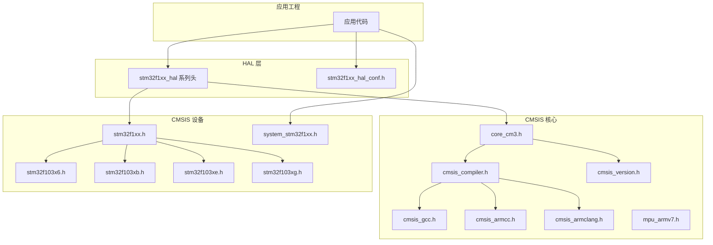
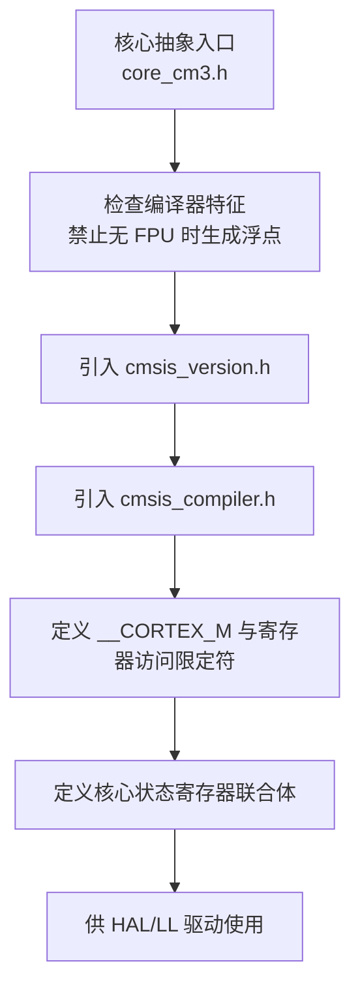
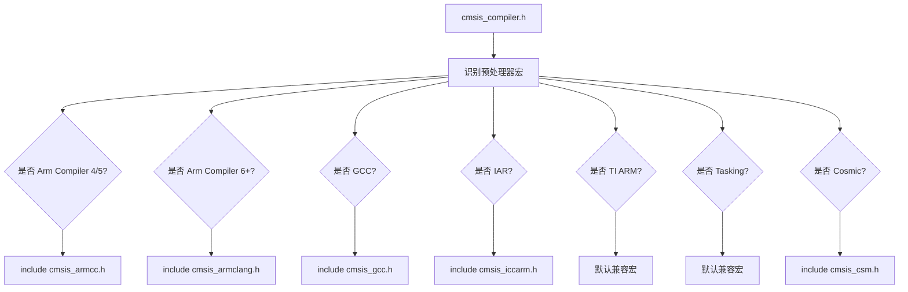
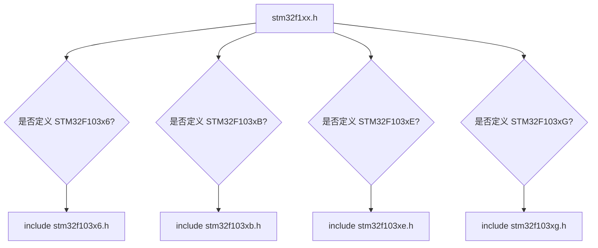
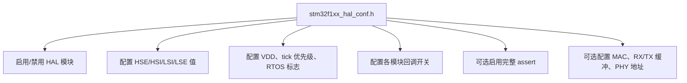
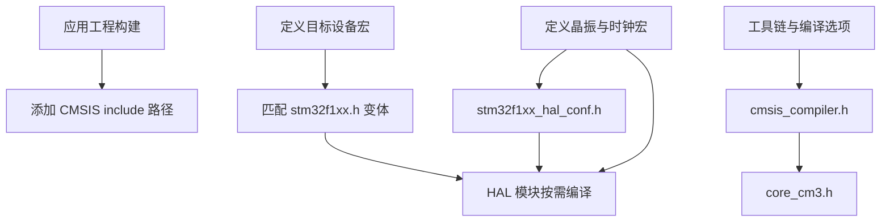

# CMSIS 核心与设备定义

<cite>
**本文引用的文件列表**
- [core_cm3.h](file://CMSIS/Core/Include/core_cm3.h)
- [cmsis_compiler.h](file://CMSIS/Core/Include/cmsis_compiler.h)
- [stm32f103x6.h](file://CMSIS/Device/ST/STM32F1xx/Include/stm32f103x6.h)
- [stm32f103xb.h](file://CMSIS/Device/ST/STM32F1xx/Include/stm32f103xb.h)
- [stm32f103xe.h](file://CMSIS/Device/ST/STM32F1xx/Include/stm32f103xe.h)
- [stm32f103xg.h](file://CMSIS/Device/ST/STM32F1xx/Include/stm32f103xg.h)
- [stm32f1xx.h](file://CMSIS/Device/ST/STM32F1xx/Include/stm32f1xx.h)
- [system_stm32f1xx.h](file://CMSIS/Device/ST/STM32F1xx/Include/system_stm32f1xx.h)
- [stm32f1xx_hal_conf.h](file://Inc/stm32f1xx_hal_conf.h)
</cite>

## 目录
1. [简介](#简介)
2. [项目结构与定位](#项目结构与定位)
3. [外部依赖清单与职责](#外部依赖清单与职责)
4. [头文件依赖关系](#头文件依赖关系)
5. [Cortex-M3 核心抽象](#cortex-m3-核心抽象)
6. [编译器适配层](#编译器适配层)
7. [STM32F1xx 设备定义](#stm32f1xx-设备定义)
8. [系统初始化接口](#系统初始化接口)
9. [HAL 编译期配置模板](#hal-编译期配置模板)
10. [构建系统集成说明](#构建系统集成说明)
11. [常见问题排查](#常见问题排查)
12. [结论](#结论)

## 简介
本页面描述 STM32Cube HAL（STM32F1xx）在编译期所需的一组 **非本仓库源码** 的基础头文件：CMSIS 内核访问层、编译器适配层，以及 STM32F1xx 设备寄存器与系统初始化头。这些文件不属于本次 HAL 驱动实现本身，而是应用工程必须提供的外部前置依赖。文档只说明其作用、依赖位置和构建约束，不解释 HAL 外设的行为细节。

## 项目结构与定位
该需求在本地代码仓库中新增如下结构：

```text
CMSIS/
  Core/
    Include/
      core_cm3.h
      cmsis_compiler.h
      cmsis_gcc.h
      cmsis_armcc.h
      cmsis_armclang.h
      cmsis_version.h
      mpu_armv7.h
  Device/
    ST/
      STM32F1xx/
        Include/
          stm32f103x6.h
          stm32f103xb.h
          stm32f103xe.h
          stm32f103xg.h
          stm32f1xx.h
          system_stm32f1xx.h
Inc/
  stm32f1xx_hal_conf.h
```

其中：

| 路径 | 角色 | 是否为本仓库源码 |
|---|---|---:|
| `CMSIS/Core/Include` | ARM Cortex-M3 内核与 CMSIS 工具链公共定义 | 否，由应用或 CMSIS 包提供 |
| `CMSIS/Device/ST/STM32F1xx/Include` | STM32F1xx 设备基地址、中断号、寄存器位段和系统接口声明 | 否，由应用或 CMSIS Device 包提供 |
| `Inc/stm32f1xx_hal_conf.h` | HAL 模块启用、晶振参数、回调开关等模板 | 是，但应视为“模板”，实际使用时复制到应用目录覆盖 |

**注意**  
- 当前仓库已经包含 `CMSIS/Core/Include/core_cm3.h`、`CMSIS/Core/Include/cmsis_compiler.h` 以及 `CMSIS/Device/ST/STM32F1xx/Include/stm32f1xx.h`、`CMSIS/Device/ST/STM32F1xx/Include/system_stm32f1xx.h`。
- 其他被需求明确列出的 `_armcc.h`、`_armclang.h`、`_gcc.h`、`_version.h`、`mpu_armv7.h` 以及 `stm32f103x{6,b,e,g}.h` 需要由用户工程或 CMSIS 源包补齐，不能以现有文件名推断其内容存在。

**章节来源**
- [core_cm3.h:1-120](file://CMSIS/Core/Include/core_cm3.h#L1-L120)
- [cmsis_compiler.h:1-120](file://CMSIS/Core/Include/cmsis_compiler.h#L1-L120)
- [stm32f1xx.h:120-140](file://CMSIS/Device/ST/STM32F1xx/Include/stm32f1xx.h#L120-L140)
- [system_stm32f1xx.h:1-98](file://CMSIS/Device/ST/STM32F1xx/Include/system_stm32f1xx.h#L1-L98)

## 外部依赖清单与职责

### 必需 CMSIS Core 头文件

| 文件名 | 主要职责 | 关键影响 |
|---|---|---|
| `core_cm3.h` | 定义 Cortex-M3 核心寄存器类型、APSR/IPSR/xPSR 等底层访问基础，并包含 `cmsis_version.h` 和 `cmsis_compiler.h` | 决定 HAL 能否使用 Cortex-M3 寄存器抽象和 `__CORTEX_M` |
| `cmsis_compiler.h` | 根据编译器宏分发到 `cmsis_gcc.h`、`cmsis_armcc.h`、`cmsis_armclang.h` 等 | 决定内联、对齐、弱符号、无返回值等编译器属性 |
| `cmsis_version.h` | 提供 CMSIS 版本主从号供 `core_cm3.h` 引用 | 控制版本常量 |
| `cmsis_gcc.h` | GCC 专用适配 | 配合 `__GNUC__` |
| `cmsis_armcc.h` | Arm Compiler 4/5 适配 | 对应 `__CC_ARM` |
| `cmsis_armclang.h` | Arm Compiler 6 / armclang 适配 | 对应 `ARMCC_VERSION >= 6010050` |
| `mpu_armv7.h` | MPU（内存保护单元）相关定义（如目标芯片启用 MPU） | 仅在启用 MPU 时参与链接和类型检查 |

**验证结果**  
- `core_cm3.h` 显式包含 `<stdint.h>`、`"cmsis_version.h"` 和 `"cmsis_compiler.h"`，并设置 `__CORTEX_M` 为 3。
- `cmsis_compiler.h` 对 GCC、Arm Compiler 4/5、Arm Compiler 6、IAR、TI、Tasking、Cosmic 等分别处理，未匹配的分支中给出默认弱定义。

**章节来源**
- [core_cm3.h:1-120](file://CMSIS/Core/Include/core_cm3.h#L1-L120)
- [cmsis_compiler.h:1-120](file://CMSIS/Core/Include/cmsis_compiler.h#L1-L120)

### 必需 STM32F1xx 设备定义

| 文件名 | 主要职责 | 典型用途 |
|---|---|---|
| `stm32f1xx.h` | 聚合头，按 `STM32F103x6/xB/xE/xG` 等宏包含具体变体头 | 让外设 HAL 和系统代码统一引用一个设备头 |
| `stm32f103x6.h` | 针对较小容量 STM32F103x6 的设备定义 | 小闪存、引脚较少设备 |
| `stm32f103xb.h` | 针对中等容量 STM32F103xB 的设备定义 | 常见开发板所采用的系列 |
| `stm32f103xe.h` | 针对大容量 STM32F103xE 的设备定义 | 更大 Flash、更多外设 |
| `stm32f103xg.h` | 针对 XL 容量 STM32F103xG 的设备定义 | 最大规格 F1xx 设备 |
| `system_stm32f1xx.h` | 声明 `SystemCoreClock`、`AHBPrescTable`、`APBPrescTable`、`SystemInit()`、`SystemCoreClockUpdate()` | 系统时钟初始化和运行时频率查询 |

**验证结果**  
- `stm32f1xx.h` 根据预处理器条件选择 `stm32f103x6.h`、`stm32f103xb.h`、`stm32f103xe.h`、`stm32f103xg.h` 之一作为最终设备头。
- `system_stm32f1xx.h` 暴露系统核心时钟全局变量、分频表以及两个关键系统函数，符合典型的 Cortex-M 启动流程接口。

**章节来源**
- [stm32f1xx.h:120-140](file://CMSIS/Device/ST/STM32F1xx/Include/stm32f1xx.h#L120-L140)
- [system_stm32f1xx.h:1-98](file://CMSIS/Device/ST/STM32F1xx/Include/system_stm32f1xx.h#L1-L98)

## 头文件依赖关系



**图表来源**
- [core_cm3.h:1-120](file://CMSIS/Core/Include/core_cm3.h#L1-L120)
- [cmsis_compiler.h:1-120](file://CMSIS/Core/Include/cmsis_compiler.h#L1-L120)
- [stm32f1xx.h:120-140](file://CMSIS/Device/ST/STM32F1xx/Include/stm32f1xx.h#L120-L140)
- [system_stm32f1xx.h:1-98](file://CMSIS/Device/ST/STM32F1xx/Include/system_stm32f1xx.h#L1-L98)

## Cortex-M3 核心抽象
`core_cm3.h` 提供以下基础能力：

- 声明 `__CORTEX_M` 为 3。
- 通过多个编译器检测阻止在无浮点配置的架构上生成浮点指令。
- 引入 CMSIS 版本和设备校验宏。
- 提供寄存器访问类型如 `__IO`、`__IM`、`__OM` 等。
- 定义 APSR、IPSR、xPSR 等核心状态寄存器的联合体与位域。

这表示任何直接面向 Cortex-M3 的 HAL、LL 或底层驱动都应以这个文件为最小内核抽象入口，而不是自行重新定义寄存器类型。



**图表来源**
- [core_cm3.h:1-120](file://CMSIS/Core/Include/core_cm3.h#L1-L120)

**章节来源**
- [core_cm3.h:1-120](file://CMSIS/Core/Include/core_cm3.h#L1-L120)

## 编译器适配层
`cmsis_compiler.h` 的主要作用是屏蔽不同厂商编译器之间的语义差异。它根据编译环境选择相应子头：

| 编译器标识 | 选中子头 | 说明 |
|---|---|---|
| `__CC_ARM` | `cmsis_armcc.h` | Arm Compiler 4/5 |
| `ARMCC_VERSION >= 6010050` | `cmsis_armclang.h` | Arm Compiler 6 及更高 |
| `__GNUC__` | `cmsis_gcc.h` | GNU C/C++ 工具链 |
| `__ICCARM__` | `<cmsis_iccarm.h>` | IAR |
| `__TI_ARM__` | `<cmsis_ccs.h>` | TI ARM |
| `__TASKING__` | 内置默认定义 | Tasking |
| `__CSMC__` | `<cmsis_csm.h>` | Cosmic |

当没有合适的工具链支持时，该文件会尽量提供一组通用的宏，例如 `__INLINE`、`__STATIC_INLINE`、`__WEAK`、`__PACKED`、`__ALIGNED` 等，以避免后续 CMSIS 头出现未知标识符错误。



**图表来源**
- [cmsis_compiler.h:1-200](file://CMSIS/Core/Include/cmsis_compiler.h#L1-L200)

**章节来源**
- [cmsis_compiler.h:1-220](file://CMSIS/Core/Include/cmsis_compiler.h#L1-L220)

## STM32F1xx 设备定义
`stm32f1xx.h` 负责把具体的 STM32F1xx 变体映射到一个统一的设备接口。根据查找结果，它通过不同宏包含四个核心变体头：

| 变体头 | 典型场景 |
|---|---|
| `stm32f103x6.h` | 小容量 F103x6 |
| `stm32f103xb.h` | 中容量 F103xB |
| `stm32f103xe.h` | 大容量 F103xE |
| `stm32f103xg.h` | 超大容量 F103xG |

应用工程需要在工具链中定义其中一个目标宏，否则 HAL 和底层驱动无法获得正确的寄存器基地址、中断向量表和端口数量信息。由于这些文件在当前工作区不是可读取的 UTF-8 文本，本文不再对其内部结构做逐行断言；但从 `stm32f1xx.h` 的包含逻辑可确认：设备头之间是互斥的，且由上层聚合头统一接入。



**图表来源**
- [stm32f1xx.h:120-140](file://CMSIS/Device/ST/STM32F1xx/Include/stm32f1xx.h#L120-L140)

**章节来源**
- [stm32f1xx.h:120-140](file://CMSIS/Device/ST/STM32F1xx/Include/stm32f1xx.h#L120-L140)
- [stm32f103xe.h:1-220](file://CMSIS/Device/ST/STM32F1xx/Include/stm32f103xe.h#L1-L220)

## 系统初始化接口
`system_stm32f1xx.h` 暴露的是系统启动阶段的关键接口，不涉及 HAL 外设 API：

- `uint32_t SystemCoreClock;`：当前核心时钟频率。
- `const uint8_t AHBPrescTable[16U];`：AHB 预分频值表。
- `const uint8_t APBPrescTable[8U];`：APB 预分频值表。
- `void SystemInit(void);`：通常在启动文件中调用，用于初始 PLL、Flash、系统时钟、NVIC 优先级布局等。
- `void SystemCoreClockUpdate(void);`：在运行期间更新 `SystemCoreClock`，通常由 SysTick 或时钟更改回调触发。

这两个函数构成 Cortex-M 系统时钟的生命周期边界：一次是启动阶段，另一次是运行阶段可能重算时钟的阶段。HAL 的 RCC 模块通常依赖这两个符号获取或调整系统时钟信息，但本文不展开 HAL RCC 内部行为。

**章节来源**
- [system_stm32f1xx.h:1-98](file://CMSIS/Device/ST/STM32F1xx/Include/system_stm32f1xx.h#L1-L98)

## HAL 编译期配置模板
`stm32f1xx_hal_conf.h` 是一个编译期模板，用于配置 STM32F1xx HAL 的行为。其主要内容包括：

- **模块开关**：以 `HAL_xx_MODULE_ENABLED` 控制 HAL 中的各个模块是否参与编译，例如 ADC、CAN、Cortex、CRC、DMA、ETH、EXTI、FLASH、GPIO、HCD、I2C、I2S、IRDA、IWDG、NAND、NOR、PCCARD、PCD、PWR、RCC、RTC、SD、SMARTCARD、SPI、SRAM、TIM、UART、USART、WWDG、MMC。
- **振荡器参数**：包括 `HSE_VALUE`、`HSI_VALUE`、`LSI_VALUE`、`LSE_VALUE` 及其启动超时。
- **系统配置**：如 `VDD_VALUE`、`TICK_INT_PRIORITY`、`USE_RTOS`、`PREFETCH_ENABLE`。
- **回调注册开关**：各 HAL 模块的 `USE_HAL_xx_REGISTER_CALLBACKS`。
- **断言开关**：`USE_FULL_ASSERT`。
- **以太网 PHY 配置段**：MAC 地址、缓冲区大小、PHY 地址、延迟与通用 PHY 寄存器定义。

特别重要的一点是文件注释指出：**该文件应复制到应用目录并重命名为 `stm32f1xx_hal_conf.h`**。这意味着本仓库中的这个文件更像是“原始模板”，实际应用应当维护自己的副本，以便在不修改库模板的情况下升级。



**图表来源**
- [stm32f1xx_hal_conf.h:1-220](file://Inc/stm32f1xx_hal_conf.h#L1-L220)

**章节来源**
- [stm32f1xx_hal_conf.h:1-220](file://Inc/stm32f1xx_hal_conf.h#L1-L220)

## 构建系统集成说明
要使 HAL 正常编译，应用工程的构建系统应满足以下条件：

| 类别 | 要求 |
|---|---|
| include 搜索路径 | 至少包含 `CMSIS/Core/Include`、`CMSIS/Device/ST/STM32F1xx/Include`，以及包含 `Inc` 的路径 |
| 设备宏 | 根据目标芯片定义 `STM32F103x6`、`STM32F103xB`、`STM32F103xE`、`STM32F103xG` 中的一个 |
| 时钟宏 | 如果未被 `stm32f1xx_hal_conf.h` 中的条件定义覆盖，需提供 `HSE_VALUE`、`HSI_VALUE`、`LSI_VALUE`、`LSE_VALUE` 等 |
| 系统文件 | 应提供 `SystemInit()` 的实际实现，并与 `system_stm32f1xx.h` 保持一致 |
| 工具链 | 必须支持所选编译器宏，以便 `cmsis_compiler.h` 正确派发到对应子类头 |
| HAL 配置文件 | 建议将 `Inc/stm32f1xx_hal_conf.h` 复制到应用目录后编辑 |

推荐的做法是：不要把 `stm32f1xx_hal_conf.h` 留在原位置长期使用，而是在应用工程中复制并保留独立副本，这样后续升级 HAL 库时不会意外丢失项目私有配置。



**图表来源**
- [stm32f1xx.h:120-140](file://CMSIS/Device/ST/STM32F1xx/Include/stm32f1xx.h#L120-L140)
- [cmsis_compiler.h:1-120](file://CMSIS/Core/Include/cmsis_compiler.h#L1-L120)
- [core_cm3.h:1-120](file://CMSIS/Core/Include/core_cm3.h#L1-L120)
- [stm32f1xx_hal_conf.h:1-220](file://Inc/stm32f1xx_hal_conf.h#L1-L220)

**章节来源**
- [stm32f1xx.h:120-140](file://CMSIS/Device/ST/STM32F1xx/Include/stm32f1xx.h#L120-L140)
- [cmsis_compiler.h:1-120](file://CMSIS/Core/Include/cmsis_compiler.h#L1-L120)
- [stm32f1xx_hal_conf.h:1-220](file://Inc/stm32f1xx_hal_conf.h#L1-L220)

## 常见问题排查

| 问题现象 | 可能原因 | 处理方式 |
|---|---|---|
| 找不到 `cmsis_gcc.h` 或 `cmsis_armcc.h` | `cmsis_compiler.h` 选择了对应的子头，但该子头不在 include 路径中 | 将 `CMSIS/Core/Include` 加入 include 路径，或提供缺失子头 |
| 提示编译器生成 FPU 指令但目标无 FPU | `core_cm3.h` 检测到编译器开启浮点特性而目标不支持 | 检查 `-mfpu`、`-mfloat-abi` 或 Arm Compiler 对应选项，关闭 FPU |
| 找不到 `stm32f103x6.h` 等变体头 | 未安装 CMSIS Device 定义或未复制相关文件 | 补充 CMSIS Device 包或确保 include 搜索路径包含 `CMSIS/Device/ST/STM32F1xx/Include` |
| 链接失败：找不到 `SystemInit` | 缺少系统初始化实现 | 在应用工程中添加对应的 `system_stm32f1xx.c` 或自定义实现 |
| 编译时出现大量未知宏 | 设备宏未定义，或 `STM32F103x6/B/E/G` 重复定义 | 只定义一个设备宏，并确保没有被覆盖 |
| HAL 模块未按预期启用 | 未启用对应 `HAL_xx_MODULE_ENABLED`，或被上层 `#if` 关闭 | 编辑应用副本的 `stm32f1xx_hal_conf.h` |
| 时钟计算不正确 | HSE/HSI/LSI/LSE 值与硬件不一致 | 在工具链预处理选项或应用配置中修正对应宏 |

**章节来源**
- [core_cm3.h:1-120](file://CMSIS/Core/Include/core_cm3.h#L1-L120)
- [cmsis_compiler.h:1-220](file://CMSIS/Core/Include/cmsis_compiler.h#L1-L220)
- [stm32f1xx.h:120-140](file://CMSIS/Device/ST/STM32F1xx/Include/stm32f1xx.h#L120-L140)
- [system_stm32f1xx.h:1-98](file://CMSIS/Device/ST/STM32F1xx/Include/system_stm32f1xx.h#L1-L98)
- [stm32f1xx_hal_conf.h:1-220](file://Inc/stm32f1xx_hal_conf.h#L1-L220)

## 结论
本页面梳理了 STM32F1xx HAL 所需的 **基础头文件依赖**：Cortex-M3 核心定义、CMSIS 编译器适配、STM32F1xx 设备变体和系统初始化声明，以及 HAL 编译期配置模板。它们的作用是为 HAL 层提供稳定的内核抽象、设备地址与中断定义、编译器抽象、以及系统时钟初始入口，而不是实现具体的外设操作。

对于工程实践而言，最重要的是三点：

1. 确保 include 路径能解析 `CMSIS/Core/Include` 与 `CMSIS/Device/ST/STM32F1xx/Include`。
2. 准确定义一个 `STM32F103x{6,b,e,g}` 设备宏，并提供 `SystemInit()`。
3. 将 `stm32f1xx_hal_conf.h` 复制到应用目录并根据硬件配置修改晶振值和启用的 HAL 模块。

完成上述步骤后，HAL 驱动即可基于 CMSIS 提供的内核和设备抽象进行编译和链接。