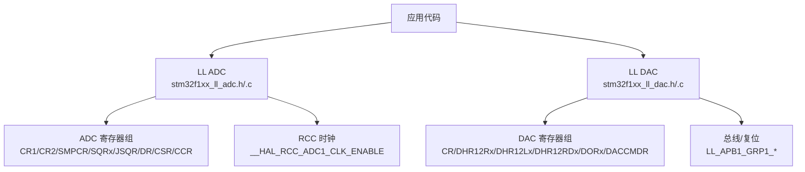
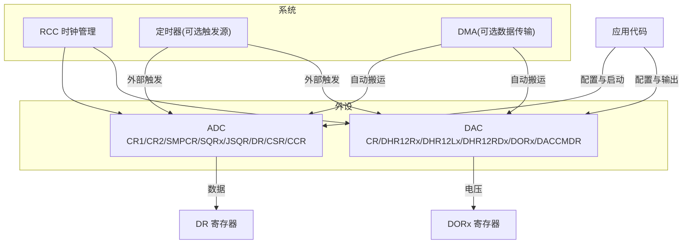
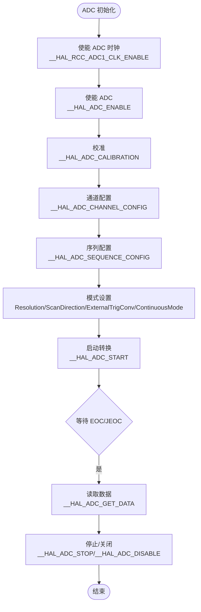
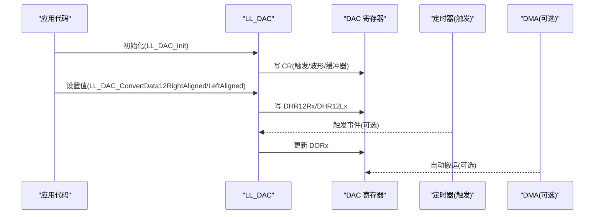
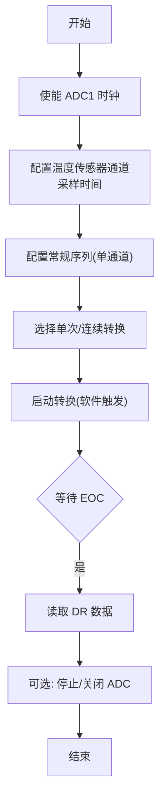
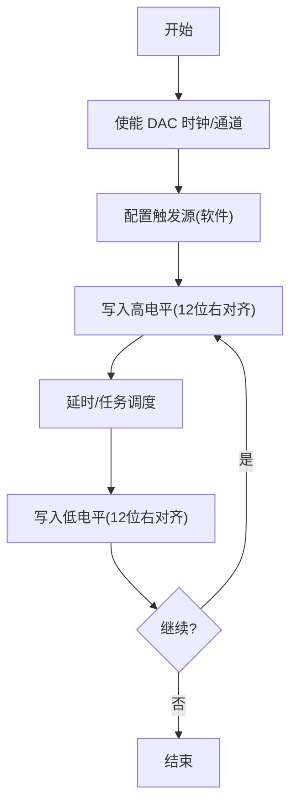
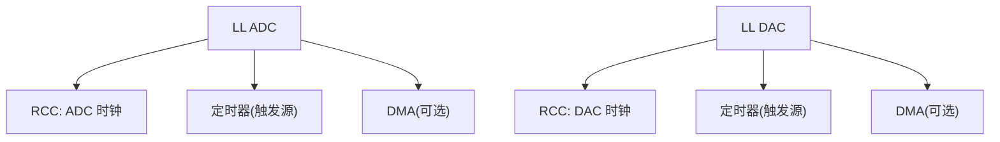

# LL ADC/DAC 低层接口

<cite>
**本文引用的文件**   
- [stm32f1xx_ll_adc.h](file://Inc/stm32f1xx_ll_adc.h)
- [stm32f1xx_ll_dac.h](file://Inc/stm32f1xx_ll_dac.h)
- [stm32f1xx_ll_adc.c](file://Src/stm32f1xx_ll_adc.c)
- [stm32f1xx_ll_dac.c](file://Src/stm32f1xx_ll_dac.c)
</cite>

## 目录
1. [引言](#引言)
2. [项目结构](#项目结构)
3. [核心组件](#核心组件)
4. [架构总览](#架构总览)
5. [详细组件分析](#详细组件分析)
6. [依赖关系分析](#依赖关系分析)
7. [性能与资源特性](#性能与资源特性)
8. [故障排查指南](#故障排查指南)
9. [结论](#结论)
10. [附录：常用 API 速查](#附录常用-api-速查)

## 引言
本文面向 STM32F1 系列，系统性整理 LL（Low-Layer）ADC 与 DAC 的低层接口。LL 库直接映射并操作外设寄存器，适合对控制流程、时序和中断/DMA 有精细要求的场景。文档覆盖：
- LL_ADC：常规/注入转换、扫描模式、模拟看门狗、外部触发、连续/单次转换；典型宏与函数如 `__HAL_RCC_ADC1_CLK_ENABLE`、`__HAL_ADC_ENABLE/DISABLE`、`__HAL_ADC_CALIBRATION`、`__HAL_ADC_CHANNEL_CONFIG`、`__HAL_ADC_SEQUENCE_CONFIG`、`__HAL_ADC_START/STOP`、`__HAL_ADC_GET_DATA`，以及参数类型如 `Resolution`、`ScanDirection`、`ExternalTrigConv`、`ContinuousMode`、`ADC_RegularSequence` 等。
- LL_DAC：DORx、CR、DHR12Rx/DHR12Lx/DHR12RDx、DACCMDR 等寄存器；12 位右对齐/左对齐输出、三角波/噪声波形、DMA 输出；函数如 `__HAL_DAC_ENABLE/DISABLE`、`__HAL_DAC_SET_VALUE`、`__HAL_DAC_TRIGGER_CONFIG`、`__HAL_DAC_DMA_CONFIG`。
- 示例：温度传感器采样、DAC 方波输出。
- HAL 对比：与 `HAL_ADC_Start`、`HAL_DAC_SetValue` 的调用链差异。
- 注意事项：STM32F1 ADC 通常为 12 位分辨率、采样时间单位、校准流程、DAC 输出缓冲器约束。

## 项目结构
本仓库为 STM32F1 HAL/LL 驱动集合。与本次文档相关的核心源文件位于：
- `Inc/stm32f1xx_ll_adc.h`：LL ADC 宏、常量、初始化结构体与内联函数声明。
- `Src/stm32f1xx_ll_adc.c`：LL ADC 实现，含参数校验与寄存器操作封装。
- `Inc/stm32f1xx_ll_dac.h`：LL DAC 宏、常量、初始化结构体与内联函数声明。
- `Src/stm32f1xx_ll_dac.c`：LL DAC 实现，含初始化、触发、波形、缓冲器与 DMA 配置。

**图示来源**
- [stm32f1xx_ll_adc.h:55-80](file://Inc/stm32f1xx_ll_adc.h#L55-L80)
- [stm32f1xx_ll_dac.h:64-87](file://Inc/stm32f1xx_ll_dac.h#L64-L87)

**章节来源**
- [stm32f1xx_ll_adc.h:55-80](file://Inc/stm32f1xx_ll_adc.h#L55-L80)
- [stm32f1xx_ll_dac.h:64-87](file://Inc/stm32f1xx_ll_dac.h#L64-L87)

## 核心组件
- LL_ADC
  - 直接操作 ADC 寄存器族，提供常规通道序列、注入通道序列、模拟看门狗、外部触发、连续/单次转换、数据读取等功能。
  - 典型参数类型：`Resolution`、`ScanDirection`、`ExternalTrigConv`、`ContinuousMode`、`ADC_RegularSequence`、`ADC_InjectionSequence`、`ADC_ChannelConfig` 等。
  - 常见宏/函数：`__HAL_RCC_ADC1_CLK_ENABLE`、`__HAL_ADC_ENABLE/DISABLE`、`__HAL_ADC_CALIBRATION`、`__HAL_ADC_CHANNEL_CONFIG`、`__HAL_ADC_SEQUENCE_CONFIG`、`__HAL_ADC_START/STOP`、`__HAL_ADC_GET_DATA`。
- LL_DAC
  - 直接操作 DAC 寄存器族，支持软件/定时器触发、噪声/三角波自动生成、12 位右对齐/左对齐数据写入、DMA 传输、输出缓冲器控制。
  - 常见宏/函数：`__HAL_DAC_ENABLE/DISABLE`、`__HAL_DAC_SET_VALUE`、`__HAL_DAC_TRIGGER_CONFIG`、`__HAL_DAC_DMA_CONFIG`，以及底层 `LL_DAC_Enable/Disable/SetTriggerSource/SetWaveAutoGeneration/SetOutputBuffer/ConvertData12RightAligned/ConvertData12LeftAligned/EnableDMAReq` 等。

**章节来源**
- [stm32f1xx_ll_adc.h:55-80](file://Inc/stm32f1xx_ll_adc.h#L55-L80)
- [stm32f1xx_ll_dac.h:64-87](file://Inc/stm32f1xx_ll_dac.h#L64-L87)

## 架构总览
下图展示 LL ADC/DAC 与应用、RCC、定时器和 DMA 的关系，以及关键数据流。

**图示来源**
- [stm32f1xx_ll_adc.h:55-80](file://Inc/stm32f1xx_ll_adc.h#L55-L80)
- [stm32f1xx_ll_dac.h:64-87](file://Inc/stm32f1xx_ll_dac.h#L64-L87)

## 详细组件分析

### LL ADC 组件分析
LL ADC 通过宏和内联函数直接访问寄存器，涵盖以下能力：
- 常规转换：单通道、多通道扫描、外部触发、连续/单次模式。
- 注入转换：独立触发与优先级控制。
- 模拟看门狗：阈值比较与中断标志。
- 公共配置：时钟分频、延迟、双/三模（视具体型号）。

#### 关键寄存器与功能映射
- ACR：ADC 时钟配置（与 RCC 配合）。
- CR1/CR2/SMPCR：ADC 控制、触发源、采样时间。
- SQRx/JSQR：常规/注入序列。
- DR：常规数据寄存器。
- CSR：状态寄存器（EOC/JEOC/AWD 标志）。
- CCR：公共 ADC 时钟/延迟/双模配置。

**图示来源**
- [stm32f1xx_ll_adc.h:55-80](file://Inc/stm32f1xx_ll_adc.h#L55-L80)

#### 典型参数与枚举
- Resolution：ADC 分辨率（STM32F1 通常为 12 位）。
- ScanDirection：扫描方向（递增/递减或固定顺序）。
- ExternalTrigConv：外部触发源（定时器通道、EXTI 等）。
- ContinuousMode：连续/单次转换模式。
- ADC_RegularSequence：常规序列项（通道号、排名、采样时间）。
- ADC_InjectionSequence：注入序列项（通道号、排名、偏移值）。
- ADC_ChannelConfig：通道配置（通道号、采样时间、是否内部通道）。

#### 关键函数与作用
- `LL_ADC_CommonInit` / `LL_ADC_Init`：公共/实例级初始化，设置时钟、模式、触发等。
- `LL_ADC_REG_StartConversionSWStart` / `LL_ADC_REG_StartConversionExtTrig`：软件/外部触发启动常规转换。
- `LL_ADC_INJ_StartConversionSWStart` / `LL_ADC_INJ_StartConversionExtTrig`：注入转换启动。
- `LL_ADC_IsActiveFlag_EOC` / `LL_ADC_IsActiveFlag_JEOC`：检查转换完成标志。
- `LL_ADC_AWD_ConfigChannel`：模拟看门狗通道配置。
- `LL_ADC_GetConversionData`：读取 DR 中的数据（对应 `__HAL_ADC_GET_DATA` 的使用方式）。

**章节来源**
- [stm32f1xx_ll_adc.h:533-655](file://Inc/stm32f1xx_ll_adc.h#L533-L655)
- [stm32f1xx_ll_adc.h:1791-1879](file://Inc/stm32f1xx_ll_adc.h#L1791-L1879)
- [stm32f1xx_ll_adc.h:2245-2439](file://Inc/stm32f1xx_ll_adc.h#L2245-L2439)
- [stm32f1xx_ll_adc.h:3318-3471](file://Inc/stm32f1xx_ll_adc.h#L3318-L3471)
- [stm32f1xx_ll_adc.h:3887-3896](file://Inc/stm32f1xx_ll_adc.h#L3887-L3896)
- [stm32f1xx_ll_adc.c:1-200](file://Src/stm32f1xx_ll_adc.c#L1-L200)

### LL DAC 组件分析
LL DAC 直接操作 DAC 寄存器，支持：
- 12 位右对齐/左对齐数据写入（DHR12Rx/DHR12Lx）。
- 三角波/噪声波形自动生成。
- 定时器/EXTI 触发更新输出。
- DMA 自动搬运数据到 DHRx。
- 输出缓冲器开关（BOFF）。

**图示来源**
- [stm32f1xx_ll_dac.h:735-746](file://Inc/stm32f1xx_ll_dac.h#L735-L746)
- [stm32f1xx_ll_dac.h:1023-1058](file://Inc/stm32f1xx_ll_dac.h#L1023-L1058)

#### 关键寄存器与功能映射
- DORx：DAC 输出寄存器（可读当前输出电压对应的数字值）。
- CR：DAC 控制（通道使能、触发源、波形生成、DMA、缓冲器）。
- DHR12Rx/DHR12Lx/DHR12RDx：数据保持寄存器（12 位右/左对齐、双通道同时）。
- DACCMDR：命令寄存器（用于批量更新/命令控制，具体用法依型号而定）。

#### 关键函数与作用
- `LL_DAC_Enable` / `LL_DAC_Disable`：使能/禁用 DAC 通道。
- `LL_DAC_SetTriggerSource`：配置触发源（软件或定时器）。
- `LL_DAC_SetWaveAutoGeneration`：启用噪声/三角波。
- `LL_DAC_SetOutputBuffer`：开启/关闭输出缓冲器。
- `LL_DAC_ConvertData12RightAligned` / `LL_DAC_ConvertData12LeftAligned`：写入 12 位数据。
- `LL_DAC_EnableDMAReq` / `LL_DAC_DisableDMAReq`：DMA 请求使能/禁用。
- `LL_DAC_RetrieveOutputData`：从 DORx 读取输出值。

**章节来源**
- [stm32f1xx_ll_dac.h:64-87](file://Inc/stm32f1xx_ll_dac.h#L64-L87)
- [stm32f1xx_ll_dac.h:735-746](file://Inc/stm32f1xx_ll_dac.h#L735-L746)
- [stm32f1xx_ll_dac.h:850-883](file://Inc/stm32f1xx_ll_dac.h#L850-L883)
- [stm32f1xx_ll_dac.h:997-1058](file://Inc/stm32f1xx_ll_dac.h#L997-L1058)
- [stm32f1xx_ll_dac.c:1-200](file://Src/stm32f1xx_ll_dac.c#L1-L200)

### 示例：温度传感器采样（LL ADC）
- 目标：使用内置温度传感器通道进行 ADC 采样。
- 步骤要点：
  1. 使能 ADC 时钟：`__HAL_RCC_ADC1_CLK_ENABLE`。
  2. 配置温度传感器通道与采样时间（较长采样时间有助于提高精度）。
  3. 配置常规序列（单通道或与其他通道混合扫描）。
  4. 设置转换模式：单次或连续。
  5. 启动转换（软件触发或外部触发）。
  6. 等待 EOC 标志，读取 DR 数据。
  7. 关闭 ADC（可选）。

**图示来源**
- [stm32f1xx_ll_adc.h:533-655](file://Inc/stm32f1xx_ll_adc.h#L533-L655)
- [stm32f1xx_ll_adc.h:3318-3471](file://Inc/stm32f1xx_ll_adc.h#L3318-L3471)

### 示例：DAC 方波输出（LL DAC）
- 目标：通过软件循环切换两个电平，产生方波。
- 步骤要点：
  1. 使能 DAC 时钟与通道。
  2. 配置触发源为软件触发。
  3. 使用 `LL_DAC_ConvertData12RightAligned` 写入高/低电平值。
  4. 可启用 DMA 自动更新（若需更高吞吐）。
  5. 控制输出缓冲器以满足负载要求。

**图示来源**
- [stm32f1xx_ll_dac.h:1023-1058](file://Inc/stm32f1xx_ll_dac.h#L1023-L1058)
- [stm32f1xx_ll_dac.h:735-746](file://Inc/stm32f1xx_ll_dac.h#L735-L746)

### 与 HAL 的对比
- `HAL_ADC_Start`：HAL 层封装了更高层的状态机、回调与错误处理；LL 层则直接操作寄存器，提供更细粒度的控制与更低开销。
- `HAL_DAC_SetValue`：HAL 层负责参数校验、状态管理与可能的 DMA 集成；LL 层直接写入 DHRx 寄存器，适合对时序有严格要求的应用。

建议：
- 快速开发、通用需求优先使用 HAL。
- 精确控制、实时性、最小代码体积优先使用 LL。

**章节来源**
- [stm32f1xx_ll_adc.h:3318-3471](file://Inc/stm32f1xx_ll_adc.h#L3318-L3471)
- [stm32f1xx_ll_dac.h:1023-1058](file://Inc/stm32f1xx_ll_dac.h#L1023-L1058)

## 依赖关系分析
- LL ADC 依赖：
  - RCC：ADC 时钟使能与分频。
  - 定时器：作为外部触发源（TIM1/TIM2/TIM3/TIM4/TIM5/TIM8）。
  - DMA：可选的数据搬运（常规序列）。
- LL DAC 依赖：
  - RCC：DAC 时钟。
  - 定时器：作为触发源（TIM2/TIM3/TIM4/TIM5/TIM6/TIM7/TIM8/TIM15）。
  - DMA：自动将数据搬移到 DHRx。

**图示来源**
- [stm32f1xx_ll_adc.h:533-655](file://Inc/stm32f1xx_ll_adc.h#L533-L655)
- [stm32f1xx_ll_dac.h:163-188](file://Inc/stm32f1xx_ll_dac.h#L163-L188)

**章节来源**
- [stm32f1xx_ll_adc.h:533-655](file://Inc/stm32f1xx_ll_adc.h#L533-L655)
- [stm32f1xx_ll_dac.h:163-188](file://Inc/stm32f1xx_ll_dac.h#L163-L188)

## 性能与资源特性
- STM32F1 ADC 分辨率：通常为 12 位（最大值为 4095），采样时间以“周期”为单位，需在 SMPSR 中配置各通道的采样时间。
- 采样时间单位：以 ADC 时钟周期计，较长的采样时间可提高精度但降低采样率。
- 校准流程：
  1. 确保 ADC 已使能且处于稳定状态。
  2. 执行校准宏/函数（例如 `__HAL_ADC_CALIBRATION`）。
  3. 等待校准完成标志。
  4. 再进行转换配置与启动。
- DAC 输出缓冲器：
  - 开启后可提升驱动能力，适用于中等负载。
  - 关闭时输出阻抗较高，适合轻负载或后续运放缓冲。
  - 注意负载与功耗权衡，避免超出 I/O 驱动能力。

**章节来源**
- [stm32f1xx_ll_adc.h:533-655](file://Inc/stm32f1xx_ll_adc.h#L533-L655)
- [stm32f1xx_ll_dac.h:735-746](file://Inc/stm32f1xx_ll_dac.h#L735-L746)

## 故障排查指南
- ADC 无数据：
  - 检查 ADC 时钟是否使能。
  - 确认通道与序列配置正确。
  - 检查 EOC 标志是否置位。
  - 验证采样时间是否足够长。
- ADC 数据异常：
  - 检查参考电压与输入范围。
  - 确认是否启用了模拟看门狗且阈值合理。
  - 避免在转换期间修改序列或通道配置。
- DAC 无输出：
  - 检查 DAC 通道是否使能。
  - 确认触发源与数据写入时序。
  - 检查输出缓冲器状态与负载匹配。
- DMA 相关：
  - 确认 DMA 通道与外设地址配置正确。
  - 检查 DMA 请求使能与传输计数。

**章节来源**
- [stm32f1xx_ll_adc.h:3318-3471](file://Inc/stm32f1xx_ll_adc.h#L3318-L3471)
- [stm32f1xx_ll_dac.h:850-883](file://Inc/stm32f1xx_ll_dac.h#L850-L883)

## 结论
LL ADC/DAC 提供了对 STM32F1 外设寄存器的直接控制能力，适合需要高精度时序、灵活触发与最小化运行时开销的场景。结合 RCC、定时器与 DMA，可实现高效的多通道采样与波形生成。在实际工程中，应优先考虑 HAL 的易用性与稳定性，在关键路径或资源受限场景再切换到 LL，以获得更好的控制粒度与性能。

## 附录：常用 API 速查
- LL ADC
  - 时钟与使能：`__HAL_RCC_ADC1_CLK_ENABLE`、`__HAL_ADC_ENABLE`、`__HAL_ADC_DISABLE`
  - 校准：`__HAL_ADC_CALIBRATION`
  - 通道与序列：`__HAL_ADC_CHANNEL_CONFIG`、`__HAL_ADC_SEQUENCE_CONFIG`
  - 启动/停止：`__HAL_ADC_START`、`__HAL_ADC_STOP`
  - 数据读取：`__HAL_ADC_GET_DATA`
  - 参数类型：`Resolution`、`ScanDirection`、`ExternalTrigConv`、`ContinuousMode`、`ADC_RegularSequence`
- LL DAC
  - 使能/禁用：`__HAL_DAC_ENABLE`、`__HAL_DAC_DISABLE`
  - 设置值：`__HAL_DAC_SET_VALUE`
  - 触发配置：`__HAL_DAC_TRIGGER_CONFIG`
  - DMA 配置：`__HAL_DAC_DMA_CONFIG`
  - 底层函数：`LL_DAC_Enable/Disable`、`LL_DAC_SetTriggerSource`、`LL_DAC_SetWaveAutoGeneration`、`LL_DAC_SetOutputBuffer`、`LL_DAC_ConvertData12RightAligned/LeftAligned`、`LL_DAC_EnableDMAReq/DisableDMAReq`

**章节来源**
- [stm32f1xx_ll_adc.h:533-655](file://Inc/stm32f1xx_ll_adc.h#L533-L655)
- [stm32f1xx_ll_dac.h:735-746](file://Inc/stm32f1xx_ll_dac.h#L735-L746)
- [stm32f1xx_ll_dac.h:1023-1058](file://Inc/stm32f1xx_ll_dac.h#L1023-L1058)