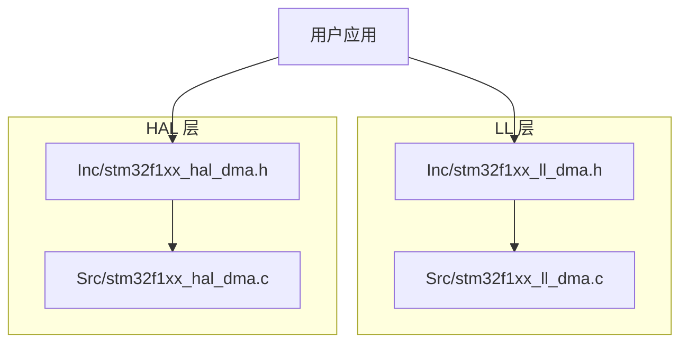
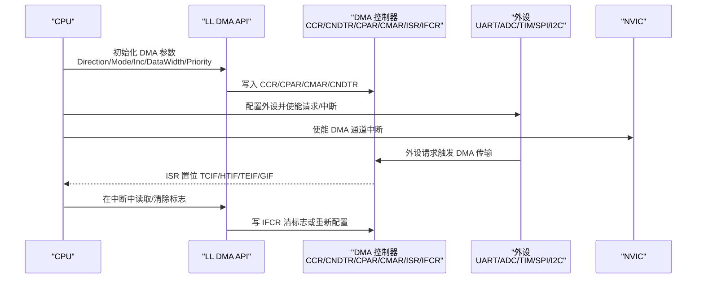
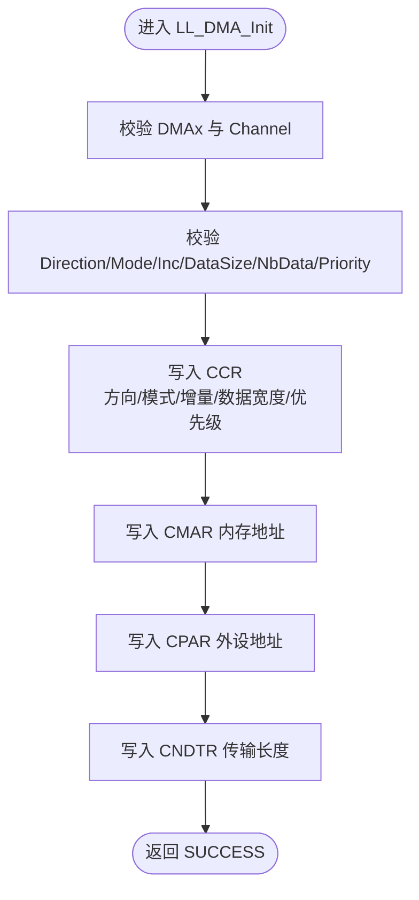
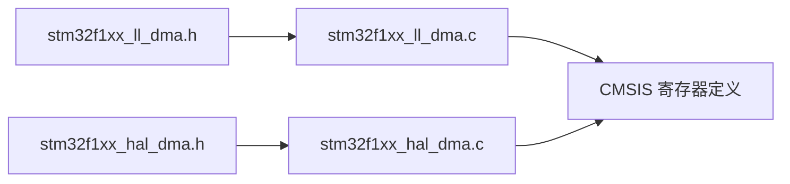

# LL DMA 低层接口

<cite>
**本文引用的文件**   
- [stm32f1xx_ll_dma.h](file://Inc/stm32f1xx_ll_dma.h)
- [stm32f1xx_ll_dma.c](file://Src/stm32f1xx_ll_dma.c)
- [stm32f1xx_hal_dma.h](file://Inc/stm32f1xx_hal_dma.h)
- [stm32f1xx_hal_dma.c](file://Src/stm32f1xx_hal_dma.c)
- [README.md](file://README.md)
</cite>

## 目录
1. [引言](#引言)
2. [项目结构](#项目结构)
3. [核心组件](#核心组件)
4. [架构总览](#架构总览)
5. [详细组件分析](#详细组件分析)
6. [依赖关系分析](#依赖关系分析)
7. [性能与行为特征](#性能与行为特征)
8. [使用示例：UART 发送 + DMA、ADC 多通道扫描 + DMA](#使用示例uart-发送--dmaadc-多通道扫描--dma)
9. [DMA 完成标志与中断处理](#dma-完成标志与中断处理)
10. [HAL 与 LL 对比](#hal-与-ll-对比)
11. [常见问题与排错](#常见问题与排错)
12. [结论](#结论)

## 引言
本文面向 STM32F1xx 的 DMA 低层接口，重点说明 LL 驱动如何直接操作 CCR、CNDTR、CPAR、CMAR、ISR、IFCR 等寄存器，并覆盖 DMA1 多个通道在不同外设间的数据搬运。文档涵盖内存到外设、外设到内存、内存到内存三种方向，正常/循环模式、优先级配置，以及与 HAL DMA 的差异。同时给出 UART 发送 + DMA、ADC 多通道扫描 + DMA 的使用思路，并强调 DMA 必须配合外设中断使能、时钟使能和 NVIC 配置。

## 项目结构
本仓库是 STM32CubeF1 HAL-LL 驱动组件的一部分。DMA 相关代码主要位于以下两个位置：
- LL 层头文件与实现：`Inc/stm32f1xx_ll_dma.h`、`Src/stm32f1xx_ll_dma.c`
- HAL 层头文件与实现：`Inc/stm32f1xx_hal_dma.h`、`Src/stm32f1xx_hal_dma.c`

图表来源
- [README.md:1-45](file://README.md#L1-L45)
- [stm32f1xx_ll_dma.h:1-100](file://Inc/stm32f1xx_ll_dma.h#L1-L100)
- [stm32f1xx_hal_dma.h:1-100](file://Inc/stm32f1xx_hal_dma.h#L1-L100)

章节来源
- [README.md:1-45](file://README.md#L1-L45)

## 核心组件
LL DMA 提供一组“直接操作寄存器”的内联函数和宏，用于配置 DMA 通道的工作方向、地址、数据宽度、传输长度、模式与优先级，并启用/禁用通道。HAL DMA 在此基础上提供更高层的状态机、回调机制、锁保护、超时轮询与统一的 IRQ 处理器。

关键要点：
- LL 直接读写 CCR、CNDTR、CPAR、CMAR、ISR、IFCR。
- HAL 通过 `DMA_HandleTypeDef` 管理状态、错误码、回调与锁，内部调用底层寄存器操作或封装逻辑。
- DMA1 支持最多 7 个通道；若设备包含 DMA2，则 DMA2 也暴露若干通道（由芯片定义决定）。

章节来源
- [stm32f1xx_ll_dma.h:200-350](file://Inc/stm32f1xx_ll_dma.h#L200-L350)
- [stm32f1xx_ll_dma.c:1-200](file://Src/stm32f1xx_ll_dma.c#L1-L200)
- [stm32f1xx_hal_dma.h:1-150](file://Inc/stm32f1xx_hal_dma.h#L1-L150)
- [stm32f1xx_hal_dma.c:200-350](file://Src/stm32f1xx_hal_dma.c#L200-L350)

## 架构总览
下图展示 DMA 在系统中的作用：CPU 通过 LL/HAL API 配置 DMA 通道，DMA 根据 CCR/CNDTR/CPAR/CMAR 自动搬运数据，并在 ISR/IFCR 上产生标志位；外设侧（如 UART、ADC）可独立产生请求或中断，DMA 与外设 IT 必须协同。

图表来源
- [stm32f1xx_ll_dma.h:200-350](file://Inc/stm32f1xx_ll_dma.h#L200-L350)
- [stm32f1xx_ll_dma.c:200-312](file://Src/stm32f1xx_ll_dma.c#L200-L312)
- [stm32f1xx_hal_dma.c:500-754](file://Src/stm32f1xx_hal_dma.c#L500-L754)

## 详细组件分析

### 1) 寄存器映射与基本语义
DMA 通道控制寄存器 CCR 是核心配置位域：
- DIR：数据方向（内存→外设 / 外设→内存 / 内存→内存）
- MEM2MEM：内存到内存模式使能
- CIRC：循环模式
- PINC/MINC：外设地址增量/内存地址增量
- PSIZE/MSIZE：外设数据宽度/内存数据宽度
- PL：优先级（低/中/高/非常高）
- EN：通道使能

其他关键寄存器：
- CNDTR：剩余数据项计数
- CPAR：外设地址
- CMAR：内存地址
- ISR：中断状态寄存器（GIFx/TCIFx/HTIFx/TEIFx）
- IFCR：中断标志清除寄存器（CGIFx/CTCIFx/CHTIFx/CTEIFx）

这些语义在 LL 层以常量、宏和内联函数形式暴露。

章节来源
- [stm32f1xx_ll_dma.h:200-350](file://Inc/stm32f1xx_ll_dma.h#L200-L350)

### 2) LL 初始化与参数结构体
LL 提供 `LL_DMA_InitTypeDef`，字段包括：
- PeriphOrM2MSrcAddress
- MemoryOrM2MDstAddress
- Direction
- Mode
- PeriphOrM2MSrcIncMode
- MemoryOrM2MDstIncMode
- PeriphOrM2MSrcDataSize
- MemoryOrM2MDstDataSize
- NbData
- Priority

`LL_DMA_Init()` 会校验参数、写入 CCR、CMAR、CPAR、CNDTR，并提供默认值填充函数 `LL_DMA_StructInit()`。

图表来源
- [stm32f1xx_ll_dma.c:200-312](file://Src/stm32f1xx_ll_dma.c#L200-L312)

章节来源
- [stm32f1xx_ll_dma.h:1-200](file://Inc/stm32f1xx_ll_dma.h#L1-L200)
- [stm32f1xx_ll_dma.c:200-312](file://Src/stm32f1xx_ll_dma.c#L200-L312)

### 3) 通道开关、传输配置与单属性设置
LL 暴露如下关键内联函数：
- `LL_DMA_EnableChannel` / `LL_DMA_DisableChannel` / `LL_DMA_IsEnabledChannel`
- `LL_DMA_ConfigTransfer`：一次性写入 CCR 的方向、模式、增量、数据宽度、优先级
- `LL_DMA_SetDataTransferDirection`
- `LL_DMA_SetPeriphIncMode` / `LL_DMA_SetMemoryIncMode`
- `LL_DMA_SetPeriphSize` / `LL_DMA_SetMemorySize`
- `LL_DMA_SetDataLength`
- `LL_DMA_SetPeriphAddress` / `LL_DMA_SetMemoryAddress`
- `LL_DMA_SetCounter`（对应 CNDTR）

这些函数直接对 DMA 通道基址加上偏移后访问 CCR/CNDTR/CPAR/CMAR。

章节来源
- [stm32f1xx_ll_dma.h:200-535](file://Inc/stm32f1xx_ll_dma.h#L200-L535)

### 4) 标志位与中断使能
LL 定义：
- 中断使能：`LL_DMA_CCR_TCIE`、`LL_DMA_CCR_HTIE`、`LL_DMA_CCR_TEIE`
- ISR 标志：`LL_DMA_ISR_GIFx`、`LL_DMA_ISR_TCIFx`、`LL_DMA_ISR_HTIFx`、`LL_DMA_ISR_TEIFx`
- IFCR 清除：`LL_DMA_IFCR_CTCIFx`、`LL_DMA_IFCR_CHTIFx`、`LL_DMA_IFCR_CTEIFx`、`LL_DMA_IFCR_CGIFx`

HAL 层还定义了统一 flag 位掩码（如 `DMA_FLAG_GL1` 等），并提供了 `__HAL_DMA_GET_FLAG`、`__HAL_DMA_CLEAR_FLAG`、`__HAL_DMA_ENABLE_IT`、`__HAL_DMA_DISABLE_IT` 等宏。

章节来源
- [stm32f1xx_ll_dma.h:200-350](file://Inc/stm32f1xx_ll_dma.h#L200-L350)
- [stm32f1xx_hal_dma.h:200-455](file://Inc/stm32f1xx_hal_dma.h#L200-L455)

## 依赖关系分析
LL DMA 的实现依赖 CMSIS 寄存器定义和通用读写宏（WRITE_REG/READ_REG/SET_BIT/CLEAR_BIT/MODIFY_REG），并通过 `CHANNEL_OFFSET_TAB` 将通道编号映射到具体通道寄存器基址。HAL DMA 依赖 `DMA_HandleTypeDef` 管理状态与回调，并在启动传输前调用内部 `DMA_SetConfig` 写入源/目的地址与长度。

图表来源
- [stm32f1xx_ll_dma.h:1-100](file://Inc/stm32f1xx_ll_dma.h#L1-L100)
- [stm32f1xx_ll_dma.c:1-120](file://Src/stm32f1xx_ll_dma.c#L1-L120)
- [stm32f1xx_hal_dma.h:1-100](file://Inc/stm32f1xx_hal_dma.h#L1-L100)
- [stm32f1xx_hal_dma.c:1-120](file://Src/stm32f1xx_hal_dma.c#L1-L120)

章节来源
- [stm32f1xx_ll_dma.c:1-120](file://Src/stm32f1xx_ll_dma.c#L1-L120)
- [stm32f1xx_hal_dma.c:1-120](file://Src/stm32f1xx_hal_dma.c#L1-L120)

## 性能与行为特征
- LL 接口开销极低，适合对实时性和确定性要求高的场景。
- HAL 接口增加状态机、锁、回调、超时轮询等，灵活性更强但引入额外开销。
- 循环模式下不支持轮询等待完成（HAL 明确禁止），应使用中断或检查计数器。
- DMA 传输期间不应修改正在使用的缓冲区；应在中断中切换双缓冲或仅在空闲时更新。

[本节为通用指导，不直接分析具体文件]

## 使用示例：UART 发送 + DMA、ADC 多通道扫描 + DMA

### UART 发送 + DMA（LL 风格）
目标：将内存中的字节数组通过 UART TX 引脚发送出去，DMA 负责从内存搬运到 UART 数据寄存器。

步骤要点：
1. 使能 DMA1 对应通道时钟（例如 USART1_TX → DMA1_Channel4，依芯片连接而定）。
2. 配置 UART：TX 引脚复用、波特率、数据位、停止位、无硬件流控；开启 UART 发送完成中断可选（用于整包结束处理）。
3. 配置 DMA 通道：
   - Direction：`LL_DMA_DIRECTION_MEMORY_TO_PERIPH`
   - Mode：`LL_DMA_MODE_NORMAL`（单次）或 `LL_DMA_MODE_CIRCULAR`（环形缓冲）
   - PeriphInc：`LL_DMA_PERIPH_NOINCREMENT`
   - MemInc：`LL_DMA_MEMORY_INCREMENT`
   - PeriphDataWidth：`LL_DMA_PDATAALIGN_BYTE`
   - MemoryDataWidth：`LL_DMA_MDATAALIGN_BYTE`
   - Priority：按系统需求选择
   - CPAR：UART_DR 地址
   - CMAR：发送缓冲区地址
   - CNDTR：发送字节数
4. 使能 DMA 通道，并可选择使能 TCIE/HTIE/TEIE。
5. 如果需要中断：配置 NVIC 使能 DMA 通道中断，并在 DMA 中断中清除 TCIF/TEIF 标志；也可结合 UART 中断判断最后一帧完成。

注意：
- 如果采用环形缓冲，需要在 DMA TCIF 中断中切换发送指针，避免覆盖未发送数据。
- 若需要精确知道 UART 物理层发送完毕，还需结合 UART 发送完成中断（TC/TCIE）。

章节来源
- [stm32f1xx_ll_dma.h:200-350](file://Inc/stm32f1xx_ll_dma.h#L200-L350)
- [stm32f1xx_ll_dma.c:200-312](file://Src/stm32f1xx_ll_dma.c#L200-L312)

### ADC 多通道扫描 + DMA（LL 风格）
目标：ADC 连续扫描多个通道，DMA 把采样结果搬运到内存数组。

步骤要点：
1. 使能 ADC 和 DMA 通道时钟。
2. 配置 ADC：
   - 多通道规则序列
   - 扫描模式
   - 连续转换模式（视需求）
   - 对齐方式（右对齐常见）
   - 采样时间
3. 配置 DMA 通道：
   - Direction：`LL_DMA_DIRECTION_PERIPH_TO_MEMORY`
   - Mode：`LL_DMA_MODE_CIRCULAR`
   - PeriphInc：`LL_DMA_PERIPH_NOINCREMENT`
   - MemInc：`LL_DMA_MEMORY_INCREMENT`
   - PeriphDataWidth：与 ADC 输出对齐（通常为半字或字）
   - MemoryDataWidth：与数组元素类型一致
   - CPAR：ADC_DR 地址
   - CMAR：采样数据缓冲区地址
   - CNDTR：缓冲区长度
4. 使能 DMA 通道，并启用 HTIE/TCIE（如果使用半传输/全传输分割）。
5. 在 DMA 中断中处理已采集数据块；若使用双缓冲，可在半传输中断切换读指针，在全传输中断切换写指针。

注意：
- ADC_DR 通常固定地址，因此 PeriphInc 必须关闭。
- 如果内存数组为 16 位，请确保 MSIZE 与 ADC 数据格式匹配。

章节来源
- [stm32f1xx_ll_dma.h:200-350](file://Inc/stm32f1xx_ll_dma.h#L200-L350)
- [stm32f1xx_ll_dma.c:200-312](file://Src/stm32f1xx_ll_dma.c#L200-L312)

## DMA 完成标志与中断处理
DMA 标志位：
- GIFx：全局中断标志（通道级）
- TCIFx：传输完成标志
- HTIFx：半传输标志
- TEIFx：传输错误标志

清除方式：
- 通过 IFCR 写对应 CGIFx/CTCIFx/CHTIFx/CTEIFx 清零。

HAL 中断处理流程（供理解差异）：
- `HAL_DMA_IRQHandler` 会检查 ISR 中对应通道标志位与 CCR 中断使能位，分别处理半传输、全传输、错误事件，并调用相应回调；在非循环模式下会在完成时关闭 TC/TE 中断，并将状态复位为 READY。

LL 使用中，建议：
- 仅使能需要的中断源（TCIE/HTIE/TEIE）。
- 在 DMA 中断中先清除标志位，再执行业务逻辑。
- 对于错误（TEIF），应记录错误码、必要时重启外设或 DMA，并清除所有标志位。

章节来源
- [stm32f1xx_ll_dma.h:200-350](file://Inc/stm32f1xx_ll_dma.h#L200-L350)
- [stm32f1xx_hal_dma.c:500-754](file://Src/stm32f1xx_hal_dma.c#L500-L754)

## HAL 与 LL 对比
| 维度 | HAL DMA | LL DMA |
| --- | --- | --- |
| 抽象层次 | 高级，带句柄、状态机、回调、锁 | 低级，直接操作寄存器 |
| 启动传输 | `HAL_DMA_Start` / `HAL_DMA_Start_IT` | `LL_DMA_EnableChannel` + 配置 CCR/CNDTR/CPAR/CMAR |
| 中断处理 | `HAL_DMA_IRQHandler` 统一管理 | 用户在中断中直接读取 ISR、写 IFCR |
| 标志查询/清除 | `__HAL_DMA_GET_FLAG` / `__HAL_DMA_CLEAR_FLAG` | 直接读 ISR、写 IFCR |
| 计数器读取 | `__HAL_DMA_GET_COUNTER` | 直接读 CNDTR 或使用 LL 设置函数 |
| 适用场景 | 快速集成、回调模型、跨平台移植 | 高性能、确定性、最小开销 |

关键差异点：
- HAL 的 `HAL_DMA_Start` 内部会禁用通道、配置源/目的地址与长度，再使能通道；而 LL 需要显式调用各配置函数并最后启用通道。
- HAL 的 `HAL_DMA_IRQHandler` 会统一处理 TC/HT/TE 并调用回调；LL 需要用户自行编写中断逻辑。
- HAL 对循环模式下的轮询有保护，LL 不提供该保护，需用户自行规避。

章节来源
- [stm32f1xx_hal_dma.h:200-455](file://Inc/stm32f1xx_hal_dma.h#L200-L455)
- [stm32f1xx_hal_dma.c:350-754](file://Src/stm32f1xx_hal_dma.c#L350-L754)
- [stm32f1xx_ll_dma.h:200-535](file://Inc/stm32f1xx_ll_dma.h#L200-L535)

## 常见问题与排错

### 1) DMA 冲突
现象：多个外设请求同一 DMA 通道，导致数据丢失或顺序错乱。
排查：
- 确认每个外设绑定到唯一 DMA 通道。
- 检查优先级：高优先级通道优先获得总线。
- 避免在同一通道上混用不同外设的请求。

章节来源
- [stm32f1xx_ll_dma.h:200-350](file://Inc/stm32f1xx_ll_dma.h#L200-L350)

### 2) 地址不对齐
现象：写入外设寄存器或读取 ADC 数据出现错位。
排查：
- 外设寄存器地址是否固定（如 UART_DR、ADC_DR），此时 PeriphInc 必须关闭。
- 内存地址是否需要按数据宽度对齐（例如 16 位半字或 32 位字）。
- 确保 MSIZE/PSIZE 与实际数据类型一致。

章节来源
- [stm32f1xx_ll_dma.h:200-350](file://Inc/stm32f1xx_ll_dma.h#L200-L350)

### 3) 长度清零或溢出
现象：传输提前结束或计数器异常。
排查：
- CNDTR 初始值是否正确，是否为 0。
- 是否在运行中意外重写 CNDTR。
- 循环模式下不要轮询等待完成。

章节来源
- [stm32f1xx_ll_dma.c:200-312](file://Src/stm32f1xx_ll_dma.c#L200-L312)

### 4) 外设与内存宽度不一致
现象：数据错位、丢字节。
排查：
- 比较 PSIZE 与 MSIZE，确保外设数据宽度与内存数据宽度一致或符合预期。
- ADC 输出为半字时，内存数组应为 16 位类型。
- UART 字节传输时两者都应为字节。

章节来源
- [stm32f1xx_ll_dma.h:200-350](file://Inc/stm32f1xx_ll_dma.h#L200-L350)

### 5) 忘记使能时钟或 NVIC
现象：DMA 完全不工作，或中断不进。
排查：
- 使能 DMA 时钟（例如 RCC 中 DMA1/DMA2 时钟）。
- 使能外设时钟及对应引脚复用。
- 使能 NVIC 中 DMA 通道中断。
- 在外设侧正确使能 DMA 请求或中断。

章节来源
- [stm32f1xx_ll_dma.h:200-350](file://Inc/stm32f1xx_ll_dma.h#L200-L350)
- [stm32f1xx_hal_dma.c:200-350](file://Src/stm32f1xx_hal_dma.c#L200-L350)

## 结论
STM32F1xx 的 LL DMA 提供最小开销的直接寄存器访问能力，适合对性能和确定性要求较高的应用。其核心围绕 CCR、CNDTR、CPAR、CMAR、ISR、IFCR 展开，用户需要准确配置方向、模式、地址增量、数据宽度、优先级、长度，并配合外设 IT、时钟与 NVIC 完成完整链路。相比 HAL，LL 更贴近硬件，但要求开发者自行处理中断标志、错误恢复与状态管理。实际工程中，应根据场景选择 LL 或 HAL：高频实时任务倾向 LL，快速开发与回调模型倾向 HAL。