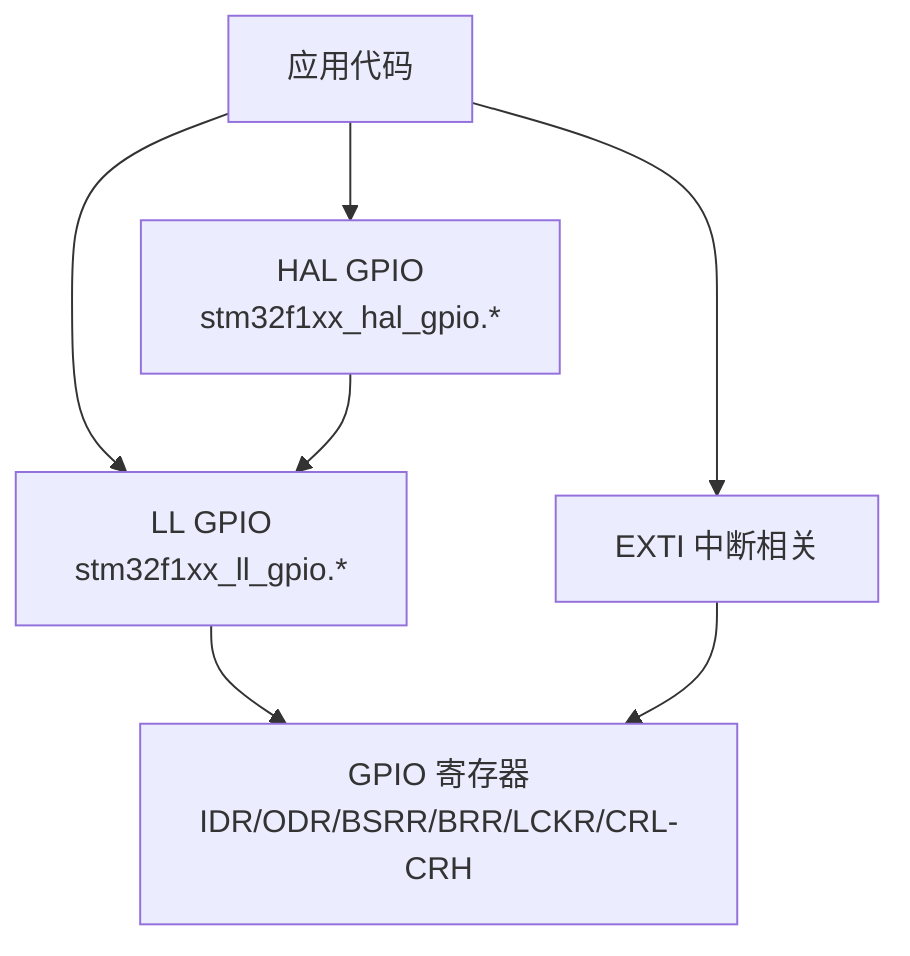
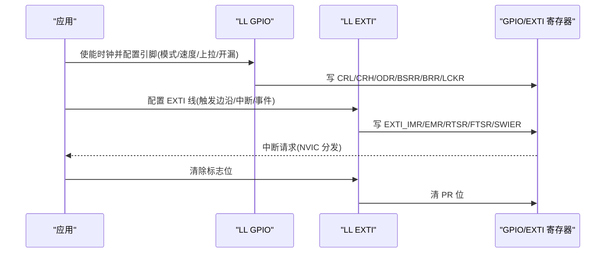
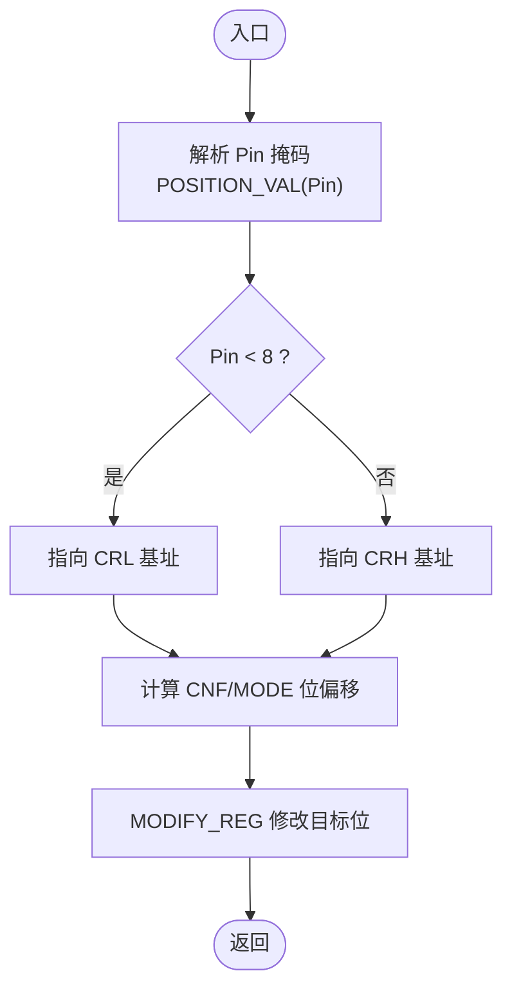
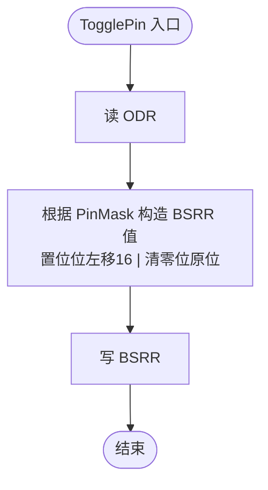
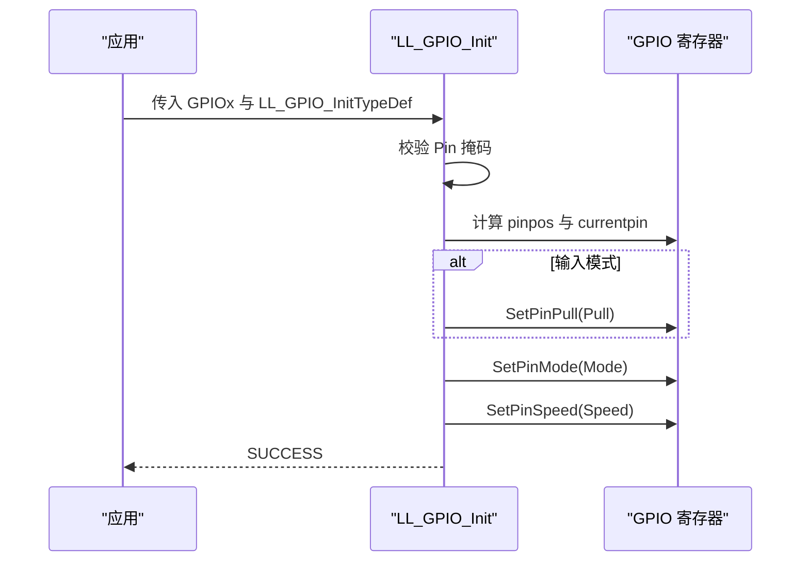
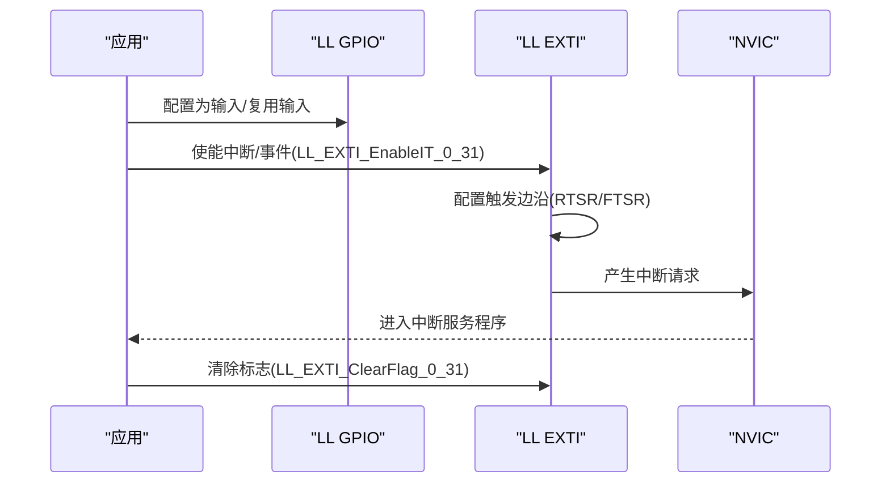
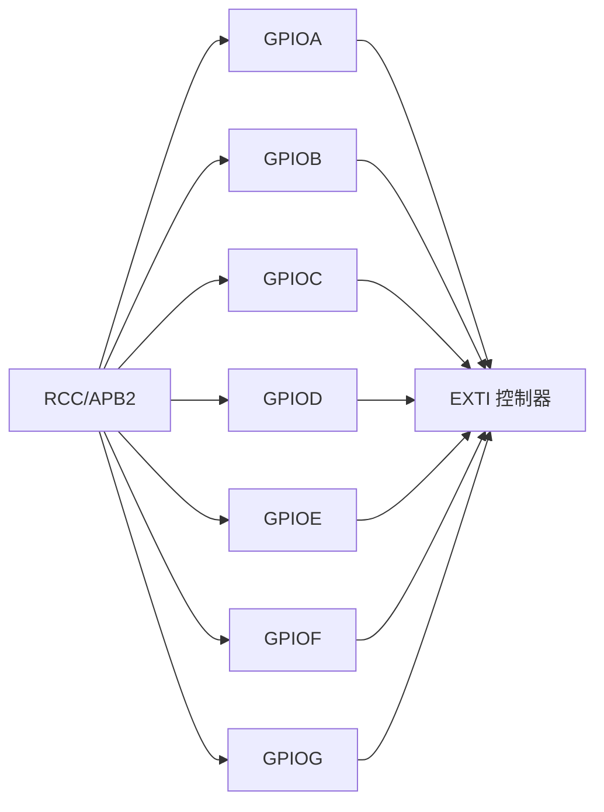

# LL GPIO 低层接口

<cite>
**本文引用的文件**   
- [Inc/stm32f1xx_ll_gpio.h](file://Inc/stm32f1xx_ll_gpio.h)
- [Src/stm32f1xx_ll_gpio.c](file://Src/stm32f1xx_ll_gpio.c)
- [Inc/stm32f1xx_hal_gpio.h](file://Inc/stm32f1xx_hal_gpio.h)
- [Src/stm32f1xx_hal_gpio.c](file://Src/stm32f1xx_hal_gpio.c)
- [README.md](file://README.md)
</cite>

## 目录
1. [简介](#简介)
2. [项目结构](#项目结构)
3. [核心组件](#核心组件)
4. [架构总览](#架构总览)
5. [详细组件分析](#详细组件分析)
6. [依赖关系分析](#依赖关系分析)
7. [性能与可移植性](#性能与可移植性)
8. [故障排查](#故障排查)
9. [结论](#结论)
10. [附录：API 对照与示例流程](#附录api-对照与示例流程)

## 简介
本文件面向 STM32F1xx 的 LL GPIO 低层接口，聚焦通过位带或掩码直接访问 GPIOx_IDR/ODR/BSRR/BRR/LCKR 等寄存器，适用于按键输入、LED 输出、外部中断引脚配置等对时序敏感的场景。文档基于仓库中的 LL 与 HAL 驱动头文件和实现文件进行梳理，说明主要函数族、参数语义、返回值、使用约束、多外设复用注意事项，以及不同封装间可移植性的限制。

## 项目结构
该仓库提供 STM32CubeF1 的 HAL-LL 驱动组件，其中：
- Inc/stm32f1xx_ll_gpio.h 与 Src/stm32f1xx_ll_gpio.c 定义并实现 LL GPIO API；
- Inc/stm32f1xx_hal_gpio.h 与 Src/stm32f1xx_hal_gpio.c 提供 HAL 层 GPIO API；
- README.md 说明仓库为 STM32CubeF1 MCU 组件的一部分，包含 HAL-LL 驱动。

**图示来源**
- [Inc/stm32f1xx_ll_gpio.h:113-178](file://Inc/stm32f1xx_ll_gpio.h#L113-L178)
- [Inc/stm32f1xx_ll_gpio.h:689-865](file://Inc/stm32f1xx_ll_gpio.h#L689-L865)
- [Inc/stm32f1xx_hal_gpio.h:223-236](file://Inc/stm32f1xx_hal_gpio.h#L223-L236)

**章节来源**
- [README.md:1-45](file://README.md#L1-L45)

## 核心组件
- LL GPIO 初始化结构体与常量
  - LL_GPIO_InitTypeDef：包含 Pin、Mode、Speed、OutputType、Pull。
  - 引脚枚举：LL_GPIO_PIN_0..15、LL_GPIO_PIN_ALL。
  - 模式：LL_GPIO_MODE_ANALOG/FLOATING/INPUT/OUTPUT/ALTERNATE。
  - 速度：LL_GPIO_SPEED_FREQ_LOW/MEDIUM/HIGH（底层对应 CRL/CRH MODEy）。
  - 输出类型：LL_GPIO_OUTPUT_PUSHPULL/OPENDRAIN。
  - 上拉下拉：LL_GPIO_PULL_DOWN/UP（底层通过 ODR 位控制）。
- LL GPIO 配置函数族
  - LL_GPIO_SetPinMode / GetPinMode
  - LL_GPIO_SetPinSpeed / GetPinSpeed
  - LL_GPIO_SetPinOutputType / GetPinOutputType
  - LL_GPIO_SetPinPull / GetPinPull
  - LL_GPIO_LockPin / IsPinLocked / IsAnyPinLocked
  - LL_GPIO_ReadInputPort / IsInputPinSet
  - LL_GPIO_WriteOutputPort / ReadOutputPort / IsOutputPinSet
  - LL_GPIO_SetOutputPin / ResetOutputPin / TogglePin
  - LL_GPIO_Init / DeInit / StructInit
- HAL GPIO 对应函数族
  - HAL_GPIO_Init
  - HAL_GPIO_ReadPin / WritePin / TogglePin / LockPin
  - EXTI 宏：__HAL_GPIO_EXTI_GET_FLAG/CLEAR_FLAG/GET_IT/CLEAR_IT

**章节来源**
- [Inc/stm32f1xx_ll_gpio.h:64-98](file://Inc/stm32f1xx_ll_gpio.h#L64-L98)
- [Inc/stm32f1xx_ll_gpio.h:113-178](file://Inc/stm32f1xx_ll_gpio.h#L113-L178)
- [Inc/stm32f1xx_ll_gpio.h:311-597](file://Inc/stm32f1xx_ll_gpio.h#L311-L597)
- [Inc/stm32f1xx_ll_gpio.h:607-865](file://Inc/stm32f1xx_ll_gpio.h#L607-L865)
- [Inc/stm32f1xx_ll_gpio.h:2314-2316](file://Inc/stm32f1xx_ll_gpio.h#L2314-L2316)
- [Inc/stm32f1xx_hal_gpio.h:223-236](file://Inc/stm32f1xx_hal_gpio.h#L223-L236)
- [Inc/stm32f1xx_hal_gpio.h:174-198](file://Inc/stm32f1xx_hal_gpio.h#L174-L198)

## 架构总览
LL GPIO 直接操作硬件寄存器，HAL GPIO 在其之上提供更高层的抽象。EXTI 中断配置在 LL 中由 LL_EXTI_* 系列函数完成，GPIO 引脚需先配置为输入或复用输入模式。

**图示来源**
- [Inc/stm32f1xx_ll_gpio.h:311-597](file://Inc/stm32f1xx_ll_gpio.h#L311-L597)
- [Inc/stm32f1xx_ll_gpio.h:689-865](file://Inc/stm32f1xx_ll_gpio.h#L689-L865)
- [Inc/stm32f1xx_ll_exti.h:239-415](file://Inc/stm32f1xx_ll_exti.h#L239-L415)
- [Inc/stm32f1xx_ll_exti.h:818-859](file://Inc/stm32f1xx_ll_exti.h#L818-L859)

## 详细组件分析

### LL GPIO 引脚掩码与端口映射
- LL_GPIO_PIN_x 采用组合编码，同时携带 BSRR 位移与位索引信息，内部常量包括 GPIO_PIN_MASK_POS、GPIO_PIN_NB。
- 低位引脚 0–7 与高位引脚 8–15 在 CRL/CRH 中分别占用不同寄存器，LL 函数通过计算地址偏移选择 CRL 或 CRH。

**图示来源**
- [Inc/stm32f1xx_ll_gpio.h:113-178](file://Inc/stm32f1xx_ll_gpio.h#L113-L178)
- [Inc/stm32f1xx_ll_gpio.h:341-384](file://Inc/stm32f1xx_ll_gpio.h#L341-L384)

**章节来源**
- [Inc/stm32f1xx_ll_gpio.h:113-178](file://Inc/stm32f1xx_ll_gpio.h#L113-L178)
- [Inc/stm32f1xx_ll_gpio.h:341-384](file://Inc/stm32f1xx_ll_gpio.h#L341-L384)

### 模式、速度与输出类型
- 模式：模拟、浮空、输入、通用输出、复用功能。
- 速度：低速、中速、高速，对应 CRL/CRH 的 MODE 位。
- 输出类型：推挽或开漏，对应 CRL/CRH 的 CNF 位。

这些字段在 LL_GPIO_SetPinMode/SetPinSpeed/SetPinOutputType 中被写入 CRL/CRH 对应位段。

**章节来源**
- [Inc/stm32f1xx_ll_gpio.h:143-178](file://Inc/stm32f1xx_ll_gpio.h#L143-L178)
- [Inc/stm32f1xx_ll_gpio.h:393-533](file://Inc/stm32f1xx_ll_gpio.h#L393-L533)

### 上拉/下拉与锁存器
- 上拉/下拉通过 ODR 位控制：LL_GPIO_SetPinPull/GetPinPull。
- 锁存器 LCKR：LL_GPIO_LockPin 执行“写 LCKK 序列”，IsPinLocked/IsAnyPinLocked 读取状态。

**章节来源**
- [Inc/stm32f1xx_ll_gpio.h:540-597](file://Inc/stm32f1xx_ll_gpio.h#L540-L597)
- [Inc/stm32f1xx_ll_gpio.h:607-676](file://Inc/stm32f1xx_ll_gpio.h#L607-L676)

### 输入读取与输出写入
- 输入：LL_GPIO_ReadInputPort 读 IDR，IsInputPinSet 按掩码检测。
- 输出：WriteOutputPort 写 ODR，ReadOutputPort 读 ODR，IsOutputPinSet 检测 ODR。
- 原子置位/清零：SetOutputPin 写 BSRR，ResetOutputPin 写 BRR。
- 翻转：TogglePin 先读 ODR，再按位组合写入 BSRR。

**图示来源**
- [Inc/stm32f1xx_ll_gpio.h:689-865](file://Inc/stm32f1xx_ll_gpio.h#L689-L865)

**章节来源**
- [Inc/stm32f1xx_ll_gpio.h:689-865](file://Inc/stm32f1xx_ll_gpio.h#L689-L865)

### 初始化与复位
- LL_GPIO_DeInit：对每个 GPIO 实例调用 APB2 复位与释放，确保寄存器恢复默认。
- LL_GPIO_Init：遍历配置的 Pin，区分高低位组，依次设置 Pull、Mode、Speed 等。
- LL_GPIO_StructInit：填充默认结构体。

**图示来源**
- [Src/stm32f1xx_ll_gpio.c:68-136](file://Src/stm32f1xx_ll_gpio.c#L68-L136)
- [Src/stm32f1xx_ll_gpio.c:137-200](file://Src/stm32f1xx_ll_gpio.c#L137-L200)

**章节来源**
- [Src/stm32f1xx_ll_gpio.c:68-200](file://Src/stm32f1xx_ll_gpio.c#L68-L200)

### EXTI 中断相关最小流程
- GPIO 引脚需配置为输入或复用输入。
- 使用 LL_EXTI_EnableIT_0_31/EnableEvent_0_31 启用中断或事件。
- 使用 LL_EXTI_ClearFlag_0_31 清除中断挂起标志。
- 软件触发可通过 LL_EXTI_SWIER 或 SWINT 相关宏完成（具体宏名以设备头为准，此处依据 LL_EXTI 能力描述）。

**图示来源**
- [Inc/stm32f1xx_ll_exti.h:239-415](file://Inc/stm32f1xx_ll_exti.h#L239-L415)
- [Inc/stm32f1xx_ll_exti.h:818-859](file://Inc/stm32f1xx_ll_exti.h#L818-L859)

**章节来源**
- [Inc/stm32f1xx_ll_exti.h:239-415](file://Inc/stm32f1xx_ll_exti.h#L239-L415)
- [Inc/stm32f1xx_ll_exti.h:818-859](file://Inc/stm32f1xx_ll_exti.h#L818-L859)

## 依赖关系分析
- LL GPIO 依赖 APB2 总线与 RCC 时钟；GPIOA-G 均位于 APB2 总线。
- LL GPIO 与 LL EXTI 协同工作，GPIO 负责引脚电气特性与方向，EXTI 负责边沿检测与中断路由。
- HAL GPIO 在逻辑上与 LL GPIO 概念一致，但 API 名称和参数类型不同，HAL 更偏易用性，LL 更偏直接与确定性。

**图示来源**
- [Src/stm32f1xx_ll_gpio.c:87-136](file://Src/stm32f1xx_ll_gpio.c#L87-L136)
- [Inc/stm32f1xx_ll_exti.h:239-415](file://Inc/stm32f1xx_ll_exti.h#L239-L415)

**章节来源**
- [Src/stm32f1xx_ll_gpio.c:87-136](file://Src/stm32f1xx_ll_gpio.c#L87-L136)
- [Inc/stm32f1xx_ll_exti.h:239-415](file://Inc/stm32f1xx_ll_exti.h#L239-L415)

## 性能与可移植性
- 性能特征
  - LL 函数多为内联或轻量实现，直接读写寄存器，避免 HAL 的额外抽象开销，适合实时性要求高的场景。
  - 原子置位/清零使用 BSRR/BRR，避免读-改-写竞争条件。
  - TogglePin 通过一次 BSRR 写入完成翻转，减少总线事务。
- 可移植性限制
  - LL GPIO 的 Pin 掩码、CRL/CRH 布局、AFIO 重映射、EXTI 线映射与 STM32F103x 的具体封装密切相关。
  - 不同封装可能缺失某些端口（如 GPIOE/GPIOF/GPIOG），LL 实现中通过条件编译保护。
  - AFIO 重映射与 SWJ 配置影响调试与复用功能可用性，需在应用层谨慎处理。

**章节来源**
- [Inc/stm32f1xx_ll_gpio.h:113-178](file://Inc/stm32f1xx_ll_gpio.h#L113-L178)
- [Inc/stm32f1xx_ll_gpio.h:885-1575](file://Inc/stm32f1xx_ll_gpio.h#L885-L1575)
- [Src/stm32f1xx_ll_gpio.c:87-136](file://Src/stm32f1xx_ll_gpio.c#L87-L136)

## 故障排查
- 未使能时钟导致 GPIO 不可用
  - 现象：配置无效、读取恒为 0 或无法输出。
  - 排查：确认已调用对应 RCC 时钟使能宏（例如 __HAL_RCC_GPIOx_CLK_ENABLE）后再配置 GPIO。
- 引脚模式冲突
  - 现象：复用功能异常、ADC/DAC 采样错误。
  - 排查：检查 Mode 是否为 ANALOG/INPUT/ALTERNATE，且与其他外设不冲突。
- 上拉下拉误配
  - 现象：按键抖动或电平不稳。
  - 排查：确认 Pull 配置与外部电路匹配，必要时添加软件消抖。
- EXTI 未清标志
  - 现象：中断重复触发或丢失。
  - 排查：在中断服务程序中调用 LL_EXTI_ClearFlag_0_31 清除对应位。
- 锁存器状态
  - 现象：引脚配置后无法修改。
  - 排查：检查是否误用了 LL_GPIO_LockPin，必要时重新配置前解锁或重新初始化。

**章节来源**
- [Inc/stm32f1xx_ll_gpio.h:607-676](file://Inc/stm32f1xx_ll_gpio.h#L607-L676)
- [Inc/stm32f1xx_ll_exti.h:818-859](file://Inc/stm32f1xx_ll_exti.h#L818-L859)

## 结论
LL GPIO 提供直接、确定性的 GPIO 控制能力，适合对时序敏感的应用。其优势在于接近寄存器级的操作与较少的运行时开销，劣势是需开发者自行处理时钟、端口可用性与外设复用等细节。与 HAL GPIO 相比，LL 更适合嵌入式实时系统或资源受限场景；HAL 则更适合快速开发与跨型号移植。

## 附录：API 对照与示例流程

### LL 与 HAL GPIO API 对照
- 初始化
  - LL：LL_GPIO_InitTypeDef + LL_GPIO_Init
  - HAL：GPIO_InitTypeDef + HAL_GPIO_Init
- 引脚读写
  - LL：LL_GPIO_SetOutputPin / ResetOutputPin / TogglePin / ReadInputPort
  - HAL：HAL_GPIO_WritePin / TogglePin / ReadPin
- 引脚锁定
  - LL：LL_GPIO_LockPin / IsPinLocked
  - HAL：HAL_GPIO_LockPin
- EXTI 标志
  - HAL：__HAL_GPIO_EXTI_GET_FLAG / CLEAR_FLAG / GET_IT / CLEAR_IT
  - LL：LL_EXTI_ClearFlag_0_31 / EnableIT_0_31 / EnableEvent_0_31

**章节来源**
- [Inc/stm32f1xx_ll_gpio.h:2314-2316](file://Inc/stm32f1xx_ll_gpio.h#L2314-L2316)
- [Inc/stm32f1xx_hal_gpio.h:223-236](file://Inc/stm32f1xx_hal_gpio.h#L223-L236)
- [Inc/stm32f1xx_hal_gpio.h:174-198](file://Inc/stm32f1xx_hal_gpio.h#L174-L198)
- [Inc/stm32f1xx_ll_exti.h:239-415](file://Inc/stm32f1xx_ll_exti.h#L239-L415)
- [Inc/stm32f1xx_ll_exti.h:818-859](file://Inc/stm32f1xx_ll_exti.h#L818-L859)

### LED 闪烁（LL）
- 步骤
  - 使能 GPIO 时钟（例如 __HAL_RCC_GPIOx_CLK_ENABLE）。
  - 配置 LED 引脚为输出模式、适当速度与推挽输出。
  - 循环调用 LL_GPIO_TogglePin 或 Set/Reset 输出。
- 与 HAL 对照
  - HAL 侧可使用 HAL_GPIO_TogglePin 或 HAL_GPIO_WritePin。

**章节来源**
- [Inc/stm32f1xx_ll_gpio.h:689-865](file://Inc/stm32f1xx_ll_gpio.h#L689-L865)
- [Inc/stm32f1xx_hal_gpio.h:233-235](file://Inc/stm32f1xx_hal_gpio.h#L233-L235)

### 按键轮询读取（LL）
- 步骤
  - 使能 GPIO 时钟。
  - 配置按键引脚为输入模式，配置 Pull 为上拉或下拉。
  - 主循环中调用 LL_GPIO_IsInputPinSet 或 ReadInputPort 判断按键状态。
- 与 HAL 对照
  - HAL 侧使用 HAL_GPIO_ReadPin。

**章节来源**
- [Inc/stm32f1xx_ll_gpio.h:689-724](file://Inc/stm32f1xx_ll_gpio.h#L689-L724)
- [Inc/stm32f1xx_hal_gpio.h:233-233](file://Inc/stm32f1xx_hal_gpio.h#L233-L233)

### EXTI 中断回调（LL）
- 步骤
  - 将引脚配置为输入或复用输入。
  - 配置 EXTI 线触发边沿（上升/下降/双边沿）。
  - 使能中断或事件（LL_EXTI_EnableIT_0_31/EnableEvent_0_31）。
  - 在 ISR 中清除标志（LL_EXTI_ClearFlag_0_31）。
- 与 HAL 对照
  - HAL 侧使用 __HAL_GPIO_EXTI_GET_FLAG/CLEAR_FLAG 等宏配合 HAL_NVIC 配置。

**章节来源**
- [Inc/stm32f1xx_ll_exti.h:239-415](file://Inc/stm32f1xx_ll_exti.h#L239-L415)
- [Inc/stm32f1xx_ll_exti.h:818-859](file://Inc/stm32f1xx_ll_exti.h#L818-L859)
- [Inc/stm32f1xx_hal_gpio.h:174-198](file://Inc/stm32f1xx_hal_gpio.h#L174-L198)

### 多外设共享引脚的复用模式注意事项
- 复用模式（LL_GPIO_MODE_ALTERNATE）下，引脚由外设（如 USART、SPI、TIM）接管，GPIO 仅保留电气特性。
- 注意 AFIO 重映射与 SWJ 配置，避免关闭调试口或改变外设引脚位置。
- 同一引脚不能同时被多个外设独占使用，需要明确优先级与时序。

**章节来源**
- [Inc/stm32f1xx_ll_gpio.h:143-178](file://Inc/stm32f1xx_ll_gpio.h#L143-L178)
- [Inc/stm32f1xx_ll_gpio.h:885-1575](file://Inc/stm32f1xx_ll_gpio.h#L885-L1575)

### STM32F103x 不同封装间的可移植性限制
- 端口可用性：部分封装缺少 GPIOE/GPIOF/GPIOG，LL 实现中包含条件编译保护。
- AFIO 功能差异：不同封装的 AFIO_MAPR 位定义不同，重映射选项存在差异。
- EXTI 线与引脚映射受封装影响，需在应用层根据芯片选型做条件编译或适配层。

**章节来源**
- [Src/stm32f1xx_ll_gpio.c:87-136](file://Src/stm32f1xx_ll_gpio.c#L87-L136)
- [Inc/stm32f1xx_ll_gpio.h:885-1575](file://Inc/stm32f1xx_ll_gpio.h#L885-L1575)