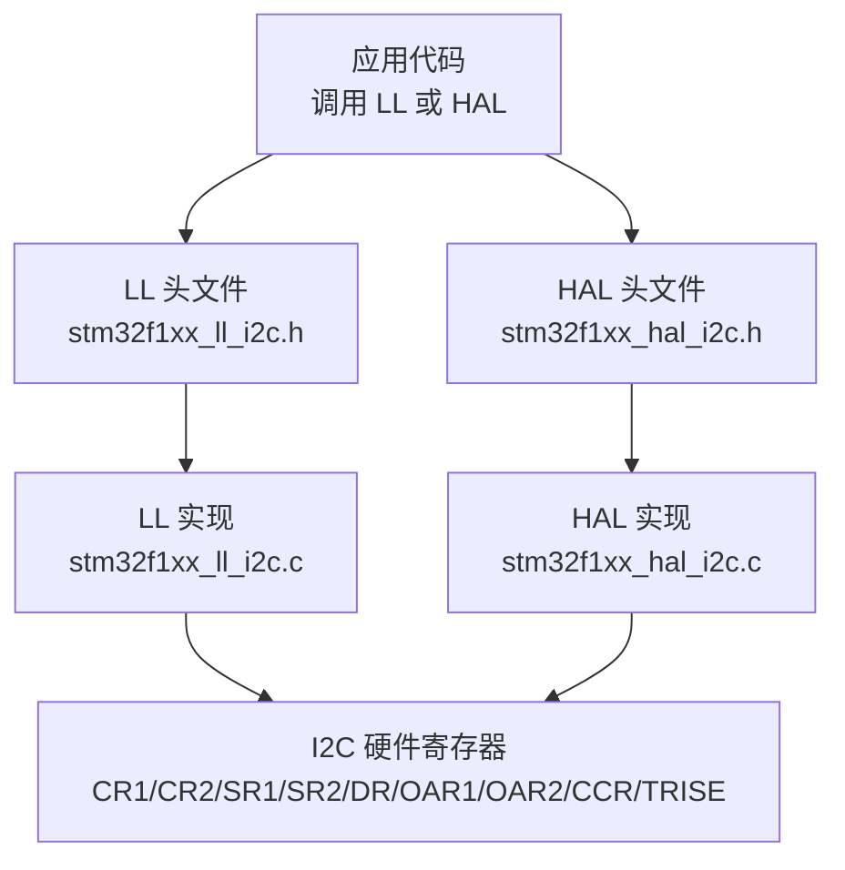
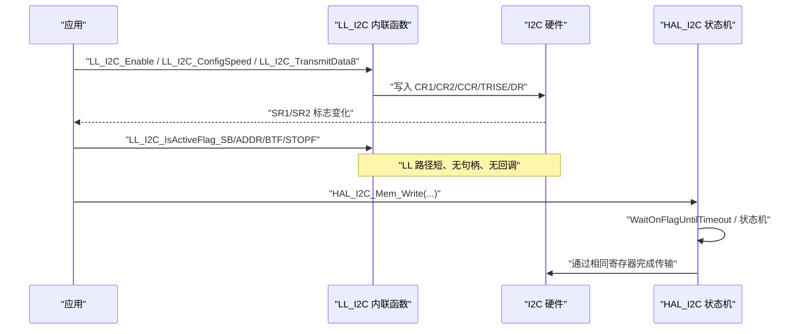
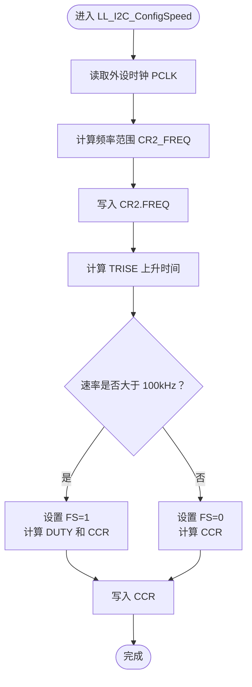
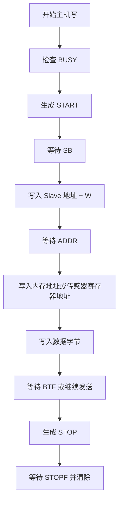
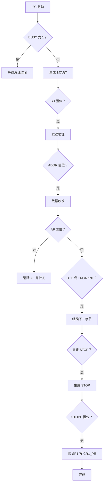
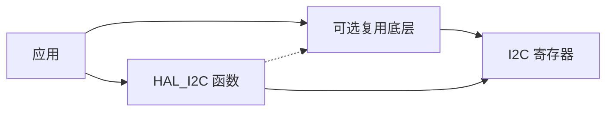

# LL I2C 低层接口

<cite>
**本文引用的文件**   
- [stm32f1xx_ll_i2c.h](file://Inc/stm32f1xx_ll_i2c.h)
- [stm32f1xx_ll_i2c.c](file://Src/stm32f1xx_ll_i2c.c)
- [stm32f1xx_hal_i2c.h](file://Inc/stm32f1xx_hal_i2c.h)
- [stm32f1xx_hal_i2c.c](file://Src/stm32f1xx_hal_i2c.c)
</cite>

## 目录
1. [引言](#引言)
2. [项目结构](#项目结构)
3. [核心组件](#核心组件)
4. [架构总览](#架构总览)
5. [详细组件分析](#详细组件分析)
6. [依赖关系分析](#依赖关系分析)
7. [性能考虑](#性能考虑)
8. [故障排查指南](#故障排查指南)
9. [结论](#结论)
10. [附录：寄存器与参数对照](#附录寄存器与参数对照)

## 引言
本文面向 STM32F1xx 的 LL（Low Layer）I2C 驱动，重点解释 LL_I2C 如何直接操作 I2Cx_CR1、CR2、SR1/SR2、DR、OAR1/OAR2、TRISE、CCR/TIMINGR 等硬件寄存器，完成主机发送/接收、从机应答和超时检测。文档同时说明 HAL 层 `HAL_I2C_Mem_Write` 与 LL 手动状态机的差异，并给出主机写 EEPROM、主机读传感器的参考实现思路，以及 BUSY、AF、ADDR、BTF、STOPF 等标志的正确处理顺序。

本仓库中，LL 函数主要位于 `stm32f1xx_ll_i2c.h` 与 `stm32f1xx_ll_i2c.c`；HAL 定义与实现分别位于 `stm32f1xx_hal_i2c.h` 与 `stm32f1xx_hal_i2c.c`。本文所有技术断言均以这两个头文件和源文件为依据。

## 项目结构
该仓库是 STM32F1 HAL/LL 标准外设库。与 I2C 相关的核心文件如下：

**图表来源**
- [stm32f1xx_ll_i2c.h:520-740](file://Inc/stm32f1xx_ll_i2c.h#L520-L740)
- [stm32f1xx_ll_i2c.c:1-219](file://Src/stm32f1xx_ll_i2c.c#L1-L219)
- [stm32f1xx_hal_i2c.h:330-530](file://Inc/stm32f1xx_hal_i2c.h#L330-L530)
- [stm32f1xx_hal_i2c.c:2560-2580](file://Src/stm32f1xx_hal_i2c.c#L2560-L2580)

**章节来源**
- [stm32f1xx_ll_i2c.h:1-120](file://Inc/stm32f1xx_ll_i2c.h#L1-L120)
- [stm32f1xx_ll_i2c.c:1-60](file://Src/stm32f1xx_ll_i2c.c#L1-L60)
- [stm32f1xx_hal_i2c.h:330-530](file://Inc/stm32f1xx_hal_i2c.h#L330-L530)

## 核心组件
LL I2C 的核心能力由一组内联函数和宏组成，它们直接读写 I2C 外设寄存器：

| 类别 | 关键函数/宏 | 对应寄存器或行为 |
|---|---|---|
| 使能/禁用 | `LL_I2C_Enable`、`LL_I2C_Disable`、`LL_I2C_IsEnabled` | CR1_PE |
| 时钟配置 | `LL_I2C_SetPeriphClock`、`LL_I2C_ConfigSpeed`、`LL_I2C_SetDutyCycle`、`LL_I2C_SetClockSpeedMode` | CR2_FREQ、TRISE、CCR_FS/CCR_DUTY/CCR_CCR |
| 地址配置 | `LL_I2C_SetOwnAddress1`、`LL_I2C_SetOwnAddress2`、`LL_I2C_EnableOwnAddress2` | OAR1_ADDMODE/OAR1_ADD、OAR2_ADD2/OAR2_ENDUAL |
| 模式配置 | `LL_I2C_SetMode`、`LL_I2C_EnableGeneralCall`、`LL_I2C_EnableClockStretching` | CR1_SMBUS/SMBTYPE/ENARP、CR1_ENGC、CR1_NOSTRETCH |
| 数据操作 | `LL_I2C_TransmitData8`、`LL_I2C_ReceiveData8` | DR_DR |
| 应答控制 | `LL_I2C_AcknowledgeNextData` | CR1_ACK |
| 标志查询 | `LL_I2C_IsActiveFlag_*` | SR1、SR2 |
| 标志清除 | `LL_I2C_ClearFlag_ADDR`、`LL_I2C_ClearFlag_AF`、`LL_I2C_ClearFlag_STOP`、`LL_I2C_ClearFlag_BERR`、`LL_I2C_ClearFlag_ARLO`、`LL_I2C_ClearFlag_OVR` | SR1、SR2、CR1_PE |

这些函数大多为 `__STATIC_INLINE`，编译后直接展开为对 `I2Cx->CR1`、`I2Cx->CR2`、`I2Cx->SR1`、`I2Cx->SR2`、`I2Cx->DR`、`I2Cx->OAR1`、`I2Cx->OAR2`、`I2Cx->CCR`、`I2Cx->TRISE` 的直接写入或读取，从而避免 HAL 层的状态机、回调和锁开销。

**章节来源**
- [stm32f1xx_ll_i2c.h:520-560](file://Inc/stm32f1xx_ll_i2c.h#L520-L560)
- [stm32f1xx_ll_i2c.h:700-780](file://Inc/stm32f1xx_ll_i2c.h#L700-L780)
- [stm32f1xx_ll_i2c.h:1100-1480](file://Inc/stm32f1xx_ll_i2c.h#L1100-L1480)
- [stm32f1xx_ll_i2c.h:1723-1760](file://Inc/stm32f1xx_ll_i2c.h#L1723-L1760)

## 架构总览
LL I2C 的运行时路径很短：应用代码直接调用内联函数，内联函数直接访问外设寄存器。HAL I2C 则在此基础上封装了更复杂的句柄、状态机、超时等待、DMA/中断选项和回调。

**图表来源**
- [stm32f1xx_ll_i2c.h:520-560](file://Inc/stm32f1xx_ll_i2c.h#L520-L560)
- [stm32f1xx_ll_i2c.h:700-780](file://Inc/stm32f1xx_ll_i2c.h#L700-L780)
- [stm32f1xx_ll_i2c.h:1100-1480](file://Inc/stm32f1xx_ll_i2c.h#L1100-L1480)
- [stm32f1xx_hal_i2c.c:2560-2580](file://Src/stm32f1xx_hal_i2c.c#L2560-L2580)

## 详细组件分析

### 1. 时钟与速率配置：CR2、TRISE、CCR
`LL_I2C_ConfigSpeed` 负责根据外设时钟和目标速率设置：

- CR2_FREQ：外设时钟范围。
- TRISE_TRISE：上升时间。
- CCR_FS：标准模式或快速模式。
- CCR_DUTY：快速模式占空比。
- CCR_CCR：时钟分频值。

内部还使用宏计算标准模式和快速模式的 CCR 值，并根据是否超过 100kHz 选择标准或快速模式。

**图表来源**
- [stm32f1xx_ll_i2c.h:700-780](file://Inc/stm32f1xx_ll_i2c.h#L700-L780)

**章节来源**
- [stm32f1xx_ll_i2c.h:201-350](file://Inc/stm32f1xx_ll_i2c.h#L201-L350)
- [stm32f1xx_ll_i2c.h:700-780](file://Inc/stm32f1xx_ll_i2c.h#L700-L780)
- [stm32f1xx_ll_i2c.c:60-219](file://Src/stm32f1xx_ll_i2c.c#L60-L219)

### 2. 设备地址：OAR1、OAR2
`LL_I2C_SetOwnAddress1` 同时设置：

- OAR1_ADDMODE：7 位或 10 位地址模式。
- OAR1_ADD[9:1]、OAR1_ADD0：设备自身地址。
- 验证 OwnAddress1 不超过 0x3FF。

`LL_I2C_SetOwnAddress2` 仅设置 7 位第二地址 OAR2_ADD2，并由 `LL_I2C_EnableOwnAddress2` 控制是否启用双地址响应。

注意：
- 7 位地址范围为 0x00–0x7F。
- 10 位地址高 2 位用于头字节，低 8 位由辅助宏提取。
- 第二地址只在启用双地址时生效。

**章节来源**
- [stm32f1xx_ll_i2c.h:520-560](file://Inc/stm32f1xx_ll_i2c.h#L520-L560)
- [stm32f1xx_ll_i2c.h:560-640](file://Inc/stm32f1xx_ll_i2c.h#L560-L640)
- [stm32f1xx_ll_i2c.h:201-240](file://Inc/stm32f1xx_ll_i2c.h#L201-L240)

### 3. 数据收发：DR、TXE、RXNE
LL 提供两个数据寄存器访问函数：

- `LL_I2C_TransmitData8(I2Cx, Data)`：写入 DR_DR。
- `LL_I2C_ReceiveData8(I2Cx)`：从 DR_DR 读取。

配合标志函数：

- `LL_I2C_IsActiveFlag_TXE`：发送寄存器为空。
- `LL_I2C_IsActiveFlag_RXNE`：接收寄存器非空。

典型循环逻辑是：
- 发送：等待 TXE，写入 DR。
- 接收：等待 RXNE，读取 DR。

**章节来源**
- [stm32f1xx_ll_i2c.h:1100-1145](file://Inc/stm32f1xx_ll_i2c.h#L1100-L1145)
- [stm32f1xx_ll_i2c.h:1723-1760](file://Inc/stm32f1xx_ll_i2c.h#L1723-L1760)

### 4. 起始、停止与地址匹配：SB、ADDR、ADD10
LL 没有直接命名为 `__HAL_I2C_GENERATE_START` 或 `__HAL_I2C_GENERATE_STOP` 的独立宏；实际生成 START/STOP 是通过组合以下操作完成：

- 生成 START：
  - 确保总线空闲。
  - 在主机模式下设置 CR2 的 START 位。
  - 等待 SR1_SB。
  - 写入目标地址。
  - 等待 SR1_ADDR。

- 生成 STOP：
  - 在主机模式下设置 CR2 的 STOP 位。
  - 等待 SR1_STOPF。
  - 按硬件要求清除 STOPF：先读 SR1，再写 CR1_PE。

- 地址匹配：
  - 主机：发送地址后等待 ADDR。
  - 从机：收到匹配地址后设置 ADDR。
  - 清除 ADDR：必须先读 SR1，再读 SR2。

**图表来源**
- [stm32f1xx_ll_i2c.h:1141-1206](file://Inc/stm32f1xx_ll_i2c.h#L1141-L1206)
- [stm32f1xx_ll_i2c.h:1391-1430](file://Inc/stm32f1xx_ll_i2c.h#L1391-L1430)

**章节来源**
- [stm32f1xx_ll_i2c.h:1141-1206](file://Inc/stm32f1xx_ll_i2c.h#L1141-L1206)
- [stm32f1xx_ll_i2c.h:1391-1430](file://Inc/stm32f1xx_ll_i2c.h#L1391-L1430)

### 5. 应答控制：ACK/NACK
LL 通过 `LL_I2C_AcknowledgeNextData` 控制下一个字节的 ACK 或 NACK，对应 CR1_ACK：

- `LL_I2C_ACK`：当前接收字节后发送 ACK。
- `LL_I2C_NACK`：当前接收字节后发送 NACK。

常见用法：
- 主机读最后一个字节前，将 ACK 设置为 NACK。
- 从机在正常数据接收过程中保持 ACK，结束接收时改为 NACK。

若对端未应答，硬件会置位 SR1_AF，需要应用清除 AF 并进入错误恢复流程。

**章节来源**
- [stm32f1xx_ll_i2c.h:1546-1560](file://Inc/stm32f1xx_ll_i2c.h#L1546-L1560)
- [stm32f1xx_ll_i2c.h:1202-1206](file://Inc/stm32f1xx_ll_i2c.h#L1202-L1206)
- [stm32f1xx_ll_i2c.h:1406-1410](file://Inc/stm32f1xx_ll_i2c.h#L1406-L1410)

### 6. 标志与状态机：SR1/SR2
LL 提供大量标志查询和清除函数，覆盖 I2C 主从传输中的关键事件：

| 标志 | 含义 | 清除方式 |
|---|---|---|
| BUSY | 总线忙，检测到 START | 硬件自动更新；需软件等待空闲 |
| SB | 主机已产生 START | 读 SR1 后写地址清除 |
| ADDR | 地址已发送或匹配 | 读 SR1，再读 SR2 |
| ADD10 | 10 位地址头已发送 | 后续写地址低字节 |
| BTF | 字节传输完成 | 写数据或读数据后由硬件清除 |
| TXE | 发送寄存器空 | 写入 DR 后清除 |
| RXNE | 接收寄存器非空 | 读取 DR 后清除 |
| AF | 应答失败 | 写 SR1_CLR 清除 |
| STOPF | 检测到 STOP | 读 SR1，再写 CR1_PE |
| BERR | 总线错误 | 写 SR1_CLR 清除 |
| ARLO | 仲裁丢失 | 写 SR1_CLR 清除 |
| OVR | 溢出/下溢 | 写 SR1_CLR 清除 |

**图表来源**
- [stm32f1xx_ll_i2c.h:1100-1480](file://Inc/stm32f1xx_ll_i2c.h#L1100-L1480)

**章节来源**
- [stm32f1xx_ll_i2c.h:1100-1480](file://Inc/stm32f1xx_ll_i2c.h#L1100-L1480)

### 7. 通用功能：使能、复位、模式、全局呼叫
- 使能/禁用：`LL_I2C_Enable`、`LL_I2C_Disable`、`LL_I2C_IsEnabled` 直接操作 CR1_PE。
- 复位：`LL_I2C_DeInit` 通过 RCC 强制复位再释放 I2C1/I2C2 时钟。
- 模式：`LL_I2C_SetMode` 可配置 I2C、SMBus Host、SMBus Device、SMBus Device ARP。
- 全局呼叫：`LL_I2C_EnableGeneralCall`、`LL_I2C_DisableGeneralCall` 控制 CR1_ENGC。
- 时钟拉伸：`LL_I2C_EnableClockStretching`、`LL_I2C_DisableClockStretching` 控制 CR1_NOSTRETCH。

**章节来源**
- [stm32f1xx_ll_i2c.h:520-560](file://Inc/stm32f1xx_ll_i2c.h#L520-L560)
- [stm32f1xx_ll_i2c.c:60-120](file://Src/stm32f1xx_ll_i2c.c#L60-L120)
- [stm32f1xx_ll_i2c.h:780-850](file://Inc/stm32f1xx_ll_i2c.h#L780-L850)

## 依赖关系分析
LL I2C 与 HAL I2C 的关系可以概括为：

- LL 是直接寄存器抽象层，适合极短的中断路径、实时性要求高的场景。
- HAL 是基于 LL 或寄存器之上的高层封装，包含句柄、状态、超时、回调、DMA 等。
- 在 STM32F1 中，LL 函数多为内联，HAL 函数则包含更多条件判断和等待逻辑。

**图表来源**
- [stm32f1xx_ll_i2c.h:520-780](file://Inc/stm32f1xx_ll_i2c.h#L520-L780)
- [stm32f1xx_hal_i2c.h:330-530](file://Inc/stm32f1xx_hal_i2c.h#L330-L530)
- [stm32f1xx_hal_i2c.c:2560-2580](file://Src/stm32f1xx_hal_i2c.c#L2560-L2580)

**章节来源**
- [stm32f1xx_ll_i2c.h:520-780](file://Inc/stm32f1xx_ll_i2c.h#L520-L780)
- [stm32f1xx_hal_i2c.h:330-530](file://Inc/stm32f1xx_hal_i2c.h#L330-L530)
- [stm32f1xx_hal_i2c.c:2560-2580](file://Src/stm32f1xx_hal_i2c.c#L2560-L2580)

## 性能考虑
- LL 的优势：
  - 函数为内联，通常不引入额外函数调用开销。
  - 不维护 HAL 句柄、状态、锁和回调。
  - 在中断服务程序中使用 LL 可直接轮询 SR1/SR2 并读写 DR，路径最短。

- HAL 的成本：
  - `HAL_I2C_Mem_Write` 包含多次 `I2C_WaitOnFlagUntilTimeout`。
  - 支持阻塞、IT、DMA 多种模式，但调用链更长。
  - 适合易用性和通用性优先的场景。

- 何时选择 LL：
  - 需要极短中断路径。
  - 需要完全自定义 I2C 状态机。
  - 需要精确控制 START/STOP、重复起始、NACK 时机。
  - 已有成熟 LL 状态机，不想承担 HAL 额外开销。

**章节来源**
- [stm32f1xx_ll_i2c.h:520-780](file://Inc/stm32f1xx_ll_i2c.h#L520-L780)
- [stm32f1xx_hal_i2c.c:2560-2580](file://Src/stm32f1xx_hal_i2c.c#L2560-L2580)

## 故障排查指南

### 常见错误 1：时钟频率计算错误
现象：
- SCL 频率异常。
- 快速模式无法达到预期速率。
- 时序不符合 EEPROM 或传感器手册。

排查要点：
- 确认传入 `LL_I2C_ConfigSpeed` 的外设时钟是否正确。
- 标准模式应小于等于 100kHz。
- 快速模式应在 100kHz 到 400kHz 之间。
- 快速模式必须正确设置占空比。

建议：
- 先使用 `LL_I2C_SetPeriphClock` 设置正确的 CR2_FREQ。
- 再调用 `LL_I2C_ConfigSpeed` 计算 TRISE 和 CCR。
- 使用逻辑分析仪测量 SCL 实际频率。

**章节来源**
- [stm32f1xx_ll_i2c.h:201-350](file://Inc/stm32f1xx_ll_i2c.h#L201-L350)
- [stm32f1xx_ll_i2c.h:700-780](file://Inc/stm32f1xx_ll_i2c.h#L700-L780)

### 常见错误 2：ACK/NACK 处理不当
现象：
- 主机读最后一个字节后仍被对方 ACK。
- 主机写数据后出现 AF。
- 从机无法正确结束接收。

排查要点：
- 主机在读最后一个字节前切换到 NACK。
- 从机在正常数据接收中保持 ACK，结束时切换 NACK。
- 出现 AF 后立即清除 AF，并终止传输。

**章节来源**
- [stm32f1xx_ll_i2c.h:1202-1206](file://Inc/stm32f1xx_ll_i2c.h#L1202-L1206)
- [stm32f1xx_ll_i2c.h:1546-1560](file://Inc/stm32f1xx_ll_i2c.h#L1546-L1560)
- [stm32f1xx_ll_i2c.h:1406-1410](file://Inc/stm32f1xx_ll_i2c.h#L1406-L1410)

### 常见错误 3：重复起始条件错误
现象：
- 主机写寄存器地址后读数据失败。
- 地址发送后没有正确切换到读方向。

排查要点：
- 主机写 EEPROM 或传感器寄存器时，应先发送设备地址+W，再发送寄存器地址，然后发送重复 START，再发送设备地址+R。
- 重复 START 前应确保上一个 ADDR 或 BTF 已正确处理。
- 不要遗漏读 SR1、读 SR2 的清除顺序。

**章节来源**
- [stm32f1xx_ll_i2c.h:1141-1206](file://Inc/stm32f1xx_ll_i2c.h#L1141-L1206)
- [stm32f1xx_ll_i2c.h:1391-1430](file://Inc/stm32f1xx_ll_i2c.h#L1391-L1430)

### 常见错误 4：总线锁死恢复
现象：
- BUSY 一直为 1。
- I2C 不再响应任何命令。
- 系统挂起或频繁触发总线错误。

恢复步骤：
- 尝试生成多个 SCL 脉冲，让从机释放 SDA。
- 如果无效，关闭 I2C 外设，必要时复位 I2C。
- 清除 BERR、ARLO、OVR 等错误标志。
- 重新初始化 I2C 并恢复应用状态。

**章节来源**
- [stm32f1xx_ll_i2c.h:1306-1310](file://Inc/stm32f1xx_ll_i2c.h#L1306-L1310)
- [stm32f1xx_ll_i2c.h:1434-1460](file://Inc/stm32f1xx_ll_i2c.h#L1434-L1460)
- [stm32f1xx_ll_i2c.c:60-120](file://Src/stm32f1xx_ll_i2c.c#L60-L120)

## 结论
LL I2C 提供了最小、最直接的操作 I2C 寄存器的接口。它适合需要完整控制 I2C 状态机、极短中断路径、精确时序控制的场景。HAL 更适合快速开发、通用性优先的应用。对于主机写 EEPROM 或主机读传感器数据，推荐先理解 LL 的 SB、ADDR、BTF、AF、STOPF 处理顺序，再决定是否用 HAL 封装。

## 附录：寄存器与参数对照

### 寄存器映射
| 寄存器 | 用途 | 相关函数/宏 |
|---|---|---|
| CR1 | 外设使能、SMBus 模式、全局呼叫、时钟拉伸、ACK | `LL_I2C_Enable`、`LL_I2C_SetMode`、`LL_I2C_EnableGeneralCall`、`LL_I2C_EnableClockStretching`、`LL_I2C_AcknowledgeNextData` |
| CR2 | 外设时钟频率、DMA 请求、中断使能 | `LL_I2C_SetPeriphClock`、`LL_I2C_EnableDMAReq_TX`、`LL_I2C_EnableDMAReq_RX` |
| SR1 | 事件和错误标志 | `LL_I2C_IsActiveFlag_*`、`LL_I2C_ClearFlag_*` |
| SR2 | 总线状态、模式、方向、双地址、SMBus 标志 | `LL_I2C_IsActiveFlag_BUSY`、`LL_I2C_IsActiveFlag_MSL`、`LL_I2C_IsActiveFlag_GENCALL` |
| DR | 数据寄存器 | `LL_I2C_TransmitData8`、`LL_I2C_ReceiveData8` |
| OAR1 | 第一设备地址和地址模式 | `LL_I2C_SetOwnAddress1` |
| OAR2 | 第二设备地址和双地址使能 | `LL_I2C_SetOwnAddress2`、`LL_I2C_EnableOwnAddress2` |
| CCR | 时钟控制、FS、DUTY、CCR | `LL_I2C_ConfigSpeed`、`LL_I2C_SetClockSpeedMode`、`LL_I2C_SetDutyCycle` |
| TRISE | 快速模式上升时间 | `LL_I2C_ConfigSpeed` |

### 常用参数与硬件约束
| 参数 | 含义 | 约束 |
|---|---|---|
| PeripheralMode | I2C 或 SMBus 模式 | 必须为 I2C、SMBus Host、SMBus Device、SMBus Device ARP |
| ClockSpeed | 目标 I2C 速率 | 必须大于 0，且小于等于 400kHz |
| DutyCycle | 快速模式占空比 | 2 或 16/9 |
| OwnAddress1 | 第一设备地址 | 0x00–0x3FF |
| OwnAddrSize | 地址长度 | 7 位或 10 位 |
| TypeAcknowledge | ACK/NACK | ACK 或 NACK |
| OwnAddress2 | 第二设备地址 | 7 位，0x00–0x7F |
| GeneralCall | 全局呼叫 | 启用后地址 0x00 会被应答 |
| Direction | 传输方向 | 写方向或读方向 |

**章节来源**
- [stm32f1xx_ll_i2c.h:60-120](file://Inc/stm32f1xx_ll_i2c.h#L60-L120)
- [stm32f1xx_ll_i2c.h:201-350](file://Inc/stm32f1xx_ll_i2c.h#L201-L350)
- [stm32f1xx_ll_i2c.h:520-640](file://Inc/stm32f1xx_ll_i2c.h#L520-L640)
- [stm32f1xx_ll_i2c.h:700-850](file://Inc/stm32f1xx_ll_i2c.h#L700-L850)
- [stm32f1xx_ll_i2c.h:1100-1480](file://Inc/stm32f1xx_ll_i2c.h#L1100-L1480)
- [stm32f1xx_ll_i2c.h:1723-1760](file://Inc/stm32f1xx_ll_i2c.h#L1723-L1760)