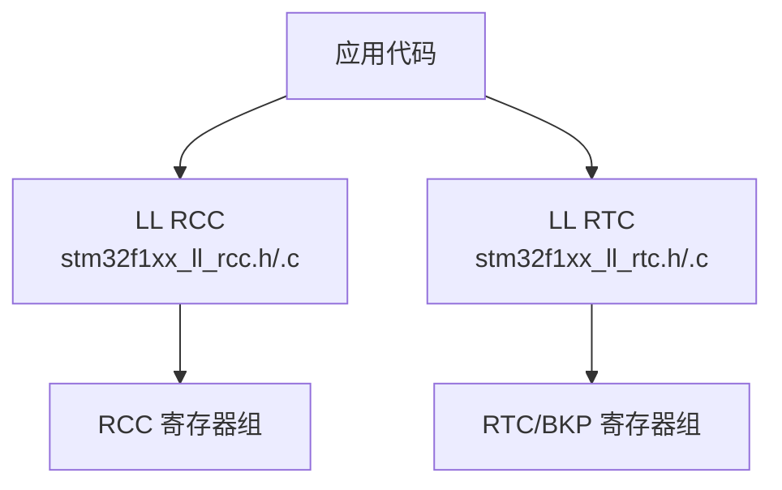
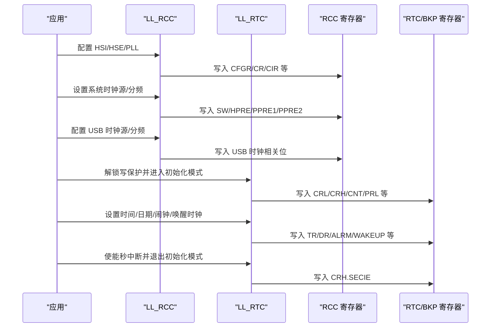
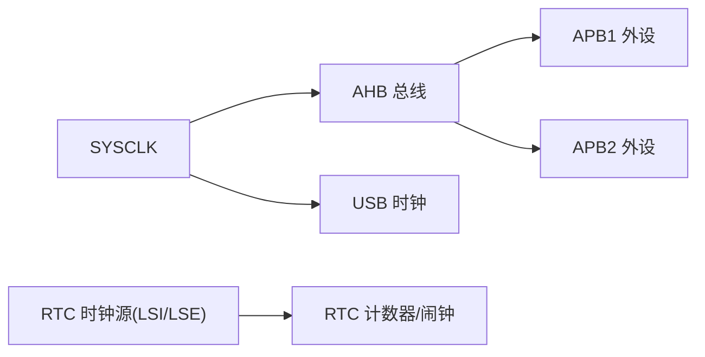
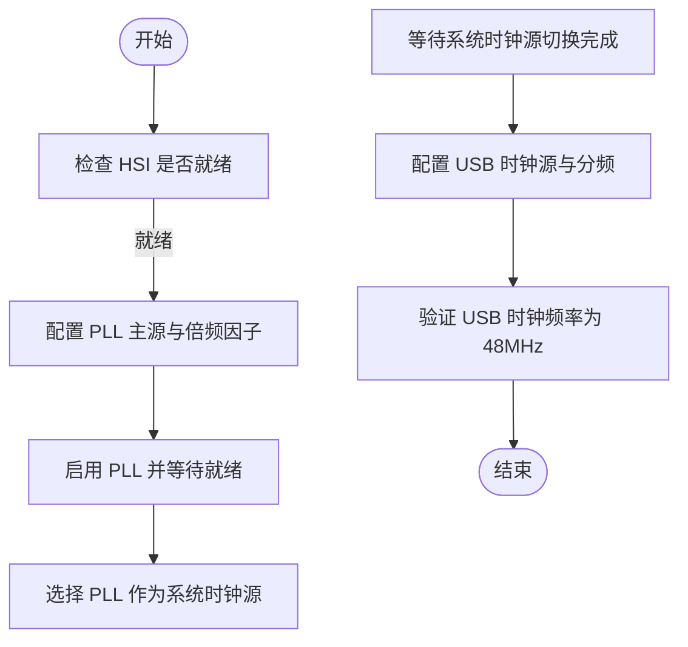
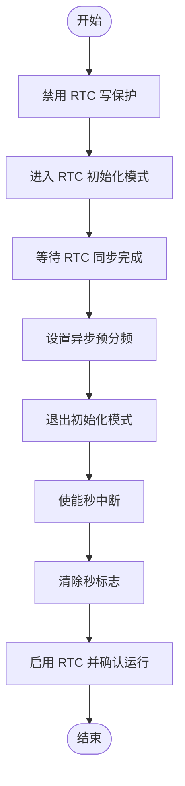

# LL RCC/RTC 低层接口

<cite>
**本文引用的文件**   
- [Inc/stm32f1xx_ll_rcc.h](file://Inc/stm32f1xx_ll_rcc.h)
- [Src/stm32f1xx_ll_rcc.c](file://Src/stm32f1xx_ll_rcc.c)
- [Inc/stm32f1xx_ll_rtc.h](file://Inc/stm32f1xx_ll_rtc.h)
- [Src/stm32f1xx_ll_rtc.c](file://Src/stm32f1xx_ll_rtc.c)
</cite>

## 目录
1. [简介](#简介)
2. [项目结构](#项目结构)
3. [核心组件](#核心组件)
4. [架构总览](#架构总览)
5. [详细组件分析](#详细组件分析)
6. [依赖关系分析](#依赖关系分析)
7. [性能与安全性考虑](#性能与安全性考虑)
8. [故障排查指南](#故障排查指南)
9. [结论](#结论)
10. [附录：USB 48MHz 与 RTC 秒中断示例流程](#附录usb-48mhz-与-rtc-秒中断示例流程)

## 简介
本文档面向 STM32F1xx 系列，聚焦 LL（Low Layer）层的 RCC 与 RTC 两个模块，重点说明：
- LL_RCC 如何直接管理 PLL、HSI/HSE、CSS、AHB/APB 分频、USB 预分频、系统时钟切换和外设时钟门控。
- LL_RTC 如何直接操作 CRH/CRL、DIVR/L、ALRM、TR/DR、CNTH/RTL、CALR 等寄存器，并提供时间、日期、闹钟、唤醒时钟和标志位控制。
- 给出 USB 48MHz 时钟配置与 RTC 秒中断的参考流程，并总结 LSI/LSE 启动等待、备份域保护与时钟源切换安全步骤。

需要特别说明的是：在当前仓库中，LL_RCC 与 LL_RTC 以头文件中的内联函数与宏为主；部分宏如 `__HAL_RCC_HSE_CONFIG`、`__HAL_RCC_PLL_CONFIG`、`__HAL_RCC_SYSCLK_CONFIG`、`__HAL_RCC_GET_SYSCLK_SOURCE`、`__HAL_RCC_APBx_CLK_ENABLE/DISABLE`、`__HAL_RCC_USB_CLK_DIV_CONFIG` 属于 HAL 风格的命名，可能由 HAL 层或外部公共头文件提供，不在当前 LL 头文件中定义。文档会严格区分“LL 接口”和“HAL 风格宏”，并以实际源码为依据。

## 项目结构
本仓库采用按外设模块划分的组织方式：
- Inc/ 下为各模块的头文件，LL 层接口集中在 stm32f1xx_ll_*.h。
- Src/ 下为对应实现，LL 层实现在 stm32f1xx_ll_*.c。

图表来源
- [Inc/stm32f1xx_ll_rcc.h:1-200](file://Inc/stm32f1xx_ll_rcc.h#L1-L200)
- [Src/stm32f1xx_ll_rcc.c:1-200](file://Src/stm32f1xx_ll_rcc.c#L1-L200)
- [Inc/stm32f1xx_ll_rtc.h:1-200](file://Inc/stm32f1xx_ll_rtc.h#L1-L200)
- [Src/stm32f1xx_ll_rtc.c:1-200](file://Src/stm32f1xx_ll_rtc.c#L1-L200)

章节来源
- [Inc/stm32f1xx_ll_rcc.h:1-200](file://Inc/stm32f1xx_ll_rcc.h#L1-L200)
- [Src/stm32f1xx_ll_rcc.c:1-200](file://Src/stm32f1xx_ll_rcc.c#L1-L200)
- [Inc/stm32f1xx_ll_rtc.h:1-200](file://Inc/stm32f1xx_ll_rtc.h#L1-L200)
- [Src/stm32f1xx_ll_rtc.c:1-200](file://Src/stm32f1xx_ll_rtc.c#L1-L200)

## 核心组件
- LL_RCC：通过内联函数直接读写 RCC 寄存器，提供 HSI/HSE 开关、PLL 配置、系统时钟源选择、AHB/APB 分频、USB 时钟源/分频、时钟安全系统相关标志与中断控制等能力。
- LL_RTC：通过内联函数直接操作 RTC 和 BKP 寄存器，提供初始化、同步、写保护、时间/日期设置、闹钟配置、唤醒时钟、标志位查询/清除、中断使能等能力。

章节来源
- [Inc/stm32f1xx_ll_rcc.h:1000-1510](file://Inc/stm32f1xx_ll_rcc.h#L1000-L1510)
- [Inc/stm32f1xx_ll_rtc.h:300-970](file://Inc/stm32f1xx_ll_rtc.h#L300-L970)

## 架构总览
LL RCC/RTC 直接映射到硬件寄存器，不引入复杂抽象层。应用代码通过 LL 接口函数写入 RCC/RTC 寄存器，再由硬件完成时钟切换、计数器和闹钟事件。

图表来源
- [Inc/stm32f1xx_ll_rcc.h:1000-1510](file://Inc/stm32f1xx_ll_rcc.h#L1000-L1510)
- [Inc/stm32f1xx_ll_rtc.h:300-970](file://Inc/stm32f1xx_ll_rtc.h#L300-L970)
- [Src/stm32f1xx_ll_rcc.c:1-200](file://Src/stm32f1xx_ll_rcc.c#L1-L200)
- [Src/stm32f1xx_ll_rtc.c:1-200](file://Src/stm32f1xx_ll_rtc.c#L1-L200)

## 详细组件分析

### LL_RCC 低层接口
LL_RCC 提供的关键能力包括：
- HSI/HSE 开关与就绪状态查询。
- PLL 主源选择与乘法因子配置。
- 系统时钟源选择及读取。
- AHB/APB1/APB2 分频设置与读取。
- USB 时钟源与分频配置。
- CSS 相关标志与中断清理。
- 外设时钟使能/禁用（通常通过 RCC APBx/APHxENR 寄存器）。

以下是对应接口的说明与参数语义。

#### 系统时钟源与 PLL 配置
- `LL_RCC_SetSysClkSource(Source)`
  - 作用：选择系统时钟源。
  - Source 可选值：`LL_RCC_SYS_CLKSOURCE_HSI`、`LL_RCC_SYS_CLKSOURCE_HSE`、`LL_RCC_SYS_CLKSOURCE_PLL`。
  - 说明：该函数直接修改 CFGR.SW 位。切换后需等待切换完成。
  - 参考位置：[Inc/stm32f1xx_ll_rcc.h:1012-1018](file://Inc/stm32f1xx_ll_rcc.h#L1012-L1018)

- `LL_RCC_GetSysClkSource()`
  - 作用：返回当前系统时钟源状态。
  - 返回值：用于判断当前 SWS 字段对应的时钟源。
  - 参考位置：[Inc/stm32f1xx_ll_rcc.h:1025-1031](file://Inc/stm32f1xx_ll_rcc.h#L1025-L1031)

- `LL_RCC_PLL_ConfigDomain_SYS(Source, PLLMul)`
  - 作用：配置系统域的 PLL，包含 PLL 输入源、外部分频、PLL 乘法因子以及 PREDIV1 相关位。
  - Source：表示 PLL 主时钟源及其外部分频设置，涉及 CFGR.PLLSRC、CFGR.PLLXTPRE 等位。
  - PLLMul：PLL 乘法因子，对应 CFGR.PLLMULL 等位。
  - 参考位置：[Inc/stm32f1xx_ll_rcc.h:1475-1479](file://Inc/stm32f1xx_ll_rcc.h#L1475-L1479)

- `LL_RCC_PLL_SetMainSource(PLLSource)`
  - 作用：设置 PLL 主时钟源。
  - PLLSource：决定 CFGR2.PREDIV1SRC 与 CFGR.PLLSRC 的配置。
  - 参考位置：[Inc/stm32f1xx_ll_rcc.h:1499-1505](file://Inc/stm32f1xx_ll_rcc.h#L1499-L1505)

#### AHB/APB 分频
- `LL_RCC_SetAHBPrescaler(Prescaler)`
  - 作用：设置 AHB 分频器 HPRE。
  - Prescaler：AHB 分频系数。
  - 参考位置：[Inc/stm32f1xx_ll_rcc.h:1045-1051](file://Inc/stm32f1xx_ll_rcc.h#L1045-L1051)

- `LL_RCC_GetAHBPrescaler()`
  - 作用：读取当前 AHB 分频系数。
  - 参考位置：[Inc/stm32f1xx_ll_rcc.h:1096-1102](file://Inc/stm32f1xx_ll_rcc.h#L1096-L1102)

- `LL_RCC_SetAPB1Prescaler(Prescaler)`
  - 作用：设置 APB1 分频器 PPRE1。
  - 参考位置：[Inc/stm32f1xx_ll_rcc.h:1061-1067](file://Inc/stm32f1xx_ll_rcc.h#L1061-L1067)

- `LL_RCC_SetAPB2Prescaler(Prescaler)`
  - 作用：设置 APB2 分频器 PPRE2。
  - 参考位置：[Inc/stm32f1xx_ll_rcc.h:1077-1083](file://Inc/stm32f1xx_ll_rcc.h#L1077-L1083)

#### USB 时钟配置
- USB 时钟源与分频相关接口存在于 LL_RCC 中，典型包括设置 USB 时钟源与分频系数的函数。具体函数名在 LL 头文件中存在，但本次搜索未命中用户指定的宏 `__HAL_RCC_USB_CLK_DIV_CONFIG`。因此建议优先使用 LL_RCC 提供的 USB 时钟配置函数，而不是 HAL 风格宏。

#### 时钟安全系统与就绪标志
- LL_RCC 暴露大量就绪标志与中断清理宏，例如：
  - `LL_RCC_CIR_LSERDYF`、`LL_RCC_CIR_HSIRDYF`、`LL_RCC_CIR_HSERDYF`、`LL_RCC_CIR_PLLRDYF`、`LL_RCC_CIR_CSSF`。
  - 对应清除宏：`LL_RCC_CIR_LSERDYC`、`LL_RCC_CIR_HSIRDYC`、`LL_RCC_CIR_HSERDYC`、`LL_RCC_CIR_PLLRDYC`、`LL_RCC_CIR_CSSC`。
  - 这些宏用于查询和清除 LSI/LSE/HSI/HSE/PLL/CSS 就绪标志。
  - 参考位置：[Inc/stm32f1xx_ll_rcc.h:60-120](file://Inc/stm32f1xx_ll_rcc.h#L60-L120)

#### HAL 风格宏的说明
- 用户提到的宏如 `__HAL_RCC_HSE_CONFIG`、`__HAL_RCC_PLL_CONFIG`、`__HAL_RCC_SYSCLK_CONFIG`、`__HAL_RCC_GET_SYSCLK_SOURCE`、`__HAL_RCC_APBx_CLK_ENABLE/DISABLE`、`__HAL_RCC_USB_CLK_DIV_CONFIG` 是 HAL 层常用的宏命名。在当前仓库的 LL 头文件中未找到这些宏的直接定义。若需要在 LL 层完成相同功能，应改用 LL_RCC 的内联函数，例如：
  - 系统时钟源切换：`LL_RCC_SetSysClkSource`
  - PLL 配置：`LL_RCC_PLL_ConfigDomain_SYS`、`LL_RCC_PLL_SetMainSource`
  - AHB/APB 分频：`LL_RCC_SetAHBPrescaler`、`LL_RCC_SetAPB1Prescaler`、`LL_RCC_SetAPB2Prescaler`
  - USB 时钟：使用 LL_RCC 提供的 USB 时钟源/分频函数（具体函数名以头文件为准）。

章节来源
- [Inc/stm32f1xx_ll_rcc.h:60-120](file://Inc/stm32f1xx_ll_rcc.h#L60-L120)
- [Inc/stm32f1xx_ll_rcc.h:1012-1031](file://Inc/stm32f1xx_ll_rcc.h#L1012-L1031)
- [Inc/stm32f1xx_ll_rcc.h:1045-1102](file://Inc/stm32f1xx_ll_rcc.h#L1045-L1102)
- [Inc/stm32f1xx_ll_rcc.h:1475-1505](file://Inc/stm32f1xx_ll_rcc.h#L1475-L1505)

### LL_RTC 低层接口
LL_RTC 直接操作 RTC 与 BKP 寄存器，提供完整的 RTC 初始化、时间/日期/闹钟设置、唤醒时钟配置、标志位与中断管理。

#### 写保护与初始化模式
- `LL_RTC_EnableWriteProtection(RTCx)`
  - 作用：启用 RTC 寄存器写保护。
  - 参考位置：[Inc/stm32f1xx_ll_rtc.h:335-342](file://Inc/stm32f1xx_ll_rtc.h#L335-L342)

- `LL_RTC_DisableWriteProtection(RTCx)`
  - 作用：禁用 RTC 寄存器写保护，以便写入受保护寄存器。
  - 参考位置：[Inc/stm32f1xx_ll_rtc.h:346-353](file://Inc/stm32f1xx_ll_rtc.h#L346-L353)

- `LL_RTC_EnterInitMode(RTCx)`
  - 作用：进入初始化模式，允许写入一些受保护的寄存器。
  - 参考位置：[Inc/stm32f1xx_ll_rtc.h:967](file://Inc/stm32f1xx_ll_rtc.h#L967)

- `LL_RTC_ExitInitMode(RTCx)`
  - 作用：退出初始化模式，恢复正常运行。
  - 参考位置：[Inc/stm32f1xx_ll_rtc.h:968](file://Inc/stm32f1xx_ll_rtc.h#L968)

- `LL_RTC_WaitForSynchro(RTCx)`
  - 作用：等待 RTC 同步完成，确保后续写入时序正确。
  - 参考位置：[Inc/stm32f1xx_ll_rtc.h:969](file://Inc/stm32f1xx_ll_rtc.h#L969)

#### 初始化与去初始化
- `LL_RTC_DeInit(RTCx)`
  - 作用：将 RTC 寄存器恢复到默认复位值，但不重置 RTC 时钟源与备份数据寄存器。
  - 内部流程包括：禁用写保护、进入初始化模式、清零 CNT/PRL/CRH/CRL、重置 BKP RTCCR/CR/CSR、退出初始化模式、等待同步、清除 RSF、重新启用写保护。
  - 参考位置：[Src/stm32f1xx_ll_rtc.c:1-200](file://Src/stm32f1xx_ll_rtc.c#L1-L200)

- `LL_RTC_Init(RTCx, RTC_InitStruct)`
  - 作用：根据初始化结构体配置 RTC，包括异步预分频与输出源。
  - 内部流程包括：校验参数、等待同步、进入初始化模式、清除 ALR/OW/SEC 标志、可选禁用 Tamper 引脚、设置输出源、配置异步预分频、退出初始化模式。
  - 参考位置：[Src/stm32f1xx_ll_rtc.c:1-200](file://Src/stm32f1xx_ll_rtc.c#L1-L200)

#### 时间、日期、闹钟与唤醒时钟
- 时间格式：`LL_RTC_FORMAT_BIN`、`LL_RTC_FORMAT_BCD`。
  - 参考位置：[Inc/stm32f1xx_ll_rtc.h:120-140](file://Inc/stm32f1xx_ll_rtc.h#L120-L140)

- 时间与日期结构体：
  - `LL_RTC_TimeTypeDef`：Hours、Minutes、Seconds。
  - `LL_RTC_AlarmTypeDef`：AlarmTime。
  - 参考位置：[Inc/stm32f1xx_ll_rtc.h:40-120](file://Inc/stm32f1xx_ll_rtc.h#L40-L120)

- 时间/日期/闹钟/唤醒时钟的具体设置函数在 LL_RTC 头文件中存在，调用前通常需要：
  - 禁用写保护：`LL_RTC_DisableWriteProtection`
  - 进入初始化模式：`LL_RTC_EnterInitMode`
  - 写入 TR/DR/ALRM/WAKEUP 等寄存器
  - 退出初始化模式：`LL_RTC_ExitInitMode`
  - 等待同步：`LL_RTC_WaitForSynchro`

由于本次检索未直接匹配到所有函数名，建议以头文件中存在的函数名为准，并在调用时遵循上述写保护与初始化模式流程。

#### 标志位与中断
- 标志位清除：
  - `LL_RTC_ClearFlag_ALR(RTCx)`：清除闹钟标志。
  - `LL_RTC_ClearFlag_RS(RTCx)`：清除同步标志。
  - `LL_RTC_ClearFlag_OW(RTCx)`：清除溢出标志。
  - `LL_RTC_ClearFlag_SEC(RTCx)`：清除秒标志。
  - 参考位置：[Inc/stm32f1xx_ll_rtc.h:720-790](file://Inc/stm32f1xx_ll_rtc.h#L720-L790)

- 中断使能/禁用：
  - `LL_RTC_EnableIT_ALR` / `LL_RTC_DisableIT_ALR`
  - `LL_RTC_EnableIT_SEC` / `LL_RTC_DisableIT_SEC`
  - `LL_RTC_EnableIT_OW` / `LL_RTC_DisableIT_OW`
  - 参考位置：[Inc/stm32f1xx_ll_rtc.h:816-903](file://Inc/stm32f1xx_ll_rtc.h#L816-L903)

章节来源
- [Inc/stm32f1xx_ll_rtc.h:40-140](file://Inc/stm32f1xx_ll_rtc.h#L40-L140)
- [Inc/stm32f1xx_ll_rtc.h:335-353](file://Inc/stm32f1xx_ll_rtc.h#L335-L353)
- [Inc/stm32f1xx_ll_rtc.h:720-903](file://Inc/stm32f1xx_ll_rtc.h#L720-L903)
- [Inc/stm32f1xx_ll_rtc.h:967-969](file://Inc/stm32f1xx_ll_rtc.h#L967-L969)
- [Src/stm32f1xx_ll_rtc.c:1-200](file://Src/stm32f1xx_ll_rtc.c#L1-L200)

## 依赖关系分析
LL_RCC 与 LL_RTC 都直接依赖芯片寄存器定义（RCC、RTC、BKP），并通过 LL 层内联函数进行最小化封装。两者之间的耦合主要体现在应用层对时钟与时间源的协调：
- 配置 USB 48MHz 前，需先确保 USB 时钟源稳定且分频正确。
- 配置 RTC 前，需确保 RTC 时钟源（LSI/LSE）已就绪。
- 外设时钟使能应在相应时钟源稳定后进行。

图表来源
- [Inc/stm32f1xx_ll_rcc.h:1000-1510](file://Inc/stm32f1xx_ll_rcc.h#L1000-L1510)
- [Inc/stm32f1xx_ll_rtc.h:300-970](file://Inc/stm32f1xx_ll_rtc.h#L300-L970)

## 性能与安全性考虑
- 时钟源切换安全步骤：
  - 在切换系统时钟源前，应先启用目标时钟源并等待其就绪标志置位。
  - 切换系统时钟源后，应读取当前系统时钟源状态以确认切换成功。
  - 若使用 PLL，应先配置好 PLL 源与倍频/分频因子，再开启 PLL 并等待 PLL 就绪。
- LSI/LSE 启动等待：
  - 使用 LL_RCC 的就绪标志宏查询 LSI/LSE 是否就绪，避免在未就绪情况下启用 RTC。
- 备份域保护：
  - 写入 RTC 寄存器前必须禁用写保护，并在完成所有写入后重新启用写保护。
  - 初始化 RTC 时应进入初始化模式，并在完成后退出初始化模式。
- USB 48MHz 时钟：
  - 确保 USB 时钟源与分频配置正确，避免 USB 通信异常。
- 外设时钟门控：
  - 在启用外设时钟前，确保相应总线时钟已配置到安全频率范围。

[本节为通用指导，不直接分析具体文件]

## 故障排查指南
- 系统时钟未切换：
  - 检查是否调用了系统时钟源设置函数，并读取当前系统时钟源状态确认。
  - 参考位置：[Inc/stm32f1xx_ll_rcc.h:1012-1031](file://Inc/stm32f1xx_ll_rcc.h#L1012-L1031)

- PLL 不稳定：
  - 检查 PLL 主源与乘法因子配置是否正确。
  - 确认 PLL 就绪标志。
  - 参考位置：[Inc/stm32f1xx_ll_rcc.h:1475-1505](file://Inc/stm32f1xx_ll_rcc.h#L1475-L1505)

- RTC 写入失败：
  - 确认是否禁用了写保护并进入了初始化模式。
  - 检查是否等待了同步完成。
  - 参考位置：[Inc/stm32f1xx_ll_rtc.h:335-353](file://Inc/stm32f1xx_ll_rtc.h#L335-L353)、[Inc/stm32f1xx_ll_rtc.h:967-969](file://Inc/stm32f1xx_ll_rtc.h#L967-L969)

- 秒中断未触发：
  - 确认已使能秒中断并清除了相应的秒标志。
  - 参考位置：[Inc/stm32f1xx_ll_rtc.h:851-868](file://Inc/stm32f1xx_ll_rtc.h#L851-L868)、[Inc/stm32f1xx_ll_rtc.h:786-790](file://Inc/stm32f1xx_ll_rtc.h#L786-L790)

章节来源
- [Inc/stm32f1xx_ll_rcc.h:1012-1031](file://Inc/stm32f1xx_ll_rcc.h#L1012-L1031)
- [Inc/stm32f1xx_ll_rcc.h:1475-1505](file://Inc/stm32f1xx_ll_rcc.h#L1475-L1505)
- [Inc/stm32f1xx_ll_rtc.h:335-353](file://Inc/stm32f1xx_ll_rtc.h#L335-L353)
- [Inc/stm32f1xx_ll_rtc.h:786-790](file://Inc/stm32f1xx_ll_rtc.h#L786-L790)
- [Inc/stm32f1xx_ll_rtc.h:851-868](file://Inc/stm32f1xx_ll_rtc.h#L851-L868)
- [Inc/stm32f1xx_ll_rtc.h:967-969](file://Inc/stm32f1xx_ll_rtc.h#L967-L969)

## 结论
- LL_RCC 提供了直接管理 HSI/HSE、PLL、系统时钟源、AHB/APB 分频、USB 时钟与 CSS 的低层接口。
- LL_RTC 提供了直接操作 RTC/BKP 寄存器的低层接口，涵盖初始化、写保护、时间/日期/闹钟、唤醒时钟与标志位/中断管理。
- 对于 HAL 风格宏，当前仓库未在其 LL 头文件中定义；应优先使用 LL 层函数以保证一致性。
- 在实际工程中，务必遵循时钟源就绪等待、备份域写保护、初始化模式同步等安全步骤。

[本节为总结性内容，不直接分析具体文件]

## 附录：USB 48MHz 与 RTC 秒中断示例流程

### USB 48MHz 时钟配置流程

图表来源
- [Inc/stm32f1xx_ll_rcc.h:1012-1031](file://Inc/stm32f1xx_ll_rcc.h#L1012-L1031)
- [Inc/stm32f1xx_ll_rcc.h:1475-1505](file://Inc/stm32f1xx_ll_rcc.h#L1475-L1505)

### RTC 秒中断配置流程

图表来源
- [Inc/stm32f1xx_ll_rtc.h:335-353](file://Inc/stm32f1xx_ll_rtc.h#L335-L353)
- [Inc/stm32f1xx_ll_rtc.h:967-969](file://Inc/stm32f1xx_ll_rtc.h#L967-L969)
- [Inc/stm32f1xx_ll_rtc.h:851-868](file://Inc/stm32f1xx_ll_rtc.h#L851-L868)
- [Inc/stm32f1xx_ll_rtc.h:786-790](file://Inc/stm32f1xx_ll_rtc.h#L786-L790)
- [Src/stm32f1xx_ll_rtc.c:1-200](file://Src/stm32f1xx_ll_rtc.c#L1-L200)