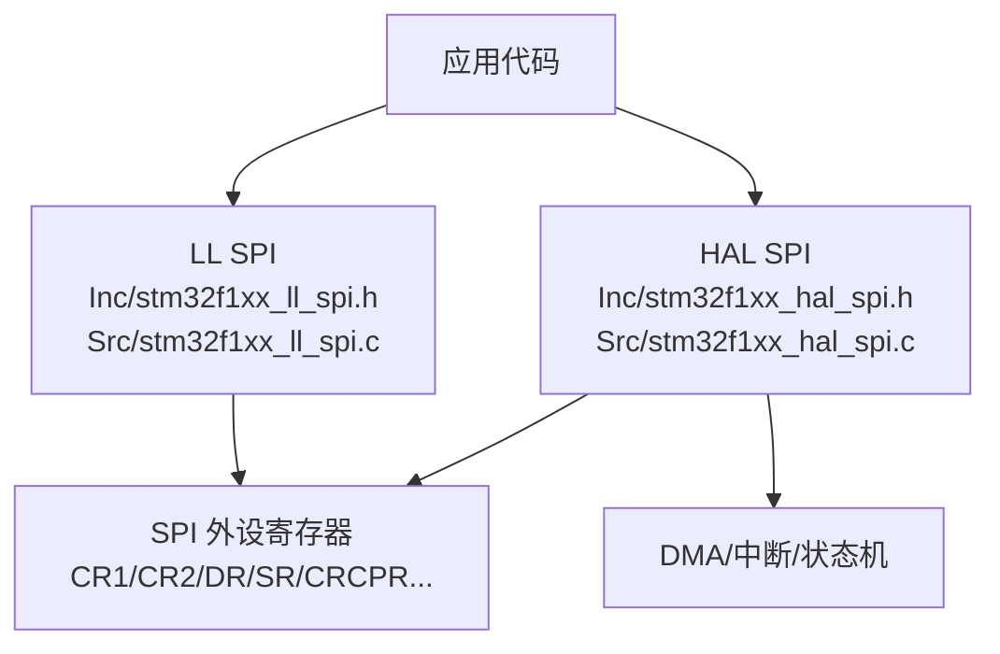
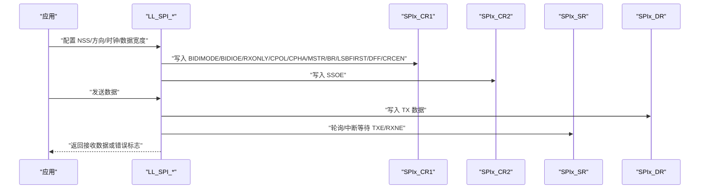
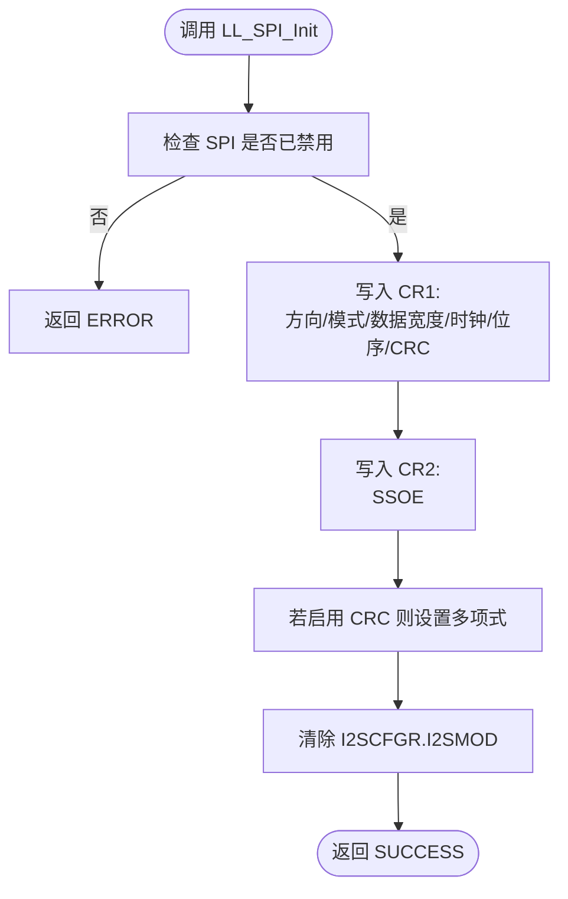
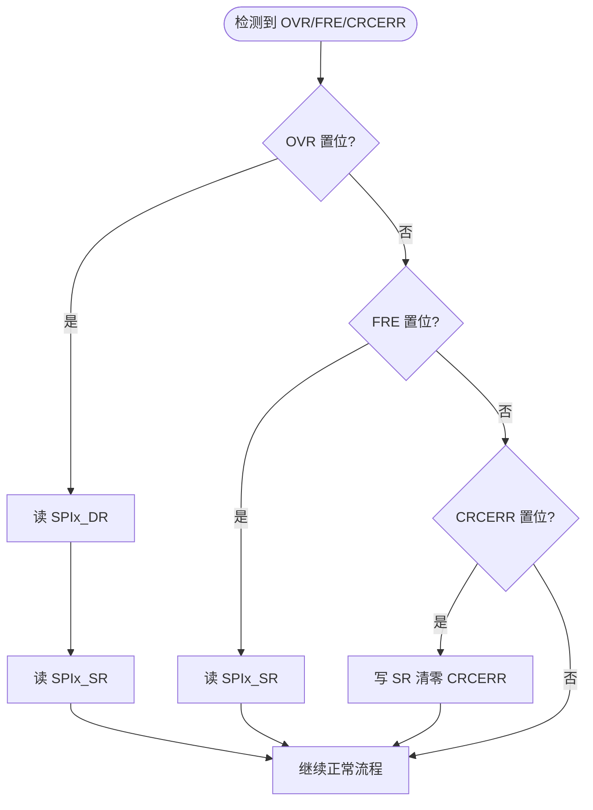
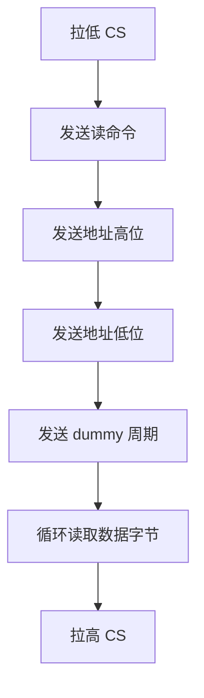
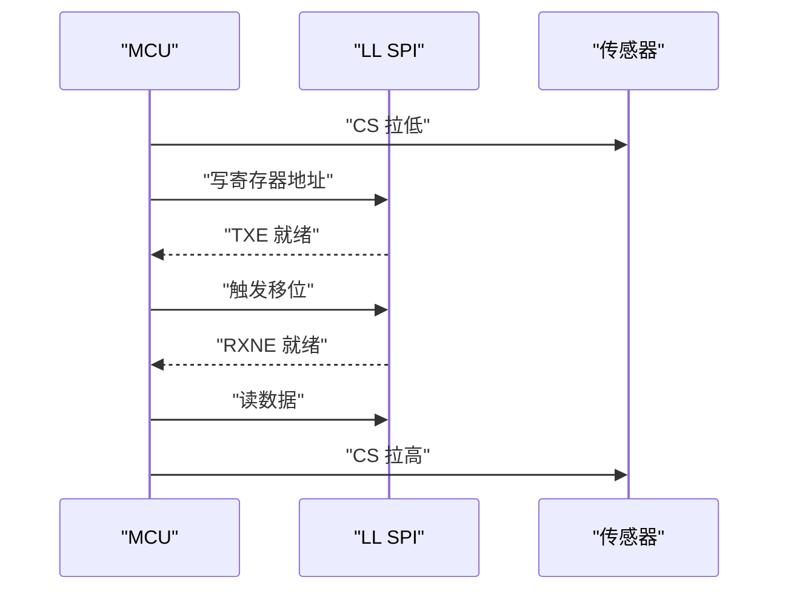
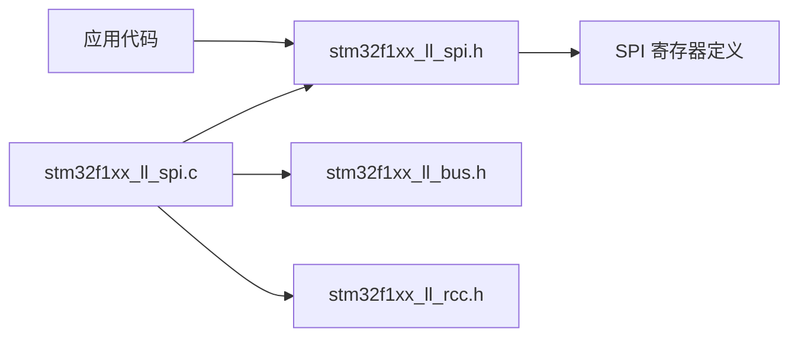

# LL SPI 低层接口

<cite>
**本文引用的文件**   
- [Inc/stm32f1xx_ll_spi.h](file://Inc/stm32f1xx_ll_spi.h)
- [Src/stm32f1xx_ll_spi.c](file://Src/stm32f1xx_ll_spi.c)
- [Inc/stm32f1xx_hal_spi.h](file://Inc/stm32f1xx_hal_spi.h)
- [Src/stm32f1xx_hal_spi.c](file://Src/stm32f1xx_hal_spi.c)
</cite>

## 目录
1. [引言](#引言)
2. [项目结构](#项目结构)
3. [核心组件](#核心组件)
4. [架构总览](#架构总览)
5. [详细组件分析](#详细组件分析)
6. [依赖关系分析](#依赖关系分析)
7. [性能与实时性考虑](#性能与实时性考虑)
8. [故障排查指南](#故障排查指南)
9. [结论](#结论)
10. [附录：API 速查表](#附录api-速查表)

## 引言
本文面向使用 STM32F1xx HAL/LL 驱动的工程师，系统文档化 LL（Low Layer）SPI 接口的寄存器级管理能力。LL_SPI 直接操作 SPIx_CR1、SPIx_CR2、SPIx_DR、SPIx_SR、SPIx_CRCPR、SPIx_RXCRCR、SPIx_TXCRCR 等寄存器，提供全双工、半双工、单向收发、硬件/NSS 软件管理以及多种帧格式配置能力。

需要特别注意：本仓库未定义名为 `__HAL_SPI_ENABLE/DISABLE/RESET` 的宏；LL 层对应入口是 `LL_SPI_Enable/Disable`、`LL_SPI_DeInit` 等函数。用户若从 HAL 迁移到 LL，应替换为这些 LL API。

## 项目结构
该仓库采用 HAL/LL 分层组织：
- Inc/ 中存放所有外设头文件，LL 头文件位于 `stm32f1xx_ll_*.h`。
- Src/ 中存放实现代码，LL 实现位于 `stm32f1xx_ll_*.c`。
- HAL 层在 `stm32f1xx_hal_spi.[ch]` 中封装更高层状态机与 DMA/中断流程。

**图示来源**
- [Inc/stm32f1xx_ll_spi.h:200-600](file://Inc/stm32f1xx_ll_spi.h#L200-L600)
- [Src/stm32f1xx_ll_spi.c:1-120](file://Src/stm32f1xx_ll_spi.c#L1-L120)

**章节来源**
- [Inc/stm32f1xx_ll_spi.h:1-250](file://Inc/stm32f1xx_ll_spi.h#L1-L250)
- [Src/stm32f1xx_ll_spi.c:1-80](file://Src/stm32f1xx_ll_spi.c#L1-L80)

## 核心组件
LL SPI 的核心由以下部分构成：
- 初始化结构与初始化函数族：`LL_SPI_InitTypeDef`、`LL_SPI_Init`、`LL_SPI_StructInit`、`LL_SPI_DeInit`。
- 运行时控制函数：使能/禁用、主从模式、时钟极性与相位、波特率分频、数据宽度、位序、NSS 模式、方向。
- 数据搬运：8/16 位发送/接收 DR。
- 标志与中断：RXNE、TXE、BSY、OVR、FRE、CRCERR、MODF，以及相应中断使能。
- CRC：开启/关闭、多项式、读 RX/TX CRC。
- DMA：RX/TX DMA 请求使能与数据寄存器地址。

**章节来源**
- [Inc/stm32f1xx_ll_spi.h:200-600](file://Inc/stm32f1xx_ll_spi.h#L200-L600)
- [Inc/stm32f1xx_ll_spi.h:600-1157](file://Inc/stm32f1xx_ll_spi.h#L600-L1157)
- [Src/stm32f1xx_ll_spi.c:120-260](file://Src/stm32f1xx_ll_spi.c#L120-L260)

## 架构总览
LL SPI 以寄存器直写为主，配合少量内联函数完成掩码修改。其典型调用链如下：

**图示来源**
- [Inc/stm32f1xx_ll_spi.h:200-600](file://Inc/stm32f1xx_ll_spi.h#L200-L600)
- [Inc/stm32f1xx_ll_spi.h:600-1157](file://Inc/stm32f1xx_ll_spi.h#L600-L1157)

## 详细组件分析

### 寄存器与参数映射
| 参数 | 主要寄存器位 | 含义与作用 |
|---|---:|---|
| CPOL | SPI_CR1_CPOL | 时钟空闲极性：0 表示空闲为低，1 表示空闲为高。影响主设备 SCK 波形。 |
| CPHA | SPI_CR1_CPHA | 时钟相位：第一跳变采样或第二跳变采样，决定首个有效边沿。 |
| DFF | SPI_CR1_DFF | 数据帧长度：0=8 位，1=16 位。影响 DR 访问宽度。 |
| MSTR | SPI_CR1_MSTR | 主从模式：置 1 为主设备，0 为从设备。 |
| BR[2:0] | SPI_CR1_BR | 波特率分频：fPCLK/2/4/8/16/32/64/128/256。 |
| LSBFIRST | SPI_CR1_LSBFIRST | 传输位序：MSB 优先或 LSB 优先。 |
| BIDIMODE/BIDIOE/RXONLY | SPI_CR1 | 传输方向：全双工、半双工收/发、单收。 |
| SSM/SSI | SPI_CR1 | NSS 软件管理：内部拉高选中（SSI=1），引脚复用为 NSS。 |
| SSOE | SPI_CR2 | 从机模式下 NSS 引脚输出片选。 |
| CRCEN | SPI_CR1 | 启用硬件 CRC。 |
| CRCNEXT | SPI_CR1 | 下一字节为 CRC 值。 |
| RXNEIE/TXEIE/ERRIE | SPI_CR2 | RX/TX 缓冲区及错误中断使能。 |
| RXDMAEN/TXDMAEN | SPI_CR2 | RX/TX DMA 请求使能。 |

**章节来源**
- [Inc/stm32f1xx_ll_spi.h:200-600](file://Inc/stm32f1xx_ll_spi.h#L200-L600)
- [Inc/stm32f1xx_ll_spi.h:600-1157](file://Inc/stm32f1xx_ll_spi.h#L600-L1157)

### 初始化与复位
- `LL_SPI_DeInit`：通过 APB 复位/释放 SPI 外设，恢复默认寄存器值。
- `LL_SPI_Init`：在 SPI 禁用状态下写入 CR1、CR2、CRCPR；同时清除 I2S 模式位。
- `LL_SPI_StructInit`：将初始化结构体字段设为库默认值。

**图示来源**
- [Src/stm32f1xx_ll_spi.c:120-220](file://Src/stm32f1xx_ll_spi.c#L120-L220)

**章节来源**
- [Src/stm32f1xx_ll_spi.c:80-260](file://Src/stm32f1xx_ll_spi.c#L80-L260)

### 运行控制函数族
- 使能/禁用：`LL_SPI_Enable`、`LL_SPI_Disable`、`LL_SPI_IsEnabled`。
- 模式：`LL_SPI_SetMode`、`LL_SPI_GetMode`。
- 时钟：`LL_SPI_SetClockPolarity`、`LL_SPI_SetClockPhase`。
- 波特率：`LL_SPI_SetBaudRatePrescaler`。
- 方向：`LL_SPI_SetTransferDirection`。
- 数据宽度：`LL_SPI_SetDataWidth`。
- 位序：`LL_SPI_SetTransferBitOrder`。
- NSS：`LL_SPI_SetNSSMode`、`LL_SPI_GetNSSMode`。
- CRC：`LL_SPI_EnableCRC`、`LL_SPI_DisableCRC`、`LL_SPI_SetCRCPolynomial`、`LL_SPI_SetCRCNext`。

这些函数直接修改 SPIx_CR1/CR2/CRCPR，不隐藏底层寄存器行为。

**章节来源**
- [Inc/stm32f1xx_ll_spi.h:200-600](file://Inc/stm32f1xx_ll_spi.h#L200-L600)
- [Inc/stm32f1xx_ll_spi.h:600-1157](file://Inc/stm32f1xx_ll_spi.h#L600-L1157)

### 数据发送与接收
- 发送：`LL_SPI_TransmitData8`、`LL_SPI_TransmitData16`。
- 接收：`LL_SPI_ReceiveData8`、`LL_SPI_ReceiveData16`。
- 标志：`LL_SPI_IsActiveFlag_TXE`、`LL_SPI_IsActiveFlag_RXNE`、`LL_SPI_IsActiveFlag_BSY`。
- 中断：`LL_SPI_EnableIT_TXE`、`LL_SPI_EnableIT_RXNE`、`LL_SPI_EnableIT_ERR`。
- DMA：`LL_SPI_EnableDMAReq_TX`、`LL_SPI_EnableDMAReq_RX`、`LL_SPI_DMA_GetRegAddr`。

注意：LL 没有 `__HAL_SPI_TX_ENABLE` 这类宏。若希望仅发送，应使用 `LL_SPI_SetTransferDirection(LL_SPI_HALF_DUPLEX_TX)`；若仅接收，可使用 `LL_SPI_SIMPLEX_RX` 或 `LL_SPI_HALF_DUPLEX_RX`。

**章节来源**
- [Inc/stm32f1xx_ll_spi.h:600-1157](file://Inc/stm32f1xx_ll_spi.h#L600-L1157)

### 标志读取与清除顺序
| 标志 | 检测函数 | 清除方式 | 常见陷阱 |
|---|---|---|---|
| RXNE | `LL_SPI_IsActiveFlag_RXNE` | 读 DR 自动清 | 未及时读 DR 导致 OVR。 |
| TXE | `LL_SPI_IsActiveFlag_TXE` | 写 DR 自动清 | 在 TXE 前写入可能丢失上一帧。 |
| OVR | `LL_SPI_IsActiveFlag_OVR` | 先读 DR，再读 SR | 只读 SR 不清 OVR。 |
| FRE | `LL_SPI_ClearFlag_FRE` | 读 SR | 多用于 TI 模式误配。 |
| CRCERR | `LL_SPI_ClearFlag_CRCERR` | 写 SR 清零位 | 需配合正确 CRC 配置。 |
| MODF | `LL_SPI_ClearFlag_MODF` | 读 SR 后禁用 SPE | 主从冲突时出现。 |
| BSY | `LL_SPI_IsActiveFlag_BSY` | 正确禁用 SPI 或故障后恢复 | 不可简单写零清除。 |

**图示来源**
- [Inc/stm32f1xx_ll_spi.h:600-1157](file://Inc/stm32f1xx_ll_spi.h#L600-L1157)

**章节来源**
- [Inc/stm32f1xx_ll_spi.h:600-1157](file://Inc/stm32f1xx_ll_spi.h#L600-L1157)

### 与 HAL SPI 的差异对比
- HAL 提供 `HAL_SPI_Transmit`、`HAL_SPI_Receive`、`HAL_SPI_TransmitReceive` 等高级函数，内部可驱动 DMA 或中断，并维护状态机。
- LL 提供最小寄存器操作集合，不包含高级状态机；即使启用了 DMA 请求位，也需要应用层或 DMA 控制器完成数据搬运。
- 当 DMA 未启用时，LL 必须手动循环等待 TXE/RXNE 并读写 DR；这比 HAL 更透明但更容易出错。
- HAL 对错误标志的处理通常封装在回调和返回值中；LL 暴露原始标志，要求应用显式处理 OVR/FRE/CRCERR/MODF。

建议：
- 小批量、低延迟场景可直接用 LL 轮询。
- 大数据量建议使用 LL 暴露的 DMA 请求 + 外部 DMA 驱动。
- 快速移植可从 HAL 开始，确认时序后再下探到 LL。

**章节来源**
- [Inc/stm32f1xx_ll_spi.h:600-1157](file://Inc/stm32f1xx_ll_spi.h#L600-L1157)
- [Src/stm32f1xx_ll_spi.c:120-260](file://Src/stm32f1xx_ll_spi.c#L120-L260)

### SPI Flash 读取与写入示例思路
以下为 LL 风格伪流程，便于理解实际寄存器交互。

#### 读取 SPI Flash
1. 配置 GPIO：MOSI、MISO、SCK、CS。
2. 配置 RCC：启用 SPI 时钟。
3. 配置 LL SPI：
   - 主模式、全双工。
   - 选择 Flash 要求的 CPOL/CPHA。
   - 设置 MSB 优先。
   - 设置合适分频。
   - 使用软件 NSS（由 GPIO CS 控制）。
4. 拉低 CS。
5. 发送命令字节与地址字节，每次发送后读取应答。
6. 拉高 CS。

#### 写入 SPI Flash
1. 拉低 CS。
2. 发送写使能命令。
3. 拉高 CS。
4. 再次拉低 CS。
5. 发送页写命令、地址、最多一页数据。
6. 拉高 CS。
7. 轮询状态寄存器直到写入完成。

**章节来源**
- [Inc/stm32f1xx_ll_spi.h:200-600](file://Inc/stm32f1xx_ll_spi.h#L200-L600)
- [Inc/stm32f1xx_ll_spi.h:600-1157](file://Inc/stm32f1xx_ll_spi.h#L600-L1157)

### SPI 传感器采集示例思路
以典型数字传感器为例：
1. 配置 SPI 为传感器支持的 CPOL/CPHA、MSB 优先。
2. 使用软件 NSS，由 GPIO 控制片选。
3. 先写寄存器地址，再读回数据。
4. 对连续多寄存器使用突发读或按字节轮询。
5. 若使用中断，可在 RXNE 中断中逐字节搬移数据到缓冲区。

**章节来源**
- [Inc/stm32f1xx_ll_spi.h:600-1157](file://Inc/stm32f1xx_ll_spi.h#L600-L1157)

## 依赖关系分析
LL SPI 模块依赖：
- 芯片定义头文件，包含 SPI 寄存器基址与位定义。
- LL Bus/RCC 用于外设时钟与复位。
- 可选断言宏，在启用完整 LL 驱动时进行参数校验。

**图示来源**
- [Src/stm32f1xx_ll_spi.c:1-40](file://Src/stm32f1xx_ll_spi.c#L1-L40)

**章节来源**
- [Src/stm32f1xx_ll_spi.c:1-80](file://Src/stm32f1xx_ll_spi.c#L1-L80)

## 性能与实时性考虑
- LL 函数多为内联或短函数，开销接近直接写寄存器。
- 轮询方式在忙等待中占用 CPU；大数据量时应启用 DMA。
- 中断方式可降低 CPU 占用，但需在 ISR 中及时读写 DR，避免 OVR。
- 频繁切换 CPOL/CPHA/MSTR 会影响通信稳定性，应在通信开始前统一配置。
- BSY 标志不能简单清零，必须在正确时机禁用 SPI 或通过故障恢复序列清理。

## 故障排查指南
常见问题与解决思路：

| 现象 | 可能原因 | 排查与修复 |
|---|---|---|
| 读到的数据错位或乱码 | CPOL/CPHA 与器件不一致 | 对照器件手册调整 `LL_SPI_SetClockPolarity` 与 `LL_SPI_SetClockPhase`。 |
| 主从无法通信 | MSTR 配置错误或外部 slave 未产生时钟 | 确认主端 MSTR=1，从端 MSTR=0；主端必须产生 SCK。 |
| CS 电平异常 | NSS 模式与 GPIO 逻辑不匹配 | 使用软件 NSS 并由 GPIO 控制 CS，检查拉低/拉高时序。 |
| 首次读取为空 | 未等待 TXE 或未发送 dummy 时钟 | 确保在发送后读取 RXNE，并对只读器件发送足够 dummy 字节。 |
| OVR 标志持续置位 | 未及时读 DR 或从端溢出 | 优先读 DR，再读 SR；检查 RXNE 处理路径。 |
| FRE 或 MODF 报错 | TI 模式误配或主从冲突 | 关闭 TI 模式相关配置；重新检查主从模式与 NSS 管理。 |
| CRC 错误 | CRC 多项式或两端 CRC 策略不一致 | 核对 CRCEN、CRCNEXT、CRCPoly，并确保对端一致。 |

**章节来源**
- [Inc/stm32f1xx_ll_spi.h:600-1157](file://Inc/stm32f1xx_ll_spi.h#L600-L1157)

## 结论
LL SPI 提供了 STM32F1xx SPI 外设的最小且最直接的编程模型。它适合需要精确控制寄存器、降低抽象开销的场景，但也要求开发者自行处理标志、中断、DMA 与错误恢复。对于大多数应用，可以先使用 HAL SPI 快速验证功能，再根据实时性或体积需求迁移到 LL。在使用 LL 时，务必严格对齐 CPOL/CPHA、NSS 管理、数据宽度与位序，并在错误路径中正确处理 OVR/FRE/CRCERR/MODF。

## 附录：API 速查表
- 初始化与复位
  - `LL_SPI_DeInit`
  - `LL_SPI_Init`
  - `LL_SPI_StructInit`
- 运行控制
  - `LL_SPI_Enable`
  - `LL_SPI_Disable`
  - `LL_SPI_IsEnabled`
  - `LL_SPI_SetMode`
  - `LL_SPI_SetClockPolarity`
  - `LL_SPI_SetClockPhase`
  - `LL_SPI_SetBaudRatePrescaler`
  - `LL_SPI_SetTransferDirection`
  - `LL_SPI_SetDataWidth`
  - `LL_SPI_SetTransferBitOrder`
  - `LL_SPI_SetNSSMode`
- 数据操作
  - `LL_SPI_TransmitData8`
  - `LL_SPI_TransmitData16`
  - `LL_SPI_ReceiveData8`
  - `LL_SPI_ReceiveData16`
- 标志与中断
  - `LL_SPI_IsActiveFlag_TXE`
  - `LL_SPI_IsActiveFlag_RXNE`
  - `LL_SPI_IsActiveFlag_BSY`
  - `LL_SPI_IsActiveFlag_OVR`
  - `LL_SPI_IsActiveFlag_CRCERR`
  - `LL_SPI_IsActiveFlag_FRE`
  - `LL_SPI_ClearFlag_OVR`
  - `LL_SPI_ClearFlag_CRCERR`
  - `LL_SPI_ClearFlag_FRE`
  - `LL_SPI_ClearFlag_MODF`
  - `LL_SPI_EnableIT_TXE`
  - `LL_SPI_EnableIT_RXNE`
  - `LL_SPI_EnableIT_ERR`
- DMA
  - `LL_SPI_EnableDMAReq_TX`
  - `LL_SPI_EnableDMAReq_RX`
  - `LL_SPI_DMA_GetRegAddr`
- CRC
  - `LL_SPI_EnableCRC`
  - `LL_SPI_DisableCRC`
  - `LL_SPI_SetCRCPolynomial`
  - `LL_SPI_SetCRCNext`

**章节来源**
- [Inc/stm32f1xx_ll_spi.h:200-600](file://Inc/stm32f1xx_ll_spi.h#L200-L600)
- [Inc/stm32f1xx_ll_spi.h:600-1157](file://Inc/stm32f1xx_ll_spi.h#L600-L1157)
- [Src/stm32f1xx_ll_spi.c:120-260](file://Src/stm32f1xx_ll_spi.c#L120-L260)