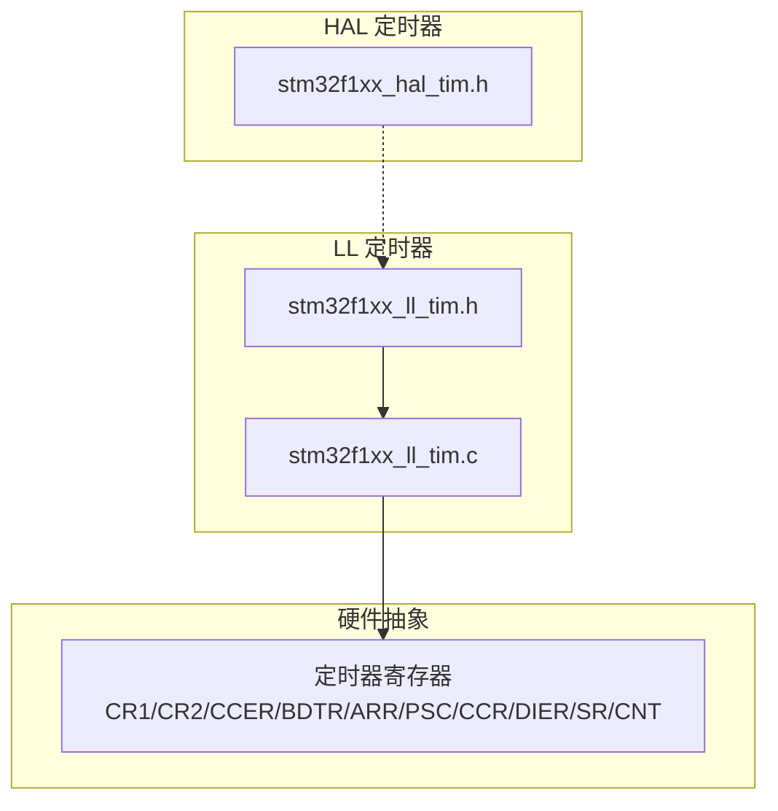
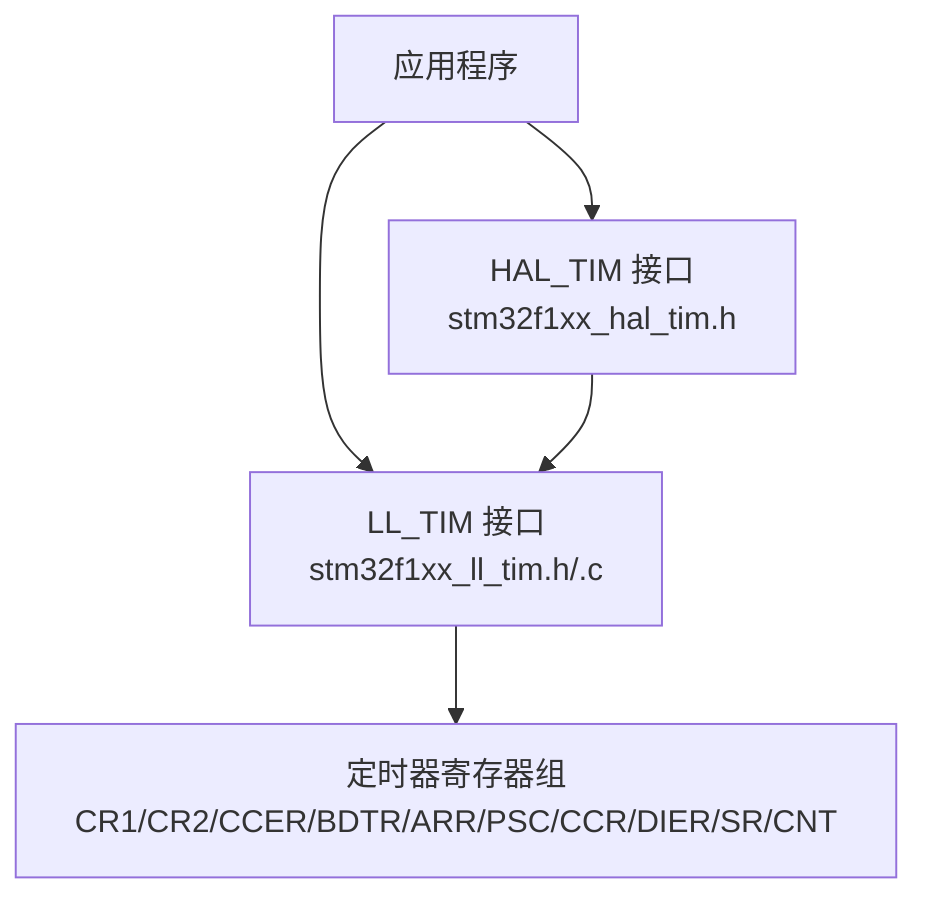
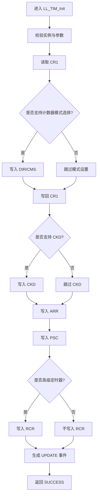
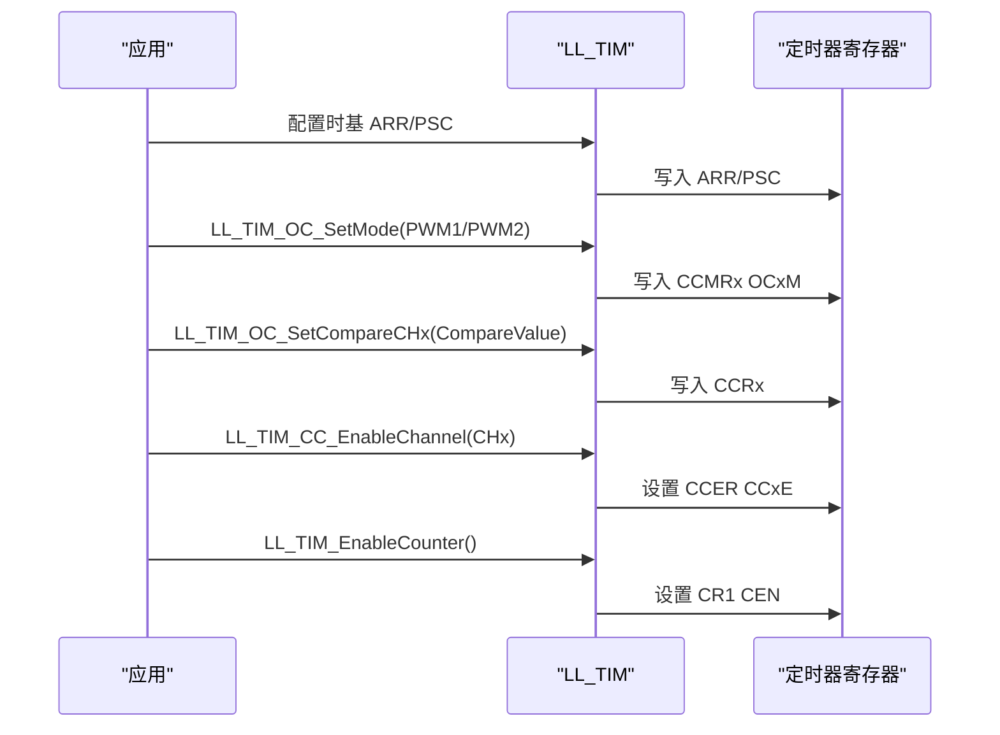
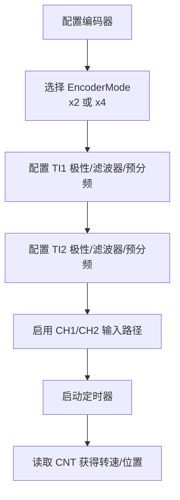
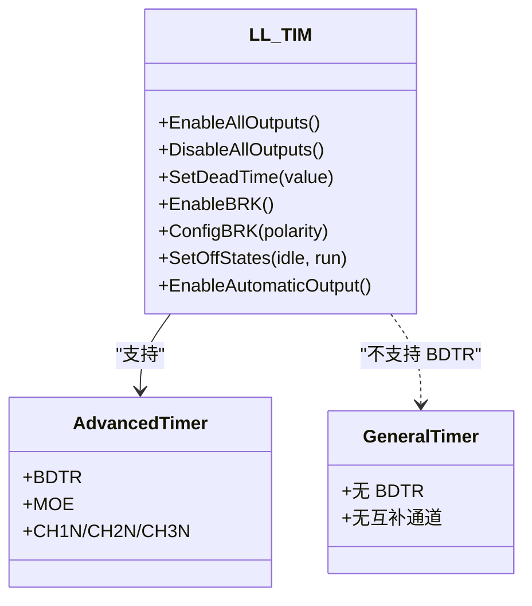
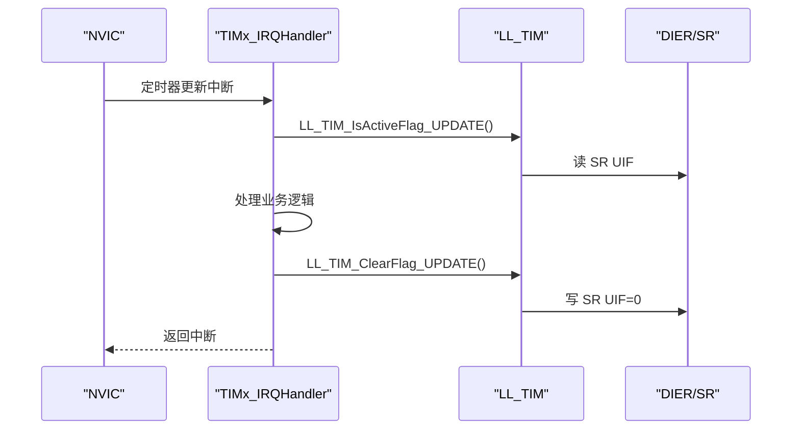
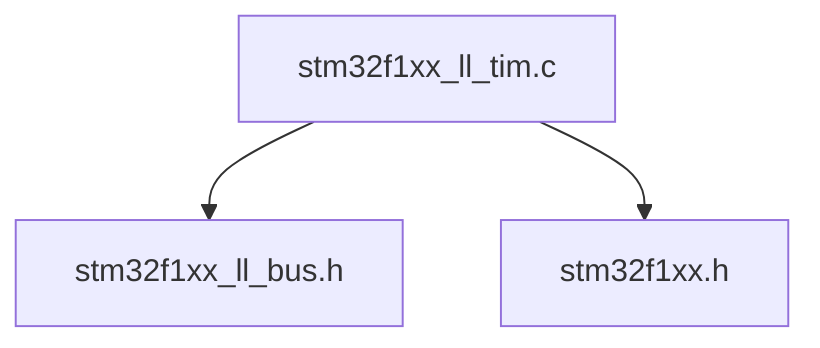

# LL TIM 低层接口

<cite>
**本文引用的文件**   
- [Inc/stm32f1xx_ll_tim.h](file://Inc/stm32f1xx_ll_tim.h)
- [Src/stm32f1xx_ll_tim.c](file://Src/stm32f1xx_ll_tim.c)
- [Inc/stm32f1xx_hal_tim.h](file://Inc/stm32f1xx_hal_tim.h)
- [README.md](file://README.md)
</cite>

## 目录
1. [简介](#简介)
2. [项目结构](#项目结构)
3. [核心组件](#核心组件)
4. [架构总览](#架构总览)
5. [详细组件分析](#详细组件分析)
6. [依赖关系分析](#依赖关系分析)
7. [性能与可移植性注意事项](#性能与可移植性注意事项)
8. [故障排查指南](#故障排查指南)
9. [结论](#结论)
10. [附录：API 速查与参数说明](#附录api-速查与参数说明)

## 简介
本文档面向使用 STM32F1xx LL（Low Layer）定时器接口的开发者，系统化梳理 LL_TIM 对定时器底层寄存器的封装方式。LL 层直接操作定时器的关键寄存器，包括自动重装载寄存器 ARR、预分频器 PSC、比较寄存器 CCR、中断/事件使能寄存器 DIER、状态寄存器 SR、计数器 CNT，以及控制寄存器 CR1/CR2、捕获/比较使能寄存器 CCER、死区与刹车寄存器 BDTR 等。

LL_TIM 提供以下能力：
- 基本计数与时基配置：PSC、ARR、CNT、CounterMode、ClockDivision。
- 更新中断：DIER/UIE、SR/UIF、中断服务函数中的标志清除。
- PWM 输出：OC Mode、CCRx、通道使能 CCER。
- 输入捕获：ICx 极性、滤波器、预分频、ActiveInput。
- 编码器模式：TI1/TI2 边沿计数 x2/x4。
- 互补输出与高级特性：CH1N/CH2N/CH3N、BDTR 死区时间、刹车、主输出 MOE。

文档同时给出与 HAL_TIM_Base_Init、HAL_TIM_PWM_ConfigChannel 的对应关系，并提醒通用定时器（如 TIM2/TIM5）与高级定时器（如 TIM1/TIM8）在 CCER、BDTR、CH1P 等寄存器上的差异，以及在 F1 子型号间进行实例能力校验的重要性。

**章节来源**
- [README.md:1-45](file://README.md#L1-L45)

## 项目结构
该仓库是 STM32CubeF1 HAL-LL 驱动组件的一部分，LL 层头文件和实现分别位于：
- Inc/stm32f1xx_ll_tim.h：LL_TIM 全部宏、枚举、结构体与内联 API 声明。
- Src/stm32f1xx_ll_tim.c：LL_TIM 初始化、输出比较、输入捕获、编码器、BDTR 等函数的实现。
- Inc/stm32f1xx_hal_tim.h：用于对比的 HAL TIM 数据结构与 API 声明。

**图示来源**
- [Inc/stm32f1xx_ll_tim.h:1-120](file://Inc/stm32f1xx_ll_tim.h#L1-L120)
- [Src/stm32f1xx_ll_tim.c:1-80](file://Src/stm32f1xx_ll_tim.c#L1-L80)
- [Inc/stm32f1xx_hal_tim.h:1-60](file://Inc/stm32f1xx_hal_tim.h#L1-L60)

**章节来源**
- [Inc/stm32f1xx_ll_tim.h:1-120](file://Inc/stm32f1xx_ll_tim.h#L1-L120)
- [Src/stm32f1xx_ll_tim.c:1-80](file://Src/stm32f1xx_ll_tim.c#L1-L80)
- [Inc/stm32f1xx_hal_tim.h:1-60](file://Inc/stm32f1xx_hal_tim.h#L1-L60)

## 核心组件
LL_TIM 的核心由三类构件组成：
1. 数据类型与常量
   - LL_TIM_InitTypeDef：时基单元配置，包含 Prescaler、CounterMode、Autoreload、ClockDivision、RepetitionCounter。
   - LL_TIM_OC_InitTypeDef：输出比较/PWM 配置，包含 OCMode、OCState/OCNState、CompareValue、OCPolarity、OCNPolarity、OCIdleState/OCNIdleState。
   - LL_TIM_IC_InitTypeDef：输入捕获配置，包含 ICPolarity、ICActiveInput、ICPrescaler、ICFilter。
   - LL_TIM_ENCODER_InitTypeDef：编码器配置，包含 EncoderMode、IC1/IC2 相关极性与滤波器。
   - LL_TIM_BDTR_InitTypeDef：高级定时器的死区与刹车配置。
   - 各类枚举：TIM_LL_EC_COUNTERMODE、TIM_LL_EC_OCMODE、TIM_LL_EC_IC_POLARITY、TIM_LL_EC_ENCODERMODE、TIM_LL_EC_CLOCKDIVISION、TIM_LL_EC_ACTIVEINPUT、TIM_LL_EC_OCPOLARITY、TIM_LL_EC_OCIDLESTATE 等。

2. 内联访问函数
   - 计数器与事件：LL_TIM_EnableCounter、LL_TIM_DisableCounter、LL_TIM_GenerateEvent_UPDATE、LL_TIM_IsEnabledUpdateEvent。
   - 预分频与重装载：LL_TIM_SetPrescaler、LL_TIM_GetPrescaler、LL_TIM_SetAutoReload、LL_TIM_GetAutoReload、LL_TIM_EnableARRPreload、LL_TIM_DisableARRPreload。
   - 方向与模式：LL_TIM_SetCounterMode、LL_TIM_GetCounterMode、LL_TIM_IsTimCountingDown、LL_TIM_SetClockDivision。
   - 比较与通道：LL_TIM_CC_EnableChannel、LL_TIM_CC_DisableChannel、LL_TIM_OC_SetMode、LL_TIM_OC_SetPolarity、LL_TIM_OC_SetCompareCHx、LL_TIM_OC_GetCompareCHx。
   - 中断与标志：LL_TIM_EnableIT_UPDATE、LL_TIM_DisableIT_UPDATE、LL_TIM_ClearFlag_UPDATE、LL_TIM_IsActiveFlag_UPDATE；以及 CC1~CC4、COM、TRIG、BRK 等中断与标志操作。
   - 编码器：LL_TIM_SetEncoderMode、LL_TIM_IC_* 系列。
   - 高级定时器：LL_TIM_EnableAllOutputs、LL_TIM_DisableAllOutputs、LL_TIM_SetDeadTime、LL_TIM_EnableBRK、LL_TIM_ConfigBRK、LL_TIM_SetOffStates、LL_TIM_EnableAutomaticOutput 等。

3. 初始化与结构体默认值
   - LL_TIM_DeInit、LL_TIM_StructInit、LL_TIM_Init。
   - LL_TIM_OC_StructInit、LL_TIM_OC_Init。
   - LL_TIM_IC_StructInit、LL_TIM_IC_Init。
   - LL_TIM_ENCODER_StructInit、LL_TIM_ENCODER_Init。
   - LL_TIM_BDTR_StructInit、LL_TIM_BDTR_Init。

这些组件共同构成对定时器寄存器的细粒度控制，适合需要最小开销、精确时序或底层调试的场景。

**章节来源**
- [Inc/stm32f1xx_ll_tim.h:181-463](file://Inc/stm32f1xx_ll_tim.h#L181-L463)
- [Inc/stm32f1xx_ll_tim.h:983-1017](file://Inc/stm32f1xx_ll_tim.h#L983-L1017)
- [Inc/stm32f1xx_ll_tim.h:1047-1405](file://Inc/stm32f1xx_ll_tim.h#L1047-L1405)
- [Inc/stm32f1xx_ll_tim.h:1428-2138](file://Inc/stm32f1xx_ll_tim.h#L1428-L2138)
- [Inc/stm32f1xx_ll_tim.h:2184-2509](file://Inc/stm32f1xx_ll_tim.h#L2184-L2509)
- [Inc/stm32f1xx_ll_tim.h:2530-2909](file://Inc/stm32f1xx_ll_tim.h#L2530-L2909)
- [Inc/stm32f1xx_ll_tim.h:2968-3515](file://Inc/stm32f1xx_ll_tim.h#L2968-L3515)
- [Inc/stm32f1xx_ll_tim.h:3862-3874](file://Inc/stm32f1xx_ll_tim.h#L3862-L3874)
- [Src/stm32f1xx_ll_tim.c:305-708](file://Src/stm32f1xx_ll_tim.c#L305-L708)

## 架构总览
下图展示 LL_TIM 在“应用 → LL 定时器 → 寄存器”三层中的位置，以及与 HAL 定时器的对应关系。

**图示来源**
- [Inc/stm32f1xx_ll_tim.h:181-463](file://Inc/stm32f1xx_ll_tim.h#L181-L463)
- [Inc/stm32f1xx_hal_tim.h:1-120](file://Inc/stm32f1xx_hal_tim.h#L1-L120)

## 详细组件分析

### 时基单元与基础计数
LL_TIM 的时基配置通过 LL_TIM_InitTypeDef 描述，核心字段包括：
- Prescaler：预分频值，决定定时器时钟分频。
- CounterMode：计数器模式，支持向上、向下、中心对齐等。
- Autoreload：自动重装载值 ARR。
- ClockDivision：时钟分频 CKD，影响死区采样周期和外部时钟滤波。
- RepetitionCounter：重复计数器 RCR，仅高级定时器有效。

LL_TIM_Init 会：
1. 校验实例与参数。
2. 根据 IS_TIM_COUNTER_MODE_SELECT_INSTANCE 选择写入 DIR/CMS。
3. 根据 IS_TIM_CLOCK_DIVISION_INSTANCE 设置 CKD。
4. 写入 ARR 与 PSC。
5. 若为高级定时器则写入 RCR。
6. 触发 UPDATE 事件以立即重载 PSC 与 RCR。

**图示来源**
- [Src/stm32f1xx_ll_tim.c:324-376](file://Src/stm32f1xx_ll_tim.c#L324-L376)

**章节来源**
- [Inc/stm32f1xx_ll_tim.h:181-210](file://Inc/stm32f1xx_ll_tim.h#L181-L210)
- [Src/stm32f1xx_ll_tim.c:324-376](file://Src/stm32f1xx_ll_tim.c#L324-L376)

### 输出比较与 PWM
LL_TIM 的 PWM 功能基于输出比较通道。主要接口：
- LL_TIM_OC_ConfigOutput：通道输出配置入口。
- LL_TIM_OC_SetMode：设置 OCMode（PWM1/PWM2 等）。
- LL_TIM_OC_SetPolarity：设置输出极性。
- LL_TIM_OC_EnablePreload/Fast/Clear：启用比较预装载、快速模式、OCREF 清除。
- LL_TIM_OC_SetCompareCHx / GetCompareCHx：设置或读取 CCRx。
- LL_TIM_CC_EnableChannel / DisableChannel：通过 CCER 启用/禁用通道。

典型 PWM 调光流程：
1. 配置时基 ARR/PSC。
2. 配置 OC Mode 为 PWM1 或 PWM2。
3. 设置 CompareValue 作为占空比。
4. 启用通道输出。
5. 启动定时器。

**图示来源**
- [Inc/stm32f1xx_ll_tim.h:1626-2138](file://Inc/stm32f1xx_ll_tim.h#L1626-L2138)
- [Inc/stm32f1xx_ll_tim.h:1047-1062](file://Inc/stm32f1xx_ll_tim.h#L1047-L1062)

**章节来源**
- [Inc/stm32f1xx_ll_tim.h:1626-2138](file://Inc/stm32f1xx_ll_tim.h#L1626-L2138)
- [Src/stm32f1xx_ll_tim.c:403-457](file://Src/stm32f1xx_ll_tim.c#L403-L457)

### 输入捕获
输入捕获通过 LL_TIM_IC_Config、LL_TIM_IC_SetPolarity、LL_TIM_IC_SetFilter、LL_TIM_IC_SetPrescaler、LL_TIM_IC_SetActiveInput 完成。捕获值可通过 LL_TIM_IC_GetCaptureCHx 获取。

适用场景：测量脉冲宽度、频率、相位差等。

**章节来源**
- [Inc/stm32f1xx_ll_tim.h:2184-2509](file://Inc/stm32f1xx_ll_tim.h#L2184-L2509)
- [Src/stm32f1xx_ll_tim.c:458-511](file://Src/stm32f1xx_ll_tim.c#L458-L511)

### 编码器模式
编码器模式通过 LL_TIM_ENCODER_Init 或 LL_TIM_SetEncoderMode 配置，支持：
- LL_TIM_ENCODERMODE_X2_TI1：TI1 边沿计数。
- LL_TIM_ENCODERMODE_X2_TI2：TI2 边沿计数。
- LL_TIM_ENCODERMODE_X4_TI12：TI1/TI2 双边沿四倍频计数。

每个 TI 输入可独立设置极性、ActiveInput、预分频与滤波器。

**图示来源**
- [Inc/stm32f1xx_ll_tim.h:305-361](file://Inc/stm32f1xx_ll_tim.h#L305-L361)
- [Inc/stm32f1xx_ll_tim.h:2580-2597](file://Inc/stm32f1xx_ll_tim.h#L2580-L2597)
- [Src/stm32f1xx_ll_tim.c:489-511](file://Src/stm32f1xx_ll_tim.c#L489-L511)

**章节来源**
- [Inc/stm32f1xx_ll_tim.h:305-361](file://Inc/stm32f1xx_ll_tim.h#L305-L361)
- [Inc/stm32f1xx_ll_tim.h:2580-2597](file://Inc/stm32f1xx_ll_tim.h#L2580-L2597)
- [Src/stm32f1xx_ll_tim.c:489-511](file://Src/stm32f1xx_ll_tim.c#L489-L511)

### 互补输出与高级定时器（BDTR）
高级定时器（如 TIM1/TIM8）具备互补通道 CH1N/CH2N/CH3N 与 BDTR 寄存器，用于死区时间与刹车控制。

关键接口：
- LL_TIM_EnableAllOutputs / DisableAllOutputs：通过 BDTR MOE 控制所有输出。
- LL_TIM_SetDeadTime：设置死区时间。
- LL_TIM_EnableBRK / ConfigBRK：配置刹车输入与极性。
- LL_TIM_SetOffStates：设置运行/空闲时的输出状态。
- LL_TIM_EnableAutomaticOutput：自动输出使能。

注意：通用定时器没有 BDTR，也没有互补通道。

**图示来源**
- [Inc/stm32f1xx_ll_tim.h:2766-2909](file://Inc/stm32f1xx_ll_tim.h#L2766-L2909)
- [Src/stm32f1xx_ll_tim.c:682-708](file://Src/stm32f1xx_ll_tim.c#L682-L708)

**章节来源**
- [Inc/stm32f1xx_ll_tim.h:2766-2909](file://Inc/stm32f1xx_ll_tim.h#L2766-L2909)
- [Src/stm32f1xx_ll_tim.c:682-708](file://Src/stm32f1xx_ll_tim.c#L682-L708)

### 中断与溢出处理
更新中断通过 DIER/UIE 使能，SR/UIF 查询或在中断服务函数中清除。

推荐的中断处理流程：
1. 在初始化中调用 LL_TIM_EnableIT_UPDATE。
2. 在 NVIC 中设置 TIMx 中断优先级。
3. 在 TIMx_IRQHandler 中：
   - 检查 LL_TIM_IsActiveFlag_UPDATE。
   - 执行业务逻辑。
   - 调用 LL_TIM_ClearFlag_UPDATE 清除标志。

**图示来源**
- [Inc/stm32f1xx_ll_tim.h:2987-3009](file://Inc/stm32f1xx_ll_tim.h#L2987-L3009)
- [Inc/stm32f1xx_ll_tim.h:3258-3284](file://Inc/stm32f1xx_ll_tim.h#L3258-L3284)

**章节来源**
- [Inc/stm32f1xx_ll_tim.h:2987-3009](file://Inc/stm32f1xx_ll_tim.h#L2987-L3009)
- [Inc/stm32f1xx_ll_tim.h:3258-3284](file://Inc/stm32f1xx_ll_tim.h#L3258-L3284)

## 依赖关系分析
LL_TIM 的实现依赖设备定义与总线 LL：
- stm32f1xx_ll_bus.h：用于复位与使能各 TIM 外设。
- stm32f1xx.h：包含定时器实例宏（TIM1~TIM17）。
- LL_TIM_DeInit 通过 LL_APB1_GRP1/LL_APB2_GRP1_ForceReset 与 ReleaseReset 对不同定时器进行复位。

**图示来源**
- [Src/stm32f1xx_ll_tim.c:1-30](file://Src/stm32f1xx_ll_tim.c#L1-L30)
- [Src/stm32f1xx_ll_tim.c:345-420](file://Src/stm32f1xx_ll_tim.c#L345-L420)

**章节来源**
- [Src/stm32f1xx_ll_tim.c:1-30](file://Src/stm32f1xx_ll_tim.c#L1-L30)
- [Src/stm32f1xx_ll_tim.c:345-420](file://Src/stm32f1xx_ll_tim.c#L345-L420)

## 性能与可移植性注意事项

### 常用宏与计算工具
LL_TIM 提供以下宏用于频率/延时/脉冲计算：
- __LL_TIM_CALC_ARR(TIMCLK, PSC, FREQ)：计算 ARR。
- __LL_TIM_CALC_DELAY(TIMCLK, PSC, DELAY)：计算延时对应的计数值。
- __LL_TIM_CALC_PULSE(TIMCLK, PSC, DELAY, PULSE)：计算 PWM 脉冲宽度对应的 CCR。

使用时需传入正确的定时器时钟频率与当前 PSC。

**章节来源**
- [Inc/stm32f1xx_ll_tim.h:989-1017](file://Inc/stm32f1xx_ll_tim.h#L989-L1017)

### 与 HAL 的对应关系
- LL_TIM 的时基结构与 HAL 的 TIM_Base_InitTypeDef 高度相似，区别在于 LL 使用 Autoreload，HAL 使用 Period。
- LL_TIM 的 PWM 通道配置与 HAL_TIM_PWM_ConfigChannel 对应，但 LL 更直接地操作 CCMRx、CCR、CCER。
- LL_TIM 的编码器配置与 HAL 的 TIM_Encoder_InitTypeDef 对应，但 LL 使用 LL_TIM_ENCODER_Init 或 LL_TIM_SetEncoderMode。

建议：
- 若项目已使用 HAL，优先保持 HAL 一致性。
- 若追求更低开销、更直接寄存器控制，可使用 LL。
- 混合使用时，避免重复初始化同一外设。

**章节来源**
- [Inc/stm32f1xx_hal_tim.h:1-120](file://Inc/stm32f1xx_hal_tim.h#L1-L120)
- [Inc/stm32f1xx_ll_tim.h:181-463](file://Inc/stm32f1xx_ll_tim.h#L181-L463)

### 通用定时器与高级定时器差异
- 通用定时器（如 TIM2/TIM5）：
  - 通常不支持互补通道 CH1N/CH2N/CH3N。
  - 没有 BDTR 寄存器。
  - 可能不支持某些 CKD 或 CMS 位。
- 高级定时器（如 TIM1/TIM8）：
  - 支持互补通道与 BDTR。
  - 支持 MOE（主输出）、刹车输入、死区时间。
  - 支持 RCR 重复计数器。

因此，将同一 LL 代码从 TIM2 迁移到 TIM1/TIM8 时，应：
1. 用 IS_TIM_COUNTER_MODE_SELECT_INSTANCE、IS_TIM_CLOCK_DIVISION_INSTANCE、IS_TIM_REPETITION_COUNTER_INSTANCE 校验实例能力。
2. 仅在高级定时器上启用 BDTR、MOE、刹车。
3. 仅在支持互补通道的实例上启用 CH1N/CH2N/CH3N。

**章节来源**
- [Inc/stm32f1xx_ll_tim.h:1174-1198](file://Inc/stm32f1xx_ll_tim.h#L1174-L1198)
- [Inc/stm32f1xx_ll_tim.h:1261-1280](file://Inc/stm32f1xx_ll_tim.h#L1261-L1280)
- [Inc/stm32f1xx_ll_tim.h:1385-1399](file://Inc/stm32f1xx_ll_tim.h#L1385-L1399)

### 性能优化建议
- 使用 LL_TIM_EnableARRPreload 启用 ARR 预装载，避免更新过程中出现毛刺。
- 使用 LL_TIM_EnableCCPreload 或 LL_TIM_OC_EnablePreload 启用比较预装载，确保 PWM 波形同步更新。
- 合理设置 ClockDivision：CKD 会影响外部时钟滤波与死区采样周期，高频应用需谨慎。
- 在中断中尽量减少耗时操作，优先置位标志并在主循环处理。
- 对于高频 PWM，尽量在定时器停止状态下修改 ARR/CCR，或使用影子寄存器与预装载机制。
- 使用 LL_TIM_GenerateEvent_UPDATE 在初始化后立刻重载 PSC 与 RCR，减少首次计数的不确定性。

[本节为通用指导，不直接分析具体文件]

## 故障排查指南

常见问题与定位方法：
- 定时器未启动：检查 LL_TIM_EnableCounter 与 CR1 CEN。
- PWM 无输出：检查 LL_TIM_CC_EnableChannel 与 CCER CCxE；确认 OC Mode 正确；确认 GPIO 复用配置。
- 中断不触发：检查 LL_TIM_EnableIT_UPDATE 与 DIER UIE；检查 NVIC 优先级；检查 LL_TIM_ClearFlag_UPDATE 是否被调用。
- 编码器计数异常：检查 EncoderMode、IC1/IC2 极性与 ActiveInput；确认 TI1/TI2 引脚与信号质量。
- 高级定时器输出异常：检查 BDTR MOE、死区时间、刹车状态；确认仅高级定时器使用 BDTR。
- 不同 F1 子型号行为不一致：使用 IS_TIM_* 宏校验实例能力，避免访问不存在的功能位。

**章节来源**
- [Inc/stm32f1xx_ll_tim.h:1047-1062](file://Inc/stm32f1xx_ll_tim.h#L1047-L1062)
- [Inc/stm32f1xx_ll_tim.h:1514-1564](file://Inc/stm32f1xx_ll_tim.h#L1514-L1564)
- [Inc/stm32f1xx_ll_tim.h:3258-3284](file://Inc/stm32f1xx_ll_tim.h#L3258-L3284)
- [Inc/stm32f1xx_ll_tim.h:2987-3009](file://Inc/stm32f1xx_ll_tim.h#L2987-L3009)
- [Inc/stm32f1xx_ll_tim.h:2766-2909](file://Inc/stm32f1xx_ll_tim.h#L2766-L2909)

## 结论
LL_TIM 为 STM32F1xx 定时器提供了贴近寄存器的底层接口，适用于对性能、可控性和可移植性有更高要求的嵌入式开发。其核心围绕 ARR、PSC、CCR、DIER、SR、CNT、CR1/CR2、CCER、BDTR 等寄存器展开，并通过丰富的内联函数与枚举常量覆盖基本计数、更新中断、PWM、输入捕获、编码器与互补输出等常见应用。

在实际工程中，建议：
- 明确区分通用定时器与高级定时器，避免误用 BDTR 与互补通道。
- 合理使用预装载与影子寄存器，确保波形更新稳定。
- 在中断中保持轻量处理，结合 NVIC 优先级管理。
- 在跨子型号移植时，使用 IS_TIM_* 宏进行能力校验。
- 若项目已使用 HAL，优先保持一致性；若追求极致控制，再引入 LL。

[本节为总结性内容，不直接分析具体文件]

## 附录：API 速查与参数说明

### 定时器基础与计数
- LL_TIM_EnableCounter / LL_TIM_DisableCounter：启动/停止定时器。
- LL_TIM_GetCounter / LL_TIM_SetCounter：读取/设置计数器 CNT。
- LL_TIM_IsTimCountingDown：判断计数方向。
- LL_TIM_SetCounterMode / LL_TIM_GetCounterMode：设置/读取 CounterMode。

**章节来源**
- [Inc/stm32f1xx_ll_tim.h:1047-1062](file://Inc/stm32f1xx_ll_tim.h#L1047-L1062)
- [Inc/stm32f1xx_ll_tim.h:1191-1211](file://Inc/stm32f1xx_ll_tim.h#L1191-L1211)
- [Inc/stm32f1xx_ll_tim.h:1302-1337](file://Inc/stm32f1xx_ll_tim.h#L1302-L1337)

### 预分频与自动重装载
- LL_TIM_SetPrescaler / LL_TIM_GetPrescaler：读写 PSC。
- LL_TIM_SetAutoReload / LL_TIM_GetAutoReload：读写 ARR。
- LL_TIM_EnableARRPreload / LL_TIM_DisableARRPreload：启用/禁用 ARR 预装载。
- LL_TIM_GenerateEvent_UPDATE：生成更新事件，重载 PSC 与 RCR。

**章节来源**
- [Inc/stm32f1xx_ll_tim.h:1227-1253](file://Inc/stm32f1xx_ll_tim.h#L1227-L1253)
- [Inc/stm32f1xx_ll_tim.h:1342-1378](file://Inc/stm32f1xx_ll_tim.h#L1342-L1378)
- [Inc/stm32f1xx_ll_tim.h:3767-3771](file://Inc/stm32f1xx_ll_tim.h#L3767-L3771)

### 中断与标志
- LL_TIM_EnableIT_UPDATE / LL_TIM_DisableIT_UPDATE：使能/禁用更新中断。
- LL_TIM_ClearFlag_UPDATE：清除更新标志。
- LL_TIM_IsActiveFlag_UPDATE：查询更新标志。

**章节来源**
- [Inc/stm32f1xx_ll_tim.h:3258-3284](file://Inc/stm32f1xx_ll_tim.h#L3258-L3284)
- [Inc/stm32f1xx_ll_tim.h:2987-3009](file://Inc/stm32f1xx_ll_tim.h#L2987-L3009)

### PWM 输出
- LL_TIM_OC_SetMode：设置 OCMode（含 PWM1/PWM2）。
- LL_TIM_OC_SetCompareCHx：设置 CCRx。
- LL_TIM_CC_EnableChannel / DisableChannel：启用/禁用通道。

**章节来源**
- [Inc/stm32f1xx_ll_tim.h:1640-1661](file://Inc/stm32f1xx_ll_tim.h#L1640-L1661)
- [Inc/stm32f1xx_ll_tim.h:2030-2138](file://Inc/stm32f1xx_ll_tim.h#L2030-L2138)
- [Inc/stm32f1xx_ll_tim.h:1521-1564](file://Inc/stm32f1xx_ll_tim.h#L1521-L1564)

### 输入捕获
- LL_TIM_IC_Config：配置输入捕获通道。
- LL_TIM_IC_SetPolarity / ICFilter / ICPrescaler / ICActiveInput。
- LL_TIM_IC_GetCaptureCHx：读取捕获值。

**章节来源**
- [Inc/stm32f1xx_ll_tim.h:2184-2509](file://Inc/stm32f1xx_ll_tim.h#L2184-L2509)

### 编码器模式
- LL_TIM_SetEncoderMode：设置编码器模式。
- LL_TIM_ENCODER_Init：完整编码器初始化。

**章节来源**
- [Inc/stm32f1xx_ll_tim.h:2580-2597](file://Inc/stm32f1xx_ll_tim.h#L2580-L2597)
- [Inc/stm32f1xx_ll_tim.h:305-361](file://Inc/stm32f1xx_ll_tim.h#L305-L361)
- [Src/stm32f1xx_ll_tim.c:489-511](file://Src/stm32f1xx_ll_tim.c#L489-L511)

### 高级定时器与死区时间
- LL_TIM_EnableAllOutputs / DisableAllOutputs：MOE 控制。
- LL_TIM_SetDeadTime：设置死区时间。
- LL_TIM_EnableBRK / ConfigBRK：刹车配置。
- LL_TIM_SetOffStates / EnableAutomaticOutput：输出状态与自动输出。

**章节来源**
- [Inc/stm32f1xx_ll_tim.h:2766-2909](file://Inc/stm32f1xx_ll_tim.h#L2766-L2909)

### 常用参数说明
- Prescaler：预分频值，决定定时器时钟频率。
- CounterMode：向上、向下、中心对齐等计数模式。
- Period/Autoreload：ARR 值，决定溢出周期。
- Pulse/CompareValue：CCR 值，决定 PWM 占空比或捕获阈值。
- ClockDivision：CKD，影响外部时钟滤波与死区采样。
- OCMode：输出比较模式，含 PWM1/PWM2。
- ICPolarity：输入捕获极性，上升/下降沿。
- ICSelection/ICActiveInput：输入捕获源选择。
- EncoderMode：编码器 x2/x4 模式。

**章节来源**
- [Inc/stm32f1xx_ll_tim.h:181-463](file://Inc/stm32f1xx_ll_tim.h#L181-L463)
- [Inc/stm32f1xx_hal_tim.h:1-120](file://Inc/stm32f1xx_hal_tim.h#L1-L120)