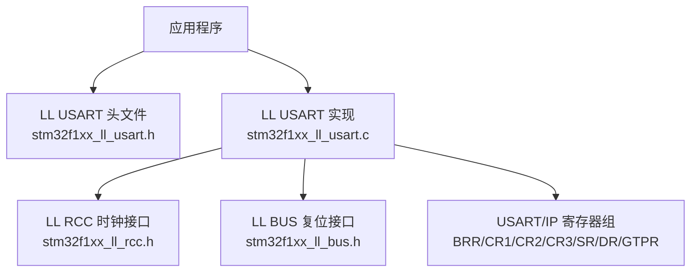
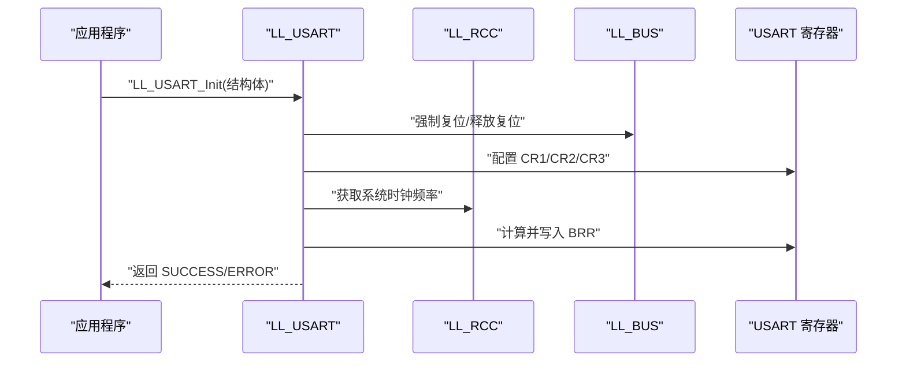
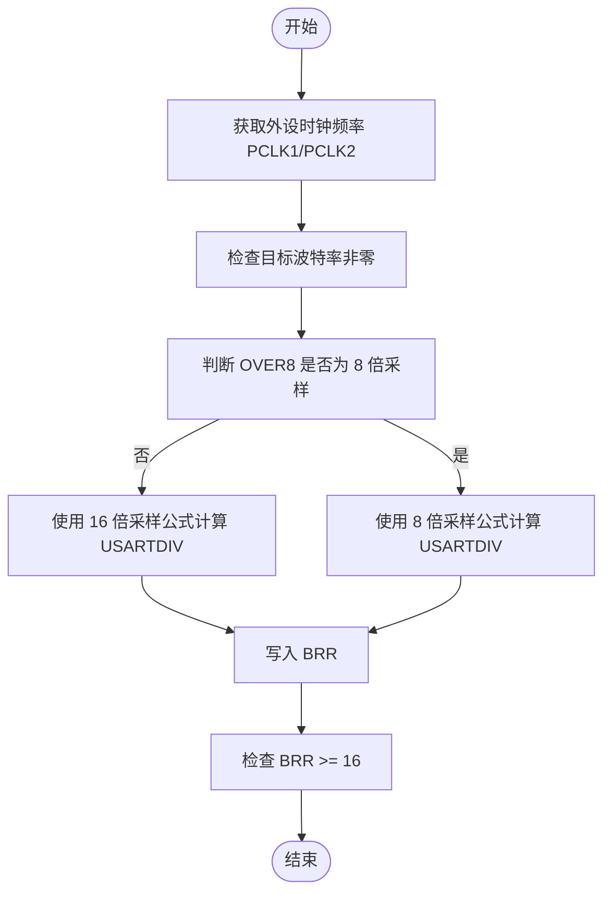
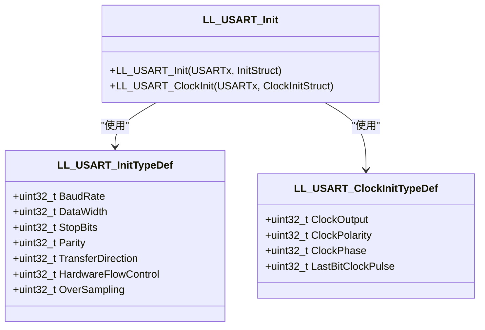
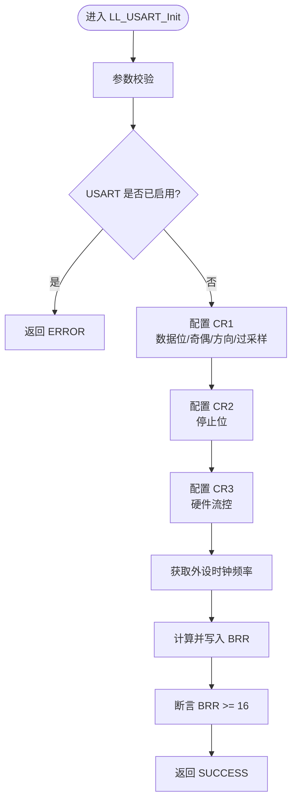
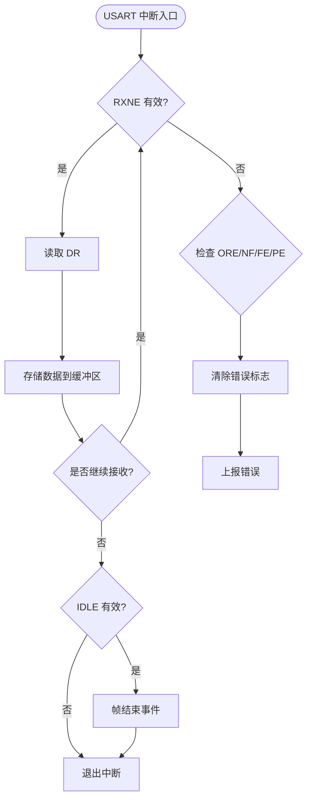
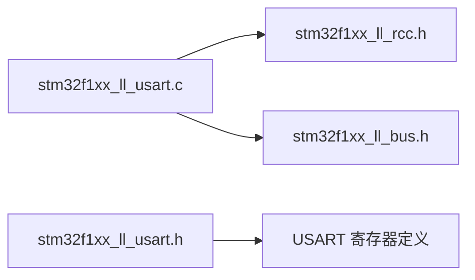

# LL USART/UART 低层接口

<cite>
**本文引用的文件**   
- [stm32f1xx_ll_usart.h](file://Inc/stm32f1xx_ll_usart.h)
- [stm32f1xx_ll_usart.c](file://Src/stm32f1xx_ll_usart.c)
- [stm32f1xx_hal_usart.h](file://Inc/stm32f1xx_hal_usart.h)
- [stm32f1xx_hal_uart.h](file://Inc/stm32f1xx_hal_uart.h)
- [stm32f1xx_ll_rcc.h](file://Inc/stm32f1xx_ll_rcc.h)
- [README.md](file://README.md)
</cite>

## 目录
1. [简介](#简介)
2. [项目结构与定位](#项目结构与定位)
3. [核心组件与寄存器映射](#核心组件与寄存器映射)
4. [架构总览](#架构总览)
5. [关键 API 文档](#关键-api-文档)
6. [详细组件分析](#详细组件分析)
7. [依赖关系分析](#依赖关系分析)
8. [性能与体积特性](#性能与体积特性)
9. [疑难解答与调试方法](#疑难解答与调试方法)
10. [结论](#结论)

## 简介
本文件面向 STM32F1xx 系列中基于 LL（Low Layer）驱动的 USART/UART 低层接口，重点说明如何通过 LL_USART 直接操作 BRR、CR1/CR2/CR3、SR、DR、GTPR 等寄存器，并覆盖异步通信、同步时钟模式、LIN 帧、多处理器地址检测、单线半双工、硬件流控以及 IrDA/PWM 相关配置能力。

LL 驱动的目标是提供最小抽象、接近寄存器的控制路径：它不隐藏中断向量、状态标志和 FIFO/DR 行为，适合需要精确控制中断路径、最小代码体积或实时性强的裸机与 RTOS 应用。HAL 驱动则在此基础上提供更高层的封装；当用户需要“只写寄存器”的能力时，应优先参考 LL_USART 函数族与宏。

本仓库 README 明确说明该组件属于 STM32CubeF1 HAL-LL 驱动的一部分，提供跨产品线的可移植性基础，并强调 CMSIS Core、CMSIS Device 与 HAL/LL 版本的一致性要求。

**章节来源**
- [README.md:1-45](file://README.md#L1-L45)

## 项目结构与定位
STM32F1xx HAL-LL 驱动采用按外设划分的头文件与实现文件组织方式。USART/UART 低层接口集中在以下两个文件中：
- `Inc/stm32f1xx_ll_usart.h`：定义 LL_USART_InitTypeDef、LL_USART_ClockInitTypeDef、枚举常量、内联宏和函数声明。
- `Src/stm32f1xx_ll_usart.c`：实现初始化、复位、时钟配置、波特率设置等逻辑，并依赖 LL_RCC/LL_BUS 完成时钟和复位。

**图表来源**
- [stm32f1xx_ll_usart.c:1-100](file://Src/stm32f1xx_ll_usart.c#L1-L100)
- [stm32f1xx_ll_rcc.h:1-50](file://Inc/stm32f1xx_ll_rcc.h#L1-L50)

**章节来源**
- [stm32f1xx_ll_usart.h:1-120](file://Inc/stm32f1xx_ll_usart.h#L1-L120)
- [stm32f1xx_ll_usart.c:1-80](file://Src/stm32f1xx_ll_usart.c#L1-L80)

## 核心组件与寄存器映射
LL_USART 的核心控制面围绕以下几类寄存器：

| 类别 | 寄存器 | 作用 | 典型操作 |
|---|---|---|---|
| 波特率与时钟分频 | BRR | 保存 USARTDIV，决定采样频率与波特率 | 通过 __LL_USART_DIV_SAMPLING16/__LL_USART_DIV_SAMPLING8 计算后写入 |
| 通用控制 | CR1 | UE、RE、TE、PCE、PS、M、OVER8、RXNEIE、TXEIE、TCIE、PEIE、IDLEIE 等 | 使能/禁用收发、奇偶校验、数据位、中断使能 |
| 控制和格式 | CR2 | STOP、CLKEN、CPOL、CPHA、LBCL、LBDL 等 | 停止位、同步时钟、LIN 断帧检测长度 |
| 高级控制 | CR3 | EIE、CTSE、RTSE、IRLP、ONEBIT 等 | 错误中断、CTS/RTS 流控、IrDA 低功耗、单线模式 |
| 状态 | SR | TXE、TC、RXNE、IDLE、ORE、NF、FE、PE、LBD、CTS 等 | 查询/清除标志 |
| 数据 | DR | 发送/接收数据字节或字 | 写 DR 发送，读 DR 接收 |
| 保护与超时 | GTPR | GT 字段用于超时计时器分频（常用于 ISO7816/LIN 场景） | 配置超时计数分频 |

LL 层的关键特点是：
- 通过 `LL_USART_WriteReg` / `LL_USART_ReadReg` 访问寄存器。
- 通过内联函数如 `LL_USART_Enable` / `LL_USART_Disable` / `LL_USART_SetParity` / `LL_USART_SetDataWidth` / `LL_USART_SetStopBitsLength` / `LL_USART_SetHWFlowCtrl` / `LL_USART_SetBaudRate` 修改 CR1/CR2/CR3/BRR。
- 通过 `LL_USART_GetFlag_*` / `LL_USART_ClearFlag_*` / `LL_USART_EnableIT_*` / `LL_USART_DisableIT_*` 管理 SR 标志和中断。
- 通过 `LL_USART_SendData` / `LL_USART_ReceiveData` 直接读写 DR。
- 通过 `LL_USART_TransmitSelect` / `LL_USART_ReceiverWakeUp` / `LL_USART_EnableSingleWire` / `LL_USART_EnableHalfDuplex` 等函数支持 LIN、多处理器、单线半双工。
- 通过 `LL_USART_EnableSCLKOutput` / `LL_USART_SetClockPolarity` / `LL_USART_SetClockPhase` / `LL_USART_SetLastClkPulseOutput` 配置同步时钟模式。

**章节来源**
- [stm32f1xx_ll_usart.h:200-420](file://Inc/stm32f1xx_ll_usart.h#L200-L420)
- [stm32f1xx_ll_usart.h:420-650](file://Inc/stm32f1xx_ll_usart.h#L420-L650)

## 架构总览
下图展示 LL_USART 在 STM32F1xx 软件栈中的位置：应用程序直接调用 LL_USART 函数族，LL_USART 实现再访问 USART 外设寄存器；初始化过程中可能调用 LL_RCC 获取时钟频率，调用 LL_BUS 进行外设复位。

**图表来源**
- [stm32f1xx_ll_usart.c:80-220](file://Src/stm32f1xx_ll_usart.c#L80-L220)
- [stm32f1xx_ll_usart.c:220-350](file://Src/stm32f1xx_ll_usart.c#L220-L350)

**章节来源**
- [stm32f1xx_ll_usart.c:80-220](file://Src/stm32f1xx_ll_usart.c#L80-L220)

## 关键 API 文档

### 1. 使能与禁用：__HAL_USART_ENABLE/DISABLE 对应 LL_USART_Enable/Disable
LL 层提供直接的使能与禁用接口：
- `LL_USART_Enable(USARTx)`：置位 CR1.UE，启用 USART。
- `LL_USART_Disable(USARTx)`：清零 CR1.UE，禁用 USART；文档说明此时预分频器和输出被停止，当前操作丢弃，状态寄存器恢复到默认值。
- `LL_USART_IsEnabled(USARTx)`：读取 CR1.UE 判断是否已启用。

这些函数通常对应 HAL 层的 `__HAL_USART_ENABLE` / `__HAL_USART_DISABLE` 宏所触发的同一寄存器位。

**章节来源**
- [stm32f1xx_ll_usart.h:420-520](file://Inc/stm32f1xx_ll_usart.h#L420-L520)

### 2. 复位：__HAL_USART_RESET 对应 LL_USART_DeInit
`LL_USART_DeInit(USARTx)` 根据实例选择 APB2 或 APB1 总线，执行强制复位后再释放复位，从而将 USART 寄存器恢复到默认状态。对 UART4/UART5 也支持。

**章节来源**
- [stm32f1xx_ll_usart.c:80-180](file://Src/stm32f1xx_ll_usart.c#L80-L180)

### 3. 波特率配置：__HAL_USART_BAUDRATE_CONFIG 对应 LL_USART_SetBaudRate
LL 层使用两个主要工具宏计算 USARTDIV：
- `__LL_USART_DIV_SAMPLING16(__PERIPHCLK__, __BAUDRATE__)`
- `__LL_USART_DIV_SAMPLING8(__PERIPHCLK__, __BAUDRATE__)`

其中采样率由 OVER8 位决定：默认 16 倍采样，部分设备支持 8 倍采样。`LL_USART_Init` 会根据 OverSampling 字段调用对应的 `LL_USART_SetBaudRate`，并通过 `assert_param(IS_LL_USART_BRR_MIN(...))` 检查 BRR 不小于 16。

波特率计算流程如下：

**图表来源**
- [stm32f1xx_ll_usart.h:520-620](file://Inc/stm32f1xx_ll_usart.h#L520-L620)
- [stm32f1xx_ll_usart.c:220-350](file://Src/stm32f1xx_ll_usart.c#L220-L350)

**章节来源**
- [stm32f1xx_ll_usart.h:520-620](file://Inc/stm32f1xx_ll_usart.h#L520-L620)
- [stm32f1xx_ll_usart.c:220-350](file://Src/stm32f1xx_ll_usart.c#L220-L350)

### 4. 数据位配置：__HAL_USART_WORD_LENGTH_CONFIG 对应 LL_USART_SetDataWidth
- `LL_USART_SetDataWidth(USARTx, DataWidth)`：配置 CR1.M，支持 8 位或 9 位数据。
- `LL_USART_GetDataWidth(USARTx)`：读取当前数据位配置。
- 当使用 9 位数据时，常见用途包括多处理器寻址、奇偶扩展或 LIN 地址帧。

**章节来源**
- [stm32f1xx_ll_usart.h:200-280](file://Inc/stm32f1xx_ll_usart.h#L200-L280)
- [stm32f1xx_ll_usart.h:520-650](file://Inc/stm32f1xx_ll_usart.h#L520-L650)

### 5. 奇偶校验配置：__HAL_USART_PARITY_CONFIG 对应 LL_USART_SetParity
- `LL_USART_SetParity(USARTx, Parity)`：配置 CR1.PCE 和 CR1.PS，支持无校验、偶校验、奇校验。
- 启用奇偶校验后，硬件会在发送端插入校验位，并在接收端检查校验位。
- `LL_USART_GetParity(USARTx)`：读取当前校验配置。

**章节来源**
- [stm32f1xx_ll_usart.h:200-260](file://Inc/stm32f1xx_ll_usart.h#L200-L260)
- [stm32f1xx_ll_usart.h:520-600](file://Inc/stm32f1xx_ll_usart.h#L520-L600)

### 6. 停止位配置：__HAL_USART_STOPBITS_CONFIG 对应 LL_USART_SetStopBitsLength
- `LL_USART_SetStopBitsLength(USARTx, StopBits)`：配置 CR2.STOP，支持 0.5、1、1.5、2 个停止位。
- 标准异步通信常用 1 个停止位；LIN 协议常用 1 个停止位，但某些特殊设备或协议可能使用其他值。

**章节来源**
- [stm32f1xx_ll_usart.h:280-340](file://Inc/stm32f1xx_ll_usart.h#L280-L340)
- [stm32f1xx_ll_usart.h:560-620](file://Inc/stm32f1xx_ll_usart.h#L560-L620)

### 7. 硬件流控配置：__HAL_USART_HARDWARE_FLOW_CONTROL_CONFIG 对应 LL_USART_SetHWFlowCtrl
- `LL_USART_SetHWFlowCtrl(USARTx, HardwareFlowControl)`：配置 CR3.RTSE 和 CR3.CTSE，支持无流控、仅 RTS、仅 CTS、RTS+CTS。
- 流控影响传输时机：例如启用 CTS 后，只有 nCTS 为有效电平时才允许发送；启用 RTS 后，接收缓冲区空间不足时可请求对端暂停。

**章节来源**
- [stm32f1xx_ll_usart.h:320-360](file://Inc/stm32f1xx_ll_usart.h#L320-L360)
- [stm32f1xx_ll_usart.h:560-620](file://Inc/stm32f1xx_ll_usart.h#L560-L620)

### 8. 中断使能与禁止：__HAL_USART_ENABLE_IT / __HAL_USART_DISABLE_IT
LL 层提供一组 IT 宏和函数族，对应 CR1/CR2/CR3 中的中断使能位：
- RXNE 接收数据寄存器非空中断：`LL_USART_RXNE_IT` / `LL_USART_EnableIT_RXNE` / `LL_USART_DisableIT_RXNE`
- TXE 发送数据寄存器空中断：`LL_USART_TXE_IT` / `LL_USART_EnableIT_TXE` / `LL_USART_DisableIT_TXE`
- TC 发送完成中断：`LL_USART_TC_IT` / `LL_USART_EnableIT_TC` / `LL_USART_DisableIT_TC`
- IDLE 空闲中断：`LL_USART_IDLE_IT` / `LL_USART_EnableIT_IDLE` / `LL_USART_DisableIT_IDLE`
- PE 奇偶错误中断：`LL_USART_PE_IT` / `LL_USART_EnableIT_PE` / `LL_USART_DisableIT_PE`
- LBD LIN 断帧中断：`LL_USART_LBD_IT` / `LL_USART_EnableIT_LBD` / `LL_USART_DisableIT_LBD`
- CTS 中断：`LL_USART_CTS_IT` / `LL_USART_EnableIT_CTS` / `LL_USART_DisableIT_CTS`
- EIE 错误中断总开关：`LL_USART_EIE_IT` / `LL_USART_EnableIT_ERROR` / `LL_USART_DisableIT_ERROR`

**章节来源**
- [stm32f1xx_ll_usart.h:120-220](file://Inc/stm32f1xx_ll_usart.h#L120-L220)
- [stm32f1xx_ll_usart.h:600-760](file://Inc/stm32f1xx_ll_usart.h#L600-L760)

### 9. 数据收发：__HAL_USART_SEND_DATA / __HAL_USART_RECEIVE_DATA
- `LL_USART_SendData(USARTx, Data)`：写入 DR，启动发送。
- `LL_USART_ReceiveData(USARTx)`：从 DR 读取数据。
- 对于 9 位数据模式，DR 的低 9 位有效；若启用了奇偶校验，最高位可能承载奇偶信息，具体取决于设备手册。

**章节来源**
- [stm32f1xx_ll_usart.h:760-900](file://Inc/stm32f1xx_ll_usart.h#L760-L900)

### 10. 标志读取与清除：__HAL_USART_GET_FLAG / CLEAR_FLAG
LL 层提供一组 `LL_USART_GetFlag_*` 和 `LL_USART_ClearFlag_*` 函数，对应 SR 中的 TXE、TC、RXNE、IDLE、ORE、NF、FE、PE、LBD、CTS 等标志。典型用法：
- 轮询发送：等待 `LL_USART_IsActiveFlag_TXE()` 或 `LL_USART_IsActiveFlag_TC()`。
- 中断接收：在 USART IRQHandler 中检查 `LL_USART_IsActiveFlag_RXNE()`，然后读取 DR，并根据 ORE/NF/FE/PE 处理错误。
- 空闲帧：检查 `LL_USART_IsActiveFlag_IDLE()`，常用于整包接收。

**章节来源**
- [stm32f1xx_ll_usart.h:120-220](file://Inc/stm32f1xx_ll_usart.h#L120-L220)
- [stm32f1xx_ll_usart.h:900-1100](file://Inc/stm32f1xx_ll_usart.h#L900-L1100)

### 11. 收发方向与单线半双工：__HAL_USART_TXRX_SELECT
- `LL_USART_SetTransferDirection(USARTx, Direction)`：同时配置 RE 和 TE，支持 NONE/RX/TX/TX_RX。
- `LL_USART_EnableSingleWire(USARTx)` / `LL_USART_DisableSingleWire(USARTx)`：配置单线半双工模式。
- `LL_USART_EnableHalfDuplex(USARTx)` / `LL_USART_DisableHalfDuplex(USARTx)`：配置半双工模式。
- 这些接口共同支持多处理器、LIN、单线模式下的收发切换。

**章节来源**
- [stm32f1xx_ll_usart.h:480-560](file://Inc/stm32f1xx_ll_usart.h#L480-L560)
- [stm32f1xx_ll_usart.h:1000-1200](file://Inc/stm32f1xx_ll_usart.h#L1000-L1200)

### 12. 同步时钟模式：ClockPolarity、ClockPhase、LastBit
同步模式适用于主设备向从设备输出 SCLK：
- `LL_USART_EnableSCLKOutput(USARTx)` / `LL_USART_DisableSCLKOutput(USARTx)`：启用或禁用 SCLK 输出。
- `LL_USART_SetClockPolarity(USARTx, Polarity)`：配置 CPOL，支持低电平稳定或高电平稳定。
- `LL_USART_SetClockPhase(USARTx, Phase)`：配置 CPHA，支持第一边沿或第二边沿捕获。
- `LL_USART_SetLastClkPulseOutput(USARTx, LastBit)`：配置 LBCL，决定是否输出最后一个数据位的时钟脉冲。
- `LL_USART_ClockInit` 会一次性配置 CLKEN、CPOL、CPHA、LBCL。

**章节来源**
- [stm32f1xx_ll_usart.h:260-340](file://Inc/stm32f1xx_ll_usart.h#L260-L340)
- [stm32f1xx_ll_usart.c:350-438](file://Src/stm32f1xx_ll_usart.c#L350-L438)

### 13. LIN、多处理器与 IrDA/PWM 模式
- LIN：通过 LIN 断帧检测长度、LBD 中断、11 位或 10 位断帧、多处理器地址帧（常配合 9 位数据）。
- 多处理器：通过 MME 和多地址匹配机制，结合 9 位数据和 IDLE 帧识别。
- IrDA：通过 CR3.IRLP 配置 IrDA 低功耗模式。
- PWM：部分 USART 引脚复用支持 PWM 输出，需参考设备引脚复用表；LL_USART 本身不直接配置 PWM，而是通过 GPIO 和定时器配合。

**章节来源**
- [stm32f1xx_ll_usart.h:300-360](file://Inc/stm32f1xx_ll_usart.h#L300-L360)
- [stm32f1xx_ll_usart.h:340-420](file://Inc/stm32f1xx_ll_usart.h#L340-L420)

## 详细组件分析

### LL_USART_InitTypeDef 与 LL_USART_ClockInitTypeDef
LL_USART 初始化包含两类结构体：

| 字段 | 类型 | 含义 | 对应寄存器 |
|---|---|---|---|
| BaudRate | uint32_t | 目标波特率 | BRR |
| DataWidth | uint32_t | 数据位宽：8B 或 9B | CR1.M |
| StopBits | uint32_t | 停止位数 | CR2.STOP |
| Parity | uint32_t | 无校验/偶校验/奇校验 | CR1.PCE/PS |
| TransferDirection | uint32_t | 收发方向 | CR1.RE/TE |
| HardwareFlowControl | uint32_t | 硬件流控 | CR3.RTSE/CTSE |
| OverSampling | uint32_t | 16 倍或 8 倍采样 | CR1.OVER8 |
| ClockOutput | uint32_t | 是否输出 SCLK | CR2.CLKEN |
| ClockPolarity | uint32_t | SCLK 极性 | CR2.CPOL |
| ClockPhase | uint32_t | SCLK 相位 | CR2.CPHA |
| LastBitClockPulse | uint32_t | 最后一位时钟脉冲输出 | CR2.LBCL |

**图表来源**
- [stm32f1xx_ll_usart.h:60-160](file://Inc/stm32f1xx_ll_usart.h#L60-L160)
- [stm32f1xx_ll_usart.c:200-350](file://Src/stm32f1xx_ll_usart.c#L200-L350)

**章节来源**
- [stm32f1xx_ll_usart.h:60-160](file://Inc/stm32f1xx_ll_usart.h#L60-L160)
- [stm32f1xx_ll_usart.c:200-350](file://Src/stm32f1xx_ll_usart.c#L200-L350)

### 初始化控制流
`LL_USART_Init` 的执行顺序大致为：
1. 参数校验：波特率、数据位、停止位、奇偶校验、方向、硬件流控、过采样。
2. 确保 USART 处于禁用状态，否则返回 ERROR。
3. 配置 CR1：数据位、奇偶校验、收发方向、过采样。
4. 配置 CR2：停止位。
5. 配置 CR3：硬件流控。
6. 读取 RCC 时钟频率，计算并写入 BRR。
7. 检查 BRR 是否满足最小值。

**图表来源**
- [stm32f1xx_ll_usart.c:200-350](file://Src/stm32f1xx_ll_usart.c#L200-L350)

**章节来源**
- [stm32f1xx_ll_usart.c:200-350](file://Src/stm32f1xx_ll_usart.c#L200-L350)

### 中断接收处理流程
典型的中断接收流程包括：
1. 在 USART IRQHandler 中检查 RXNE 标志。
2. 如果存在 RXNE，读取 DR。
3. 检查 ORE、NF、FE、PE 等错误标志，必要时清除并上报错误。
4. 如果使用了 IDLE 中断，则在检测到 IDLE 后认为一帧结束。
5. 根据业务逻辑将数据存入缓冲队列或触发任务通知。

**图表来源**
- [stm32f1xx_ll_usart.h:120-220](file://Inc/stm32f1xx_ll_usart.h#L120-L220)
- [stm32f1xx_ll_usart.h:900-1100](file://Inc/stm32f1xx_ll_usart.h#L900-L1100)

**章节来源**
- [stm32f1xx_ll_usart.h:120-220](file://Inc/stm32f1xx_ll_usart.h#L120-L220)
- [stm32f1xx_ll_usart.h:900-1100](file://Inc/stm32f1xx_ll_usart.h#L900-L1100)

## 依赖关系分析
LL_USART 实现依赖以下模块：
- LL_RCC：获取系统时钟频率，供波特率计算使用。
- LL_BUS：通过 APB2/APB1 复位 USART。
- 底层寄存器定义：来自 CMSIS/Device 头文件，LL_USART 通过宏和内联函数访问 CR1/CR2/CR3/BRR/SR/DR/GTPR。

**图表来源**
- [stm32f1xx_ll_usart.c:1-60](file://Src/stm32f1xx_ll_usart.c#L1-L60)
- [stm32f1xx_ll_usart.h:1-60](file://Inc/stm32f1xx_ll_usart.h#L1-L60)

**章节来源**
- [stm32f1xx_ll_usart.c:1-60](file://Src/stm32f1xx_ll_usart.c#L1-L60)
- [stm32f1xx_ll_usart.h:1-60](file://Inc/stm32f1xx_ll_usart.h#L1-L60)

## 性能与体积特性
- LL 层更接近寄存器操作，函数多为内联或短小实现，编译后代码体积小。
- LL 不隐藏中断向量，开发者可直接在中断服务程序中操作 SR/DR，减少间接调用。
- 与 HAL 相比，LL 更适合：
  - 裸机应用中追求确定性和最小开销。
  - RTOS 应用中希望在中断中快速处理 RXNE/TC/IDLE，避免 HAL 层额外状态机。
  - 对内存和 Flash 敏感的产品。
- 波特率计算复杂度为常数时间，主要开销在于 RCC 时钟查询和寄存器写入。

[本节为通用性能讨论，不直接分析具体源码文件]

## 疑难解答与调试方法

### 波特率不准
- 检查 RCC 配置是否正确，PCLK1/PCLK2 频率是否符合预期。
- 确认 OVER8 是否与硬件能力和期望一致。
- 检查 BRR 是否小于 16；LL 层使用断言进行检查。
- 验证目标波特率是否在 IS_LL_USART_BAUDRATE 范围内。

**章节来源**
- [stm32f1xx_ll_usart.c:120-180](file://Src/stm32f1xx_ll_usart.c#L120-L180)
- [stm32f1xx_ll_usart.c:220-350](file://Src/stm32f1xx_ll_usart.c#L220-L350)

### 发送卡住或丢字节
- 检查 TXE/TC 标志：发送前应等待 TXE，发送完成后等待 TC。
- 检查是否启用了硬件流控，CTS 信号是否有效。
- 检查 DR 写入时机：频繁写入 DR 前必须确保 TXE 为真。
- 如果使用 DMA，确保 DMA 与 USART 配置一致。

**章节来源**
- [stm32f1xx_ll_usart.h:120-220](file://Inc/stm32f1xx_ll_usart.h#L120-L220)
- [stm32f1xx_ll_usart.h:760-900](file://Inc/stm32f1xx_ll_usart.h#L760-L900)

### 接收错误或乱码
- 检查 PE、FE、NF、ORE 标志，必要时开启 EIE 或单独开启 PEIE/FEIE 等。
- 检查奇偶校验和数据位宽度是否匹配。
- 检查停止位是否与对端一致。
- 使用 IDLE 中断辅助帧边界识别。

**章节来源**
- [stm32f1xx_ll_usart.h:120-220](file://Inc/stm32f1xx_ll_usart.h#L120-L220)
- [stm32f1xx_ll_usart.h:900-1100](file://Inc/stm32f1xx_ll_usart.h#L900-L1100)

### 同步模式无法通信
- 确认 SCLK 输出已启用。
- 检查 CPOL/CPHA 是否与从设备匹配。
- 检查 LBCL 是否需要输出最后一个时钟脉冲。
- 确认从设备时钟输入引脚正确配置。

**章节来源**
- [stm32f1xx_ll_usart.c:350-438](file://Src/stm32f1xx_ll_usart.c#L350-L438)
- [stm32f1xx_ll_usart.h:260-340](file://Inc/stm32f1xx_ll_usart.h#L260-L340)

### HAL 与 LL 的差异对比
| 维度 | HAL_UART_Transmit/Receive | LL 方式 |
|---|---|---|
| 抽象层级 | 较高，封装了更多状态和回调 | 较低，直接操作寄存器 |
| 中断路径 | HAL 内部维护状态机，可能隐藏细节 | 开发者直接处理 RXNE/TC/IDLE/错误 |
| 代码体积 | 更大，包含更多功能 | 更小，适合最小化部署 |
| 实时性 | 受 HAL 层实现影响 | 更可控，适合严格时序 |
| 易用性 | 更容易上手 | 需要理解寄存器行为 |
| 适用场景 | 快速原型、通用应用 | 裸机、RTOS 中低延迟、嵌入式资源受限 |

**章节来源**
- [stm32f1xx_hal_usart.h:1-120](file://Inc/stm32f1xx_hal_usart.h#L1-L120)
- [stm32f1xx_hal_uart.h:1-120](file://Inc/stm32f1xx_hal_uart.h#L1-L120)
- [stm32f1xx_ll_usart.h:1-120](file://Inc/stm32f1xx_ll_usart.h#L1-L120)

## 结论
LL_USART 为 STM32F1xx 提供了接近寄存器的 USART/UART 控制能力。它通过明确的函数族和宏暴露 BRR、CR1/CR2/CR3、SR、DR、GTPR 等关键寄存器，支持异步通信、同步时钟、LIN、多处理器、单线半双工、硬件流控以及 IrDA 低功耗模式。对于需要精确控制中断路径、最小代码体积和确定性的应用，LL 比 HAL 更具优势。实际工程中，建议：
- 使用 LL_USART_Init 完成基本配置。
- 在中断中直接处理 RXNE/TC/IDLE/错误标志。
- 使用 LL_USART_SendData/ReceiveData 操作 DR。
- 谨慎配置波特率、数据位、奇偶校验、停止位和硬件流控。
- 在同步模式下仔细匹配 CPOL/CPHA/LBCL。
- 在资源受限场景中优先使用 LL，在快速开发场景中可结合 HAL。

[本节为总结性内容，不直接分析具体源码文件]