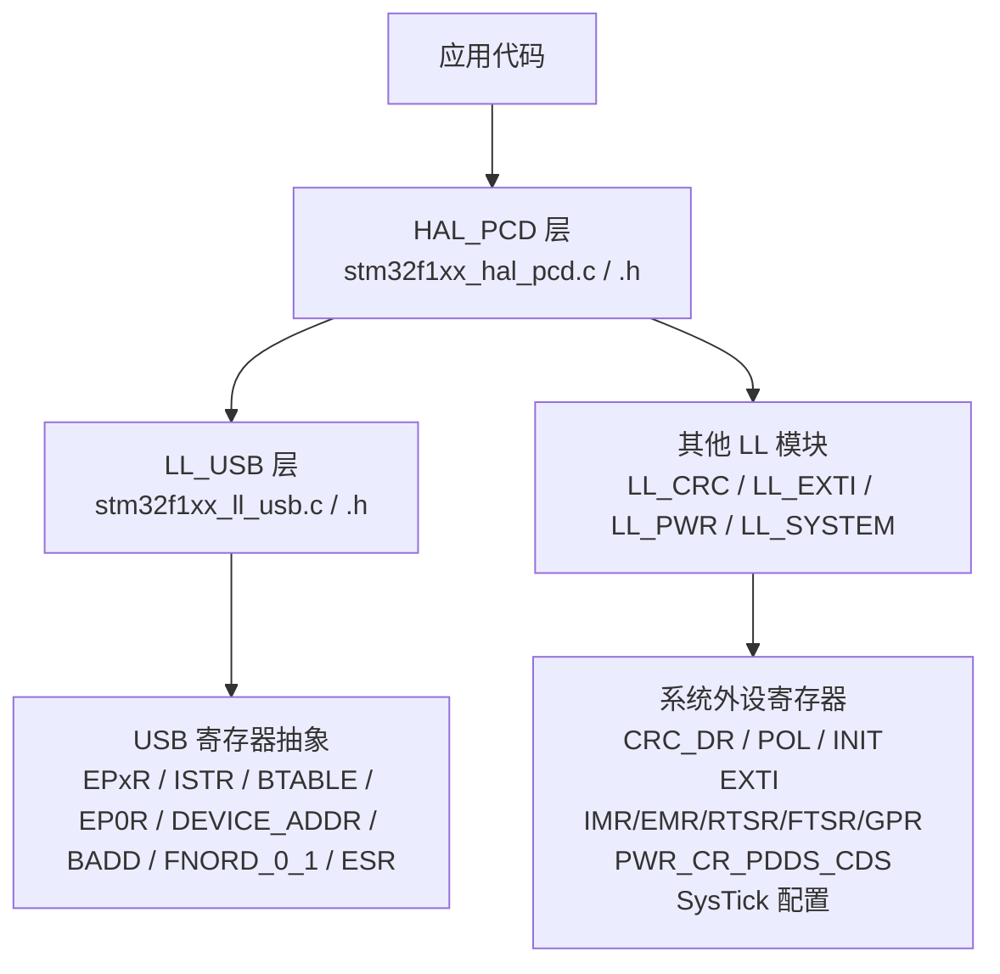
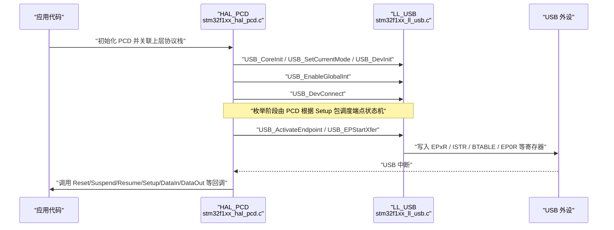
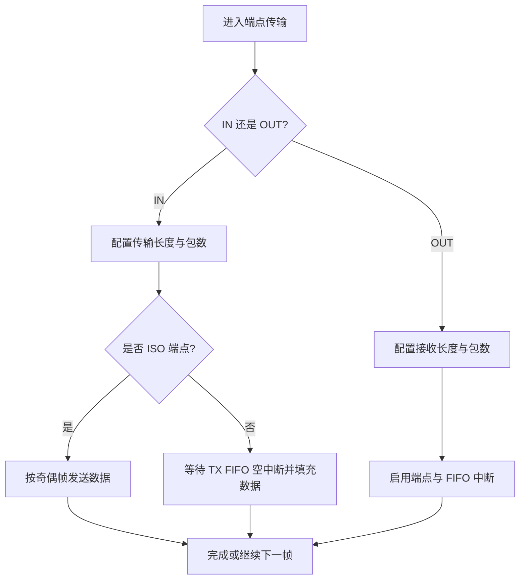
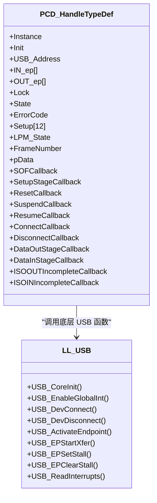
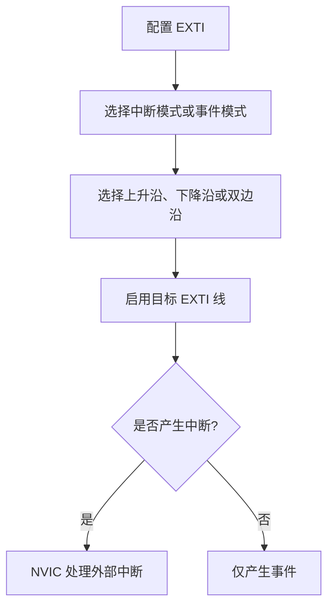
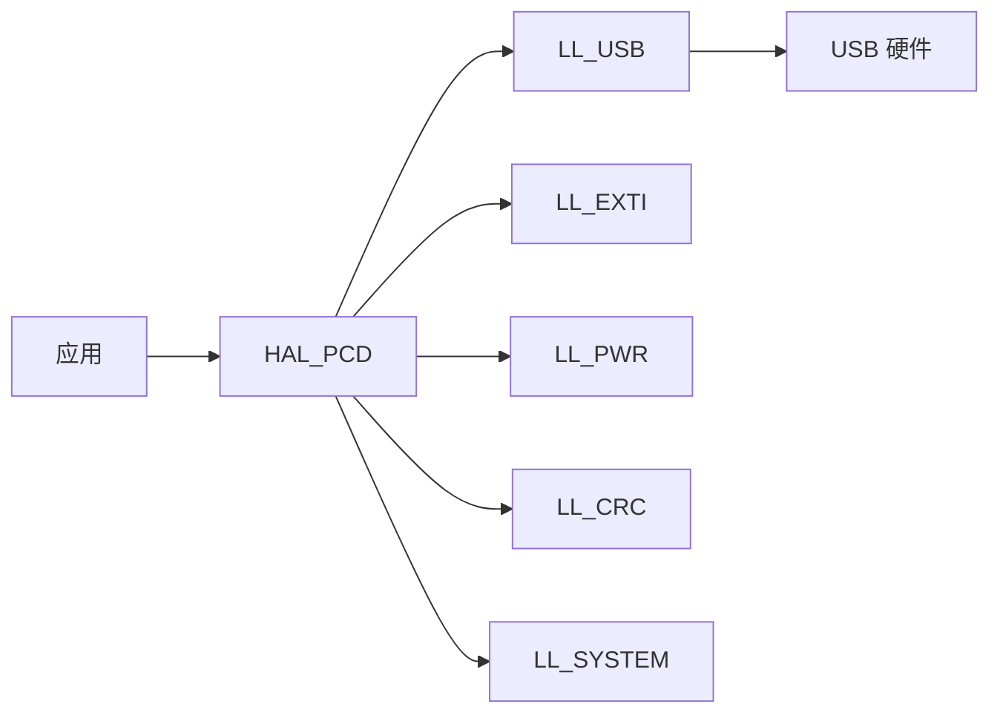

# LL USB 与其他外设参考

<cite>
**本文引用的文件**   
- [stm32f1xx_ll_usb.h](file://Inc/stm32f1xx_ll_usb.h)
- [stm32f1xx_ll_usb.c](file://Src/stm32f1xx_ll_usb.c)
- [stm32f1xx_hal_pcd.h](file://Inc/stm32f1xx_hal_pcd.h)
- [stm32f1xx_hal_pcd.c](file://Src/stm32f1xx_hal_pcd.c)
- [stm32f1xx_ll_crc.h](file://Inc/stm32f1xx_ll_crc.h)
- [stm32f1xx_ll_crc.c](file://Src/stm32f1xx_ll_crc.c)
- [stm32f1xx_ll_exti.h](file://Inc/stm32f1xx_ll_exti.h)
- [stm32f1xx_ll_exti.c](file://Src/stm32f1xx_ll_exti.c)
- [stm32f1xx_ll_pwr.h](file://Inc/stm32f1xx_ll_pwr.h)
- [stm32f1xx_ll_pwr.c](file://Src/stm32f1xx_ll_pwr.c)
- [stm32f1xx_ll_system.h](file://Inc/stm32f1xx_ll_system.h)
</cite>

## 目录
1. [引言](#引言)
2. [项目结构](#项目结构)
3. [核心组件](#核心组件)
4. [架构总览](#架构总览)
5. [详细组件分析](#详细组件分析)
6. [依赖关系分析](#依赖关系分析)
7. [性能与资源特性](#性能与资源特性)
8. [故障排查指南](#故障排查指南)
9. [结论](#结论)

## 引言
本文面向 STM32F1xx 系列中 LL 层外设，重点说明 LL_USB 对设备端 PCD 寄存器的直接管理方式，并补充 LL_CRC、LL_EXTI、LL_PWR、LL_SYSTEM 的关键能力。文档同时给出 USB CDC 虚拟串口端点初始化与 EXTI 外部中断配置的 LL 使用思路，强调 LL_USB 通常需要配合 HAL PCD 或自定义 USB 协议栈协同工作，并提供枚举失败、缓冲区溢出、中断丢失和低功耗唤醒等问题的排查方法。

需要特别注意：仓库中的 `stm32f1xx_ll_usb.h` 和 `stm32f1xx_ll_usb.c` 同时包含 USB_OTG_FS 与原生 USB 两类实现分支；但其中并未定义用户请求的 `__HAL_USB_ENABLE/DISABLE`、`__HAL_USB_RESET`、`__HAL_USB_CONNECT/UNCONNECT`、`__HAL_USB_EP_SETUP`、`__HAL_USB_EP_SET_TYPE`、`__HAL_USB_EP_SET_STALL/CLRTSTALL`、`__HAL_USB_EP_SET_TX_STATUS/RX_STATUS`、`__HAL_USB_GET_EP_TX_STATUS/RX_STATUS`、`__HAL_USB_GET_DEVICE_SPEED` 等宏。实际可用的底层接口是 `USB_CoreInit`、`USB_EnableGlobalInt`、`USB_DevConnect`、`USB_DevDisconnect`、`USB_EPSetStall`、`USB_EPClearStall`、`USB_ActivateEndpoint`、`USB_DeactivateEndpoint`、`USB_EPStartXfer`、`USB_ReadInterrupts` 等函数。因此，本文将严格以仓库中已定义的 LL_USB 接口为准进行说明，并在“架构总览”中解释这些宏通常由上层驱动（如 HAL PCD）封装。

**章节来源**
- [stm32f1xx_ll_usb.h:300-641](file://Inc/stm32f1xx_ll_usb.h#L300-L641)
- [stm32f1xx_ll_usb.c:1900-2600](file://Src/stm32f1xx_ll_usb.c#L1900-L2600)

## 项目结构
该仓库提供 STM32F1xx HAL 与 LL 驱动的头文件和源文件。与本文相关的文件组织如下：

**图示来源**
- [stm32f1xx_hal_pcd.h:1-200](file://Inc/stm32f1xx_hal_pcd.h#L1-L200)
- [stm32f1xx_ll_usb.h:300-641](file://Inc/stm32f1xx_ll_usb.h#L300-L641)
- [stm32f1xx_ll_crc.h:1-200](file://Inc/stm32f1xx_ll_crc.h#L1-L200)
- [stm32f1xx_ll_exti.h:1-200](file://Inc/stm32f1xx_ll_exti.h#L1-L200)
- [stm32f1xx_ll_pwr.h:1-200](file://Inc/stm32f1xx_ll_pwr.h#L1-L200)
- [stm32f1xx_ll_system.h:1-200](file://Inc/stm32f1xx_ll_system.h#L1-L200)

**章节来源**
- [stm32f1xx_ll_usb.h:300-641](file://Inc/stm32f1xx_ll_usb.h#L300-L641)
- [stm32f1xx_ll_crc.h:1-200](file://Inc/stm32f1xx_ll_crc.h#L1-L200)
- [stm32f1xx_ll_exti.h:1-200](file://Inc/stm32f1xx_ll_exti.h#L1-L200)
- [stm32f1xx_ll_pwr.h:1-200](file://Inc/stm32f1xx_ll_pwr.h#L1-L200)
- [stm32f1xx_ll_system.h:1-200](file://Inc/stm32f1xx_ll_system.h#L1-L200)

## 核心组件
- **LL_USB**：提供 USB Core 初始化、设备模式切换、全局中断控制、端点激活/停用、传输启动、Stall 设置/清除、收发包、FIFO 刷新、中断读取等函数。对于 STM32F1 原生 USB，头文件中定义了端点类型常量、端点描述符结构体、缓冲区表基地址常量以及双缓冲相关宏。
- **HAL_PCD**：作为 USB 设备控制器高层抽象，引用 `stm32f1xx_ll_usb.h`，并通过 `PCD_HandleTypeDef`、回调机制、端点数组、Setup 缓冲区等把 USB 事件交给上层协议栈处理。
- **LL_CRC**：提供 CRC 计算单元复位、数据写入、结果读取、独立数据寄存器读写以及可选的 DeInit。
- **LL_EXTI**：提供外部中断/事件配置结构体、初始化、反初始化、端口触发选择、软件中断生成等接口。
- **LL_PWR**：提供备份域访问、低功耗模式选择、稳压器深度睡眠模式、唤醒引脚、电压检测阈值等接口。
- **LL_SYSTEM**：提供 DBGMCU、SYSCFG、Flash 延迟、调试冻结等通用系统级操作。

**章节来源**
- [stm32f1xx_ll_usb.h:300-641](file://Inc/stm32f1xx_ll_usb.h#L300-L641)
- [stm32f1xx_ll_usb.c:1900-2600](file://Src/stm32f1xx_ll_usb.c#L1900-L2600)
- [stm32f1xx_hal_pcd.h:1-200](file://Inc/stm32f1xx_hal_pcd.h#L1-L200)
- [stm32f1xx_ll_crc.h:1-200](file://Inc/stm32f1xx_ll_crc.h#L1-L200)
- [stm32f1xx_ll_exti.h:700-886](file://Inc/stm32f1xx_ll_exti.h#L700-L886)
- [stm32f1xx_ll_pwr.h:60-240](file://Inc/stm32f1xx_ll_pwr.h#L60-L240)
- [stm32f1xx_ll_system.h:1-200](file://Inc/stm32f1xx_ll_system.h#L1-L200)

## 架构总览
下图展示从应用到 LL_USB 的典型调用链，以及 HAL_PCD 在其中的角色。

**图示来源**
- [stm32f1xx_hal_pcd.c:1-200](file://Src/stm32f1xx_hal_pcd.c#L1-L200)
- [stm32f1xx_ll_usb.c:1900-2600](file://Src/stm32f1xx_ll_usb.c#L1900-L2600)

关于用户请求中的 `__HAL_USB_*` 宏：当前仓库的 `stm32f1xx_ll_usb.h` 中没有定义这些宏，也没有定义 `__HAL_USB_ENABLE`、`__HAL_USB_DISABLE`、`__HAL_USB_RESET`、`__HAL_USB_CONNECT`、`__HAL_USB_UNCONNECT`、`__HAL_USB_EP_SETUP`、`__HAL_USB_EP_SET_TYPE`、`__HAL_USB_EP_SET_STALL`、`__HAL_USB_EP_CLRTSTALL`、`__HAL_USB_EP_SET_TX_STATUS`、`__HAL_USB_EP_SET_RX_STATUS`、`__HAL_USB_GET_EP_TX_STATUS`、`__HAL_USB_GET_EP_RX_STATUS`、`__HAL_USB_GET_DEVICE_SPEED`。因此不能断言它们直接映射到某个具体寄存器位。更合理的理解是：这些宏属于更上层的驱动封装，用于统一暴露给应用或协议栈；在本仓库中，对应功能由 `USB_EnableGlobalInt`、`USB_DevConnect`、`USB_DevDisconnect`、`USB_EPSetStall`、`USB_EPClearStall`、`USB_ActivateEndpoint`、`USB_EPStartXfer`、`USB_ReadInterrupts` 等函数承担。

**章节来源**
- [stm32f1xx_ll_usb.h:570-641](file://Inc/stm32f1xx_ll_usb.h#L570-L641)
- [stm32f1xx_hal_pcd.h:1-200](file://Inc/stm32f1xx_hal_pcd.h#L1-L200)

## 详细组件分析

### LL_USB：设备端 PCD 寄存器与端点状态机
LL_USB 针对 STM32F1 原生 USB 的核心概念包括：

| 概念 | 说明 |
|---|---|
| EPxR | 每个端点的控制与状态寄存器，用于设置端点类型、最大包长、方向、Stall、TX/RX 状态、双缓冲指针等。 |
| ISTR | USB 中断状态寄存器，反映 RESET、SOF、ERR、WAKEUP、SUSPEND、ENDPOINT 等事件。 |
| BTABLE | 缓冲区表基址，指向 PMA 中各端点 TX/RX 地址的配置项。 |
| EP0R | 控制端点专用寄存器，常用于 Setup 阶段和数据阶段的状态控制。 |
| DEVICE_ADDR | 设备地址寄存器，枚举过程中由主机分配。 |
| BADD | 缓冲区地址字段，指向 PMA 中的具体缓冲区地址。 |
| FNORD_0/1 | 帧号计数器，ISOchronous 端点需要奇偶帧区分。 |
| ESR | 端点状态寄存器，反映端点传输完成、溢出、错误等状态。 |

端点类型定义在 LL_USB 头文件中，包括 Control、Isochronous、Bulk、Interrupt。端点描述符结构体包含端点号、方向、是否 Stall、类型、初始 Data PID、最大包长、缓冲区指针、长度和计数等信息；对于原生 USB，还包含 PMA 地址、双缓冲标志等字段。

#### 端点类型与缓冲区表
- 端点类型常量：Control、Isochronous、Bulk、Interrupt。
- 缓冲区表基址常量：BTABLE_ADDRESS。
- PMA 访问常量：PMA_ACCESS。
- 双缓冲宏：USE_USB_DOUBLE_BUFFER。

#### 端点状态机与中断流程
- 激活端点：`USB_ActivateEndpoint` 设置端点使能、类型、方向和最大包长。
- 停止端点：`USB_DeactivateEndpoint` 禁用端点并清理相关中断掩码。
- 开始传输：`USB_EPStartXfer` 根据 IN/OUT、端点类型、长度和包大小配置传输尺寸、包数，并为非 ISO 端点启用 FIFO 空中断；ISO 端点按奇偶帧发送。
- Stall 控制：`USB_EPSetStall`、`USB_EPClearStall` 设置或清除端点 Stall。
- 传输停止：`USB_EPStopXfer` 停止正在进行的传输。
- 中断处理：通过 `USB_ReadInterrupts`、`USB_ReadDevAllInEpInterrupt`、`USB_ReadDevOutEpInterrupt` 读取中断状态，再由 HAL_PCD 分发到 Reset、Suspend、Resume、Setup、DataIn、DataOut 等回调。

**图示来源**
- [stm32f1xx_ll_usb.c:2277-2554](file://Src/stm32f1xx_ll_usb.c#L2277-L2554)
- [stm32f1xx_ll_usb.h:360-490](file://Inc/stm32f1xx_ll_usb.h#L360-L490)

#### 关于用户请求的 `__HAL_USB_*` 宏
由于仓库未定义这些宏，不能将其直接映射到 EPxR、ISTR、BTABLE、EP0R、DEVICE_ADDR、BADD、FNORD_0/1、ESR 的具体位。更准确的做法是：

- 如果需要“使能/禁用 USB”，使用 `USB_EnableGlobalInt` / `USB_DisableGlobalInt`。
- 如果需要“连接/断开 USB”，使用 `USB_DevConnect` / `USB_DevDisconnect`。
- 如果需要“重置 USB”，通常通过 `USB_CoreInit` + `USB_SetCurrentMode` + `USB_DevInit` 的组合完成。
- 如果需要“设置端点类型”，使用 `USB_ActivateEndpoint` 或 `USB_DeactivateEndpoint`。
- 如果需要“设置/清除 Stall”，使用 `USB_EPSetStall` / `USB_EPClearStall`。
- 如果需要“设置 TX/RX 状态”，使用 `USB_EPStartXfer`。
- 如果需要“获取端点状态”，应通过 `USB_ReadDevAllInEpInterrupt` / `USB_ReadDevOutEpInterrupt` / `USB_ReadInterrupts` 解析中断状态。
- 如果需要“获取设备速度”，可使用 `USB_GetDevSpeed`。

**章节来源**
- [stm32f1xx_ll_usb.h:360-490](file://Inc/stm32f1xx_ll_usb.h#L360-L490)
- [stm32f1xx_ll_usb.h:575-616](file://Inc/stm32f1xx_ll_usb.h#L575-L616)
- [stm32f1xx_ll_usb.c:2277-2554](file://Src/stm32f1xx_ll_usb.c#L2277-L2554)
- [stm32f1xx_ll_usb.c:1900-2090](file://Src/stm32f1xx_ll_usb.c#L1900-L2090)

### HAL_PCD 与 LL_USB 的关系
HAL_PCD 头文件包含 `stm32f1xx_ll_usb.h`，并定义了 PCD 句柄、端点数组、Setup 缓冲区、回调函数指针等。其注释明确说明：应用应先声明 PCD 句柄，填充 Init 参数，调用 `HAL_PCD_Init`，然后通过 MspInit 配置时钟、GPIO、NVIC，再关联上层 USB 设备栈，最后启动 PCD。

**图示来源**
- [stm32f1xx_hal_pcd.h:1-200](file://Inc/stm32f1xx_hal_pcd.h#L1-L200)
- [stm32f1xx_ll_usb.h:575-616](file://Inc/stm32f1xx_ll_usb.h#L575-L616)

**章节来源**
- [stm32f1xx_hal_pcd.h:1-200](file://Inc/stm32f1xx_hal_pcd.h#L1-L200)
- [stm32f1xx_hal_pcd.c:1-200](file://Src/stm32f1xx_hal_pcd.c#L1-L200)

### LL_CRC：CRC_DR、CRC_POL、CRC_INIT 操作
LL_CRC 提供的关键操作包括：

| 操作 | 说明 |
|---|---|
| `LL_CRC_ResetCRCCalculationUnit` | 复位 CRC 计算单元；若支持可编程初始值，会将 DR 设置为 CRC_INIT 的值。 |
| `LL_CRC_FeedData32` | 向 CRC_DR 写入 32 位数据。 |
| `LL_CRC_ReadData32` | 读取当前 CRC 计算结果。 |
| `LL_CRC_Read_IDR` / `LL_CRC_Write_IDR` | 读写独立数据寄存器 IDR，可用作单字节临时存储。 |
| `LL_CRC_DeInit` | 可选 DeInit，复位 CRC 单元并清零 IDR。 |

CRC 模块本身不直接提供 CRC_POL、CRC_INIT 的设置函数，但头文件提供了通用写寄存器宏 `LL_CRC_WriteReg` 和读寄存器宏 `LL_CRC_ReadReg`，可用于访问任意 CRC 寄存器。

**章节来源**
- [stm32f1xx_ll_crc.h:1-200](file://Inc/stm32f1xx_ll_crc.h#L1-L200)
- [stm32f1xx_ll_crc.c:1-104](file://Src/stm32f1xx_ll_crc.c#L1-L104)

### LL_EXTI：IMR/EMR/RTSR/FTSR/GPR 配置
LL_EXTI 提供以下能力：

| 寄存器/接口 | 作用 |
|---|---|
| IMR | 中断屏蔽寄存器，控制哪些 EXTI 线可以产生中断。 |
| EMR | 事件屏蔽寄存器，控制哪些 EXTI 线可以产生事件。 |
| RTSR | 上升沿触发选择寄存器。 |
| FTSR | 下降沿触发选择寄存器。 |
| SWIER | 软件中断事件寄存器，用于软件触发 EXTI。 |
| GPR | 通用端口寄存器，用于多路复用选择外部中断源。 |
| `LL_EXTI_Init` | 根据结构体配置 Line、Mode、Trigger，并分别启用/禁用中断和事件。 |
| `LL_EXTI_DeInit` | 将 IMR、EMR、RTSR、FTSR、SWIER 恢复默认值，并清除挂起位。 |
| `LL_EXTI_StructInit` | 初始化结构体默认值。 |

**图示来源**
- [stm32f1xx_ll_exti.c:1-200](file://Src/stm32f1xx_ll_exti.c#L1-L200)
- [stm32f1xx_ll_exti.h:700-886](file://Inc/stm32f1xx_ll_exti.h#L700-L886)

**章节来源**
- [stm32f1xx_ll_exti.h:700-886](file://Inc/stm32f1xx_ll_exti.h#L700-L886)
- [stm32f1xx_ll_exti.c:1-200](file://Src/stm32f1xx_ll_exti.c#L1-L200)

### LL_PWR：PWR_CR_PDDS_CDS 低功耗模式
LL_PWR 的关键常量与函数包括：

| 常量/函数 | 含义 |
|---|---|
| `LL_PWR_MODE_STOP_MAINREGU` | 进入 Stop 模式时 CPU 进入 DeepSleep，主稳压器工作。 |
| `LL_PWR_MODE_STOP_LPREGU` | 进入 Stop 模式时 CPU 进入 DeepSleep，低压稳压器工作。 |
| `LL_PWR_MODE_STANDBY` | 进入 Standby 模式，对应 PWR_CR_PDDS。 |
| `LL_PWR_SetRegulModeDS` | 设置深度睡眠时稳压器模式，涉及 PWR_CR_LPDS。 |
| `LL_PWR_EnableBkUpAccess` / `DisableBkUpAccess` | 启用/禁用备份域访问。 |
| `LL_PWR_IsEnabledBkUpAccess` | 查询备份域访问是否启用。 |
| `LL_PWR_WAKEUP_PIN1` | WKUP 引脚配置。 |
| `LL_PWR_PVDLEVEL_x` | PVD 电压检测阈值。 |

虽然用户提到 `PWR_CR_PDDS_CDS`，但仓库中主要出现的是 `PWR_CR_PDDS` 与 `PWR_CR_LPDS`，用于选择 Standby 模式和深度睡眠时稳压器模式。

**章节来源**
- [stm32f1xx_ll_pwr.h:60-240](file://Inc/stm32f1xx_ll_pwr.h#L60-L240)
- [stm32f1xx_ll_pwr.c:1-83](file://Src/stm32f1xx_ll_pwr.c#L1-L83)

### LL_SYSTEM：SysTick 配置与系统钩子
LL_SYSTEM 主要提供系统级通用操作，包括：

- DBGMCU TRACE 引脚分配。
- DBGMCU APB1/APB2 调试冻结选项。
- Flash 延迟配置。
- 设备 ID 读取。
- SYSCFG 与 DBGMCU 寄存器访问。

仓库中未直接发现 SysTick 配置函数；SysTick 通常由 Cortex-M LL 或 HAL 层提供。不过，LL_SYSTEM 的作用是为系统调试、Flash 时序、设备识别等提供底层访问入口，USB 和 EXTI 等外设的低功耗与中断行为也常与这些系统寄存器交互。

**章节来源**
- [stm32f1xx_ll_system.h:1-200](file://Inc/stm32f1xx_ll_system.h#L1-L200)

## 依赖关系分析
- HAL_PCD 依赖 LL_USB 完成 USB 外设底层操作。
- LL_USB 直接操作 USB 外设寄存器模型，负责端点、FIFO、中断和设备状态。
- LL_CRC、LL_EXTI、LL_PWR、LL_SYSTEM 是相对独立的 LL 模块，可在 USB 协议栈之外单独使用。

**图示来源**
- [stm32f1xx_hal_pcd.h:1-200](file://Inc/stm32f1xx_hal_pcd.h#L1-L200)
- [stm32f1xx_ll_usb.h:575-616](file://Inc/stm32f1xx_ll_usb.h#L575-L616)

**章节来源**
- [stm32f1xx_hal_pcd.h:1-200](file://Inc/stm32f1xx_hal_pcd.h#L1-L200)
- [stm32f1xx_ll_usb.h:575-616](file://Inc/stm32f1xx_ll_usb.h#L575-L616)

## 性能与资源特性
- LL_USB 为寄存器级驱动，适合对 USB 行为有精细控制的场景，但需要使用者理解端点状态机、FIFO 和中断处理。
- 双缓冲支持通过 `USE_USB_DOUBLE_BUFFER` 宏启用，可降低 CPU 负载并提高吞吐。
- LL_CRC 提供 32 位数据流式计算，适合通信校验、完整性检查等高频场景。
- LL_EXTI 允许在中断和事件之间灵活选择，减少不必要的上下文切换。
- LL_PWR 提供 Stop 和 Standby 模式，有助于降低待机功耗；Wake-up 引脚和 PVD 可用于电源监控与唤醒。
- LL_SYSTEM 提供调试冻结和 Flash 延迟配置，对实时性和调试体验有影响。

[本节为通用指导，不直接分析具体文件]

## 故障排查指南

### USB 枚举问题
常见原因包括：
- 未正确设置设备速度和 PHY。
- 端点未激活或端点类型错误。
- Setup 阶段未正确处理，导致地址分配失败。
- USB 全局中断未启用。
- 设备连接状态异常。

建议排查步骤：
1. 确认 `USB_CoreInit`、`USB_SetCurrentMode`、`USB_DevInit` 成功。
2. 确认 `USB_EnableGlobalInt` 已调用。
3. 确认 `USB_DevConnect` 已调用。
4. 检查 HAL_PCD 的 Reset、Suspend、Resume、Setup、DataIn、DataOut 回调是否正常触发。
5. 检查端点激活与最大包长是否符合 USB 规范。
6. 使用逻辑分析仪或 USB 协议分析仪观察枚举过程。

**章节来源**
- [stm32f1xx_ll_usb.c:1900-2090](file://Src/stm32f1xx_ll_usb.c#L1900-L2090)
- [stm32f1xx_hal_pcd.c:1-200](file://Src/stm32f1xx_hal_pcd.c#L1-L200)

### 端点缓冲区溢出
常见原因包括：
- 端点最大包长配置与实际数据包不一致。
- TX FIFO 空中断未及时响应，导致数据未能及时写入。
- RX 端点未提前准备足够缓冲区。
- 双缓冲模式下缓冲区指针或长度更新不及时。

建议排查步骤：
1. 检查 `USB_EPStartXfer` 设置的传输长度和包数。
2. 检查端点最大包长是否与协议一致。
3. 检查 TX FIFO 空中断处理和 RX 数据接收流程。
4. 如果使用双缓冲，检查缓冲区地址和长度更新逻辑。
5. 必要时刷新 RX/TX FIFO 并重新同步端点状态。

**章节来源**
- [stm32f1xx_ll_usb.c:2277-2554](file://Src/stm32f1xx_ll_usb.c#L2277-L2554)

### 中断丢失
常见原因包括：
- USB 全局中断未启用。
- 端点中断未使能。
- 中断服务程序执行时间过长。
- 未正确清除中断标志。

建议排查步骤：
1. 确认 `USB_EnableGlobalInt` 已调用。
2. 确认端点中断掩码已正确设置。
3. 检查 NVIC 优先级和中断服务程序耗时。
4. 检查 `USB_ReadInterrupts`、`USB_ReadDevAllInEpInterrupt`、`USB_ReadDevOutEpInterrupt` 是否正确解析并清除中断。
5. 避免在中断中进行耗时操作，必要时置标志位后在主循环处理。

**章节来源**
- [stm32f1xx_ll_usb.h:604-609](file://Inc/stm32f1xx_ll_usb.h#L604-L609)
- [stm32f1xx_ll_usb.c:1900-2090](file://Src/stm32f1xx_ll_usb.c#L1900-L2090)

### 低功耗唤醒
常见原因包括：
- 未正确配置 PWR 模式。
- Wake-up 引脚未启用。
- 外部中断未正确配置。
- USB 在 Suspend/Resume 状态下未正确处理。

建议排查步骤：
1. 使用 `LL_PWR_SetRegulModeDS` 选择 Stop 或 Standby 模式。
2. 使用 `LL_PWR_EnableBkUpAccess` 启用备份域访问后再修改相关寄存器。
3. 使用 `LL_EXTI_Init` 配置 EXTI 线和触发边沿。
4. 检查 Wake-up 引脚配置和电源状态标志。
5. 在 USB 场景中，确保 Suspend 和 Resume 回调正确处理低功耗状态。

**章节来源**
- [stm32f1xx_ll_pwr.h:60-240](file://Inc/stm32f1xx_ll_pwr.h#L60-L240)
- [stm32f1xx_ll_exti.c:1-200](file://Src/stm32f1xx_ll_exti.c#L1-L200)

## 结论
- LL_USB 提供 STM32F1 原生 USB 设备的底层寄存器管理能力，涵盖端点类型、缓冲区表、端点状态机和中断流程。
- 仓库中未定义用户请求的 `__HAL_USB_*` 宏；实际可用接口是 `USB_CoreInit`、`USB_EnableGlobalInt`、`USB_DevConnect`、`USB_DevDisconnect`、`USB_EPSetStall`、`USB_EPClearStall`、`USB_ActivateEndpoint`、`USB_EPStartXfer`、`USB_ReadInterrupts` 等函数。
- HAL_PCD 是 LL_USB 的上层封装，负责 USB 设备状态机、回调分发和与协议栈集成。
- LL_CRC、LL_EXTI、LL_PWR、LL_SYSTEM 可作为独立 LL 模块使用，分别覆盖 CRC 计算、外部中断、低功耗模式和系统级寄存器访问。
- 在实际工程中，建议优先使用 HAL_PCD 管理 USB 枚举和协议栈，仅在需要深入控制寄存器时使用 LL_USB；同时结合 LL_EXTI 与 LL_PWR 实现可靠的中断与低功耗方案。

[本节为总结性内容，不直接分析具体文件]