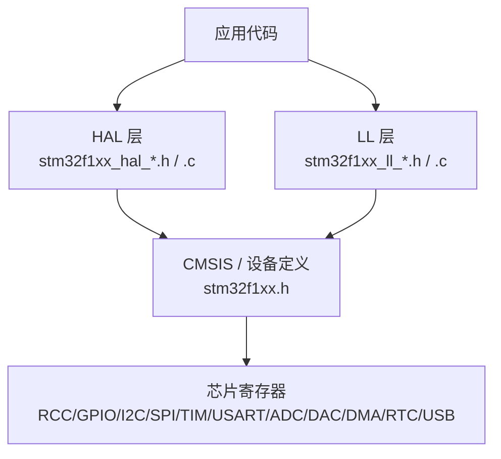
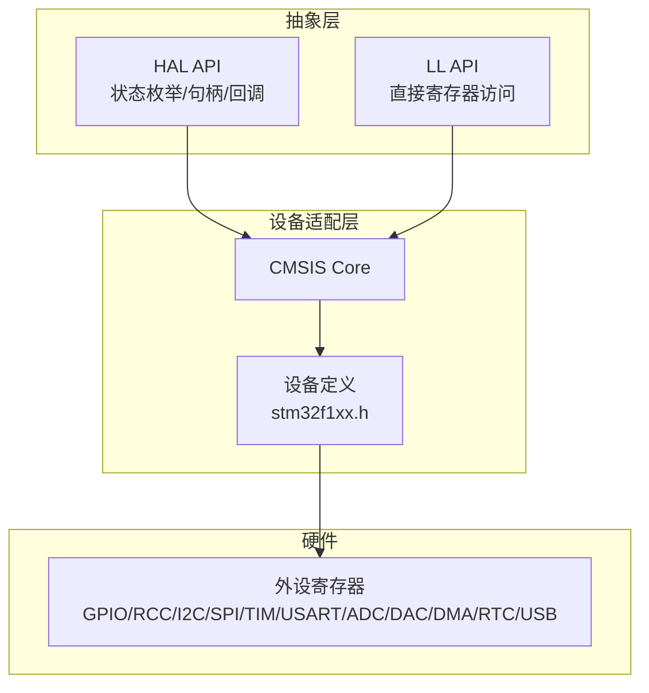
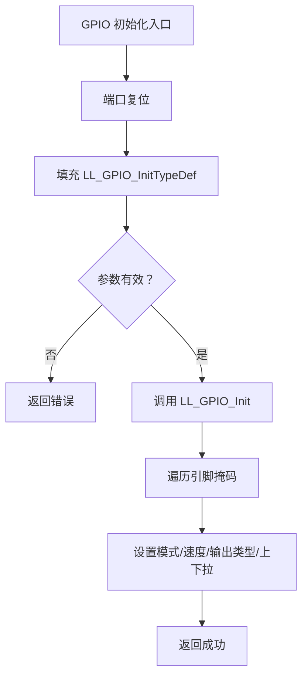
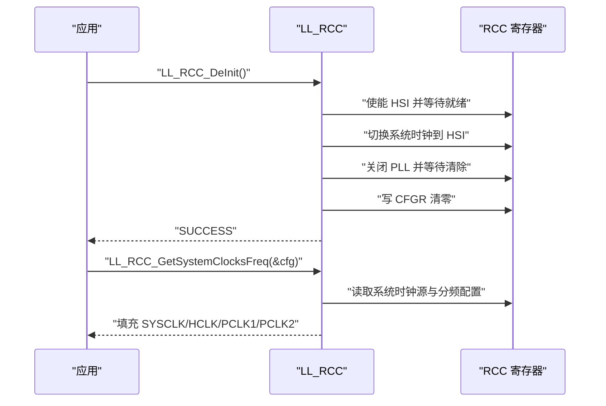
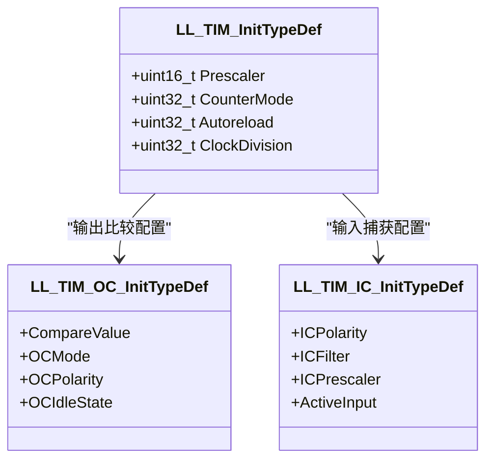
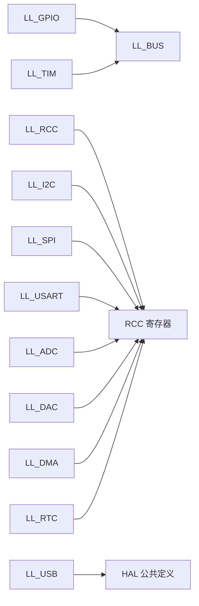

# LL 低层驱动参考

<cite>
**本文引用的文件**   
- [README.md](file://README.md)
- [stm32f1xx_hal_def.h](file://Inc/stm32f1xx_hal_def.h)
- [stm32f1xx_ll_gpio.h](file://Inc/stm32f1xx_ll_gpio.h)
- [stm32f1xx_ll_gpio.c](file://Src/stm32f1xx_ll_gpio.c)
- [stm32f1xx_ll_rcc.h](file://Inc/stm32f1xx_ll_rcc.h)
- [stm32f1xx_ll_rcc.c](file://Src/stm32f1xx_ll_rcc.c)
- [stm32f1xx_ll_i2c.h](file://Inc/stm32f1xx_ll_i2c.h)
- [stm32f1xx_ll_spi.h](file://Inc/stm32f1xx_ll_spi.h)
- [stm32f1xx_ll_tim.h](file://Inc/stm32f1xx_ll_tim.h)
- [stm32f1xx_ll_tim.c](file://Src/stm32f1xx_ll_tim.c)
- [stm32f1xx_ll_usart.h](file://Inc/stm32f1xx_ll_usart.h)
- [stm32f1xx_ll_adc.h](file://Inc/stm32f1xx_ll_adc.h)
- [stm32f1xx_ll_dac.h](file://Inc/stm32f1xx_ll_dac.h)
- [stm32f1xx_ll_dma.h](file://Inc/stm32f1xx_ll_dma.h)
- [stm32f1xx_ll_rtc.h](file://Inc/stm32f1xx_ll_rtc.h)
- [stm32f1xx_ll_usb.h](file://Inc/stm32f1xx_ll_usb.h)
</cite>

## 目录
1. [引言](#引言)
2. [项目结构](#项目结构)
3. [核心组件](#核心组件)
4. [架构总览](#架构总览)
5. [详细组件分析](#详细组件分析)
6. [依赖关系分析](#依赖关系分析)
7. [性能与体积考量](#性能与体积考量)
8. [从 HAL 迁移到 LL 的最小示例](#从-hal-迁移到-ll-的最小示例)
9. [可移植性与风险](#可移植性与风险)
10. [性能分析方法](#性能分析方法)
11. [调试建议](#调试建议)
12. [结论](#结论)

## 引言
本参考文档面向使用 STM32F1xx HAL 库的开发者，重点解释其中附带的 LL（Low Layer）低层驱动。LL 接口直接封装寄存器操作，适用于极致性能、精确时序控制、裸机或轻量 RTOS 环境。文档同时对比 HAL 与 LL 在代码体积、执行效率、可移植性和易用性上的差异，给出何时从 HAL 下探到 LL 的判断标准，并按外设梳理主要 LL 函数族、常用参数、返回值和使用约束。

STM32CubeF1 仓库说明指出，该组件提供 HAL-LL 驱动层，并与 CMSIS Core、CMSIS Device 保持版本一致性要求；HAL 库通过统一的状态枚举、锁机制等定义，为上层应用提供一致抽象。

**章节来源**
- [README.md:1-45](file://README.md#L1-L45)
- [stm32f1xx_hal_def.h:1-200](file://Inc/stm32f1xx_hal_def.h#L1-L200)

## 项目结构
该仓库按 HAL 与 LL 分层组织：
- `Inc/` 包含所有头文件，分为 HAL 头文件与 LL 头文件，命名前缀分别为 `stm32f1xx_hal_*.h` 与 `stm32f1xx_ll_*.h`。
- `Src/` 包含对应实现，如 `stm32f1xx_ll_gpio.c`、`stm32f1xx_ll_rcc.c`、`stm32f1xx_ll_tim.c` 等。
- 部分外设只有 LL 头文件与少量实现，例如 USB LL 头文件更偏接口描述，实际底层由 USB 栈或 HAL USB 层组合。

**图表来源**
- [README.md:10-25](file://README.md#L10-L25)
- [stm32f1xx_hal_def.h:1-80](file://Inc/stm32f1xx_hal_def.h#L1-L80)

**章节来源**
- [README.md:1-45](file://README.md#L1-L45)

## 核心组件
LL 层按外设划分模块，每个模块通常包括：
- 初始化结构体，例如 `LL_GPIO_InitTypeDef`、`LL_RCC_ClocksTypeDef`、`LL_I2C_InitTypeDef`、`LL_SPI_InitTypeDef`、`LL_USART_InitTypeDef`、`LL_TIM_OC_InitTypeDef` 等。
- 常量宏，用于选择模式、极性、相位、分频、中断标志位等。
- 函数族，用于复位、初始化、使能时钟、配置寄存器、读写状态和中断。

关键特征：
- LL 函数多直接调用寄存器写入、读取宏，如 `LL_RCC_WriteReg(CFGR, ...)`。
- 许多功能以宏形式暴露，便于编译器内联优化。
- 大量条件编译保护不同子型号的外设存在性，例如 `#if defined(TIM1)`、`#if defined(ADC1)`。

**章节来源**
- [stm32f1xx_ll_gpio.h:1-120](file://Inc/stm32f1xx_ll_gpio.h#L1-L120)
- [stm32f1xx_ll_rcc.h:1-120](file://Inc/stm32f1xx_ll_rcc.h#L1-L120)
- [stm32f1xx_ll_i2c.h:1-120](file://Inc/stm32f1xx_ll_i2c.h#L1-L120)
- [stm32f1xx_ll_spi.h:1-120](file://Inc/stm32f1xx_ll_spi.h#L1-L120)
- [stm32f1xx_ll_tim.h:1-120](file://Inc/stm32f1xx_ll_tim.h#L1-L120)
- [stm32f1xx_ll_usart.h:1-120](file://Inc/stm32f1xx_ll_usart.h#L1-L120)

## 架构总览
下图展示 HAL 与 LL 的关系，以及它们如何映射到具体外设寄存器：

**图表来源**
- [stm32f1xx_hal_def.h:1-120](file://Inc/stm32f1xx_hal_def.h#L1-L120)
- [stm32f1xx_ll_rcc.c:1-120](file://Src/stm32f1xx_ll_rcc.c#L1-L120)

## 详细组件分析

### GPIO 低层驱动
GPIO LL 提供引脚掩码、模式、速度、输出类型、上下拉等配置项，并支持批量引脚配置。典型初始化流程包括：
- 使用 `LL_GPIO_DeInit` 复位端口。
- 填充 `LL_GPIO_InitTypeDef`，设置 Pin、Mode、Speed、OutputType、Pull。
- 调用 `LL_GPIO_Init` 完成寄存器配置。
- 后续可通过单引脚函数修改特定属性。

常用参数与约束：
- Pin：使用 `LL_GPIO_PIN_x` 或 `LL_GPIO_PIN_ALL`，注意引脚掩码编码方式。
- Mode：模拟、浮空、输入、通用输出、复用模式。
- Speed：低速、中速、高速，对应 I/O 最大翻转频率。
- OutputType：推挽、开漏。
- Pull：下拉、上拉。

返回值：
- 初始化函数返回错误状态，成功通常为 SUCCESS，失败为 ERROR。

**图表来源**
- [stm32f1xx_ll_gpio.c:1-200](file://Src/stm32f1xx_ll_gpio.c#L1-L200)
- [stm32f1xx_ll_gpio.h:1-120](file://Inc/stm32f1xx_ll_gpio.h#L1-L120)

**章节来源**
- [stm32f1xx_ll_gpio.h:1-120](file://Inc/stm32f1xx_ll_gpio.h#L1-L120)
- [stm32f1xx_ll_gpio.c:1-200](file://Src/stm32f1xx_ll_gpio.c#L1-L200)

### RCC 低层驱动
RCC LL 负责系统时钟、AHB/APB 总线时钟、外部晶振、PLL、CSS、MCO 等。其结构体 `LL_RCC_ClocksTypeDef` 包含 SYSCLK、HCLK、PCLK1、PCLK2 频率字段。常用函数族包括：
- 复位时钟配置：`LL_RCC_DeInit`。
- 获取当前时钟频率：`LL_RCC_GetSystemClocksFreq`。
- 使能/等待 HSE/HSI/PLL：如 `LL_RCC_HSI_Enable`、`LL_RCC_HSI_IsReady`。
- 切换系统时钟源：`LL_RCC_SetSysClkSource`、`LL_RCC_GetSysClkSource`。
- 写寄存器：`LL_RCC_WriteReg(CFGR, ...)`。

常用参数与约束：
- 振荡器值宏：`HSE_VALUE`、`HSI_VALUE`、`LSE_VALUE`、`LSI_VALUE`，用户需与实际硬件匹配。
- 时钟源选择：HSI、HSE、PLL。
- 预分频、倍频因子必须满足器件手册限制。

返回值：
- 初始化与复位函数返回错误状态；频率查询函数填充结构体。

**图表来源**
- [stm32f1xx_ll_rcc.c:1-200](file://Src/stm32f1xx_ll_rcc.c#L1-L200)
- [stm32f1xx_ll_rcc.h:1-120](file://Inc/stm32f1xx_ll_rcc.h#L1-L120)

**章节来源**
- [stm32f1xx_ll_rcc.h:1-120](file://Inc/stm32f1xx_ll_rcc.h#L1-L120)
- [stm32f1xx_ll_rcc.c:1-200](file://Src/stm32f1xx_ll_rcc.c#L1-L200)

### I2C 低层驱动
I2C LL 提供主/从模式、SMBus 模式、时钟速度、占空比、自身地址、ACK/NACK 等配置。初始化结构体 `LL_I2C_InitTypeDef` 包含：
- PeripheralMode：I2C、SMBus Host、SMBus Device。
- ClockSpeed：时钟频率，标准模式不超过 100kHz，快速模式不超过 400kHz。
- DutyCycle：快速模式占空比。
- OwnAddress1：自身地址，7位或10位。
- TypeAcknowledge：ACK 或 NACK。
- OwnAddrSize：地址长度。

常用参数与约束：
- 时钟速度受硬件限制，需在稳定时钟基础上计算 SCL 周期。
- 主模式下需要处理起始、应答、停止、忙等状态标志。
- SMBus 模式需额外配置 ARP、默认地址等。

返回值：
- 配置函数通常返回错误状态；状态查询通过标志宏判断。

**章节来源**
- [stm32f1xx_ll_i2c.h:1-180](file://Inc/stm32f1xx_ll_i2c.h#L1-L180)

### SPI 低层驱动
SPI LL 提供传输方向、主/从、数据宽度、时钟极性与相位、NSS、波特率分频、比特顺序、CRC 等配置。初始化结构体 `LL_SPI_InitTypeDef` 包含：
- TransferDirection：单向或双向。
- Mode：主机或从机。
- DataWidth：数据宽度。
- ClockPolarity、ClockPhase：CPOL/CPHA。
- NSS：硬件或软件管理。
- BaudRate：波特率分频。
- BitOrder：MSB 或 LSB 优先。
- CRCCalculation、CRCPoly：CRC 选项。

常用参数与约束：
- 从机模式下不需要设置波特率分频。
- CPOL/CPHA 必须与从机设备一致。
- CRC 多项式范围有限制。

返回值：
- 配置函数返回错误状态；状态查询通过标志宏。

**章节来源**
- [stm32f1xx_ll_spi.h:1-180](file://Inc/stm32f1xx_ll_spi.h#L1-L180)

### TIM 低层驱动
TIM LL 提供时基、输出比较、输入捕获、编码器、死区时间、断言等丰富功能。初始化结构体包含：
- Prescaler：预分频。
- CounterMode：向上、向下、中心对齐等。
- Autoreload：自动重装载值，某些定时器支持 32 位。
- ClockDivision：时钟分频。
- OC/IC/Encoder/Break 相关配置结构体。

常用参数与约束：
- 计数器模式与通道数因定时器实例而异。
- 高级定时器具备死区时间与刹车功能，需结合具体应用场景配置。
- 中断和 DMA 触发点需与计数事件配合。

返回值：
- 初始化函数返回错误状态；配置内部使用断言校验参数有效性。

**图表来源**
- [stm32f1xx_ll_tim.h:1-200](file://Inc/stm32f1xx_ll_tim.h#L1-L200)
- [stm32f1xx_ll_tim.c:1-200](file://Src/stm32f1xx_ll_tim.c#L1-L200)

**章节来源**
- [stm32f1xx_ll_tim.h:1-200](file://Inc/stm32f1xx_ll_tim.h#L1-L200)
- [stm32f1xx_ll_tim.c:1-200](file://Src/stm32f1xx_ll_tim.c#L1-L200)

### USART 低层驱动
USART LL 提供波特率、数据位、停止位、奇偶校验、收发方向、硬件流控、过采样等配置。初始化结构体 `LL_USART_InitTypeDef` 包含：
- BaudRate：通信波特率。
- DataWidth：数据位宽。
- StopBits：停止位数。
- Parity：奇偶校验。
- TransferDirection：接收/发送方向。
- HardwareFlowControl：硬件流控。
- OverSampling：16 或 8 过采样。

另有时钟初始化结构体 `LL_USART_ClockInitTypeDef`，用于同步模式下的时钟输出、极性、相位、最后一位脉冲输出。

常用参数与约束：
- 波特率计算依赖 PCLK 频率，需先正确配置 RCC。
- 硬件流控仅在支持 CTS/RTS 的实例可用。
- 同步模式下需配置时钟信号。

返回值：
- 配置函数返回错误状态；状态查询通过标志宏。

**章节来源**
- [stm32f1xx_ll_usart.h:1-200](file://Inc/stm32f1xx_ll_usart.h#L1-L200)

### ADC 低层驱动
ADC LL 提供规则序列、注入序列、通道编号、采样时间、模拟看门狗等配置。内部宏定义了：
- 规则序列寄存器偏移与位偏移。
- 注入序列数据寄存器与偏移量。
- 通道编号与内部通道标记。
- 采样时间配置偏移与位位置。

常用参数与约束：
- 通道编号可能区分外部通道与内部通道。
- 规则与注入序列共享部分寄存器位域，需注意冲突。
- 模拟看门狗阈值与通道选择需匹配硬件能力。

返回值：
- 配置函数返回错误状态；转换结果通过数据寄存器读取。

**章节来源**
- [stm32f1xx_ll_adc.h:1-200](file://Inc/stm32f1xx_ll_adc.h#L1-L200)

### DAC 低层驱动
DAC LL 提供触发源、波形自动生成（噪声、三角波）、输出缓冲、通道偏移与寄存器指针宏。初始化结构体 `LL_DAC_InitTypeDef` 包含：
- TriggerSource：内部触发或外部事件。
- WaveAutoGeneration：波形模式。
- WaveAutoGenerationConfig：噪声 LFSR 位数或三角波幅度。
- OutputBuffer：输出缓冲开关。

常用参数与约束：
- 通道偏移宏用于定位 DHR/DOR 寄存器。
- 数字满量程值基于 12 位分辨率。
- 触发源与定时器/外部中断需配合。

返回值：
- 配置函数返回错误状态；转换值通过 DOR 寄存器读取。

**章节来源**
- [stm32f1xx_ll_dac.h:1-200](file://Inc/stm32f1xx_ll_dac.h#L1-L200)

### DMA 低层驱动
DMA LL 提供外设或内存地址、传输方向、模式（正常/循环）、地址递增、数据宽度、传输数量、优先级等配置。初始化结构体 `LL_DMA_InitTypeDef` 包含：
- PeriphOrM2MSrcAddress：外设基址或源地址。
- MemoryOrM2MDstAddress：内存基址或目的地址。
- Direction：内存到外设、外设到内存、内存到内存。
- Mode：正常或循环。
- PeriphOrM2MSrcIncMode、MemoryOrM2MDstIncMode：地址递增。
- PeriphOrM2MSrcDataSize、MemoryOrM2MDstDataSize：数据宽度。
- NbData：传输数据数量。
- Priority：通道优先级。

常用参数与约束：
- 内存到内存传输不支持循环模式。
- 数据宽度需与外设和数据缓冲区一致。
- 中断标志与清除标志宏用于处理传输完成、半传输、错误等事件。

返回值：
- 配置函数返回错误状态；状态查询通过标志宏。

**章节来源**
- [stm32f1xx_ll_dma.h:1-200](file://Inc/stm32f1xx_ll_dma.h#L1-L200)

### RTC 低层驱动
RTC LL 提供异步预分频、输出源、备份寄存器、格式（二进制/BCD）、tamper 电平、校准输出等。初始化结构体 `LL_RTC_InitTypeDef` 包含：
- AsynchPrescaler：异步预分频值。
- OutPutSource：输出到 TAMPER 引脚的信号源。

另有时间结构与闹钟结构，用于设置小时、分钟、秒及闹钟时间。

常用参数与约束：
- 备份寄存器数量取决于具体子型号。
- 输出源可选 RTC 时钟、闹钟脉冲、秒脉冲或禁用。
- 数据格式可在二进制与 BCD 之间选择。

返回值：
- 配置函数返回错误状态；时间/闹钟设置需遵循字段取值范围。

**章节来源**
- [stm32f1xx_ll_rtc.h:1-200](file://Inc/stm32f1xx_ll_rtc.h#L1-L200)

### USB 低层驱动
USB LL 头文件定义了 USB 模式、URB 状态、主机通道状态、端点与配置结构体，包括：
- USB_ModeTypeDef：设备、主机、双角色。
- USB_EPTypeDef：端点数、方向、类型、最大包长、缓冲区指针等。
- USB_CfgTypeDef：端点数、主机通道数、DMA、速度、PHY、低功耗等。

常用参数与约束：
- USB OTG FS 与内置 USB 控制器结构体字段存在差异，需用条件编译区分。
- 端点类型、最大包长、PMA 地址等需与协议和设备能力匹配。

返回值：
- USB LL 更多作为高层 USB 栈或 HAL USB 的底层抽象，具体返回语义由上层实现决定。

**章节来源**
- [stm32f1xx_ll_usb.h:1-200](file://Inc/stm32f1xx_ll_usb.h#L1-L200)

## 依赖关系分析
LL 模块普遍依赖：
- CMSIS Core 提供的寄存器访问宏。
- 设备定义头文件中的外设基址与位定义。
- 部分 LL 实现依赖 LL Bus 模块进行端口复位与时钟控制。

**图表来源**
- [stm32f1xx_ll_gpio.c:1-80](file://Src/stm32f1xx_ll_gpio.c#L1-L80)
- [stm32f1xx_ll_tim.c:1-80](file://Src/stm32f1xx_ll_tim.c#L1-L80)
- [stm32f1xx_ll_rcc.c:1-80](file://Src/stm32f1xx_ll_rcc.c#L1-L80)
- [stm32f1xx_ll_usb.h:1-80](file://Inc/stm32f1xx_ll_usb.h#L1-L80)

**章节来源**
- [stm32f1xx_ll_gpio.c:1-80](file://Src/stm32f1xx_ll_gpio.c#L1-L80)
- [stm32f1xx_ll_tim.c:1-80](file://Src/stm32f1xx_ll_tim.c#L1-L80)
- [stm32f1xx_ll_rcc.c:1-80](file://Src/stm32f1xx_ll_rcc.c#L1-L80)
- [stm32f1xx_ll_usb.h:1-80](file://Inc/stm32f1xx_ll_usb.h#L1-L80)

## 性能与体积考量
- 代码体积：LL 接口更接近寄存器操作，函数体较小且多为内联宏，可减少中间抽象层带来的代码膨胀。HAL 则提供更高层次的句柄、回调、状态机与跨系列兼容逻辑，体积更大。
- 执行效率：LL 减少函数调用与分支，适合对延迟敏感的路径，如高频 ISR、精确时序控制、硬实时任务。
- 可移植性：HAL 更强调跨系列一致性；LL 虽在同一系列内尽量统一，但仍依赖具体外设位域与寄存器布局，不同子型号差异更明显。
- 易用性：HAL 提供完整初始化结构体与错误处理；LL 要求开发者理解寄存器位段、中断标志、时序约束。

判断是否从 HAL 下探到 LL 的标准：
- 已确认 HAL 无法满足时序或延迟预算。
- 需要在 ISR 中执行高频、短路径操作，且希望避免多余开销。
- 需要精确控制外设寄存器位段，以实现定制行为。
- 目标产品对 Flash/RAM 有严格限制，必须精简驱动代码。
- 已有足够外设手册知识，能够承担更高维护成本。

[本节为通用指导，不直接分析具体文件]

## 从 HAL 迁移到 LL 的最小示例
以下以 GPIO 为例，说明最小迁移步骤（不展示具体代码内容）：
- 在 HAL 中，通常调用 `MX_GPIO_Init()` 并通过 `HAL_GPIO_Init` 配置引脚。
- 在 LL 中，改为：
  - 调用 `LL_GPIO_DeInit(GPIOx)` 复位端口。
  - 填充 `LL_GPIO_InitTypeDef`，设置 Pin、Mode、Speed、OutputType、Pull。
  - 调用 `LL_GPIO_Init(GPIOx, &gpioInitStruct)` 完成配置。
  - 如需动态修改，使用 `LL_GPIO_SetPinMode`、`LL_GPIO_SetPinSpeed`、`LL_GPIO_SetPinPull` 等函数。

注意事项：
- 确保 `USE_FULL_LL_DRIVER` 宏启用 LL 实现。
- 引脚掩码使用 LL 提供的 `LL_GPIO_PIN_x` 宏。
- 若使用中断，还需配置 EXTI LL 与 NVIC，而不是仅依赖 HAL 回调。

**章节来源**
- [stm32f1xx_ll_gpio.h:1-120](file://Inc/stm32f1xx_ll_gpio.h#L1-L120)
- [stm32f1xx_ll_gpio.c:1-200](file://Src/stm32f1xx_ll_gpio.c#L1-L200)

## 可移植性与风险
- 子型号差异：LL 头文件中广泛使用 `#if defined(TIM1)`、`#if defined(ADC1)`、`#if defined(DAC)` 等条件编译，同一外设在不同 STM32F1 子型号上可能存在缺失或增强。
- 寄存器位域差异：LL 常量宏直接映射到具体寄存器位，若将代码从一个子型号迁移到另一个，必须核对位偏移、掩码与功能支持。
- 时钟树差异：RCC 与 PLL 配置在不同子型号上可能有额外 PLL2/PLL3、预分频器等，不能简单复制 LL 配置。
- USB 控制器差异：USB 与 USB_OTG_FS 的结构体字段不同，迁移时必须检查条件编译分支。

建议：
- 在迁移后重新评估外设可用性，逐项核对头文件中的条件编译。
- 使用构建脚本或静态检查工具验证未使用的宏与外设。
- 对关键外设编写单元测试，覆盖不同子型号的编译与运行路径。

**章节来源**
- [stm32f1xx_ll_tim.h:1-120](file://Inc/stm32f1xx_ll_tim.h#L1-L120)
- [stm32f1xx_ll_adc.h:1-120](file://Inc/stm32f1xx_ll_adc.h#L1-L120)
- [stm32f1xx_ll_dac.h:1-120](file://Inc/stm32f1xx_ll_dac.h#L1-L120)
- [stm32f1xx_ll_usb.h:1-120](file://Inc/stm32f1xx_ll_usb.h#L1-L120)

## 性能分析方法
- 编译产物分析：比较 HAL 与 LL 版本的 `.map` 文件，统计各模块体积与符号占用。
- 运行时分析：使用硬件性能计数器或调试器观察关键路径的指令数、周期数、中断延迟。
- 时序测量：用示波器或逻辑分析仪测量 GPIO 翻转、SPI/I2C/USART 帧间隔、定时器输出边沿精度。
- 中断负载：统计 ISR 执行时间与调用频率，评估 LL 路径是否能满足实时需求。
- 功耗测量：在空闲与活跃状态下测量电流，评估 LL 配置对功耗的影响。

[本节为通用指导，不直接分析具体文件]

## 调试建议
- 启用断言：当 `USE_FULL_ASSERT` 开启时，LL 实现会进行参数校验；否则 `assert_param` 为空宏。
- 状态标志轮询：LL 多通过标志宏判断外设状态，建议在超时机制下轮询，避免无限等待。
- 时钟验证：在切换系统时钟后调用 `LL_RCC_GetSystemClocksFreq` 验证 SYSCLK/HCLK/PCLK1/PCLK2 是否符合预期。
- 外设复位：使用 LL Bus 模块的复位/释放复位函数恢复外设到初始状态，便于重复测试。
- 中断调试：确认中断使能宏与 NVIC 配置一致，必要时禁用其他中断以降低干扰。
- 寄存器快照：在关键配置前后读取寄存器值，对比期望位段，快速定位错误。

**章节来源**
- [stm32f1xx_ll_gpio.c:1-80](file://Src/stm32f1xx_ll_gpio.c#L1-L80)
- [stm32f1xx_ll_rcc.c:1-200](file://Src/stm32f1xx_ll_rcc.c#L1-L200)

## 结论
LL 低层驱动为 STM32F1xx 提供了贴近寄存器的轻量接口，适合追求极致性能、精确时序、裸机或轻量 RTOS 场景。相比 HAL，LL 在代码体积和执行效率上更具优势，但牺牲了部分可移植性和易用性。开发者应在明确性能与体积需求的前提下，谨慎选择从 HAL 下探到 LL，并充分评估不同子型号间的差异与风险。对于关键路径，建议使用性能分析与调试手段验证 LL 配置的正确性与稳定性。

[本节为总结性内容，不直接分析具体文件]