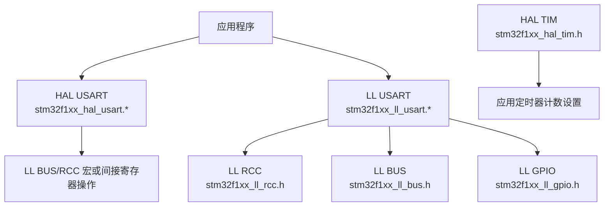
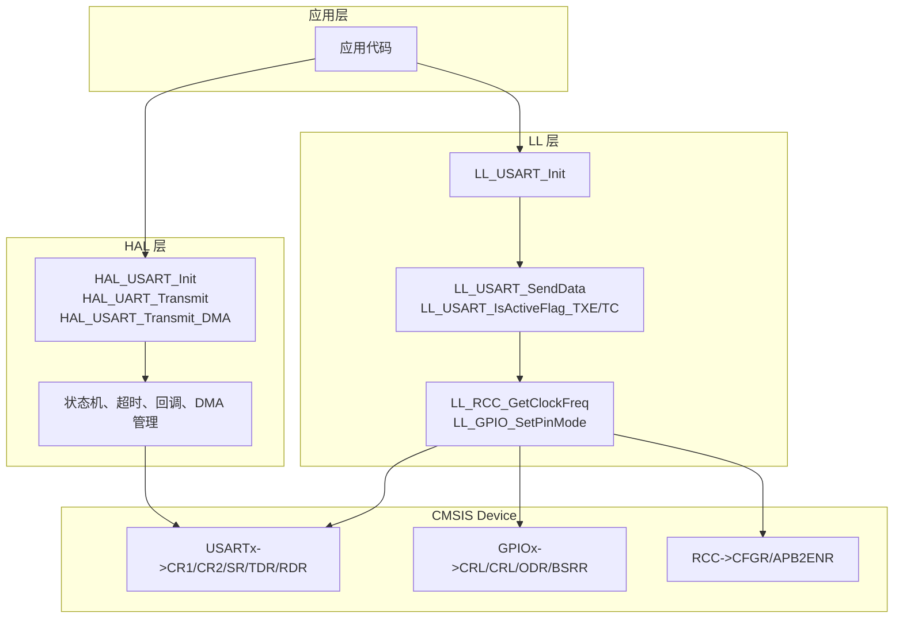
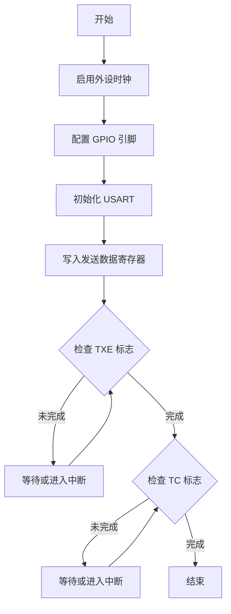
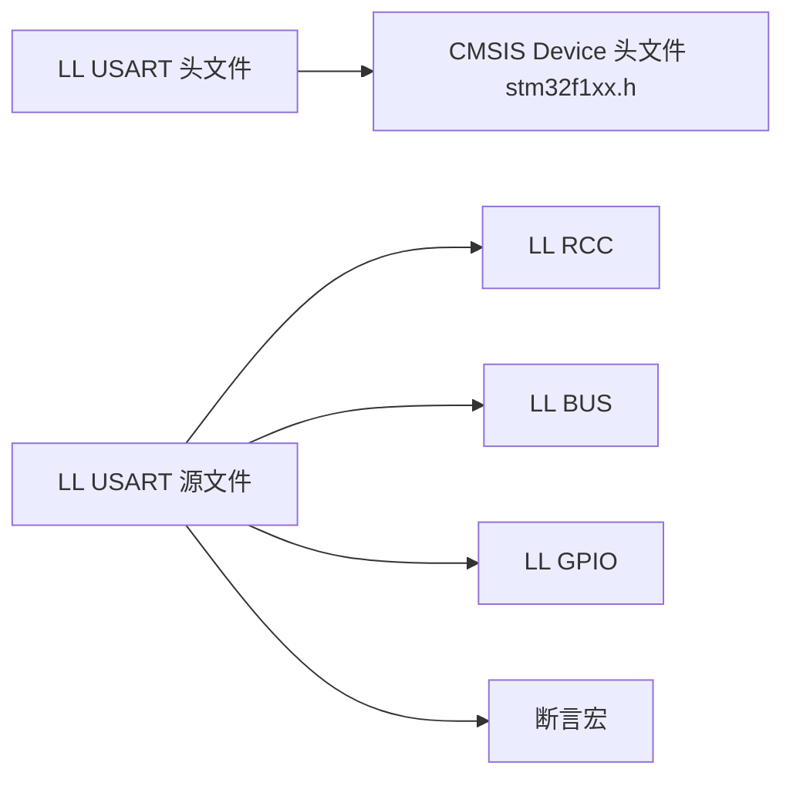

# LL 架构与迁移指南

<cite>
**本文引用的文件**
- [README.md](file://README.md)
- [stm32f1xx_ll_usart.h](file://Inc/stm32f1xx_ll_usart.h)
- [stm32f1xx_ll_usart.c](file://Src/stm32f1xx_ll_usart.c)
- [stm32f1xx_hal_usart.h](file://Inc/stm32f1xx_hal_usart.h)
- [stm32f1xx_hal_usart.c](file://Src/stm32f1xx_hal_usart.c)
- [stm32f1xx_ll_gpio.h](file://Inc/stm32f1xx_ll_gpio.h)
- [stm32f1xx_ll_rcc.h](file://Inc/stm32f1xx_ll_rcc.h)
- [stm32f1xx_hal_tim.h](file://Inc/stm32f1xx_hal_tim.h)
- [stm32f1xx_ll_bus.h](file://Inc/stm32f1xx_ll_bus.h)
</cite>

## 目录
1. [引言](#引言)
2. [项目结构](#项目结构)
3. [核心组件](#核心组件)
4. [架构总览](#架构总览)
5. [详细组件分析](#详细组件分析)
6. [依赖关系分析](#依赖关系分析)
7. [性能考量](#性能考量)
8. [故障排查指南](#故障排查指南)
9. [结论](#结论)
10. [附录](#附录)

## 引言
本指南面向使用 STM32F1xx HAL-LL 驱动库的嵌入式工程师，目标是帮助读者理解 STM32F1 LL（Low Layer）低层驱动的架构、命名约定、典型调用流程，以及从 HAL 向 LL 迁移时的注意事项。

STM32CubeF1 HAL-LL 驱动组件提供两类抽象：
- HAL：强调可移植性、易用性和统一 API，包含状态机、回调、超时管理、DMA/中断高层封装等。
- LL：面向性能、精确时序和最小代码体积，直接通过内联函数访问 CMSIS Device 寄存器定义。

README 明确指出该仓库是 STM32CubeF1 MCU 包中“HAL-LL Drivers”的一部分，并强调 CMSIS Core、CMSIS Device、HAL 的版本一致性非常重要；这与 LL 直接依赖 `stm32f1xx.h` 设备头文件的实现方式一致。

**章节来源**
- [README.md:1-45](file://README.md#L1-L45)

## 项目结构
该仓库按功能分为 HAL 与 LL 两套驱动，并在 `Inc/` 与 `Src/` 下分别组织头文件和源文件。本次迁移指南重点涉及 USART、GPIO、RCC、TIM 等外设。

**图表来源**
- [stm32f1xx_ll_usart.h:1-260](file://Inc/stm32f1xx_ll_usart.h#L1-L260)
- [stm32f1xx_ll_usart.c:1-220](file://Src/stm32f1xx_ll_usart.c#L1-L220)
- [stm32f1xx_ll_rcc.h:1-200](file://Inc/stm32f1xx_ll_rcc.h#L1-L200)
- [stm32f1xx_ll_gpio.h:1-180](file://Inc/stm32f1xx_ll_gpio.h#L1-L180)
- [stm32f1xx_hal_tim.h:1283-1283](file://Inc/stm32f1xx_hal_tim.h#L1283-L1283)

**章节来源**
- [README.md:1-45](file://README.md#L1-L45)
- [stm32f1xx_ll_usart.h:1-260](file://Inc/stm32f1xx_ll_usart.h#L1-L260)
- [stm32f1xx_ll_usart.c:1-220](file://Src/stm32f1xx_ll_usart.c#L1-L220)
- [stm32f1xx_ll_rcc.h:1-200](file://Inc/stm32f1xx_ll_rcc.h#L1-L200)
- [stm32f1xx_ll_gpio.h:1-180](file://Inc/stm32f1xx_ll_gpio.h#L1-L180)

## 核心组件
### LL USART 组件
LL USART 主要职责是直接暴露 USART 外设的初始化、配置、数据发送/接收、标志位检查和中断控制能力。其关键特征包括：
- 使用 `USART_TypeDef *USARTx` 直接操作寄存器基地址。
- 大量使用 `__STATIC_INLINE` 函数，减少函数调用开销。
- 将状态标志定义为 `LL_USART_SR_*`，中断使能定义为 `LL_USART_CRx_*IE`。
- 提供 `LL_USART_InitTypeDef`、`LL_USART_ClockInitTypeDef` 等结构体，用于描述波特率、数据宽度、停止位、奇偶校验、方向、硬件流控、过采样等参数。

在头文件中可见 TXE、TC、RXNE、空闲线、溢出错误等标志常量，以及对应中断使能宏；这些是 LL 驱动中最常用的底层状态接口。

**章节来源**
- [stm32f1xx_ll_usart.h:1-260](file://Inc/stm32f1xx_ll_usart.h#L1-L260)

### LL GPIO 组件
LL GPIO 提供引脚掩码、模式、速度、上拉下拉等配置能力。引脚掩码采用统一的编码方式，把位位置与寄存器偏移组合为统一选择值，便于跨端口复用相同逻辑。

**章节来源**
- [stm32f1xx_ll_gpio.h:1-180](file://Inc/stm32f1xx_ll_gpio.h#L1-L180)

### LL RCC 组件
LL RCC 提供系统时钟、HCLK、PCLK1、PCLK2 频率查询结构，以及振荡器就绪标志、复位标志、中断标志等底层信息。它通常被 LL 其他外设模块引用，用于计算波特率、等待时钟稳定等。

**章节来源**
- [stm32f1xx_ll_rcc.h:1-200](file://Inc/stm32f1xx_ll_rcc.h#L1-L200)

### HAL USART 组件
HAL USART 维护 `USART_HandleTypeDef`，包含实例指针、初始化参数、发送/接收缓冲区指针、传输大小、计数器、DMA 句柄、锁、状态、错误码等。它还提供轮询、中断、DMA 三种传输模式的完整生命周期管理，以及丰富的回调机制。

**章节来源**
- [stm32f1xx_hal_usart.h:1-240](file://Inc/stm32f1xx_hal_usart.h#L1-L240)

## 架构总览
下图展示 HAL 与 LL 在 USART 场景中的分层关系：应用层可以选择 HAL 提供的易用 API，也可以直接调用 LL 的低层函数；LL 则直接读写 CMSIS Device 定义的寄存器。

该架构图反映以下设计事实：
- HAL 更关注“如何使用”，LL 更关注“如何配置”。
- LL 函数数量少、调用链短，适合对执行时间、ROM/RAM 占用敏感的场景。
- HAL 包含更多状态、缓冲区和回调，更适合快速开发和多型号移植。

**图表来源**
- [stm32f1xx_hal_usart.h:1-240](file://Inc/stm32f1xx_hal_usart.h#L1-L240)
- [stm32f1xx_hal_usart.c:1-260](file://Src/stm32f1xx_hal_usart.c#L1-L260)
- [stm32f1xx_ll_usart.h:1-260](file://Inc/stm32f1xx_ll_usart.h#L1-L260)
- [stm32f1xx_ll_usart.c:1-220](file://Src/stm32f1xx_ll_usart.c#L1-L220)

## 详细组件分析

### HAL 与 LL 的设计目标对比
| 维度 | HAL | LL |
|---|---|---|
| 设计目标 | 可移植性、易用性、统一 API、回调与 DMA 抽象 | 性能、精确时序、最小代码体积、直接寄存器访问 |
| 典型函数数量 | 每个外设较多，含初始化、阻塞、非阻塞、DMA、回调、错误处理 | 每个外设较少，以初始化、配置、标志检查、简单 IO 为主 |
| 执行开销 | 更高，因为包含状态机、超时判断、缓冲区管理、锁、回调 | 更低，多为内联函数，直接写寄存器 |
| ROM/RAM 占用 | 更高，需要更多函数体和状态结构 | 更低，适合资源受限设备 |
| 中断/DMA 抽象 | 强，封装完整生命周期和回调 | 弱，多由用户自行处理中断/DMA 配置和状态 |
| 适用场景 | 通用业务、快速原型、多型号移植、复杂外设协议 | 实时通信、精确延时、最小固件体积、高频中断路径 |

### LL 命名约定与常用宏分类
LL 命名约定具有以下特点：
- 外设函数前缀通常为 `LL_<Perpheral>_<Action>`，例如 `LL_USART_Init`、`LL_USART_EnableDirectionTx`、`LL_USART_IsActiveFlag_TC`。
- 标志宏通常以 `LL_USART_SR_*` 表示状态寄存器标志，如 `LL_USART_SR_TXE`、`LL_USART_SR_TC`、`LL_USART_SR_RXNE`。
- 中断使能宏通常以 `LL_USART_CRx_*IE` 形式出现，如 `LL_USART_CR1_TXEIE`、`LL_USART_CR1_TCIE`。
- GPIO 引脚掩码使用统一格式，例如 `LL_GPIO_PIN_0` 到 `LL_GPIO_PIN_ALL`，便于批量操作。
- RCC 时钟频率查询使用 `LL_RCC_ClocksTypeDef`，包含 SYSCLK、HCLK、PCLK1、PCLK2。

常用宏分类示例：
- 时钟相关：`LL_RCC_ClocksTypeDef`、各振荡器就绪标志、时钟源选择宏。
- GPIO 相关：`LL_GPIO_PIN_*`、`LL_GPIO_MODE_*`、`LL_GPIO_SPEED_*`、`LL_GPIO_PULL_*`。
- 外设控制：`LL_USART_InitTypeDef`、`LL_USART_SetDataWidth`、`LL_USART_SetParity`、`LL_USART_ConfigCharacter`。
- 状态检查：`LL_USART_IsActiveFlag_TXE`、`LL_USART_IsActiveFlag_TC`、`LL_USART_IsActiveFlag_RXNE`。

**章节来源**
- [stm32f1xx_ll_usart.h:1-260](file://Inc/stm32f1xx_ll_usart.h#L1-L260)
- [stm32f1xx_ll_gpio.h:1-180](file://Inc/stm32f1xx_ll_gpio.h#L1-L180)
- [stm32f1xx_ll_rcc.h:1-200](file://Inc/stm32f1xx_ll_rcc.h#L1-L200)

### LL 典型调用流程
典型的 LL USART 发送流程如下：
1. 通过 LL RCC 或 LL BUS 启用外设时钟。
2. 通过 LL GPIO 配置 TX/RX 引脚为复用模式。
3. 调用 `LL_USART_Init` 完成波特率、数据宽度、停止位、奇偶校验、方向等配置。
4. 调用发送函数写入数据寄存器。
5. 轮询或中断检查 TXE、TC 标志，确保发送完成。
6. 若使用中断，需开启对应中断并使能 NVIC。

**图表来源**
- [stm32f1xx_ll_usart.c:1-220](file://Src/stm32f1xx_ll_usart.c#L1-L220)
- [stm32f1xx_ll_usart.h:1-260](file://Inc/stm32f1xx_ll_usart.h#L1-L260)

### 从 HAL_UART_Transmit 到 LL 的最小迁移思路
注意：当前仓库中直接匹配的 LL USART 发送函数名在不同版本可能不同，但核心思想一致：用 LL 的发送函数替换 HAL 的阻塞发送，并用 LL 的标志检查函数替换 HAL 内部的等待逻辑。

迁移步骤：
1. 保留 HAL 初始化阶段，或改为 LL 初始化：
   - HAL：`HAL_UART_Init`、`HAL_UART_MspInit`。
   - LL：`LL_APB2_GRP1_EnableClock`/`LL_APB1_GRP1_EnableClock`、`LL_GPIO_Init`、`LL_USART_Init`。
2. 将 `HAL_UART_Transmit(huart, pData, Size, Timeout)` 替换为 LL 调用：
   - 发送数据：使用 LL 提供的发送函数或直接写 `USARTx->TDR`。
   - 等待发送完成：使用 `LL_USART_IsActiveFlag_TXE` 和 `LL_USART_IsActiveFlag_TC` 进行轮询。
3. 将 HAL 的超时逻辑转换为 LL 风格的轮询循环。
4. 若需要中断或 DMA，需在 LL 层自行配置中断使能和 NVIC。

参考定位：
- HAL UART 发送接口定义位于 [stm32f1xx_hal_uart.h:749-753](file://Inc/stm32f1xx_hal_uart.h#L749-L753)。
- HAL USART 内部轮询和寄存器写入逻辑位于 [stm32f1xx_hal_usart.c:780-810](file://Src/stm32f1xx_hal_usart.c#L780-L810)、[stm32f1xx_hal_usart.c:995-1017](file://Src/stm32f1xx_hal_usart.c#L995-L1017)。
- LL USART 状态标志定义位于 [stm32f1xx_ll_usart.h:164-179](file://Inc/stm32f1xx_ll_usart.h#L164-L179)、[stm32f1xx_ll_usart.h:1847-1862](file://Inc/stm32f1xx_ll_usart.h#L1847-L1862)。

**章节来源**
- [stm32f1xx_hal_uart.h:749-753](file://Inc/stm32f1xx_hal_uart.h#L749-L753)
- [stm32f1xx_hal_usart.c:780-810](file://Src/stm32f1xx_hal_usart.c#L780-L810)
- [stm32f1xx_hal_usart.c:995-1017](file://Src/stm32f1xx_hal_usart.c#L995-L1017)
- [stm32f1xx_ll_usart.h:164-179](file://Inc/stm32f1xx_ll_usart.h#L164-L179)
- [stm32f1xx_ll_usart.h:1847-1862](file://Inc/stm32f1xx_ll_usart.h#L1847-L1862)

### HAL 与 LL 的关键差异说明
| 差异点 | HAL | LL |
|---|---|---|
| 函数入口 | `HAL_UART_Transmit`、`HAL_USART_Transmit` | `LL_USART_Init`、`LL_USART_SendData` 或寄存器直写 |
| 等待逻辑 | 内部封装 `USART_WaitOnFlagUntilTimeout`，支持超时 | 用户自行编写 `while(!LL_USART_IsActiveFlag_TXE())` 类循环 |
| 缓冲区管理 | 维护 `pTxBuffPtr`、`TxXferSize`、`TxXferCount` | 无内置缓冲区，通常由应用管理 |
| 回调机制 | 支持 Tx/Rx 半完成、完成、错误回调 | 一般不封装回调，需用户在中断中处理 |
| DMA 支持 | 提供 `HAL_UART_Transmit_DMA` 等高级 API | 通常直接配置 DMA 外设和 USART 触发条件 |
| 移植性 | 高，API 相对稳定 | 较低，直接依赖具体外设寄存器行为 |

**章节来源**
- [stm32f1xx_hal_usart.h:1-240](file://Inc/stm32f1xx_hal_usart.h#L1-L240)
- [stm32f1xx_hal_usart.c:247-260](file://Src/stm32f1xx_hal_usart.c#L247-L260)
- [stm32f1xx_ll_usart.h:1-260](file://Inc/stm32f1xx_ll_usart.h#L1-L260)

## 依赖关系分析
LL USART 的实现依赖多个底层模块：
- `stm32f1xx.h`：CMSIS Device 头文件，定义寄存器基地址、寄存器位域、外设枚举。
- `stm32f1xx_ll_rcc.h`：时钟频率、时钟源、复位标志等。
- `stm32f1xx_ll_bus.h`：总线复位和时钟使能辅助宏。
- `stm32f1xx_ll_gpio.h`：GPIO 引脚掩码和模式配置。
- `stm32_assert.h`：可选参数断言，用于编译期或运行期参数检查。

**图表来源**
- [stm32f1xx_ll_usart.c:1-20](file://Src/stm32f1xx_ll_usart.c#L1-L20)
- [stm32f1xx_ll_usart.h:1-20](file://Inc/stm32f1xx_ll_usart.h#L1-L20)

**章节来源**
- [stm32f1xx_ll_usart.c:1-20](file://Src/stm32f1xx_ll_usart.c#L1-L20)
- [stm32f1xx_ll_usart.h:1-20](file://Inc/stm32f1xx_ll_usart.h#L1-L20)

## 性能考量
### 编译器优化等级
- LL 大量使用内联函数，因此在较高优化等级下更容易展开为直接寄存器访问。
- 建议在最终发布固件中使用 `-O2` 或 `-Os` 进行编译，并结合 map 文件观察函数展开情况。
- 对于调试版本，可使用较低优化等级，但需注意此时 LL 的性能优势可能被编译器优化策略影响。

### 查看 map 文件
- 比较 HAL 与 LL 两个构建版本的 `.map` 文件，统计 `stm32f1xx_hal_usart.o` 与 `stm32f1xx_ll_usart.o` 的代码段和数据段大小。
- 关注是否引入了不必要的状态结构、回调表、超时处理代码。

### 中断延迟统计
- 在 LL 中断服务程序中，尽量减少分支、内存访问和函数调用。
- 可以使用 SysTick 记录中断入口时间和退出时间，估算中断延迟。
- 若需要高精度测量，可配合 SWO/ITM 输出时间戳。

### 代码体积建议
- 优先使用 LL 初始化一次外设，然后在中断或 DMA 中直接读写寄存器。
- 避免在热路径中调用复杂的 HAL 函数。
- 将低频配置放在初始化阶段，高频路径只保留最小必要逻辑。

**章节来源**
- [stm32f1xx_ll_usart.h:1-260](file://Inc/stm32f1xx_ll_usart.h#L1-L260)
- [stm32f1xx_ll_usart.c:1-220](file://Src/stm32f1xx_ll_usart.c#L1-L220)

## 故障排查指南
### 常见问题
1. **发送后未检测到 TC 标志**  
   - 确认是否正确等待 `LL_USART_IsActiveFlag_TXE` 后再关闭外设。
   - 确认是否也检查了 `LL_USART_IsActiveFlag_TC`，因为 TXE 仅表示数据寄存器空，TC 表示整个帧传输完成。
2. **波特率不正确**  
   - 检查 LL RCC 获取的时钟频率是否与硬件一致。
   - 检查 LL USART 初始化时使用的过采样模式和分频参数。
3. **GPIO 配置无效**  
   - 确认时钟已启用。
   - 确认引脚模式设置为复用模式，而非普通输出或输入。
4. **中断无法进入**  
   - 确认 USART 中断使能宏正确。
   - 确认 NVIC 中断优先级和使能状态。
   - 确认中断服务程序中没有长时间阻塞逻辑。

### 调试建议
- **SysTick**：在关键路径前后读取 SysTick 计数器，估算执行时间。
- **ITM/SWO**：在启动 ITM 追踪后，通过串口输出关键事件的时间戳。
- **LED 或调试引脚**：在中断入口、标志检查、发送完成处翻转 GPIO，用示波器或逻辑分析仪测量时序。
- **Map 文件与反汇编**：确认 LL 内联函数是否被展开，HAL 回调是否被调用。

**章节来源**
- [stm32f1xx_ll_usart.h:164-179](file://Inc/stm32f1xx_ll_usart.h#L164-L179)
- [stm32f1xx_ll_usart.h:1847-1862](file://Inc/stm32f1xx_ll_usart.h#L1847-L1862)
- [stm32f1xx_ll_rcc.h:1-200](file://Inc/stm32f1xx_ll_rcc.h#L1-L200)
- [stm32f1xx_ll_gpio.h:1-180](file://Inc/stm32f1xx_ll_gpio.h#L1-L180)

## 结论
LL 驱动的核心价值在于“更接近硬件、更少抽象、更小体积、更快执行”。它适合对性能、时序和固件大小有严格要求的应用。HAL 则更适合快速开发、复杂外设协议和多型号移植。

在选择 HAL 还是 LL 时，应综合考虑：
- 是否需要稳定的跨系列 API。
- 是否依赖 DMA、回调、超时等高层功能。
- 是否处于中断热路径。
- 是否必须严格控制代码体积和执行时间。
- 是否需要在不同 STM32 子型号间保持最大兼容性。

当从 HAL 迁移到 LL 时，务必逐外设验证寄存器行为，特别要注意不同 STM32F1 子型号之间的寄存器差异风险。

## 附录

### HAL 与 LL 选择决策矩阵
| 场景 | 推荐 | 理由 |
|---|---|---|
| 快速原型、教学、演示 | HAL | API 易读、文档丰富、回调完善 |
| 产品初期开发、多型号兼容 | HAL | 降低移植成本 |
| 实时通信、精确时序 | LL | 减少中间层开销 |
| 极小固件体积 | LL | 减少函数体和状态结构 |
| 高频中断路径 | LL | 可直接操作寄存器，避免额外跳转 |
| 复杂外设协议栈 | HAL | 状态机、回调、DMA 更易管理 |
| 已有 HAL 代码只需局部优化 | 混合 | 热点路径改用 LL，其余保留 HAL |

### 常见 LL 宏分类速查
- 时钟宏：`LL_RCC_ClocksTypeDef`、时钟就绪标志、时钟源选择。
- GPIO 宏：`LL_GPIO_PIN_*`、`LL_GPIO_MODE_*`、`LL_GPIO_SPEED_*`、`LL_GPIO_PULL_*`。
- USART 控制宏：`LL_USART_InitTypeDef`、`LL_USART_SetDataWidth`、`LL_USART_SetParity`、`LL_USART_ConfigCharacter`。
- USART 状态宏：`LL_USART_SR_TXE`、`LL_USART_SR_TC`、`LL_USART_SR_RXNE`、`LL_USART_IsActiveFlag_*`。

### 定时器相关参考
虽然本指南聚焦 USART，但 LL 迁移过程中常涉及定时器。HAL TIM 提供 `__HAL_TIM_SET_COUNTER` 宏用于设置计数器值，便于在测试和基准中调整定时精度。

**章节来源**
- [stm32f1xx_hal_tim.h:1283-1283](file://Inc/stm32f1xx_hal_tim.h#L1283-L1283)