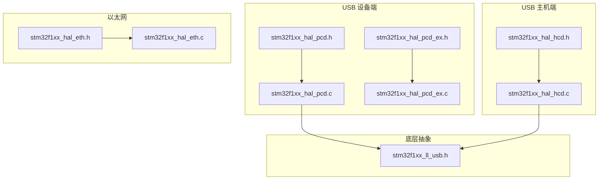
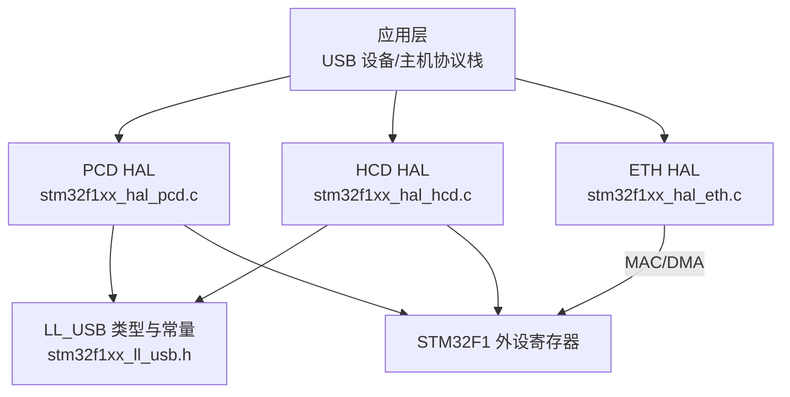
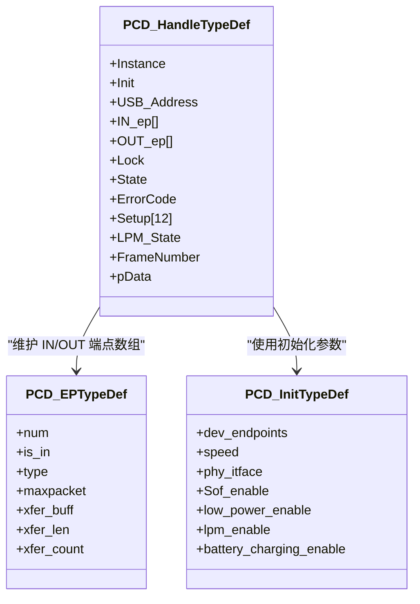
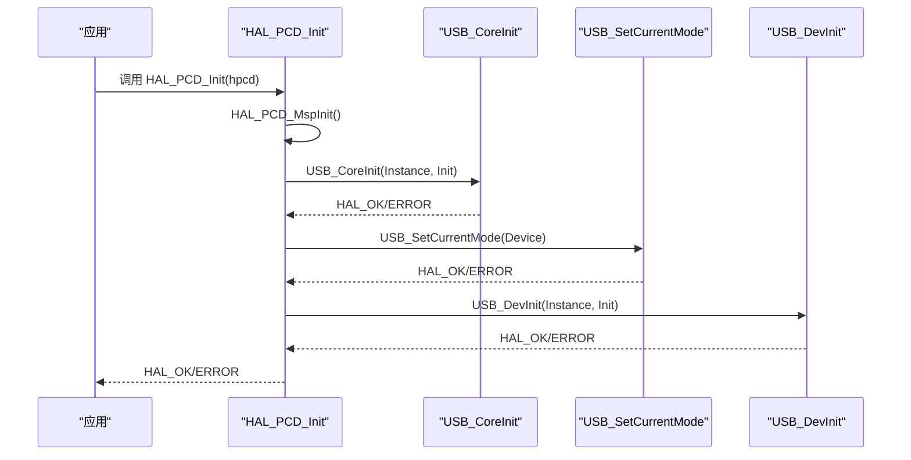
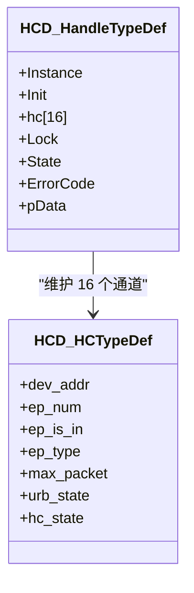
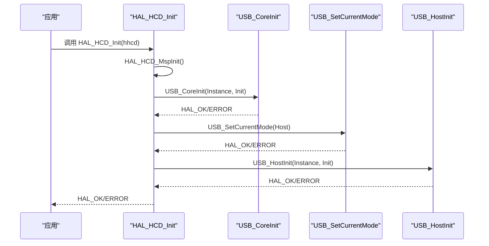
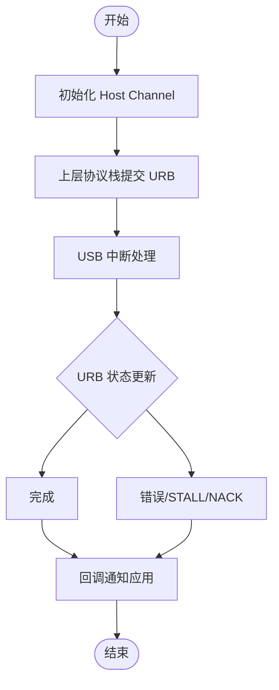
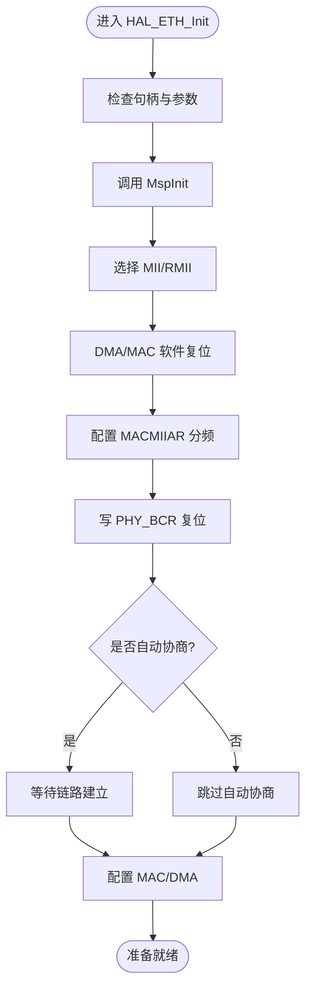
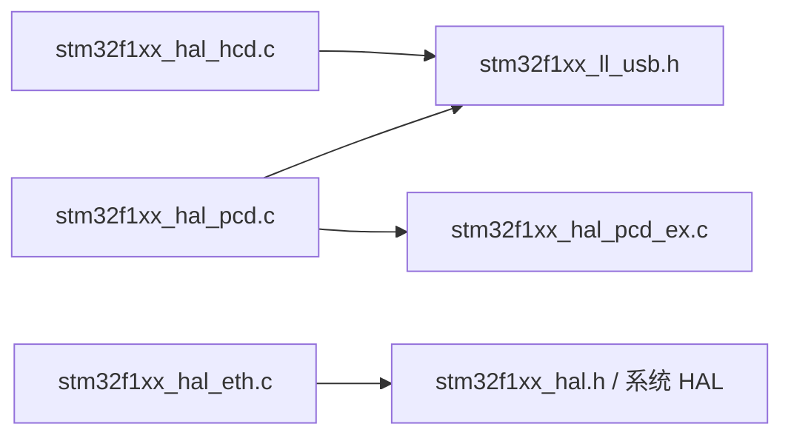

# USB 与网络接口

<cite>
**本文引用的文件**   
- [stm32f1xx_hal_pcd.h](file://Inc/stm32f1xx_hal_pcd.h)
- [stm32f1xx_hal_pcd_ex.h](file://Inc/stm32f1xx_hal_pcd_ex.h)
- [stm32f1xx_hal_pcd.c](file://Src/stm32f1xx_hal_pcd.c)
- [stm32f1xx_hal_pcd_ex.c](file://Src/stm32f1xx_hal_pcd_ex.c)
- [stm32f1xx_hal_hcd.h](file://Inc/stm32f1xx_hal_hcd.h)
- [stm32f1xx_hal_hcd.c](file://Src/stm32f1xx_hal_hcd.c)
- [stm32f1xx_hal_eth.h](file://Inc/stm32f1xx_hal_eth.h)
- [stm32f1xx_hal_eth.c](file://Src/stm32f1xx_hal_eth.c)
- [stm32f1xx_ll_usb.h](file://Inc/stm32f1xx_ll_usb.h)
</cite>

## 目录
1. [引言](#引言)
2. [项目结构](#项目结构)
3. [核心组件](#核心组件)
4. [架构总览](#架构总览)
5. [详细组件分析](#详细组件分析)
6. [依赖关系分析](#依赖关系分析)
7. [性能与资源特性](#性能与资源特性)
8. [故障排查指南](#故障排查指南)
9. [从 HAL 迁移到 LL_USB 的指引](#从-hal-迁移到-llusb-的指引)
10. [结论](#结论)

## 引言
本文件面向 STM32F1xx 的 USB 设备端（PCD）、USB 主机端（HCD）和以太网 MAC 驱动，目标是用可操作的方式说明：
- PCD 的设备枚举、端点配置、控制/批量/中断/等时传输、挂起与唤醒、DMA 相关限制；
- HCD 的连接管理与通道数据传输；
- 以太网 MAC 初始化、帧收发、中断与 DMA 集成；
- 并给出使用 stm32f1xx_hal_pcd[_ex].h/.c、stm32f1xx_hal_hcd.h/.c、stm32f1xx_hal_eth.h/.c 的最小实践路径。

文档同时覆盖总线供电、带宽限制、MTU、PHY 配置、中断优先级和调试方法，并提供从 HAL 迁移到 LL_USB 的指导思路。

## 项目结构
该仓库是 STM32 HAL 驱动库的一部分，关键文件分布如下：
- Inc 目录下提供 USB PCD/HCD、以太网 ETH、LL_USB 的头文件；
- Src 目录下提供对应 C 实现；
- USB 分为两种内核抽象：内置 USB FS 与 OTG FS；ETH 则针对 STM32F1 的 MAC/DMA。

图表来源
- [stm32f1xx_hal_pcd.h:1-200](file://Inc/stm32f1xx_hal_pcd.h#L1-L200)
- [stm32f1xx_hal_pcd_ex.h:1-85](file://Inc/stm32f1xx_hal_pcd_ex.h#L1-L85)
- [stm32f1xx_hal_hcd.h:1-200](file://Inc/stm32f1xx_hal_hcd.h#L1-L200)
- [stm32f1xx_hal_eth.h:1-200](file://Inc/stm32f1xx_hal_eth.h#L1-L200)
- [stm32f1xx_ll_usb.h:1-200](file://Inc/stm32f1xx_ll_usb.h#L1-L200)

章节来源
- [stm32f1xx_hal_pcd.h:1-200](file://Inc/stm32f1xx_hal_pcd.h#L1-L200)
- [stm32f1xx_hal_hcd.h:1-200](file://Inc/stm32f1xx_hal_hcd.h#L1-L200)
- [stm32f1xx_hal_eth.h:1-200](file://Inc/stm32f1xx_hal_eth.h#L1-L200)
- [stm32f1xx_ll_usb.h:1-200](file://Inc/stm32f1xx_ll_usb.h#L1-L200)

## 核心组件
- PCD（USB 设备控制器 HAL）：负责设备模式下的枚举、端点管理、Setup/Data/Status 阶段处理、事件回调（Reset/Suspend/Resume/Connect/Disconnect 等）。
- HCD（USB 主机控制器 HAL）：负责 OTG FS 主机模式下 Host Init、Host Channel 初始化、URB 状态回调、端口连接/断开事件。
- ETH（以太网 MAC/DMA HAL）：负责 MAC 与 DMA 初始化、MII/RMII PHY 通信、发送/接收描述符链、中断或轮询收包。

这些组件共同遵循 HAL 风格：句柄 + 初始化函数 + Msp 回调 + 可选动态回调注册。

章节来源
- [stm32f1xx_hal_pcd.c:1-120](file://Src/stm32f1xx_hal_pcd.c#L1-L120)
- [stm32f1xx_hal_hcd.c:1-120](file://Src/stm32f1xx_hal_hcd.c#L1-L120)
- [stm32f1xx_hal_eth.c:1-120](file://Src/stm32f1xx_hal_eth.c#L1-L120)

## 架构总览
下图展示上层协议栈与 HAL 层的关系，以及底层 LL_USB 的作用。

图表来源
- [stm32f1xx_hal_pcd.c:1-120](file://Src/stm32f1xx_hal_pcd.c#L1-L120)
- [stm32f1xx_hal_hcd.c:1-120](file://Src/stm32f1xx_hal_hcd.c#L1-L120)
- [stm32f1xx_hal_eth.c:1-120](file://Src/stm32f1xx_hal_eth.c#L1-L120)
- [stm32f1xx_ll_usb.h:1-200](file://Inc/stm32f1xx_ll_usb.h#L1-L200)

## 详细组件分析

### USB 设备端（PCD）

#### 数据结构与职责
- `PCD_HandleTypeDef`：包含实例指针、初始化参数、端点表、锁、状态、错误码、Setup 数据包缓冲、LPM 状态、帧号、上层栈指针，以及可选回调。
- `PCD_EPTypeDef`：端点方向、类型、最大包长、缓冲区指针、长度、计数，以及不同内核下的额外字段（如 FIFO、PMA、双缓冲等）。
- `PCD_InitTypeDef`：端点数、速度、PHY 接口、SOF/LPM/充电使能、VBUS 检测等。

图表来源
- [stm32f1xx_hal_pcd.h:1-200](file://Inc/stm32f1xx_hal_pcd.h#L1-L200)
- [stm32f1xx_ll_usb.h:1-200](file://Inc/stm32f1xx_ll_usb.h#L1-L200)

#### 初始化流程
- 分配句柄、调用 MspInit（时钟、GPIO、NVIC），禁止全局中断；
- 调用底层 CoreInit，设置 Device 模式；
- 初始化端点结构为控制端点；
- 调用 DevInit 完成设备初始化，初始地址为 0，并断开连接等待枚举。

图表来源
- [stm32f1xx_hal_pcd.c:100-220](file://Src/stm32f1xx_hal_pcd.c#L100-L220)

#### 端点配置与传输
- 端点通过 `PCD_EPTypeDef` 配置：方向、类型、最大包长、数据缓冲；
- 对 OTG FS，端点还涉及 TX FIFO 编号；对内置 USB，还涉及 PMA 地址与双缓冲；
- 典型 API 族包括端点初始化、发送、接收、清除 STALL、关闭等（由 HAL 与底层 USB 驱动组合实现）。

注意：
- OTG FS 使用 FIFO；内置 USB 使用 PMA；
- 等时端点在 OTG FS 下支持 incomplete 回调，用于处理丢帧；
- 在 F1 系列中，USB 通常不使用 DMA（驱动中会强制禁用 DMA）。

#### 事件回调与电源管理
- 回调包括 SOF、SetupStage、Reset、Suspend、Resume、Connect、Disconnect、DataOutStage、DataInStage、ISOIN/ISOOUT Incomplete；
- LPM 与 BCD 扩展回调位于扩展头文件中；
- 挂起/唤醒由 USB 硬件触发，应用需在 Suspend 中降低功耗并在 Resume 恢复外设。

章节来源
- [stm32f1xx_hal_pcd.h:1-200](file://Inc/stm32f1xx_hal_pcd.h#L1-L200)
- [stm32f1xx_hal_pcd_ex.h:1-85](file://Inc/stm32f1xx_hal_pcd_ex.h#L1-L85)
- [stm32f1xx_hal_pcd.c:100-220](file://Src/stm32f1xx_hal_pcd.c#L100-L220)
- [stm32f1xx_hal_pcd_ex.c:1-243](file://Src/stm32f1xx_hal_pcd_ex.c#L1-L243)
- [stm32f1xx_ll_usb.h:1-200](file://Inc/stm32f1xx_ll_usb.h#L1-L200)

#### 最小示例路径（不直接粘贴代码）
- 定义句柄与初始化参数，填充端点数、速度、PHY 接口等；
- 调用 `HAL_PCD_Init`；
- 在用户 `HAL_PCD_MspInit` 中启用 USB/OTG 时钟、配置 D+/D- 引脚、配置 NVIC 中断；
- 将上层设备栈指针赋给 `hpcd.pData`；
- 调用 `HAL_PCD_Start` 启动设备；
- 在 SetupStageCallback 中解析请求并返回描述符；
- 在 DataOutStage/DataInStage 中处理批量/中断端点数据；
- 使用扩展函数设置 FIFO/PMA（OTG FS 用 FIFO，内置 USB 用 PMA）。

参考路径
- [stm32f1xx_hal_pcd.c:1-120](file://Src/stm32f1xx_hal_pcd.c#L1-L120)
- [stm32f1xx_hal_pcd_ex.c:1-243](file://Src/stm32f1xx_hal_pcd_ex.c#L1-L243)

### USB 主机端（HCD）

#### 数据结构与职责
- `HCD_HandleTypeDef`：实例、初始化参数、16 个 Host Channel 表、锁、状态、错误码、上层栈指针及回调；
- `HCD_HCTypeDef`：每个通道的设备地址、端点号、方向、类型、最大包长、状态等；
- 回调包括 SOF、Connect、Disconnect、PortEnabled、PortDisabled、HC_NotifyURBChange。

图表来源
- [stm32f1xx_hal_hcd.h:1-200](file://Inc/stm32f1xx_hal_hcd.h#L1-L200)
- [stm32f1xx_ll_usb.h:1-200](file://Inc/stm32f1xx_ll_usb.h#L1-L200)

#### 初始化与通道管理
- `HAL_HCD_Init`：MspInit → CoreInit → 设置 Host 模式 → HostInit；
- `HAL_HCD_HC_Init`：配置通道号、端点号、设备地址、速度、端点类型、最大包长，并调用底层 `USB_HC_Init`；
- `HAL_HCD_HC_Halt`：停止通道；
- 端口事件与 URB 状态变化通过回调上报。

图表来源
- [stm32f1xx_hal_hcd.c:100-200](file://Src/stm32f1xx_hal_hcd.c#L100-L200)

#### 数据传输流程（以 Bulk/Interrupt/Isochronous 为例）
- 应用先通过 `HAL_HCD_HC_Init` 创建通道；
- 上层协议栈构造 URB（统一请求块），并通过底层 USB 驱动提交；
- 中断服务程序根据通道状态更新 URB 状态；
- 应用通过 `HC_NotifyURBChangeCallback` 获取完成、错误、STALL、NACK/NYET 等结果。

图表来源
- [stm32f1xx_hal_hcd.c:150-260](file://Src/stm32f1xx_hal_hcd.c#L150-L260)
- [stm32f1xx_ll_usb.h:1-200](file://Inc/stm32f1xx_ll_usb.h#L1-L200)

章节来源
- [stm32f1xx_hal_hcd.h:1-200](file://Inc/stm32f1xx_hal_hcd.h#L1-L200)
- [stm32f1xx_hal_hcd.c:100-260](file://Src/stm32f1xx_hal_hcd.c#L100-L260)
- [stm32f1xx_ll_usb.h:1-200](file://Inc/stm32f1xx_ll_usb.h#L1-L200)

### 以太网 MAC（ETH）

#### 初始化与 PHY 配置
- `HAL_ETH_Init`：MspInit → AFIO 选择 MII/RMII → 软件复位 DMA/MAC → 配置 MII CSR 时钟分频 → 复位 PHY → 自动协商或手动配置链路；
- 随后需配置 MAC 与 DMA（通常在初始化后分别调用配置函数）；
- 描述符链初始化用于发送与接收流程。

图表来源
- [stm32f1xx_hal_eth.c:120-350](file://Src/stm32f1xx_hal_eth.c#L120-L350)

#### 帧收发与 DMA
- 发送：填充 TX 描述符链，调用发送函数，让 DMA 把帧写入 MAC FIFO；
- 接收：轮询或中断方式从 RX 描述符获取帧；
- 中断模式通过 `HAL_ETH_GetReceivedFrame_IT` 在 RX 中断中取帧；
- DMA 仲裁、突发长度、阈值、存储转发等通过宏与配置函数设置。

章节来源
- [stm32f1xx_hal_eth.h:1-200](file://Inc/stm32f1xx_hal_eth.h#L1-L200)
- [stm32f1xx_hal_eth.c:120-350](file://Src/stm32f1xx_hal_eth.c#L120-L350)

## 依赖关系分析

图表来源
- [stm32f1xx_hal_pcd.c:1-120](file://Src/stm32f1xx_hal_pcd.c#L1-L120)
- [stm32f1xx_hal_hcd.c:1-120](file://Src/stm32f1xx_hal_hcd.c#L1-L120)
- [stm32f1xx_hal_eth.c:1-120](file://Src/stm32f1xx_hal_eth.c#L1-L120)
- [stm32f1xx_ll_usb.h:1-200](file://Inc/stm32f1xx_ll_usb.h#L1-L200)

- PCD/HCD 都依赖 LL_USB 中的公共类型（如端点、URB、通道状态）；
- ETH 依赖系统 HAL 提供的延时、RCC 等基础能力；
- PCD 扩展功能（FIFO/PMA、LPM/BCD 回调）位于独立扩展文件。

章节来源
- [stm32f1xx_hal_pcd_ex.h:1-85](file://Inc/stm32f1xx_hal_pcd_ex.h#L1-L85)
- [stm32f1xx_hal_pcd_ex.c:1-243](file://Src/stm32f1xx_hal_pcd_ex.c#L1-L243)

## 性能与资源特性

### USB 总线供电与带宽
- USB 全速（FS）总线理论带宽约 12 Mbps，实际吞吐更低；
- 设备枚举阶段由主机供电，最大电流取决于设备类与配置；
- 若使用 OTG，需注意 VBUS 检测、外部 VBUS 使能、充电检测（BCD）；
- 低功耗与 LPM 可降低空闲功耗，但需确保唤醒源与上层栈正确处理。

### DMA 传输
- 在 F1 系列 USB 驱动中，DMA 被显式禁用（初始化中强制清零 dma_enable）；
- 因此 USB 传输主要依靠 CPU 与 FIFO/PMA；
- 对高吞吐场景，应避免在中断中做大量数据处理，建议采用零拷贝或环形缓冲。

### 以太网 MTU 与帧大小
- 标准以太网帧最大长度为 1518 字节；带 VLAN 时为 1522；
- 驱动侧应确保描述符缓冲区不小于期望的最大帧长；
- 若需要更大载荷，应在上层协议（如 Jumbo Frame）中保证链路两端一致，并注意芯片与 PHY 的限制。

### PHY 配置
- 必须正确选择 MII 或 RMII；
- 根据 HCLK 配置 MACMIIAR 分频，确保与 PHY 时钟兼容；
- 自动协商失败时，应检查 PHY 寄存器、网线、交换机端口与速率/双工匹配。

### 中断优先级
- USB 与 ETH 的中断应与实时性需求相匹配；
- USB 枚举与控制传输对延迟敏感，建议较高优先级；
- ETH RX/TX 中断不宜抢占 USB 关键路径，避免帧丢失或枚举失败。

章节来源
- [stm32f1xx_hal_pcd.c:100-160](file://Src/stm32f1xx_hal_pcd.c#L100-L160)
- [stm32f1xx_hal_hcd.c:100-160](file://Src/stm32f1xx_hal_hcd.c#L100-L160)
- [stm32f1xx_hal_eth.c:120-250](file://Src/stm32f1xx_hal_eth.c#L120-L250)

## 故障排查指南

### USB 设备端常见问题
- 无法枚举：
  - 检查 D+/D- 上拉电阻与 GPIO 配置；
  - 确认 MspInit 已启用 USB 时钟与 NVIC；
  - 检查描述符是否正确（设备类、接口、端点、字符串）；
  - 查看 SetupStageCallback 是否返回正确的状态。
- 端点无数据：
  - 确认端点类型与最大包长匹配主机期望；
  - 检查缓冲区对齐与长度；
  - 对 OTG FS，检查 TX FIFO 配置是否足够；
  - 对内置 USB，检查 PMA 地址与双缓冲配置。
- 挂起/唤醒异常：
  - 在 Suspend 中关闭不必要外设，在 Resume 重新初始化；
  - 确认唤醒源（USB 线信号或内部唤醒）已启用。

章节来源
- [stm32f1xx_hal_pcd.c:1-120](file://Src/stm32f1xx_hal_pcd.c#L1-L120)
- [stm32f1xx_hal_pcd_ex.c:1-243](file://Src/stm32f1xx_hal_pcd_ex.c#L1-L243)

### USB 主机端常见问题
- 端口未启用：
  - 检查 VBUS 检测与外部 VBUS 配置；
  - 确认 PortEnabledCallback 被触发；
- 设备识别失败：
  - 检查 Hub 级联设备与供电；
  - 查看 URB 状态是否为 NAK/STALL/错误；
- 通道卡死：
  - 调用 Halt 清理通道；
  - 检查最大包长与端点类型是否匹配设备描述符。

章节来源
- [stm32f1xx_hal_hcd.c:100-260](file://Src/stm32f1xx_hal_hcd.c#L100-L260)

### 以太网丢包问题
- 检查描述符链是否正确链接，且缓冲区足够大；
- 确认 RX 模式为中断或轮询，且在中断中及时取帧；
- 调整 DMA 仲裁与突发长度，避免 TX/RX 冲突；
- 检查 PHY 自动协商结果与实际链路速率/双工；
- 在高速流量下，考虑减少 CPU 中断负载，使用更高效的缓冲策略。

章节来源
- [stm32f1xx_hal_eth.c:120-350](file://Src/stm32f1xx_hal_eth.c#L120-L350)

## 从 HAL 迁移到 LL_USB 的指引

### 迁移动机
- LL_USB 提供更接近硬件的访问方式，适合需要精细控制 FIFO/PMA/寄存器、优化延迟或移植第三方 USB 栈的场景；
- HAL 更适合快速开发与通用应用。

### 主要差异
- LL_USB 暴露更多底层结构与常量（如端点类型、URB/通道状态、USB 模式）；
- HAL 封装了 CoreInit/DeviceInit/HostInit 等高层流程；
- 在 F1 系列中，USB DMA 通常仍保持禁用，迁移时需关注 FIFO/PMA 与双缓冲。

### 迁移步骤
1. 保留 HAL 初始化入口，逐步替换关键路径：
   - 将 `USB_CoreInit`/`USB_DevInit`/`USB_HostInit` 的调用逻辑映射到 LL_USB 寄存器操作；
   - 将端点配置从 `PCD_EPTypeDef` 映射到 LL 端点结构；
2. 对于 OTG FS：
   - 使用 LL_USB 中的 FIFO 操作与通道管理；
   - 自行处理 URB 状态机；
3. 对于内置 USB：
   - 使用 PMA 地址与双缓冲配置；
   - 谨慎处理 PMA 对齐与边界；
4. 中断与回调：
   - 将 HAL 回调改为 LL 级别的事件处理；
   - 保留应用层回调接口以便平滑过渡。

### 风险与建议
- LL 层更易出错，建议在原型验证后逐步替换；
- 保持 HAL 作为“适配层”，仅在必要时直接访问 LL；
- 重点测试枚举、大数据量传输、等时端点完整性与中断响应时间。

章节来源
- [stm32f1xx_ll_usb.h:1-200](file://Inc/stm32f1xx_ll_usb.h#L1-L200)
- [stm32f1xx_hal_pcd.c:100-220](file://Src/stm32f1xx_hal_pcd.c#L100-L220)
- [stm32f1xx_hal_hcd.c:100-260](file://Src/stm32f1xx_hal_hcd.c#L100-L260)

## 结论
- PCD 负责设备枚举与端点管理，HCD 负责主机通道与 URB 状态，ETH 负责 MAC/DMA 与 PHY 通信；
- 在 STM32F1 系列中，USB 通常不使用 DMA，需重视 FIFO/PMA 与 CPU 开销；
- ETH 的关键在于正确的 MII/RMII 配置、PHY 协商、描述符链与中断策略；
- 推荐以 HAL 为基础，按需向 LL_USB 迁移以获得更高可控性；
- 通过合理的中断优先级、带宽规划与调试手段，可以显著改善 USB 枚举成功率与网络稳定性。