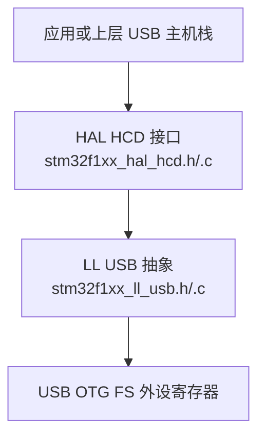
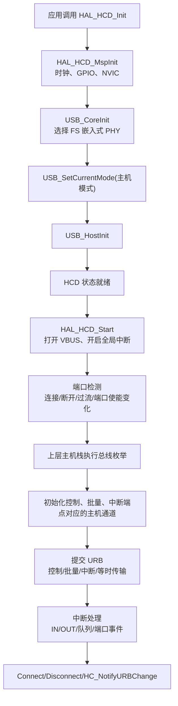
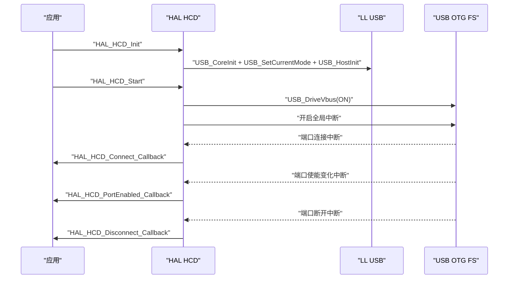
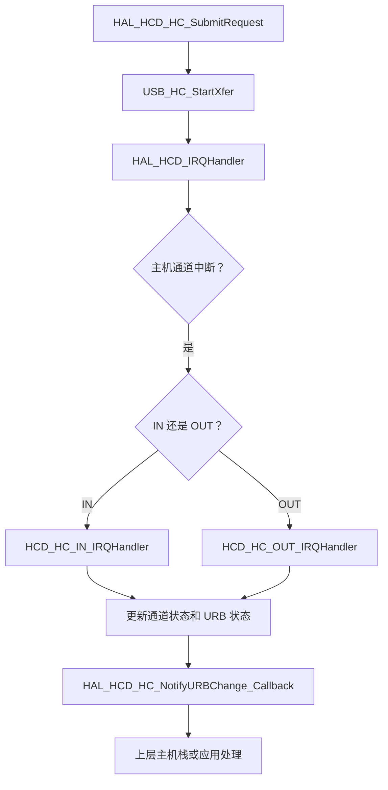
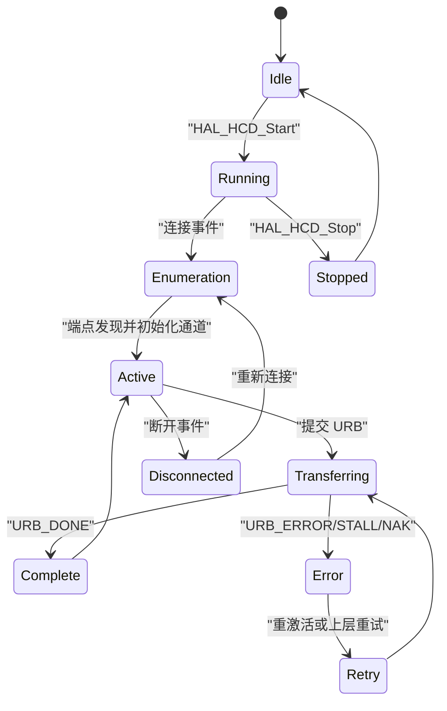

# USB 主机端（HCD）

<cite>
**本文引用的文件**
- [stm32f1xx_hal_hcd.h](file://Inc/stm32f1xx_hal_hcd.h)
- [stm32f1xx_hal_hcd.c](file://Src/stm32f1xx_hal_hcd.c)
- [stm32f1xx_ll_usb.h](file://Inc/stm32f1xx_ll_usb.h)
- [stm32f1xx_ll_usb.c](file://Src/stm32f1xx_ll_usb.c)
</cite>

## 目录
1. [引言](#引言)
2. [项目结构与定位](#项目结构与定位)
3. [核心数据结构](#核心数据结构)
4. [架构总览](#架构总览)
5. [初始化与主机启动流程](#初始化与主机启动流程)
6. [设备连接、断开检测与端口电源](#设备连接断开检测与端口电源)
7. [总线枚举、端点发现与带宽分配](#总线枚举端点发现与带宽分配)
8. [数据传输与端点生命周期](#数据传输与端点生命周期)
9. [挂起、唤醒、恢复和错误恢复](#挂起唤醒恢复和错误恢复)
10. [最小使用示例](#最小使用示例)
11. [性能、DMA 与中断优先级](#性能dma-与中断优先级)
12. [常见问题排查](#常见问题排查)
13. [结论](#结论)

## 引言
本文件面向 STM32F1xx HAL 的 USB 主机端驱动层，即 HCD 模块。该层位于上层 USB 主机协议栈与底层 USB OTG FS 硬件寄存器之间，负责：
- 配置 OTG FS 控制器为主机模式；
- 管理 VBUS、端口状态、设备速度识别；
- 初始化并复用主机通道；
- 提交控制、批量、中断和等时传输请求；
- 处理 URB 完成、NAK、STALL、错误重试；
- 暴露 Connect / Disconnect / HC NotifyURBChange 回调给上层主机栈或应用。

STM32F1xx 的 USB OTG FS 在典型应用中以全速主机运行，因此高速设备兼容性受 PHY 和上层主机栈限制；本仓库中的 LL 层常量明确体现全速 PHY 配置。

**章节来源**
- [stm32f1xx_hal_hcd.h:1-200](file://Inc/stm32f1xx_hal_hcd.h#L1-L200)
- [stm32f1xx_ll_usb.h:200-585](file://Inc/stm32f1xx_ll_usb.h#L200-L585)

## 项目结构与定位
HCD 由两层组成：
- HAL 层：`stm32f1xx_hal_hcd.h/.c`，提供 `HCD_HandleTypeDef`、初始化、端口控制、主机通道操作、中断处理和回调框架；
- LL 层：`stm32f1xx_ll_usb.h/.c`，封装 USB OTG FS 全局寄存器、主机初始化、端点描述、主机通道初始化和数据收发。

**图表来源**
- [stm32f1xx_hal_hcd.h:1-200](file://Inc/stm32f1xx_hal_hcd.h#L1-L200)
- [stm32f1xx_ll_usb.h:200-585](file://Inc/stm32f1xx_ll_usb.h#L200-L585)

**章节来源**
- [stm32f1xx_hal_hcd.c:1-120](file://Src/stm32f1xx_hal_hcd.c#L1-L120)
- [stm32f1xx_ll_usb.c:1-60](file://Src/stm32f1xx_ll_usb.c#L1-L60)

## 核心数据结构
### HCD_HandleTypeDef
这是 HCD 实例句柄，包含：
- 外设基地址指针；
- 初始化参数；
- 最多 16 个主机通道描述符数组；
- 锁、当前状态、错误码；
- 指向 USB 主机栈的指针；
- 可选回调表，包括 SOF、连接、断开、端口使能/禁用、主机通道 URB 变更通知。

该结构是上层调用 `HAL_HCD_Init`、`HAL_HCD_Start`、`HAL_HCD_HC_SubmitRequest` 等函数的入口对象。

**章节来源**
- [stm32f1xx_hal_hcd.h:1-200](file://Inc/stm32f1xx_hal_hcd.h#L1-L200)
- [stm32f1xx_hal_hcd.h:200-324](file://Inc/stm32f1xx_hal_hcd.h#L200-L324)

### HCD_ConfigTypeDef 与 USB_OTG_CfgTypeDef
HAL 层将 `HCD_InitTypeDef` 直接别名化为 LL 层的 `USB_OTG_CfgTypeDef`。该结构体用于配置：
- 设备端点数；
- 主机通道数；
- DMA 是否启用；
- 核心速度；
- EP0 最大包长；
- PHY 接口；
- SOF 输出；
- 低功耗、链路电源管理；
- 电池充电；
- VBUS 感知和外部 VBUS；
- 专用端点 1 中断。

注意：在 `HAL_HCD_Init` 中，FS 实例会强制关闭 DMA，因为 STM32F1xx OTG FS 通常不使用 DMA。

**章节来源**
- [stm32f1xx_ll_usb.h:1-200](file://Inc/stm32f1xx_ll_usb.h#L1-L200)
- [stm32f1xx_hal_hcd.c:120-200](file://Src/stm32f1xx_hal_hcd.c#L120-L200)

### 主机通道描述符
HAL 层将 `HCD_HCTypeDef` 别名化为 `USB_OTG_HCTypeDef`。它保存每个端点的通道信息，包括：
- 设备地址、通道号、端点号、方向；
- 速度、是否使用 PING；
- Hub 地址和端口号；
- 端点类型、最大包长、初始 PID；
- 传输缓冲区、长度、已传计数；
- IN/OUT toggle 标志；
- DMA 地址；
- 错误计数；
- URB 状态；
- 主机通道状态。

这些字段由 HAL 层在提交请求和中断处理中更新，供上层主机栈查询。

**章节来源**
- [stm32f1xx_ll_usb.h:200-585](file://Inc/stm32f1xx_ll_usb.h#L200-L585)

### 端点相关类型
LL 层还定义通用端点类型 `USB_EPTypeDef`，包含端点号、方向、STALL、类型、最大包长、缓冲区指针、长度、PMA 地址等。虽然 HCD 主要使用主机通道，但该类型说明端点在 USB 中的通用语义。

**章节来源**
- [stm32f1xx_ll_usb.h:1-200](file://Inc/stm32f1xx_ll_usb.h#L1-L200)

## 架构总览
HCD 的工作层次如下：

**图表来源**
- [stm32f1xx_hal_hcd.c:120-200](file://Src/stm32f1xx_hal_hcd.c#L120-L200)
- [stm32f1xx_hal_hcd.c:1192-1330](file://Src/stm32f1xx_hal_hcd.c#L1192-L1330)
- [stm32f1xx_ll_usb.c:60-120](file://Src/stm32f1xx_ll_usb.c#L60-L120)

**章节来源**
- [stm32f1xx_hal_hcd.c:120-200](file://Src/stm32f1xx_hal_hcd.c#L120-L200)
- [stm32f1xx_ll_usb.c:60-120](file://Src/stm32f1xx_ll_usb.c#L60-L120)

## 初始化与主机启动流程
### 初始化步骤
1. 声明 `HCD_HandleTypeDef hhcd`。
2. 填充 `hhcd.Init`，包括主机通道数、PHY 接口、VBUS 感知、速度等。
3. 调用 `HAL_HCD_Init`：
   - 若处于复位状态，分配锁并调用 MSP 初始化；
   - 强制关闭 DMA；
   - 禁用全局中断；
   - 调用 `USB_CoreInit` 选择 FS 嵌入式 PHY；
   - 调用 `USB_SetCurrentMode` 设置为 `USB_HOST_MODE`；
   - 调用 `USB_HostInit` 初始化主机功能；
   - 将状态置为 `HAL_HCD_STATE_READY`。

### MSP 初始化职责
用户需在 `HAL_HCD_MspInit` 中实现：
- 使能 USB OTG FS 时钟；
- 使能 GPIO 时钟；
- 配置 D+/D- 引脚为复用推挽；
- 如需外部 VBUS 驱动，配置相应 GPIO；
- 配置 USB 中断 NVIC 并设置合理优先级；
- 如需 Wakeup 中断，配置 EXTI。

### 启动主机
调用 `HAL_HCD_Start`：
- 通过 `USB_DriveVbus(USBx, 1)` 打开端口电源；
- 通过宏启用全局中断。

停止主机调用 `HAL_HCD_Stop`，内部调用 `USB_StopHost`。

**章节来源**
- [stm32f1xx_hal_hcd.c:120-200](file://Src/stm32f1xx_hal_hcd.c#L120-L200)
- [stm32f1xx_hal_hcd.c:1192-1260](file://Src/stm32f1xx_hal_hcd.c#L1192-L1260)
- [stm32f1xx_ll_usb.c:60-120](file://Src/stm32f1xx_ll_usb.c#L60-L120)

## 设备连接、断开检测与端口电源
### 连接检测
当端口检测到连接且设备存在时，中断处理会触发连接回调：
- 检查 HPRT0 的连接状态位；
- 调用 `HAL_HCD_Connect_Callback` 或用户注册的 `ConnectCallback`。

上层主机栈应在该回调中启动枚举流程。

### 断开检测
当发生断开中断且端口状态显示无设备时：
- 清空 TX/RX FIFO；
- 恢复全速时钟；
- 调用 `HAL_HCD_Disconnect_Callback` 或 `DisconnectCallback`。

### 端口使能变化
端口使能变化中断会判断：
- 端口是否已使能；
- 低速设备时使用 6 MHz 时钟；
- 全速设备时使用 48 MHz 时钟；
- 调用端口使能或禁用回调。

### 过流保护
HPRT0 的过流变化位会被记录，但当前代码路径仅清标志位。应用层可通过读取 HPRT0 或扩展中断处理逻辑来实施软件级过流保护，例如关闭 VBUS、上报故障并重启主机。

**图表来源**
- [stm32f1xx_hal_hcd.c:600-760](file://Src/stm32f1xx_hal_hcd.c#L600-L760)
- [stm32f1xx_hal_hcd.c:1600-1738](file://Src/stm32f1xx_hal_hcd.c#L1600-L1738)

**章节来源**
- [stm32f1xx_hal_hcd.c:600-760](file://Src/stm32f1xx_hal_hcd.c#L600-L760)
- [stm32f1xx_hal_hcd.c:1600-1738](file://Src/stm32f1xx_hal_hcd.c#L1600-L1738)

## 总线枚举、端点发现与带宽分配
### 总线枚举
HCD 本身不实现完整 USB 枚举协议；它提供连接事件、端口状态、速度和主机通道能力。实际枚举应由上层 USB 主机栈完成，例如 ST USB Host Library 或第三方栈。

### 端点发现
枚举过程中，主机栈解析设备描述符、配置描述符和端点描述符，然后为每个需要通信的端点调用 `HAL_HCD_HC_Init` 初始化对应主机通道。端点类型包括：
- 控制端点；
- 批量端点；
- 中断端点；
- 等时端点。

### 带宽分配
- 控制端点和批量端点共享有限带宽；
- 中断端点按帧周期预留带宽；
- 等时端点也预留带宽；
- STM32F1xx OTG FS 是全速 USB 主机，不支持高速端点；
- 多端点高负载时应避免过多等时或高频中断端点占用带宽。

### 速度识别
- LL 层定义的全速 PHY 和速度常量表明 FS 主机默认全速；
- 端口使能变化中断会根据低速设备切换 6 MHz 时钟；
- 获取当前速度函数返回枚举后的主机速度；
- 高速设备兼容性取决于芯片 PHY 和上层主机栈，不能仅凭 HCD 层假设支持高速。

**章节来源**
- [stm32f1xx_ll_usb.h:200-585](file://Inc/stm32f1xx_ll_usb.h#L200-L585)
- [stm32f1xx_hal_hcd.h:1-200](file://Inc/stm32f1xx_hal_hcd.h#L1-L200)
- [stm32f1xx_hal_hcd.c:1600-1738](file://Src/stm32f1xx_hal_hcd.c#L1600-L1738)

## 数据传输与端点生命周期
### 提交传输请求
`HAL_HCD_HC_SubmitRequest` 负责：
- 设置通道方向、端点类型和数据 PID；
- 根据端点类型维护 DATA0/DATA1 toggle；
- 设置缓冲区、长度、URB 状态和通道状态；
- 调用 `USB_HC_StartXfer` 启动传输。

对于控制端点，STATUS OUT 阶段长度为 0 时会特殊处理 PID。

### 中断处理主流程
`HAL_HCD_IRQHandler` 在主机模式下：
- 忽略无效中断；
- 清理无关模式中断标志；
- 处理断开、端口事件、SOF、主机通道中断、接收队列；
- 分发到 IN/OUT 通道处理函数；
- 触发 URB 变更回调。

### IN 通道处理
IN 通道处理关注：
- AHB 错误、总线错误、STALL、数据校验错误、事务错误；
- 帧错误；
- 传输完成；
- 通道暂停；
- NYET、NAK；
- 自动重激活控制或批量通道；
- 更新 toggle、URB 状态，并回调上层。

### OUT 通道处理
OUT 通道处理关注：
- ACK、帧错误、传输完成；
- STALL、NAK、TX 错误、数据校验错误；
- 通道暂停后完成状态转换；
- 非 DMA 模式下更新 OUT toggle；
- DMA 模式下按数据包数量决定是否翻转 toggle；
- 回调上层。

### 接收队列
`HCD_RXQLVL_IRQHandler` 从 GRXSTSP 读取包状态、端点号和包长度：
- IN 包时复制到应用缓冲；
- 多包传输时重新激活通道；
- 更新已传长度；
- 错误包状态则进入错误分支。

**图表来源**
- [stm32f1xx_hal_hcd.c:200-420](file://Src/stm32f1xx_hal_hcd.c#L200-L420)
- [stm32f1xx_hal_hcd.c:600-760](file://Src/stm32f1xx_hal_hcd.c#L600-L760)
- [stm32f1xx_hal_hcd.c:1200-1600](file://Src/stm32f1xx_hal_hcd.c#L1200-L1600)

**章节来源**
- [stm32f1xx_hal_hcd.c:200-420](file://Src/stm32f1xx_hal_hcd.c#L200-L420)
- [stm32f1xx_hal_hcd.c:600-760](file://Src/stm32f1xx_hal_hcd.c#L600-L760)
- [stm32f1xx_hal_hcd.c:1200-1600](file://Src/stm32f1xx_hal_hcd.c#L1200-L1600)

## 挂起、唤醒、恢复和错误恢复
### 挂起与唤醒
- 主机可在合适时机挂起总线以降低功耗；
- 唤醒可由 USB 设备远程唤醒或主机自身事件触发；
- 本仓库未提供显式挂起 API，但 LL 层提供远程唤醒激活/停用函数；
- Wakeup 中断处理函数在当前实现中为空，实际唤醒逻辑通常由上层主机栈协调。

### 恢复策略
HCD 的错误恢复集中在通道中断处理中：
- NAK：对控制或批量通道可能重新激活通道；
- STALL、事务错误、数据校验错误：暂停通道并递增错误计数；
- 连续错误超过阈值时，URB 状态变为 `URB_ERROR`；
- 成功完成后清除错误计数；
- 控制/批量通道在成功后主动 Halt，释放通道；
- 中断/等时通道保持周期性行为。

**图表来源**
- [stm32f1xx_hal_hcd.c:1200-1600](file://Src/stm32f1xx_hal_hcd.c#L1200-L1600)
- [stm32f1xx_hal_hcd.c:1192-1260](file://Src/stm32f1xx_hal_hcd.c#L1192-L1260)

**章节来源**
- [stm32f1xx_ll_usb.h:200-585](file://Inc/stm32f1xx_ll_usb.h#L200-L585)
- [stm32f1xx_hal_hcd.c:1200-1600](file://Src/stm32f1xx_hal_hcd.c#L1200-L1600)

## 最小使用示例
以下示例描述如何在不粘贴具体代码的情况下组织程序：

### 1. 初始化 HCD
- 声明 `HCD_HandleTypeDef hhcd`；
- 设置 `hhcd.Instance` 为 OTG FS 实例；
- 设置 `hhcd.Init.Host_channels`、`phy_itface`、`vbus_sensing_enable`、`use_external_vbus`、`speed` 等；
- 实现 `HAL_HCD_MspInit`：
  - 使能 USB OTG FS 时钟；
  - 配置 D+/D-；
  - 配置 VBUS 控制引脚；
  - 配置 USB 中断；
- 调用 `HAL_HCD_Init(&hhcd)`；
- 设置 `hhcd.pData` 指向 USB 主机栈或自定义设备管理器；
- 调用 `HAL_HCD_Start(&hhcd)`。

### 2. 处理设备插拔
- 实现 `HAL_HCD_Connect_Callback`：
  - 记录连接状态；
  - 通知上层主机栈开始枚举；
- 实现 `HAL_HCD_Disconnect_Callback`：
  - 清理设备上下文；
  - 停止所有活跃传输；
  - 重置主机通道状态；
- 如需注册回调，可使用 `HAL_HCD_RegisterCallback` 和 `HAL_HCD_RegisterHC_NotifyURBChangeCallback`。

### 3. 数据收发
- 枚举完成后，为控制端点、批量端点、中断端点分别调用 `HAL_HCD_HC_Init`；
- 控制传输：按 SETUP → DATA → STATUS 三阶段提交请求；
- 批量传输：设置 `EP_TYPE_BULK`、方向和缓冲区；
- 中断传输：设置 `EP_TYPE_INTR`、轮询间隔；
- 在 `HAL_HCD_HC_NotifyURBChange_Callback` 中检查 URB 状态：
  - `URB_DONE`：继续下一次传输；
  - `URB_STALL`：尝试清除 STALL 或报告设备异常；
  - `URB_ERROR`：重试或降级处理；
  - `URB_NOTREADY`：可短暂等待并重试。

### 4. 直接访问端点
如果不用上层主机栈，可直接维护：
- 设备地址；
- 端点号与方向；
- 主机通道号；
- 缓冲区；
- 长度；
- 在连接回调中初始化通道；
- 在应用任务中循环提交请求并检查 URB 状态。

**章节来源**
- [stm32f1xx_hal_hcd.h:1-200](file://Inc/stm32f1xx_hal_hcd.h#L1-L200)
- [stm32f1xx_hal_hcd.h:200-324](file://Inc/stm32f1xx_hal_hcd.h#L200-L324)
- [stm32f1xx_hal_hcd.c:200-420](file://Src/stm32f1xx_hal_hcd.c#L200-L420)
- [stm32f1xx_hal_hcd.c:600-760](file://Src/stm32f1xx_hal_hcd.c#L600-L760)

## 性能、DMA 与中断优先级
### DMA 使用
- FS 实例在初始化中强制关闭 DMA；
- 因此数据移动主要由 CPU 通过写入/读取 FIFO 完成；
- 大量数据或高频传输会增加 CPU 负载；
- 上层主机栈应避免频繁小包传输，尽量合并数据。

### MTU 与最大包长
- 全速 USB 端点最大包长为 64 字节；
- 控制端点 EP0 最大包长通常为 64 字节；
- 批量和中断端点最大包长不能超过设备描述符中声明的值；
- 应用发送数据时应按 `max_packet` 分片，避免超出端点容量。

### 带宽分配
- 控制端点按需使用；
- 批量端点共享剩余带宽；
- 中断端点按帧周期占用固定带宽；
- 等时端点需预留带宽，不适合不可预测的大流量；
- 高速设备不在 FS 主机范围内，不应依赖高速吞吐。

### 中断优先级
- USB 中断应高于普通业务任务，但不能抢占关键实时任务；
- 建议将 USB 中断优先级设为中等偏上，确保连接、枚举和 URB 完成能及时响应；
- 若系统有大量低延迟定时器，应避免 USB 中断抢占其临界区；
- 中断服务函数应保持短小，复杂逻辑交由回调或上层主机栈。

**章节来源**
- [stm32f1xx_ll_usb.h:200-585](file://Inc/stm32f1xx_ll_usb.h#L200-L585)
- [stm32f1xx_hal_hcd.c:120-200](file://Src/stm32f1xx_hal_hcd.c#L120-L200)

## 常见问题排查
### 连接失败
排查要点：
- 确认 `HAL_HCD_MspInit` 已使能 USB 时钟和 GPIO；
- 确认 D+/D- 引脚配置正确；
- 确认 VBUS 供电正常；
- 检查 `HAL_HCD_Connect_Callback` 是否被调用；
- 若使用外部 VBUS，确认 `use_external_vbus` 和 GPIO 控制逻辑；
- 检查端口电源是否被其他外设或电源管理关闭。

**章节来源**
- [stm32f1xx_hal_hcd.c:1192-1260](file://Src/stm32f1xx_hal_hcd.c#L1192-L1260)
- [stm32f1xx_hal_hcd.c:1600-1738](file://Src/stm32f1xx_hal_hcd.c#L1600-L1738)

### 设备无法枚举
排查要点：
- 确认连接回调已触发；
- 确认上层主机栈已收到连接事件并开始枚举；
- 检查设备描述符和配置描述符是否有效；
- 检查端点最大包长是否为 64 字节以内；
- 检查是否误用高速端点；
- 查看 URB 状态是否停留在 `URB_IDLE` 或 `URB_NOTREADY`。

**章节来源**
- [stm32f1xx_ll_usb.h:200-585](file://Inc/stm32f1xx_ll_usb.h#L200-L585)
- [stm32f1xx_hal_hcd.c:600-760](file://Src/stm32f1xx_hal_hcd.c#L600-L760)

### 间歇性断开
排查要点：
- 检查 VBUS 稳定性；
- 检查线缆接触；
- 检查端口过流标志；
- 检查是否在低功耗或电源管理中意外关闭 USB；
- 观察断开回调频率，判断是否为抖动。

**章节来源**
- [stm32f1xx_hal_hcd.c:1600-1738](file://Src/stm32f1xx_hal_hcd.c#L1600-L1738)

### 端点 NAK/TIMEOUT
排查要点：
- NAK 表示设备暂时忙，HCD 可能重激活控制或批量通道；
- 多次 NAK 或事务错误会使 URB 进入 `URB_ERROR`；
- 检查设备固件是否及时处理请求；
- 检查端点 toggle 是否同步；
- 检查缓冲区对齐和长度是否符合最大包长；
- 避免在回调中执行耗时操作。

**章节来源**
- [stm32f1xx_hal_hcd.c:1200-1600](file://Src/stm32f1xx_hal_hcd.c#L1200-L1600)

### 主机复位循环
排查要点：
- 检查端口使能变化回调是否反复触发；
- 检查是否因过流或供电不足导致端口不断重启；
- 检查设备是否在枚举过程中再次断开；
- 检查上层主机栈是否正确处理复位后的重新枚举；
- 确认没有在上层栈中无限重试同一失败端点。

**章节来源**
- [stm32f1xx_hal_hcd.c:1192-1260](file://Src/stm32f1xx_hal_hcd.c#L1192-L1260)
- [stm32f1xx_hal_hcd.c:1600-1738](file://Src/stm32f1xx_hal_hcd.c#L1600-L1738)

### 调试日志分析
建议在以下位置添加日志：
- `HAL_HCD_Connect_Callback`：记录连接事件和设备地址；
- `HAL_HCD_Disconnect_Callback`：记录断开原因和端口状态；
- `HAL_HCD_HC_NotifyURBChange_Callback`：记录通道号、端点类型、URB 状态、已传字节数；
- 端口中断处理前后可记录 HPRT0 状态；
- 控制传输各阶段记录 SETUP、DATA、STATUS 结果。

日志应包含时间戳、HCD 状态、通道状态、URB 状态、速度和端点类型，便于区分连接问题、枚举问题和传输问题。

**章节来源**
- [stm32f1xx_hal_hcd.c:600-760](file://Src/stm32f1xx_hal_hcd.c#L600-L760)
- [stm32f1xx_hal_hcd.c:1200-1600](file://Src/stm32f1xx_hal_hcd.c#L1200-L1600)

## 结论
STM32F1xx HAL HCD 提供了稳定的 USB OTG FS 主机驱动基础：它负责外设初始化、主机模式配置、端口电源、连接/断开事件、主机通道管理和 URB 中断处理。完整 USB 枚举和协议栈应由上层主机栈承担。FS 主机默认全速，DMA 被禁用，因此应用需注意：
- 正确使用连接和断开回调；
- 按端点描述符配置主机通道；
- 遵守 64 字节最大包长；
- 合理分配带宽；
- 在中断回调中只进行状态更新；
- 对 NAK、STALL、错误进行重试或降级；
- 在电源和中断层面保证 VBUS、端口和 USB 中断的稳定性和优先级。