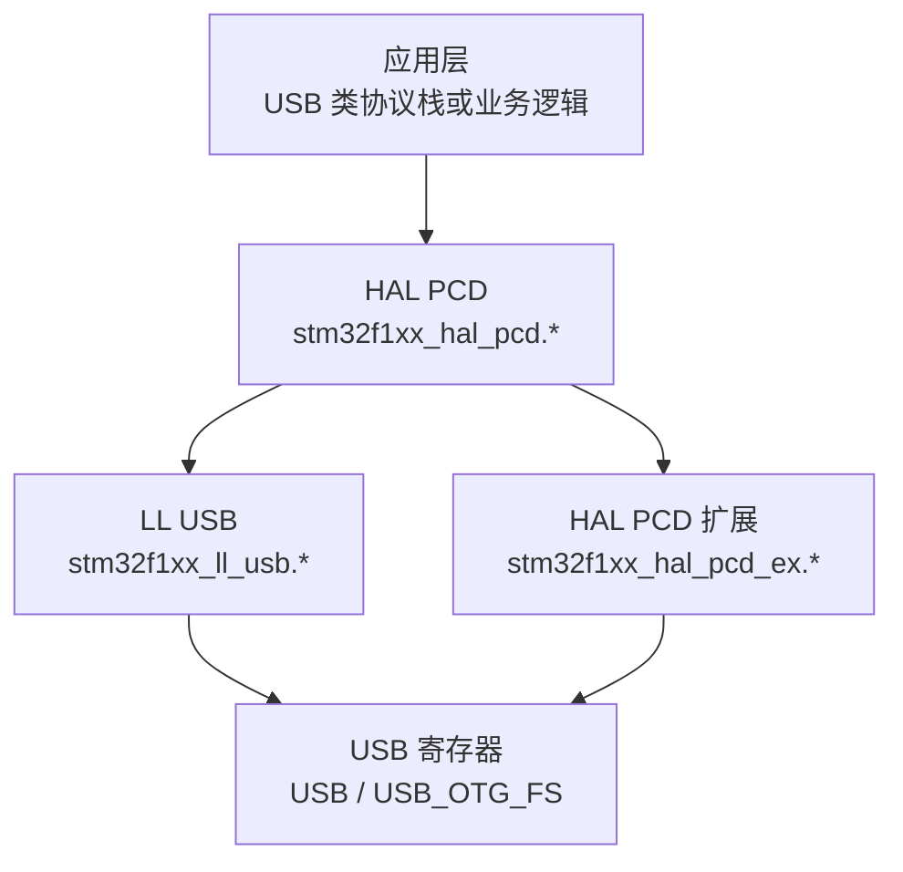
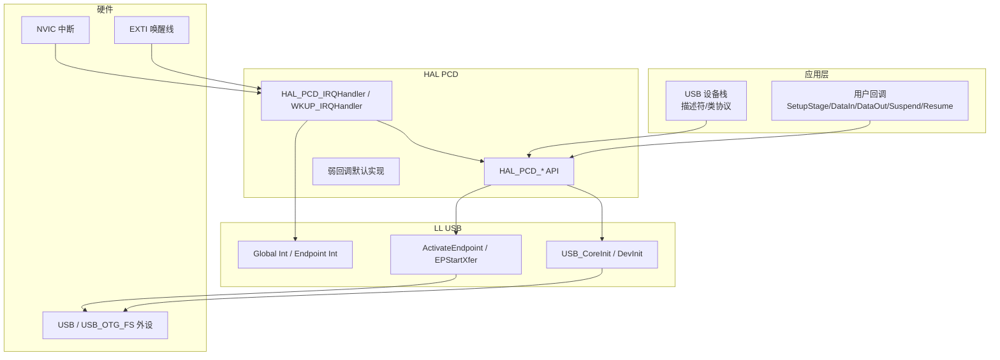
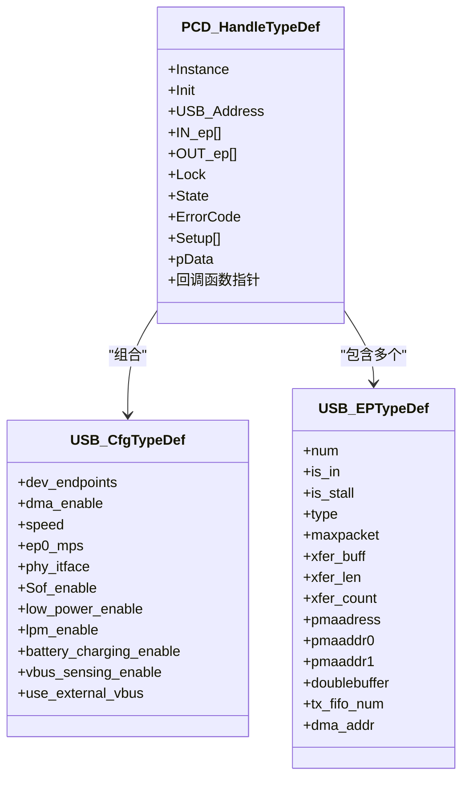

# USB 设备端（PCD）

<cite>
**本文引用的文件**   
- [stm32f1xx_hal_pcd.h](file://Inc/stm32f1xx_hal_pcd.h)
- [stm32f1xx_hal_pcd.c](file://Src/stm32f1xx_hal_pcd.c)
- [stm32f1xx_hal_pcd_ex.h](file://Inc/stm32f1xx_hal_pcd_ex.h)
- [stm32f1xx_hal_pcd_ex.c](file://Src/stm32f1xx_hal_pcd_ex.c)
- [stm32f1xx_ll_usb.h](file://Inc/stm32f1xx_ll_usb.h)
- [stm32f1xx_ll_usb.c](file://Src/stm32f1xx_ll_usb.c)
</cite>

## 目录
1. [引言](#引言)
2. [项目结构](#项目结构)
3. [核心数据结构](#核心数据结构)
4. [系统架构总览](#系统架构总览)
5. [初始化与枚举流程](#初始化与枚举流程)
6. [端点配置与数据传输](#端点配置与数据传输)
7. [控制、批量、中断、等时传输行为](#控制批量中断等时传输行为)
8. [挂起、唤醒与远程唤醒](#挂起唤醒与远程唤醒)
9. [DMA 与 FIFO/PMA 集成](#dma-与-fifopma-集成)
10. [事件回调机制](#事件回调机制)
11. [USB 总线供电、Vbus 检测与 PHY 限制](#usb-bus-bus供电vbus-检测与-phy-限制)
12. [最小自定义 USB 设备示例设计](#最小自定义-usd-设备示例设计)
13. [依赖关系分析](#依赖关系分析)
14. [性能注意事项](#性能注意事项)
15. [常见问题排查](#常见问题排查)
16. [从 HAL_PCD 迁移到 LL_USB 的对照建议](#从-hal_pcd-迁移到-ll_usb-的对照建议)
17. [结论](#结论)

## 引言
本文围绕 STM32F1xx HAL 的 USB 外设控制器设备端模块，系统化说明 PCD 初始化、枚举、端点配置、四类传输、挂起与唤醒、DMA/FIFO/PMA 集成以及事件回调机制。重点解释以下文件之间的协作：
- `stm32f1xx_hal_pcd.h` / `stm32f1xx_hal_pcd.c`：PCD HAL 对外接口、句柄、状态机、中断处理、端点 API 和弱回调。
- `stm32f1xx_hal_pcd_ex.h` / `stm32f1xx_hal_pcd_ex.c`：扩展能力，如 OTG FS 的 RX/TX FIFO 配置、内置 USB 的 PMA 配置和连接状态控制。
- `stm32f1xx_ll_usb.h` / `stm32f1xx_ll_usb.c`：底层 USB Core/Device 操作，包括 `USB_CoreInit`、`USB_DevInit`、`USB_EPStartXfer`、`USB_ActivateEndpoint` 等。

该文档不直接粘贴源码，而是通过“代码片段路径”指向仓库中的具体行号，便于读者对照实现细节。

## 项目结构
STM32F1xx HAL USB PCD 相关代码集中在 Inc/Src 两个目录：

**图示来源**
- [stm32f1xx_hal_pcd.h:200-300](file://Inc/stm32f1xx_hal_pcd.h#L200-L300)
- [stm32f1xx_hal_pcd_ex.h:20-85](file://Inc/stm32f1xx_hal_pcd_ex.h#L20-L85)
- [stm32f1xx_ll_usb.h:1-120](file://Inc/stm32f1xx_ll_usb.h#L1-L120)

**章节来源**
- [stm32f1xx_hal_pcd.h:1-200](file://Inc/stm32f1xx_hal_pcd.h#L1-L200)
- [stm32f1xx_hal_pcd_ex.h:1-85](file://Inc/stm32f1xx_hal_pcd_ex.h#L1-L85)
- [stm32f1xx_ll_usb.h:1-120](file://Inc/stm32f1xx_ll_usb.h#L1-L120)

## 核心数据结构
### PCD_HandleTypeDef
这是上层驱动与底层 USB Core 之间的核心句柄，包含：
- 外设基地址指针、初始化参数、USB 地址。
- IN/OUT 端点数组，分别对应最多 8 个端点（内置 USB）或 16 个端点（OTG FS）。
- 锁、状态、错误码、Setup 包缓冲、LPM 状态、BESL、帧号。
- 可选回调函数指针集合。

关键点：
- 在 `HAL_PCD_Init` 中，所有端点初始化为控制端点类型，并清零缓冲区；随后调用底层设备初始化。
- OTG FS 模式下强制关闭 DMA 模式；内置 USB 使用 PMA 而非全局 FIFO。

**章节来源**
- [stm32f1xx_hal_pcd.h:80-180](file://Inc/stm32f1xx_hal_pcd.h#L80-L180)
- [stm32f1xx_hal_pcd.c:200-260](file://Src/stm32f1xx_hal_pcd.c#L200-L260)

### PCDCfgTypeDef 与 USB_CfgTypeDef
对于 OTG FS，`PCD_InitTypeDef` 是 `USB_OTG_CfgTypeDef`；对于内置 USB，`PCD_InitTypeDef` 是 `USB_CfgTypeDef`。二者都包含端点数、DMA 使能、速度、EP0 最大包长、PHY 接口、SOF、低功耗、LPM、电池充电等字段。

注意：
- `dma_enable` 对 FS 实例会被 HAL 置零。
- `speed` 通常为全速。
- `ep0_mps` 决定 EP0 的最大包长，常见为 64。

**章节来源**
- [stm32f1xx_hal_pcd.h:100-160](file://Inc/stm32f1xx_hal_pcd.h#L100-L160)
- [stm32f1xx_ll_usb.h:100-170](file://Inc/stm32f1xx_ll_usb.h#L100-L170)

### PCD_EPTypeDef 与端点句柄
端点描述符保存方向、类型、最大包长、缓冲区、长度、计数、PMA/DMA 信息等。在 OTG FS 下还维护 DMA 地址和 FIFO 编号；在内置 USB 下维护 PMA 地址及双缓冲信息。

- `maxpacket`：端点最大包长，必须与 USB 规范和设备描述符一致。
- `xfer_buff` / `xfer_len` / `xfer_count`：传输缓冲区、总长度、已传输长度。
- `is_stall`：STALL 标志。
- `tx_fifo_num`：OTG FS 发送 FIFO 编号。
- `pmaadress` / `pmaaddr0` / `pmaaddr1`：内置 USB 的 PMA 地址。

**章节来源**
- [stm32f1xx_ll_usb.h:170-330](file://Inc/stm32f1xx_ll_usb.h#L170-L330)
- [stm32f1xx_hal_pcd_ex.c:100-170](file://Src/stm32f1xx_hal_pcd_ex.c#L100-L170)

### 设备描述符的关系
虽然本仓库未包含 USB 设备描述符定义，但 PCD 层通过 `USB_Address`、`Init.ep0_mps`、端点 `maxpacket` 与上层设备栈交互。实际枚举行为由上层 USB 设备栈根据设备描述符、配置描述符、字符串描述符等进行响应；PCD 负责把 Setup/Data/Status 阶段映射到底层 USB 硬件。

**章节来源**
- [stm32f1xx_hal_pcd.h:100-160](file://Inc/stm32f1xx_hal_pcd.h#L100-L160)
- [stm32f1xx_hal_pcd.c:1400-1500](file://Src/stm32f1xx_hal_pcd.c#L1400-L1500)

## 系统架构总览
PCD 分层如下：

**图示来源**
- [stm32f1xx_hal_pcd.c:200-260](file://Src/stm32f1xx_hal_pcd.c#L200-L260)
- [stm32f1xx_hal_pcd.c:1000-1253](file://Src/stm32f1xx_hal_pcd.c#L1000-L1253)
- [stm32f1xx_ll_usb.c:1-120](file://Src/stm32f1xx_ll_usb.c#L1-L120)

## 初始化与枚举流程
### 初始化流程
典型顺序：
1. 声明 `PCD_HandleTypeDef hpcd`。
2. 填充 `hpcd.Init`：端点数、速度、EP0 最大包长、PHY、低功耗/LPM 等。
3. 调用 `HAL_PCD_Init(&hpcd)`：
   - 分配锁、注册默认回调。
   - 调用 `HAL_PCD_MspInit` 配置时钟、GPIO、NVIC。
   - 禁用全局中断。
   - 调用 `USB_CoreInit` 初始化 USB Core。
   - 设置设备模式。
   - 初始化端点表。
   - 调用 `USB_DevInit` 初始化设备端。
   - 断开设备连接。
4. 调用 `HAL_PCD_Start(&hpcd)`：
   - 启用全局中断。
   - 内置 USB 调用 `HAL_PCDEx_SetConnectionState`。
   - 调用 `USB_DevConnect` 连接设备。

**章节来源**
- [stm32f1xx_hal_pcd.c:200-260](file://Src/stm32f1xx_hal_pcd.c#L200-L260)
- [stm32f1xx_hal_pcd.c:1000-1080](file://Src/stm32f1xx_hal_pcd.c#L1000-L1080)
- [stm32f1xx_ll_usb.c:80-120](file://Src/stm32f1xx_ll_usb.c#L80-L120)

### 枚举流程
USB 主机连接后，设备端经历：
1. 复位中断：
   - 清除唤醒信号。
   - 清空 TX FIFO。
   - 清理端点中断标志，清除 STALL，OUT 端点设置为 NAK。
   - 重新配置端点中断掩码。
   - 将设备地址设为 0。
   - 启动 EP0 OUT 接收 Setup 包。
2. 枚举完成中断：
   - 激活 Setup 包处理。
   - 获取当前速度。
   - 设置往返时间。
   - 触发 Reset 回调，通常由上层设备栈处理描述符请求。
3. 后续 Setup 包进入 `SetupStageCallback`，由上层解析标准/类/Vendor 请求。

**章节来源**
- [stm32f1xx_hal_pcd.c:1080-1253](file://Src/stm32f1xx_hal_pcd.c#L1080-L1253)
- [stm32f1xx_hal_pcd.c:1400-1500](file://Src/stm32f1xx_hal_pcd.c#L1400-L1500)

## 端点配置与数据传输
### 打开端点
`HAL_PCD_EP_Open` 会：
- 根据地址最高位判断 IN/OUT。
- 记录端点编号、最大包长、类型。
- OTG FS 模式下为 IN 端点分配发送 FIFO。
- 批量端点初始化数据 PID 起始值。
- 调用底层 `USB_ActivateEndpoint`。

### 关闭端点
`HAL_PCD_EP_Close` 调用底层 `USB_DeactivateEndpoint`，并重置端点句柄中的方向、编号。

### 接收数据
`HAL_PCD_EP_Receive`：
- 设置 OUT 端点的缓冲区、长度、计数。
- 调用 `USB_EPStartXfer` 开始接收。
- 接收完成后，`xfer_count` 累积已接收字节数。
- 可通过 `HAL_PCD_EP_GetRxCount` 查询已接收长度。

### 发送数据
`HAL_PCD_EP_Transmit`：
- 设置 IN 端点的缓冲区、长度、计数。
- 内置 USB 模式设置双缓冲相关字段。
- 调用 `USB_EPStartXfer` 开始发送。

### STALL、清除 STALL、中止、刷新
- `HAL_PCD_EP_SetStall`：设置端点 STALL，EP0 情况下需重新启动 EP0 OUT 接收 Setup。
- `HAL_PCD_EP_ClrStall`：清除 STALL。
- `HAL_PCD_EP_Abort`：停止当前传输。
- `HAL_PCD_EP_Flush`：IN 端点刷新 TX FIFO，OUT 端点刷新 RX FIFO。

**章节来源**
- [stm32f1xx_hal_pcd.c:1600-2081](file://Src/stm32f1xx_hal_pcd.c#L1600-L2081)

## 控制、批量、中断、等时传输行为
### 控制传输
- 始终通过 EP0 进行。
- Setup 阶段由 `SetupStageCallback` 处理。
- Data 阶段由 `DataInStageCallback` / `DataOutStageCallback` 处理。
- Status 阶段通常由底层自动完成；OTG FS 支持 `OTEPSPR` 状态阶段中断。

### 批量传输
- 通过 `HAL_PCD_EP_Transmit` / `HAL_PCD_EP_Receive`。
- 底层按 `maxpacket` 分片写入 FIFO 或从 FIFO 读取。
- 多包传输依靠 `xfer_len` 和 `xfer_count` 推进。

### 中断传输
- 端点类型为中断类型。
- 通常需要周期性调度发送或及时接收。
- 若主机周期小于设备可提供的带宽，可能出现 NYET/NAK 或不完整等时中断。

### 等时传输
- 等时传输对实时性要求高。
- OTG FS 提供 `ISOINIncompleteCallback` / `ISOOUTIncompleteCallback`，用于通知等时传输未完成。
- 发生全局 OUT NAK 或等时未完成时，HAL 会尝试中止相应端点。

**章节来源**
- [stm32f1xx_hal_pcd.c:1080-1253](file://Src/stm32f1xx_hal_pcd.c#L1080-L1253)
- [stm32f1xx_hal_pcd.c:1400-1500](file://Src/stm32f1xx_hal_pcd.c#L1400-L1500)

## 挂起、唤醒与远程唤醒
### 挂起
- OTG FS：检测到 `USBSUSP` 且 `DSTS_SUSPSTS` 有效时调用 `SuspendCallback`。
- 内置 USB：进入低功率模式前设置 `FSUSP` 和 `LP_MODE`，再清除挂起标志。

### 唤醒
- OTG FS：检测到 `WKUINT` 时清除远程唤醒信号并调用 `ResumeCallback`。
- 内置 USB：通过 `HAL_PCD_WKUP_IRQHandler` 清除 EXTI 挂起位。

### 远程唤醒
- 使用 `HAL_PCD_ActivateRemoteWakeup` 激活远程唤醒信号。
- 使用 `HAL_PCD_DeActivateRemoteWakeup` 关闭远程唤醒信号。

**章节来源**
- [stm32f1xx_hal_pcd.c:1080-1253](file://Src/stm32f1xx_hal_pcd.c#L1080-L1253)
- [stm32f1xx_hal_pcd.c:1400-1470](file://Src/stm32f1xx_hal_pcd.c#L1400-L1470)
- [stm32f1xx_hal_pcd.h:200-260](file://Inc/stm32f1xx_hal_pcd.h#L200-L260)

## DMA 与 FIFO/PMA 集成
### OTG FS 的 FIFO
- RX FIFO 通过 `GRXFSIZ` 配置。
- TX FIFO 通过 `DIEPTXF0_HNPTXFSIZ` 和各端点 TX FIFO 寄存器配置。
- `HAL_PCDEx_SetTxFiFo` / `HAL_PCDEx_SetRxFiFo` 提供扩展配置。
- 注释强调：TX FIFO 最小空间为 16 字；DMA 使用时应预留 3n 个位置给内部 DMA 寄存器。

### 内置 USB 的 PMA
- 端点数据存储在 PMA 中。
- `HAL_PCDEx_PMAConfig` 配置单缓冲或双缓冲端点的 PMA 地址。
- 双缓冲端点需要两个 PMA 地址，分别保存到 `pmaaddr0` / `pmaaddr1`。

### DMA
- OTG FS 初始化时强制关闭 DMA。
- LL USB 层存在 `USB_EnableGlobalInt` / `USB_DisableGlobalInt` 等全局中断操作。
- 如果未来启用 DMA，需注意：
  - 数据缓冲区 32 位对齐。
  - 缓冲区大小与 `maxpacket` 的关系。
  - FIFO 容量足够容纳整批数据或分段写入。

**章节来源**
- [stm32f1xx_hal_pcd_ex.c:40-120](file://Src/stm32f1xx_hal_pcd_ex.c#L40-L120)
- [stm32f1xx_hal_pcd_ex.c:120-200](file://Src/stm32f1xx_hal_pcd_ex.c#L120-L200)
- [stm32f1xx_hal_pcd.c:200-260](file://Src/stm32f1xx_hal_pcd.c#L200-L260)
- [stm32f1xx_ll_usb.c:100-180](file://Src/stm32f1xx_ll_usb.c#L100-L180)

## 事件回调机制
### 回调注册机制
当启用 `USE_HAL_PCD_REGISTER_CALLBACKS` 时，`PCD_HandleTypeDef` 中包含回调函数指针，例如：
- `SOFCallback`
- `SetupStageCallback`
- `ResetCallback`
- `SuspendCallback`
- `ResumeCallback`
- `ConnectCallback`
- `DisconnectCallback`
- `DataOutStageCallback`
- `DataInStageCallback`
- `ISOOUTIncompleteCallback`
- `ISOINIncompleteCallback`

可通过 `HAL_PCD_RegisterCallback` / `HAL_PCD_UnRegisterCallback` 动态替换，也可单独注册 Data Stage 和 ISO 不完整回调。

### 默认弱回调
未覆盖回调时，HAL 提供弱函数默认实现，例如：
- `HAL_PCD_SetupStageCallback`
- `HAL_PCD_DataInStageCallback`
- `HAL_PCD_SuspendCallback`
- `HAL_PCD_ResumeCallback`

这些默认实现不做业务处理，用户应在应用层重写或注册回调。

**章节来源**
- [stm32f1xx_hal_pcd.h:200-400](file://Inc/stm32f1xx_hal_pcd.h#L200-L400)
- [stm32f1xx_hal_pcd.c:260-700](file://Src/stm32f1xx_hal_pcd.c#L260-L700)
- [stm32f1xx_hal_pcd.c:1470-1600](file://Src/stm32f1xx_hal_pcd.c#L1470-L1600)

## USB 总线供电、Vbus 检测与 PHY 限制
### 总线供电与 Vbus
- OTG FS 配置项包含 `vbus_sensing_enable` 和 `use_external_vbus`。
- 内置 USB 没有这两个字段，连接状态常通过 `HAL_PCDEx_SetConnectionState` 模拟或由上层 USB 栈管理。
- Vbus 检测失败会导致枚举无法开始或频繁断开。

### PHY 选择
- `phy_itface` 可指定 ULPI、嵌入式 PHY 或 UTMI。
- STM32F1 常用内置 Full-Speed USB 或 USB OTG FS 的嵌入式 PHY。
- 如果使用外挂 PHY，必须确保时钟、电源、复位引脚正确配置。

### 时钟源
- USB 全速模式要求稳定的 48 MHz 时钟。
- 如果系统主频变化，需确保 USB 时钟源稳定，否则会出现枚举不稳定、CRC 错误或 SOF 异常。

**章节来源**
- [stm32f1xx_ll_usb.h:120-200](file://Inc/stm32f1xx_ll_usb.h#L120-L200)
- [stm32f1xx_hal_pcd_ex.c:160-200](file://Src/stm32f1xx_hal_pcd_ex.c#L160-L200)
- [stm32f1xx_ll_usb.c:80-120](file://Src/stm32f1xx_ll_usb.c#L80-L120)

## 最小自定义 USB 设备示例设计
以下是一个“最小可行设计”，不粘贴代码，只给出步骤和对应源码位置。

### 目标
- 实现一个自定义 USB 设备。
- 注册 EP0 控制请求处理。
- 使用 Bulk 或 Interrupt 端点收发数据。
- 在 `HAL_PCD_DataInStageCallback` / `HAL_PCD_SetupStageCallback` / `HAL_PCD_SuspendCallback` / `HAL_PCD_ResumeCallback` 中完成状态管理。

### 步骤
1. 定义 `PCD_HandleTypeDef hpcd` 并填充 `Init`：
   - 设置端点数。
   - 设置速度为全速。
   - 设置 EP0 最大包长。
   - 配置 PHY 和时钟。
2. 实现 `HAL_PCD_MspInit`：
   - 开启 USB/OTG FS 时钟。
   - 配置 USB 引脚。
   - 配置 NVIC 中断优先级。
3. 调用 `HAL_PCD_Init(&hpcd)`。
4. 调用 `HAL_PCD_Start(&hpcd)`。
5. 在 `HAL_PCD_SetupStageCallback` 中：
   - 解析标准/类/Vendor 请求。
   - 更新设备状态、配置端点、设置地址。
6. 在 `HAL_PCD_DataInStageCallback` 中：
   - 如果是 Bulk/Interrupt IN，继续准备下一包数据。
   - 更新发送状态机。
7. 在 `HAL_PCD_DataOutStageCallback` 中：
   - 读取接收到的数据。
   - 更新接收状态机。
8. 在 `HAL_PCD_SuspendCallback` 中：
   - 关闭非必需外设。
   - 降低时钟频率。
   - 标记设备进入低功耗。
9. 在 `HAL_PCD_ResumeCallback` 中：
   - 恢复外设。
   - 恢复时钟。
   - 重新激活端点或重启接收。
10. 使用 `HAL_PCD_EP_Open` 打开 Bulk 或 Interrupt 端点。
11. 使用 `HAL_PCD_EP_Transmit` / `HAL_PCD_EP_Receive` 收发数据。
12. 必要时使用 `HAL_PCD_EP_SetStall` / `HAL_PCD_EP_ClrStall` 处理错误请求。

**章节来源**
- [stm32f1xx_hal_pcd.c:200-260](file://Src/stm32f1xx_hal_pcd.c#L200-L260)
- [stm32f1xx_hal_pcd.c:1000-1080](file://Src/stm32f1xx_hal_pcd.c#L1000-L1080)
- [stm32f1xx_hal_pcd.c:1470-1600](file://Src/stm32f1xx_hal_pcd.c#L1470-L1600)
- [stm32f1xx_hal_pcd.c:1600-2081](file://Src/stm32f1xx_hal_pcd.c#L1600-L2081)

## 依赖关系分析

**图示来源**
- [stm32f1xx_hal_pcd.h:80-180](file://Inc/stm32f1xx_hal_pcd.h#L80-L180)
- [stm32f1xx_ll_usb.h:100-330](file://Inc/stm32f1xx_ll_usb.h#L100-L330)

**章节来源**
- [stm32f1xx_hal_pcd.h:80-180](file://Inc/stm32f1xx_hal_pcd.h#L80-L180)
- [stm32f1xx_ll_usb.h:100-330](file://Inc/stm32f1xx_ll_usb.h#L100-L330)

## 性能注意事项
- **FIFO 容量**：OTG FS 的 RX/TX FIFO 不足会导致频繁 TXFE 中断或丢包。应根据端点数量和带宽需求合理分配。
- **最大包长**：端点 `maxpacket` 必须与设备描述符一致，且不超过硬件限制。
- **DMA 对齐**：如果使用 DMA，缓冲区地址必须 32 位对齐，长度也需考虑 FIFO 字宽。
- **中断优先级**：USB 中断不能太低，否则可能在主机请求时未及时响应，导致枚举失败或超时。
- **回调执行时间**：回调应尽量短，避免阻塞 USB 事务；复杂任务应放入后台任务或定时器处理。
- **等时传输**：等时端点容易因主机带宽不足而报告不完整，需要在上层做丢弃或重同步策略。
- **时钟稳定性**：USB 全速模式依赖稳定 48 MHz，时钟抖动会影响 CRC、SOF 和端到端时序。

[本节为通用性能指导，不直接分析具体文件]

## 常见问题排查
### 枚举失败
可能原因：
- Vbus 未检测到或电源不稳定。
- USB 时钟未稳定或未启用。
- EP0 最大包长与主机期望不一致。
- 设备描述符不正确。
- 中断未启用或优先级过低。

排查建议：
- 检查 `HAL_PCD_MspInit` 中 USB 时钟和 GPIO。
- 检查 `Init.speed`、`Init.ep0_mps`。
- 确认 `HAL_PCD_Start` 后主机能识别设备。
- 查看 `HAL_PCD_ResetCallback` 是否被触发。

**章节来源**
- [stm32f1xx_hal_pcd.c:200-260](file://Src/stm32f1xx_hal_pcd.c#L200-L260)
- [stm32f1xx_hal_pcd.c:1080-1253](file://Src/stm32f1xx_hal_pcd.c#L1080-L1253)

### 设备被重置
可能原因：
- 主机主动复位。
- USB 总线噪声或供电波动。
- 设备端长时间不响应 Setup 或 Data 阶段。

排查建议：
- 在 `HAL_PCD_ResetCallback` 中打印状态。
- 检查是否在回调中执行了耗时操作。
- 检查端点 STALL 是否被误用。

**章节来源**
- [stm32f1xx_hal_pcd.c:1080-1253](file://Src/stm32f1xx_hal_pcd.c#L1080-L1253)
- [stm32f1xx_hal_pcd.c:1470-1600](file://Src/stm32f1xx_hal_pcd.c#L1470-L1600)

### 端点忙或无响应
可能原因：
- 端点未正确打开。
- 缓冲区未准备好。
- FIFO 未满或已满但未及时处理。
- 使用了错误的端点地址或方向。

排查建议：
- 检查 `HAL_PCD_EP_Open` 是否成功。
- 检查 `HAL_PCD_EP_Transmit` / `HAL_PCD_EP_Receive` 是否调用。
- 检查 `HAL_PCD_EP_GetRxCount` 是否递增。
- 使用 `HAL_PCD_EP_Flush` 清理卡住的 FIFO。

**章节来源**
- [stm32f1xx_hal_pcd.c:1600-2081](file://Src/stm32f1xx_hal_pcd.c#L1600-L2081)

### DMA 地址未对齐
可能原因：
- 数据缓冲区位于堆或非对齐区域。
- 编译器未保证 32 位对齐。
- DMA 未被正确启用或配置。

排查建议：
- 使用静态缓冲区或 `__attribute__((aligned(4)))`。
- 确认缓冲区地址和长度符合 FIFO 字宽。
- 在 OTG FS 模式下注意 HAL 默认关闭 DMA。

**章节来源**
- [stm32f1xx_hal_pcd.c:200-260](file://Src/stm32f1xx_hal_pcd.c#L200-L260)
- [stm32f1xx_hal_pcd_ex.c:40-120](file://Src/stm32f1xx_hal_pcd_ex.c#L40-L120)

### USB_OTG_FS 中断优先级不足
现象：
- 枚举延迟。
- 批量传输丢包。
- 等时传输频繁不完整。

排查建议：
- 提高 USB OTG FS 中断优先级。
- 避免在中断中执行长耗时操作。
- 将数据处理放到任务队列。

**章节来源**
- [stm32f1xx_hal_pcd.c:1000-1253](file://Src/stm32f1xx_hal_pcd.c#L1000-L1253)

### 复位后状态不一致
可能原因：
- 端点未重新激活。
- Setup 接收未重新启动。
- 上层设备栈状态未重置。

排查建议：
- 在 `HAL_PCD_ResetCallback` 中重置上层状态机。
- 重新初始化端点和缓冲区。
- 确保 EP0 能再次接收 Setup。

**章节来源**
- [stm32f1xx_hal_pcd.c:1080-1253](file://Src/stm32f1xx_hal_pcd.c#L1080-L1253)

## 从 HAL_PCD 迁移到 LL_USB 的对照建议
| HAL_PCD 接口 | LL_USB 职责 | 说明 |
|---|---|---|
| `HAL_PCD_Init` | `USB_CoreInit` + `USB_DevInit` | HAL 封装了 Core 和设备初始化；LL 暴露更细粒度操作。 |
| `HAL_PCD_Start` | `USB_EnableGlobalInt` + `USB_DevConnect` | 启动设备和全局中断。 |
| `HAL_PCD_Stop` | `USB_DisableGlobalInt` + `USB_DevDisconnect` | 停止设备并禁用中断。 |
| `HAL_PCD_EP_Open` | `USB_ActivateEndpoint` | 激活并配置端点。 |
| `HAL_PCD_EP_Receive` / `HAL_PCD_EP_Transmit` | `USB_EPStartXfer` | 开始数据转移。 |
| `HAL_PCD_EP_SetStall` | `USB_EPSetStall` | 设置端点 STALL。 |
| `HAL_PCD_EP_ClrStall` | `USB_EPClearStall` | 清除端点 STALL。 |
| `HAL_PCD_EP_Abort` | `USB_EPStopXfer` | 停止端点传输。 |
| `HAL_PCD_EP_Flush` | `USB_FlushTxFifo` / `USB_FlushRxFifo` | 清空 FIFO。 |
| `HAL_PCD_IRQHandler` | 中断处理 + 调用 LL 中断服务 | HAL 负责解析中断并分发到回调。 |
| `HAL_PCD_SetupStageCallback` | 上层设备栈解析 Setup | HAL 仅传递 Setup 包到上层。 |

注意：
- LL 层更接近硬件，适合需要精细控制 FIFO、DMA、端点状态的场景。
- HAL 层更适合快速开发，结合上层 USB 设备栈使用。
- 迁移时需自行处理中断上下文、回调注册、端点状态机和缓冲区管理。

**章节来源**
- [stm32f1xx_hal_pcd.c:200-260](file://Src/stm32f1xx_hal_pcd.c#L200-L260)
- [stm32f1xx_hal_pcd.c:1000-1253](file://Src/stm32f1xx_hal_pcd.c#L1000-L1253)
- [stm32f1xx_hal_pcd.c:1600-2081](file://Src/stm32f1xx_hal_pcd.c#L1600-L2081)
- [stm32f1xx_ll_usb.c:80-180](file://Src/stm32f1xx_ll_usb.c#L80-L180)

## 结论
STM32F1xx HAL 的 PCD 模块以 `PCD_HandleTypeDef` 为中心，向上提供简洁的设备端 API，向下委托 LL USB 操作 USB Core 和端点。对于大多数 USB 设备应用，推荐采用 HAL_PCD 配合上层 USB 设备栈；只有在需要精细控制 FIFO、DMA、端点状态或优化性能时，才考虑直接对接 LL_USB。

在实际工程中，最需要关注的是：
- 初始化顺序和 MSP 配置。
- 枚举回调中的状态重置。
- 端点最大包长与缓冲区一致性。
- FIFO/PMA 容量和对齐。
- 中断优先级和回调执行时间。
- Vbus、时钟、PHY 的硬件约束。

只要围绕这些关键点建立正确的状态机，就能构建稳定可靠的 STM32F1xx USB 设备端实现。