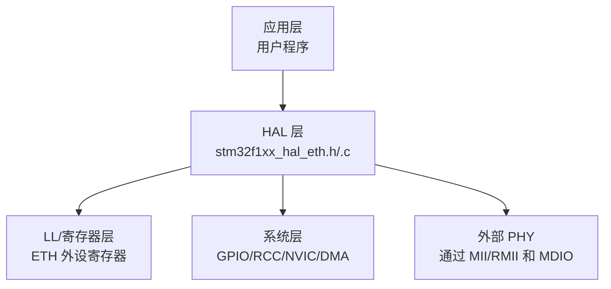
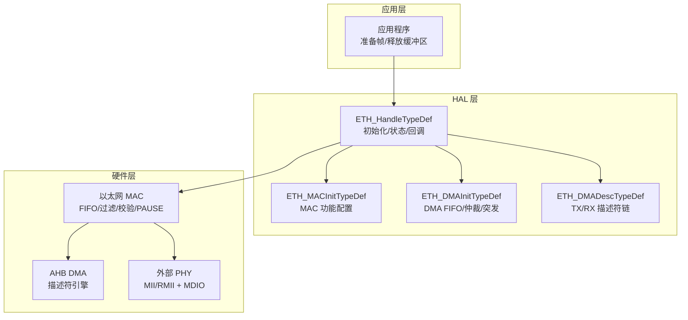
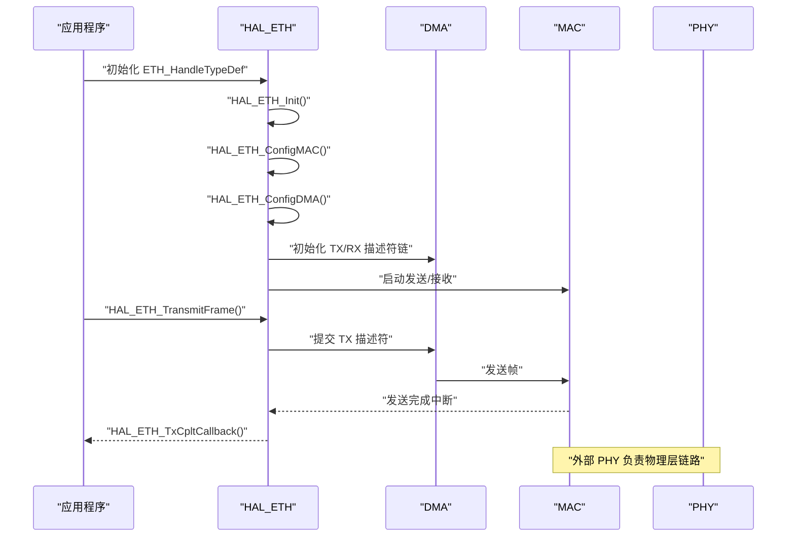
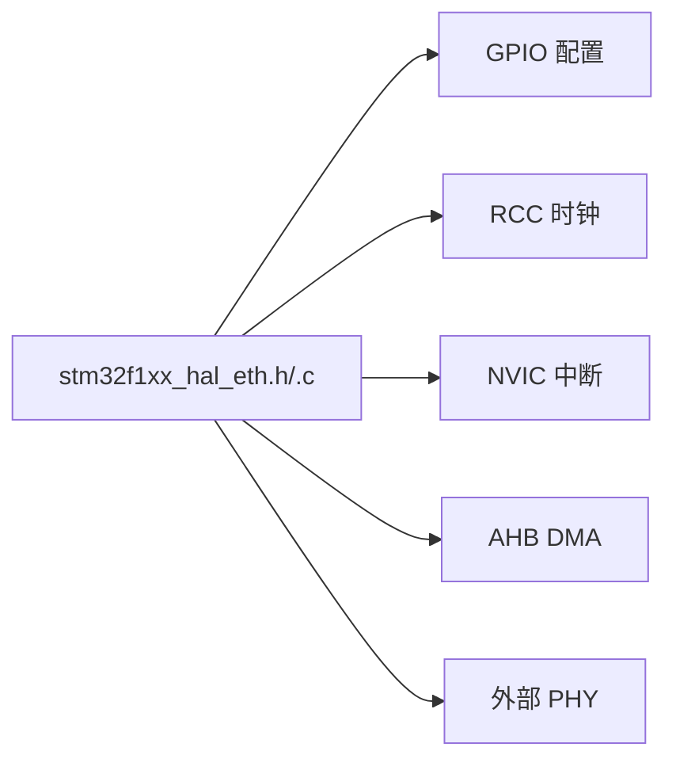
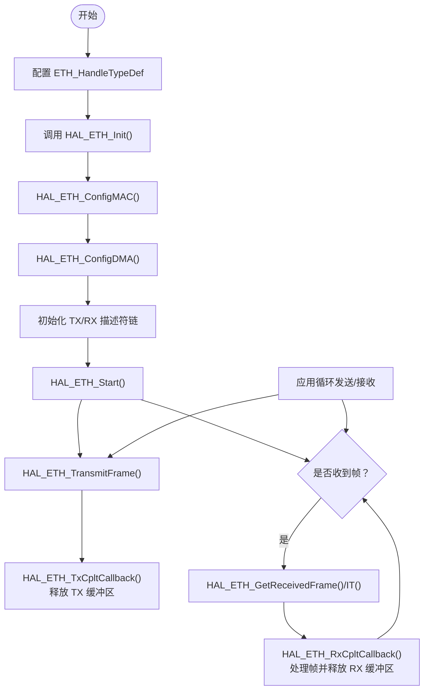

# 以太网 MAC

<cite>
**本文引用的文件**   
- [stm32f1xx_hal_eth.h](file://Inc/stm32f1xx_hal_eth.h)
- [stm32f1xx_hal_eth.c](file://Src/stm32f1xx_hal_eth.c)
- [README.md](file://README.md)
</cite>

## 目录
1. [引言](#引言)
2. [项目结构](#项目结构)
3. [核心组件](#核心组件)
4. [架构总览](#架构总览)
5. [详细组件分析](#详细组件分析)
6. [依赖关系分析](#依赖关系分析)
7. [性能与功耗考虑](#性能与功耗考虑)
8. [最小使用示例](#最小使用示例)
9. [常见问题排查](#常见问题排查)
10. [结论](#结论)

## 引言
本文件面向 STM32F1xx HAL 以太网 MAC 接口，系统性说明以太网控制器初始化、MII/RMII 模式选择、外部 PHY 配置、MAC 地址设置、帧收发、DMA 描述符链、接收/发送中断、丢包处理以及功耗相关配置。文档重点围绕以下实现文件展开：
- `Inc/stm32f1xx_hal_eth.h`：以太网 HAL 类型、宏、常量与导出 API 声明
- `Src/stm32f1xx_hal_eth.c`：以太网 HAL 驱动实现、初始化流程、MAC/DMA 控制、PHY 访问、回调机制

STM32CubeF1 HAL 驱动是 STM32Cube 生态的一部分，提供跨 MCU 的 HAL-LL 抽象层；本仓库为 F1 系列 HAL 驱动组件。

**章节来源**
- [README.md:1-45](file://README.md#L1-L45)

## 项目结构
本项目采用典型的 STM32Cube 分层组织方式：
- `Inc/`：所有 HAL 头文件，包含以太网 HAL 接口定义
- `Src/`：对应 C 实现，包含以太网 HAL 驱动逻辑
- 顶层 README 说明 STM32CubeF1 HAL 驱动组件的定位、版本兼容性与发布说明入口

图示为概念性结构，不直接映射到具体代码行，因此不提供“图表来源”。

**章节来源**
- [README.md:1-45](file://README.md#L1-L45)

## 核心组件
本节聚焦以太网 HAL 的核心数据结构与作用：

| 类型 | 作用 | 关键字段或行为 |
|---|---|---|
| `ETH_HandleTypeDef` | 以太网 HAL 句柄，贯穿整个生命周期 | 实例基址、初始化参数、链路状态、当前 TX/RX 描述符指针、最近一帧信息、状态机、锁、回调指针 |
| `ETH_InitTypeDef` | 以太网基础初始化参数 | 自动协商、速率、双工模式、PHY 地址、MAC 地址指针、接收模式、校验模式、介质接口（MII/RMII） |
| `ETH_MACInitTypeDef` | MAC 层配置 | 看门狗、Jabber、帧间间隔、载波检测、半双工 ReceiveOwn、回环、校验卸载、重试、自动填充/CRC 剥离、冲突退避、延迟检查、接收全部、源地址过滤、控制帧转发、广播帧、目的地址过滤、混杂模式、组播/单播过滤、哈希表、PAUSE 时间、零量子 PAUSE、低阈值、单播 PAUSE 检测、接收/发送流量控制、VLAN 比较与 ID |
| `ETH_DMAInitTypeDef` | DMA 层配置 | 丢弃 TCP/IP 校验错误帧、收/发存储转发、刷新接收帧、传输阈值、转发错误帧/小于 64 字节良好帧、接收阈值、第二帧操作、地址对齐节拍、固定突发、RX/TX 突发长度、描述符跳过长度、仲裁策略 |
| `ETH_DMADescTypeDef` | DMA 描述符 | Status、ControlBufferSize、Buffer1Addr、Buffer2NextDescAddr；用于构建 TX/RX 描述符链表并指向数据缓冲区 |
| `ETH_DMARxFrameInfos` | 最近一次接收帧信息 | 首段/末段描述符、段数、帧长、缓冲索引 |

这些结构共同构成以太网驱动的“配置—运行—回调”模型：先填写初始化结构，再调用初始化函数，随后启动 MAC/DMA，最后通过发送/接收 API 与回调完成数据搬运。

**章节来源**
- [stm32f1xx_hal_eth.h:447-741](file://Inc/stm32f1xx_hal_eth.h#L447-L741)
- [stm32f1xx_hal_eth.h:742-950](file://Inc/stm32f1xx_hal_eth.h#L742-L950)
- [stm32f1xx_hal_eth.h:950-1392](file://Inc/stm32f1xx_hal_eth.h#L950-L1392)

## 架构总览
以太网子系统在 HAL 中分为三层：
1. **应用层**：负责准备数据缓冲区、构造以太网帧、调用发送 API、在接收回调中处理数据。
2. **HAL 层**：封装 ETH 外设初始化、MAC/DMA 配置、PHY 读写、中断/轮询收发、描述符管理。
3. **硬件层**：STM32F1xx 以太网 MAC、内部 FIFO、AHB DMA、MII/RMII 接口、MDIO。

该图为概念性架构图，不直接映射到具体源码行，因此不提供“图表来源”。

## 详细组件分析

### 1. 以太网控制器初始化与媒体接口选择
- 媒体接口通过 `MediaInterface` 选择 MII 或 RMII。
- `Init` 结构中的 `AutoNegotiation`、`Speed`、`DuplexMode`、`PhyAddress`、`MACAddr`、`RxMode`、`ChecksumMode`、`MediaInterface` 决定 MAC 与 PHY 的基础工作方式。
- HAL 文档强调先调用 `HAL_ETH_Init()`，再在 `HAL_ETH_MspInit()` 中使能时钟、配置 GPIO、配置 NVIC。

典型步骤：
1. 声明 `ETH_HandleTypeDef heth`。
2. 填写 `heth.Init`。
3. 调用 `HAL_ETH_Init()`。
4. 在 MSP 中启用 ETH MAC/TX/RX 时钟、配置 MII/RMII 引脚、配置中断。
5. 初始化 DMA 描述符链表。
6. 启动 MAC/DMA。
7. 进行帧收发。

**章节来源**
- [stm32f1xx_hal_eth.c:1-200](file://Src/stm32f1xx_hal_eth.c#L1-L200)
- [stm32f1xx_hal_eth.h:200-446](file://Inc/stm32f1xx_hal_eth.h#L200-L446)

### 2. MII/RMII 引脚复用与时钟来源
- RMII/MII 由 `MediaInterface` 控制。
- HAL 使用说明要求在 `HAL_ETH_MspInit()` 中：
  - 启用以太网 MAC 时钟
  - 启用以太网 TX/RX 时钟
  - 初始化相关 GPIO 时钟并配置引脚复用
- RMII 需要参考时钟、CRS_DV、TXD[0:1]、TX_EN、COL、RXD[0:1]、MDC、MDIO 等引脚。
- MII 需要更多数据和控制信号引脚。
- 时钟来源通常来自 RCC，例如 HSE 经 PLL 产生 50MHz RMII 参考时钟；具体取决于板级设计。

注意：本仓库未包含具体引脚宏，实际引脚复用需根据目标芯片型号和板图配置。

**章节来源**
- [stm32f1xx_hal_eth.c:1-200](file://Src/stm32f1xx_hal_eth.c#L1-L200)
- [stm32f1xx_hal_eth.h:200-446](file://Inc/stm32f1xx_hal_eth.h#L200-L446)

### 3. PHY 配置、自动协商、链路建立
- PHY 地址由 `PhyAddress` 指定，取值范围有宏约束。
- 自动协商由 `AutoNegotiation` 控制；若启用，HAL 会等待自动协商完成。
- 速率 `Speed` 与双工模式 `DuplexMode` 在自动协商关闭时强制配置，或在自动协商后由上层读取链路状态。
- HAL 提供读取/写入 PHY 寄存器的 API，可用于探测 PHY 是否存在、读取 PHY 状态寄存器、配置 LED 等。
- 链接超时和自动协商超时在驱动中有定义，便于排查 PHY 无响应或协商失败。

常见流程：
1. 初始化 MAC/DMA。
2. 读取 PHY 基本状态寄存器确认 PHY 存在。
3. 若启用自动协商，等待完成。
4. 根据链路状态调整上层网络栈配置。

**章节来源**
- [stm32f1xx_hal_eth.h:200-446](file://Inc/stm32f1xx_hal_eth.h#L200-L446)
- [stm32f1xx_hal_eth.c:1-200](file://Src/stm32f1xx_hal_eth.c#L1-L200)

### 4. MAC 地址设置与地址过滤
- MAC 地址通过 `Init.MACAddr` 传入，驱动内部调用 MAC 地址配置函数写入 MAC 地址寄存器。
- 支持多个 MAC 地址寄存器，可用于多地址过滤或源/目的地址过滤。
- `ETH_MACInitTypeDef` 提供源地址过滤、目的地址过滤、混杂模式、组播/单播过滤及哈希表配置。
- VLAN 支持通过 VLAN 比较与 VLAN ID 字段参与过滤。

**章节来源**
- [stm32f1xx_hal_eth.h:447-741](file://Inc/stm32f1xx_hal_eth.h#L447-L741)
- [stm32f1xx_hal_eth.h:950-1392](file://Inc/stm32f1xx_hal_eth.h#L950-L1392)

### 5. 帧收发、DMA 描述符链与缓冲区管理
- RX/TX 缓冲区以链表形式组织，每个缓冲区对应一个 DMA 描述符。
- TX：应用准备数据，填充描述符的 Buffer1Addr 和长度，设置 OWN、IC、CRC 控制等标志，然后交给 DMA。
- RX：DMA 将帧从 MAC FIFO 写入缓冲区，设置描述符状态，触发接收中断或允许轮询获取帧。
- 描述符结构包含状态、控制/长度、缓冲区地址、下一个描述符地址。
- 头部、CRC、VLAN、Payload 大小由宏定义辅助计算。

关键宏与限制：
- `ETH_MAX_PACKET_SIZE`、`ETH_HEADER`、`ETH_CRC`、`ETH_VLAN_TAG`、`ETH_MIN_ETH_PAYLOAD`、`ETH_MAX_ETH_PAYLOAD`、`ETH_JUMBO_FRAME_PAYLOAD`
- RX/TX 默认缓冲区数量与大小可通过 `ETH_RXBUFNB`、`ETH_RX_BUF_SIZE`、`ETH_TXBUFNB`、`ETH_TX_BUF_SIZE` 自定义。

**章节来源**
- [stm32f1xx_hal_eth.h:742-950](file://Inc/stm32f1xx_hal_eth.h#L742-L950)
- [stm32f1xx_hal_eth.h:950-1392](file://Inc/stm32f1xx_hal_eth.h#L950-L1392)

### 6. 接收/发送中断与回调
- HAL 支持两种接收模式：轮询模式和中断模式，由 `RxMode` 选择。
- DMA 中断包括正常中断摘要、异常中断摘要、收发完成、溢出、欠载、缓冲区不可用等。
- MAC 中断包括时间戳触发、MMC、PMT。
- 回调包括 `TxCpltCallback`、`RxCpltCallback`、`DMAErrorCallback`，可动态注册或保留弱实现。
- 描述符级中断可由 `__HAL_ETH_DMATXDESC_ENABLE_IT`、`__HAL_ETH_DMARXDESC_ENABLE_IT` 控制。

**图表来源**
- [stm32f1xx_hal_eth.c:1-200](file://Src/stm32f1xx_hal_eth.c#L1-L200)
- [stm32f1xx_hal_eth.h:200-446](file://Inc/stm32f1xx_hal_eth.h#L200-L446)

**章节来源**
- [stm32f1xx_hal_eth.h:1393-1749](file://Inc/stm32f1xx_hal_eth.h#L1393-L1749)
- [stm32f1xx_hal_eth.c:1-200](file://Src/stm32f1xx_hal_eth.c#L1-L200)

### 7. 丢包处理、错误计数与流量控制
- DMA 溢出与丢包计数通过 DMA overflow 宏区分 FIFO 溢出与丢帧计数。
- MMC（MAC 监控计数器）提供 CRC 错误、对齐错误、良好单播帧计数等中断标志。
- 流量控制通过 `ReceiveFlowControl`、`TransmitFlowControl`、`PauseTime`、`ZeroQuantaPause`、`PauseLowThreshold`、`UnicastPauseFrameDetect` 配置。
- 全双工下可发送 PAUSE 控制帧；半双工下可使用背压。

**章节来源**
- [stm32f1xx_hal_eth.h:447-741](file://Inc/stm32f1xx_hal_eth.h#L447-L741)
- [stm32f1xx_hal_eth.h:950-1392](file://Inc/stm32f1xx_hal_eth.h#L950-L1392)
- [stm32f1xx_hal_eth.h:1393-1749](file://Inc/stm32f1xx_hal_eth.h#L1393-L1749)

### 8. 功耗相关配置
- 看门狗与 Jabber 可限制最大接收/发送帧长，间接影响功耗与稳定性。
- PMT（电源管理定时器）标志位表明唤醒帧与魔术包能力。
- 驱动文档指出 PTP 与环形描述符模式在本驱动中不支持，这意味着在低功耗或实时场景中应谨慎使用 DMA 高级特性。

**章节来源**
- [stm32f1xx_hal_eth.h:447-741](file://Inc/stm32f1xx_hal_eth.h#L447-L741)
- [stm32f1xx_hal_eth.h:1393-1749](file://Inc/stm32f1xx_hal_eth.h#L1393-L1749)
- [stm32f1xx_hal_eth.c:1-200](file://Src/stm32f1xx_hal_eth.c#L1-L200)

## 依赖关系分析
以太网 HAL 依赖以下底层资源：
- GPIO：MII/RMII 引脚复用
- RCC：ETH MAC、TX、RX 时钟
- NVIC：以太网中断优先级
- DMA：AHB DMA 描述符引擎
- PHY：通过 MDIO 访问，物理层通过 MII/RMII

该图为概念性依赖图，不直接映射到具体源码行，因此不提供“图表来源”。

**章节来源**
- [stm32f1xx_hal_eth.c:1-200](file://Src/stm32f1xx_hal_eth.c#L1-L200)

## 性能与功耗考虑
- DMA 突发长度：RX/TX 突发长度影响总线效率，过大可能增加延迟，过小降低吞吐。
- 存储转发与阈值：提高 FIFO 阈值可减少中断次数，但增加端到端延迟；较低阈值提升实时性但增加 CPU 负载。
- 第二帧操作：允许 DMA 在处理第一帧状态前开始处理下一帧，提高吞吐。
- 地址对齐节拍与固定突发：影响 AHB 总线事务效率。
- 仲裁策略：轮询比例或 RX 优先会影响收发公平性。
- Jumbo Frame：宏定义了巨型帧载荷上限，但需注意 MAC 看门狗与缓冲区大小限制。
- 校验卸载：硬件校验可降低 CPU 开销，但需确保协议栈配合。
- 功耗：合理关闭不必要功能、避免长时间高吞吐、利用 PMT 能力进行休眠唤醒。

**章节来源**
- [stm32f1xx_hal_eth.h:950-1392](file://Inc/stm32f1xx_hal_eth.h#L950-L1392)
- [stm32f1xx_hal_eth.h:1393-1749](file://Inc/stm32f1xx_hal_eth.h#L1393-L1749)

## 最小使用示例
本节给出一个“最小可用”流程，不直接粘贴代码，而是以步骤和源码路径说明如何配置 RMII/MII、初始化 MAC 与 DMA、绑定 TX/RX 描述符、发送一帧以太网数据并在回调中释放缓冲区。

### 步骤一：准备句柄与初始化参数
- 声明 `ETH_HandleTypeDef heth`。
- 填写 `heth.Init`：
  - `MediaInterface`：RMII 或 MII
  - `AutoNegotiation`：启用或禁用
  - `Speed`：10M 或 100M
  - `DuplexMode`：半双工或全双工
  - `PhyAddress`：外部 PHY 地址
  - `MACAddr`：指向 6 字节 MAC 地址数组
  - `RxMode`：轮询或中断
  - `ChecksumMode`：硬件或软件校验

**参考路径**
- [stm32f1xx_hal_eth.h:200-446](file://Inc/stm32f1xx_hal_eth.h#L200-L446)

### 步骤二：调用 HAL_ETH_Init()
- 该函数负责 MAC 与 DMA 的基础初始化。
- 需要在 `HAL_ETH_MspInit()` 中完成：
  - 启用 ETH MAC/TX/RX 时钟
  - 配置 MII/RMII 引脚复用
  - 配置 NVIC 中断优先级

**参考路径**
- [stm32f1xx_hal_eth.c:1-200](file://Src/stm32f1xx_hal_eth.c#L1-L200)

### 步骤三：配置 MAC 与 DMA
- 填写 `ETH_MACInitTypeDef`，设置看门狗、Jabber、帧间间隔、双工相关选项、过滤、流量控制等。
- 填写 `ETH_DMAInitTypeDef`，设置存储转发、阈值、突发长度、仲裁等。
- 调用 `HAL_ETH_ConfigMAC()` 与 `HAL_ETH_ConfigDMA()`。

**参考路径**
- [stm32f1xx_hal_eth.h:447-741](file://Inc/stm32f1xx_hal_eth.h#L447-L741)
- [stm32f1xx_hal_eth.h:742-950](file://Inc/stm32f1xx_hal_eth.h#L742-L950)

### 步骤四：初始化 DMA 描述符链
- 分配 TX/RX 描述符数组与数据缓冲区数组。
- 调用 `HAL_ETH_DMATxDescListInit()` 与 `HAL_ETH_DMARxDescListInit()`。
- 将每个描述符的 Buffer1Addr 指向对应缓冲区，并根据需要设置 Buffer2NextDescAddr。
- 对于 RX，设置 OWN 位让 DMA 接管；对于 TX，由应用填充数据后设置 OWN。

**参考路径**
- [stm32f1xx_hal_eth.h:742-950](file://Inc/stm32f1xx_hal_eth.h#L742-L950)

### 步骤五：启动 MAC 与 DMA
- 调用 `HAL_ETH_Start()` 启动发送与接收。

**参考路径**
- [stm32f1xx_hal_eth.c:1-200](file://Src/stm32f1xx_hal_eth.c#L1-L200)

### 步骤六：发送一帧以太网数据
- 准备以太网帧数据（目的 MAC、源 MAC、类型/长度、Payload、CRC）。
- 调用 `HAL_ETH_TransmitFrame()`，将帧交给 DMA。
- 在 `HAL_ETH_TxCpltCallback()` 中释放 TX 缓冲区，以便重用。

**参考路径**
- [stm32f1xx_hal_eth.h:950-1392](file://Inc/stm32f1xx_hal_eth.h#L950-L1392)

### 步骤七：接收帧与释放 RX 缓冲区
- 轮询模式：循环调用 `HAL_ETH_GetReceivedFrame()` 获取帧。
- 中断模式：在 `HAL_ETH_RxCpltCallback()` 中调用 `HAL_ETH_GetReceivedFrame_IT()` 获取帧。
- 处理完后重新设置 RX 描述符 OWN 位，并释放已用缓冲区。

**参考路径**
- [stm32f1xx_hal_eth.h:1393-1749](file://Inc/stm32f1xx_hal_eth.h#L1393-L1749)

该图为概念性流程图，不直接映射到具体源码行，因此不提供“图表来源”。

**章节来源**
- [stm32f1xx_hal_eth.c:1-200](file://Src/stm32f1xx_hal_eth.c#L1-L200)
- [stm32f1xx_hal_eth.h:200-446](file://Inc/stm32f1xx_hal_eth.h#L200-L446)
- [stm32f1xx_hal_eth.h:742-950](file://Inc/stm32f1xx_hal_eth.h#L742-L950)
- [stm32f1xx_hal_eth.h:950-1392](file://Inc/stm32f1xx_hal_eth.h#L950-L1392)
- [stm32f1xx_hal_eth.h:1393-1749](file://Inc/stm32f1xx_hal_eth.h#L1393-L1749)

## 常见问题排查

| 问题 | 可能原因 | 排查方法 | 建议措施 |
|---|---|---|---|
| PHY 无响应 | PHY 地址错误、MDIO 引脚未正确配置、时钟未使能 | 读取 PHY 基本状态寄存器；检查 GPIO 复用与 RCC 时钟 | 修正 PHY 地址、检查引脚与时钟、确认 MDIO 通信 |
| 链路无法建立 | 自动协商失败、速率/双工不匹配、参考时钟频率错误 | 查看 PHY 状态寄存器与链路状态标志；检查 RMII 参考时钟 | 统一速率/双工，校准参考时钟，必要时禁用自动协商手动配置 |
| 只能收不能发 | TX 描述符 OWN 未置位、TX 缓冲区未就绪、DMA 发送进程停止 | 检查 DMA 发送状态标志与 TX 描述符状态 | 确保描述符链正确、OWN 位在发送前设置、重启 DMA 发送 |
| 大量 CRC 错误 | 线路干扰、PHY 配置错误、MAC/Jabber/看门狗配置不当 | 查看 MMC CRC 错误计数与 DMA 标志 | 优化布线、检查 PHY、调整 MAC 过滤与帧长限制 |
| DMA 卡死 | 描述符内存未对齐、缓冲区越界、中断未清除、DMA 总线错误 | 检查 DMA 错误标志、描述符状态、内存布局 | 对齐内存、修复缓冲区、清除中断、重启 DMA |
| 描述符环溢出 | 应用未及时释放 RX 缓冲区、CPU 处理太慢 | 检查 RX 缓冲区不可用标志与丢帧计数 | 提高接收优先级、减少中断延迟、增大缓冲区数量 |
| 网络丢包 | FIFO 溢出、阈值过低、仲裁不合理、CPU 过载 | 检查 DMA 溢出计数、FIFO 阈值、中断优先级 | 提高阈值、调整仲裁、提升中断优先级、优化应用处理 |

**章节来源**
- [stm32f1xx_hal_eth.h:1393-1749](file://Inc/stm32f1xx_hal_eth.h#L1393-L1749)
- [stm32f1xx_hal_eth.c:1-200](file://Src/stm32f1xx_hal_eth.c#L1-L200)

## 结论
STM32F1xx HAL 以太网驱动通过 `ETH_HandleTypeDef`、`ETH_InitTypeDef`、`ETH_MACInitTypeDef`、`ETH_DMAInitTypeDef` 与 `ETH_DMADescTypeDef` 构建了清晰的“配置—运行—回调”模型。正确使用该模型的关键在于：
- 正确选择 MII/RMII 与 PHY 配置
- 正确初始化 MAC 与 DMA
- 正确构建并维护 TX/RX 描述符链
- 在回调中及时释放缓冲区
- 根据吞吐量与延迟需求调优 DMA 阈值、突发长度与仲裁
- 通过 MMC 与 DMA 标志监控丢包、CRC 错误与溢出
- 结合中断优先级与 CPU 调度保证实时性

遵循上述原则，可在 STM32F1xx 上稳定实现以太网 MAC 的收发、过滤、流量控制与低功耗运行。