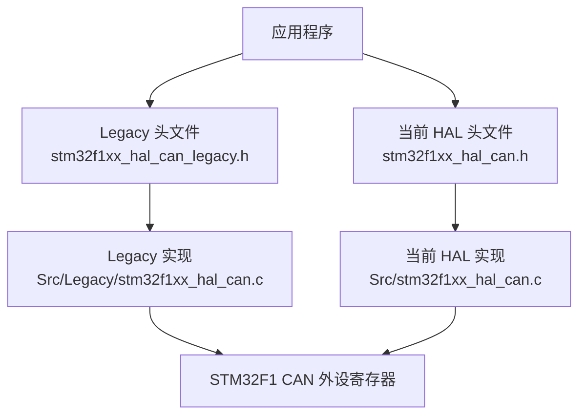
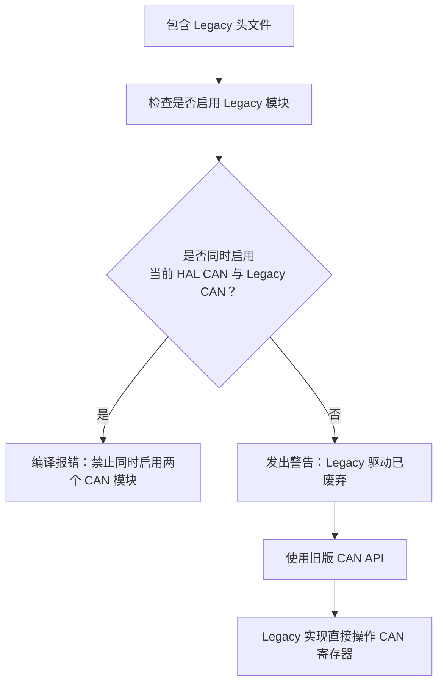
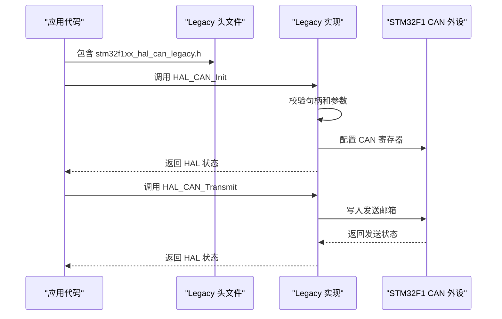
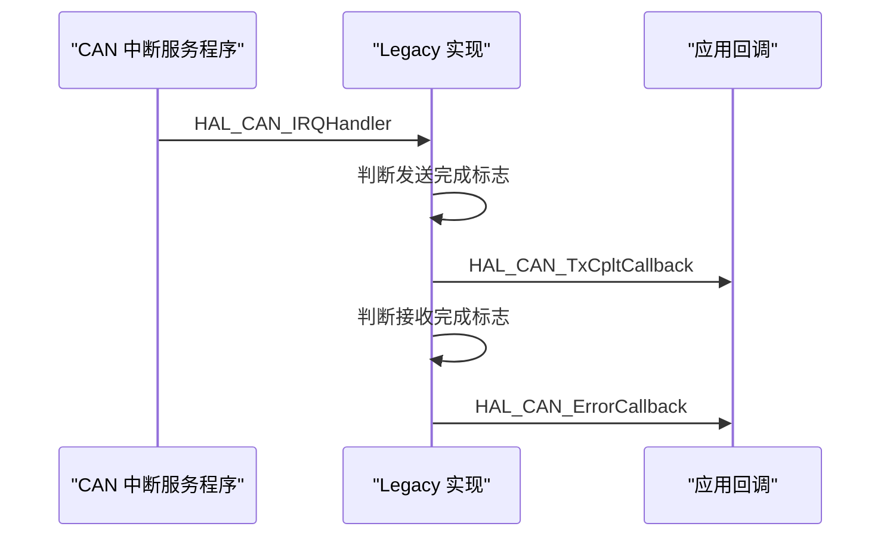

# 向后兼容性与 Legacy API

<cite>
**本文引用的文件**   
- [stm32f1xx_hal_can_legacy.h](file://Inc/Legacy/stm32f1xx_hal_can_legacy.h)
- [stm32f1xx_hal_can_ex_legacy.h](file://Inc/Legacy/stm32f1xx_hal_can_ex_legacy.h)
- [stm32f1xx_hal_can.c（Legacy 实现）](file://Src/Legacy/stm32f1xx_hal_can.c)
- [stm32f1xx_hal_can.h（当前 HAL）](file://Inc/stm32f1xx_hal_can.h)
- [stm32f1xx_hal_can.c（当前 HAL 实现）](file://Src/stm32f1xx_hal_can.c)
- [README.md](file://README.md)
</cite>

## 目录

1. [引言](#引言)
2. [项目结构与 Legacy 定位](#项目结构与-legacy-定位)
3. [Legacy CAN 层整体架构](#legacy-can-层整体架构)
4. [核心数据结构对照](#核心数据结构对照)
5. [API 迁移对照表](#api-迁移对照表)
6. [Legacy 到当前 HAL 的调用流程](#legacy-到当前-hal-的调用流程)
7. [错误码与状态映射](#错误码与状态映射)
8. [受支持与废弃接口清单](#受支持与废弃接口清单)
9. [自动化迁移建议](#自动化迁移建议)
10. [常见问题与排错](#常见问题与排错)
11. [性能与行为差异](#性能与行为差异)
12. [结论](#结论)

## 引言

STM32F1xx HAL Driver 中的 `Inc/Legacy` 和 `Src/Legacy` 目录构成一个专门面向 STM32CubeF1 旧版 HAL CAN 接口的向后兼容层。它的主要职责是：

- 保留早期 STM32Cube HAL CAN API 的类型、宏和函数签名；
- 让存量旧代码在不直接修改业务逻辑的前提下继续编译；
- 将旧式 `CAN_HandleTypeDef`、`CanTxMsgTypeDef`、`CanRxMsgTypeDef`、`CAN_FilterConfTypeDef` 等结构体桥接到硬件寄存器操作；
- 明确标记 Legacy 驱动为“已废弃”，并引导用户迁移到当前 `stm32f1xx_hal_can.h` 提供的更新版本。

README 明确指出，该仓库提供的是 STM32CubeF1 MCU 包中的 HAL-LL 驱动组件，并且强调 CMSIS Core、CMSIS Device 与 HAL 之间应保持版本一致性。Legacy CAN 驱动也遵循这一原则：它不是新开发的主流接口，而是用于平滑迁移的历史兼容实现。

**章节来源**
- [README.md:1-45](file://README.md#L1-L45)

## 项目结构与 Legacy 定位

从仓库结构看，CAN 相关代码分为三层：

| 层级 | 位置 | 职责 |
|---|---|---|
| 当前 HAL 头文件 | `Inc/stm32f1xx_hal_can.h` | 定义新版 `CAN_InitTypeDef`、`CAN_TxHeaderTypeDef`、`CAN_RxHeaderTypeDef`、`CAN_FilterTypeDef` 和新 API |
| 当前 HAL 实现 | `Src/stm32f1xx_hal_can.c` | 实现改进后的 CAN FIFO、回调注册、错误处理和启动/停止控制 |
| Legacy 头文件 | `Inc/Legacy/stm32f1xx_hal_can_legacy.h`、`Inc/Legacy/stm32f1xx_hal_can_ex_legacy.h` | 定义旧版类型、常量、宏和函数声明 |
| Legacy 实现 | `Src/Legacy/stm32f1xx_hal_can.c` | 实现旧版 HAL CAN 函数，内部直接操作 CAN 寄存器 |



**图示来源**
- [stm32f1xx_hal_can_legacy.h:1-200](file://Inc/Legacy/stm32f1xx_hal_can_legacy.h#L1-L200)
- [stm32f1xx_hal_can_ex_legacy.h:1-125](file://Inc/Legacy/stm32f1xx_hal_can_ex_legacy.h#L1-L125)
- [stm32f1xx_hal_can.c（Legacy 实现）:1-200](file://Src/Legacy/stm32f1xx_hal_can.c#L1-L200)
- [stm32f1xx_hal_can.h:1-200](file://Inc/stm32f1xx_hal_can.h#L1-L200)
- [stm32f1xx_hal_can.c（当前 HAL 实现）:275-840](file://Src/stm32f1xx_hal_can.c#L275-L840)

**章节来源**
- [stm32f1xx_hal_can_legacy.h:1-200](file://Inc/Legacy/stm32f1xx_hal_can_legacy.h#L1-L200)
- [stm32f1xx_hal_can_ex_legacy.h:1-125](file://Inc/Legacy/stm32f1xx_hal_can_ex_legacy.h#L1-L125)
- [stm32f1xx_hal_can.c（Legacy 实现）:1-200](file://Src/Legacy/stm32f1xx_hal_can.c#L1-L200)
- [stm32f1xx_hal_can.h:1-200](file://Inc/stm32f1xx_hal_can.h#L1-L200)

## Legacy CAN 层整体架构

Legacy CAN 层的核心设计可以概括为：**以旧结构体为中心，以旧函数签名为入口，直接访问底层 CAN 寄存器**。

### 主要组成

1. **Legacy 类型定义**
   - `HAL_CAN_StateTypeDef`：旧版 CAN 状态枚举；
   - `CAN_InitTypeDef`：旧版初始化配置；
   - `CanTxMsgTypeDef`：旧版发送帧结构；
   - `CanRxMsgTypeDef`：旧版接收帧结构；
   - `CAN_FilterConfTypeDef`：旧版过滤器配置；
   - `CAN_HandleTypeDef`：旧版句柄结构。

2. **Legacy 函数集合**
   - 初始化与反初始化；
   - 过滤器配置；
   - 轮询发送与接收；
   - 中断发送与接收；
   - 睡眠与唤醒；
   - 中断处理；
   - 状态查询。

3. **互斥与启用策略**
   - Legacy 实现要求不能同时启用当前 HAL CAN 模块和 Legacy HAL CAN 模块；
   - 若两者同时启用，会触发编译错误；
   - 启用 Legacy 时会发出警告，提示建议使用新版驱动。



**图示来源**
- [stm32f1xx_hal_can.c（Legacy 实现）:1-200](file://Src/Legacy/stm32f1xx_hal_can.c#L1-L200)

**章节来源**
- [stm32f1xx_hal_can.c（Legacy 实现）:1-200](file://Src/Legacy/stm32f1xx_hal_can.c#L1-L200)

## 核心数据结构对照

### 初始化结构体

| 字段 | Legacy | 当前 HAL | 说明 |
|---|---|---|---|
| 预分频器 | `uint32_t Prescaler` | `uint32_t Prescaler` | 语义一致，范围均为 1 到 1024 |
| 工作模式 | `uint32_t Mode` | `uint32_t Mode` | 保持相同语义 |
| 同步跳宽 | `uint32_t SJW` | `uint32_t SyncJumpWidth` | 名称变化，含义不变 |
| Bit Segment 1 | `uint32_t BS1` | `uint32_t TimeSeg1` | 名称变化 |
| Bit Segment 2 | `uint32_t BS2` | `uint32_t TimeSeg2` | 名称变化 |
| 时间触发通信 | `uint32_t TTCM` | `FunctionalState TimeTriggeredMode` | 从 `uint32_t` 改为 `FunctionalState` |
| 自动 bus-off | `uint32_t ABOM` | `FunctionalState AutoBusOff` | 从 `uint32_t` 改为 `FunctionalState` |
| 自动唤醒 | `uint32_t AWUM` | `FunctionalState AutoWakeUp` | 从 `uint32_t` 改为 `FunctionalState` |
| 非自动重传 | `uint32_t NART` | `FunctionalState AutoRetransmission` | 语义取反：旧 `NART=DISABLE` 对应新 `AutoRetransmission=ENABLE` |
| 接收 FIFO 锁定 | `uint32_t RFLM` | `FunctionalState ReceiveFifoLocked` | 从 `uint32_t` 改为 `FunctionalState` |
| 发送 FIFO 优先级 | `uint32_t TXFP` | `FunctionalState TransmitFifoPriority` | 从 `uint32_t` 改为 `FunctionalState` |

### 发送消息结构体

| 字段 | Legacy | 当前 HAL | 说明 |
|---|---|---|---|
| 标准标识符 | `uint32_t StdId` | `uint32_t StdId` | 一致 |
| 扩展标识符 | `uint32_t ExtId` | `uint32_t ExtId` | 一致 |
| 标识符类型 | `uint32_t IDE` | `uint32_t IDE` | 一致 |
| 远程帧 | `uint32_t RTR` | `uint32_t RTR` | 一致 |
| 数据长度 | `uint32_t DLC` | `uint32_t DLC` | 一致 |
| 数据数组 | `uint8_t Data[8]` | 数据通过参数指针传入 | 当前 HAL 不再在发送头中保存数据 |
| 全局时间戳发送 | 无 | `FunctionalState TransmitGlobalTime` | 新增功能，需启用时间触发通信模式 |

### 接收消息结构体

| 字段 | Legacy | 当前 HAL | 说明 |
|---|---|---|---|
| 标准标识符 | `uint32_t StdId` | `uint32_t StdId` | 一致 |
| 扩展标识符 | `uint32_t ExtId` | `uint32_t ExtId` | 一致 |
| 标识符类型 | `uint32_t IDE` | `uint32_t IDE` | 一致 |
| 远程帧 | `uint32_t RTR` | `uint32_t RTR` | 一致 |
| 数据长度 | `uint32_t DLC` | `uint32_t DLC` | 一致 |
| 数据数组 | `uint8_t Data[8]` | 数据通过参数指针传入 | 当前 HAL 分离消息头与数据缓冲区 |
| 过滤器索引 | `uint32_t FMI` | 由接收 API 或消息头上下文提供 | 当前 API 设计不同 |
| FIFO 编号 | `uint32_t FIFONumber` | 作为 API 参数传入 | 当前 HAL 不再依赖接收结构体中的字段 |
| 时间戳 | 无 | `uint32_t Timestamp` | 新增字段 |

### 过滤器配置结构体

| 字段 | Legacy | 当前 HAL | 说明 |
|---|---|---|---|
| 高 16 位标识 | `uint32_t FilterIdHigh` | `uint32_t FilterIdHigh` | 一致 |
| 低 16 位标识 | `uint32_t FilterIdLow` | `uint32_t FilterIdLow` | 一致 |
| 高 16 位掩码 | `uint32_t FilterMaskIdHigh` | `uint32_t FilterMaskIdHigh` | 一致 |
| 低 16 位掩码 | `uint32_t FilterMaskIdLow` | `uint32_t FilterMaskIdLow` | 一致 |
| 分配 FIFO | `uint32_t FilterFIFOAssignment` | `uint32_t FilterFIFOAssignment` | 一致 |
| 过滤器编号 | `uint32_t FilterNumber` | `uint32_t FilterBank` | 名称变化 |
| 过滤器模式 | `uint32_t FilterMode` | `uint32_t FilterMode` | 一致 |
| 过滤器尺度 | `uint32_t FilterScale` | `uint32_t FilterScale` | 一致 |
| 激活状态 | `uint32_t FilterActivation` | `uint32_t FilterActivation` | 一致 |
| 从机起始银行 | `uint32_t BankNumber` | `uint32_t SlaveStartFilterBank` | 名称变化 |

### 句柄结构体

| 字段 | Legacy | 当前 HAL | 说明 |
|---|---|---|---|
| 外设基地址 | `CAN_TypeDef* Instance` | `CAN_TypeDef* Instance` | 一致 |
| 初始化配置 | `CAN_InitTypeDef Init` | `CAN_InitTypeDef Init` | 一致 |
| 发送消息指针 | `CanTxMsgTypeDef* pTxMsg` | 发送头通过参数传递 | 当前 HAL 不缓存发送消息指针 |
| 接收消息指针 | `CanRxMsgTypeDef* pRxMsg` | 接收结果通过参数返回 | 当前 HAL 不缓存接收消息指针 |
| 第二接收消息指针 | `CanRxMsgTypeDef* pRx1Msg` | 不存在 | 当前 HAL 通过 FIFO 参数区分 |
| 状态 | `HAL_CAN_StateTypeDef State` | `HAL_CAN_StateTypeDef State` | 语义接近但枚举值不同 |
| 锁对象 | `HAL_LockTypeDef Lock` | 存在锁机制 | 当前实现使用更明确的锁管理 |
| 错误码 | `__IO uint32_t ErrorCode` | `__IO uint32_t ErrorCode` | 一致，但错误码定义有差异 |

**章节来源**
- [stm32f1xx_hal_can_legacy.h:47-182](file://Inc/Legacy/stm32f1xx_hal_can_legacy.h#L47-L182)
- [stm32f1xx_hal_can_ex_legacy.h:30-100](file://Inc/Legacy/stm32f1xx_hal_can_ex_legacy.h#L30-L100)
- [stm32f1xx_hal_can.h:44-200](file://Inc/stm32f1xx_hal_can.h#L44-L200)

## API 迁移对照表

### 初始化与反初始化

| Legacy | 当前 HAL | 迁移要点 |
|---|---|---|
| `HAL_CAN_Init` | `HAL_CAN_Init` | 函数名一致，但 `CAN_InitTypeDef` 字段名称发生变化 |
| `HAL_CAN_DeInit` | `HAL_CAN_DeInit` | 语义一致 |
| 无显式启动 | `HAL_CAN_Start` | 当前 HAL 将初始化、启动、停止拆分为独立步骤 |
| 无显式停止 | `HAL_CAN_Stop` | 当前 HAL 支持显式停止 |

### 过滤器配置

| Legacy | 当前 HAL | 迁移要点 |
|---|---|---|
| `HAL_CAN_ConfigFilter(hcan, &filter)` | `HAL_CAN_ConfigFilter(hcan, &filter)` | 函数名一致，但第二个参数类型从 `CAN_FilterConfTypeDef*` 变为 `const CAN_FilterTypeDef*` |
| 过滤器结构体字段 `FilterNumber` | 字段 `FilterBank` | 必须重命名字段 |
| 过滤器结构体字段 `BankNumber` | 字段 `SlaveStartFilterBank` | 仅双 CAN 实例有意义，单 CAN 实例可忽略 |

### 发送接口

| Legacy | 当前 HAL | 迁移要点 |
|---|---|---|
| `HAL_CAN_Transmit(hcan, Timeout)` | `HAL_CAN_AddTxMessage(hcan, pHeader, pData, Size)` | 不再使用句柄中的 `pTxMsg`，改为传入发送头和缓冲区的指针 |
| `HAL_CAN_Transmit_IT(hcan)` | `HAL_CAN_AddTxMessage_IT(hcan, pHeader, pData, Size)` | 当前 HAL 通常通过带 `_IT` 后缀的添加消息函数完成异步发送 |
| 发送前设置 `hcan->pTxMsg` | 无需设置句柄成员 | 旧代码中预先填充 `CanTxMsgTypeDef` 后赋值给句柄的做法需要删除 |

### 接收接口

| Legacy | 当前 HAL | 迁移要点 |
|---|---|---|
| `HAL_CAN_Receive(hcan, FIFONumber, Timeout)` | `HAL_CAN_GetRxMessage(hcan, RxFifo, pHeader, pData, pLen)` | 接收结果现在返回消息头和数据，而不是依赖句柄中的 `pRxMsg` |
| `HAL_CAN_Receive_IT(hcan, FIFONumber)` | 当前 HAL 通过通知和回调机制处理异步接收 | 旧 `FIFONumber` 参数在新 API 中作为 FIFO 选择参数出现 |
| 读取 `hcan->pRxMsg` | 读取传入的 `CAN_RxHeaderTypeDef` 和缓冲区 | 不再依赖句柄成员 |

### 睡眠与唤醒

| Legacy | 当前 HAL | 迁移要点 |
|---|---|---|
| `HAL_CAN_Sleep` | `HAL_CAN_RequestSleep` | 当前 HAL 使用请求语义，可能进入等待状态 |
| `HAL_CAN_WakeUp` | `HAL_CAN_WakeUp` | 函数名一致，但状态机和回调模型可能变化 |

### 回调模型

| Legacy | 当前 HAL | 迁移要点 |
|---|---|---|
| 全局函数指针 `HAL_CAN_TxCpltCallback` | `HAL_CAN_RegisterCallback` + `HAL_CAN_TxCpltCallback` | 当前 HAL 支持按回调 ID 注册和注销 |
| 全局函数指针 `HAL_CAN_ErrorCallback` | `HAL_CAN_RegisterCallback` + `HAL_CAN_ErrorCallback` | 错误回调同样支持动态注册 |
| 固定回调签名 | 回调签名保持一致，但回调 ID 更清晰 | 建议改用当前 HAL 的回调注册 API |

### 错误码

见下一节“错误码与状态映射”。

**章节来源**
- [stm32f1xx_hal_can.c（Legacy 实现）:361-464](file://Src/Legacy/stm32f1xx_hal_can.c#L361-L464)
- [stm32f1xx_hal_can.c（Legacy 实现）:549-691](file://Src/Legacy/stm32f1xx_hal_can.c#L549-L691)
- [stm32f1xx_hal_can.c（Legacy 实现）:812-999](file://Src/Legacy/stm32f1xx_hal_can.c#L812-L999)
- [stm32f1xx_hal_can.c（当前 HAL 实现）:840-1058](file://Src/stm32f1xx_hal_can.c#L840-L1058)
- [stm32f1xx_hal_can.c（当前 HAL 实现）:1222-1480](file://Src/stm32f1xx_hal_can.c#L1222-L1480)

## Legacy 到当前 HAL 的调用流程

以下时序图展示从 Legacy 应用调用到最终操作 CAN 外设的过程。注意：Legacy 实现并不调用当前 HAL 实现，而是各自直接访问硬件寄存器。



**图示来源**
- [stm32f1xx_hal_can_legacy.h:683-699](file://Inc/Legacy/stm32f1xx_hal_can_legacy.h#L683-L699)
- [stm32f1xx_hal_can.c（Legacy 实现）:549-691](file://Src/Legacy/stm32f1xx_hal_can.c#L549-L691)

另一个关键流程是中断处理：



**图示来源**
- [stm32f1xx_hal_can.c（Legacy 实现）:1217-1477](file://Src/Legacy/stm32f1xx_hal_can.c#L1217-L1477)

**章节来源**
- [stm32f1xx_hal_can.c（Legacy 实现）:549-691](file://Src/Legacy/stm32f1xx_hal_can.c#L549-L691)
- [stm32f1xx_hal_can.c（Legacy 实现）:1217-1477](file://Src/Legacy/stm32f1xx_hal_can.c#L1217-L1477)

## 错误码与状态映射

### 状态枚举对比

| Legacy 状态 | 当前 HAL 状态 | 说明 |
|---|---|---|
| `HAL_CAN_STATE_RESET` | `HAL_CAN_STATE_RESET` | 未初始化或未启用 |
| `HAL_CAN_STATE_READY` | `HAL_CAN_STATE_READY` | 已初始化且可用 |
| `HAL_CAN_STATE_BUSY` | 无完全等价项 | 当前 HAL 使用更细粒度的监听、睡眠等状态 |
| `HAL_CAN_STATE_BUSY_TX` | 无完全等价项 | 当前 HAL 通过发送状态和回调表达 |
| `HAL_CAN_STATE_BUSY_RX0` / `BUSY_RX1` | 无完全等价项 | 当前 HAL 通过 FIFO 和回调区分 |
| `HAL_CAN_STATE_TIMEOUT` | 无完全等价项 | 当前 HAL 更多通过返回值和错误码表达超时 |
| `HAL_CAN_STATE_ERROR` | `HAL_CAN_STATE_ERROR` | 发生错误 |

### 错误码对比

| Legacy 错误码 | 当前 HAL 错误码 | 语义变化 |
|---|---|---|
| `HAL_CAN_ERROR_NONE` | `HAL_CAN_ERROR_NONE` | 一致 |
| `HAL_CAN_ERROR_EWG` | `HAL_CAN_ERROR_EWG` | 一致 |
| `HAL_CAN_ERROR_EPV` | `HAL_CAN_ERROR_EPV` | 一致 |
| `HAL_CAN_ERROR_BOF` | `HAL_CAN_ERROR_BOF` | 一致 |
| `HAL_CAN_ERROR_STF` | `HAL_CAN_ERROR_STF` | 一致 |
| `HAL_CAN_ERROR_FOR` | `HAL_CAN_ERROR_FOR` | 一致 |
| `HAL_CAN_ERROR_ACK` | `HAL_CAN_ERROR_ACK` | 一致 |
| `HAL_CAN_ERROR_BR` | `HAL_CAN_ERROR_BR` | 一致 |
| `HAL_CAN_ERROR_BD` | `HAL_CAN_ERROR_BD` | 一致 |
| `HAL_CAN_ERROR_CRC` | `HAL_CAN_ERROR_CRC` | 一致 |
| `HAL_CAN_ERROR_FOV0` | `HAL_CAN_ERROR_RX_FOV0` | 命名规范化 |
| `HAL_CAN_ERROR_FOV1` | `HAL_CAN_ERROR_RX_FOV1` | 命名规范化 |
| `HAL_CAN_ERROR_TXFAIL` | `HAL_CAN_ERROR_TX_ALST0/1/2` 和 `HAL_CAN_ERROR_TX_TERR0/1/2` | 当前 HAL 区分仲裁丢失和传输错误，并按邮箱细分 |

### 状态与错误码迁移建议

- 如果旧代码只判断 `HAL_CAN_ERROR_NONE`，可直接替换为当前 HAL 的 `HAL_CAN_ERROR_NONE`；
- 如果旧代码判断 `HAL_CAN_ERROR_FOV0`，应替换为 `HAL_CAN_ERROR_RX_FOV0`；
- 如果旧代码判断 `HAL_CAN_ERROR_TXFAIL`，应根据具体原因分别替换为仲裁丢失或传输错误错误码；
- 如果旧代码依赖 `HAL_CAN_STATE_BUSY_*` 组合状态，当前 HAL 更推荐使用 `HAL_CAN_GetState` 结合具体回调来判断运行阶段；
- 不要假设新旧状态枚举具有相同的数值，应始终通过符号常量进行比较。

**章节来源**
- [stm32f1xx_hal_can_legacy.h:47-64](file://Inc/Legacy/stm32f1xx_hal_can_legacy.h#L47-L64)
- [stm32f1xx_hal_can_legacy.h:198-210](file://Inc/Legacy/stm32f1xx_hal_can_legacy.h#L198-L210)
- [stm32f1xx_hal_can.h:44-55](file://Inc/stm32f1xx_hal_can.h#L44-L55)
- [stm32f1xx_hal_can.h:292-319](file://Inc/stm32f1xx_hal_can.h#L292-L319)

## 受支持与废弃接口清单

### 仍受支持的 Legacy 接口

以下接口在 Legacy 头文件和实现中仍然存在，可用于过渡期：

| 接口 | 作用 | 备注 |
|---|---|---|
| `HAL_CAN_Init` | 初始化 CAN | 使用旧版 `CAN_InitTypeDef` |
| `HAL_CAN_DeInit` | 反初始化 CAN | 释放资源 |
| `HAL_CAN_ConfigFilter` | 配置过滤器 | 使用旧版 `CAN_FilterConfTypeDef` |
| `HAL_CAN_Transmit` | 轮询发送 | 使用句柄中的 `pTxMsg` |
| `HAL_CAN_Transmit_IT` | 中断发送 | 使用全局回调 |
| `HAL_CAN_Receive` | 轮询接收 | 使用句柄中的 `pRxMsg` |
| `HAL_CAN_Receive_IT` | 中断接收 | 使用全局回调 |
| `HAL_CAN_Sleep` | 进入睡眠 | Legacy 行为 |
| `HAL_CAN_WakeUp` | 唤醒 | Legacy 行为 |
| `HAL_CAN_IRQHandler` | 中断处理 | 分发到发送或错误回调 |
| `HAL_CAN_GetState` | 获取状态 | 返回旧版状态枚举 |

### 已被标记为废弃或替代的接口

| Legacy 接口 | 当前替代方案 | 说明 |
|---|---|---|
| `HAL_CAN_Transmit` | `HAL_CAN_AddTxMessage` | 当前 HAL 更明确地分离消息头和缓冲区 |
| `HAL_CAN_Receive` | `HAL_CAN_GetRxMessage` | 当前 HAL 返回消息头和数据，而非依赖句柄成员 |
| 全局 `HAL_CAN_TxCpltCallback` | `HAL_CAN_RegisterCallback` | 支持按回调 ID 注册 |
| 全局 `HAL_CAN_ErrorCallback` | `HAL_CAN_RegisterCallback` | 支持按回调 ID 注册 |
| 无显式启动/停止 | `HAL_CAN_Start` / `HAL_CAN_Stop` | 当前 HAL 提供更清晰的设备生命周期控制 |
| `CAN_FilterConfTypeDef` | `CAN_FilterTypeDef` | 字段名称和语义规范化 |
| `CanTxMsgTypeDef` | `CAN_TxHeaderTypeDef` + 数据缓冲区 | 数据不再嵌入发送头 |
| `CanRxMsgTypeDef` | `CAN_RxHeaderTypeDef` + 数据缓冲区 | 数据不再嵌入接收头 |

### 未来移除计划

Legacy 实现中明确声明：

- Legacy HAL CAN 驱动是“已废弃”的；
- 它存在已知的 CAN 发送/接收 FIFO 限制；
- 新版本 HAL CAN 驱动提供了新的 API 以修复这些限制；
- 同时启用当前 HAL CAN 和 Legacy HAL CAN 是不允许的；
- 编译器会发出警告，建议迁移到新版驱动。

因此，从长期维护角度，Legacy 接口不应被视为稳定扩展点，而应视为过渡期兼容层。

**章节来源**
- [stm32f1xx_hal_can.c（Legacy 实现）:1-200](file://Src/Legacy/stm32f1xx_hal_can.c#L1-L200)
- [stm32f1xx_hal_can_legacy.h:683-755](file://Inc/Legacy/stm32f1xx_hal_can_legacy.h#L683-L755)

## 自动化迁移建议

### 第一步：统一头文件引用

将项目中所有引用旧版 CAN 头的位置：

```text
#include "stm32f1xx_hal_can_legacy.h"
#include "stm32f1xx_hal_can_ex_legacy.h"
```

替换为：

```text
#include "stm32f1xx_hal_can.h"
```

同时确保不再同时启用 `HAL_CAN_LEGACY_MODULE_ENABLED` 和 `HAL_CAN_MODULE_ENABLED`。

### 第二步：结构体字段重命名

可使用正则表达式批量替换：

| 旧字段 | 新字段 |
|---|---|
| `SJW` | `SyncJumpWidth` |
| `BS1` | `TimeSeg1` |
| `BS2` | `TimeSeg2` |
| `TTCM` | `TimeTriggeredMode` |
| `ABOM` | `AutoBusOff` |
| `AWUM` | `AutoWakeUp` |
| `NART` | `AutoRetransmission` |
| `RFLM` | `ReceiveFifoLocked` |
| `TXFP` | `TransmitFifoPriority` |
| `FilterNumber` | `FilterBank` |
| `BankNumber` | `SlaveStartFilterBank` |

### 第三步：发送接口迁移

旧代码典型模式：

```text
hcan.pTxMsg = &txMsg;
HAL_CAN_Transmit(&hcan, timeout);
```

新代码典型模式：

```text
HAL_CAN_AddTxMessage(&hcan, &txHeader, data, size);
```

迁移规则：

- 删除对 `hcan.pTxMsg` 的赋值；
- 将 `CanTxMsgTypeDef` 拆分为 `CAN_TxHeaderTypeDef` 和数据缓冲区；
- 使用 `HAL_CAN_AddTxMessage` 或对应的中断版本；
- 如果需要同步等待，可通过轮询发送状态或使用带超时的添加函数；

### 第四步：接收接口迁移

旧代码典型模式：

```text
HAL_CAN_Receive(&hcan, fifo, timeout);
// 读取 hcan.pRxMsg
```

新代码典型模式：

```text
HAL_CAN_GetRxMessage(&hcan, fifo, &rxHeader, data, &len);
```

迁移规则：

- 不再依赖 `hcan.pRxMsg`；
- 使用 `CAN_RxHeaderTypeDef` 接收消息头；
- 单独传入数据缓冲区和长度指针；
- 如果需要中断接收，则使用当前 HAL 的通知和回调机制。

### 第五步：回调迁移

旧代码典型模式：

```text
HAL_CAN_TxCpltCallback = myTxCpltCallback;
HAL_CAN_ErrorCallback = myErrorCallback;
```

新代码典型模式：

```text
HAL_CAN_RegisterCallback(&hcan, HAL_CAN_TX_COMPLETE_CB_ID, myTxCpltCallback);
HAL_CAN_RegisterCallback(&hcan, HAL_CAN_ERROR_CB_ID, myErrorCallback);
```

### 第六步：错误码和状态迁移

- 将 `HAL_CAN_ERROR_FOV0` 替换为 `HAL_CAN_ERROR_RX_FOV0`；
- 将 `HAL_CAN_ERROR_FOV1` 替换为 `HAL_CAN_ERROR_RX_FOV1`；
- 将 `HAL_CAN_ERROR_TXFAIL` 根据实际场景替换为对应邮箱的错误码；
- 避免直接比较状态枚举数值，使用 `HAL_CAN_GetState` 和符号常量。

### 第七步：构建验证

迁移完成后至少执行以下检查：

1. 清理旧 Legacy CAN 模块定义；
2. 确认只启用了当前 HAL CAN 模块；
3. 编译全部源文件；
4. 检查是否存在遗留的 `CanTxMsgTypeDef`、`CanRxMsgTypeDef`、`CAN_FilterConfTypeDef` 引用；
5. 检查是否存在对 `hcan.pTxMsg` 或 `hcan.pRxMsg` 的读写；
6. 验证 CAN 收发测试用例；
7. 验证中断回调是否按新方式注册和触发。

**章节来源**
- [stm32f1xx_hal_can.c（Legacy 实现）:1-200](file://Src/Legacy/stm32f1xx_hal_can.c#L1-L200)
- [stm32f1xx_hal_can.c（当前 HAL 实现）:559-702](file://Src/stm32f1xx_hal_can.c#L559-L702)

## 常见问题与排错

### 问题一：同时启用当前 HAL CAN 和 Legacy CAN

**现象**  
编译时出现错误，提示不能同时使用 Legacy HAL CAN 驱动和其新版本。

**原因**  
Legacy 实现中明确禁止同时启用两个 CAN 模块。

**解决**  
在配置文件里只启用 `HAL_CAN_MODULE_ENABLED`，禁用 `HAL_CAN_LEGACY_MODULE_ENABLED`。

**章节来源**
- [stm32f1xx_hal_can.c（Legacy 实现）:1-200](file://Src/Legacy/stm32f1xx_hal_can.c#L1-L200)

### 问题二：迁移后发送失败

**现象**  
迁移到 `HAL_CAN_AddTxMessage` 后发送失败，或返回值异常。

**原因**  
- 仍在使用 `hcan.pTxMsg`；
- 没有正确设置 `CAN_TxHeaderTypeDef`；
- 数据缓冲区大小与实际帧长度不一致；
- 未正确启用 CAN 或未完成初始化。

**解决**  
- 删除 `hcan.pTxMsg` 的使用；
- 填写 `StdId`、`ExtId`、`IDE`、`RTR`、`DLC`；
- 传入正确的数据缓冲区；
- 先调用初始化，再调用添加发送函数。

### 问题三：接收不到数据或读取空数据

**现象**  
调用接收函数后，消息头为空，数据缓冲区未更新。

**原因**  
- 仍使用 `hcan.pRxMsg`；
- 没有正确配置过滤器；
- 未启用相应中断或通知；
- 使用了错误的 FIFO。

**解决**  
- 使用 `HAL_CAN_GetRxMessage`；
- 使用 `CAN_RxHeaderTypeDef`；
- 检查过滤器配置；
- 检查中断或回调是否注册。

### 问题四：过滤器配置无效

**现象**  
过滤器已配置，但无法过滤预期报文。

**原因**  
- 仍使用 `FilterNumber`；
- 未理解单 CAN 与双 CAN 的滤波器数量差异；
- 未理解标识符模式和掩码模式的区别。

**解决**  
- 将 `FilterNumber` 改为 `FilterBank`；
- 单 CAN 实例使用 0 到 13；
- 双 CAN 实例使用 0 到 27；
- 确认 `FilterMode` 和 `FilterScale` 与实际报文格式匹配。

**章节来源**
- [stm32f1xx_hal_can_ex_legacy.h:30-100](file://Inc/Legacy/stm32f1xx_hal_can_ex_legacy.h#L30-L100)
- [stm32f1xx_hal_can.h:101-150](file://Inc/stm32f1xx_hal_can.h#L101-L150)

## 性能与行为差异

### Legacy 驱动的已知限制

Legacy 实现的文件注释明确指出：

- Legacy HAL CAN 驱动已废弃；
- 它包含一些 CAN 发送/接收 FIFO 管理的已知限制；
- 新版 HAL CAN 驱动通过新 API 修复了这些限制。

这意味着 Legacy 驱动更适合快速兼容旧项目，而不适合追求更健壮 FIFO 行为和更清晰状态机的新项目。

### 当前 HAL 的改进方向

当前 HAL CAN 驱动更倾向于：

- 分离消息头和数据缓冲区；
- 显式启动、停止、睡眠请求；
- 更细粒度的错误码；
- 更灵活的回调注册机制；
- 更清晰的过滤器配置结构体；
- 更强的参数校验和状态管理。

### 迁移对性能的影响

迁移本身不会改变底层 CAN 外设的行为，因为最终都是操作同一组寄存器。真正的影响在于：

- 调用栈可能略有变化；
- 数据结构布局变化可能导致内存占用微小差异；
- 回调模型变化可能影响中断路径的可维护性；
- 新 API 的参数校验可能增加少量运行时开销，但提高安全性。

**章节来源**
- [stm32f1xx_hal_can.c（Legacy 实现）:1-200](file://Src/Legacy/stm32f1xx_hal_can.c#L1-L200)
- [stm32f1xx_hal_can.h:101-200](file://Inc/stm32f1xx_hal_can.h#L101-L200)

## 结论

STM32F1xx HAL Driver 中的 Legacy CAN 层是一个明确标注为废弃的兼容性适配层。它通过保留旧版类型、结构和函数签名，帮助从旧版 STM32CubeF1 项目平滑迁移，但它不应被视为长期稳定接口。

迁移的核心原则是：

1. 优先替换头文件引用；
2. 将旧结构体字段映射到新字段；
3. 将发送和接收接口迁移到当前 HAL 的新 API；
4. 将全局回调迁移为按回调 ID 注册的回调；
5. 更新错误码和状态判断；
6. 关闭 Legacy CAN 模块，只启用当前 HAL CAN 模块；
7. 通过单元测试和真实硬件验证迁移结果。

对于存量系统，推荐采用渐进式迁移：先在关键模块逐步切换到当前 HAL，再逐步清理 Legacy 引用，最终彻底移除 Legacy CAN 依赖。这样可以在不破坏既有行为的前提下，实现 CAN 驱动的现代化和可维护性提升。