# FSMC 外扩存储器

<cite>
**本文引用的文件**   
- [stm32f1xx_hal_nand.h](file://Inc/stm32f1xx_hal_nand.h)
- [stm32f1xx_hal_nand.c](file://Src/stm32f1xx_hal_nand.c)
- [stm32f1xx_hal_nor.h](file://Inc/stm32f1xx_hal_nor.h)
- [stm32f1xx_hal_nor.c](file://Src/stm32f1xx_hal_nor.c)
- [stm32f1xx_hal_sram.h](file://Inc/stm32f1xx_hal_sram.h)
- [stm32f1xx_hal_sram.c](file://Src/stm32f1xx_hal_sram.c)
- [stm32f1xx_hal_pccard.h](file://Inc/stm32f1xx_hal_pccard.h)
- [stm32f1xx_hal_pccard.c](file://Src/stm32f1xx_hal_pccard.c)
- [stm32f1xx_ll_fsmc.h](file://Inc/stm32f1xx_ll_fsmc.h)
- [stm32f1xx_ll_fsmc.c](file://Src/stm32f1xx_ll_fsmc.c)
</cite>

## 目录
1. [引言](#引言)
2. [项目结构](#项目结构)
3. [核心组件](#核心组件)
4. [架构总览](#架构总览)
5. [详细组件分析](#详细组件分析)
6. [依赖关系分析](#依赖关系分析)
7. [性能与带宽特性](#性能与带宽特性)
8. [总线、地址空间与时序设计](#总线地址空间与时序设计)
9. [故障诊断与恢复](#故障诊断与恢复)
10. [结论](#结论)

## 引言
本文面向使用 STM32F1xx HAL 的 FSMC 外扩存储器驱动工程师，系统梳理 NAND、NOR、SRAM 和 PC Card 四类介质在 HAL 层的行为差异。文档重点说明：
- HAL 接口函数、句柄结构与状态机；
- FSMC 控制寄存器与时序参数的选择原则；
- NOR/SRAM 的直接指针访问方式；
- NAND 按页读写、坏块管理思路及硬件 ECC；
- PC Card 的公共/属性/IO 空间与扇区操作；
- DMA、中断、错误处理、上电时序、掉电保护与调试实践。

## 项目结构
该仓库提供 STM32F1xx HAL 驱动层与 FSMC 低层抽象：
- HAL 层：`stm32f1xx_hal_nand.*`、`stm32f1xx_hal_nor.*`、`stm32f1xx_hal_sram.*`、`stm32f1xx_hal_pccard.*`
- FSMC LL 层：`stm32f1xx_ll_fsmc.h/.c`，封装 BCR/BTR/BWTR、PCR/PMEM/PATT/PIO 等寄存器配置
- 头文件暴露设备类型、初始化结构体、定时器参数结构和公开 API

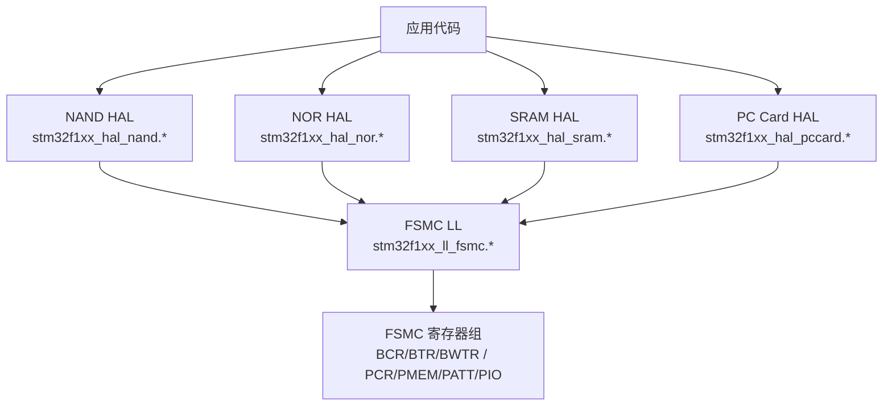

**图示来源**
- [stm32f1xx_ll_fsmc.c:27-55](file://Src/stm32f1xx_ll_fsmc.c#L27-L55)
- [stm32f1xx_hal_nand.c:1-60](file://Src/stm32f1xx_hal_nand.c#L1-L60)
- [stm32f1xx_hal_nor.c:1-60](file://Src/stm32f1xx_hal_nor.c#L1-L60)
- [stm32f1xx_hal_sram.c:1-70](file://Src/stm32f1xx_hal_sram.c#L1-L70)
- [stm32f1xx_hal_pccard.c:1-70](file://Src/stm32f1xx_hal_pccard.c#L1-L70)

**章节来源**
- [stm32f1xx_ll_fsmc.c:27-55](file://Src/stm32f1xx_ll_fsmc.c#L27-L55)

## 核心组件
- **NAND HAL**
  - 句柄包含 FSMC NAND 实例、初始化参数、锁、状态、设备物理信息（页大小、备用区大小、块大小、块数量、平面信息等）。
  - 关键 API：`HAL_NAND_Init`、`HAL_NAND_Read_ID`、`HAL_NAND_Read_Page_8b/16b`、`HAL_NAND_Write_Page_8b/16b`、`HAL_NAND_Erase_Block`、`HAL_NAND_Read_Status`、`HAL_NAND_ECC_Enable/Disable`、`HAL_NAND_GetECC`。
- **NOR HAL**
  - 句柄包含 NORSRAM 实例、扩展模式实例、初始化参数、锁、状态、命令集标志。
  - 关键 API：`HAL_NOR_Init`、`HAL_NOR_Read_ID`、`HAL_NOR_ReturnToReadMode`、`HAL_NOR_Read`、`HAL_NOR_Program`、`HAL_NOR_Erase_Block`、`HAL_NOR_Erase_Chip`、`HAL_NOR_WriteOperation_Enable/Disable`。
- **SRAM HAL**
  - 句柄包含 NORSRAM 实例、扩展模式实例、初始化参数、锁、状态、DMA 句柄指针。
  - 关键 API：`HAL_SRAM_Init`、`HAL_SRAM_Read_8b/16b/32b`、`HAL_SRAM_Write_8b/16b/32b`、`HAL_SRAM_Read_DMA`、`HAL_SRAM_Write_DMA`、写使能/禁用。
- **PC Card HAL**
  - 句柄包含 PCCARD 实例、初始化参数、锁、状态。
  - 关键 API：`HAL_PCCARD_Init`、`HAL_PCCARD_Read_ID`、`HAL_PCCARD_Read_Sector`、`HAL_PCCARD_Write_Sector`、`HAL_PCCARD_Erase_Sector`、`HAL_PCCARD_Reset`、`HAL_PCCARD_IRQHandler`。

**章节来源**
- [stm32f1xx_hal_nand.h:35-190](file://Inc/stm32f1xx_hal_nand.h#L35-L190)
- [stm32f1xx_hal_nor.h:35-170](file://Inc/stm32f1xx_hal_nor.h#L35-L170)
- [stm32f1xx_hal_sram.h:35-180](file://Inc/stm32f1xx_hal_sram.h#L35-L180)
- [stm32f1xx_hal_pccard.h:35-210](file://Inc/stm32f1xx_hal_pccard.h#L35-L210)

## 架构总览
FSMC 是 AHBL 到外部存储协议的桥接器。HAL 层根据介质类型调用不同 API，底层统一通过 `FSMC_NORSRAM_*` 或 `FSMC_NAND_*`、`FSMC_PCCARD_*` 设置控制寄存器与时序寄存器。

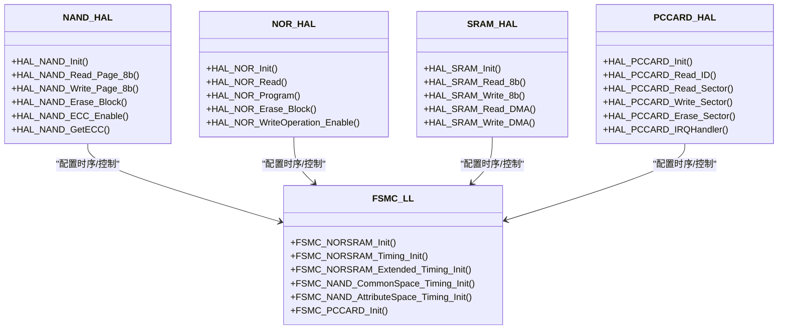

**图示来源**
- [stm32f1xx_ll_fsmc.h:130-210](file://Inc/stm32f1xx_ll_fsmc.h#L130-L210)
- [stm32f1xx_ll_fsmc.c:210-389](file://Src/stm32f1xx_ll_fsmc.c#L210-L389)
- [stm32f1xx_hal_nand.c:100-180](file://Src/stm32f1xx_hal_nand.c#L100-L180)
- [stm32f1xx_hal_nor.c:250-340](file://Src/stm32f1xx_hal_nor.c#L250-L340)
- [stm32f1xx_hal_sram.c:120-220](file://Src/stm32f1xx_hal_sram.c#L120-L220)
- [stm32f1xx_hal_pccard.c:160-240](file://Src/stm32f1xx_hal_pccard.c#L160-L240)

## 详细组件分析

### NAND 外扩存储器
#### 句柄与设备模型
- 句柄包含 FSMC NAND 实例、初始化参数、锁、状态、设备配置。
- 设备配置描述页大小、备用区大小、块大小、块数、平面数和额外命令标志。
- 地址结构以页、平面、块表示。

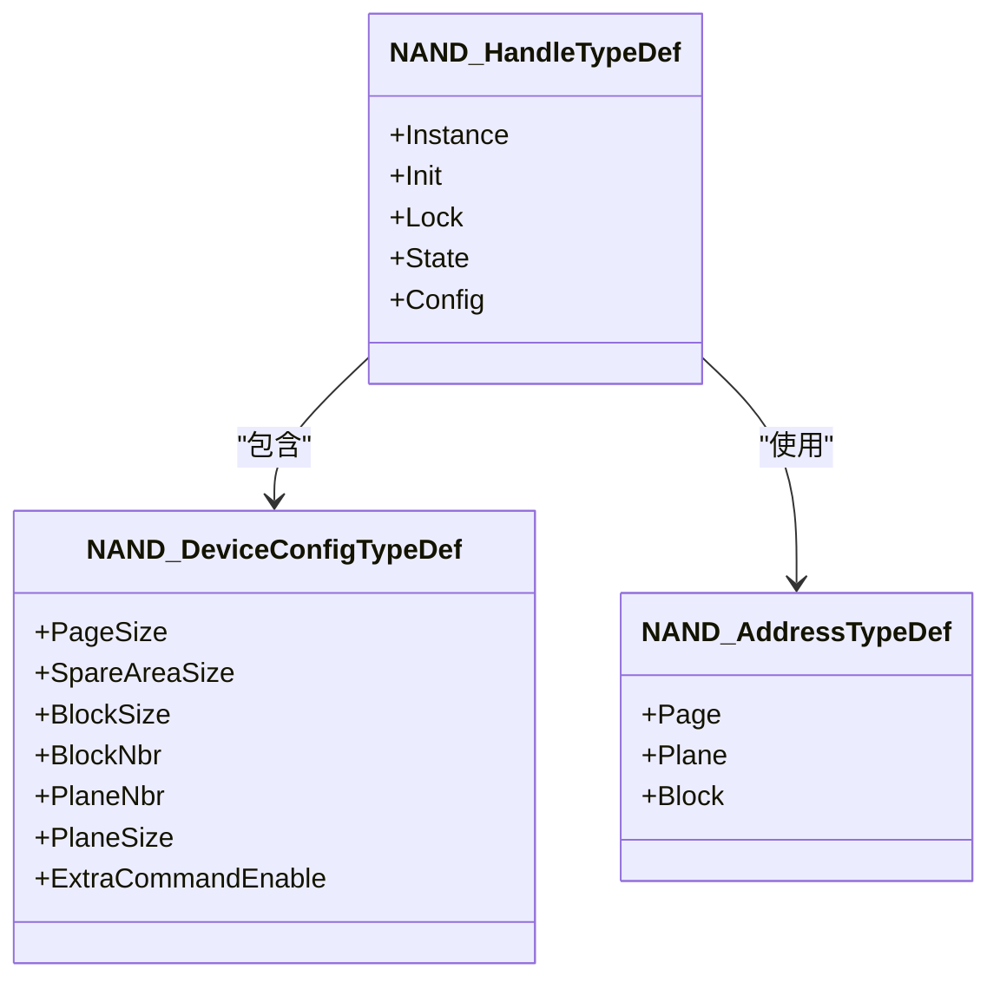

**图示来源**
- [stm32f1xx_hal_nand.h:35-150](file://Inc/stm32f1xx_hal_nand.h#L35-L150)

#### 初始化与片选
- `HAL_NAND_Init` 完成 MSP 初始化、FSMC NAND 控制初始化、公共空间和属性空间时序初始化，并启用设备。
- 公共空间用于命令/地址/数据，属性空间用于元数据，时序分别由 `FSMC_NAND_CommonSpace_Timing_Init` 和 `FSMC_NAND_AttributeSpace_Timing_Init` 配置。

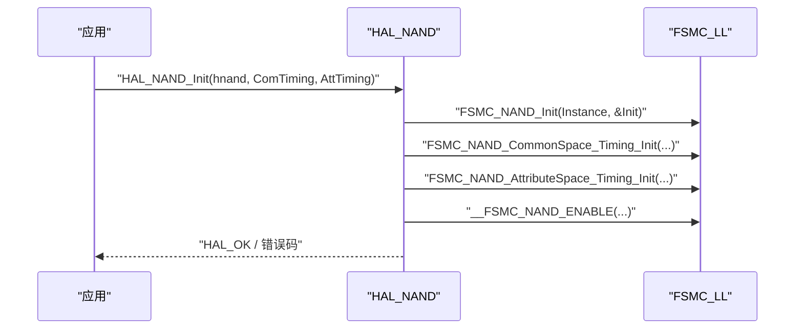

**图示来源**
- [stm32f1xx_hal_nand.c:120-180](file://Src/stm32f1xx_hal_nand.c#L120-L180)

#### 页/块/行/列与读写命令序列
- NAND 以页为基本读写单位，块为擦除单位；地址结构含页、平面、块。
- 读页流程：发送读 ID、区域 A 命令、实际数据读取命令，然后轮询状态直到就绪。
- 写页流程：发送区域 C/A 命令、写入数据、确认写入命令，再轮询状态。
- 擦块流程：发送擦除命令序列，并等待状态就绪。

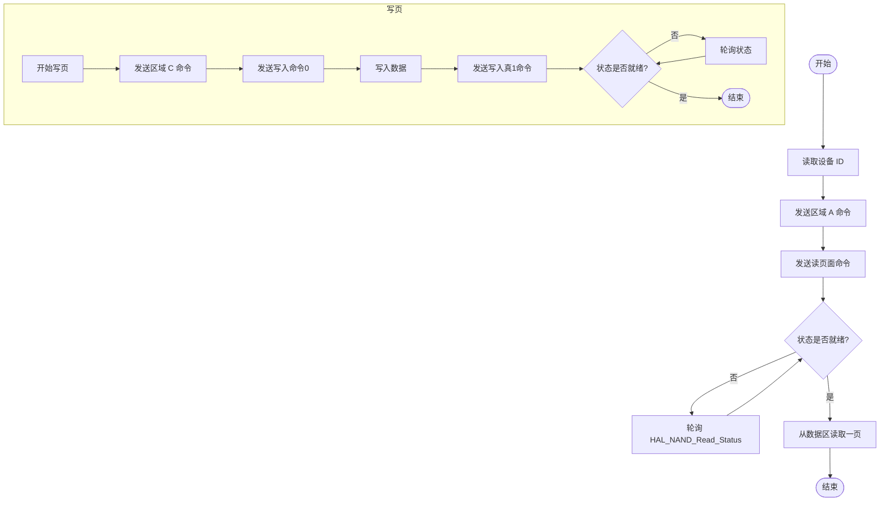

**图示来源**
- [stm32f1xx_hal_nand.c:532-640](file://Src/stm32f1xx_hal_nand.c#L532-L640)
- [stm32f1xx_hal_nand.c:864-980](file://Src/stm32f1xx_hal_nand.c#L864-L980)
- [stm32f1xx_hal_nand.c:1853-1900](file://Src/stm32f1xx_hal_nand.c#L1853-L1900)

#### ECC 支持
- FSMC 支持 NAND 硬件 ECC，页大小可选 256B/512B/1KB/2KB/4KB/8KB。
- HAL 提供 `HAL_NAND_ECC_Enable`、`HAL_NAND_ECC_Disable`、`HAL_NAND_GetECC` 获取 ECC 值。
- 应用层需结合备用区保存 ECC，并在读取时校验与纠错。

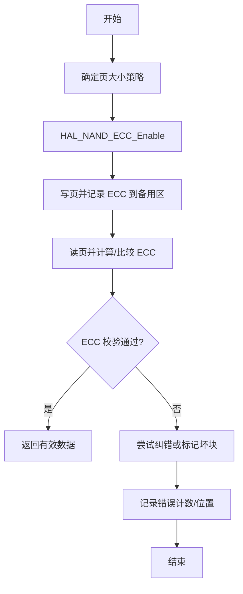

**图示来源**
- [stm32f1xx_ll_fsmc.h:572-586](file://Inc/stm32f1xx_ll_fsmc.h#L572-L586)
- [stm32f1xx_ll_fsmc.h:917-918](file://Inc/stm32f1xx_ll_fsmc.h#L917-L918)
- [stm32f1xx_hal_nand.h:257-260](file://Inc/stm32f1xx_hal_nand.h#L257-L260)
- [stm32f1xx_hal_nand.c:2097-2140](file://Src/stm32f1xx_hal_nand.c#L2097-L2140)

#### 典型用法
- 初始化：构造 `NAND_HandleTypeDef`，填写 `NAND_DeviceConfigTypeDef`，调用 `HAL_NAND_Init`。
- 读页：使用 `HAL_NAND_Read_Page_8b/16b`，传入页/块/平面地址。
- 写页：使用 `HAL_NAND_Write_Page_8b/16b`，配合备用区保存 ECC。
- 擦块：使用 `HAL_NAND_Erase_Block`，按块索引寻址。
- 状态查询：使用 `HAL_NAND_Read_Status` 轮询忙闲。
- 坏块管理建议：维护坏块表，避免分配已坏块；写失败后重试或迁移数据；定期扫描状态位。

**章节来源**
- [stm32f1xx_hal_nand.c:120-180](file://Src/stm32f1xx_hal_nand.c#L120-L180)
- [stm32f1xx_hal_nand.c:532-640](file://Src/stm32f1xx_hal_nand.c#L532-L640)
- [stm32f1xx_hal_nand.c:864-980](file://Src/stm32f1xx_hal_nand.c#L864-L980)
- [stm32f1xx_hal_nand.c:1853-1900](file://Src/stm32f1xx_hal_nand.c#L1853-L1900)
- [stm32f1xx_hal_nand.c:2228-2250](file://Src/stm32f1xx_hal_nand.c#L2228-L2250)

### NOR 外扩存储器
#### 句柄与状态
- NOR 句柄包含 NORSRAM 实例、扩展模式实例、初始化参数、锁、状态、命令集标志。
- 状态包括复位、就绪、忙碌、错误以及写保护。

#### 初始化与直接指针访问
- `HAL_NOR_Init` 配置控制寄存器与时序寄存器，并启用设备。
- NOR 支持内存映射访问，可直接通过指针读写数据缓冲区，适用于启动代码或运行时取指。
- 编程前需进入编程模式，完成后返回读模式。

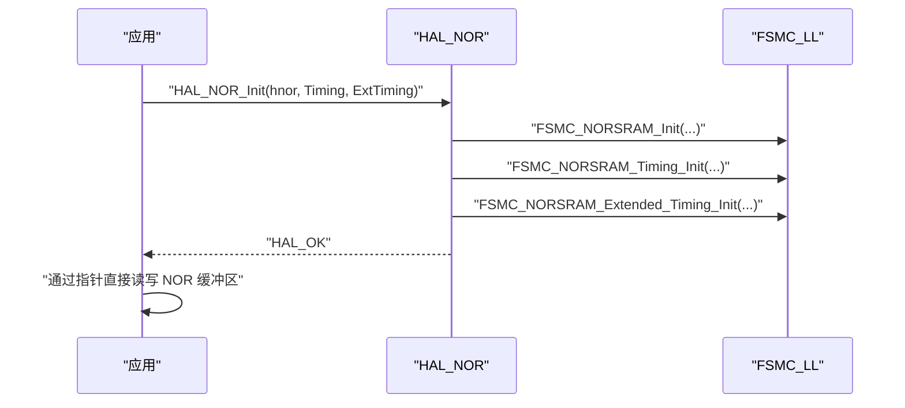

**图示来源**
- [stm32f1xx_hal_nor.c:250-340](file://Src/stm32f1xx_hal_nor.c#L250-L340)

#### 编程与擦除
- `HAL_NOR_Program` 按字编程，内部遵循 JEDEC 命令序列。
- `HAL_NOR_Erase_Block` 按块擦除，需要发送解锁/擦除命令序列并等待状态。
- `HAL_NOR_ReturnToReadMode` 确保设备回到正常读模式。
- 写操作可通过 `HAL_NOR_WriteOperation_Enable/Disable` 控制 FSMC 侧写使能。

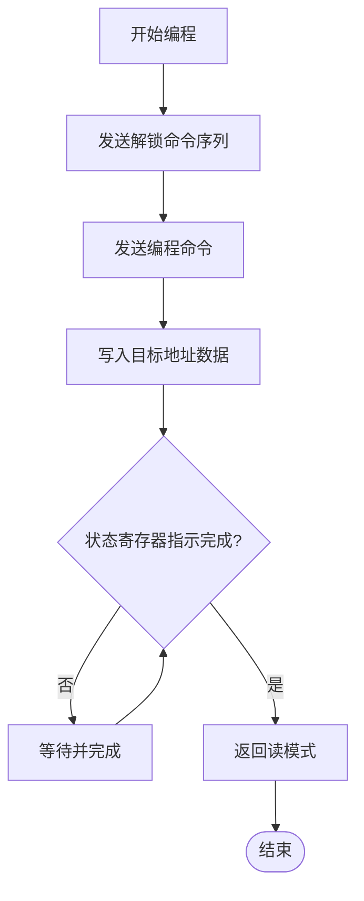

**图示来源**
- [stm32f1xx_hal_nor.c:727-760](file://Src/stm32f1xx_hal_nor.c#L727-L760)
- [stm32f1xx_hal_nor.c:1052-1100](file://Src/stm32f1xx_hal_nor.c#L1052-L1100)
- [stm32f1xx_hal_nor.c:549-580](file://Src/stm32f1xx_hal_nor.c#L549-L580)

#### 典型用法
- 初始化：构造 `NOR_HandleTypeDef`，配置时序，调用 `HAL_NOR_Init`。
- 读：`HAL_NOR_Read` 或直接指针读。
- 写：`HAL_NOR_Program`，注意先解锁、再编程、最后返回读模式。
- 擦除：`HAL_NOR_Erase_Block`，按块号与偏移寻址。
- 写保护：使用 `HAL_NOR_WriteOperation_Enable/Disable` 控制 FSMC 写通道。

**章节来源**
- [stm32f1xx_hal_nor.c:250-340](file://Src/stm32f1xx_hal_nor.c#L250-L340)
- [stm32f1xx_hal_nor.c:549-580](file://Src/stm32f1xx_hal_nor.c#L549-L580)
- [stm32f1xx_hal_nor.c:727-760](file://Src/stm32f1xx_hal_nor.c#L727-L760)
- [stm32f1xx_hal_nor.c:1052-1100](file://Src/stm32f1xx_hal_nor.c#L1052-L1100)
- [stm32f1xx_hal_nor.c:1425-1475](file://Src/stm32f1xx_hal_nor.c#L1425-L1475)

### SRAM 外扩存储器
#### 句柄与 DMA
- SRAM 句柄包含 NORSRAM 实例、扩展模式实例、初始化参数、锁、状态、DMA 句柄指针。
- 支持 8/16/32 位宽度读写，以及 DMA 传输。

#### 初始化与缓冲读写
- `HAL_SRAM_Init` 配置控制寄存器与时序寄存器，禁止突发模式（实现中有显式检查）。
- 提供字节/半字/字级缓冲读写 API。
- DMA 传输通过 `HAL_SRAM_Read_DMA`、`HAL_SRAM_Write_DMA`，内部绑定完成与错误回调。

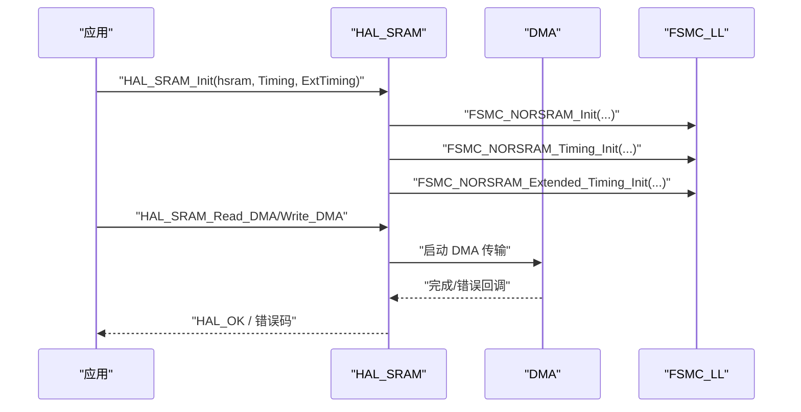

**图示来源**
- [stm32f1xx_hal_sram.c:160-220](file://Src/stm32f1xx_hal_sram.c#L160-L220)
- [stm32f1xx_hal_sram.c:656-730](file://Src/stm32f1xx_hal_sram.c#L656-L730)

#### 典型用法
- 初始化：构造 `SRAM_HandleTypeDef`，配置时序，调用 `HAL_SRAM_Init`。
- 直接访问：通过指针进行 8/16/32 位读写。
- DMA 传输：对大数据块使用 `HAL_SRAM_Read_DMA`、`HAL_SRAM_Write_DMA`，并实现完成与错误回调。
- 写保护：使用写操作使能/禁用 API 控制 FSMC 写通道。

**章节来源**
- [stm32f1xx_hal_sram.c:160-220](file://Src/stm32f1xx_hal_sram.c#L160-L220)
- [stm32f1xx_hal_sram.c:656-730](file://Src/stm32f1xx_hal_sram.c#L656-L730)

### PC Card 外扩存储器
#### 地址空间划分
- PC Card 定义公共空间、属性空间、IO 空间基地址常量，便于按地址访问设备寄存器与数据。
- 初始化需分别配置公共空间、属性空间、IO 空间的时序。

#### 扇区操作与中断
- 提供 CompactFlash ID 读取、扇区读写、扇区擦除、复位、中断处理函数。
- 中断处理函数 `HAL_PCCARD_IRQHandler` 由用户在中断入口调用，进一步分发到 `HAL_PCCARD_ITCallback`。

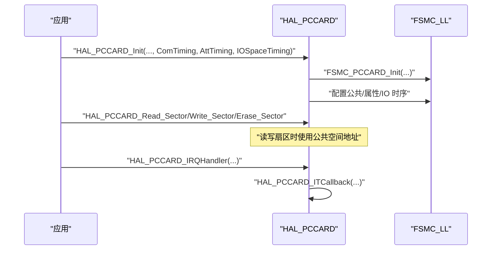

**图示来源**
- [stm32f1xx_hal_pccard.h:230-280](file://Inc/stm32f1xx_hal_pccard.h#L230-L280)
- [stm32f1xx_hal_pccard.c:160-240](file://Src/stm32f1xx_hal_pccard.c#L160-L240)
- [stm32f1xx_hal_pccard.c:309-370](file://Src/stm32f1xx_hal_pccard.c#L309-L370)
- [stm32f1xx_hal_pccard.c:373-560](file://Src/stm32f1xx_hal_pccard.c#L373-L560)
- [stm32f1xx_hal_pccard.c:621-660](file://Src/stm32f1xx_hal_pccard.c#L621-L660)

#### 典型用法
- 初始化：构造 `PCCARD_HandleTypeDef`，填充公共/属性/IO 时序，调用 `HAL_PCCARD_Init`。
- 识别设备：调用 `HAL_PCCARD_Read_ID` 获取 CompactFlash ID。
- 扇区操作：调用 `HAL_PCCARD_Read_Sector`、`HAL_PCCARD_Write_Sector`、`HAL_PCCARD_Erase_Sector`。
- 中断：在 PCCARD 中断服务函数中调用 `HAL_PCCARD_IRQHandler`，并实现 `HAL_PCCARD_ITCallback`。

**章节来源**
- [stm32f1xx_hal_pccard.c:160-240](file://Src/stm32f1xx_hal_pccard.c#L160-L240)
- [stm32f1xx_hal_pccard.c:309-370](file://Src/stm32f1xx_hal_pccard.c#L309-L370)
- [stm32f1xx_hal_pccard.c:373-560](file://Src/stm32f1xx_hal_pccard.c#L373-L560)
- [stm32f1xx_hal_pccard.c:621-660](file://Src/stm32f1xx_hal_pccard.c#L621-L660)

## 依赖关系分析
- HAL 层依赖 FSMC LL 层完成寄存器级配置。
- NAND/PC Card 共用 PCR/PMEM/PATT/PIO 寄存器族；NOR/SRAM 共用 BCR/BTR/BWTR 寄存器族。
- SRAM 可依赖 DMA 外设进行高速数据传输。
- NOR 的编程/擦除依赖于设备命令集，而 FSMC 仅负责总线协议转换。

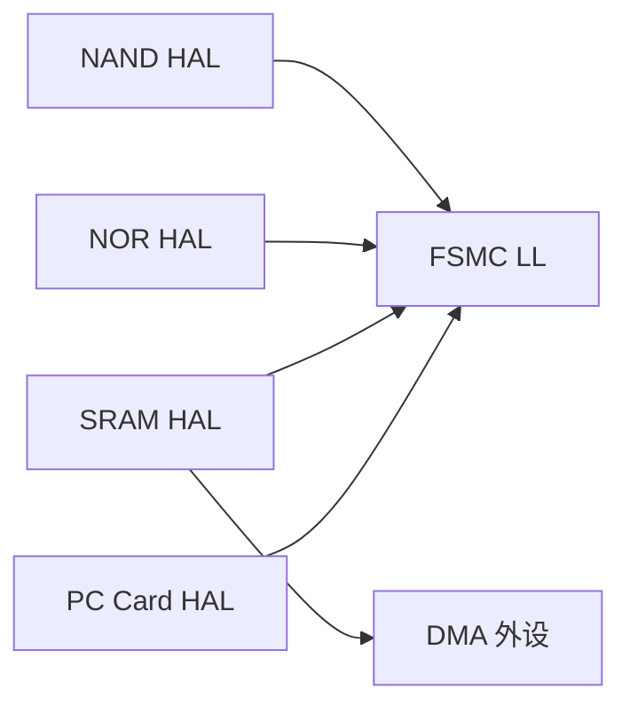

**图示来源**
- [stm32f1xx_ll_fsmc.h:130-210](file://Inc/stm32f1xx_ll_fsmc.h#L130-L210)
- [stm32f1xx_hal_sram.c:656-730](file://Src/stm32f1xx_hal_sram.c#L656-L730)

**章节来源**
- [stm32f1xx_ll_fsmc.c:210-389](file://Src/stm32f1xx_ll_fsmc.c#L210-L389)

## 性能与带宽特性
- **NOR/SRAM**
  - 作为同步/异步静态存储器，FSMC 通过 BCR/BTR/BWTR 控制地址建立时间、数据建立时间、总线周转时间、时钟分频和数据延迟。
  - 适合直接指针访问、取指与随机读写，延迟较低。
- **NAND**
  - 以页为单位批量读写，适合顺序大吞吐；小块随机写效率低。
  - 硬件 ECC 可降低误码率，但需预留备用区空间。
- **PC Card**
  - 通常用于 CompactFlash 等块设备，扇区粒度较高，适合文件系统或分区管理。

选型建议：
- 若需要 CPU 直接取指或小对象随机访问，优先 NOR/SRAM。
- 若需要大容量顺序存储且接受页/块结构，优先 NAND。
- 若目标是 CF 卡等标准 PC Card 设备，使用 PC Card HAL。

[本节为通用指导，不直接分析具体文件]

## 总线、地址空间与时序设计
### FSMC 控制与时序参数
- **NORSRAM（NOR/SRAM）**
  - 控制寄存器 BCR：数据地址复用、存储器类型、数据宽度、突发模式、等待极性、包装模式、写操作、等待信号、扩展模式、异步等待、写突发、页大小。
  - 时序寄存器 BTR：地址建立时间、地址保持时间、数据建立时间、总线周转时间、时钟分频、数据延迟、访问模式。
  - 写时序 BWTR：当启用扩展模式时单独配置写时序。
- **NAND/PC Card**
  - 控制寄存器 PCR：等待功能、片选使能、存储器类型、数据宽度、ECC 使能、TCLR/TAR、ECC 页大小。
  - 时序寄存器 PMEM/PATT/PIO：公共/属性/IO 空间的建立、等待、保持、高阻时间。

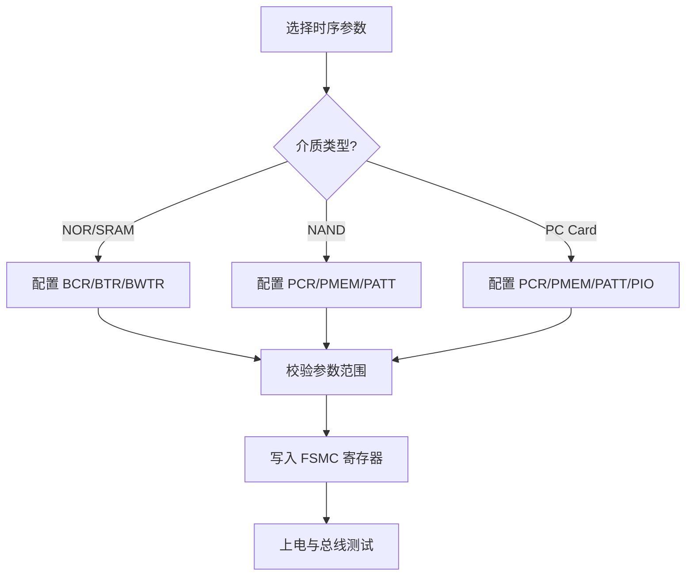

**图示来源**
- [stm32f1xx_ll_fsmc.h:60-120](file://Inc/stm32f1xx_ll_fsmc.h#L60-L120)
- [stm32f1xx_ll_fsmc.h:130-210](file://Inc/stm32f1xx_ll_fsmc.h#L130-L210)
- [stm32f1xx_ll_fsmc.c:210-389](file://Src/stm32f1xx_ll_fsmc.c#L210-L389)

### 上电时序与掉电保护
- 上电应先配置 GPIO、FSMC 时钟，再初始化控制器与时序，最后启用对应 Bank。
- 掉电前应禁用写操作、停止 DMA、关闭 FSMC Bank，避免总线竞争与数据损坏。
- NOR 写保护可通过 `HAL_NOR_WriteOperation_Disable` 防止意外编程。
- SRAM 可通过 `HAL_SRAM_WriteOperation_Disable` 关闭写通道。

### 总线占用与冲突
- FSMC 同一时刻只对一个外部设备进行访问。
- 多 Bank 共享地址/数据/控制线，必须严格划分 Chip Select 与地址范围，避免映射冲突。
- 调试时建议使用逻辑分析仪观察 CS、OE、WE、地址和数据总线波形。

**章节来源**
- [stm32f1xx_ll_fsmc.c:210-389](file://Src/stm32f1xx_ll_fsmc.c#L210-L389)
- [stm32f1xx_hal_nor.c:1425-1475](file://Src/stm32f1xx_hal_nor.c#L1425-L1475)
- [stm32f1xx_hal_sram.h:180-220](file://Inc/stm32f1xx_hal_sram.h#L180-L220)

## 故障诊断与恢复
### 常见错误与定位
- **NAND**
  - 状态轮询超时：检查命令序列是否正确、时序是否满足器件要求。
  - ECC 校验失败：检查页大小配置与备用区布局，必要时重新分配坏块。
- **NOR**
  - 编程失败：检查解锁序列、目标地址对齐、写使能状态。
  - 未返回读模式：确保编程完成后调用返回读模式 API。
- **SRAM**
  - DMA 错误：检查 DMA 通道配置、源/目的地址对齐、长度与权限。
- **PC Card**
  - 扇区读写失败：检查公共空间地址、设备状态、中断是否触发。

### 恢复机制
- NAND：重试写页、迁移数据到健康块、记录坏块列表、上报统计。
- NOR：重试编程、检查写保护状态、回退到安全读模式。
- SRAM：重配 DMA、重试传输、检测内存完整性。
- PC Card：执行复位、重新识别设备、重试扇区操作。

**章节来源**
- [stm32f1xx_hal_nand.c:2228-2250](file://Src/stm32f1xx_hal_nand.c#L2228-L2250)
- [stm32f1xx_hal_nor.c:549-580](file://Src/stm32f1xx_hal_nor.c#L549-L580)
- [stm32f1xx_hal_sram.c:1085-1110](file://Src/stm32f1xx_hal_sram.c#L1085-L1110)
- [stm32f1xx_hal_pccard.c:621-660](file://Src/stm32f1xx_hal_pccard.c#L621-L660)

## 结论
- FSMC HAL 为 NOR/SRAM/NAND/PC Card 提供了统一的初始化、时序配置与访问接口。
- NOR/SRAM 适合直接指针访问和小对象随机读写；NAND 适合页/块结构的顺序大吞吐存储；PC Card 面向标准 CF 等设备。
- 正确选择 FSMC 控制与时序参数是稳定运行的关键；务必区分公共/属性/IO 空间，严格划分片选与地址范围。
- 生产环境应结合 ECC、坏块管理、DMA 与中断，完善错误检测、恢复与日志记录。

[本节为总结性内容，不直接分析具体文件]