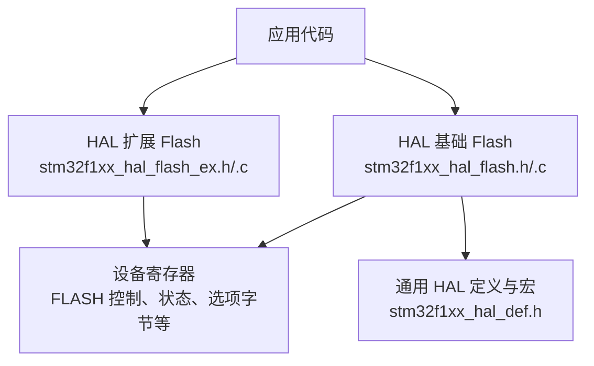
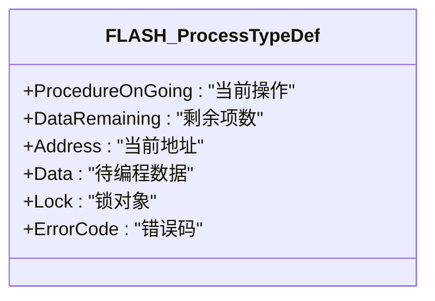
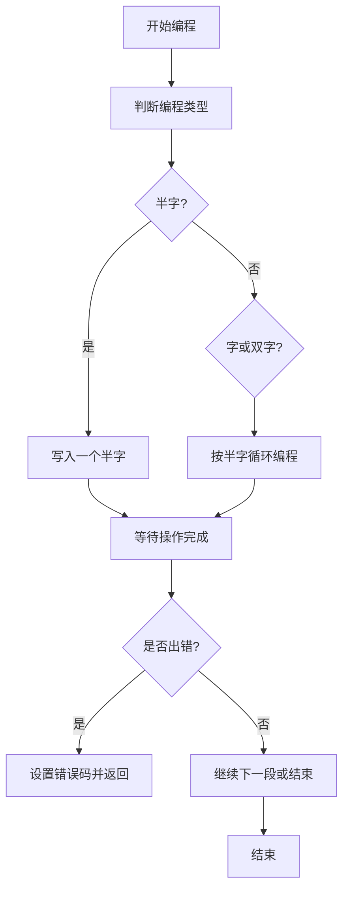
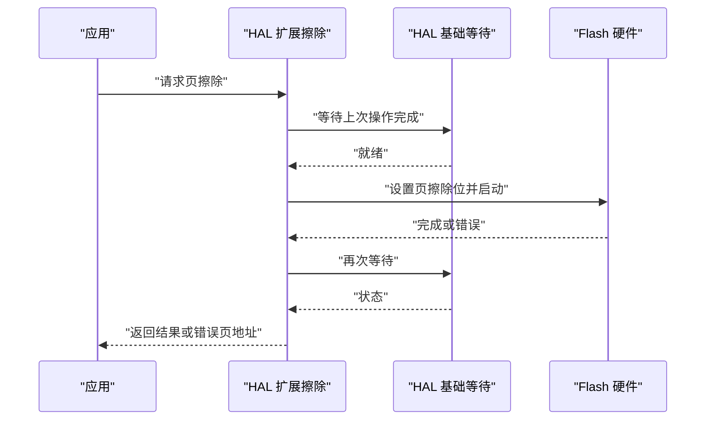
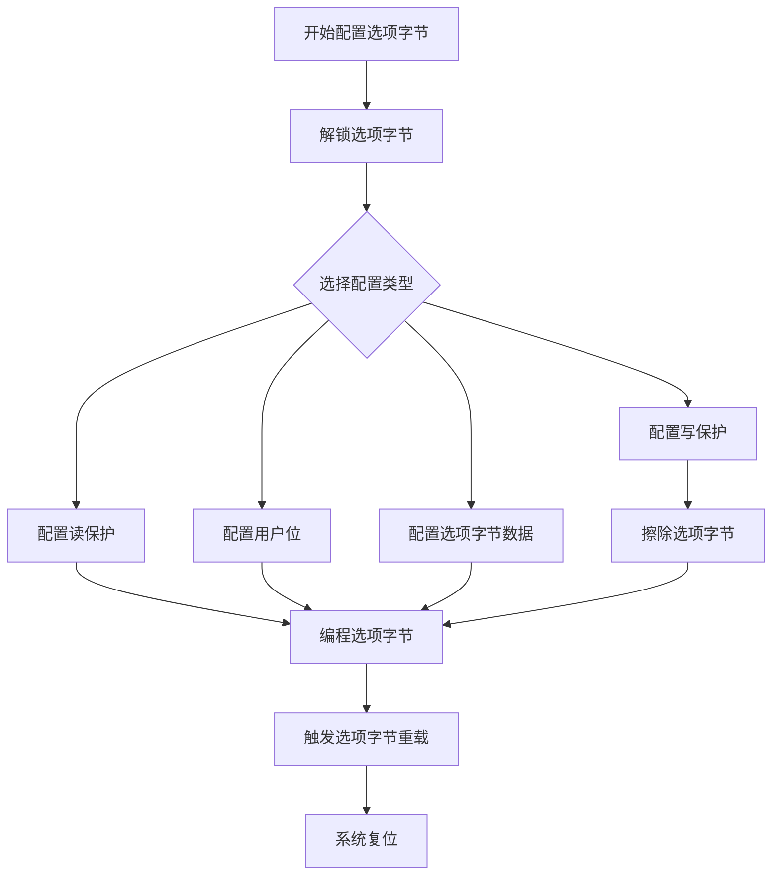
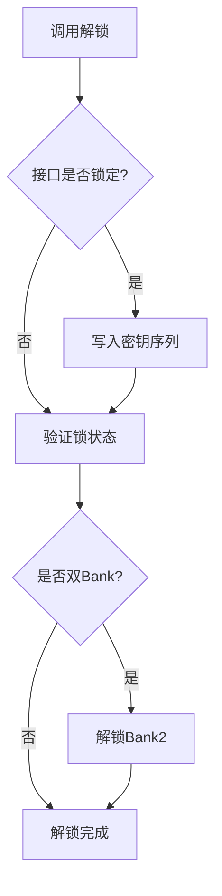
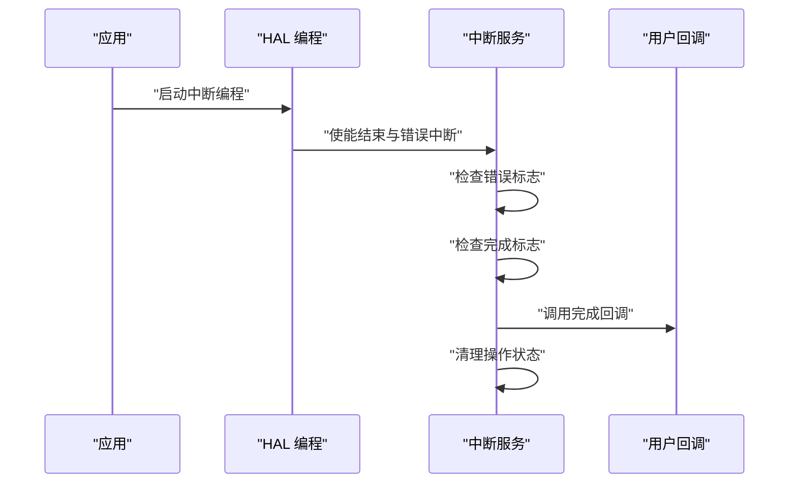

# Flash 存储器

<cite>
**本文引用的文件**   
- [Inc/stm32f1xx_hal_flash.h](file://Inc/stm32f1xx_hal_flash.h)
- [Src/stm32f1xx_hal_flash.c](file://Src/stm32f1xx_hal_flash.c)
- [Inc/stm32f1xx_hal_flash_ex.h](file://Inc/stm32f1xx_hal_flash_ex.h)
- [Src/stm32f1xx_hal_flash_ex.c](file://Src/stm32f1xx_hal_flash_ex.c)
- [README.md](file://README.md)
</cite>

## 目录
1. [简介](#简介)
2. [项目结构与定位](#项目结构与定位)
3. [Flash HAL API 总览](#flash-hal-api-总览)
4. [架构与地址映射](#架构与地址映射)
5. [核心组件分析](#核心组件分析)
6. [详细操作流程](#详细操作流程)
7. [典型应用场景](#典型应用场景)
8. [依赖关系分析](#依赖关系分析)
9. [性能、功耗与可靠性](#性能功耗与可靠性)
10. [故障诊断指南](#故障诊断指南)
11. [结论](#结论)

## 简介
本文围绕 STM32F1xx HAL 的 Flash 存储器子系统，系统化说明 `stm32f1xx_hal_flash` 与 `stm32f1xx_hal_flash_ex` 暴露的 API，并结合 STM32F1 系列 Flash 的硬件特性解释编程模型。文档重点覆盖：

- 页擦除与整片擦除。
- 半字、字、双字编程。
- 选项字节读取、修改、写保护与读保护。
- Flash 接口解锁/上锁、选项字节区解锁/上锁。
- 中断标志查询、忙等待、错误码处理。
- 程序存储器与数据存储器的地址映射、页大小、块/扇区组织、等待状态、预取与半周期访问。
- 固件升级双区备份、参数持久化、启动扇区保护、运行时数据写入与回滚策略。
- Flash 磨损、可靠性、功耗、延迟、总线带宽优化。
- 常见故障的诊断方法。

本仓库是 STM32CubeF1 HAL 驱动组件的一部分，提供可移植的 Flash HAL/LL 抽象层，供应用代码调用以访问内部 Flash。

**章节来源**
- [README.md:1-45](file://README.md#L1-L45)

## 项目结构与定位
Flash 相关代码由头文件与实现文件组成：

- 基础 Flash HAL：`Inc/stm32f1xx_hal_flash.h`、`Src/stm32f1xx_hal_flash.c`。
- 扩展 Flash HAL：`Inc/stm32f1xx_hal_flash_ex.h`、`Src/stm32f1xx_hal_flash_ex.c`。
- 基础 Flash 头文件包含扩展 Flash 头文件，从而统一对外暴露 API。

**图示来源**
- [Inc/stm32f1xx_hal_flash.h:201-325](file://Inc/stm32f1xx_hal_flash.h#L201-L325)
- [Src/stm32f1xx_hal_flash.c:1-200](file://Src/stm32f1xx_hal_flash.c#L1-L200)
- [Inc/stm32f1xx_hal_flash_ex.h:1-200](file://Inc/stm32f1xx_hal_flash_ex.h#L1-L200)
- [Src/stm32f1xx_hal_flash_ex.c:1-200](file://Src/stm32f1xx_hal_flash_ex.c#L1-L200)

**章节来源**
- [Inc/stm32f1xx_hal_flash.h:201-325](file://Inc/stm32f1xx_hal_flash.h#L201-L325)
- [Src/stm32f1xx_hal_flash.c:1-200](file://Src/stm32f1xx_hal_flash.c#L1-L200)
- [Inc/stm32f1xx_hal_flash_ex.h:1-200](file://Inc/stm32f1xx_hal_flash_ex.h#L1-L200)
- [Src/stm32f1xx_hal_flash_ex.c:1-200](file://Src/stm32f1xx_hal_flash_ex.c#L1-L200)

## Flash HAL API 总览
STM32F1 Flash HAL 将功能划分为三类：

1. **编程操作函数**
   - `HAL_FLASH_Program`：同步半字/字/双字编程。
   - `HAL_FLASH_Program_IT`：异步编程，通过中断完成。
   - `HAL_FLASH_IRQHandler`：Flash 中断服务函数。
   - `HAL_FLASH_EndOfOperationCallback`：操作成功回调。
   - `HAL_FLASH_OperationErrorCallback`：操作错误回调。

2. **外设控制函数**
   - `HAL_FLASH_Unlock`：解锁 Flash 接口。
   - `HAL_FLASH_Lock`：上锁 Flash 接口。
   - `HAL_FLASH_OB_Unlock`：解锁选项字节区。
   - `HAL_FLASH_OB_Lock`：上锁选项字节区。
   - `HAL_FLASH_OB_Launch`：触发选项字节重载并复位系统。

3. **状态与错误函数**
   - `HAL_FLASH_GetError`：获取最近一次操作的错误码。

扩展 Flash HAL 提供：

- `HAL_FLASHEx_Erase`：页擦除或整片擦除。
- `HAL_FLASHEx_Erase_IT`：中断方式擦除。
- `HAL_FLASHEx_OBErase`：擦除选项字节。
- `HAL_FLASHEx_OBProgram`：配置写保护、读保护、用户位、选项字节数据。
- `HAL_FLASHEx_OBGetConfig`：读取当前选项字节配置。
- `HAL_FLASHEx_OBGetUserData`：读取选项字节中的用户数据。

这些 API 共同构成 Flash 编程、擦除、保护、选项字节管理以及中断驱动的完整工具集。

**章节来源**
- [Inc/stm32f1xx_hal_flash.h:201-325](file://Inc/stm32f1xx_hal_flash.h#L201-L325)
- [Src/stm32f1xx_hal_flash.c:200-964](file://Src/stm32f1xx_hal_flash.c#L200-L964)
- [Inc/stm32f1xx_hal_flash_ex.h:201-783](file://Inc/stm32f1xx_hal_flash_ex.h#L201-L783)
- [Src/stm32f1xx_hal_flash_ex.c:200-1121](file://Src/stm32f1xx_hal_flash_ex.c#L200-L1121)

## 架构与地址映射
### 程序存储器与数据存储器
STM32F1 的内部 Flash 作为程序存储器使用，通常从 `0x08000000` 开始。HAL 通过 `FLASH_BASE` 和按密度派生的上限宏进行地址校验，确保写入地址位于合法 Flash 区域。对于部分高密度、XL 密度或互联型器件，存在双 Bank 模型；单 Bank 器件仅支持 Bank 1。

- 低密度和中密度器件通常有较小的 Flash 容量。
- 高密度、XL 密度和互联型器件可能具有更大的 Flash 空间，并可能分为两个 Bank。
- 设备实际 Flash 大小可通过固定地址处的信息读取，HAL 中用于页范围检查。

### 页大小与块/扇区组织
- 低密度和部分中密度设备的页大小为 512 字节。
- 高密度、XL 密度和互联型设备的页大小为 1024 字节。
- 页擦除以页为单位进行，不能对任意字节或部分页执行擦除。
- 编程最小单位为半字（16 位），但 HAL 支持按半字、字（32 位）或双字（64 位）批量编程。

### 等待状态、预取与半周期访问
- Flash 访问延迟可通过 `__HAL_FLASH_SET_LATENCY` 设置，具体值取决于 CPU 时钟频率。
- 预取缓冲器可通过 `__HAL_FLASH_PREFETCH_BUFFER_ENABLE` 启用，提高指令读取效率。
- 半周期访问模式仅在低频时钟下可用，HAL 提供了启用与禁用宏。

### VDD 工作范围与掉电安全要求
- Flash 编程和擦除对电源稳定性敏感。若电压不足或掉电，可能导致编程失败、选项字节损坏或写保护失效。
- 建议在执行 Flash 编程前确认系统电源稳定，并在关键操作中避免在掉电临界点中断。
- 固件升级时，应在写入完成后进行校验，再切换引导入口，以减少掉电导致的不一致状态。

**章节来源**
- [Inc/stm32f1xx_hal_flash_ex.h:201-529](file://Inc/stm32f1xx_hal_flash_ex.h#L201-L529)
- [Inc/stm32f1xx_hal_flash.h:1-200](file://Inc/stm32f1xx_hal_flash.h#L1-L200)

## 核心组件分析
### Flash 进程上下文
Flash HAL 使用一个全局进程结构体记录当前正在进行的操作，包括：

- 当前操作类型：无操作、页擦除、整片擦除、半字编程、字编程、双字编程。
- 剩余待处理项：例如剩余页数或剩余半字数量。
- 当前地址：用于跟踪页擦除或编程进度。
- 待编程数据：用于中断式多段编程。
- 锁对象：防止并发冲突。
- 错误码：保存最后一次 Flash 错误。

**图示来源**
- [Inc/stm32f1xx_hal_flash.h:1-200](file://Inc/stm32f1xx_hal_flash.h#L1-L200)

**章节来源**
- [Inc/stm32f1xx_hal_flash.h:1-200](file://Inc/stm32f1xx_hal_flash.h#L1-L200)

### 编程模型
- 同步编程：调用 `HAL_FLASH_Program`，内部循环按半字写入，每写一次都等待操作完成并清除编程位。
- 中断编程：调用 `HAL_FLASH_Program_IT`，开启结束与错误中断，在中断服务函数中继续写入下一个半字，直到全部完成。
- 底层半字编程：`FLASH_Program_HalfWord` 根据地址所属 Bank 设置对应编程位并写入目标地址。

**图示来源**
- [Src/stm32f1xx_hal_flash.c:200-600](file://Src/stm32f1xx_hal_flash.c#L200-L600)
- [Src/stm32f1xx_hal_flash.c:600-964](file://Src/stm32f1xx_hal_flash.c#L600-L964)

**章节来源**
- [Src/stm32f1xx_hal_flash.c:200-600](file://Src/stm32f1xx_hal_flash.c#L200-L600)
- [Src/stm32f1xx_hal_flash.c:600-964](file://Src/stm32f1xx_hal_flash.c#L600-L964)

### 擦除模型
- 页擦除：指定起始页地址和页数，逐页调用页擦除函数。
- 整片擦除：选择 Bank 或同时擦除多个 Bank，置位擦除位并启动擦除。
- 中断擦除：记录待擦除页数和地址，在中断中继续擦下一页，直至完成。

**图示来源**
- [Src/stm32f1xx_hal_flash_ex.c:200-700](file://Src/stm32f1xx_hal_flash_ex.c#L200-L700)

**章节来源**
- [Src/stm32f1xx_hal_flash_ex.c:200-700](file://Src/stm32f1xx_hal_flash_ex.c#L200-L700)

### 选项字节模型
选项字节用于配置：

- 写保护页掩码。
- 读保护级别。
- 用户配置位：独立看门狗、STOP/STDBY 复位行为，部分型号支持 BOOT1。
- 选项字节数据区：两个 8 位数据位置，可用于保存少量参数。

**图示来源**
- [Src/stm32f1xx_hal_flash_ex.c:700-1121](file://Src/stm32f1xx_hal_flash_ex.c#L700-L1121)

**章节来源**
- [Src/stm32f1xx_hal_flash_ex.c:700-1121](file://Src/stm32f1xx_hal_flash_ex.c#L700-L1121)

## 详细操作流程
### 解锁与上锁流程
- `HAL_FLASH_Unlock`：先检查锁位，若已锁定则依次写入密钥寄存器，然后验证解锁成功；对双 Bank 器件还会解锁 Bank 2。
- `HAL_FLASH_Lock`：设置锁位，禁止后续 Flash 编程和擦除。
- `HAL_FLASH_OB_Unlock`：检查选项字节写使能位，若未使能则写入选项密钥序列。
- `HAL_FLASH_OB_Lock`：清除选项字节写使能位。

**图示来源**
- [Src/stm32f1xx_hal_flash.c:600-964](file://Src/stm32f1xx_hal_flash.c#L600-L964)

**章节来源**
- [Src/stm32f1xx_hal_flash.c:600-964](file://Src/stm32f1xx_hal_flash.c#L600-L964)

### 页擦除与整片擦除
- 页擦除：校验起始页和页数范围，逐页调用 `FLASH_PageErase`，每次擦除后等待完成并清除页擦除位。
- 整片擦除：根据 Bank 设置主擦除位并启动；双 Bank 情况下可同时设置两个 Bank 的擦除位。
- 错误处理：如果某页擦除失败，返回错误页地址，便于上层定位问题。

**章节来源**
- [Src/stm32f1xx_hal_flash_ex.c:200-700](file://Src/stm32f1xx_hal_flash_ex.c#L200-L700)

### 编程与中断处理
- 同步编程：根据编程类型决定迭代次数，逐个半字写入，每步等待完成。
- 中断编程：初始化操作状态、剩余数量和当前地址，开启结束与错误中断；中断中继续写入下一个半字，直到完成并回调用户函数。
- 错误中断：检测到写保护错误或编程错误时，保存错误地址、设置错误码并停止当前操作。

**图示来源**
- [Src/stm32f1xx_hal_flash.c:200-600](file://Src/stm32f1xx_hal_flash.c#L200-L600)

**章节来源**
- [Src/stm32f1xx_hal_flash.c:200-600](file://Src/stm32f1xx_hal_flash.c#L200-L600)

### 选项字节读取与修改
- 读取：`HAL_FLASHEx_OBGetConfig` 获取写保护掩码、读保护级别和用户位；`HAL_FLASHEx_OBGetUserData` 读取两个选项字节数据。
- 修改：`HAL_FLASHEx_OBProgram` 根据选项类型分别调用写保护、读保护、用户位或选项字节数据编程函数。
- 加载：`HAL_FLASH_OB_Launch` 触发系统复位以重新加载选项字节。

**章节来源**
- [Src/stm32f1xx_hal_flash_ex.c:700-1121](file://Src/stm32f1xx_hal_flash_ex.c#L700-L1121)

## 典型应用场景
### 固件升级中的双区备份
- 将主固件与应用数据放在一个分区，将备用固件放在另一个分区。
- 升级时先擦除备用分区，再逐页写入新固件。
- 写入后进行完整性校验，校验成功后更新选项字节或标志位，并触发重启。
- 若启动时检测备用固件有效，则切换到备用分区运行；否则回滚到原分区。

注意事项：
- 避免在升级过程中断电，建议在关键步骤加入状态标记和恢复逻辑。
- 使用页擦除 API 时注意页边界对齐。
- 使用选项字节数据区保存升级状态时，应保证幂等性。

**章节来源**
- [Src/stm32f1xx_hal_flash_ex.c:200-700](file://Src/stm32f1xx_hal_flash_ex.c#L200-L700)
- [Src/stm32f1xx_hal_flash_ex.c:700-1121](file://Src/stm32f1xx_hal_flash_ex.c#L700-L1121)

### 参数区持久化
- 为产品参数分配固定页，参数结构体按半字或字对齐存放。
- 修改参数前先校验新值，再擦除对应页，最后写入新值。
- 使用选项字节数据区保存小体积元数据，例如版本号和校验和。
- 启动时读取参数区并进行一致性检查，必要时恢复默认值。

**章节来源**
- [Src/stm32f1xx_hal_flash_ex.c:700-1121](file://Src/stm32f1xx_hal_flash_ex.c#L700-L1121)

### 启动扇区保护
- 将引导程序和关键启动代码放在前若干页，并通过选项字节对这些页启用写保护。
- 防止运行时意外改写启动代码，提升系统安全性。
- 若需要更新引导程序，应先解除写保护，擦除并重新编程，再恢复写保护。

**章节来源**
- [Src/stm32f1xx_hal_flash_ex.c:700-1121](file://Src/stm32f1xx_hal_flash_ex.c#L700-L1121)

### 运行时数据写入与回滚策略
- 使用环形缓冲区或双缓冲结构存储运行时日志或临时数据。
- 当一页写满后，切换到下一页，保留旧页以便回滚。
- 若写入失败或校验失败，启动时识别无效数据并恢复到上一有效版本。
- 对于关键状态，建议结合 CRC 或版本号进行一致性判断。

**章节来源**
- [Src/stm32f1xx_hal_flash_ex.c:200-700](file://Src/stm32f1xx_hal_flash_ex.c#L200-L700)

## 依赖关系分析
### 模块依赖
- 基础 Flash HAL 依赖 HAL 通用定义、设备寄存器宏和中断宏。
- 扩展 Flash HAL 依赖基础 Flash HAL 提供的等待函数、错误码和处理进程上下文。
- 两者均依赖设备特定的 Flash 寄存器定义，如控制寄存器、状态寄存器、选项字节寄存器等。

**图示来源**
- [Inc/stm32f1xx_hal_flash.h:201-325](file://Inc/stm32f1xx_hal_flash.h#L201-L325)
- [Src/stm32f1xx_hal_flash.c:1-200](file://Src/stm32f1xx_hal_flash.c#L1-L200)
- [Inc/stm32f1xx_hal_flash_ex.h:1-200](file://Inc/stm32f1xx_hal_flash_ex.h#L1-L200)
- [Src/stm32f1xx_hal_flash_ex.c:1-200](file://Src/stm32f1xx_hal_flash_ex.c#L1-L200)

**章节来源**
- [Inc/stm32f1xx_hal_flash.h:201-325](file://Inc/stm32f1xx_hal_flash.h#L201-L325)
- [Src/stm32f1xx_hal_flash.c:1-200](file://Src/stm32f1xx_hal_flash.c#L1-L200)
- [Inc/stm32f1xx_hal_flash_ex.h:1-200](file://Inc/stm32f1xx_hal_flash_ex.h#L1-L200)
- [Src/stm32f1xx_hal_flash_ex.c:1-200](file://Src/stm32f1xx_hal_flash_ex.c#L1-L200)

### 潜在循环依赖
- 基础 Flash 头文件包含扩展 Flash 头文件，但扩展 Flash 不反向包含基础 Flash 头文件，因此不存在头文件循环依赖。
- 实现文件中，扩展 Flash 通过外部引用基础 Flash 的全局进程结构体，属于单向依赖。

**章节来源**
- [Inc/stm32f1xx_hal_flash.h:201-325](file://Inc/stm32f1xx_hal_flash.h#L201-L325)
- [Src/stm32f1xx_hal_flash_ex.c:1-200](file://Src/stm32f1xx_hal_flash_ex.c#L1-L200)

## 性能、功耗与可靠性
### 编程与擦除延迟
- Flash 编程和擦除是相对慢的操作，HAL 使用超时等待机制避免无限阻塞。
- 同步 API 会阻塞调用线程；中断 API 适合在实时系统中减少阻塞时间。
- 批量编程比逐字节编程更高效，推荐使用字或双字模式减少总线访问次数。

### 总线带宽与预取
- 启用预取缓冲器可提高指令读取吞吐，降低 Flash 读取延迟。
- 半周期访问可降低 Flash 读取延迟，但受限于低频时钟，不适合高频运行场景。
- 在高负载任务中，应避免频繁触发 Flash 编程或擦除，以免占用总线带宽。

### Flash 磨损与可靠性
- Flash 单元有有限的擦写寿命，应避免对同一页频繁擦写。
- 建议采用磨损均衡策略，如环形缓冲、分页轮换、参数区双份备份。
- 写入前进行校验，写入后进行 CRC 或哈希验证，确保数据一致性。

### 功耗考虑
- Flash 编程和擦除会增加瞬时电流，尤其在电源不稳定时风险更高。
- 低功耗设计中，应尽量合并 Flash 写操作，减少唤醒次数和持续时间。
- 在待机或停机模式下，避免执行 Flash 编程。

**章节来源**
- [Src/stm32f1xx_hal_flash.c:200-964](file://Src/stm32f1xx_hal_flash.c#L200-L964)
- [Inc/stm32f1xx_hal_flash.h:1-200](file://Inc/stm32f1xx_hal_flash.h#L1-L200)

## 故障诊断指南
### 未解锁
- 现象：编程或擦除立即失败。
- 原因：未调用 `HAL_FLASH_Unlock` 或解锁失败。
- 排查：检查返回值，确认锁位是否被正确清除；注意双 Bank 器件需同时解锁 Bank 2。

**章节来源**
- [Src/stm32f1xx_hal_flash.c:600-964](file://Src/stm32f1xx_hal_flash.c#L600-L964)

### 写保护冲突
- 现象：返回写保护错误，或无法擦除/编程目标页。
- 原因：目标页被选项字节写保护屏蔽。
- 排查：使用 `HAL_FLASHEx_OBGetConfig` 读取写保护掩码，确认目标页未被保护；如需修改，先解除写保护。

**章节来源**
- [Src/stm32f1xx_hal_flash_ex.c:700-1121](file://Src/stm32f1xx_hal_flash_ex.c#L700-L1121)

### 电压不足或掉电
- 现象：编程中途失败，选项字节损坏，或系统异常。
- 原因：VDD 波动、掉电、电源设计不足。
- 排查：增加去耦电容、监控电源状态、在关键操作前后添加电压检查和重试逻辑。

### 校验失败
- 现象：启动时检测到固件或参数不一致。
- 原因：写入不完整、Flash 损坏、回滚标志未更新。
- 排查：比较 CRC、版本号、签名；检查是否有中间状态；实现回滚路径并记录错误地址。

**章节来源**
- [Src/stm32f1xx_hal_flash_ex.c:200-700](file://Src/stm32f1xx_hal_flash_ex.c#L200-L700)
- [Src/stm32f1xx_hal_flash_ex.c:700-1121](file://Src/stm32f1xx_hal_flash_ex.c#L700-L1121)

### 错误码与标志
- 错误码包括：无错误、编程错误、写保护错误、选项字节有效性错误。
- 标志包括：忙标志、编程错误标志、写保护错误标志、操作完成标志。
- 中断模式下，错误回调返回错误地址，帮助快速定位问题页或编程位置。

**章节来源**
- [Inc/stm32f1xx_hal_flash.h:1-200](file://Inc/stm32f1xx_hal_flash.h#L1-L200)
- [Src/stm32f1xx_hal_flash.c:200-600](file://Src/stm32f1xx_hal_flash.c#L200-L600)

## 结论
STM32F1xx HAL 的 Flash 子系统通过基础 API 和扩展 API 提供了完整的内部 Flash 管理能力。开发者应理解页擦除、半字/字/双字编程、选项字节配置、解锁/上锁、中断处理和错误码机制，并结合 STM32F1 的 Flash 架构特性设计可靠的应用方案。在实际工程中，尤其要注意地址对齐、页边界、写保护、电源稳定性、Flash 磨损和数据一致性。通过合理的分区设计、回滚策略和故障诊断手段，可以在固件升级、参数持久化和启动保护等场景中实现高可靠性的嵌入式 Flash 使用方式。