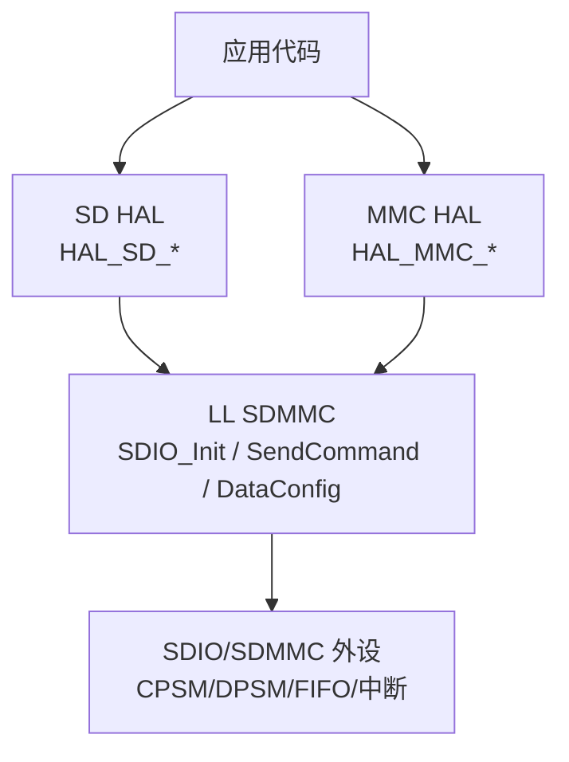
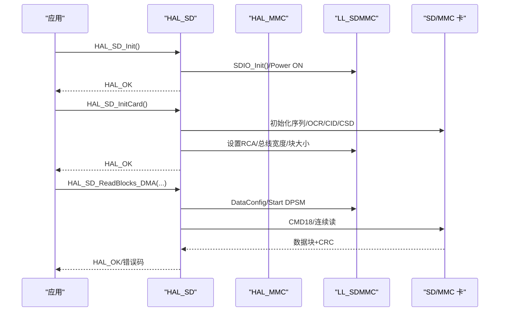
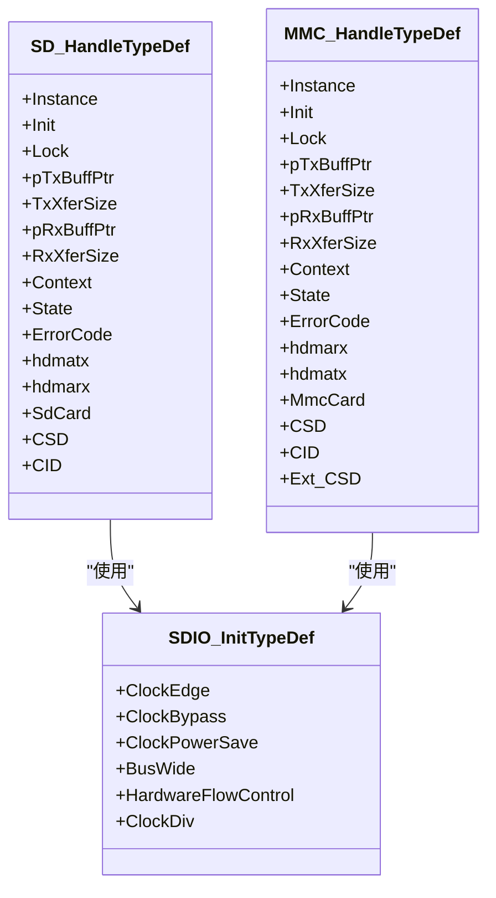

# SD/MMC 卡接口

<cite>
**本文引用的文件**   
- [stm32f1xx_hal_sd.h](file://Inc/stm32f1xx_hal_sd.h)
- [stm32f1xx_hal_sd.c](file://Src/stm32f1xx_hal_sd.c)
- [stm32f1xx_hal_mmc.h](file://Inc/stm32f1xx_hal_mmc.h)
- [stm32f1xx_hal_mmc.c](file://Src/stm32f1xx_hal_mmc.c)
- [stm32f1xx_ll_sdmmc.h](file://Inc/stm32f1xx_ll_sdmmc.h)
- [stm32f1xx_ll_sdmmc.c](file://Src/stm32f1xx_ll_sdmmc.c)
</cite>

## 目录
1. [引言](#引言)
2. [项目结构与驱动分层](#项目结构与驱动分层)
3. [核心组件与数据结构](#核心组件与数据结构)
4. [架构总览](#架构总览)
5. [SD 卡驱动详解](#sd-卡驱动详解)
6. [MMC 卡驱动详解](#mmc-卡驱动详解)
7. [SD 与 MMC 的关键差异](#sd-与-mmc-的关键差异)
8. [总线频率、时钟、电源域与信号完整性](#总线频率时钟电源域与信号完整性)
9. [典型操作示例流程](#典型操作示例流程)
10. [依赖关系分析](#依赖关系分析)
11. [性能与大数据传输](#性能与大数据传输)
12. [错误码、忙状态与故障排查](#错误码忙状态与故障排查)
13. [结论](#结论)

## 引言
本文件围绕 STM32F1xx HAL 中的 SD/MMC 驱动，系统说明 `stm32f1xx_hal_sd.[h,c]` 与 `stm32f1xx_hal_mmc.[h,c]` 的职责边界、初始化流程、命令与数据通路、DMA/中断机制、状态机生命周期、错误处理，以及 SD 卡与 MMC 卡在协议、容量类型、寻址方式和适用场景上的区别。文档同时给出面向工程实践的约束与建议：SDMMC 时钟分频、总线宽度、大文件吞吐、写保护、掉电安全、卡移除检测、CRC 错误恢复和常见问题定位方法。

## 项目结构与驱动分层
STM32F1xx 的 SD/MMC 软件栈分为三层：
- 应用层：调用 `HAL_SD_*` 或 `HAL_MMC_*` API。
- HAL 设备驱动层：封装 SD/MMC 协议、状态机、超时、错误码、CSD/CID/Ext_CSD 解析等。
- 低层硬件抽象层：直接操作 SDIO/SDMMC 寄存器、命令路径状态机 CPSM、数据路径状态机 DPSM、FIFO、DMA 请求与中断标志。

**图表来源**  
- [stm32f1xx_hal_sd.c:335-467](file://Src/stm32f1xx_hal_sd.c#L335-L467)
- [stm32f1xx_hal_mmc.c:352-502](file://Src/stm32f1xx_hal_mmc.c#L352-L502)
- [stm32f1xx_ll_sdmmc.h:1030-1099](file://Inc/stm32f1xx_ll_sdmmc.h#L1030-L1099)

**章节来源**  
- [stm32f1xx_ll_sdmmc.c:1-120](file://Src/stm32f1xx_ll_sdmmc.c#L1-L120)

## 核心组件与数据结构
### SD 句柄与卡信息
- `SD_HandleTypeDef`：保存实例指针、初始化参数、发送/接收缓冲区指针、待传字节数、上下文、状态、错误码、DMA 句柄、CID/CSD 缓存、`HAL_SD_CardInfoTypeDef`。
- `HAL_SD_CardInfoTypeDef`：包含卡类型、版本、类、相对卡地址、物理块数、块大小、逻辑块数、逻辑块大小等字段。

### MMC 句柄与卡信息
- `MMC_HandleTypeDef`：结构语义与 SD 类似，但额外包含 `Ext_CSD[128]`，用于 MMC eMMC 扩展 CSD。
- `HAL_MMC_CardInfoTypeDef`：包含卡类型、类、相对卡地址、物理块数、块大小、逻辑块数、逻辑块大小等字段。

两者均将底层 `SDIO_InitTypeDef` 重命名为 `SD_InitTypeDef` / `MMC_InitTypeDef`，并将底层 `SDIO_TypeDef` 重命名为 `SD_TypeDef` / `MMC_TypeDef`，从而让上层使用一致的命名风格。

**章节来源**  
- [stm32f1xx_hal_sd.h:1-200](file://Inc/stm32f1xx_hal_sd.h#L1-L200)
- [stm32f1xx_hal_mmc.h:1-200](file://Inc/stm32f1xx_hal_mmc.h#L1-L200)

## 架构总览
SD/MMC 驱动的运行时控制流可概括为：
1. MSP 层初始化 SDIO/SDMMC 时钟、GPIO、DMA、NVIC。
2. HAL 层执行 `HAL_SD_Init` / `HAL_MMC_Init`，完成外设初始化与默认 400kHz 通信。
3. HAL 层执行 `HAL_SD_InitCard` / `HAL_MMC_InitCard`，枚举卡类型、设置 RCA、读取 CSD/CID/Ext_CSD、配置总线宽度与块大小。
4. 应用层通过 Read/Write Blocks（轮询、中断或 DMA）访问卡。
5. 所有长耗时操作由状态机 + 超时 + 错误码管理。

**图表来源**  
- [stm32f1xx_hal_sd.c:335-467](file://Src/stm32f1xx_hal_sd.c#L335-L467)
- [stm32f1xx_ll_sdmmc.h:1030-1099](file://Inc/stm32f1xx_ll_sdmmc.h#L1030-L1099)

## SD 卡驱动详解
### 初始化与卡初始化
- `HAL_SD_Init`：启用 SDIO 时钟与电源，配置 GPIO 由 MSP 提供；内部以 400kHz 初始化 SDIO 并进入就绪。
- `HAL_SD_InitCard`：执行 SD 卡识别流程，包括空闲态、操作条件、发送 CID、选择卡、设置 RCA、读取 CSD、计算容量与逻辑地址、切换总线宽度等。
- 初始化时默认总线宽度为 1bit，随后根据能力切换到 4bit。

**章节来源**  
- [stm32f1xx_hal_sd.c:335-467](file://Src/stm32f1xx_hal_sd.c#L335-L467)

### 数据传输模式
SD 驱动提供三种数据访问方式：
- 轮询：`HAL_SD_ReadBlocks` / `HAL_SD_WriteBlocks`
- 中断：`HAL_SD_ReadBlocks_IT` / `HAL_SD_WriteBlocks_IT`
- DMA：`HAL_SD_ReadBlocks_DMA` / `HAL_SD_WriteBlocks_DMA`

所有块读写函数固定使用 512 字节块大小；多块读写支持 CMD18/CMD25 等连续传输。

**章节来源**  
- [stm32f1xx_hal_sd.c:557-565](file://Src/stm32f1xx_hal_sd.c#L557-L565)
- [stm32f1xx_hal_sd.c:768-776](file://Src/stm32f1xx_hal_sd.c#L768-L776)
- [stm32f1xx_hal_sd.c:951-960](file://Src/stm32f1xx_hal_sd.c#L951-L960)
- [stm32f1xx_hal_sd.c:1043-1052](file://Src/stm32f1xx_hal_sd.c#L1043-L1052)
- [stm32f1xx_hal_sd.c:1136-1145](file://Src/stm32f1xx_hal_sd.c#L1136-L1145)
- [stm32f1xx_hal_sd.c:1253-1262](file://Src/stm32f1xx_hal_sd.c#L1253-L1262)

### 中断与 DMA
- 中断入口：`HAL_SD_IRQHandler` 统一处理 SDIO 相关中断，并调用回调或更新状态。
- DMA：发送/接收分别绑定 `hdmatx` / `hdmarx`；DMA 优先级应高于 SDIO 中断优先级。
- 上下文：句柄中维护传输上下文，配合状态机区分空闲、编程、接收、传输、错误等阶段。

**章节来源**  
- [stm32f1xx_hal_sd.c:1479-1946](file://Src/stm32f1xx_hal_sd.c#L1479-L1946)
- [stm32f1xx_hal_sd.h:120-200](file://Inc/stm32f1xx_hal_sd.h#L120-L200)

### 卡信息与寄存器读取
- `HAL_SD_GetCardInfo`：填充 `HAL_SD_CardInfoTypeDef`。
- `HAL_SD_GetCardCID` / `HAL_SD_GetCardCSD`：读取并解析卡识别与卡特定数据。
- 句柄中缓存 CID/CSD 数组，便于后续复用。

**章节来源**  
- [stm32f1xx_hal_sd.c:1947-2000](file://Src/stm32f1xx_hal_sd.c#L1947-L2000)
- [stm32f1xx_hal_sd.c:2000-2153](file://Src/stm32f1xx_hal_sd.c#L2000-L2153)
- [stm32f1xx_hal_sd.c:2154-2260](file://Src/stm32f1xx_hal_sd.c#L2154-L2260)

### 状态查询
- `HAL_SD_GetCardState`：返回卡的当前状态，如就绪、传输、编程、断开、错误等。
- 多个写入/擦除/查询流程会反复轮询状态并在超时时返回错误。

**章节来源**  
- [stm32f1xx_hal_sd.c:2261-2329](file://Src/stm32f1xx_hal_sd.c#L2261-L2329)

## MMC 卡驱动详解
### 初始化与卡初始化
- `HAL_MMC_Init`：与 SD 类似，初始化 SDMMC 外设、时钟与电源。
- `HAL_MMC_InitCard`：执行 MMC 初始化序列，包括 OCR、发送 CID/CSD、设置 RCA、读取 Ext_CSD、配置总线宽度等。
- 初始化同样从 1bit 开始，再尝试 4bit/8bit。

**章节来源**  
- [stm32f1xx_hal_mmc.c:352-502](file://Src/stm32f1xx_hal_mmc.c#L352-L502)

### 数据传输模式
MMC 驱动也提供轮询、中断、DMA 三类块访问 API：
- `HAL_MMC_ReadBlocks` / `HAL_MMC_WriteBlocks`
- `HAL_MMC_ReadBlocks_IT` / `HAL_MMC_WriteBlocks_IT`
- `HAL_MMC_ReadBlocks_DMA` / `HAL_MMC_WriteBlocks_DMA`

同样固定 512 字节块长度，支持多块连续传输。

**章节来源**  
- [stm32f1xx_hal_mmc.c:592-600](file://Src/stm32f1xx_hal_mmc.c#L592-L600)
- [stm32f1xx_hal_mmc.c:793-801](file://Src/stm32f1xx_hal_mmc.c#L793-L801)
- [stm32f1xx_hal_mmc.c:967-976](file://Src/stm32f1xx_hal_mmc.c#L967-L976)
- [stm32f1xx_hal_mmc.c:1059-1068](file://Src/stm32f1xx_hal_mmc.c#L1059-L1068)
- [stm32f1xx_hal_mmc.c:1151-1160](file://Src/stm32f1xx_hal_mmc.c#L1151-L1160)
- [stm32f1xx_hal_mmc.c:1268-1277](file://Src/stm32f1xx_hal_mmc.c#L1268-L1277)

### 中断与 DMA
- 中断入口：`HAL_MMC_IRQHandler`。
- DMA：发送/接收句柄与 SD 类似，注意 NVIC 优先级配置。

**章节来源**  
- [stm32f1xx_hal_mmc.c:1489-1960](file://Src/stm32f1xx_hal_mmc.c#L1489-L1960)

### 卡信息与寄存器读取
- `HAL_MMC_GetCardInfo`
- `HAL_MMC_GetCardCID` / `HAL_MMC_GetCardCSD`
- `Ext_CSD[128]`：用于 MMC/eMMC 扩展特性，如电源类、写保护、功能位等。

**章节来源**  
- [stm32f1xx_hal_mmc.c:1961-2110](file://Src/stm32f1xx_hal_mmc.c#L1961-L2110)
- [stm32f1xx_hal_mmc.c:2111-2349](file://Src/stm32f1xx_hal_mmc.c#L2111-L2349)
- [stm32f1xx_hal_mmc.h:120-200](file://Inc/stm32f1xx_hal_mmc.h#L120-L200)

### 状态查询
- `HAL_MMC_GetCardState`：返回 MMC 卡状态，与 SD 的状态语义相近。

**章节来源**  
- [stm32f1xx_hal_mmc.c:2350-2411](file://Src/stm32f1xx_hal_mmc.c#L2350-L2411)

## SD 与 MMC 的关键差异
| 维度 | SD 卡 | MMC 卡 |
|---|---|---|
| 主要用途 | 存储卡、uSD、部分 SDIO 设备 | MMC/eMMC、工业嵌入式存储 |
| 协议族 | SD 规范族 | MMC 规范族 |
| 初始化入口 | `HAL_SD_Init` / `HAL_SD_InitCard` | `HAL_MMC_Init` / `HAL_MMC_InitCard` |
| 容量类型 | 标准容量与高容量，按块号寻址 | 标准容量与高容量，按扇区/块寻址，且可能带 Ext_CSD |
| 扩展信息 | CSD/CID/SCR | CSD/CID/Ext_CSD（含电源类、写保护、功能位等） |
| 常用总线宽度 | 1bit/4bit | 1bit/4bit/8bit |
| 典型使用场景 | 文件系统、日志、固件升级 | 嵌入式系统启动镜像、大容量日志、eMMC 系统盘 |
| 寻址差异 | 多数 SDHC/SDXC 使用 512B 固定块，按 LBA 寻址 | MMC/eMMC 通常按扇区/块寻址，Ext_CSD 决定扇区大小、分区表、写保护等 |

这些差异在代码中体现为：
- MMC 句柄包含 `Ext_CSD[128]`，而 SD 句柄不包含。
- MMC 初始化与配置中包含更多 Ext_CSD 相关常量与逻辑。
- 两类驱动都复用同一 LL 层，但命令响应与卡类型判断分支不同。

**章节来源**  
- [stm32f1xx_hal_mmc.h:120-200](file://Inc/stm32f1xx_hal_mmc.h#L120-L200)
- [stm32f1xx_hal_mmc.c:278-294](file://Src/stm32f1xx_hal_mmc.c#L278-L294)
- [stm32f1xx_hal_mmc.c:3083-3087](file://Src/stm32f1xx_hal_mmc.c#L3083-L3087)

## 总线频率、时钟、电源域与信号完整性
### 频率与分频
- 初始化阶段 SD/SDMMC 时钟不超过 400kHz。
- 数据传输阶段一般不超过 25MHz；高速模式下可达更高，但需参考手册开启旁路模式。
- 时钟计算公式在注释中明确：
  - SD：`SDIO_CK = SDIOCLK / (ClockDiv + 2)`
  - MMC：`SDMMC_CK = SDMMCCLK / (ClockDiv + 2)`

**章节来源**  
- [stm32f1xx_hal_sd.c:77-99](file://Src/stm32f1xx_hal_sd.c#L77-L99)
- [stm32f1xx_hal_mmc.c:77-100](file://Src/stm32f1xx_hal_mmc.c#L77-L100)

### 总线宽度
- 支持 1bit、4bit，部分 MMC 支持 8bit。
- 宽总线配置由 `Init.BusWide` 与 `HAL_SD_ConfigWideBusOperation` / `HAL_MMC_ConfigWideBusOperation` 控制。
- 初始化默认 1bit，成功识别后再协商更宽带宽。

**章节来源**  
- [stm32f1xx_hal_sd.c:2174-2203](file://Src/stm32f1xx_hal_sd.c#L2174-L2203)
- [stm32f1xx_hal_mmc.c:2246-2276](file://Src/stm32f1xx_hal_mmc.c#L2246-L2276)

### 电源域与时钟约束
- SDIO/SDMMC 外设使用专用时钟源；PCLK2 与 SDMMC_CK 频率需满足参考手册约束。
- LL 层注释强调 PCLK2 频率不低于 SDMMC_CK 的 3/8。
- 外设上电/断电通过 `SDIO_PowerState_ON/OFF` 控制。

**章节来源**  
- [stm32f1xx_ll_sdmmc.c:40-120](file://Src/stm32f1xx_ll_sdmmc.c#L40-L120)

### 信号完整性建议
- 初始化阶段保持低频，稳定后提升频率。
- 优先使用 4bit 模式提升吞吐，仅在引脚与布线允许时使用 8bit。
- 避免在高频下长时间空转时钟；必要时关闭空闲时钟输出。
- 走线尽量短、对称，远离噪声源，确保地平面完整。

[本节为通用工程建议，不直接分析具体源码行]

## 典型操作示例流程
以下示例仅描述步骤与关键 API，不粘贴代码内容。

### 枚举卡类型并获取基本信息
1. 在 MSP 中启用 SDIO/SDMMC 时钟、GPIO、DMA、NVIC。
2. 调用 `HAL_SD_Init` 或 `HAL_MMC_Init`。
3. 调用 `HAL_SD_InitCard` 或 `HAL_MMC_InitCard`。
4. 调用 `HAL_SD_GetCardInfo` / `HAL_MMC_GetCardInfo` 获取卡类型、块大小、逻辑容量。
5. 根据卡类型判断是 SDSC/SDHC/SDXC 还是 MMC/eMMC。

**章节来源**  
- [stm32f1xx_hal_sd.c:335-467](file://Src/stm32f1xx_hal_sd.c#L335-L467)
- [stm32f1xx_hal_mmc.c:352-502](file://Src/stm32f1xx_hal_mmc.c#L352-L502)
- [stm32f1xx_hal_sd.c:2154-2260](file://Src/stm32f1xx_hal_sd.c#L2154-L2260)
- [stm32f1xx_hal_mmc.c:2111-2349](file://Src/stm32f1xx_hal_mmc.c#L2111-L2349)

### 获取 CSD/MCID 信息
- SD：调用 `HAL_SD_GetCardCSD` / `HAL_SD_GetCardCID`。
- MMC：调用 `HAL_MMC_GetCardCSD` / `HAL_MMC_GetCardCID`，并可进一步读取 `Ext_CSD`。
- 若需要 MMC 的写保护、分区、电源类等能力，应检查 Ext_CSD 对应索引位。

**章节来源**  
- [stm32f1xx_hal_sd.c:1947-2000](file://Src/stm32f1xx_hal_sd.c#L1947-L2000)
- [stm32f1xx_hal_mmc.c:1961-2000](file://Src/stm32f1xx_hal_mmc.c#L1961-L2000)
- [stm32f1xx_hal_mmc.c:278-294](file://Src/stm32f1xx_hal_mmc.c#L278-L294)

### 按块读写文件级数据
- 对每个文件块，构造 512 字节缓冲。
- 使用 DMA 模式：`HAL_SD_ReadBlocks_DMA` / `HAL_SD_WriteBlocks_DMA` 或对应的 MMC API。
- 等待 DMA 完成与卡状态变为“就绪/待机”后再继续下一块。
- 对于大文件，建议使用循环分块读写，并结合文件系统或自研日志器做顺序写入。

**章节来源**  
- [stm32f1xx_hal_sd.c:1136-1145](file://Src/stm32f1xx_hal_sd.c#L1136-L1145)
- [stm32f1xx_hal_sd.c:1253-1262](file://Src/stm32f1xx_hal_sd.c#L1253-L1262)
- [stm32f1xx_hal_mmc.c:1151-1160](file://Src/stm32f1xx_hal_mmc.c#L1151-L1160)
- [stm32f1xx_hal_mmc.c:1268-1277](file://Src/stm32f1xx_hal_mmc.c#L1268-L1277)

### 处理忙状态与超时
- 每次读写后检查 `HAL_SD_GetCardState` / `HAL_MMC_GetCardState`。
- 若卡处于编程或传输状态，应避免立即发起新命令。
- 所有长耗时操作都应传入合理 Timeout，并在超时分支记录错误码并重试或降级。

**章节来源**  
- [stm32f1xx_hal_sd.c:2261-2329](file://Src/stm32f1xx_hal_sd.c#L2261-L2329)
- [stm32f1xx_hal_mmc.c:2350-2411](file://Src/stm32f1xx_hal_mmc.c#L2350-L2411)

## 依赖关系分析

**图表来源**  
- [stm32f1xx_hal_sd.h:120-200](file://Inc/stm32f1xx_hal_sd.h#L120-L200)
- [stm32f1xx_hal_mmc.h:120-200](file://Inc/stm32f1xx_hal_mmc.h#L120-L200)
- [stm32f1xx_ll_sdmmc.h:20-80](file://Inc/stm32f1xx_ll_sdmmc.h#L20-L80)

**章节来源**  
- [stm32f1xx_ll_sdmmc.h:1030-1099](file://Inc/stm32f1xx_ll_sdmmc.h#L1030-L1099)

## 性能与大数据传输
### 吞吐优化要点
- 使用 DMA 而非轮询或纯中断。
- 使用 4bit 或 8bit（若硬件与卡支持）。
- 提高时钟分频后的实际频率，但不超过卡与 PCB 能力。
- 批量写入时减少状态轮询次数，尽量连续多块传输。
- 避免频繁唤醒/休眠卡；在空闲时关闭不必要的外设中断。

### DMA 缓冲管理
- 发送/接收缓冲应 32 位对齐，大小应为块大小的整数倍。
- 在 DMA 回调中释放缓冲、触发下一块传输，避免阻塞主循环。
- 防止 DMA 未完成时覆盖缓冲；使用状态机或队列管理。

### 写保护与掉电安全
- 写前检查卡状态与 Ext_CSD/SD CSD 中的写保护位。
- 重要数据采用幂等写入策略：先写临时位置，再原子替换元数据。
- 掉电前刷新文件系统元数据，避免半更新状态。
- 对突发掉电，可在应用层增加 CRC 校验与回滚机制。

[本节为通用性能与可靠性建议，不直接分析具体源码行]

## 错误码、忙状态与故障排查
### 主要错误码
LL 层定义了大量 SDMMC 错误码，包括：
- 命令 CRC 失败
- 数据 CRC 失败
- 命令响应超时
- 数据超时
- FIFO 下溢/上溢
- 块长度错误
- 写保护冲突
- 非法命令
- ECC 错误
- DMA 错误
- 超时
- 地址越界
- 不支持功能
- 忙等

**章节来源**  
- [stm32f1xx_ll_sdmmc.h:131-166](file://Inc/stm32f1xx_ll_sdmmc.h#L131-L166)

### 常见故障定位
- 初始化失败：
  - 检查 SDIO/SDMMC 时钟是否使能、GPIO 是否配置为复用推挽上拉。
  - 确认供电与电平匹配。
  - 观察 400kHz 初始化阶段是否能收到 CID/CSD。
- 只读或写保护：
  - 检查硬件写保护引脚与卡侧写保护开关。
  - 读取 CSD/Ext_CSD 中的写保护位。
- CRC 错误：
  - 检查总线宽度、时钟频率、走线与接地。
  - 降低频率重试；检查 DMA 缓冲对齐与内存一致性。
- 超时：
  - 调整 Timeout 值。
  - 检查卡是否仍处于编程或传输状态。
  - 检查 NVIC 优先级是否被抢占。
- 卡移除检测：
  - 在应用层定期调用 GetCardState，若返回断开或无法响应，则重新枚举。
  - 对热插拔平台，结合外部中断或 GPIO 检测卡插入事件。

**章节来源**  
- [stm32f1xx_ll_sdmmc.h:131-166](file://Inc/stm32f1xx_ll_sdmmc.h#L131-L166)
- [stm32f1xx_hal_sd.c:2261-2329](file://Src/stm32f1xx_hal_sd.c#L2261-L2329)
- [stm32f1xx_hal_mmc.c:2350-2411](file://Src/stm32f1xx_hal_mmc.c#L2350-L2411)

## 结论
STM32F1xx 的 SD/MMC 驱动通过 HAL 层屏蔽了 SD 与 MMC 的差异，底层共用 LL SDMMC 实现对 CPSM/DPSM、FIFO、DMA 与中断的统一控制。工程实践中应重点关注：
- 正确的 MSP 初始化：时钟、GPIO、DMA、NVIC。
- 初始化的 400kHz 安全频率与后续频率提升策略。
- 总线宽度协商与信号完整性。
- 使用 DMA 进行大块数据高效传输。
- 严格处理超时、CRC、写保护与卡状态。
- 对大文件采用分块、顺序、可回滚的写入策略。
- 对 SD 与 MMC 的协议差异、容量类型与 Ext_CSD 能力做出正确判断。

[本节为总结性内容，不直接分析具体源码行]