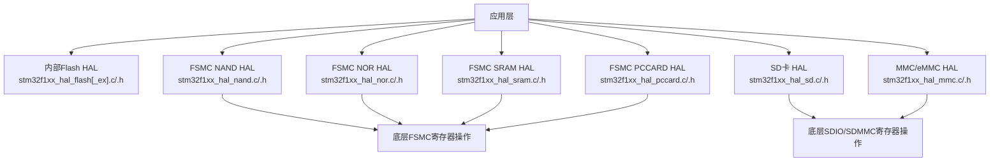
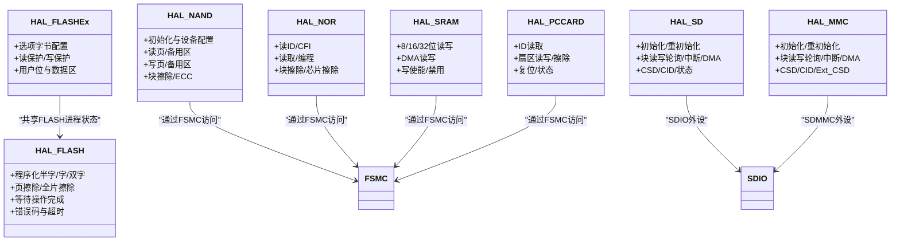
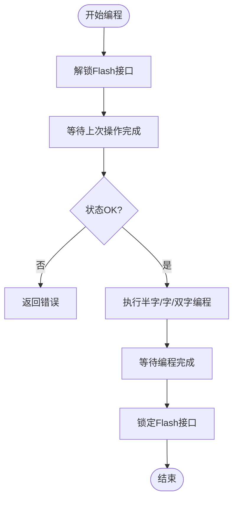
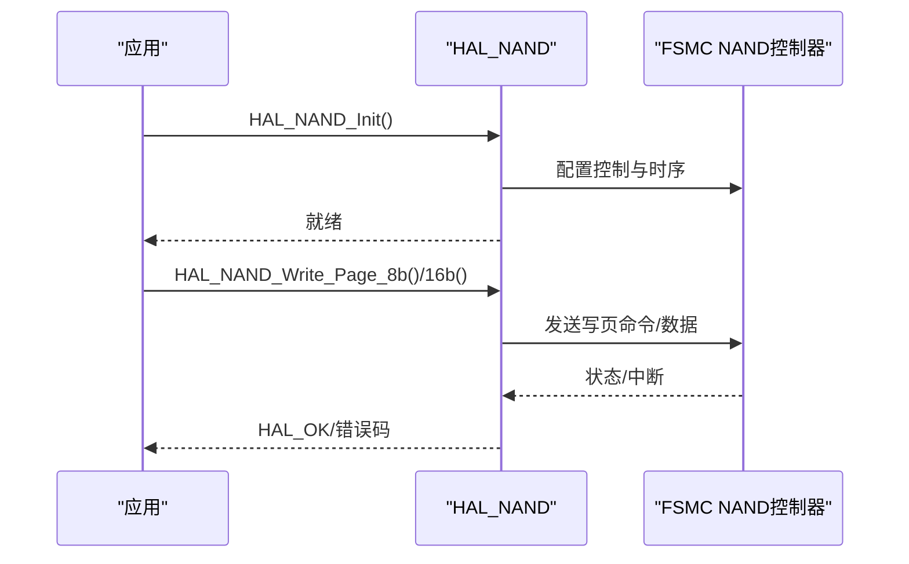
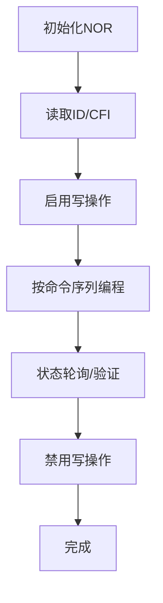
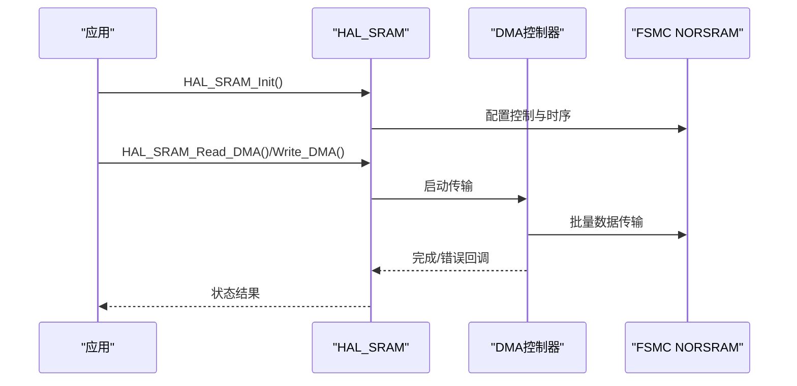
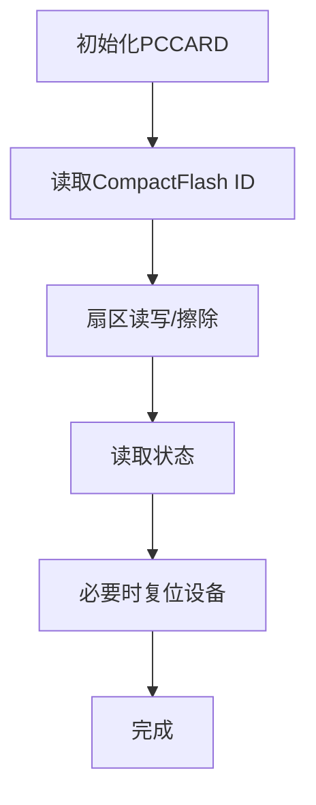
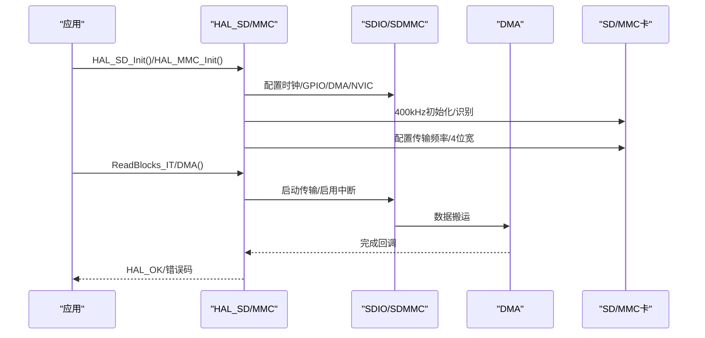
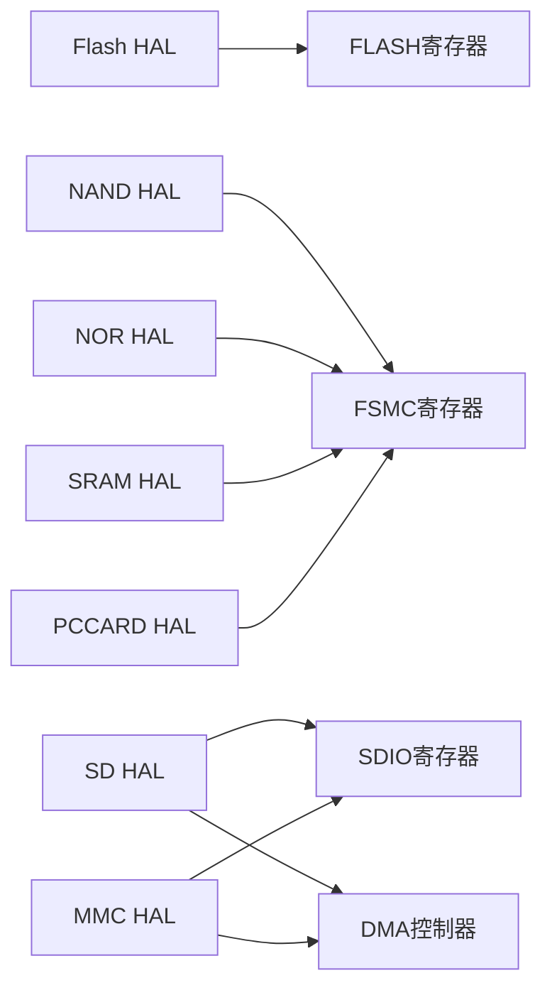

# 存储与总线接口

<cite>
**本文引用的文件**   
- [README.md](file://README.md)
- [stm32f1xx_hal_flash.c](file://Src/stm32f1xx_hal_flash.c)
- [stm32f1xx_hal_flash_ex.c](file://Src/stm32f1xx_hal_flash_ex.c)
- [stm32f1xx_hal_nand.c](file://Src/stm32f1xx_hal_nand.c)
- [stm32f1xx_hal_nor.c](file://Src/stm32f1xx_hal_nor.c)
- [stm32f1xx_hal_sram.c](file://Src/stm32f1xx_hal_sram.c)
- [stm32f1xx_hal_pccard.c](file://Src/stm32f1xx_hal_pccard.c)
- [stm32f1xx_hal_sd.c](file://Src/stm32f1xx_hal_sd.c)
- [stm32f1xx_hal_mmc.c](file://Src/stm32f1xx_hal_mmc.c)
- [stm32f1xx_hal_flash.h](file://Inc/stm32f1xx_hal_flash.h)
- [stm32f1xx_hal_flash_ex.h](file://Inc/stm32f1xx_hal_flash_ex.h)
- [stm32f1xx_hal_nand.h](file://Inc/stm32f1xx_hal_nand.h)
- [stm32f1xx_hal_nor.h](file://Inc/stm32f1xx_hal_nor.h)
- [stm32f1xx_hal_sram.h](file://Inc/stm32f1xx_hal_sram.h)
- [stm32f1xx_hal_pccard.h](file://Inc/stm32f1xx_hal_pccard.h)
- [stm32f1xx_hal_sd.h](file://Inc/stm32f1xx_hal_sd.h)
- [stm32f1xx_hal_mmc.h](file://Inc/stm32f1xx_hal_mmc.h)
</cite>

## 目录
1. [引言](#引言)
2. [项目结构](#项目结构)
3. [核心组件](#核心组件)
4. [架构总览](#架构总览)
5. [详细组件分析](#详细组件分析)
6. [依赖关系分析](#依赖关系分析)
7. [性能与可靠性考量](#性能与可靠性考量)
8. [故障诊断与恢复指南](#故障诊断与恢复指南)
9. [结论](#结论)
10. [附录：典型流程与最佳实践](#附录典型流程与最佳实践)

## 引言
本文面向 STM32F1xx HAL 的存储与总线子系统，系统梳理以下能力：
- 内置 Flash：页擦除、字编程、选项字节读写与写保护。
- FSMC 外扩存储器控制器：NAND/NOR/SRAM/PC Card。
- SD/MMC 卡接口：基于 SDIO/SDMMC 的块读写、DMA 与中断处理。

文档从驱动头文件的类型与常量出发，结合实现文件中的初始化、读写、错误标志处理与回调机制，给出可操作的初始化步骤、典型读写时序、中断/DMA 使用方式，并讨论闪存磨损均衡、掉电安全、总线带宽、延迟与可靠性设计。

## 项目结构
该仓库为 STM32CubeF1 HAL 驱动组件，存储相关代码集中在 Src 与 Inc 下：
- Src：HAL 实现，包含 flash、nand、nor、sram、pccard、sd、mmc 等驱动。
- Inc：对应头文件，定义句柄结构、状态枚举、导出 API 与宏。
- README.md 说明该组件是 STM32CubeF1 MCU 包的 HAL-LL 层之一，强调版本一致性。

图示来源
- [stm32f1xx_hal_flash.c:1-60](file://Src/stm32f1xx_hal_flash.c#L1-L60)
- [stm32f1xx_hal_nand.c:1-60](file://Src/stm32f1xx_hal_nand.c#L1-L60)
- [stm32f1xx_hal_nor.c:1-60](file://Src/stm32f1xx_hal_nor.c#L1-L60)
- [stm32f1xx_hal_sram.c:1-60](file://Src/stm32f1xx_hal_sram.c#L1-L60)
- [stm32f1xx_hal_pccard.c:1-60](file://Src/stm32f1xx_hal_pccard.c#L1-L60)
- [stm32f1xx_hal_sd.c:1-60](file://Src/stm32f1xx_hal_sd.c#L1-L60)
- [stm32f1xx_hal_mmc.c:1-60](file://Src/stm32f1xx_hal_mmc.c#L1-L60)

章节来源
- [README.md:1-45](file://README.md#L1-L45)

## 核心组件
- 内部 Flash HAL：提供解锁/锁定、半字/字/双字编程、页擦除、全片擦除、等待完成、错误码管理；扩展模块提供选项字节配置、读保护、写保护、用户位与数据区设置。
- FSMC NAND/NOR/SRAM/PCCARD HAL：通过 FSMC 外设访问外部存储器，统一封装设备初始化、地址空间与时序配置、命令序列、ECC（NAND）、状态查询与回调注册。
- SD/MMC HAL：基于 SDIO/SDMMC，提供 400kHz 初始识别、标准/高速模式切换、4 位宽总线、块读写（轮询/中断/DMA），以及 CSD/CID/Ext_CSD 信息获取。

章节来源
- [stm32f1xx_hal_flash.h:1-120](file://Inc/stm32f1xx_hal_flash.h#L1-L120)
- [stm32f1xx_hal_flash_ex.h:1-120](file://Inc/stm32f1xx_hal_flash_ex.h#L1-L120)
- [stm32f1xx_hal_nand.h:1-120](file://Inc/stm32f1xx_hal_nand.h#L1-L120)
- [stm32f1xx_hal_nor.h:1-120](file://Inc/stm32f1xx_hal_nor.h#L1-L120)
- [stm32f1xx_hal_sram.h:1-120](file://Inc/stm32f1xx_hal_sram.h#L1-L120)
- [stm32f1xx_hal_pccard.h:1-120](file://Inc/stm32f1xx_hal_pccard.h#L1-L120)
- [stm32f1xx_hal_sd.h:1-120](file://Inc/stm32f1xx_hal_sd.h#L1-L120)
- [stm32f1xx_hal_mmc.h:1-120](file://Inc/stm32f1xx_hal_mmc.h#L1-L120)

## 架构总览
STM32F1 的存储栈分为三层：
- 应用层：调用 HAL 导出 API 进行初始化、读写、擦除、状态检查与回调处理。
- HAL 层：封装硬件细节，管理句柄、锁、状态机、超时、错误码、回调注册。
- 底层外设层：通过 LL 或直接寄存器访问控制 FLASH、FSMC、SDIO/SDMMC、DMA、NVIC。

图示来源
- [stm32f1xx_hal_flash.c:1-120](file://Src/stm32f1xx_hal_flash.c#L1-L120)
- [stm32f1xx_hal_flash_ex.c:1-120](file://Src/stm32f1xx_hal_flash_ex.c#L1-L120)
- [stm32f1xx_hal_nand.c:1-120](file://Src/stm32f1xx_hal_nand.c#L1-L120)
- [stm32f1xx_hal_nor.c:1-120](file://Src/stm32f1xx_hal_nor.c#L1-L120)
- [stm32f1xx_hal_sram.c:1-120](file://Src/stm32f1xx_hal_sram.c#L1-L120)
- [stm32f1xx_hal_pccard.c:1-120](file://Src/stm32f1xx_hal_pccard.c#L1-L120)
- [stm32f1xx_hal_sd.c:1-120](file://Src/stm32f1xx_hal_sd.c#L1-L120)
- [stm32f1xx_hal_mmc.c:1-120](file://Src/stm32f1xx_hal_mmc.c#L1-L120)

## 详细组件分析

### 内置 Flash：页擦除、字编程、选项字节与安全特性
- 编程粒度：支持半字、字、双字编程；写前需等待上次操作完成，避免冲突。
- 擦除粒度：按页擦除或全片擦除；页号范围由设备密度宏校验。
- 选项字节：支持读保护、写保护、用户位、数据区写入；可通过扩展模块 API 设置/读取。
- 错误与状态：提供编程错误、写保护错误、选项无效等错误码；通过等待函数和标志位判断操作完成。
- 延时与预取：根据时钟频率配置 ACR 延迟与半周期访问。

图示来源
- [stm32f1xx_hal_flash.c:60-160](file://Src/stm32f1xx_hal_flash.c#L60-L160)
- [stm32f1xx_hal_flash.h:1-120](file://Inc/stm32f1xx_hal_flash.h#L1-L120)

章节来源
- [stm32f1xx_hal_flash.c:1-200](file://Src/stm32f1xx_hal_flash.c#L1-L200)
- [stm32f1xx_hal_flash_ex.c:1-200](file://Src/stm32f1xx_hal_flash_ex.c#L1-L200)
- [stm32f1xx_hal_flash.h:1-200](file://Inc/stm32f1xx_hal_flash.h#L1-L200)
- [stm32f1xx_hal_flash_ex.h:1-200](file://Inc/stm32f1xx_hal_flash_ex.h#L1-L200)

### FSMC NAND：页/块、ECC、备用区与地址映射
- 初始化：HAL_NAND_Init 配置 FSMC NAND 控制与时序（公共空间/属性空间），启用设备。
- 设备参数：NAND_DeviceConfigTypeDef 描述页大小、备用区大小、每块页数、平面数等。
- 访问方式：提供 8 位/16 位页读/写、备用区读/写、块擦除、芯片复位、状态读取、ECC 开关与 ECC 值获取。
- 地址模型：NAND_AddressTypeDef 包含 Page/Plane/Block 字段，便于高层逻辑按物理布局寻址。
- 总线与时序：通过 FSMC 公共空间/属性空间时序结构体配置读写时序，保证 NAND 时序要求。

图示来源
- [stm32f1xx_hal_nand.c:1-120](file://Src/stm32f1xx_hal_nand.c#L1-L120)
- [stm32f1xx_hal_nand.h:1-200](file://Inc/stm32f1xx_hal_nand.h#L1-L200)

章节来源
- [stm32f1xx_hal_nand.c:1-200](file://Src/stm32f1xx_hal_nand.c#L1-L200)
- [stm32f1xx_hal_nand.h:1-200](file://Inc/stm32f1xx_hal_nand.h#L1-L200)

### FSMC NOR：命令集、编程限制与写保护
- 初始化：HAL_NOR_Init 配置 NORSRAM 控制与时序，支持正常与扩展模式。
- 命令集：驱动支持多种 JEDEC 命令集常量，如 Intel/AMD/Fujitsu 等；用于自动选择、编程、擦除、CFI 读取。
- 访问方式：提供读 ID、读数组、编程单字、块擦除、芯片擦除、CFI 读取、写操作使能/禁用。
- 写保护：通过写操作使能/禁用控制 NOR 的写权限，配合 HAL 状态反映受保护状态。
- 时序：依据器件手册配置写脉冲、建立/保持时间，确保可靠编程。

图示来源
- [stm32f1xx_hal_nor.c:1-200](file://Src/stm32f1xx_hal_nor.c#L1-L200)
- [stm32f1xx_hal_nor.h:1-200](file://Inc/stm32f1xx_hal_nor.h#L1-L200)

章节来源
- [stm32f1xx_hal_nor.c:1-200](file://Src/stm32f1xx_hal_nor.c#L1-L200)
- [stm32f1xx_hal_nor.h:1-200](file://Inc/stm32f1xx_hal_nor.h#L1-L200)

### FSMC SRAM：快速读写与 DMA
- 初始化：HAL_SRAM_Init 配置控制与时序（含扩展模式），禁止突发模式（驱动内校验）。
- 访问方式：提供 8/16/32 位读/写 API，以及 DMA 读/写 API。
- 写保护：通过写操作使能/禁用控制 SRAM 写权限。
- DMA：默认回调完成/错误回调，可选用户回调注册。

图示来源
- [stm32f1xx_hal_sram.c:1-120](file://Src/stm32f1xx_hal_sram.c#L1-L120)
- [stm32f1xx_hal_sram.h:1-200](file://Inc/stm32f1xx_hal_sram.h#L1-L200)

章节来源
- [stm32f1xx_hal_sram.c:1-200](file://Src/stm32f1xx_hal_sram.c#L1-L200)
- [stm32f1xx_hal_sram.h:1-200](file://Inc/stm32f1xx_hal_sram.h#L1-L200)

### FSMC PC Card：扇区 I/O、复位与状态
- 初始化：HAL_PCCARD_Init 配置公共/属性/IO 空间时序，启用设备。
- 访问方式：提供 CompactFlash ID 读取、扇区读写、扇区擦除、复位、状态读取。
- 状态与时序：驱动定义常用超时与状态码，封装 PCCARD/CF 通用命令序列。

图示来源
- [stm32f1xx_hal_pccard.c:1-120](file://Src/stm32f1xx_hal_pccard.c#L1-L120)
- [stm32f1xx_hal_pccard.h:1-200](file://Inc/stm32f1xx_hal_pccard.h#L1-L200)

章节来源
- [stm32f1xx_hal_pccard.c:1-200](file://Src/stm32f1xx_hal_pccard.c#L1-L200)
- [stm32f1xx_hal_pccard.h:1-200](file://Inc/stm32f1xx_hal_pccard.h#L1-L200)

### SD/MMC：初始化、块读写、中断与DMA
- 初始化流程：
  - MSP 层配置 SDIO/SDMMC 时钟、GPIO、DMA、NVIC。
  - 以 400kHz 初始化卡片，识别容量与类型。
  - 配置传输频率（标准模式最高约 25MHz，高速模式可达 50MHz），开启 4 位宽总线。
- 块读写：
  - 支持 512 字节块的轮询、中断、DMA 三种方式。
  - 通过 HAL_SD_GetCardState()/HAL_MMC_GetCardState() 检查传输完成与状态。
- 信息获取：
  - 获取 CSD/CID/Ext_CSD 与逻辑块数量/大小，用于文件系统或自定义存储管理。

图示来源
- [stm32f1xx_hal_sd.c:1-200](file://Src/stm32f1xx_hal_sd.c#L1-L200)
- [stm32f1xx_hal_mmc.c:1-200](file://Src/stm32f1xx_hal_mmc.c#L1-L200)
- [stm32f1xx_hal_sd.h:1-200](file://Inc/stm32f1xx_hal_sd.h#L1-L200)
- [stm32f1xx_hal_mmc.h:1-200](file://Inc/stm32f1xx_hal_mmc.h#L1-L200)

章节来源
- [stm32f1xx_hal_sd.c:1-200](file://Src/stm32f1xx_hal_sd.c#L1-L200)
- [stm32f1xx_hal_mmc.c:1-200](file://Src/stm32f1xx_hal_mmc.c#L1-L200)
- [stm32f1xx_hal_sd.h:1-200](file://Inc/stm32f1xx_hal_sd.h#L1-L200)
- [stm32f1xx_hal_mmc.h:1-200](file://Inc/stm32f1xx_hal_mmc.h#L1-L200)

## 依赖关系分析
- HAL 层对底层外设的依赖：
  - Flash HAL 直接操作 FLASH 寄存器，使用超时与标志位等待操作完成。
  - FSMC 系列 HAL（NAND/NOR/SRAM/PCCARD）依赖 FSMC 控制与时序寄存器，并通过 GPIO/RCC 配置引脚与时钟。
  - SD/MMC HAL 依赖 SDIO/SDMMC、DMA、NVIC，使用中断与 DMA 回调完成块传输。
- 耦合与解耦：
  - HAL 层通过句柄、状态机与回调将硬件差异与应用逻辑解耦。
  - 各存储介质在 HAL 层抽象出统一的“初始化-访问-状态”接口，降低上层复杂度。

图示来源
- [stm32f1xx_hal_flash.c:1-120](file://Src/stm32f1xx_hal_flash.c#L1-L120)
- [stm32f1xx_hal_nand.c:1-120](file://Src/stm32f1xx_hal_nand.c#L1-L120)
- [stm32f1xx_hal_nor.c:1-120](file://Src/stm32f1xx_hal_nor.c#L1-L120)
- [stm32f1xx_hal_sram.c:1-120](file://Src/stm32f1xx_hal_sram.c#L1-L120)
- [stm32f1xx_hal_pccard.c:1-120](file://Src/stm32f1xx_hal_pccard.c#L1-L120)
- [stm32f1xx_hal_sd.c:1-120](file://Src/stm32f1xx_hal_sd.c#L1-L120)
- [stm32f1xx_hal_mmc.c:1-120](file://Src/stm32f1xx_hal_mmc.c#L1-L120)

## 性能与可靠性考量
- 闪存磨损均衡：
  - 内置 Flash 无硬件磨损均衡，建议应用层实现日志型或环形缓冲，避免频繁擦写同一页。
  - 外部 NAND/NOR 同样需应用层策略分散写热点，延长寿命。
- 掉电安全：
  - Flash 编程过程中断电可能导致数据损坏，应采用原子更新（双页/双备份+校验）与事务日志。
  - SD/MMC 写入后应等待卡片进入稳定状态，并在固件升级中采用分区镜像切换与回滚。
- 总线带宽与延迟：
  - FSMC 时序需匹配器件手册，合理设置写脉冲与建立/保持时间，避免误写。
  - SRAM 适合高频随机访问；NAND/NOR 更适合顺序大吞吐。
  - SD/MMC 使用 DMA 与 4 位宽总线提升吞吐，注意时钟分频与高速模式限制。
- 可靠性：
  - NAND 使用 ECC 纠正少量位错误，定期校验与坏块标记。
  - NOR 编程需严格遵循命令序列，完成后轮询状态位确认。
  - SD/MMC 读写后检查卡状态与错误码，失败重试与降级策略（降低时钟/关闭高速模式）。

[本节为通用指导，不直接分析具体文件]

## 故障诊断与恢复指南
- Flash：
  - 若编程失败，检查是否已解锁、地址是否在有效范围、是否存在写保护；查看错误码（编程错误、写保护错误、选项无效）。
  - 擦除失败时检查页号范围与忙标志，必要时重新解锁并重试。
- NAND：
  - 读写失败先读状态，检查 ECC 错误；必要时启用/禁用 ECC，读取 ECC 值定位问题。
  - 块擦除失败需检查块地址与设备状态，必要时复位设备。
- NOR：
  - 编程失败检查写操作是否启用、命令序列是否正确；轮询状态位确认编程完成。
  - 读 ID/CFI 失败检查 FSMC 时序与供电。
- SRAM：
  - DMA 传输失败检查 DMA 配置与回调；确保未处于写保护状态。
- PCCARD：
  - 扇区读写失败检查状态码与超时，必要时复位设备。
- SD/MMC：
  - 初始化失败检查 400kHz 阶段响应；传输失败检查卡状态、中断标志与 DMA 完成回调；必要时重置时钟或重新初始化卡。

章节来源
- [stm32f1xx_hal_flash.c:1-200](file://Src/stm32f1xx_hal_flash.c#L1-L200)
- [stm32f1xx_hal_nand.c:1-200](file://Src/stm32f1xx_hal_nand.c#L1-L200)
- [stm32f1xx_hal_nor.c:1-200](file://Src/stm32f1xx_hal_nor.c#L1-L200)
- [stm32f1xx_hal_sram.c:1-200](file://Src/stm32f1xx_hal_sram.c#L1-L200)
- [stm32f1xx_hal_pccard.c:1-200](file://Src/stm32f1xx_hal_pccard.c#L1-L200)
- [stm32f1xx_hal_sd.c:1-200](file://Src/stm32f1xx_hal_sd.c#L1-L200)
- [stm32f1xx_hal_mmc.c:1-200](file://Src/stm32f1xx_hal_mmc.c#L1-L200)

## 结论
STM32F1xx HAL 为内部 Flash 与 FSMC 外扩存储器提供了统一而可靠的抽象层。通过合理的初始化、时序配置、中断/DMA 使用与错误恢复策略，可以在嵌入式系统中实现稳定的数据持久化、固件升级与大容量存储。实际项目中应结合存储介质的物理特性，制定磨损均衡、掉电安全与性能调优方案，并利用 HAL 提供的状态与回调机制构建健壮的应用逻辑。

[本节为总结性内容，不直接分析具体文件]

## 附录：典型流程与最佳实践

### 内置 Flash 数据持久化流程
- 设计双页备份：主页与备页交替写入，每次更新同时写入两页并保存校验。
- 上电校验：比较主备页校验，选择有效页加载到 RAM。
- 擦写策略：尽量整页擦除与顺序写，避免碎片；必要时做后台整理。

参考路径
- [stm32f1xx_hal_flash.c:60-160](file://Src/stm32f1xx_hal_flash.c#L60-L160)
- [stm32f1xx_hal_flash_ex.c:1-200](file://Src/stm32f1xx_hal_flash_ex.c#L1-L200)

### 固件升级（Bootloader 与 OTA）
- Bootloader 驻留固定区域，应用固件位于独立扇区。
- 升级过程：
  - 校验新固件完整性（CRC/签名）。
  - 擦除目标扇区，顺序编程。
  - 切换引导标志，重启进入新固件。
- 回滚机制：保留旧固件副本，升级失败则回退。

参考路径
- [stm32f1xx_hal_flash_ex.h:120-200](file://Inc/stm32f1xx_hal_flash_ex.h#L120-L200)

### SD/MMC 块读写与 DMA 示例要点
- MSP 配置：SDIO/SDMMC 时钟、GPIO 复用、DMA、NVIC。
- 初始化：400kHz 识别卡，再切换到更高频率与 4 位宽。
- 传输：优先使用 DMA 或中断方式，避免 CPU 占用；完成后检查卡状态。
- 错误处理：超时重试、降速、重新初始化卡。

参考路径
- [stm32f1xx_hal_sd.c:1-200](file://Src/stm32f1xx_hal_sd.c#L1-L200)
- [stm32f1xx_hal_mmc.c:1-200](file://Src/stm32f1xx_hal_mmc.c#L1-L200)
- [stm32f1xx_hal_sd.h:120-200](file://Inc/stm32f1xx_hal_sd.h#L120-L200)
- [stm32f1xx_hal_mmc.h:120-200](file://Inc/stm32f1xx_hal_mmc.h#L120-L200)