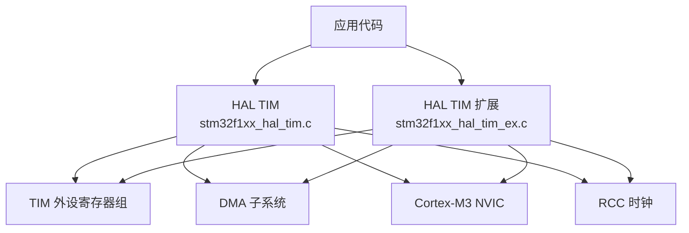
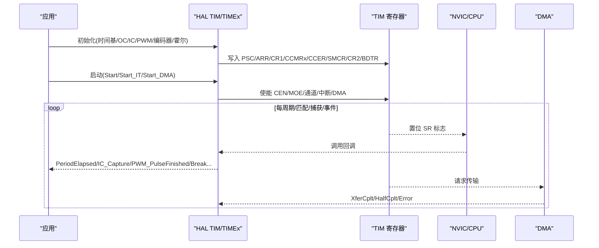
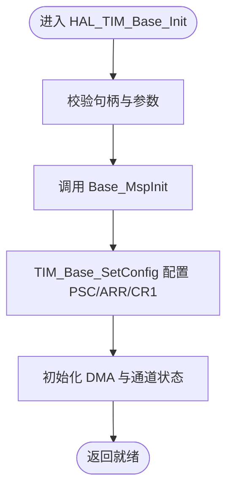
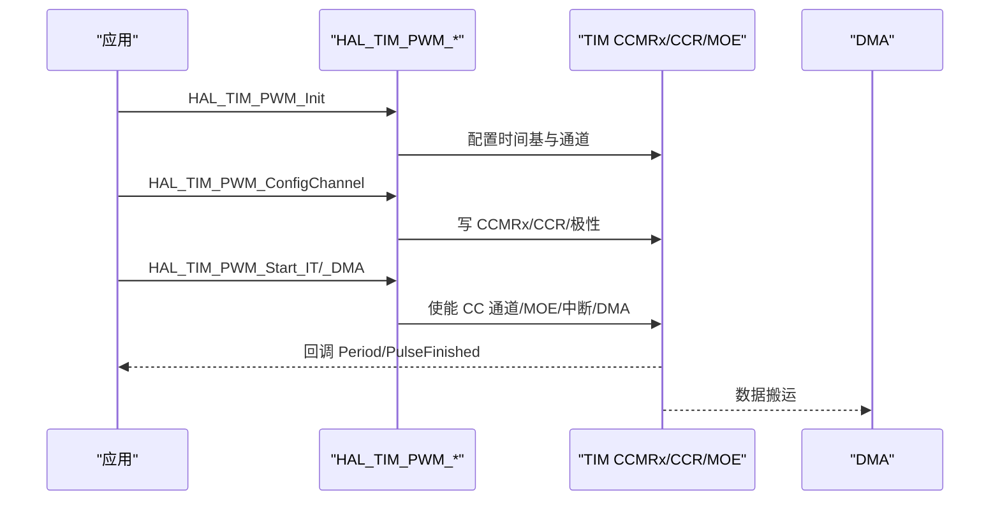
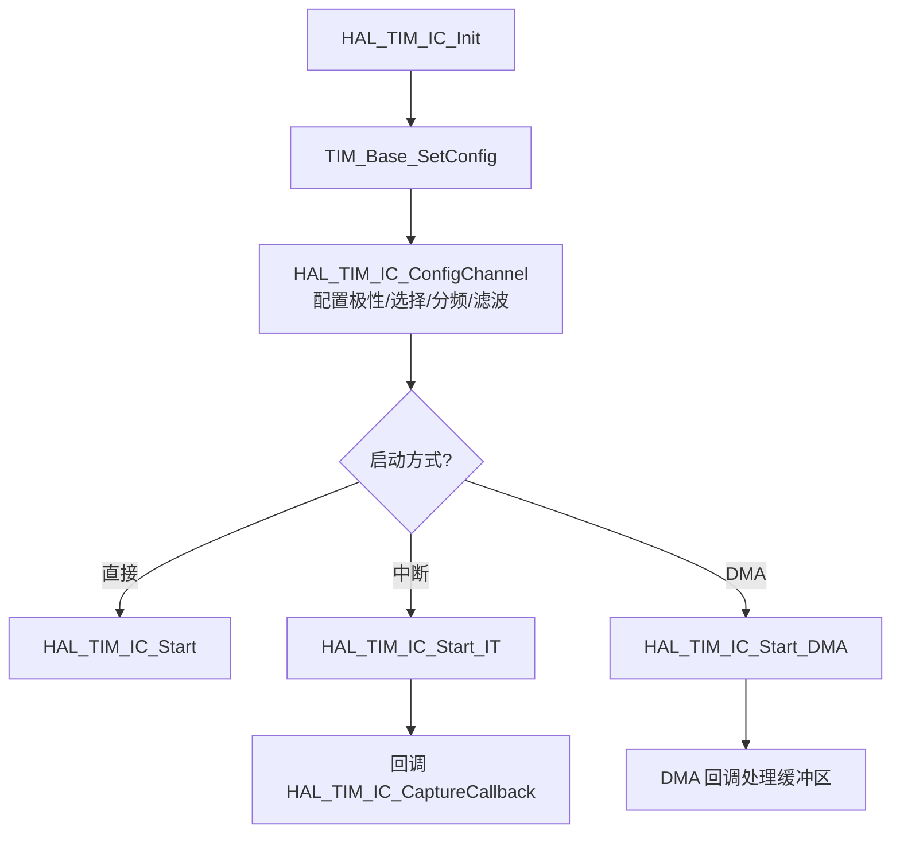
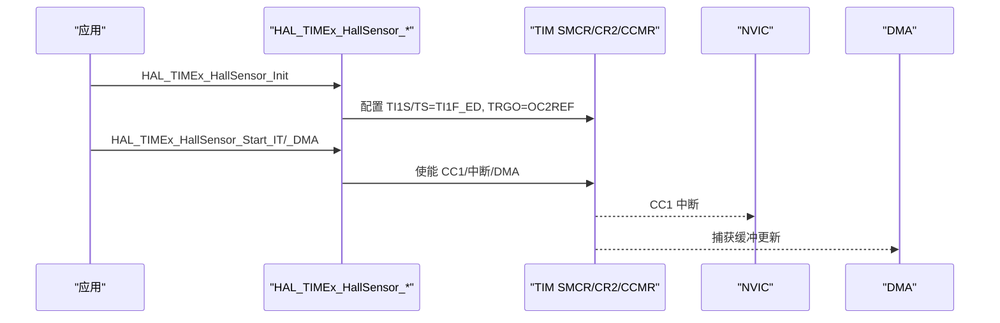
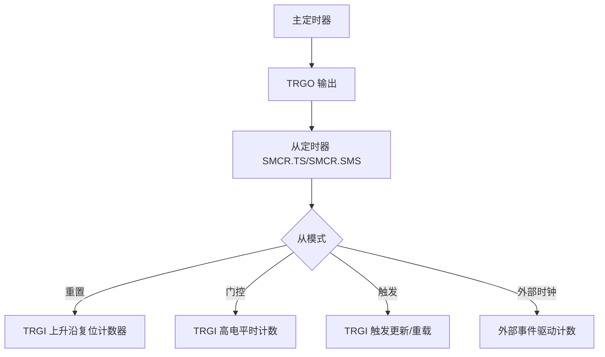
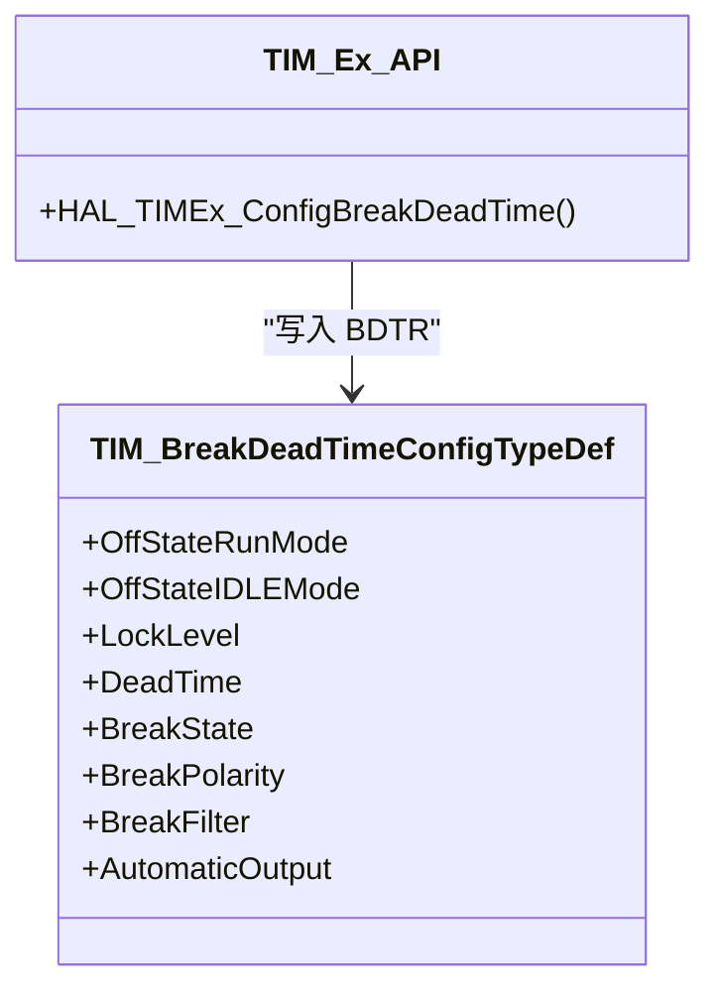
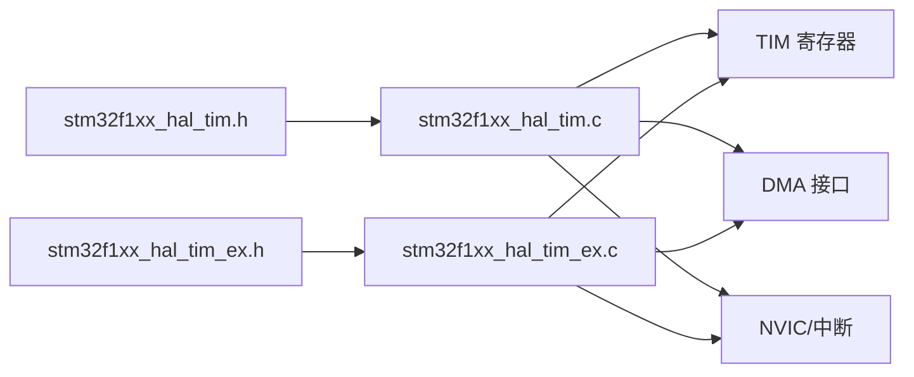

# TIM 定时器子系统

<cite>
**本文引用的文件**   
- [stm32f1xx_hal_tim.h](file://Inc/stm32f1xx_hal_tim.h)
- [stm32f1xx_hal_tim_ex.h](file://Inc/stm32f1xx_hal_tim_ex.h)
- [stm32f1xx_hal_tim.c](file://Src/stm32f1xx_hal_tim.c)
- [stm32f1xx_hal_tim_ex.c](file://Src/stm32f1xx_hal_tim_ex.c)
</cite>

## 目录
1. [引言](#引言)
2. [项目结构](#项目结构)
3. [核心组件](#核心组件)
4. [架构总览](#架构总览)
5. [详细组件分析](#详细组件分析)
6. [依赖关系分析](#依赖关系分析)
7. [性能与实时性](#性能与实时性)
8. [故障排查指南](#故障排查指南)
9. [结论](#结论)
10. [附录：典型调用路径与寄存器映射](#附录典型调用路径与寄存器映射)

## 引言
本文面向 STM32F1xx HAL 的 TIM 定时器子系统，围绕基本定时器、通用定时器与高级定时器的差异，解释关键寄存器在 HAL 中的封装方式，并系统说明初始化结构体成员含义与配置步骤。覆盖功能包括基本计数、中断与 DMA 触发、PWM 输出、互补 PWM、输入捕获、编码器接口、霍尔传感器模式、主从同步、事件调度、重复计数器、死区控制、刹车功能以及多通道同步输出。文档结合 `stm32f1xx_hal_tim.c` 与 `stm32f1xx_hal_tim_ex.c`，给出典型调用路径，并在 Cortex-M3 上讨论实时性与低功耗注意事项。

## 项目结构
TIM HAL 由两部分组成：
- 基础与通用定时器能力：位于 `stm32f1xx_hal_tim.c`，提供时间基、输出比较、PWM、输入捕获、单脉冲、编码器、时钟源配置等。
- 扩展定时器能力：位于 `stm32f1xx_hal_tim_ex.c`，提供互补输出、霍尔传感器、刹车与死区、主从同步、换相事件等。

**图表来源** 
- [stm32f1xx_hal_tim.c:201-240](file://Src/stm32f1xx_hal_tim.c#L201-L240)
- [stm32f1xx_hal_tim_ex.c:1-40](file://Src/stm32f1xx_hal_tim_ex.c#L1-L40)

**章节来源**
- [stm32f1xx_hal_tim.c:201-240](file://Src/stm32f1xx_hal_tim.c#L201-L240)
- [stm32f1xx_hal_tim_ex.c:1-40](file://Src/stm32f1xx_hal_tim_ex.c#L1-L40)

## 核心组件
- 句柄与状态：`TIM_HandleTypeDef` 保存实例指针、时间基配置、活跃通道、DMA 句柄数组、锁、外设状态、通道状态、DMA 突发状态及回调指针。
- 初始化结构体：
  - 时间基：`TIM_Base_InitTypeDef`（预分频、计数模式、周期、时钟分割、重复计数器、自动重装载预装载）。
  - 输出比较/PWM：`TIM_OC_InitTypeDef`（模式、脉冲值、极性、互补极性及空闲状态、快速模式）。
  - 输入捕获：`TIM_IC_InitTypeDef`（极性、输入选择、分频、滤波）。
  - 编码器：`TIM_Encoder_InitTypeDef`（编码模式、两路 IC 参数）。
  - 霍尔传感器：`TIM_HallSensor_InitTypeDef`（IC1 参数、换相延迟）。
  - 主从同步：`TIM_MasterConfigTypeDef`、`TIM_SlaveConfigTypeDef`。
  - 刹车与死区：`TIM_BreakDeadTimeConfigTypeDef`（运行/空闲关断态、锁级、死区、刹车使能/极性/滤波、自动输出）。
- 宏与常量：中断/DMA 使能宏、标志位读写宏、TRGO 主模式、从模式、PWM 模式、触发选择、DMA 长度索引等。

**章节来源**
- [stm32f1xx_hal_tim.h:201-750](file://Inc/stm32f1xx_hal_tim.h#L201-L750)
- [stm32f1xx_hal_tim.h:980-1257](file://Inc/stm32f1xx_hal_tim.h#L980-L1257)
- [stm32f1xx_hal_tim_ex.h:1-120](file://Inc/stm32f1xx_hal_tim_ex.h#L1-L120)

## 架构总览
TIM HAL 采用“句柄 + 初始化结构体 + 专用 API”的分层设计：
- 用户通过 `TIM_HandleTypeDef` 和各类初始化结构体描述硬件需求。
- HAL 函数完成参数校验、低层 MSP 回调调用、底层寄存器配置。
- 运行时通过中断或 DMA 触发回调，实现非阻塞数据处理。
- 扩展模块提供高级特性：互补输出、刹车、死区、主从同步、霍尔换相等。

**图表来源**
- [stm32f1xx_hal_tim.c:240-731](file://Src/stm32f1xx_hal_tim.c#L240-L731)
- [stm32f1xx_hal_tim.c:1400-1960](file://Src/stm32f1xx_hal_tim.c#L1400-L1960)
- [stm32f1xx_hal_tim_ex.c:650-1193](file://Src/stm32f1xx_hal_tim_ex.c#L650-L1193)
- [stm32f1xx_hal_tim_ex.c:1680-2078](file://Src/stm32f1xx_hal_tim_ex.c#L1680-L2078)

## 详细组件分析

### 基本定时器与时间基
- 初始化流程：`HAL_TIM_Base_Init` 执行参数校验、MSP 初始化、调用 `TIM_Base_SetConfig` 设置预分频、计数模式、周期、自动重装载预装载，然后初始化 DMA 突发状态与通道状态。
- 启动流程：`HAL_TIM_Base_Start`、`_IT`、`_DMA` 分别启用外设、更新中断或更新 DMA，注意从模式下可能由触发使能外设。
- 关键点：
  - 预分频器将 TIM 时钟分频后驱动计数器。
  - 周期值加载到 ARR，决定更新事件频率。
  - 重复计数器 RCR 控制多次更新才产生一次更新事件，适用于 PWM 重复。

**图表来源**
- [stm32f1xx_hal_tim.c:240-360](file://Src/stm32f1xx_hal_tim.c#L240-L360)

**章节来源**
- [stm32f1xx_hal_tim.c:240-731](file://Src/stm32f1xx_hal_tim.c#L240-L731)

### 输出比较与 PWM
- 初始化：`HAL_TIM_OC_Init` / `HAL_TIM_PWM_Init` 先初始化时间基，再初始化通道相关资源。
- 通道配置：`HAL_TIM_OC_ConfigChannel` / `HAL_TIM_PWM_ConfigChannel` 调用内部 `TIM_OC1_SetConfig` 等，写入 CCMRx、CCR、极性等。
- 启动：
  - 普通 PWM：`HAL_TIM_PWM_Start` 启用 CC 通道，必要时使能 MOE。
  - 互补 PWM：`HAL_TIMEx_PWMN_Start` 同时启用互补通道与 MOE。
- 中断/DMA：
  - `_Start_IT` 开启对应 CC 中断；
  - `_Start_DMA` 绑定 DMA 回调，启动 DMA 至 CCRx，并开启 TIM DMA 请求。

**图表来源**
- [stm32f1xx_hal_tim.c:1400-1960](file://Src/stm32f1xx_hal_tim.c#L1400-L1960)
- [stm32f1xx_hal_tim_ex.c:1190-1680](file://Src/stm32f1xx_hal_tim_ex.c#L1190-L1680)

**章节来源**
- [stm32f1xx_hal_tim.c:1400-1960](file://Src/stm32f1xx_hal_tim.c#L1400-L1960)
- [stm32f1xx_hal_tim_ex.c:1190-1680](file://Src/stm32f1xx_hal_tim_ex.c#L1190-L1680)

### 输入捕获
- 初始化：`HAL_TIM_IC_Init` 配置时间基，准备 DMA 与通道状态。
- 通道配置：`HAL_TIM_IC_ConfigChannel` 设置 IC 极性、选择、分频、滤波。
- 启动：
  - `_Start` 启用 CC 通道；
  - `_Start_IT` 开启 CC 中断；
  - `_Start_DMA` 绑定 DMA 回调，启动 DMA 从 CCRx 读取捕获值。
- 抖动处理：可通过 ICPolarity、ICFilter 降低噪声影响；高速信号建议使用 DMA 减少 CPU 负载。

**图表来源**
- [stm32f1xx_hal_tim.c:1960-2471](file://Src/stm32f1xx_hal_tim.c#L1960-L2471)

**章节来源**
- [stm32f1xx_hal_tim.c:1960-2471](file://Src/stm32f1xx_hal_tim.c#L1960-L2471)

### 编码器接口
- 初始化：`HAL_TIM_Encoder_Init` 使用编码器模式，自动根据 A/B 相边沿计数。
- 特点：
  - 支持四倍频计数，方向由编码器输入决定。
  - 可通过滤波器抑制毛刺。
  - 通常不需要外部中断或 DMA，但可配合更新中断进行溢出处理。

**章节来源**
- [stm32f1xx_hal_tim.h:201-438](file://Inc/stm32f1xx_hal_tim.h#L201-L438)
- [stm32f1xx_hal_tim.c:201-731](file://Src/stm32f1xx_hal_tim.c#L201-L731)

### 霍尔传感器模式
- 初始化：`HAL_TIMEx_HallSensor_Init` 配置 TI1 为霍尔输入（XOR），SMCR 设为重置模式，TRGO 输出 OC2REF 用于换相。
- 启动：`HAL_TIMEx_HallSensor_Start[_IT/_DMA]` 启用通道 1 捕获，可选开启中断或 DMA 采集。
- 用途：无刷电机换相检测，配合另一个定时器产生换相信号。

**图表来源**
- [stm32f1xx_hal_tim_ex.c:201-650](file://Src/stm32f1xx_hal_tim_ex.c#L201-L650)

**章节来源**
- [stm32f1xx_hal_tim_ex.c:201-650](file://Src/stm32f1xx_hal_tim_ex.c#L201-L650)

### 主从模式与事件调度
- 主模式：`HAL_TIMEx_MasterConfigSynchronization` 设置 CR2.MMS 以输出 TRGO（复位、使能、更新、OC1REF 等），并可选择是否启用主/从模式。
- 从模式：通过 SMCR.SMS 与 TS 配置重置、门控、触发、外部时钟模式。
- 换相事件：`HAL_TIMEx_ConfigCommutEvent[_IT/_DMA]` 配置换相触发源与 COMG/COMDE，支持软件或 TRGI 触发换相。

**图表来源**
- [stm32f1xx_hal_tim_ex.c:1680-2078](file://Src/stm32f1xx_hal_tim_ex.c#L1680-L2078)

**章节来源**
- [stm32f1xx_hal_tim_ex.c:1680-2078](file://Src/stm32f1xx_hal_tim_ex.c#L1680-L2078)

### 死区控制与刹车功能
- 死区与刹车：`HAL_TIMEx_ConfigBreakDeadTime` 写入 BDTR，配置 OSSR/OSSI、LOCK、DTG、BKE/BKP/AOE。
- 行为：
  - 死区确保互补通道不会同时导通。
  - 刹车输入可强制关闭 MOE 并输出安全电平。
  - OSSI/OSSR 控制空闲/运行时的默认输出状态。
  - AOE 允许下次更新事件自动恢复 MOE。

**图表来源**
- [stm32f1xx_hal_tim_ex.c:1680-2078](file://Src/stm32f1xx_hal_tim_ex.c#L1680-L2078)

**章节来源**
- [stm32f1xx_hal_tim_ex.c:1680-2078](file://Src/stm32f1xx_hal_tim_ex.c#L1680-L2078)

## 依赖关系分析
- HAL 层依赖：
  - 外设寄存器：TIM_CR1、TIM_PSC、TIM_ARR、TIM_CCMRx、TIM_CCER、TIM_DIER、TIM_SR、TIM_SMCR、TIM_CR2、TIM_BDTR。
  - 系统层：RCC 时钟、NVIC 中断、DMA 控制器。
- 模块耦合：
  - `stm32f1xx_hal_tim.c` 负责基础与通用定时器能力；
  - `stm32f1xx_hal_tim_ex.c` 负责扩展特性；
  - 两者共享句柄、宏与常量定义，并通过 `__HAL_TIM_*` 宏直接操作寄存器。

**图表来源**
- [stm32f1xx_hal_tim.h:201-750](file://Inc/stm32f1xx_hal_tim.h#L201-L750)
- [stm32f1xx_hal_tim.c:201-731](file://Src/stm32f1xx_hal_tim.c#L201-L731)
- [stm32f1xx_hal_tim_ex.c:1-40](file://Src/stm32f1xx_hal_tim_ex.c#L1-L40)

**章节来源**
- [stm32f1xx_hal_tim.h:201-750](file://Inc/stm32f1xx_hal_tim.h#L201-L750)
- [stm32f1xx_hal_tim.c:201-731](file://Src/stm32f1xx_hal_tim.c#L201-L731)
- [stm32f1xx_hal_tim_ex.c:1-40](file://Src/stm32f1xx_hal_tim_ex.c#L1-L40)

## 性能与实时性
- 中断优先级：
  - 更新中断与比较中断共享同一 TIM 中断向量，需在 NVIC 中合理分配优先级，避免高优先级中断抢占导致丢失捕获或 PWM 更新。
  - 建议将高频捕获中断设为较高优先级，但需保证最短 ISR 执行时间。
- DMA 边界条件：
  - 更新 DMA 目标为 ARR，长度等于重复次数加一（若启用 RCR）；
  - CC DMA 目标为 CCRx，长度等于 PWM 周期数；
  - 半满/满中断需正确区分缓冲区段，避免覆盖未消费数据。
- 实时性建议：
  - 在 ISR 中仅做最小量处理（如标记缓冲区索引、清除标志）；
  - 大量数据处理放入 DMA 回调或后台任务；
  - 避免在 PWM 更新 ISR 中进行复杂运算，防止错过下一次更新。
- 低功耗限制：
  - 在 STOP/SLEEP 模式下，APB 时钟可能停止，TIM 不计数；
  - 唤醒后需重新使能外设并检查 DMA/NVIC 状态；
  - 使用外部时钟或 LSI/LSE 时需确认 RCC 配置。

[本节为通用指导，不直接分析具体文件]

## 故障排查指南
- 无法产生 PWM：
  - 检查 GPIO 是否配置为复用功能；
  - 检查是否启用 MOE（高级定时器）；
  - 检查 CCMRx 是否为 PWM 模式且 CCRx 值小于 ARR；
  - 检查定时器是否已使能 CEN。
- 捕获值异常：
  - 检查极性、滤波、分频配置；
  - 检查是否存在过捕获（SR.OVF）；
  - 确认中断/DMA 及时读取 CCRx，避免丢失数据。
- 编码器方向错误：
  - 检查编码器模式与 IC 极性；
  - 检查接线相位顺序；
  - 使用滤波器抑制噪声。
- 互补通道冲突：
  - 检查死区配置是否正确；
  - 检查极性、空闲状态与刹车输入；
  - 确保 MOE 仅在互补通道都就绪时启用。
- 刹车误触发：
  - 检查刹车极性、滤波；
  - 确认外部刹车信号电平与噪声；
  - 避免在正常运行时意外拉低刹车引脚。
- 中断丢失：
  - 提高 NVIC 优先级；
  - 缩短 ISR 执行时间；
  - 使用 DMA 卸载数据搬运。
- DMA 半满/满中断处理：
  - 正确设置 DMA 回调；
  - 管理环形缓冲区头尾指针；
  - 避免在 DMA 传输期间修改长度或目标地址。

**章节来源**
- [stm32f1xx_hal_tim.c:240-731](file://Src/stm32f1xx_hal_tim.c#L240-L731)
- [stm32f1xx_hal_tim.c:1400-1960](file://Src/stm32f1xx_hal_tim.c#L1400-L1960)
- [stm32f1xx_hal_tim_ex.c:650-1193](file://Src/stm32f1xx_hal_tim_ex.c#L650-L1193)

## 结论
STM32F1xx 的 TIM HAL 提供了完整的时间基准、输出比较、PWM、输入捕获、编码器、霍尔传感器、主从同步、互补输出与刹车死区控制能力。理解句柄与初始化结构体的作用、掌握 HAL 函数的调用顺序、熟悉关键寄存器在 HAL 中的封装方式，是正确使用 TIM 的关键。在高实时性应用中，应重视中断优先级、DMA 边界条件与低功耗限制，并通过合理的配置与调试策略避免常见故障。

[本节为总结，不直接分析具体文件]

## 附录：典型调用路径与寄存器映射

### 初始化与启动典型路径
- 基本定时器：
  - `HAL_TIM_Base_Init` → `TIM_Base_SetConfig` → `HAL_TIM_Base_Start[_IT/_DMA]`
- PWM 输出：
  - `HAL_TIM_PWM_Init` → `HAL_TIM_PWM_ConfigChannel` → `HAL_TIM_PWM_Start[_IT/_DMA]`
- 互补 PWM：
  - `HAL_TIM_PWM_Init` → `HAL_TIM_PWM_ConfigChannel` → `HAL_TIMEx_PWMN_Start[_IT/_DMA]`
- 输入捕获：
  - `HAL_TIM_IC_Init` → `HAL_TIM_IC_ConfigChannel` → `HAL_TIM_IC_Start[_IT/_DMA]`
- 编码器：
  - `HAL_TIM_Encoder_Init` → `HAL_TIM_Encoder_Start[_IT/_DMA]`
- 霍尔传感器：
  - `HAL_TIMEx_HallSensor_Init` → `HAL_TIMEx_HallSensor_Start[_IT/_DMA]`
- 主从同步：
  - `HAL_TIMEx_MasterConfigSynchronization`
- 刹车与死区：
  - `HAL_TIMEx_ConfigBreakDeadTime`

**章节来源**
- [stm32f1xx_hal_tim.c:240-731](file://Src/stm32f1xx_hal_tim.c#L240-L731)
- [stm32f1xx_hal_tim.c:1400-1960](file://Src/stm32f1xx_hal_tim.c#L1400-L1960)
- [stm32f1xx_hal_tim_ex.c:201-650](file://Src/stm32f1xx_hal_tim_ex.c#L201-L650)
- [stm32f1xx_hal_tim_ex.c:650-1193](file://Src/stm32f1xx_hal_tim_ex.c#L650-L1193)
- [stm32f1xx_hal_tim_ex.c:1680-2078](file://Src/stm32f1xx_hal_tim_ex.c#L1680-L2078)

### 关键寄存器在 HAL 中的封装
- TIMx_CR1：外设使能、计数方向、中心对齐、自动重装载预装载。
- TIMx_PSC：预分频器。
- TIMx_ARR：自动重装载值，决定更新周期。
- TIMx_CCRx：比较值，决定 PWM 占空比或捕获值。
- TIMx_DIER：中断与 DMA 使能。
- TIMx_BDTR：刹车、死区、锁级、自动输出。
- TIMx_CCMRx：输出比较/PWM 模式、输入捕获配置。
- TIMx_CCER：通道使能与极性。
- TIMx_SMCR：从模式、触发选择。
- TIMx_CR2：主模式 TRGO、换相事件配置。

**章节来源**
- [stm32f1xx_hal_tim.h:980-1257](file://Inc/stm32f1xx_hal_tim.h#L980-L1257)
- [stm32f1xx_hal_tim_ex.h:1-120](file://Inc/stm32f1xx_hal_tim_ex.h#L1-L120)