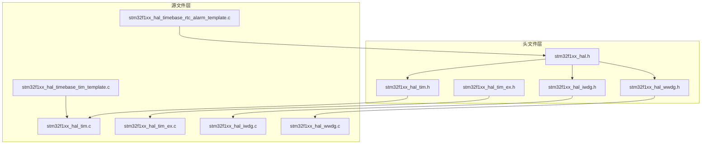
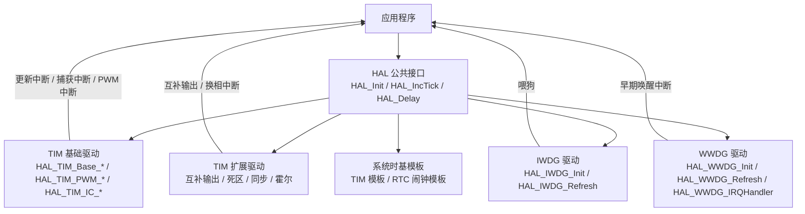
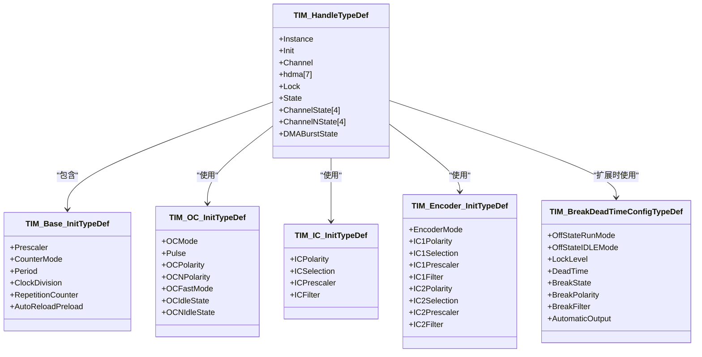
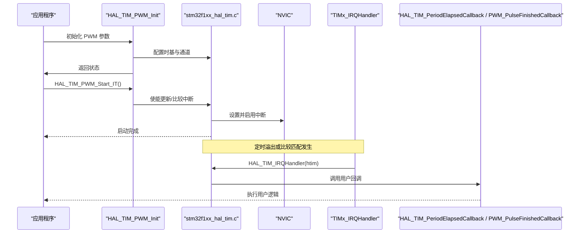
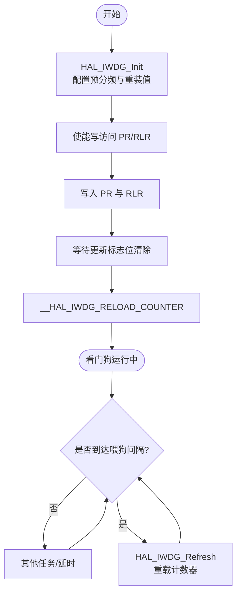
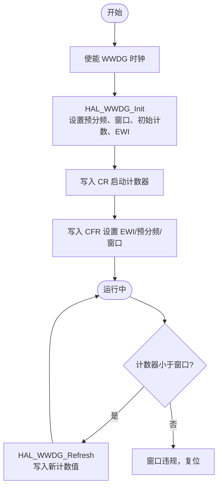
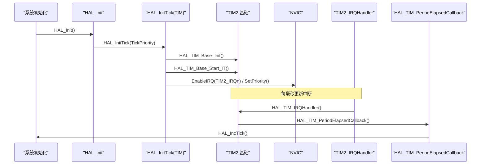
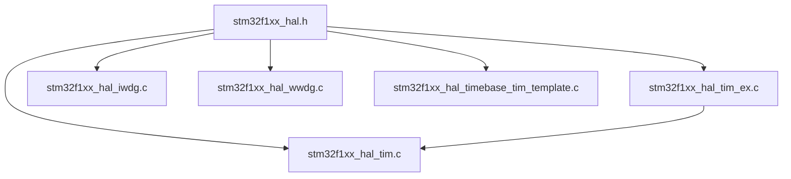

# 定时与控制子系统

<cite>
**本文引用的文件**
- [stm32f1xx_hal_tim.h](file://Inc/stm32f1xx_hal_tim.h)
- [stm32f1xx_hal_tim_ex.h](file://Inc/stm32f1xx_hal_tim_ex.h)
- [stm32f1xx_hal_tim.c](file://Src/stm32f1xx_hal_tim.c)
- [stm32f1xx_hal_tim_ex.c](file://Src/stm32f1xx_hal_tim_ex.c)
- [stm32f1xx_hal_iwdg.h](file://Inc/stm32f1xx_hal_iwdg.h)
- [stm32f1xx_hal_iwdg.c](file://Src/stm32f1xx_hal_iwdg.c)
- [stm32f1xx_hal_wwdg.h](file://Inc/stm32f1xx_hal_wwdg.h)
- [stm32f1xx_hal_wwdg.c](file://Src/stm32f1xx_hal_wwdg.c)
- [stm32f1xx_hal_timebase_tim_template.c](file://Src/stm32f1xx_hal_timebase_tim_template.c)
- [stm32f1xx_hal_timebase_rtc_alarm_template.c](file://Src/stm32f1xx_hal_timebase_rtc_alarm_template.c)
- [stm32f1xx_hal.h](file://Inc/stm32f1xx_hal.h)
</cite>

## 目录
1. [引言](#引言)
2. [项目结构](#项目结构)
3. [核心组件](#核心组件)
4. [架构总览](#架构总览)
5. [详细组件分析](#详细组件分析)
6. [依赖关系分析](#依赖关系分析)
7. [性能与实时性](#性能与实时性)
8. [故障排查与调试](#故障排查与调试)
9. [结论](#结论)

## 引言
本文件系统性地梳理 STM32F1xx HAL 的定时与控制子系统，覆盖以下关键外设：
- TIM 通用/高级定时器：基本计数、PWM 输出、输入捕获、编码器接口、互补输出、死区控制、多通道配置。
- IWDG 独立看门狗：预分频器、重装值、启动与喂狗流程。
- WWDG 窗口看门狗：窗口比较器、早期唤醒中断、喂狗策略。
- SysTick 时基替换：通过 TIM 或 RTC 闹钟模板实现非 SysTick 的系统时基。

文档面向不同技术背景的读者，先给出高层架构图，再逐步深入到数据结构、函数调用链、中断回调与 DMA 配置，最后总结实时性、功耗和调试实践。

## 项目结构
本仓库是 STM32F1xx HAL 驱动库的一部分，相关定时与控制代码主要分布在以下位置：
- Inc 层：HAL 对外暴露的类型、常量、宏与函数原型，如 TIM、TIMEx、IWDG、WWDG、HAL 公共接口。
- Src 层：各模块的具体实现，包括 HAL 层驱动与时基模板。

**图示来源**
- [stm32f1xx_hal.h:1-357](file://Inc/stm32f1xx_hal.h#L1-L357)
- [stm32f1xx_hal_tim.h:1-200](file://Inc/stm32f1xx_hal_tim.h#L1-L200)
- [stm32f1xx_hal_tim_ex.h:1-261](file://Inc/stm32f1xx_hal_tim_ex.h#L1-L261)
- [stm32f1xx_hal_iwdg.h:1-200](file://Inc/stm32f1xx_hal_iwdg.h#L1-L200)
- [stm32f1xx_hal_wwdg.h:1-200](file://Inc/stm32f1xx_hal_wwdg.h#L1-L200)

**章节来源**
- [stm32f1xx_hal.h:1-357](file://Inc/stm32f1xx_hal.h#L1-L357)
- [stm32f1xx_hal_tim.h:1-200](file://Inc/stm32f1xx_hal_tim.h#L1-L200)
- [stm32f1xx_hal_tim_ex.h:1-261](file://Inc/stm32f1xx_hal_tim_ex.h#L1-L261)
- [stm32f1xx_hal_iwdg.h:1-200](file://Inc/stm32f1xx_hal_iwdg.h#L1-L200)
- [stm32f1xx_hal_wwdg.h:1-200](file://Inc/stm32f1xx_hal_wwdg.h#L1-L200)

## 核心组件
- TIM 通用/高级定时器
  - 基础时基、输出比较、PWM、输入捕获、单脉冲、编码器接口。
  - 扩展功能：互补输出、死区控制、同步主从、霍尔传感器接口。
- IWDG 独立看门狗
  - LSI 时钟驱动，软件启动，预分频与重装值，定期喂狗。
- WWDG 窗口看门狗
  - APB 分频时钟，窗口比较器，早期唤醒中断，严格时间窗口内喂狗。
- 系统时基模板
  - TIM 模板：用定时器更新中断替代默认 SysTick 时基。
  - RTC 闹钟模板：用 RTC 闹钟中断替代默认 SysTick 时基。

**章节来源**
- [stm32f1xx_hal_tim.c:1-200](file://Src/stm32f1xx_hal_tim.c#L1-L200)
- [stm32f1xx_hal_tim_ex.c:1-200](file://Src/stm32f1xx_hal_tim_ex.c#L1-L200)
- [stm32f1xx_hal_iwdg.c:1-200](file://Src/stm32f1xx_hal_iwdg.c#L1-L200)
- [stm32f1xx_hal_wwdg.c:1-200](file://Src/stm32f1xx_hal_wwdg.c#L1-L200)
- [stm32f1xx_hal_timebase_tim_template.c:1-178](file://Src/stm32f1xx_hal_timebase_tim_template.c#L1-L178)
- [stm32f1xx_hal_timebase_rtc_alarm_template.c](file://Src/stm32f1xx_hal_timebase_rtc_alarm_template.c)

## 架构总览
下图展示 HAL 层定时与控制子系统的总体调用关系：应用层通过 HAL 初始化外设；定时器产生周期事件，驱动系统时基或用户回调；看门狗在运行期间持续被喂狗，超时则复位。

**图示来源**
- [stm32f1xx_hal_tim.c:1-200](file://Src/stm32f1xx_hal_tim.c#L1-L200)
- [stm32f1xx_hal_tim_ex.c:1-200](file://Src/stm32f1xx_hal_tim_ex.c#L1-L200)
- [stm32f1xx_hal_iwdg.c:1-200](file://Src/stm32f1xx_hal_iwdg.c#L1-L200)
- [stm32f1xx_hal_wwdg.c:1-200](file://Src/stm32f1xx_hal_wwdg.c#L1-L200)
- [stm32f1xx_hal_timebase_tim_template.c:1-178](file://Src/stm32f1xx_hal_timebase_tim_template.c#L1-L178)

## 详细组件分析

### TIM 通用与高级定时器
TIM HAL 提供统一的数据模型和处理流程，涵盖基础时基、输出比较、PWM、输入捕获、单脉冲、编码器接口等模式。扩展层提供互补输出、死区控制、主从同步、霍尔传感器接口等高级功能。

#### 关键数据结构
- 基础时基配置：预分频、计数模式、周期、时钟分频、重复计数器、自动重装载预加载。
- 输出比较与 PWM：通道模式、脉冲值、极性、快速模式、空闲状态。
- 输入捕获：极性、通道选择、预分频、滤波器。
- 编码器：两路输入极性与滤波、通道选择与预分频。
- 时钟配置：时钟源、极性、预分频、滤波器。
- 清除输入、主从配置、从机触发配置。
- 刹车与死区：运行/空闲关闭状态、锁级别、死区时间、刹车输入、极性与滤波器、自动输出使能。
- 句柄：实例寄存器地址、Init、活动通道、DMA 句柄数组、状态机、通道状态、可选回调指针。

**图示来源**
- [stm32f1xx_hal_tim.h:201-438](file://Inc/stm32f1xx_hal_tim.h#L201-L438)
- [stm32f1xx_hal_tim_ex.h:1-261](file://Inc/stm32f1xx_hal_tim_ex.h#L1-L261)

#### 典型工作流（以 PWM 为例）

**图示来源**
- [stm32f1xx_hal_tim.c:1-200](file://Src/stm32f1xx_hal_tim.c#L1-L200)

#### 功能要点
- 基本计数：使用 `HAL_TIM_Base_Init` 配置预分频与周期，随后调用 `HAL_TIM_Base_Start[_IT|_DMA]`。
- PWM 输出：使用 `HAL_TIM_PWM_Init` 与 `HAL_TIM_PWM_ConfigChannel` 配置通道后启动。
- 输入捕获：使用 `HAL_TIM_IC_Init` 与 `HAL_TIM_IC_ConfigChannel`，支持边沿、预分频与滤波。
- 编码器接口：使用 `HAL_TIM_Encoder_Init` 配置两路输入，读取计数器得到正交脉冲数。
- 互补输出与死区：使用扩展接口 `HAL_TIMEx_OCN_Start[_IT|_DMA]`、`HAL_TIMEx_PWMN_Start[_IT|_DMA]` 及 `HAL_TIMEx_ConfigCommutEvent`、`HAL_TIMEx_ConfigBreakDeadTime`。
- 多通道：每个通道对应独立的比较寄存器与回调；注意活动通道状态与 DMA 传输长度。
- DMA：TIM 支持写缓冲区到比较寄存器或读捕获数据；注意半完成与完成回调、错误回调。

**章节来源**
- [stm32f1xx_hal_tim.h:201-438](file://Inc/stm32f1xx_hal_tim.h#L201-L438)
- [stm32f1xx_hal_tim_ex.h:1-261](file://Inc/stm32f1xx_hal_tim_ex.h#L1-L261)
- [stm32f1xx_hal_tim.c:1-200](file://Src/stm32f1xx_hal_tim.c#L1-L200)
- [stm32f1xx_hal_tim_ex.c:1-200](file://Src/stm32f1xx_hal_tim_ex.c#L1-L200)

### IWDG 独立看门狗
IWDG 由内部低速时钟驱动，启动后不可禁用，必须按周期喂狗。

#### 初始化与喂狗流程

**图示来源**
- [stm32f1xx_hal_iwdg.c:1-200](file://Src/stm32f1xx_hal_iwdg.c#L1-L200)
- [stm32f1xx_hal_iwdg.c:200-263](file://Src/stm32f1xx_hal_iwdg.c#L200-L263)
- [stm32f1xx_hal_iwdg.h:1-200](file://Inc/stm32f1xx_hal_iwdg.h#L1-L200)

#### 关键点
- 预分频器：可选多个固定分频系数。
- 重装值：决定看门狗超时窗口。
- 启动：写起始关键字，LSI 强制开启，计数器从重装值递减。
- 喂狗：写重载关键字防止复位；应在正常运行循环中周期性调用。
- 调试冻结：可通过 DBGMCU 宏在调试时冻结 IWDG。

**章节来源**
- [stm32f1xx_hal_iwdg.h:1-200](file://Inc/stm32f1xx_hal_iwdg.h#L1-L200)
- [stm32f1xx_hal_iwdg.c:1-263](file://Src/stm32f1xx_hal_iwdg.c#L1-L263)
- [stm32f1xx_hal.h:1-357](file://Inc/stm32f1xx_hal.h#L1-L357)

### WWDG 窗口看门狗
WWDG 要求在限定时间窗口内刷新计数器，过早或过晚都会导致复位；可启用早期唤醒中断用于安全操作。

#### 初始化与喂狗时序

**图示来源**
- [stm32f1xx_hal_wwdg.c:200-420](file://Src/stm32f1xx_hal_wwdg.c#L200-L420)
- [stm32f1xx_hal_wwdg.h:1-200](file://Inc/stm32f1xx_hal_wwdg.h#L1-L200)

#### 关键点
- 预分频器：APB 时钟经固定分频后再除以可编程分频。
- 窗口比较器：必须在计数器低于窗口值时刷新。
- 早期唤醒中断：当计数器达到阈值时触发，可在中断中执行关键操作。
- 中断处理：`HAL_WWDG_IRQHandler` 清标志并调用用户回调。

**章节来源**
- [stm32f1xx_hal_wwdg.h:1-200](file://Inc/stm32f1xx_hal_wwdg.h#L1-L200)
- [stm32f1xx_hal_wwdg.c:200-420](file://Src/stm32f1xx_hal_wwdg.c#L200-L420)

### SysTick 时基替换（TIM 与 RTC 模板）
HAL 默认使用 SysTick 作为系统时基；可通过模板文件将 TIM 或 RTC 闹钟中断用作 `HAL_IncTick` 的来源。

#### TIM 时基模板流程

**图示来源**
- [stm32f1xx_hal_timebase_tim_template.c:1-178](file://Src/stm32f1xx_hal_timebase_tim_template.c#L1-L178)
- [stm32f1xx_hal.h:1-357](file://Inc/stm32f1xx_hal.h#L1-L357)

#### RTC 闹钟模板说明
RTC 闹钟模板同样会重写 `HAL_InitTick`，并使用 RTC 闹钟中断驱动 `HAL_IncTick`。具体实现位于模板文件中，使用时需确保 RTC 时钟与闹钟已正确配置。

**章节来源**
- [stm32f1xx_hal_timebase_tim_template.c:1-178](file://Src/stm32f1xx_hal_timebase_tim_template.c#L1-L178)
- [stm32f1xx_hal_timebase_rtc_alarm_template.c](file://Src/stm32f1xx_hal_timebase_rtc_alarm_template.c)
- [stm32f1xx_hal.h:1-357](file://Inc/stm32f1xx_hal.h#L1-L357)

## 依赖关系分析
- TIM HAL 依赖 HAL 公共接口与 RCC/GPIO/DMA/NVIC 等底层资源；TIMEx 扩展依赖基础 TIM 配置。
- IWDG/WWDG 依赖 RCC 时钟与 NVIC 中断；WWDG 额外依赖早期唤醒中断。
- 时基模板依赖 HAL 的 `HAL_InitTick` 钩子与 `HAL_IncTick` 全局变量。

**图示来源**
- [stm32f1xx_hal.h:1-357](file://Inc/stm32f1xx_hal.h#L1-L357)
- [stm32f1xx_hal_tim.c:1-200](file://Src/stm32f1xx_hal_tim.c#L1-L200)
- [stm32f1xx_hal_tim_ex.c:1-200](file://Src/stm32f1xx_hal_tim_ex.c#L1-L200)
- [stm32f1xx_hal_iwdg.c:1-200](file://Src/stm32f1xx_hal_iwdg.c#L1-L200)
- [stm32f1xx_hal_wwdg.c:1-200](file://Src/stm32f1xx_hal_wwdg.c#L1-L200)
- [stm32f1xx_hal_timebase_tim_template.c:1-178](file://Src/stm32f1xx_hal_timebase_tim_template.c#L1-L178)

**章节来源**
- [stm32f1xx_hal.h:1-357](file://Inc/stm32f1xx_hal.h#L1-L357)
- [stm32f1xx_hal_tim.c:1-200](file://Src/stm32f1xx_hal_tim.c#L1-L200)
- [stm32f1xx_hal_tim_ex.c:1-200](file://Src/stm32f1xx_hal_tim_ex.c#L1-L200)
- [stm32f1xx_hal_iwdg.c:1-200](file://Src/stm32f1xx_hal_iwdg.c#L1-L200)
- [stm32f1xx_hal_wwdg.c:1-200](file://Src/stm32f1xx_hal_wwdg.c#L1-L200)
- [stm32f1xx_hal_timebase_tim_template.c:1-178](file://Src/stm32f1xx_hal_timebase_tim_template.c#L1-L178)

## 性能与实时性
- 中断优先级
  - TIM 更新/PWM 中断应优先于一般业务逻辑，但避免高于关键通信中断；时基模板允许设置 Tick 优先级。
  - WWDG 早期唤醒中断应足够高以保证在窗口前完成关键操作。
  - IWDG 无中断，但喂狗延迟会影响实时性；建议在低开销路径中喂狗。
- 溢出处理
  - TIM 基本模式需处理溢出次数；输入捕获需处理跨溢出边界计算周期。
  - WWDG 窗口违规立即复位；需在窗口下限之前刷新。
- 抖动
  - TIM 输入捕获滤波器可减少噪声，但增加响应延迟；需权衡。
  - 中断服务程序应尽量短小，必要时采用双缓冲或 DMA。
- 功耗
  - TIM 在空闲时可停止更新中断以减少功耗；RTC 闹钟通常更省电。
  - IWDG 在 STOP/STANDBY 仍运行；WWDG 仅在 APB 工作时运行。
- 实时性保证
  - 使用 DMA 批量更新 PWM 比较值，减少中断负载。
  - 使用编码器接口时，注意高速脉冲下的中断频率与 CPU 占用。
  - 时基使用 TIM 或 RTC 时，确认中断源稳定且不受主时钟异常影响。

[本节为通用指导，不直接分析具体文件]

## 故障排查与调试
- TIM
  - 现象：PWM 波形异常或频率不对。
    - 检查预分频、周期与通道脉冲值；确认 GPIO 复用配置与引脚映射。
    - 检查更新中断与比较中断是否同时使能；确认回调未被长时间阻塞。
    - 互补输出时检查死区配置与刹车输入极性。
  - 现象：编码器计数不稳定。
    - 调整 IC 滤波与预分频；检查两路信号相位与电平。
  - 调试工具：使用 DBGMCU 冻结特定定时器以观察计数器行为。
- IWDG
  - 现象：频繁复位。
    - 检查喂狗间隔是否超过看门狗超时；确认 LSI 频率偏差；必要时测量 LSI 校准。
    - 检查调试冻结是否意外启用。
- WWDG
  - 现象：窗口违规复位。
    - 检查刷新时机是否在窗口范围内；确认 EWI 中断中及时刷新。
    - 验证初始计数值大于阈值，避免启动即复位。
  - 调试工具：使用 DBGMCU 冻结 WWDG 以定位问题。
- 时基
  - 现象：系统时基不准确或中断风暴。
    - 检查 `HAL_InitTick` 返回值与 NVIC 优先级；确认定时器时钟计算正确。
    - 若使用 RTC 模板，检查 RTC 时钟源与闹钟配置。

**章节来源**
- [stm32f1xx_hal.h:1-357](file://Inc/stm32f1xx_hal.h#L1-L357)
- [stm32f1xx_hal_tim.c:1-200](file://Src/stm32f1xx_hal_tim.c#L1-L200)
- [stm32f1xx_hal_tim_ex.c:1-200](file://Src/stm32f1xx_hal_tim_ex.c#L1-L200)
- [stm32f1xx_hal_iwdg.c:1-263](file://Src/stm32f1xx_hal_iwdg.c#L1-L263)
- [stm32f1xx_hal_wwdg.c:200-420](file://Src/stm32f1xx_hal_wwdg.c#L200-L420)
- [stm32f1xx_hal_timebase_tim_template.c:1-178](file://Src/stm32f1xx_hal_timebase_tim_template.c#L1-L178)

## 结论
STM32F1xx HAL 的定时与控制子系统通过清晰的模块化设计，提供了丰富的定时器功能、可靠的看门狗机制以及灵活的时基替换方案。TIM 覆盖从基础计数到高级互补输出的广泛场景；IWDG 与 WWDG 分别提供独立与窗口式的安全保护；TIM 与 RTC 时基模板允许在不改变应用层的情况下更换系统时基。合理配置中断优先级、溢出处理、滤波与死区，并结合 DMA 与调试工具，可以在保证实时性的前提下降低功耗与抖动。实际工程中应根据产品需求平衡精度、功耗与可靠性，并通过充分测试验证喂狗策略与中断路径。

[本节为总结性内容，不直接分析具体文件]