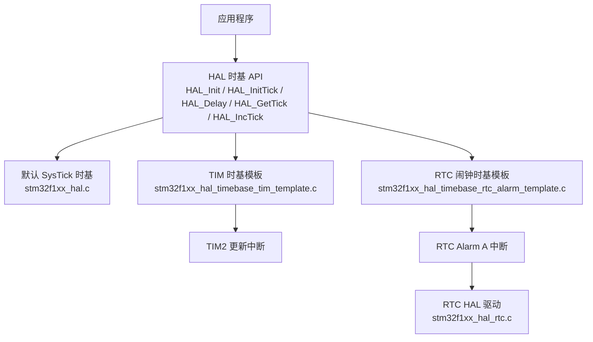
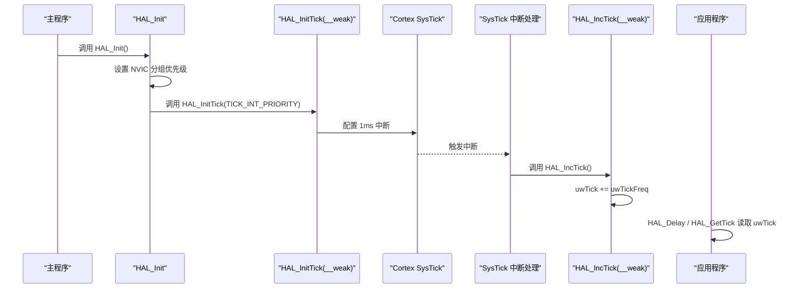
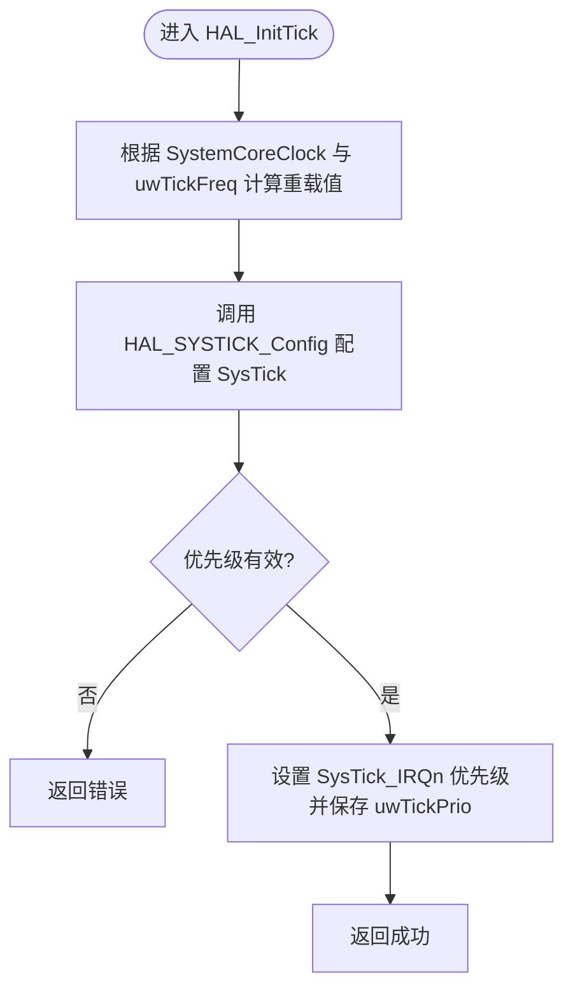
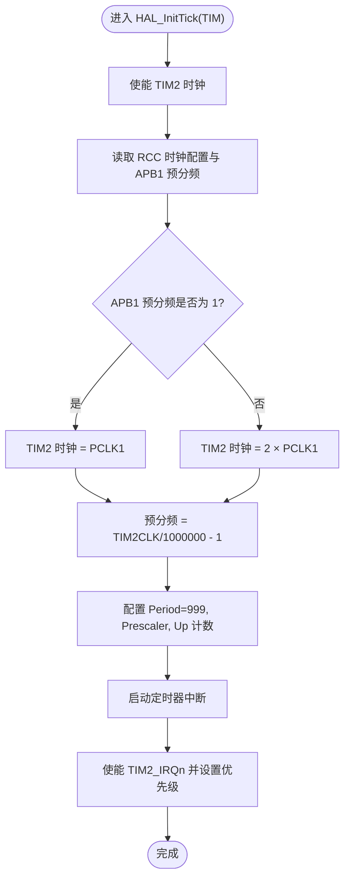
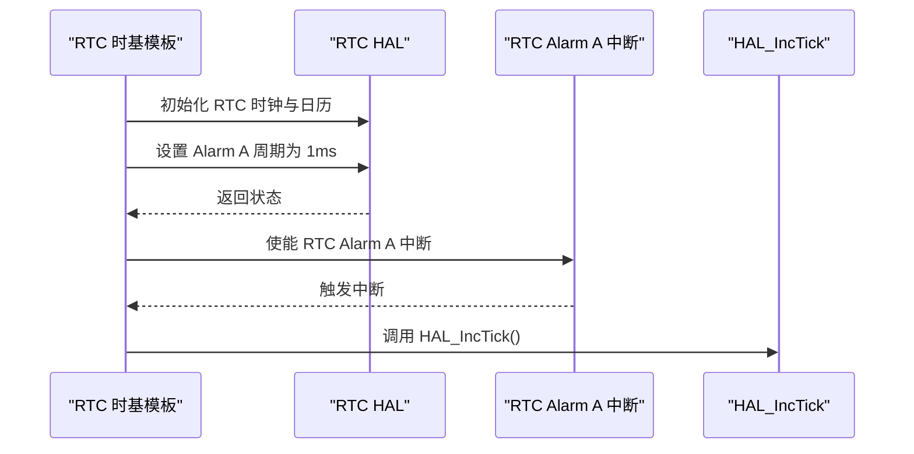
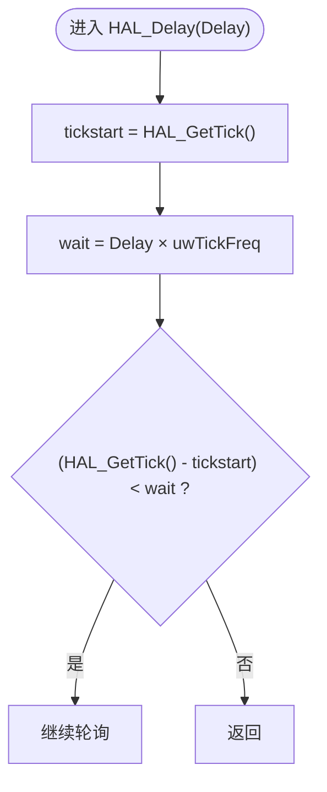
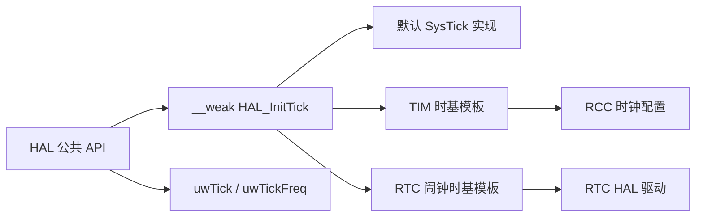

# 时基服务与时基模板

<cite>
**本文引用的文件**   
- [stm32f1xx_hal.c](file://Src/stm32f1xx_hal.c)
- [stm32f1xx_hal.h](file://Inc/stm32f1xx_hal.h)
- [stm32f1xx_hal_def.h](file://Inc/stm32f1xx_hal_def.h)
- [stm32f1xx_hal_timebase_tim_template.c](file://Src/stm32f1xx_hal_timebase_tim_template.c)
- [stm32f1xx_hal_timebase_rtc_alarm_template.c](file://Src/stm32f1xx_hal_timebase_rtc_alarm_template.c)
- [stm32f1xx_hal_rtc.c](file://Src/stm32f1xx_hal_rtc.c)
</cite>

## 目录
1. [引言](#引言)
2. [项目结构](#项目结构)
3. [核心组件](#核心组件)
4. [架构总览](#架构总览)
5. [详细组件分析](#详细组件分析)
6. [依赖关系分析](#依赖关系分析)
7. [性能与精度特性](#性能与精度特性)
8. [替换默认时基步骤](#替换默认时基步骤)
9. [RTOS 与低功耗注意事项](#rtos-与低功耗注意事项)
10. [调试方法](#调试方法)
11. [故障排查](#故障排查)
12. [结论](#结论)

## 引言
本文聚焦 STM32F1xx HAL 的时基服务：默认基于 Cortex-M SysTick，并提供两种可选模板——通用定时器时基和 RTC 闹钟时基。文档说明 HAL_Init 如何通过 __weak 钩子注册时基中断，以及 HAL_Delay、HAL_GetTick、HAL_IncTick 如何依赖该时基实现毫秒级延时与时间戳递增；同时给出定时器和 RTC 时基的实现要点、时钟源对精度的影响、中断抢占导致的抖动、RTOS 与低功耗场景的注意事项，以及系统化的调试方法。

## 项目结构
本仓库中与时基相关的代码集中在 HAL 公共实现、接口声明以及两个时基模板：
- HAL 公共实现负责 SysTick 默认时基、全局 Tick 变量与基础 API。
- 定时器时基模板通过 TIM2 提供 1ms Update 中断，重写 HAL_InitTick。
- RTC 闹钟时基模板通过 RTC Alarm A 提供 1ms 周期中断，重写 HAL_InitTick。
- RTC HAL 驱动提供 RTC 初始化、闹钟配置及回调机制，供 RTC 时基模板调用。

**图表来源**
- [stm32f1xx_hal.c:220-250](file://Src/stm32f1xx_hal.c#L220-L250)
- [stm32f1xx_hal_timebase_tim_template.c:1-178](file://Src/stm32f1xx_hal_timebase_tim_template.c#L1-L178)
- [stm32f1xx_hal_timebase_rtc_alarm_template.c:1-200](file://Src/stm32f1xx_hal_timebase_rtc_alarm_template.c#L1-L200)
- [stm32f1xx_hal_rtc.c:1185-1442](file://Src/stm32f1xx_hal_rtc.c#L1185-L1442)

**章节来源**
- [stm32f1xx_hal.c:1-120](file://Src/stm32f1xx_hal.c#L1-L120)
- [stm32f1xx_hal.h:295-330](file://Inc/stm32f1xx_hal.h#L295-L330)

## 核心组件
- HAL 公共变量与常量
  - uwTick：全局 Tick 计数值，由时基中断递增。
  - uwTickPrio：当前 Tick 中断优先级。
  - uwTickFreq：Tick 频率（默认 1kHz，即每 1ms 一次），决定每次 HAL_IncTick 累加步长。
- HAL 关键函数
  - HAL_Init：设置 NVIC 分组优先级，调用 HAL_InitTick 初始化时基，再调用 HAL_MspInit。
  - HAL_InitTick(__weak)：默认使用 SysTick 配置 1ms 中断并设置其优先级。
  - HAL_IncTick(__weak)：将 uwTick 增加 uwTickFreq。
  - HAL_GetTick：返回 uwTick。
  - HAL_Delay：基于当前 Tick 计算等待时长，轮询直到超时。
  - HAL_SetTickFreq/HAL_GetTickFreq：修改或查询 Tick 频率，内部会重新调用 HAL_InitTick。

这些变量与函数的声明位于 HAL 头文件中，定义位于 stm32f1xx_hal.c。

**章节来源**
- [stm32f1xx_hal.c:79-81](file://Src/stm32f1xx_hal.c#L79-L81)
- [stm32f1xx_hal.c:220-250](file://Src/stm32f1xx_hal.c#L220-L250)
- [stm32f1xx_hal.c:293-382](file://Src/stm32f1xx_hal.c#L293-L382)
- [stm32f1xx_hal.h:295-330](file://Inc/stm32f1xx_hal.h#L295-L330)
- [stm32f1xx_hal_def.h:45-53](file://Inc/stm32f1xx_hal_def.h#L45-L53)

## 架构总览
下图展示 HAL_Init 到具体时基实现的调用链，以及业务函数如何消费 uwTick。

**图表来源**
- [stm32f1xx_hal.c:100-150](file://Src/stm32f1xx_hal.c#L100-L150)
- [stm32f1xx_hal.c:220-250](file://Src/stm32f1xx_hal.c#L220-L250)
- [stm32f1xx_hal.c:293-382](file://Src/stm32f1xx_hal.c#L293-L382)

## 详细组件分析

### 默认 SysTick 时基
- 实现位置：stm32f1xx_hal.c 中的 HAL_InitTick(__weak)。
- 行为：
  - 使用 SystemCoreClock 和 uwTickFreq 计算 SysTick 重载值，使中断间隔为 1ms。
  - 配置 SysTick_IRQn 的 NVIC 优先级，并将 uwTickPrio 保存。
- 限制：
  - 默认依赖 HSI 提供的系统时钟；若运行时改变时钟树，需要确保 SystemCoreClock 与 uwTickFreq 一致。
  - 在低功耗模式下，部分 STOP/STANDBY 模式可能停止 SysTick，导致 Tick 不再递增。
  - 若应用在中断中调用 HAL_Delay，必须保证 SysTick 优先级高于外设中断，否则会阻塞调用者。

**图表来源**
- [stm32f1xx_hal.c:220-250](file://Src/stm32f1xx_hal.c#L220-L250)

**章节来源**
- [stm32f1xx_hal.c:220-250](file://Src/stm32f1xx_hal.c#L220-L250)
- [stm32f1xx_hal.c:100-150](file://Src/stm32f1xx_hal.c#L100-L150)

### TIM 时基模板（通用定时器）
- 实现位置：stm32f1xx_hal_timebase_tim_template.c。
- 目标：用 TIM2 生成 1ms 更新中断，并在 HAL_TIM_PeriodElapsedCallback 中直接调用 HAL_IncTick。
- 关键点：
  - 开启 TIM2 时钟，读取 RCC 时钟配置获取 APB1 预分频。
  - 当 APB1 预分频为 1 时，TIM2 时钟等于 PCLK1；否则为 2×PCLK1。
  - 预分频设置为 (TIM2CLK/1000000 - 1)，使计数器时钟为 1MHz。
  - ARR 设置为 (1000000/1000 - 1)，即 999，产生 1ms 溢出。
  - 启动 TIM 基本定时器中断，并启用 TIM2_IRQn，配置其优先级。
  - HAL_SuspendTick/ResumeTick 控制 Update 中断开关。
- 中断链：
  - TIM2_IRQHandler → HAL_TIM_IRQHandler → HAL_TIM_PeriodElapsedCallback → HAL_IncTick。

**图表来源**
- [stm32f1xx_hal_timebase_tim_template.c:1-178](file://Src/stm32f1xx_hal_timebase_tim_template.c#L1-L178)

**章节来源**
- [stm32f1xx_hal_timebase_tim_template.c:1-178](file://Src/stm32f1xx_hal_timebase_tim_template.c#L1-L178)

### RTC 闹钟时基模板
- 实现位置：stm32f1xx_hal_timebase_rtc_alarm_template.c。
- 目标：使用 RTC Alarm A 中断以 1ms 周期触发，回调中调用 HAL_IncTick。
- 关键点：
  - 配置 RTC 时钟源（HSE_LSE、LSI 或 LSE）、异步预分频，得到 1Hz 基准。
  - 配置日历时间与日期（STM32F1 的日期由软件维护）。
  - 设置 RTC Alarm A 为周期性 1ms 事件；由于 F1 系列 Alarm 检测限制，通常需要通过软件重编程或使用唤醒定时器方式达到高频节拍。
  - 使能 RTC Alarm A 中断，并在中断处理路径中调用 HAL_IncTick。
  - 注意 RTC VBAT 供电、备份域访问权限、Stop/Standby 唤醒等低功耗问题。
- 与 RTC HAL 的关系：
  - HAL_RTC_SetAlarm_IT 用于设置带中断的闹钟。
  - HAL_RTC_AlarmAEventCallback 是弱回调，可由模板覆盖。

**图表来源**
- [stm32f1xx_hal_timebase_rtc_alarm_template.c:1-200](file://Src/stm32f1xx_hal_timebase_rtc_alarm_template.c#L1-L200)
- [stm32f1xx_hal_rtc.c:1185-1442](file://Src/stm32f1xx_hal_rtc.c#L1185-L1442)

**章节来源**
- [stm32f1xx_hal_timebase_rtc_alarm_template.c:1-200](file://Src/stm32f1xx_hal_timebase_rtc_alarm_template.c#L1-L200)
- [stm32f1xx_hal_rtc.c:1185-1442](file://Src/stm32f1xx_hal_rtc.c#L1185-L1442)

### HAL_Delay、HAL_GetTick、HAL_IncTick 的工作机制
- HAL_IncTick(__weak)：将 uwTick 增加 uwTickFreq。
- HAL_GetTick：返回 uwTick。
- HAL_Delay：
  - 记录 tickstart。
  - 将 Delay 乘以 uwTickFreq 换算成 Tick 单位。
  - 循环比较当前 HAL_GetTick 与 tickstart，直到差值达到 wait。
  - 该实现假设 uwTick 单调递增且中断稳定。

**图表来源**
- [stm32f1xx_hal.c:293-382](file://Src/stm32f1xx_hal.c#L293-L382)

**章节来源**
- [stm32f1xx_hal.c:293-382](file://Src/stm32f1xx_hal.c#L293-L382)

## 依赖关系分析
- HAL_InitTick 是一个 __weak 钩子，编译时如果用户包含 TIM 或 RTC 时基模板并定义同名函数，则链接时会优先使用用户实现，从而替换默认 SysTick 时基。
- HAL_Delay、HAL_GetTick、HAL_IncTick 都依赖全局变量 uwTick 与 uwTickFreq。
- TIM 模板依赖 RCC 配置以获得正确的 PCLK1 频率，进而计算预分频与 ARR。
- RTC 模板依赖 RTC HAL 的闹钟配置与中断回调。

**图表来源**
- [stm32f1xx_hal.c:220-250](file://Src/stm32f1xx_hal.c#L220-L250)
- [stm32f1xx_hal_timebase_tim_template.c:1-178](file://Src/stm32f1xx_hal_timebase_tim_template.c#L1-L178)
- [stm32f1xx_hal_timebase_rtc_alarm_template.c:1-200](file://Src/stm32f1xx_hal_timebase_rtc_alarm_template.c#L1-L200)
- [stm32f1xx_hal_rtc.c:1185-1442](file://Src/stm32f1xx_hal_rtc.c#L1185-L1442)

**章节来源**
- [stm32f1xx_hal.c:79-81](file://Src/stm32f1xx_hal.c#L79-L81)
- [stm32f1xx_hal.c:220-250](file://Src/stm32f1xx_hal.c#L220-L250)

## 性能与精度特性
- SysTick 默认时基
  - 精度取决于 SystemCoreClock 与 uwTickFreq。
  - 若运行时改变时钟树，需确保 SystemCoreClock 正确更新。
  - 在低功耗 STOP/STANDBY 模式下，SysTick 可能停止，导致 Tick 不增长。
- TIM 时基
  - 预分频与 ARR 共同决定 1ms 周期；误差来源于 PCLK1 的频率稳定性。
  - 高负载中断会增大抖动；应合理分配 NVIC 优先级。
- RTC 时基
  - 依赖 LSI/LSE/HSE_LSE 的晶振稳定性；低精度振荡器会增加长期漂移。
  - F1 系列 RTC Alarm 能力有限，需确认是否支持真正的 1ms 周期，或通过软件补偿。
- HAL_Delay 抖动
  - 受中断抢占影响；高优先级中断延迟进入 HAL_IncTick 会导致延时变长。
  - 在中断中调用 HAL_Delay 需谨慎，避免阻塞其他中断。

[本节为通用性能讨论，未直接分析特定代码行]

## 替换默认时基步骤
1. 选择模板
   - 使用 TIM 时基：包含 stm32f1xx_hal_timebase_tim_template.c。
   - 使用 RTC 时基：包含 stm32f1xx_hal_timebase_rtc_alarm_template.c。
2. 确保函数覆盖生效
   - 模板需提供 HAL_InitTick 实现，编译器链接时会覆盖 __weak 默认实现。
3. 配置中断优先级
   - TIM：确保 TIM2_IRQn 优先级低于 SysTick（数值更低）时不会阻塞 HAL_Delay。
   - RTC：确保 RTC Alarm A 中断优先级合理，不影响关键外设。
4. 检查 HAL_Init 调用顺序
   - HAL_Init 先调用 HAL_InitTick，再调用 HAL_MspInit。
   - 若在 HAL_MspInit 中改变时钟树，请确认 uwTickFreq 与 SystemCoreClock 一致，必要时重新调用 HAL_InitTick。
5. 验证 Tick 频率
   - 可使用 HAL_GetTickFreq 或观察 HAL_IncTick 调用频率。
6. 避免业务中断冲突
   - 若业务中断中调用 HAL_Delay，必须保证 Tick 中断优先级更高。

**章节来源**
- [stm32f1xx_hal.c:100-150](file://Src/stm32f1xx_hal.c#L100-L150)
- [stm32f1xx_hal.c:220-250](file://Src/stm32f1xx_hal.c#L220-L250)
- [stm32f1xx_hal_timebase_tim_template.c:1-178](file://Src/stm32f1xx_hal_timebase_tim_template.c#L1-L178)
- [stm32f1xx_hal_timebase_rtc_alarm_template.c:1-200](file://Src/stm32f1xx_hal_timebase_rtc_alarm_template.c#L1-L200)

## RTOS 与低功耗注意事项
- RTOS Tick
  - 若 RTOS 有自己的 Tick（如 FreeRTOS xTaskGetTickCount），应避免与 HAL Tick 同时递增 uwTick。
  - 可将 HAL_Delay 映射到 RTOS 延时，或将 HAL_IncTick 作为 RTOS Tick 回调的一部分。
  - 保持 uwTickFreq 与 RTOS Tick 频率一致，防止时间尺度不一致。
- 低功耗模式
  - SysTick 在 STOP/STANDBY 可能停止；如需后台 Tick，建议使用 RTC 或 WDT 方案。
  - RTC 时基需注意 VBAT 供电与备份域写入保护；进入 Stop/Standby 前保存必要状态。
  - TIM 在低功耗下可能关闭时钟，需确认唤醒后重新初始化。

[本节为通用指导，未直接分析特定代码行]

## 调试方法
- 断点观察
  - 在 HAL_IncTick 处设置断点，确认 Tick 递增频率符合预期。
  - 在 HAL_TIM_PeriodElapsedCallback 与 RTC Alarm 回调中设置断点，确认中断路径正确。
- 硬件测量
  - 使用示波器或逻辑分析仪测量 TIM2 更新中断引脚或 GPIO 翻转，验证 1ms 周期。
  - 测量 RTC Alarm A 中断线，确认中断间隔与配置一致。
- 标志位与屏蔽
  - 确认 TIM Update 中断标志在 HAL_TIM_IRQHandler 中被清除。
  - 确认 RTC Alarm A 中断标志在回调中被清除，避免重复触发。
- 优先级验证
  - 使用 HAL_GetTickPrio 查看当前 Tick 优先级，并与外设中断优先级对比。
- 时钟验证
  - 在切换时钟后，打印 SystemCoreClock 与 uwTickFreq，确保 SysTick 重载值计算正确。

**章节来源**
- [stm32f1xx_hal_timebase_tim_template.c:120-178](file://Src/stm32f1xx_hal_timebase_tim_template.c#L120-L178)
- [stm32f1xx_hal_rtc.c:1185-1442](file://Src/stm32f1xx_hal_rtc.c#L1185-L1442)
- [stm32f1xx_hal.c:313-316](file://Src/stm32f1xx_hal.c#L313-L316)

## 故障排查
- HAL_Init 返回错误或 Tick 不增长
  - 检查 HAL_InitTick 返回值与 uwTickPrio 是否被设置。
  - 检查是否包含正确的时基模板文件。
- TIM 时基异常
  - 检查 TIM2 时钟是否使能。
  - 检查 APB1 预分频与 PCLK1 频率是否正确。
  - 检查 TIM2_IRQn 是否使能与优先级配置。
- RTC 时基异常
  - 检查 RTC 时钟源是否可用（LSE/LSI/HSE_LSE）。
  - 检查备份域访问权限与 VBAT 供电。
  - 检查 RTC Alarm A 是否启用中断，并确认回调被调用。
- HAL_Delay 不准确
  - 检查 uwTickFreq 是否与期望一致。
  - 检查是否有高优先级中断抢占导致 Tick 延迟。
  - 检查是否在 STOP/STANDBY 模式下 SysTick 停止。

**章节来源**
- [stm32f1xx_hal.c:220-250](file://Src/stm32f1xx_hal.c#L220-L250)
- [stm32f1xx_hal_timebase_tim_template.c:1-178](file://Src/stm32f1xx_hal_timebase_tim_template.c#L1-L178)
- [stm32f1xx_hal_timebase_rtc_alarm_template.c:1-200](file://Src/stm32f1xx_hal_timebase_rtc_alarm_template.c#L1-L200)

## 结论
STM32F1xx HAL 的时基服务通过 __weak 钩子提供了灵活的扩展点：默认使用 SysTick，也可替换为通用定时器或 RTC 闹钟。TIM 模板通过精确的预分频与 ARR 配置提供稳定的 1ms 中断；RTC 模板依赖外部低速时钟，适合低功耗与电池供电场景。无论采用哪种时基，都应关注时钟源精度、中断优先级、RTOS Tick 协调与低功耗模式下的 Tick 连续性。通过断点、示波器和逻辑分析仪的系统化调试，可快速定位时基相关的问题。