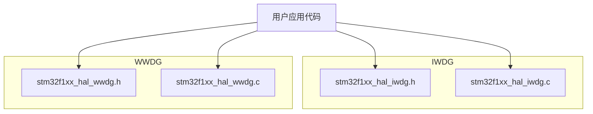
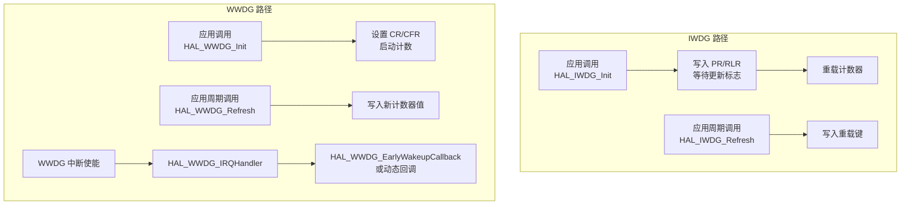
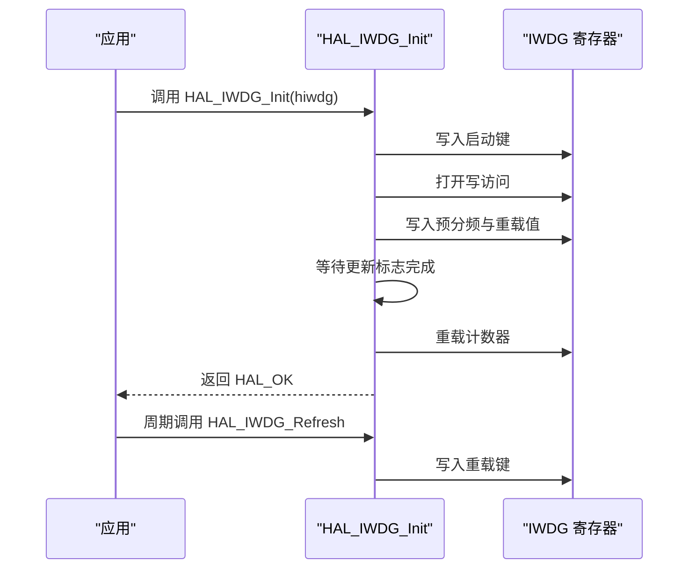
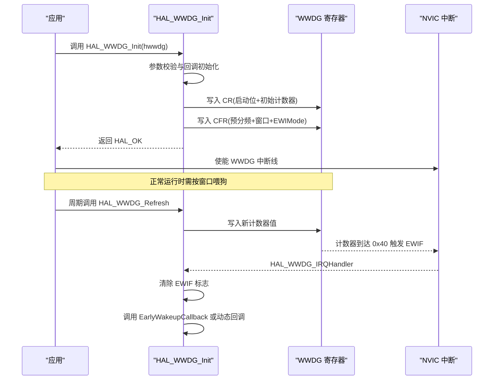
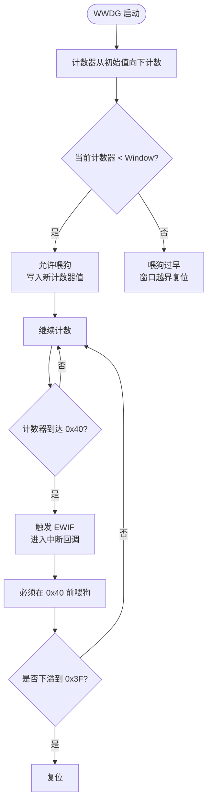
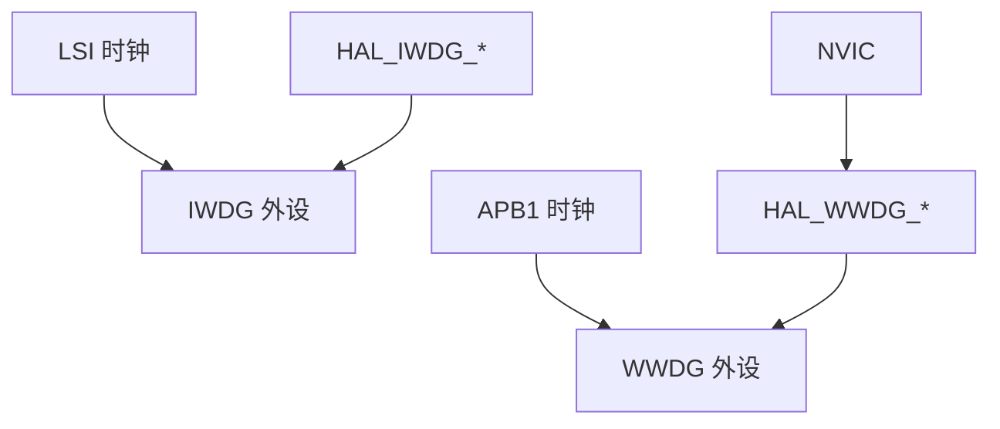

# 看门狗定时器

<cite>
**本文引用的文件**   
- [Inc/stm32f1xx_hal_iwdg.h](file://Inc/stm32f1xx_hal_iwdg.h)
- [Src/stm32f1xx_hal_iwdg.c](file://Src/stm32f1xx_hal_iwdg.c)
- [Inc/stm32f1xx_hal_wwdg.h](file://Inc/stm32f1xx_hal_wwdg.h)
- [Src/stm32f1xx_hal_wwdg.c](file://Src/stm32f1xx_hal_wwdg.c)
</cite>

## 目录
1. [引言](#引言)
2. [项目结构](#项目结构)
3. [核心组件](#核心组件)
4. [架构总览](#架构总览)
5. [详细组件分析](#详细组件分析)
6. [依赖关系分析](#依赖关系分析)
7. [性能与可靠性考虑](#性能与可靠性考虑)
8. [故障诊断与排错指南](#故障诊断与排错指南)
9. [结论](#结论)

## 引言
本文件面向 STM32F1xx HAL 驱动中的独立看门狗 IWDG 与窗口看门狗 WWDG，系统对比两者硬件特性、HAL 配置结构体、关键 API 调用流程、喂狗窗口与时序约束，以及在任务调度、中断、调试器、低功耗等场景下的使用建议。重点覆盖：
- IWDG：由内部低速内部时钟 LSI 驱动，仅支持“喂狗”，复位后自动倒计时；
- WWDG：基于 APB1 派生时钟，支持窗口比较器与提前唤醒中断 EWIF；
- HAL 接口：`HAL_IWDG_Init`/`HAL_IWDG_Refresh`、`HAL_WWDG_Init`/`HAL_WWDG_Refresh`/`HAL_WWDG_IRQHandler` 及回调；
- 典型问题：喂狗过早或过晚、窗口越界、中断优先级不足、调试暂停影响、多次初始化状态异常等。

## 项目结构
本仓库的看门狗相关代码集中在以下头文件与源文件中：
- IWDG：`stm32f1xx_hal_iwdg.h` 定义类型、常量与宏；`stm32f1xx_hal_iwdg.c` 实现初始化与刷新。
- WWDG：`stm32f1xx_hal_wwdg.h` 定义类型、常量、宏与回调注册接口；`stm32f1xx_hal_wwdg.c` 实现初始化、刷新、中断处理与回调。

**图表来源**
- [Inc/stm32f1xx_hal_iwdg.h:1-200](file://Inc/stm32f1xx_hal_iwdg.h#L1-L200)
- [Src/stm32f1xx_hal_iwdg.c:1-263](file://Src/stm32f1xx_hal_iwdg.c#L1-L263)
- [Inc/stm32f1xx_hal_wwdg.h:1-299](file://Inc/stm32f1xx_hal_wwdg.h#L1-L299)
- [Src/stm32f1xx_hal_wwdg.c:1-420](file://Src/stm32f1xx_hal_wwdg.c#L1-L420)

**章节来源**
- [Inc/stm32f1xx_hal_iwdg.h:1-200](file://Inc/stm32f1xx_hal_iwdg.h#L1-L200)
- [Src/stm32f1xx_hal_iwdg.c:1-263](file://Src/stm32f1xx_hal_iwdg.c#L1-L263)
- [Inc/stm32f1xx_hal_wwdg.h:1-299](file://Inc/stm32f1xx_hal_wwdg.h#L1-L299)
- [Src/stm32f1xx_hal_wwdg.c:1-420](file://Src/stm32f1xx_hal_wwdg.c#L1-L420)

## 核心组件
- IWDG 配置结构体 `IWDG_InitTypeDef`
  - 预分频系数 `Prescaler`：从 4、8、16、32、64、128、256 中选择；
  - 重载值 `Reload`：范围 0x000–0x0FFF；
  - 无窗口比较值、无中断模式字段；
- IWDG 句柄 `IWDG_HandleTypeDef`
  - 包含寄存器基地址与上述初始化结构体；
- WWDG 配置结构体 `WWDG_InitTypeDef`
  - 预分频系数 `Prescaler`：1、2、4、8；
  - 窗口比较值 `Window`：范围 0x40–0x7F；
  - 计数器初始值 `Counter`：范围 0x40–0x7F；
  - 提前唤醒中断模式 `EWIMode`：启用或禁用 EWIF；
- WWDG 句柄 `WWDG_HandleTypeDef`
  - 包含寄存器基地址、初始化结构体；
  - 在启用动态回调时，还包含早期唤醒回调函数指针和 MSP 初始化回调指针；
- 公共宏与标志
  - IWDG：启动键、重载键、写访问键、更新标志等待；
  - WWDG：使能位、中断使能、标志读取与清除宏、窗口与计数器范围检查宏。

**章节来源**
- [Inc/stm32f1xx_hal_iwdg.h:35-120](file://Inc/stm32f1xx_hal_iwdg.h#L35-L120)
- [Inc/stm32f1xx_hal_wwdg.h:35-120](file://Inc/stm32f1xx_hal_wwdg.h#L35-L120)

## 架构总览
IWDG 与 WWDG 在 HAL 层分别提供独立的初始化与 IO 操作接口，底层通过直接写入寄存器完成配置与喂狗。WWDG 还支持中断路径，由 `HAL_WWDG_IRQHandler` 触发用户回调。

**图表来源**
- [Src/stm32f1xx_hal_iwdg.c:100-263](file://Src/stm32f1xx_hal_iwdg.c#L100-L263)
- [Src/stm32f1xx_hal_wwdg.c:200-420](file://Src/stm32f1xx_hal_wwdg.c#L200-L420)

## 详细组件分析

### IWDG：硬件特性与 HAL 接口
- 硬件特性
  - 由内部低速内部时钟 LSI 驱动；
  - 一旦启动，LSI 强制开启且不可关闭；
  - 计数器从 0xFFF 开始向下计数，到 0x000 产生复位；
  - 写入特定键可重载计数器防止复位；
  - 调试模式下，可通过调试模块配置是否停止计数；
  - 超时范围受 LSI 频率分散影响，默认超时计算考虑最高预分频与 LSI 启动时间；
- HAL 配置字段
  - `IWDG_InitTypeDef.Prescaler`：选择 IWDG 预分频系数；
  - `IWDG_InitTypeDef.Reload`：重载寄存器值；
- 关键 API
  - `HAL_IWDG_Init`：启动 IWDG、打开写访问、写入预分频与重载值、等待更新标志并最后重载一次；
  - `HAL_IWDG_Refresh`：写入重载键以喂狗；
  - 宏：`__HAL_IWDG_START`、`__HAL_IWDG_RELOAD_COUNTER`、写访问开关宏；

**图表来源**
- [Src/stm32f1xx_hal_iwdg.c:100-263](file://Src/stm32f1xx_hal_iwdg.c#L100-L263)

**章节来源**
- [Src/stm32f1xx_hal_iwdg.c:1-263](file://Src/stm32f1xx_hal_iwdg.c#L1-L263)
- [Inc/stm32f1xx_hal_iwdg.h:35-200](file://Inc/stm32f1xx_hal_iwdg.h#L35-L200)

### WWDG：硬件特性与 HAL 接口
- 硬件特性
  - 计数器输入时钟来自 APB1 分频后的时钟；
  - 当计数器下溢至 0x3F（即从 0x40 滚到下溢）产生复位；
  - 若计数器在达到窗口值之前被刷新，也会产生复位；
  - 支持提前唤醒中断 EWIF：当计数器到达 0x40 时触发；
  - 一旦启用，无法软件关闭，只能通过系统复位恢复；
- HAL 配置字段
  - `WWDG_InitTypeDef.Prescaler`：1、2、4、8；
  - `WWDG_InitTypeDef.Window`：窗口比较值 0x40–0x7F；
  - `WWDG_InitTypeDef.Counter`：初始计数器 0x40–0x7F；
  - `WWDG_InitTypeDef.EWIMode`：启用或禁用 EWIF；
- 关键 API
  - `HAL_WWDG_Init`：参数校验、MSP 初始化、写入 CR 与 CFR 启动计数；
  - `HAL_WWDG_Refresh`：写入新的计数器值进行喂狗；
  - `HAL_WWDG_IRQHandler`：检查 EWIF 标志、清除标志、调用早期唤醒回调；
  - 回调：`HAL_WWDG_EarlyWakeupCallback`（弱实现），或在启用动态回调时使用 `EwiCallback`；
  - 注意：HAL 未暴露名为 `HAL_WWDG_Start_IT` 的公开 API；通常通过 `HAL_WWDG_Init` 配置 EWIMode 并配合 NVIC 使能中断线来实现“带中断的启动”；

**图表来源**
- [Src/stm32f1xx_hal_wwdg.c:200-420](file://Src/stm32f1xx_hal_wwdg.c#L200-L420)
- [Inc/stm32f1xx_hal_wwdg.h:120-299](file://Inc/stm32f1xx_hal_wwdg.h#L120-L299)

**章节来源**
- [Src/stm32f1xx_hal_wwdg.c:1-420](file://Src/stm32f1xx_hal_wwdg.c#L1-L420)
- [Inc/stm32f1xx_hal_wwdg.h:1-299](file://Inc/stm32f1xx_hal_wwdg.h#L1-L299)

### 喂狗窗口概念与越界行为
- 喂狗窗口
  - WWDG 要求仅在计数器小于已编程窗口值时刷新；
  - 若在计数器仍大于窗口值时刷新，视为“窗口越界”，将触发复位；
  - 若计数器下溢到 0x3F（从 0x40 滚到下溢），也触发复位；
- 早期唤醒中断 EWIF
  - 当计数器到达 0x40 时触发 EWIF；
  - 可用于记录日志、发送告警或执行安全动作；
  - EWIF 使能后不能软件关闭，只能系统复位恢复；
- 时序约束
  - 最大超时时间取决于计数器初始值与预分频；
  - 最小喂狗间隔为“计数器当前值减去窗口值”对应的时间；
  - 必须在窗口内喂狗，避免过早或过晚导致复位；

**图表来源**
- [Src/stm32f1xx_hal_wwdg.c:1-120](file://Src/stm32f1xx_hal_wwdg.c#L1-L120)
- [Inc/stm32f1xx_hal_wwdg.h:120-299](file://Inc/stm32f1xx_hal_wwdg.h#L120-L299)

**章节来源**
- [Src/stm32f1xx_hal_wwdg.c:1-420](file://Src/stm32f1xx_hal_wwdg.c#L1-L420)
- [Inc/stm32f1xx_hal_wwdg.h:120-299](file://Inc/stm32f1xx_hal_wwdg.h#L120-L299)

### 实际代码示例（按文件路径引用）
- IWDG 初始化与喂狗
  - 初始化：参考 `HAL_IWDG_Init` 实现位置；
  - 喂狗：参考 `HAL_IWDG_Refresh` 实现位置；
  - 宏使用：`__HAL_IWDG_START`、`__HAL_IWDG_RELOAD_COUNTER`；
- WWDG 初始化与中断
  - 初始化：参考 `HAL_WWDG_Init` 实现位置；
  - 喂狗：参考 `HAL_WWDG_Refresh` 实现位置；
  - 中断处理：参考 `HAL_WWDG_IRQHandler` 实现位置；
  - 回调：参考 `HAL_WWDG_EarlyWakeupCallback` 与动态回调注册；
  - “带中断的启动”：通过 `HAL_WWDG_Init` 配置 EWIMode，并在 NVIC 中使能 WWDG 中断线；HAL 未提供名为 `HAL_WWDG_Start_IT` 的函数。

**章节来源**
- [Src/stm32f1xx_hal_iwdg.c:100-263](file://Src/stm32f1xx_hal_iwdg.c#L100-L263)
- [Src/stm32f1xx_hal_wwdg.c:200-420](file://Src/stm32f1xx_hal_wwdg.c#L200-L420)

## 依赖关系分析
- IWDG 依赖
  - 依赖 LSI 时钟；
  - 依赖 HAL 提供的延时与 tick 获取用于等待寄存器更新标志；
  - 依赖 RCC 调试模块宏以控制调试模式下是否冻结 IWDG；
- WWDG 依赖
  - 依赖 APB1 时钟；
  - 依赖 NVIC 中断线以实现 EWIF；
  - 依赖 HAL 的寄存器写宏与标志位宏；
- HAL 层耦合
  - 两者均通过句柄对象管理实例与配置；
  - WWDG 在启用动态回调时增加回调指针字段与注册/注销 API；

**图表来源**
- [Src/stm32f1xx_hal_iwdg.c:1-263](file://Src/stm32f1xx_hal_iwdg.c#L1-L263)
- [Src/stm32f1xx_hal_wwdg.c:1-420](file://Src/stm32f1xx_hal_wwdg.c#L1-L420)

**章节来源**
- [Src/stm32f1xx_hal_iwdg.c:1-263](file://Src/stm32f1xx_hal_iwdg.c#L1-L263)
- [Src/stm32f1xx_hal_wwdg.c:1-420](file://Src/stm32f1xx_hal_wwdg.c#L1-L420)

## 性能与可靠性考虑
- IWDG
  - LSI 频率存在分散性，默认超时可能偏短或偏长；可根据实测 LSI 频率调整 `LSI_VALUE` 以获得更精确的超时估算；
  - 等待寄存器更新标志时使用默认超时，若 LSI 变化可能导致等待失败；
  - 调试模式下可选择冻结或继续运行，需注意调试器对超时的影响；
- WWDG
  - 窗口限制严格，任务调度延迟可能导致窗口越界；
  - EWIF 中断必须配置足够高的优先级，确保在 0x40 到来前及时喂狗；
  - 由于 WWDG 启用后不可软件关闭，需在系统设计中明确其生命周期；
- 系统任务调度
  - 喂狗应放在可靠的任务路径上，避免低优先级任务被长期抢占；
  - 临界区中应避免长时间持有中断锁，以免错过窗口；
  - 建议在心跳或调度器中集中喂狗，并结合统计信息检测异常；
- 功耗与可靠性
  - IWDG 在 STOP/STANDBY 仍可工作并可从 STANDBY 唤醒 CPU；
  - WWDG 用于检测软件逻辑错误，适合强约束窗口场景；
  - 合理选择预分频与重载值，平衡实时性与功耗；
  - 结合 RCC 复位标志位判断是否发生看门狗复位，便于系统自检。

[本节为通用设计建议，不直接分析具体源码文件]

## 故障诊断与排错指南
- 喂狗过早
  - 现象：WWDG 在计数器尚未低于窗口值时刷新，触发复位；
  - 排查：确认 `Window` 与 `Counter` 配置是否正确；确保喂狗时机在计数器小于窗口值之后；
- 喂狗过晚
  - 现象：计数器下溢到 0x3F 触发复位；
  - 排查：提高喂狗频率或增大初始计数器值；检查任务调度是否被高优先级任务长期抢占；
- 窗口配置错误
  - 现象：窗口值不在 0x40–0x7F 范围，或初始计数器小于等于窗口值；
  - 排查：检查 `IS_WWDG_WINDOW` 与 `IS_WWDG_COUNTER` 宏条件；
- 中断优先级不足
  - 现象：EWIF 触发但未能及时喂狗；
  - 排查：提升 WWDG 中断优先级；确认 NVIC 已使能 WWDG 中断线；检查回调执行时间；
- 调试器暂停导致超时
  - 现象：单步或断点时 IWDG/WWDG 触发复位；
  - 排查：IWDG 调试冻结配置；WWDG 在调试模式下仍计数；必要时在调试会话中临时禁用或正确关闭（WWDG 启用后不可软件关闭）；
- 多次初始化导致状态异常
  - 现象：重复调用 `HAL_WWDG_Init` 改变参数但未正确处理已有状态；
  - 排查：在 MspInit 回调中加入防重入或状态机；避免在未复位的情况下重新配置 WWDG；
- IWDG 默认超时异常
  - 现象：`HAL_IWDG_Init` 等待更新标志超时；
  - 排查：调整 `LSI_VALUE`；检查 LSI 是否稳定；确认预分频与重载值合法；

**章节来源**
- [Src/stm32f1xx_hal_iwdg.c:1-263](file://Src/stm32f1xx_hal_iwdg.c#L1-L263)
- [Src/stm32f1xx_hal_wwdg.c:1-420](file://Src/stm32f1xx_hal_wwdg.c#L1-L420)
- [Inc/stm32f1xx_hal_wwdg.h:120-299](file://Inc/stm32f1xx_hal_wwdg.h#L120-L299)

## 结论
IWDG 与 WWDG 在 STM32F1xx HAL 中分别承担不同层次的可靠性保障职责：IWDG 简单可靠、由 LSI 驱动，适合基础系统健康监控；WWDG 提供更严格的窗口约束与提前唤醒中断，适合需要明确喂狗窗口与安全动作的场景。正确使用 HAL 接口、合理配置预分频与重载值、严格遵守喂狗窗口与时序、妥善处理中断与调试环境，是保证系统长期稳定运行的关键。

[本节为总结性内容，不直接分析具体源码文件]