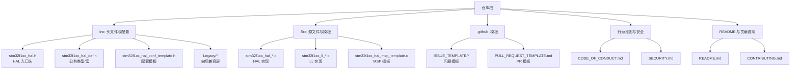
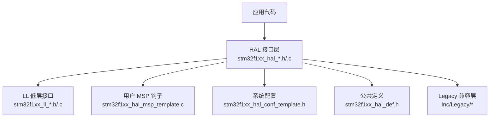
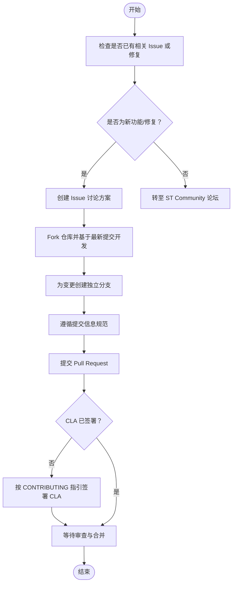
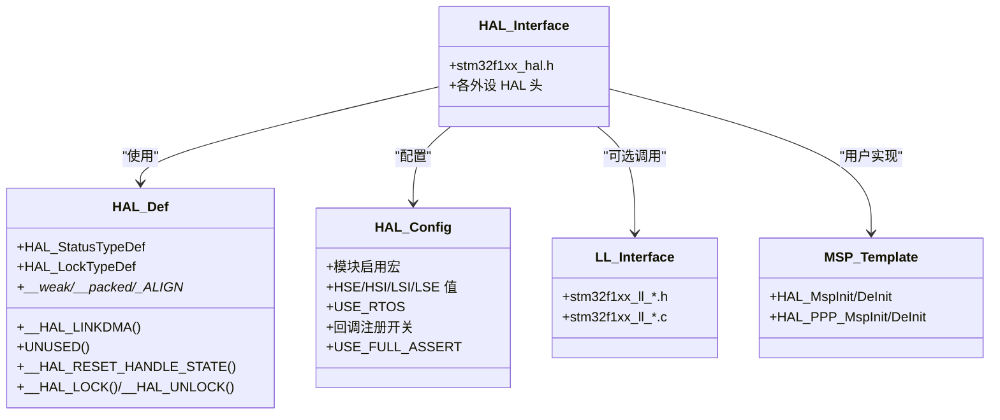
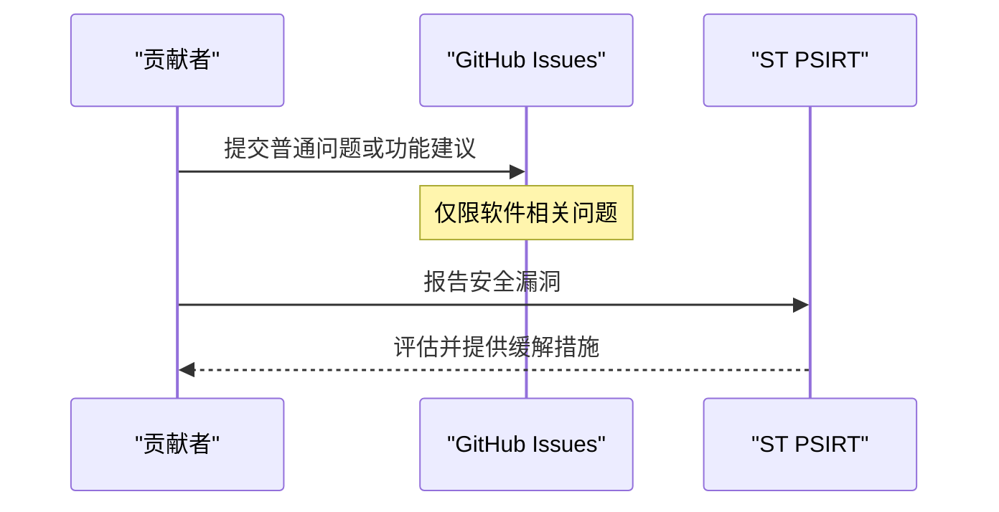
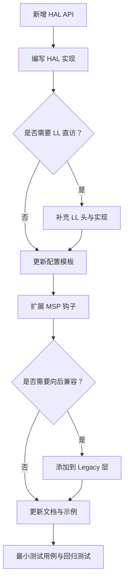
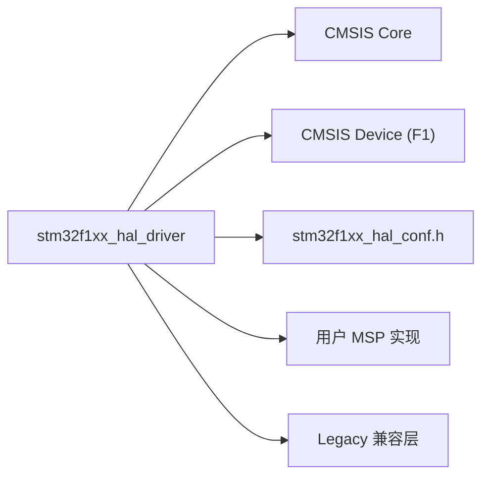

# 开发者贡献指南

<cite>
**本文引用的文件**   
- [CONTRIBUTING.md](file://CONTRIBUTING.md)
- [CODE_OF_CONDUCT.md](file://CODE_OF_CONDUCT.md)
- [SECURITY.md](file://SECURITY.md)
- [README.md](file://README.md)
- [PULL_REQUEST_TEMPLATE.md](file://.github/PULL_REQUEST_TEMPLATE.md)
- [bug_report.md](file://.github/ISSUE_TEMPLATE/bug_report.md)
- [other-issue.md](file://.github/ISSUE_TEMPLATE/other-issue.md)
- [stm32f1xx_hal_def.h](file://Inc/stm32f1xx_hal_def.h)
- [stm32f1xx_hal_conf_template.h](file://Inc/stm32f1xx_hal_conf_template.h)
- [stm32f1xx_hal.h](file://Inc/stm32f1xx_hal.h)
- [stm32f1xx_hal_msp_template.c](file://Src/stm32f1xx_hal_msp_template.c)
</cite>

## 目录
1. [简介](#简介)
2. [项目结构](#项目结构)
3. [核心组件](#核心组件)
4. [架构总览](#架构总览)
5. [详细组件分析](#详细组件分析)
6. [依赖分析](#依赖分析)
7. [性能与可维护性](#性能与可维护性)
8. [本地验证建议](#本地验证建议)
9. [常见问题排查](#常见问题排查)
10. [结论](#结论)

## 简介
本指南面向希望为 STM32F1xx HAL Driver 仓库贡献代码的开发者，涵盖从问题报告、分支与提交规范、Pull Request 流程，到代码风格、C/C++ 兼容性、MSP 钩子扩展、文档与向后兼容层要求。仓库属于 STM32CubeF1 MCU 组件之一，提供 HAL 与 LL 驱动层接口；贡献前请同时阅读仓库 README、行为准则与安全披露政策。

## 项目结构
该仓库采用按“功能模块 + 分层”组织方式：
- `Inc/`：HAL 与 LL 头文件、公共定义、配置模板、向后兼容层。
- `Src/`：对应 HAL/LL 实现；包含用户侧 MSP 模板与时基模板。
- `.github/`：Issue 模板与 Pull Request 模板。
- 根目录：贡献说明、社区行为准则、安全策略、发布说明与仓库介绍。



**图表来源**
- [stm32f1xx_hal.h:1-40](file://Inc/stm32f1xx_hal.h#L1-L40)
- [stm32f1xx_hal_def.h:1-40](file://Inc/stm32f1xx_hal_def.h#L1-L40)
- [stm32f1xx_hal_conf_template.h:1-30](file://Inc/stm32f1xx_hal_conf_template.h#L1-L30)
- [stm32f1xx_hal_msp_template.c:1-30](file://Src/stm32f1xx_hal_msp_template.c#L1-L30)
- [PULL_REQUEST_TEMPLATE.md:1-5](file://.github/PULL_REQUEST_TEMPLATE.md#L1-L5)
- [bug_report.md:1-10](file://.github/ISSUE_TEMPLATE/bug_report.md#L1-L10)
- [other-issue.md:1-10](file://.github/ISSUE_TEMPLATE/other-issue.md#L1-L10)
- [CODE_OF_CONDUCT.md:1-20](file://CODE_OF_CONDUCT.md#L1-L20)
- [SECURITY.md:1-20](file://SECURITY.md#L1-L20)
- [README.md:1-25](file://README.md#L1-L25)
- [CONTRIBUTING.md:1-20](file://CONTRIBUTING.md#L1-L20)

**章节来源**
- [README.md:1-45](file://README.md#L1-L45)
- [CONTRIBUTING.md:1-40](file://CONTRIBUTING.md#L1-L40)

## 核心组件
- HAL 入口头 `stm32f1xx_hal.h`：汇总各外设 HAL 接口，并引入配置头 `stm32f1xx_hal_conf.h`。
- 公共定义 `stm32f1xx_hal_def.h`：统一状态枚举、锁、对齐与编译器适配宏，是 HAL/LL 一致性的基础。
- 配置模板 `stm32f1xx_hal_conf_template.h`：启用/禁用模块、时钟值、回调开关、断言等。
- MSP 模板 `stm32f1xx_hal_msp_template.c`：用户侧低层初始化钩子（全局与每外设）。
- Legacy 向后兼容层：保留旧 API 或旧命名空间，便于升级。

**章节来源**
- [stm32f1xx_hal.h:1-60](file://Inc/stm32f1xx_hal.h#L1-L60)
- [stm32f1xx_hal_def.h:1-80](file://Inc/stm32f1xx_hal_def.h#L1-L80)
- [stm32f1xx_hal_conf_template.h:1-80](file://Inc/stm32f1xx_hal_conf_template.h#L1-L80)
- [stm32f1xx_hal_msp_template.c:1-60](file://Src/stm32f1xx_hal_msp_template.c#L1-L60)

## 架构总览
STM32CubeF1 HAL/LL 驱动的分层如下：应用通过 HAL 调用，HAL 在必要时委托给 LL 或直接操作寄存器；用户侧通过 MSP 钩子完成具体板级资源初始化。



**图表来源**
- [stm32f1xx_hal.h:1-40](file://Inc/stm32f1xx_hal.h#L1-L40)
- [stm32f1xx_hal_def.h:1-40](file://Inc/stm32f1xx_hal_def.h#L1-L40)
- [stm32f1xx_hal_conf_template.h:1-30](file://Inc/stm32f1xx_hal_conf_template.h#L1-L30)
- [stm32f1xx_hal_msp_template.c:1-30](file://Src/stm32f1xx_hal_msp_template.c#L1-L30)

## 详细组件分析

### 贡献流程与协作规范
- 先开 Issue 沟通需求，确认范围后再提交 PR。
- Fork 仓库并使用最新提交开发；每个新功能或修复单独提交一个 PR。
- 个人与企业贡献者需签署 CLA；企业 CLA 优先级高于个人 CLA。
- 支持类问题应转到 ST Community 论坛。



**图表来源**
- [CONTRIBUTING.md:1-40](file://CONTRIBUTING.md#L1-L40)
- [PULL_REQUEST_TEMPLATE.md:1-5](file://.github/PULL_REQUEST_TEMPLATE.md#L1-L5)

**章节来源**
- [CONTRIBUTING.md:1-40](file://CONTRIBUTING.md#L1-L40)
- [PULL_REQUEST_TEMPLATE.md:1-5](file://.github/PULL_REQUEST_TEMPLATE.md#L1-L5)

### 代码风格、注释约定与头文件组织
- 使用统一的 HAL 状态类型与锁机制，避免自定义错误码破坏一致性。
- 所有公共类型、枚举、宏集中在 `stm32f1xx_hal_def.h`，供 HAL/LL 共享。
- 头文件以 `extern "C"` 包裹保证 C/C++ 兼容。
- 使用 `__weak`、`__packed`、`__attribute__((aligned))` 等宏屏蔽编译器差异。
- 配置项集中放在 `stm32f1xx_hal_conf_template.h`，应用侧复制并重命名为 `stm32f1xx_hal_conf.h`。
- 新外设或新增 API 应优先暴露于 HAL 层，必要时再补充 LL 层。
- 对可能影响旧版本的符号，放入 `Inc/Legacy` 进行向后兼容。



**图表来源**
- [stm32f1xx_hal_def.h:40-211](file://Inc/stm32f1xx_hal_def.h#L40-L211)
- [stm32f1xx_hal_conf_template.h:1-120](file://Inc/stm32f1xx_hal_conf_template.h#L1-L120)
- [stm32f1xx_hal.h:1-60](file://Inc/stm32f1xx_hal.h#L1-L60)
- [stm32f1xx_hal_msp_template.c:1-92](file://Src/stm32f1xx_hal_msp_template.c#L1-L92)

**章节来源**
- [stm32f1xx_hal_def.h:1-211](file://Inc/stm32f1xx_hal_def.h#L1-L211)
- [stm32f1xx_hal_conf_template.h:1-200](file://Inc/stm32f1xx_hal_conf_template.h#L1-L200)
- [stm32f1xx_hal.h:1-120](file://Inc/stm32f1xx_hal.h#L1-L120)
- [stm32f1xx_hal_msp_template.c:1-92](file://Src/stm32f1xx_hal_msp_template.c#L1-L92)

### C99/C++ 兼容性要求
- 所有对外头文件以 `extern "C"` 包裹，确保 C++ 工程可直接包含。
- 使用标准头 `<stddef.h>` 与无符号字面量后缀 `U`，提高可移植性。
- 针对 ARM Compiler V4/V5/V6、GNU GCC、IAR ICCARM 提供 `__weak`、`__packed`、对齐与 RAM 函数段等宏。
- 当前版本中 RTOS 集成标志位处于受控状态，避免在未支持的配置下编译。

```mermaid
flowchart TD
    In["包含公共头"] --> CppCheck{"是否为 C++ 编译？"}
    CppCheck -->|是| ExternC["进入 extern \"C\" 块"]
    CppCheck -->|否| Skip["跳过 extern \"C\""]
    ExternC --> Types["定义 HAL_StatusTypeDef / HAL_LockTypeDef"]
    Skip --> Types
    Types --> Macros["定义 UNUSED / __HAL_* / 对齐宏"]
    Macros --> Compiler["选择 __weak/__packed/对齐属性"]
    Compiler --> RTOS["处理 USE_RTOS 分支"]
```

**图表来源**
- [stm32f1xx_hal_def.h:1-120](file://Inc/stm32f1xx_hal_def.h#L1-L120)

**章节来源**
- [stm32f1xx_hal_def.h:1-211](file://Inc/stm32f1xx_hal_def.h#L1-L211)

### 社区行为准则与安全漏洞报告
- 行为准则遵循 Contributor Covenant 1.4，强调包容、尊重与专业交流；违规内容将被移除，严重者可被暂时或永久封禁。
- 安全问题不得通过公开 Issue 报告，应通过 ST PSIRT 专用通道提交；提交即授予 ST 分析与修复所需权利，并适用隐私政策。



**图表来源**
- [CODE_OF_CONDUCT.md:1-76](file://CODE_OF_CONDUCT.md#L1-L76)
- [SECURITY.md:1-31](file://SECURITY.md#L1-L31)

**章节来源**
- [CODE_OF_CONDUCT.md:1-76](file://CODE_OF_CONDUCT.md#L1-L76)
- [SECURITY.md:1-31](file://SECURITY.md#L1-L31)

### 如何为新外设或新功能添加接口
推荐路径：
1. 在 HAL 层新增 API，保持与现有 HAL 接口风格一致。
2. 若需要直接寄存器访问能力，同步提供 LL 层封装。
3. 在 `stm32f1xx_hal_conf_template.h` 中新增模块启用宏与回调注册开关。
4. 在 MSP 模板中预留 `HAL_<PPP>_MspInit/DeInit` 钩子，由用户实现板级细节。
5. 如需兼容旧 API，将旧符号迁移至 `Inc/Legacy` 并保留映射。
6. 更新文档、示例与发布说明。



**图表来源**
- [stm32f1xx_hal_conf_template.h:1-120](file://Inc/stm32f1xx_hal_conf_template.h#L1-L120)
- [stm32f1xx_hal_msp_template.c:1-92](file://Src/stm32f1xx_hal_msp_template.c#L1-L92)

**章节来源**
- [stm32f1xx_hal_conf_template.h:1-200](file://Inc/stm32f1xx_hal_conf_template.h#L1-L200)
- [stm32f1xx_hal_msp_template.c:1-92](file://Src/stm32f1xx_hal_msp_template.c#L1-L92)

### 常见审查意见与回归测试清单
- 接口与命名是否与现有 HAL 一致。
- 是否使用了 HAL 公共类型与状态码。
- 是否覆盖 C/C++ 两种编译模式。
- 是否仅在配置启用时编译相关代码。
- 是否考虑不同编译器与对齐要求。
- 是否保留或正确迁移旧 API。
- 是否附带最小可复现用例。
- 是否通过静态检查与基本编译测试。
- 是否更新了相关文档与 Release Notes。

[本节为通用清单，不直接分析具体文件]

## 依赖分析
- CMSIS Core 与 CMSIS Device 必须与 HAL 版本匹配；README 给出了历史版本对照表。
- 运行时依赖包括：CMSIS 头、设备头、HAL 公共定义、配置头与用户实现的 MSP。
- 向后兼容依赖 Legacy 头，避免破坏既有应用。



**图表来源**
- [README.md:25-45](file://README.md#L25-L45)
- [stm32f1xx_hal.h:1-40](file://Inc/stm32f1xx_hal.h#L1-L40)
- [stm32f1xx_hal_conf_template.h:1-30](file://Inc/stm32f1xx_hal_conf_template.h#L1-L30)

**章节来源**
- [README.md:25-45](file://README.md#L25-L45)

## 性能与可维护性
- 避免在热点路径中使用阻塞延时或复杂逻辑；必要时将关键路径放入 RAM 执行。
- 合理使用 `__NOINLINE`、RAM 函数段与中断优先级控制。
- 仅启用必要的 HAL 模块以减少代码体积与链接时间。
- 使用 `UNUSED` 宏消除未使用参数警告，提升可移植性。
- 将易变硬件参数抽象为配置宏，降低条件编译复杂度。

[本节为通用指导，不直接分析具体文件]

## 本地验证建议
- 编译器
  - ARM Compiler v5/v6、GNU GCC、IAR ICCARM 至少覆盖一种主流工具链。
  - 开启严格警告级别，确保无新增警告。
- CMSIS 依赖
  - 使用 README 所列版本组合：CMSIS Core、CMSIS Device F1、HAL Driver 三者版本保持一致。
- 静态检查
  - 运行 MISRA 或项目既定静态规则检查。
  - 确保头文件顺序稳定，无循环依赖。
- 最小测试用例
  - 使用 `stm32f1xx_hal_msp_template.c` 提供最小 MSP 实现。
  - 构造最简用例：初始化时钟、GPIO/串口等基本外设，验证 API 返回状态。
  - 分别用 C 与 C++ 编译，确认 `extern "C"` 有效。
- 兼容性验证
  - 开启/关闭目标模块宏，验证构建与链接。
  - 检查 Legacy 头是否仍能编译旧代码。
  - 校验回调注册开关与断言开关的行为符合预期。

**章节来源**
- [README.md:25-45](file://README.md#L25-L45)
- [stm32f1xx_hal_msp_template.c:1-92](file://Src/stm32f1xx_hal_msp_template.c#L1-L92)

## 常见问题排查
- 无法找到 `stm32f1xx_hal_conf.h`
  - 需要将模板复制到应用目录并重命名为 `stm32f1xx_hal_conf.h`。
- 编译出现 RTOS 相关错误
  - 当前 HAL 版本中 `USE_RTOS` 处于受控状态，请勿随意启用。
- 回调函数未被调用
  - 检查配置中的回调注册开关是否启用。
- 指针或结构体对齐导致异常
  - 使用 HAL 提供的对齐宏，不要硬编码 `__attribute__((aligned(...)))`。
- 旧代码无法编译
  - 检查 `Legacy` 层是否仍包含所需旧符号映射。

**章节来源**
- [stm32f1xx_hal_conf_template.h:1-120](file://Inc/stm32f1xx_hal_conf_template.h#L1-L120)
- [stm32f1xx_hal_def.h:120-211](file://Inc/stm32f1xx_hal_def.h#L120-L211)

## 结论
参与 STM32F1xx HAL Driver 贡献时，请优先遵循仓库的 Issue/PR 流程、签署 CLA、遵守社区行为准则与安全披露要求；在技术层面，坚持 HAL/LL 分层、统一公共定义、C/C++ 兼容、合理配置与 MSP 钩子，并通过最小测试与静态检查保障质量。对新功能与 API，务必兼顾向后兼容与文档完整性，以降低升级成本与维护负担。