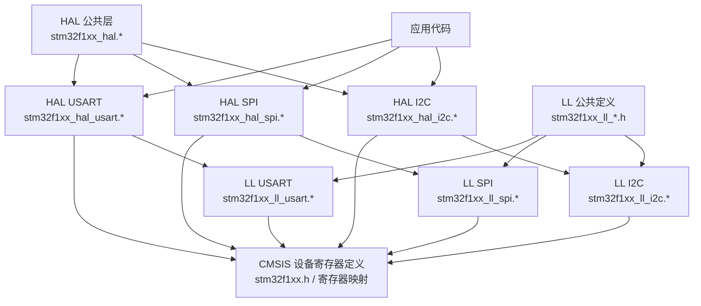
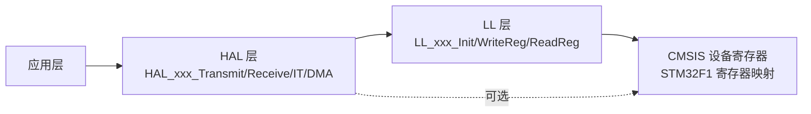
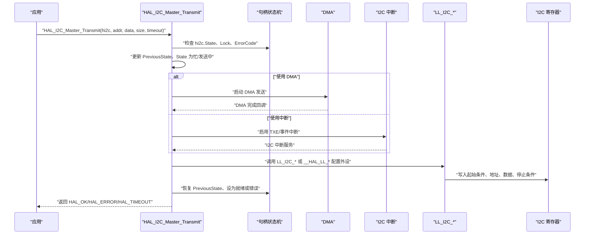
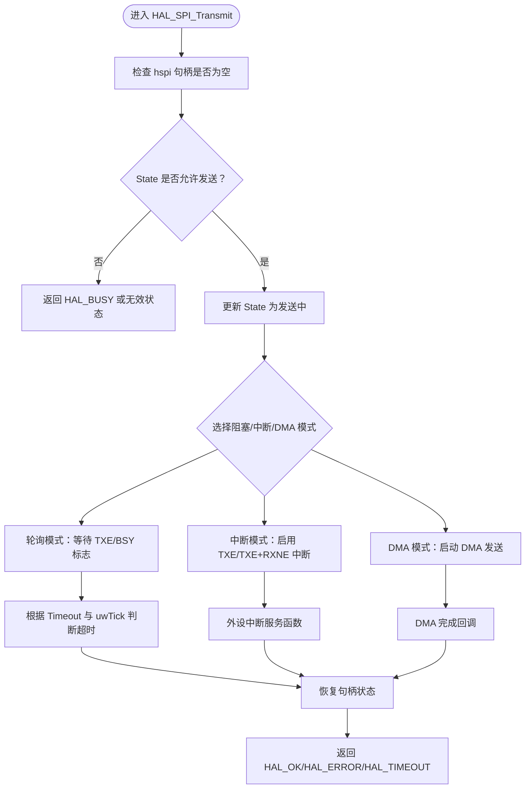
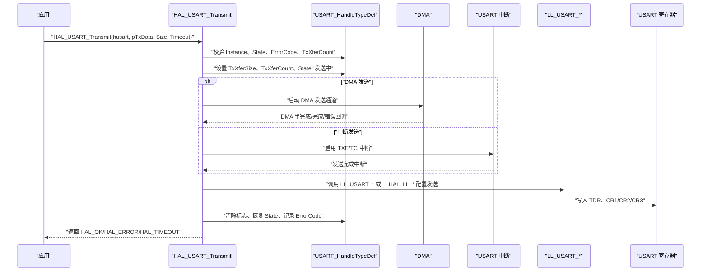
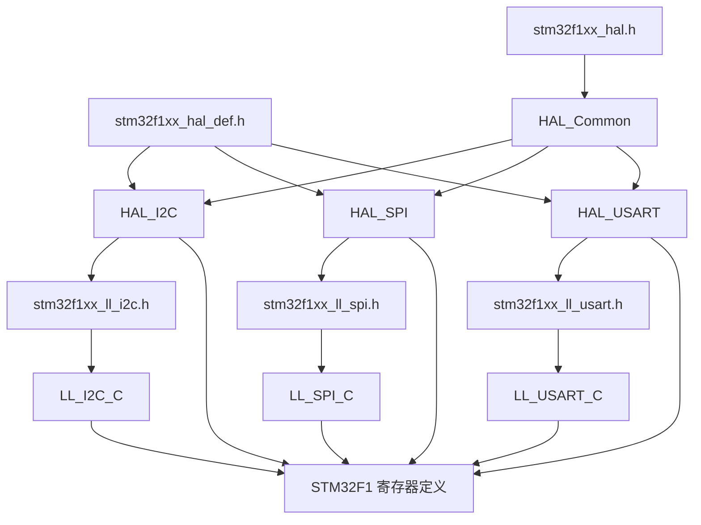

# HAL → LL → 寄存器三层架构

<cite>
**本文引用的文件**   
- [README.md](file://README.md)
- [stm32f1xx_hal.h](file://Inc/stm32f1xx_hal.h)
- [stm32f1xx_hal_def.h](file://Inc/stm32f1xx_hal_def.h)
- [stm32f1xx_hal.c](file://Src/stm32f1xx_hal.c)
- [stm32f1xx_hal_i2c.h](file://Inc/stm32f1xx_hal_i2c.h)
- [stm32f1xx_hal_i2c.c](file://Src/stm32f1xx_hal_i2c.c)
- [stm32f1xx_ll_i2c.h](file://Inc/stm32f1xx_ll_i2c.h)
- [stm32f1xx_ll_i2c.c](file://Src/stm32f1xx_ll_i2c.c)
- [stm32f1xx_hal_spi.h](file://Inc/stm32f1xx_hal_spi.h)
- [stm32f1xx_hal_spi.c](file://Src/stm32f1xx_hal_spi.c)
- [stm32f1xx_ll_spi.h](file://Inc/stm32f1xx_ll_spi.h)
- [stm32f1xx_ll_spi.c](file://Src/stm32f1xx_ll_spi.c)
- [stm32f1xx_hal_usart.h](file://Inc/stm32f1xx_hal_usart.h)
- [stm32f1xx_hal_usart.c](file://Src/stm32f1xx_hal_usart.c)
- [stm32f1xx_ll_usart.h](file://Inc/stm32f1xx_ll_usart.h)
- [stm32f1xx_ll_usart.c](file://Src/stm32f1xx_ll_usart.c)
</cite>

## 目录
1. [引言](#引言)
2. [项目结构](#项目结构)
3. [核心组件](#核心组件)
4. [架构总览](#架构总览)
5. [详细组件分析](#详细组件分析)
6. [依赖关系分析](#依赖关系分析)
7. [性能与体积权衡](#性能与体积权衡)
8. [HAL 与 LL 选择决策指南](#hal-与-ll-选择决策指南)
9. [故障排查与常见误区](#故障排查与常见误区)
10. [结论](#结论)

## 引言
本仓库是 STM32CubeF1 的 HAL-LL 驱动组件，提供面向应用的可移植 HAL API，以及更贴近寄存器的轻量 LL 接口。HAL 层负责外设状态机、超时控制、DMA/中断调度、回调分发和句柄管理；LL 层暴露直接操作寄存器的函数与宏，适合高性能或极小代码体积场景；最底层 CMSIS Device 寄存器定义被两者共同依赖。通过 I2C、SPI、USART 三类典型外设，可以清晰看到调用链：应用调用 `HAL_xxx_Transmit` → HAL 检查句柄与状态 → 设置 DMA/中断 → 调用 `__HAL_LL_*` 宏或 `LL_*` 函数 → 触发外设中断/DMA 完成标志 → 回调通知应用。

**章节来源**
- [README.md:1-45](file://README.md#L1-L45)

## 项目结构
仓库按“头文件在 Inc，实现文件在 Src”的方式组织，每个外设通常同时存在 HAL 与 LL 两套接口：

- HAL 头文件与实现：`Inc/stm32f1xx_hal_*.h` 与 `Src/stm32f1xx_hal_*.c`
- LL 头文件与实现：`Inc/stm32f1xx_ll_*.h` 与 `Src/stm32f1xx_ll_*.c`
- 通用 HAL 基础设施：`stm32f1xx_hal.h`、`stm32f1xx_hal_def.h`、`stm32f1xx_hal.c`
- 外设示例：I2C、SPI、USART、DMA、RCC、GPIO 等

**图表来源**
- [stm32f1xx_hal.h:1-260](file://Inc/stm32f1xx_hal.h#L1-L260)
- [stm32f1xx_hal_def.h:1-211](file://Inc/stm32f1xx_hal_def.h#L1-L211)
- [stm32f1xx_hal_i2c.h:1-260](file://Inc/stm32f1xx_hal_i2c.h#L1-L260)
- [stm32f1xx_ll_i2c.h:1-260](file://Inc/stm32f1xx_ll_i2c.h#L1-L260)
- [stm32f1xx_hal_spi.h:1-240](file://Inc/stm32f1xx_hal_spi.h#L1-L240)
- [stm32f1xx_ll_spi.h:1-220](file://Inc/stm32f1xx_ll_spi.h#L1-L220)
- [stm32f1xx_hal_usart.h:1-260](file://Inc/stm32f1xx_hal_usart.h#L1-L260)
- [stm32f1xx_ll_usart.h:1-240](file://Inc/stm32f1xx_ll_usart.h#L1-L240)

**章节来源**
- [stm32f1xx_hal.h:1-260](file://Inc/stm32f1xx_hal.h#L1-L260)
- [stm32f1xx_hal_def.h:1-211](file://Inc/stm32f1xx_hal_def.h#L1-L211)

## 核心组件
### HAL 公共基础设施
- `HAL_Init()` 配置 Flash 预取、NVIC 优先级分组、SysTick 时间基，并调用用户可重写的 `HAL_MspInit()`。
- `uwTick`、`uwTickPrio`、`uwTickFreq` 为全局 Tick 变量，用于延时与超时。
- `HAL_StatusTypeDef`、`HAL_LockTypeDef`、`__HAL_LOCK/__HAL_UNLOCK`、`__HAL_RESET_HANDLE_STATE`、`__HAL_LINKDMA` 等宏定义在 `stm32f1xx_hal_def.h`，是所有 HAL 外设句柄的通用基础。

这些机制使 HAL 能够统一处理错误码、互斥锁、DMA 绑定、句柄复位以及基于 SysTick 的超时。

**章节来源**
- [stm32f1xx_hal.c:1-260](file://Src/stm32f1xx_hal.c#L1-L260)
- [stm32f1xx_hal_def.h:1-211](file://Inc/stm32f1xx_hal_def.h#L1-L211)

### HAL 外设句柄模型
以 I2C、SPI、USART 为例，HAL 句柄包含：
- 外设寄存器基地址指针
- 配置结构体（如波特率、数据位、停止位、模式）
- 传输缓冲区指针、剩余计数
- DMA 句柄指针
- 锁、状态、错误码、回调函数指针

状态枚举明确区分空闲、忙、发送中、接收中、监听、超时、错误等状态，配合超时等待逻辑形成完整的外设状态机。

**章节来源**
- [stm32f1xx_hal_i2c.h:1-260](file://Inc/stm32f1xx_hal_i2c.h#L1-L260)
- [stm32f1xx_hal_spi.h:1-240](file://Inc/stm32f1xx_hal_spi.h#L1-L240)
- [stm32f1xx_hal_usart.h:1-260](file://Inc/stm32f1xx_hal_usart.h#L1-L260)

### LL 轻量接口
LL 层提供：
- 初始化/反初始化函数
- 寄存器读写宏 `LL_I2C_WriteReg`、`LL_I2C_ReadReg` 等
- 中断与标志宏，例如 `LL_SPI_CR2_TXEIE`、`LL_USART_SR_RXNE`
- 参数校验宏，例如 `IS_LL_SPI_MODE`、`IS_LL_USART_BAUDRATE`

LL 不维护 HAL 句柄，也不自带超时、回调与复杂状态机，因此更适合需要最小开销、直接控制外设的行为。

**章节来源**
- [stm32f1xx_ll_i2c.h:1-260](file://Inc/stm32f1xx_ll_i2c.h#L1-L260)
- [stm32f1xx_ll_spi.h:1-220](file://Inc/stm32f1xx_ll_spi.h#L1-L220)
- [stm32f1xx_ll_usart.h:1-240](file://Inc/stm32f1xx_ll_usart.h#L1-L240)

## 架构总览
下图展示从应用到寄存器的分层调用关系。HAL 作为应用与硬件之间的稳定抽象层，LL 作为更薄的一层，二者最终都访问 CMSIS 设备寄存器。

- HAL 层封装句柄、状态机、超时、DMA、中断与回调。
- LL 层直接操作寄存器，语义更接近数据手册。
- HAL 内部可能直接使用 LL 或 HAL 自有的 `__HAL_*` 宏访问寄存器。

**图表来源**
- [stm32f1xx_hal_i2c.c:1074-1074](file://Src/stm32f1xx_hal_i2c.c#L1074-L1074)
- [stm32f1xx_ll_i2c.c:129-179](file://Src/stm32f1xx_ll_i2c.c#L129-L179)
- [stm32f1xx_hal_spi.c:795-795](file://Src/stm32f1xx_hal_spi.c#L795-L795)
- [stm32f1xx_ll_spi.c:178-194](file://Src/stm32f1xx_ll_spi.c#L178-L194)
- [stm32f1xx_hal_usart.c:740-740](file://Src/stm32f1xx_hal_usart.c#L740-L740)
- [stm32f1xx_ll_usart.c:198-218](file://Src/stm32f1xx_ll_usart.c#L198-L218)

## 详细组件分析

### I2C 调用链：`HAL_I2C_Master_Transmit`
HAL I2C 发送流程体现 HAL 的典型职责：

- 句柄中包含 `Instance`、`Init`、`pBuffPtr`、`XferSize`、`XferCount`、`hdmatx/hdmarx`、`Lock`、`State`、`Mode`、`ErrorCode` 等字段，构成 I2C 的状态机上下文。
- HAL 文档说明支持轮询、中断、DMA、顺序帧等多种传输方式，并在完成时调用用户回调。
- LL I2C 提供 `LL_I2C_Init`、`LL_I2C_ConfigSpeed`、`LL_I2C_SetOwnAddress1`、`LL_I2C_Enable` 等函数，以及 `LL_I2C_WriteReg`、`LL_I2C_ReadReg` 宏。

**图表来源**
- [stm32f1xx_hal_i2c.h:1-260](file://Inc/stm32f1xx_hal_i2c.h#L1-L260)
- [stm32f1xx_hal_i2c.c:63-1012](file://Src/stm32f1xx_hal_i2c.c#L63-L1012)
- [stm32f1xx_hal_i2c.c:1074-1074](file://Src/stm32f1xx_hal_i2c.c#L1074-L1074)
- [stm32f1xx_ll_i2c.h:1-260](file://Inc/stm32f1xx_ll_i2c.h#L1-L260)
- [stm32f1xx_ll_i2c.c:129-179](file://Src/stm32f1xx_ll_i2c.c#L129-L179)

**章节来源**
- [stm32f1xx_hal_i2c.h:1-260](file://Inc/stm32f1xx_hal_i2c.h#L1-L260)
- [stm32f1xx_hal_i2c.c:63-1012](file://Src/stm32f1xx_hal_i2c.c#L63-L1012)
- [stm32f1xx_ll_i2c.h:1-260](file://Inc/stm32f1xx_ll_i2c.h#L1-L260)
- [stm32f1xx_ll_i2c.c:129-179](file://Src/stm32f1xx_ll_i2c.c#L129-L179)

### SPI 调用链：`HAL_SPI_Transmit`
SPI HAL 同样遵循“句柄 + 状态 + 超时 + DMA/中断 + 回调”的模式：

- `HAL_SPI_Transmit` 暴露给应用的阻塞发送入口，SPI HAL 还暴露 `_IT` 与 `_DMA` 变体。
- SPI 句柄包含 `pTxBuffPtr`、`TxXferSize`、`TxXferCount`、`hdmatx/hdmarx`、`RxISR/TxISR`、`State`、`ErrorCode`、回调指针等。
- LL SPI 提供 `LL_SPI_Init`、`LL_SPI_DeInit`、`LL_SPI_SetMode`、`LL_SPI_SetBaudRatePrescaler` 等函数，以及 `LL_SPI_CR2_TXEIE`、`LL_SPI_SR_TXE` 等标志与中断宏。

**图表来源**
- [stm32f1xx_hal_spi.c:795-795](file://Src/stm32f1xx_hal_spi.c#L795-L795)
- [stm32f1xx_hal_spi.h:1-240](file://Inc/stm32f1xx_hal_spi.h#L1-L240)
- [stm32f1xx_ll_spi.c:178-194](file://Src/stm32f1xx_ll_spi.c#L178-L194)
- [stm32f1xx_ll_spi.h:1-220](file://Inc/stm32f1xx_ll_spi.h#L1-L220)

**章节来源**
- [stm32f1xx_hal_spi.h:1-240](file://Inc/stm32f1xx_hal_spi.h#L1-L240)
- [stm32f1xx_hal_spi.c:1-260](file://Src/stm32f1xx_hal_spi.c#L1-L260)
- [stm32f1xx_ll_spi.h:1-220](file://Inc/stm32f1xx_ll_spi.h#L1-L220)
- [stm32f1xx_ll_spi.c:178-194](file://Src/stm32f1xx_ll_spi.c#L178-L194)

### USART 调用链：`HAL_USART_Transmit`
USART HAL 的发送流程与 SPI/I2C 类似，但增加了串行帧格式、奇偶校验、停止位、时钟极性相位等配置语义：

- USART 句柄包含 `Instance`、`Init`、`pTxBuffPtr`、`TxXferSize`、`TxXferCount`、`hdmatx/hdmarx`、`State`、`ErrorCode`、回调指针等。
- LL USART 提供 `LL_USART_Init`、`LL_USART_DeInit`、`LL_USART_SetBaudRate`、`LL_USART_SetDataWidth`、`LL_USART_SetParity`、`LL_USART_SetStopBitsLength` 等函数，以及 `LL_USART_SR_RXNE`、`LL_USART_SR_TC`、`LL_USART_CR1_TXEIE` 等标志与中断宏。

**图表来源**
- [stm32f1xx_hal_usart.c:740-740](file://Src/stm32f1xx_hal_usart.c#L740-L740)
- [stm32f1xx_hal_usart.h:1-260](file://Inc/stm32f1xx_hal_usart.h#L1-L260)
- [stm32f1xx_ll_usart.c:198-218](file://Src/stm32f1xx_ll_usart.c#L198-L218)
- [stm32f1xx_ll_usart.h:1-240](file://Inc/stm32f1xx_ll_usart.h#L1-L240)

**章节来源**
- [stm32f1xx_hal_usart.h:1-260](file://Inc/stm32f1xx_hal_usart.h#L1-L260)
- [stm32f1xx_hal_usart.c:1-260](file://Src/stm32f1xx_hal_usart.c#L1-L260)
- [stm32f1xx_ll_usart.h:1-240](file://Inc/stm32f1xx_ll_usart.h#L1-L240)
- [stm32f1xx_ll_usart.c:198-218](file://Src/stm32f1xx_ll_usart.c#L198-L218)

## 依赖关系分析
### HAL 依赖
- HAL 公共层依赖 `stm32f1xx_hal.h`、`stm32f1xx_hal_def.h`，并通过 `stm32f1xx_hal_conf.h` 进行功能开关。
- 各外设 HAL 实现依赖对应句柄类型、状态枚举、错误码、DMA 句柄、回调机制。
- HAL 初始化依赖 SysTick、NVIC、MSP 回调。

### LL 依赖
- LL 直接依赖 `stm32f1xx.h` 中的寄存器定义。
- LL 函数通常先做参数校验，再直接写寄存器。
- LL 不依赖 HAL 句柄，因此不会自动维护 HAL 状态。

### 共享依赖
- HAL 与 LL 都可能间接或直接访问同一组寄存器，因此混用时必须保证外部一致性。
- DMA、NVIC、RCC、GPIO 等系统资源由多个 HAL/LL 模块共享，配置顺序很重要。

**图表来源**
- [stm32f1xx_hal_def.h:1-211](file://Inc/stm32f1xx_hal_def.h#L1-L211)
- [stm32f1xx_hal.h:1-260](file://Inc/stm32f1xx_hal.h#L1-L260)
- [stm32f1xx_ll_i2c.h:1-260](file://Inc/stm32f1xx_ll_i2c.h#L1-L260)
- [stm32f1xx_ll_spi.h:1-220](file://Inc/stm32f1xx_ll_spi.h#L1-L220)
- [stm32f1xx_ll_usart.h:1-240](file://Inc/stm32f1xx_ll_usart.h#L1-L240)

**章节来源**
- [stm32f1xx_hal_def.h:1-211](file://Inc/stm32f1xx_hal_def.h#L1-L211)
- [stm32f1xx_hal.h:1-260](file://Inc/stm32f1xx_hal.h#L1-L260)
- [stm32f1xx_ll_i2c.h:1-260](file://Inc/stm32f1xx_ll_i2c.h#L1-L260)
- [stm32f1xx_ll_spi.h:1-220](file://Inc/stm32f1xx_ll_spi.h#L1-L220)
- [stm32f1xx_ll_usart.h:1-240](file://Inc/stm32f1xx_ll_usart.h#L1-L240)

## 性能与体积权衡
| 维度 | HAL | LL |
|---|---|---|
| 函数开销 | 较高：包含句柄校验、状态切换、超时、DMA/中断调度、回调 | 较低：多为直接寄存器操作 |
| ROM/RAM 占用 | 较大：状态机、超时、回调、句柄结构体 | 较小：无 HAL 句柄与回调体系 |
| 可移植性 | 高：跨 STM32 系列 API 一致 | 较低：不同外设寄存器差异更大 |
| 开发复杂度 | 低：API 语义清晰，适合快速开发 | 高：需理解数据手册与寄存器行为 |
| 实时性 | 受回调与状态机影响 | 更可控，适合硬实时路径 |
| 适用场景 | 大多数应用、产品化代码、多外设组合 | 极小代码体积、极致性能、自定义协议栈 |

注意：实际 ROM/RAM 占用与函数调用开销取决于编译器优化、使用的功能开关、是否启用回调注册、是否使用 DMA 等。不能仅凭文件名绝对判断大小，但总体趋势是 HAL 更重、LL 更轻。

[本节为通用指导，不直接分析具体源码行]

## HAL 与 LL 选择决策指南
- 优先选择 HAL 的情况：
  - 需要可移植的 API 与统一的错误码、超时、回调模型。
  - 项目包含多种外设，希望用一致的开发体验。
  - 团队规模较大，希望降低寄存器误配风险。
  - 需要使用 DMA、中断、顺序帧、内存地址传输等复杂能力。
- 下探到 LL 的情况：
  - 代码体积受限，HAL 引入的句柄、状态机、回调不可接受。
  - 对延迟敏感，需要最小化中断路径开销。
  - 实现自定义通信协议，需要精确控制起始/停止/ACK/重试时机。
  - 已经熟悉外设数据手册，且愿意承担更多维护成本。
- 混合使用时的注意事项：
  - 不要在 HAL 已持有句柄时，绕过 HAL 直接修改同一外设寄存器。
  - 如果先用 HAL 初始化，再用 LL 微调寄存器，必须确保 HAL 句柄的 `State`、`ErrorCode`、`XferCount`、DMA 指针等保持一致。
  - 如果使用 LL 直接启用中断或 DMA，务必同步 HAL 期望的中断屏蔽位与回调状态，否则可能出现回调未触发或状态不一致。

[本节为通用指导，不直接分析具体源码行]

## 故障排查与常见误区

### 常见误区一：误用 LL 导致句柄状态不一致
- 现象：应用调用 HAL 后，状态仍为忙、回调不触发、或返回超时。
- 原因：在 HAL 持有句柄期间，直接用 LL 修改了中断使能、DMA 使能或外设状态位，破坏了 HAL 状态机。
- 建议：
  - 若必须使用 LL，尽量在 HAL 初始化之后、首次传输之前，只进行不影响运行中状态的寄存器微调。
  - 始终通过 HAL 提供的句柄字段检查当前状态，避免重复初始化或并发传输。
  - 不要手动清零或改写 `State`、`ErrorCode`、`XferCount`，除非完全理解 HAL 内部约定。

**章节来源**
- [stm32f1xx_hal_def.h:1-211](file://Inc/stm32f1xx_hal_def.h#L1-L211)
- [stm32f1xx_hal_i2c.h:1-260](file://Inc/stm32f1xx_hal_i2c.h#L1-L260)
- [stm32f1xx_hal_spi.h:1-240](file://Inc/stm32f1xx_hal_spi.h#L1-L240)
- [stm32f1xx_hal_usart.h:1-260](file://Inc/stm32f1xx_hal_usart.h#L1-L260)

### 常见误区二：忽略超时与 Tick 配置
- 现象：`HAL_Delay`、外设超时等待行为异常。
- 原因：SysTick 未正确初始化、Tick 频率变化、或在高频外设中断中调用阻塞延时。
- 建议：
  - 保持 `HAL_Init()` 在程序最开始执行。
  - 确保 SysTick 中断优先级高于外设中断，避免阻塞超时。
  - 在中断中避免长时间阻塞逻辑，改用状态机或回调。

**章节来源**
- [stm32f1xx_hal.c:1-260](file://Src/stm32f1xx_hal.c#L1-L260)

### 常见误区三：DMA 与 HAL 句柄未正确关联
- 现象：DMA 传输完成但 HAL 回调不触发，或 `ErrorCode` 显示 DMA 错误。
- 原因：未使用 `__HAL_LINKDMA` 将 DMA 句柄与外设句柄双向绑定，或 NVIC/DMA 配置不完整。
- 建议：
  - 使用 HAL 提供的链接宏绑定 DMA。
  - 确保 DMA 通道、中断优先级、外设 DMA 请求使能与 HAL 配置一致。

**章节来源**
- [stm32f1xx_hal_def.h:1-211](file://Inc/stm32f1xx_hal_def.h#L1-L211)
- [stm32f1xx_hal_i2c.h:1-260](file://Inc/stm32f1xx_hal_i2c.h#L1-L260)
- [stm32f1xx_hal_spi.h:1-240](file://Inc/stm32f1xx_hal_spi.h#L1-L240)
- [stm32f1xx_hal_usart.h:1-260](file://Inc/stm32f1xx_hal_usart.h#L1-L260)

### 常见误区四：把 LL 当作 HAL 的替代品
- 现象：开发者为了“更快”而直接写 LL，却丢失了 HAL 的错误处理、超时、回调、多外设一致性。
- 建议：
  - 仅在确实需要寄存器级控制时使用 LL。
  - 优先使用 HAL，必要时局部下探到 LL，并保持清晰的注释与边界。

[本节为通用指导，不直接分析具体源码行]

## 结论
STM32F1xx HAL-LL 驱动采用清晰的三层设计：应用通过 HAL 获得可移植、健壮且易用的 API；LL 提供接近寄存器的轻量接口，服务于高性能与极小体积场景；最底层 CMSIS 设备寄存器定义被两者共同依赖。I2C、SPI、USART 的调用链展示了 HAL 如何通过句柄、状态机、超时、DMA/中断与回调，将应用需求安全地转化为外设操作。

在实际工程中，应默认选择 HAL，只有在体积、延迟或协议细节确实需要时才下探到 LL，并严格避免绕过 HAL 直接修改运行中外设状态。这样既能享受 ST 软件生态的可移植性与稳定性，又能在关键路径上保留足够的硬件控制能力。

[本节为总结，不直接分析具体源码行]