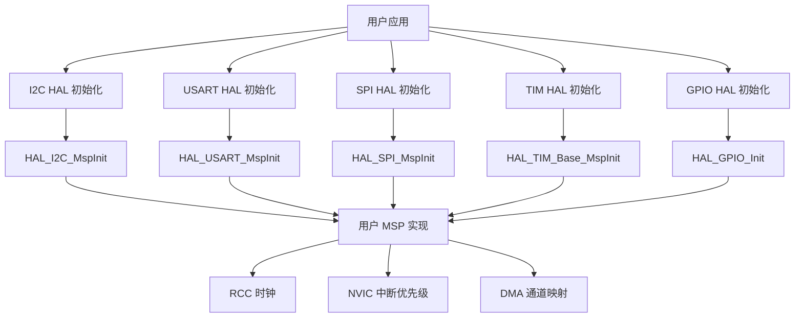
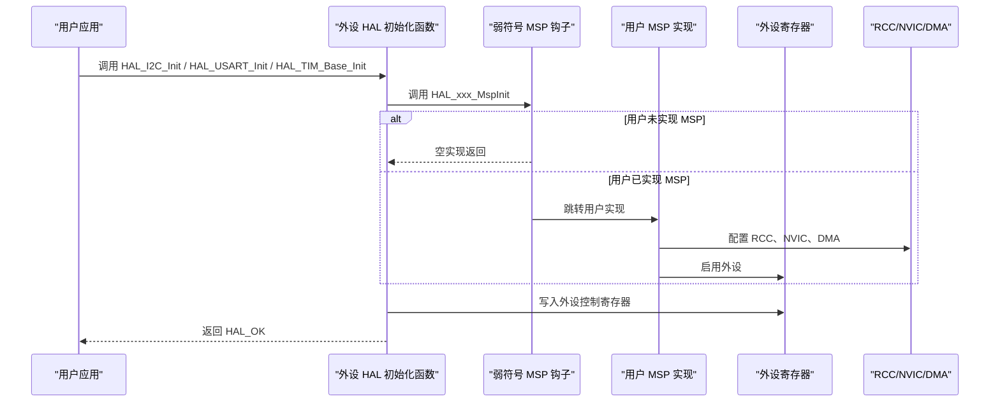
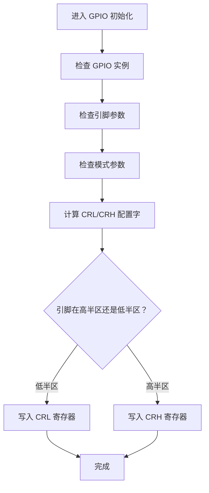
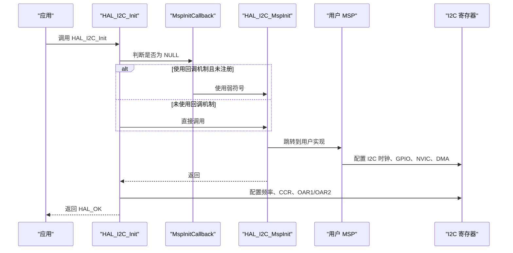
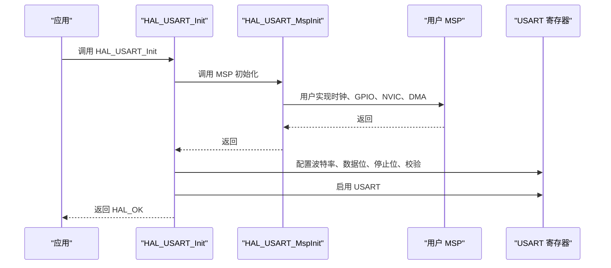
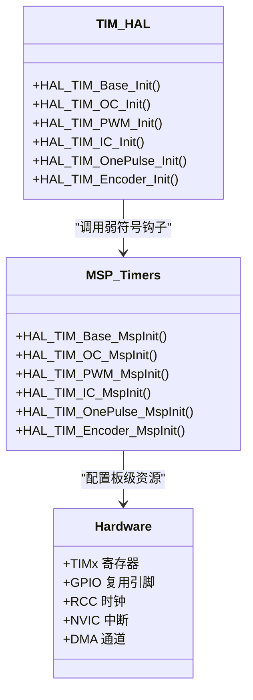
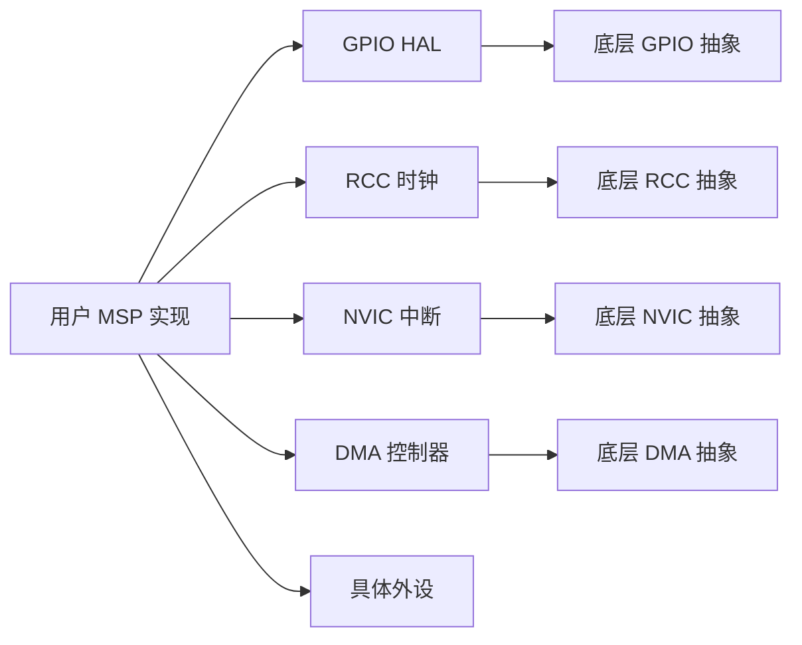

# MSP 钩子与板级抽象

<cite>
**本文引用的文件**
- [stm32f1xx_hal_msp_template.c](file://Src/stm32f1xx_hal_msp_template.c)
- [stm32f1xx_hal_gpio.c](file://Src/stm32f1xx_hal_gpio.c)
- [stm32f1xx_hal_i2c.c](file://Src/stm32f1xx_hal_i2c.c)
- [stm32f1xx_hal_spi.c](file://Src/stm32f1xx_hal_spi.c)
- [stm32f1xx_hal_usart.c](file://Src/stm32f1xx_hal_usart.c)
- [stm32f1xx_hal_tim.c](file://Src/stm32f1xx_hal_tim.c)
- [stm32f1xx_hal_gpio.h](file://Inc/stm32f1xx_hal_gpio.h)
- [stm32f1xx_hal_i2c.h](file://Inc/stm32f1xx_hal_i2c.h)
- [stm32f1xx_hal_spi.h](file://Inc/stm32f1xx_hal_spi.h)
- [stm32f1xx_hal_usart.h](file://Inc/stm32f1xx_hal_usart.h)
- [stm32f1xx_hal_tim.h](file://Inc/stm32f1xx_hal_tim.h)
- [stm32f1xx_hal.h](file://Inc/stm32f1xx_hal.h)
- [README.md](file://README.md)
</cite>

## 目录
1. [引言](#引言)
2. [项目结构](#项目结构)
3. [核心概念：为什么需要 MSP](#核心概念为什么需要-msp)
4. [架构总览](#架构总览)
5. [详细组件分析](#详细组件分析)
6. [依赖关系分析](#依赖关系分析)
7. [性能与可维护性](#性能与可维护性)
8. [最小可用 BSP 示例](#最小可用-bsp-示例)
9. [故障排查指南](#故障排查指南)
10. [结论](#结论)

## 引言

STM32Cube HAL 驱动把“芯片通用外设寄存器配置”和“开发板引脚、时钟、中断、DMA 等 MCU 具体实现”分开。前者放在 HAL 层，后者通过 **MSP（MCU Specific Peripheral）** 钩子交给用户代码实现。

对于 STM32F1xx HAL Driver，这种设计体现在：

- GPIO 提供 `HAL_GPIO_Init` 配置引脚模式、上拉/下拉、速度；
- I2C、SPI、USART、TIM 等外设初始化函数会在内部调用 `HAL_xxx_MspInit`；
- 这些 MSP 函数在 HAL 源文件中以弱符号形式声明，默认空实现；
- 用户需要将 `stm32f1xx_hal_msp_template.c` 复制到工程并实现具体的板级逻辑。

仓库 README 明确说明该仓库是 STM32CubeF1 MCU 包中的 HAL-LL 驱动组件，负责提供跨产品线的硬件抽象接口；而 BSP 属于上层板级支持包。因此，MSP 正是 HAL 与 BSP 之间的约定边界。

**章节来源**
- [README.md:1-45](file://README.md#L1-L45)

## 项目结构

该仓库按 STM32Cube HAL 标准组织：

- `Inc/`：所有 HAL 头文件，包含外设句柄类型、初始化结构体、API 声明和 MSP 函数原型；
- `Src/`：HAL 驱动实现，包括各外设初始化流程、状态机、回调调度以及弱符号 MSP 钩子；
- `Src/stm32f1xx_hal_msp_template.c`：MSP 模板，提示用户将其复制到应用工程；
- 其他文件如 `stm32f1xx_hal_rcc.c`、`stm32f1xx_ll_*.c` 提供底层时钟、总线、GPIO、NVIC、DMA 等基础能力，供 MSP 实现调用。

**图表来源**
- [stm32f1xx_hal_i2c.c:490-670](file://Src/stm32f1xx_hal_i2c.c#L490-L670)
- [stm32f1xx_hal_usart.c:290-420](file://Src/stm32f1xx_hal_usart.c#L290-L420)
- [stm32f1xx_hal_spi.c:380-520](file://Src/stm32f1xx_hal_spi.c#L380-L520)
- [stm32f1xx_hal_tim.c:270-385](file://Src/stm32f1xx_hal_tim.c#L270-L385)
- [stm32f1xx_hal_gpio.h:1-260](file://Inc/stm32f1xx_hal_gpio.h#L1-L260)

**章节来源**
- [stm32f1xx_hal_msp_template.c:1-92](file://Src/stm32f1xx_hal_msp_template.c#L1-L92)
- [stm32f1xx_hal_gpio.h:1-260](file://Inc/stm32f1xx_hal_gpio.h#L1-L260)

## 核心概念：为什么需要 MSP

HAL 的目标是让同一套 API 能在不同 STM32 系列、不同引脚分配、不同时钟树和外设组合上复用。如果 HAL 直接硬编码：

- “I2C1 的 SCL 使用 PA8，SDA 使用 PB7”；
- “USART2 的 TX 使用 PA2，RX 使用 PA3”；
- “TIM3 的 CH1 使用 PA6”；
- “USART1 中断使用 IRQn 编号和固定 NVIC 优先级”；

那么同一个 HAL 库就无法同时支持多种开发板。

MSP 的作用就是回答这些问题：

| 关注点 | HAL 层关心什么 | MSP 层实现什么 |
|---|---|---|
| 引脚复用 | 外设是否启用、引脚是否配置为复用功能 | 哪个端口、哪根引脚、复用模式、开漏或推挽、速度 |
| 时钟使能 | 外设时钟是否应该开启 | 调用 RCC 宏开启对应 APB/APB2 外设时钟 |
| 中断 | 是否需要中断传输 | 配置 NVIC 分组、IRQ 优先级、使能 IRQ |
| DMA | 是否需要 DMA 传输 | 配置 DMA 通道、方向、循环或非循环、内存与外设地址 |
| 复位 | 如何关闭外设 | 禁用外设、释放 DMA、关闭中断、恢复 GPIO |

STM32F1xx HAL 中，GPIO 本身没有 `HAL_GPIO_MspInit`，因为 GPIO 是其他外设 MSP 的基础资源；但 I2C、SPI、USART、TIM 都明确定义了各自的 MSP 钩子。

**章节来源**
- [stm32f1xx_hal_i2c.c:33-54](file://Src/stm32f1xx_hal_i2c.c#L33-L54)
- [stm32f1xx_hal_usart.c:32-57](file://Src/stm32f1xx_hal_usart.c#L32-L57)
- [stm32f1xx_hal_spi.c:33-55](file://Src/stm32f1xx_hal_spi.c#L33-L55)
- [stm32f1xx_hal_tim.c:65-70](file://Src/stm32f1xx_hal_tim.c#L65-L70)
- [stm32f1xx_hal_gpio.h:1-260](file://Inc/stm32f1xx_hal_gpio.h#L1-L260)

## 架构总览

下图展示一个典型外设从用户调用到 MSP 实现的调用链：

**图表来源**
- [stm32f1xx_hal_i2c.c:490-670](file://Src/stm32f1xx_hal_i2c.c#L490-L670)
- [stm32f1xx_hal_usart.c:290-420](file://Src/stm32f1xx_hal_usart.c#L290-L420)
- [stm32f1xx_hal_spi.c:380-520](file://Src/stm32f1xx_hal_spi.c#L380-L520)
- [stm32f1xx_hal_tim.c:270-385](file://Src/stm32f1xx_hal_tim.c#L270-L385)

## 详细组件分析

### GPIO：MSP 的基础资源

GPIO HAL 提供引脚初始化 API，其初始化结构体包含：

- `Pin`：选择引脚；
- `Mode`：输入、输出、复用、模拟、外部中断或事件；
- `Pull`：无上拉、上拉、下拉；
- `Speed`：低速、中速、高速。

MSP 通常不会直接调用 `HAL_GPIO_MspInit`，而是通过 `HAL_GPIO_Init` 配置引脚。MSP 的职责是决定：

- 使用哪个 GPIO 端口；
- 使用哪些引脚；
- 使用普通输出、复用输出还是开漏复用；
- 是否需要上拉或下拉；
- 输出速度是否与外设速率匹配；
- 是否同时配置 EXTI 中断。

**图表来源**
- [stm32f1xx_hal_gpio.c:1-200](file://Src/stm32f1xx_hal_gpio.c#L1-L200)

GPIO 文档还强调：

- 必须先启用 GPIO 时钟；
- 外部中断需配合 NVIC 配置中断优先级；
- 复位后复用功能不激活，引脚默认处于浮空输入状态。

**章节来源**
- [stm32f1xx_hal_gpio.c:1-200](file://Src/stm32f1xx_hal_gpio.c#L1-L200)
- [stm32f1xx_hal_gpio.h:1-260](file://Inc/stm32f1xx_hal_gpio.h#L1-L260)

### I2C：MSP 的典型用例

I2C HAL 的初始化流程会先处理回调注册，然后调用 `HAL_I2C_MspInit`，再执行寄存器配置、频率范围计算、上升时间设置、CCR 配置、地址配置，最后启用外设。

关键点：

- 当启用动态回调时，若 `MspInitCallback` 为空，则回退到弱符号 `HAL_I2C_MspInit`；
- 默认弱符号实现只忽略参数，不做任何硬件操作；
- 用户必须在自己的 MSP 中实现：
  - 使能 I2C 时钟；
  - 使能 I2C 所用 GPIO 时钟；
  - 将 SCL/SDA 配置为复用开漏；
  - 如需中断或 DMA，配置 NVIC 和 DMA。

**图表来源**
- [stm32f1xx_hal_i2c.c:490-670](file://Src/stm32f1xx_hal_i2c.c#L490-L670)

**章节来源**
- [stm32f1xx_hal_i2c.c:33-54](file://Src/stm32f1xx_hal_i2c.c#L33-L54)
- [stm32f1xx_hal_i2c.c:490-670](file://Src/stm32f1xx_hal_i2c.c#L490-L670)
- [stm32f1xx_hal_i2c.h:543](file://Inc/stm32f1xx_hal_i2c.h#L543)

### USART：串口 MSP

USART HAL 的初始化流程与 I2C 类似：

- 首次初始化时分配锁；
- 根据编译选项决定是否使用回调；
- 调用 `HAL_USART_MspInit`；
- 设置通信参数；
- 清除 USART LIN、HDSEL、SCEN、IREN 相关位；
- 启用外设。

MSP 应实现：

- 使能 USART 外设时钟；
- 使能 TX/RX 引脚时钟；
- 将 TX 配置为复用推挽，RX 配置为复用输入或复用浮空；
- 如果使用中断或 DMA，配置 NVIC 和 DMA 通道；
- 反初始化时关闭外设、释放 DMA、禁用中断、恢复 GPIO。

**图表来源**
- [stm32f1xx_hal_usart.c:290-420](file://Src/stm32f1xx_hal_usart.c#L290-L420)

**章节来源**
- [stm32f1xx_hal_usart.c:32-57](file://Src/stm32f1xx_hal_usart.c#L32-L57)
- [stm32f1xx_hal_usart.c:290-420](file://Src/stm32f1xx_hal_usart.c#L290-L420)
- [stm32f1xx_hal_usart.h:494](file://Inc/stm32f1xx_hal_usart.h#L494)

### SPI：复用 MSP

SPI 同样通过 `HAL_SPI_MspInit` 暴露板级细节。SPI 初始化流程：

- 首次初始化时分配锁；
- 可选择启用动态回调；
- 调用 `HAL_SPI_MspInit`；
- 禁用 SPI 外设；
- 配置 SPI_CR1、SPI_CR2、CRC 多项式；
- 清理 I2S 模式位；
- 设置为就绪状态。

SPI 的 MSP 通常需要配置：

- SPI 时钟；
- MOSI/MISO/SCK/CS 引脚；
- SPI 主从、极性、相位、数据大小、波特分频；
- 如果需要，配置 NSS 引脚和中断。

**章节来源**
- [stm32f1xx_hal_spi.c:33-55](file://Src/stm32f1xx_hal_spi.c#L33-L55)
- [stm32f1xx_hal_spi.c:380-520](file://Src/stm32f1xx_hal_spi.c#L380-L520)
- [stm32f1xx_hal_spi.h:658](file://Inc/stm32f1xx_hal_spi.h#L658)

### TIM：多模式 MSP

TIM HAL 支持多种工作模式，每种模式都有对应的 MSP 钩子：

- `HAL_TIM_Base_MspInit`
- `HAL_TIM_OC_MspInit`
- `HAL_TIM_PWM_MspInit`
- `HAL_TIM_IC_MspInit`
- `HAL_TIM_OnePulse_MspInit`
- `HAL_TIM_Encoder_MspInit`

TIM 基模式初始化流程：

- 检查定时器实例和参数；
- 首次初始化时分配锁；
- 调用 `HAL_TIM_Base_MspInit`；
- 设置定时器基本配置；
- 初始化 DMA burst 状态和通道状态；
- 设为就绪。

TIM 的 MSP 通常要：

- 使能 TIMx 时钟；
- 使能复用引脚时钟；
- 配置 PWM/OC/IC/编码器引脚；
- 如需中断，配置 NVIC 和定时器中断；
- 如需 DMA，配置定时器触发对应的 DMA 请求线。

**图表来源**
- [stm32f1xx_hal_tim.c:65-70](file://Src/stm32f1xx_hal_tim.c#L65-L70)
- [stm32f1xx_hal_tim.c:270-385](file://Src/stm32f1xx_hal_tim.c#L270-L385)
- [stm32f1xx_hal_tim.h:1887-1996](file://Inc/stm32f1xx_hal_tim.h#L1887-L1996)

**章节来源**
- [stm32f1xx_hal_tim.c:65-70](file://Src/stm32f1xx_hal_tim.c#L65-L70)
- [stm32f1xx_hal_tim.c:270-385](file://Src/stm32f1xx_hal_tim.c#L270-L385)
- [stm32f1xx_hal_tim.h:1887-1996](file://Inc/stm32f1xx_hal_tim.h#L1887-L1996)

### 全局 MSP：HAL_MspInit

`stm32f1xx_hal_msp_template.c` 提供 `HAL_MspInit` 和 `HAL_MspDeInit` 模板。它适合放置全局系统级初始化，例如：

- Cortex-M 系统 Tick 配置；
- SysTick 优先级；
- 全局低功耗模式；
- 多个外设共享的电源或时钟策略。

模板中还保留 `HAL_PPP_MspInit` 占位符，表示 HAL 会为每个外设生成对应名称的 MSP 钩子。实际 STM32F1xx HAL 中，这些钩子已经由具体外设定义，例如 `HAL_I2C_MspInit`、`HAL_USART_MspInit`、`HAL_SPI_MspInit`、`HAL_TIM_Base_MspInit` 等。

**章节来源**
- [stm32f1xx_hal_msp_template.c:1-92](file://Src/stm32f1xx_hal_msp_template.c#L1-L92)

## 依赖关系分析

MSP 不是孤立文件，它依赖 HAL 和底层抽象：

- `stm32f1xx_hal.h` 引入 HAL 公共头文件和配置；
- GPIO 初始化依赖 `stm32f1xx_hal_gpio.h`；
- 时钟配置依赖 RCC 宏；
- 中断优先级依赖 NVIC；
- DMA 传输依赖 DMA 句柄和 DMA 请求线映射。

**图表来源**
- [stm32f1xx_hal_msp_template.c:1-92](file://Src/stm32f1xx_hal_msp_template.c#L1-L92)
- [stm32f1xx_hal_gpio.h:1-260](file://Inc/stm32f1xx_hal_gpio.h#L1-L260)
- [stm32f1xx_hal.h:1-200](file://Inc/stm32f1xx_hal.h#L1-L200)

**章节来源**
- [stm32f1xx_hal.h:1-200](file://Inc/stm32f1xx_hal.h#L1-L200)
- [stm32f1xx_hal_gpio.h:1-260](file://Inc/stm32f1xx_hal_gpio.h#L1-L260)

## 性能与可维护性

### 性能特点

- MSP 钩子在初始化阶段调用，对运行时性能影响很小；
- 真正的运行时路径由 HAL 外设 API 和中断/DMA 回调组成；
- 弱符号钩子本身只是空函数，不会增加运行开销；
- 正确的 MSP 能避免重复初始化、避免错误中断优先级导致的响应延迟。

### 可维护性优势

- 应用代码可以专注于业务逻辑；
- 板级差异集中在 MSP；
- 更换开发板时，通常只需修改 MSP 和 BSP，而不必改动 HAL 层；
- 多个外设共享 GPIO、时钟、中断策略时，可在 MSP 中统一规划。

[本节为通用指导，不直接分析具体文件]

## 最小可用 BSP 示例

以下是一个针对 STM32F1xx 的最小 BSP 设计思路。注意：这里不复制源码内容，而是给出实现步骤和参考位置。

### 第一步：复制 MSP 模板

将 `stm32f1xx_hal_msp_template.c` 复制到用户工程，并重命名为符合项目的文件名，例如 `bsp_msp.c`。

模板中包含：

- `HAL_MspInit`
- `HAL_MspDeInit`
- `HAL_PPP_MspInit`
- `HAL_PPP_MspDeInit`

用户应将 `PPP` 替换为具体外设名称，或在已有外设 MSP 中实现。

**章节来源**
- [stm32f1xx_hal_msp_template.c:1-92](file://Src/stm32f1xx_hal_msp_template.c#L1-L92)

### 第二步：实现 GPIO 初始化

在 MSP 中，不要直接写寄存器，而是使用 `HAL_GPIO_Init`。典型步骤：

1. 确定引脚所在端口；
2. 调用 RCC 宏使能对应 GPIO 时钟；
3. 构造 `GPIO_InitTypeDef`；
4. 设置 `Pin`、`Mode`、`Pull`、`Speed`；
5. 调用 `HAL_GPIO_Init`。

GPIO 模式包括：

- 输入
- 推挽输出
- 开漏输出
- 复用推挽
- 复用开漏
- 模拟
- 外部中断/事件

**章节来源**
- [stm32f1xx_hal_gpio.h:1-260](file://Inc/stm32f1xx_hal_gpio.h#L1-L260)

### 第三步：实现 I2C MSP

在 `HAL_I2C_MspInit` 中：

1. 使能 I2Cx 时钟；
2. 使能 SCL/SDA 引脚时钟；
3. 配置 SCL/SDA 为复用开漏；
4. 如需中断，配置 NVIC 优先级并使能 I2Cx 中断；
5. 如需 DMA，配置 DMA 通道、方向、内存地址、外设地址、数据长度；
6. 将 DMA 句柄关联到 I2C 句柄。

**章节来源**
- [stm32f1xx_hal_i2c.c:33-54](file://Src/stm32f1xx_hal_i2c.c#L33-L54)
- [stm32f1xx_hal_i2c.c:490-670](file://Src/stm32f1xx_hal_i2c.c#L490-L670)

### 第四步：实现 USART MSP

在 `HAL_USART_MspInit` 中：

1. 使能 USARTx 时钟；
2. 使能 TX/RX 引脚时钟；
3. 配置 TX 为复用推挽，RX 为复用输入；
4. 如需中断，配置 USART 中断优先级并使能 IRQ；
5. 如需 DMA，配置 TX/RX DMA 通道和请求线；
6. 确保 DMA 传输完成后，USART 仍能正确检测最后一个字节发送完成。

**章节来源**
- [stm32f1xx_hal_usart.c:32-57](file://Src/stm32f1xx_hal_usart.c#L32-L57)
- [stm32f1xx_hal_usart.c:290-420](file://Src/stm32f1xx_hal_usart.c#L290-L420)

### 第五步：实现 TIM MSP

在 `HAL_TIM_Base_MspInit` 或其他模式对应的 MSP 中：

1. 使能 TIMx 时钟；
2. 使能复用引脚时钟；
3. 配置 PWM/OC/IC/编码器引脚；
4. 如需中断，配置 NVIC 优先级并使能定时器中断；
5. 如需 DMA，配置 DMA 通道和定时器触发请求。

**章节来源**
- [stm32f1xx_hal_tim.c:65-70](file://Src/stm32f1xx_hal_tim.c#L65-L70)
- [stm32f1xx_hal_tim.c:270-385](file://Src/stm32f1xx_hal_tim.c#L270-L385)

### 第六步：编写反初始化逻辑

在 `HAL_xxx_MspDeInit` 中：

- 禁用外设；
- 关闭中断；
- 释放 DMA；
- 恢复 GPIO 为默认输入或复用状态；
- 关闭不再需要的时钟。

注意：并非所有 HAL 外设都提供完整的 DeInit MSP 钩子，应根据具体外设 API 确认。

[本节为通用实现指导，不直接复制源码]

## 故障排查指南

### 常见问题一：重复初始化

**现象：**  
多次调用 `HAL_I2C_Init`、`HAL_USART_Init`、`HAL_TIM_Base_Init` 后行为异常，或 MSP 被重复执行。

**原因：**  
这些 HAL 初始化函数通常在句柄状态为 RESET 时才执行 MSP 初始化。如果用户代码在外部重复调用，可能绕过状态检查，或者在 MSP 中重复使能时钟、重复分配 DMA。

**排查步骤：**

1. 检查调用方是否在循环或任务中反复调用初始化；
2. 确认句柄状态是否保持 READY；
3. 检查 MSP 是否做了幂等保护；
4. 将资源分配逻辑放入一次初始化的入口；
5. 避免在 MSP 中执行耗时操作。

**章节来源**
- [stm32f1xx_hal_i2c.c:490-670](file://Src/stm32f1xx_hal_i2c.c#L490-L670)
- [stm32f1xx_hal_usart.c:290-420](file://Src/stm32f1xx_hal_usart.c#L290-L420)
- [stm32f1xx_hal_spi.c:380-520](file://Src/stm32f1xx_hal_spi.c#L380-L520)
- [stm32f1xx_hal_tim.c:270-385](file://Src/stm32f1xx_hal_tim.c#L270-L385)

### 常见问题二：时钟未开启

**现象：**  
外设初始化成功，但无输出、无数据、无中断。

**原因：**  
MSP 中忘记调用 RCC 宏使能外设时钟或 GPIO 时钟。

**排查步骤：**

1. 确认外设时钟总线是否正确；
2. 确认 GPIO 时钟是否使能；
3. 确认 DMA 时钟是否使能；
4. 使用调试器读取 RCC 寄存器；
5. 在 MSP 中为关键时钟使能语句加断点；
6. 检查是否误关了全局时钟。

**章节来源**
- [stm32f1xx_hal_i2c.c:33-54](file://Src/stm32f1xx_hal_i2c.c#L33-L54)
- [stm32f1xx_hal_usart.c:32-57](file://Src/stm32f1xx_hal_usart.c#L32-L57)
- [stm32f1xx_hal_tim.c:65-70](file://Src/stm32f1xx_hal_tim.c#L65-L70)

### 常见问题三：中断优先级冲突

**现象：**  
中断偶尔丢失、系统卡死、HardFault、或 ISR 不进入。

**原因：**  
- NVIC 分组未配置；
- 外设中断优先级高于系统中断；
- 多个中断抢占相同优先级但未正确处理嵌套；
- 中断服务程序过长。

**排查步骤：**

1. 检查 NVIC 分组是否已配置；
2. 比较外设中断优先级与 SysTick 优先级；
3. 确认中断使能顺序；
4. 检查中断标志是否清除；
5. 检查是否存在递归中断；
6. 使用调试器查看中断向量表和 pending 寄存器。

**章节来源**
- [stm32f1xx_hal_gpio.c:1-200](file://Src/stm32f1xx_hal_gpio.c#L1-L200)
- [stm32f1xx_hal_i2c.c:33-54](file://Src/stm32f1xx_hal_i2c.c#L33-L54)
- [stm32f1xx_hal_usart.c:32-57](file://Src/stm32f1xx_hal_usart.c#L32-L57)

### 常见问题四：引脚复用错误

**现象：**  
I2C 无波形、USART 无收发、PWM 无输出。

**原因：**

- 使用了错误的引脚；
- 复用功能编号错误；
- 输出类型错误，例如 I2C 用了推挽而非开漏；
- 速度过高导致信号质量差；
- GPIO 时钟未使能。

**排查步骤：**

1. 对照芯片数据手册和原理图确认引脚；
2. 检查 `GPIO_InitTypeDef` 的 Mode、Pull、Speed；
3. 检查是否启用了 GPIO 时钟；
4. 用示波器观察引脚波形；
5. 确认没有其它模块占用同一引脚。

**章节来源**
- [stm32f1xx_hal_gpio.h:1-260](file://Inc/stm32f1xx_hal_gpio.h#L1-L260)
- [stm32f1xx_hal_gpio.c:1-200](file://Src/stm32f1xx_hal_gpio.c#L1-L200)

### 常见问题五：DMA 通道映射错误

**现象：**  
DMA 传输未完成、数据错位、中断触发但数据不正确。

**原因：**

- DMA 通道与实际外设请求线不匹配；
- 方向配置错误；
- 内存地址或外设地址错误；
- 数据长度错误；
- DMA 未使能；
- 中断未使能或未清除标志。

**排查步骤：**

1. 核对芯片参考手册中的 DMA 请求映射表；
2. 检查 DMA 通道、方向、循环模式；
3. 检查内存缓冲区和外设寄存器地址；
4. 检查 DMA 中断优先级；
5. 检查外设是否在 DMA 完成后仍启用相应中断；
6. 使用调试器观察 DMA 计数器。

[本节为通用故障排查建议，不直接分析具体实现代码]

## 结论

STM32F1xx HAL 的 MSP 钩子系统是一种清晰的职责划分：

- HAL 负责跨芯片通用的外设初始化流程；
- MSP 负责特定开发板的引脚、时钟、中断、DMA 等板级细节；
- 弱符号钩子保证未实现时不会破坏编译，也不会产生意外副作用；
- 用户通过实现 `HAL_I2C_MspInit`、`HAL_USART_MspInit`、`HAL_SPI_MspInit`、`HAL_TIM_Base_MspInit` 等函数，将 BSP 与 HAL 解耦。

正确使用 MSP 的关键是：

1. 复制并实现 MSP 模板；
2. 在 MSP 中只配置板级资源；
3. 始终先使能时钟；
4. 正确配置 GPIO 复用模式和速度；
5. 合理设置 NVIC 中断优先级；
6. 准确映射 DMA 通道；
7. 实现反初始化逻辑，避免资源泄漏；
8. 遇到问题时，按时钟、引脚、中断、DMA 的顺序排查。

这样，同一个 HAL 应用可以在不同 STM32F1xx 开发板上复用，而只需要修改 MSP 和 BSP。

[本节为总结，不直接分析具体文件]