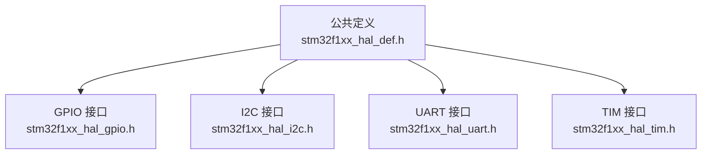
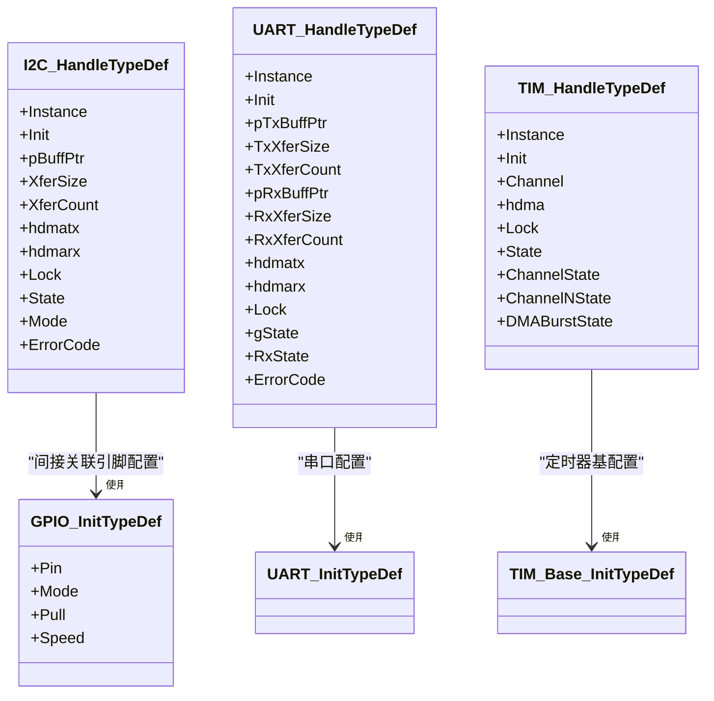
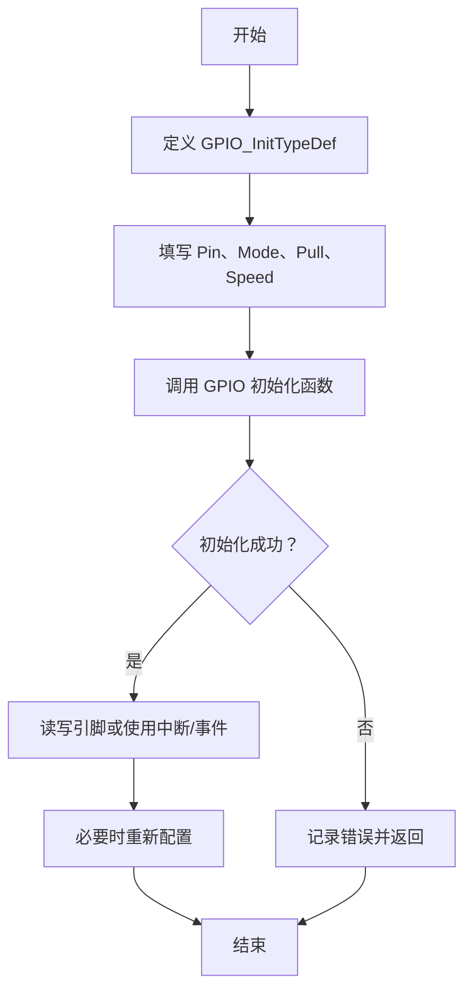
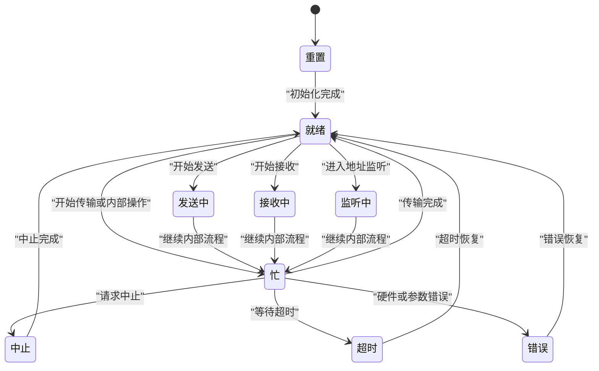
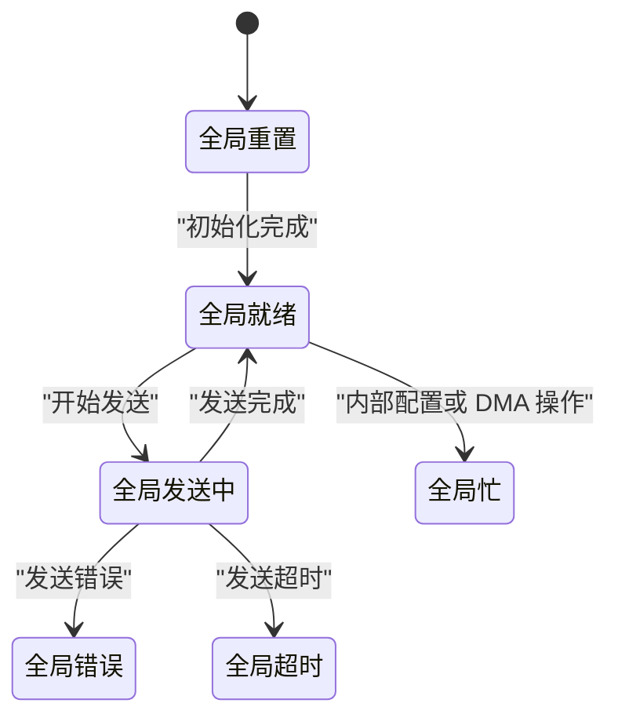
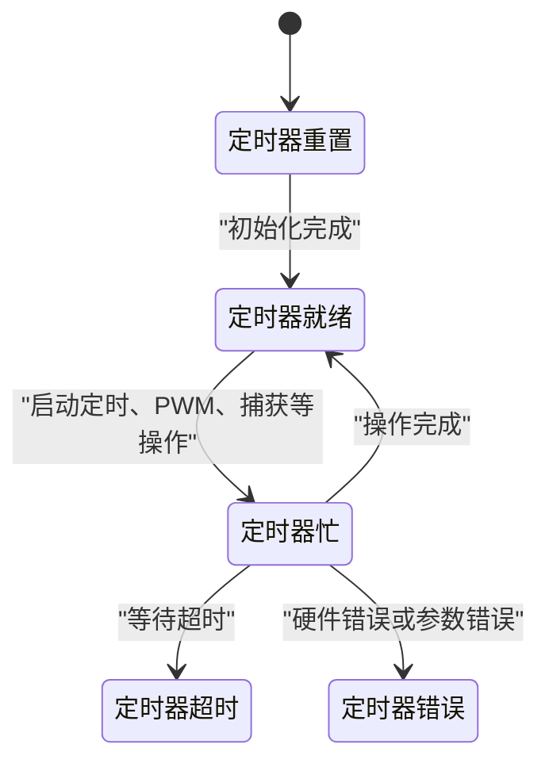
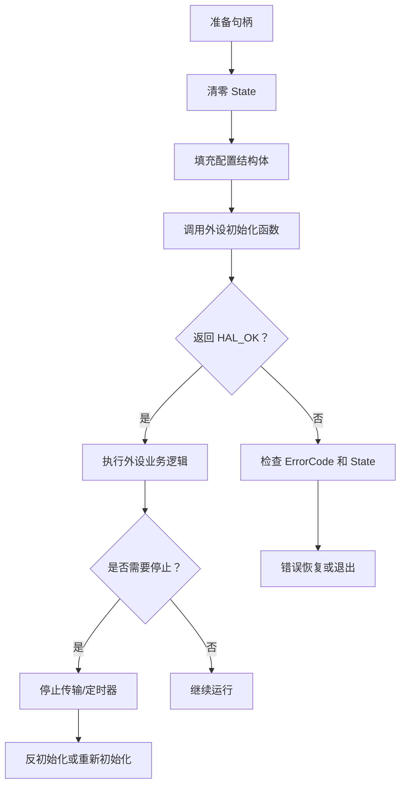
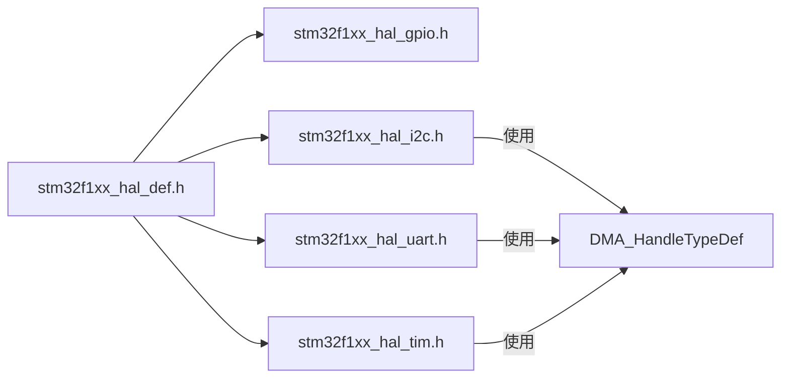

# 公共类型、句柄与状态模型

<cite>
**本文引用的文件**   
- [stm32f1xx_hal_def.h](file://Inc/stm32f1xx_hal_def.h)
- [stm32f1xx_hal_gpio.h](file://Inc/stm32f1xx_hal_gpio.h)
- [stm32f1xx_hal_i2c.h](file://Inc/stm32f1xx_hal_i2c.h)
- [stm32f1xx_hal_uart.h](file://Inc/stm32f1xx_hal_uart.h)
- [stm32f1xx_hal_tim.h](file://Inc/stm32f1xx_hal_tim.h)
</cite>

## 目录
1. [引言](#引言)
2. [项目结构](#项目结构)
3. [基础公共类型与宏](#基础公共类型与宏)
4. [外设句柄总览](#外设句柄总览)
5. [GPIO 句柄与生命周期](#gpio-句柄与生命周期)
6. [I2C 句柄与状态机](#i2c-句柄与状态机)
7. [UART 句柄与双状态模型](#uart-句柄与双状态模型)
8. [TIM 句柄与通道状态](#tim-句柄与通道状态)
9. [初始化、使用、禁用与错误恢复流程](#初始化使用禁用与错误恢复流程)
10. [多线程与 RTOS 安全](#多线程与-rtos-安全)
11. [依赖关系分析](#依赖关系分析)
12. [性能与调试建议](#性能与调试建议)
13. [故障排查指南](#故障排查指南)
14. [结论](#结论)

## 引言
本文面向 STM32F1xx HAL Driver 的公共类型、句柄和状态模型，目标是帮助开发者理解：
- `stm32f1xx_hal_def.h` 中定义的状态枚举、锁类型、句柄复位宏、编译器兼容宏。
- GPIO、I2C、UART、TIM 等外设句柄的结构字段含义、初始化顺序、运行时状态流转。
- `HAL_OK`、`HAL_ERROR`、`HAL_BUSY`、`HAL_TIMEOUT` 的使用约定。
- 在多线程或 RTOS 环境中如何正确共享句柄、避免重入冲突，并定位常见错误。

## 项目结构
该仓库是 STM32F1xx HAL 驱动的标准组织方式：
- `Inc/` 包含所有 HAL 头文件，包括公共定义和各外设接口。
- `Src/` 包含对应实现文件。
- 本说明主要聚焦公共类型与外设头文件中定义的句柄结构；具体实现细节以调用约定和状态变化为主。

**图示来源**
- [stm32f1xx_hal_def.h:25-60](file://Inc/stm32f1xx_hal_def.h#L25-L60)
- [stm32f1xx_hal_gpio.h:35-80](file://Inc/stm32f1xx_hal_gpio.h#L35-L80)
- [stm32f1xx_hal_i2c.h:25-80](file://Inc/stm32f1xx_hal_i2c.h#L25-L80)
- [stm32f1xx_hal_uart.h:25-80](file://Inc/stm32f1xx_hal_uart.h#L25-L80)
- [stm32f1xx_hal_tim.h:25-60](file://Inc/stm32f1xx_hal_tim.h#L25-L60)

**章节来源**
- [stm32f1xx_hal_def.h:25-60](file://Inc/stm32f1xx_hal_def.h#L25-L60)

## 基础公共类型与宏
### HAL_StatusTypeDef
这是 HAL API 的统一返回值类型，表示一次函数调用的整体成功或失败语义。

| 值 | 含义 | 典型使用场景 |
|---|---|---|
| `HAL_OK` | 操作成功 | 初始化完成、传输完成、查询正常 |
| `HAL_ERROR` | 参数非法、底层硬件错误、回调无效 | 传入空指针、无效配置、未注册回调 |
| `HAL_BUSY` | 外设正在使用中 | 重复初始化、并发访问、非空闲状态下的操作 |
| `HAL_TIMEOUT` | 等待超时 | 阻塞式传输、轮询标志未在规定时间内置位 |

这些值由公共定义统一提供，各外设函数应返回其中一种，以便上层逻辑统一处理。

**章节来源**
- [stm32f1xx_hal_def.h:25-60](file://Inc/stm32f1xx_hal_def.h#L25-L60)

### HAL_LockTypeDef
用于标记一个句柄是否被占用。它只有“已解锁”和“已锁定”两个状态。  
在多任务环境下，通常配合外部互斥量使用；但当前 HAL 默认关闭 RTOS 支持时，`__HAL_LOCK` / `__HAL_UNLOCK` 只是简单设置 `Lock` 字段，不提供真正的线程同步。

| 值 | 含义 |
|---|---|
| `HAL_UNLOCKED` | 句柄未被占用 |
| `HAL_LOCKED` | 句柄已被占用 |

**章节来源**
- [stm32f1xx_hal_def.h:60-75](file://Inc/stm32f1xx_hal_def.h#L60-L75)

### __IO 修饰符
`__IO` 表示该变量可能被硬件中断或 DMA 修改，编译器不应对其进行危险优化。它在句柄中的计数器、状态、错误码等共享字段上广泛使用，例如 UART 的接收计数器和 I2C 的传输计数。

**章节来源**
- [stm32f1xx_hal_def.h:25-60](file://Inc/stm32f1xx_hal_def.h#L25-L60)
- [stm32f1xx_hal_i2c.h:200-250](file://Inc/stm32f1xx_hal_i2c.h#L200-L250)
- [stm32f1xx_hal_uart.h:120-200](file://Inc/stm32f1xx_hal_uart.h#L120-L200)

### NULL 兼容宏与 UNUSED
虽然本仓库未直接展示 `NULL` 宏的定义位置，但 HAL 公共头文件通过 `<stddef.h>` 引入标准库类型；`UNUSED(X)` 宏用于消除未使用参数的编译警告，常用于回调函数、模板代码或可选功能分支。

**章节来源**
- [stm32f1xx_hal_def.h:25-45](file://Inc/stm32f1xx_hal_def.h#L25-L45)
- [stm32f1xx_hal_def.h:75-90](file://Inc/stm32f1xx_hal_def.h#L75-L90)

### 句柄复位宏
`__HAL_RESET_HANDLE_STATE(__HANDLE__)` 将句柄的 `State` 字段清零。文档明确指出：
- 本地句柄在使用前必须清零，否则首次初始化可能跳过 MSP 初始化。
- 重新配置硬件时，可先复位状态再调用初始化，而不是强制调用反初始化再初始化。

**章节来源**
- [stm32f1xx_hal_def.h:90-120](file://Inc/stm32f1xx_hal_def.h#L90-L120)

### 加锁宏与 RTOS 开关
当 `USE_RTOS == 1` 时，当前版本会触发错误提示，说明该 HAL 版本期望不使用 RTOS 宏；此时 `__HAL_LOCK` / `__HAL_UNLOCK` 只检查并设置 `Lock` 字段，不是真正的互斥锁。

**章节来源**
- [stm32f1xx_hal_def.h:120-150](file://Inc/stm32f1xx_hal_def.h#L120-L150)

## 外设句柄总览
每个外设句柄都遵循类似模式：
- 指向寄存器基地址的实例指针。
- 用户配置的结构体，如 `GPIO_InitTypeDef`、`I2C_InitTypeDef`、`UART_InitTypeDef`、`TIM_Base_InitTypeDef`。
- 运行期数据：缓冲区指针、传输大小、剩余计数。
- 状态字段：`State`、`gState`/`RxState`、通道状态等。
- 锁字段：`Lock`。
- 错误码字段：`ErrorCode`。
- 可选回调函数指针（启用回调注册功能时）。

**图示来源**
- [stm32f1xx_hal_gpio.h:35-80](file://Inc/stm32f1xx_hal_gpio.h#L35-L80)
- [stm32f1xx_hal_i2c.h:200-250](file://Inc/stm32f1xx_hal_i2c.h#L200-L250)
- [stm32f1xx_hal_uart.h:120-200](file://Inc/stm32f1xx_hal_uart.h#L120-L200)
- [stm32f1xx_hal_tim.h:380-438](file://Inc/stm32f1xx_hal_tim.h#L380-L438)

## GPIO 句柄与生命周期
GPIO 没有像 I2C、UART、TIM 那样带有完整运行状态机的 `GPIO_HandleTypeDef`。它的典型用法是：
- 定义 `GPIO_InitTypeDef`。
- 配置引脚号、模式、上下拉、速度。
- 调用 GPIO 初始化函数。
- 使用读写、中断或事件接口。
- 不需要显式“禁用”，因为 GPIO 配置本身即决定行为；若需要恢复默认，可重新配置为输入或复用模式。

| 字段 | 含义 |
|---|---|
| `Pin` | 选择的 GPIO 引脚，可以是单个引脚或全部引脚掩码 |
| `Mode` | 输入、输出推挽、输出开漏、复用推挽、复用开漏、模拟、外部中断/事件等 |
| `Pull` | 无上拉、上拉、下拉 |
| `Speed` | 输出速度档位 |

### GPIO 初始化与使用流程

**图示来源**
- [stm32f1xx_hal_gpio.h:35-80](file://Inc/stm32f1xx_hal_gpio.h#L35-L80)

**章节来源**
- [stm32f1xx_hal_gpio.h:35-80](file://Inc/stm32f1xx_hal_gpio.h#L35-L80)

## I2C 句柄与状态机
### I2C_HandleTypeDef 关键字段
| 字段 | 含义 |
|---|---|
| `Instance` | I2C 寄存器基地址 |
| `Init` | I2C 通信参数，包括时钟频率、寻址模式、主从地址、通用呼叫、无应答拉伸等 |
| `pBuffPtr` | 传输缓冲区指针 |
| `XferSize` | 传输字节数 |
| `XferCount` | 剩余待传输字节数 |
| `XferOptions` | 传输选项 |
| `PreviousState` | 内部通信上下文状态 |
| `hdmatx` / `hdmarx` | 发送/接收 DMA 句柄指针 |
| `Lock` | 句柄锁 |
| `State` | I2C 通信状态 |
| `Mode` | I2C 工作模式 |
| `ErrorCode` | 错误码 |
| `Devaddress` / `Memaddress` / `MemaddSize` | 目标设备地址、内存地址及地址宽度 |
| `EventCount` | 事件计数 |

### I2C 状态机
I2C 状态是一个位图组合，高两位表示错误信息，后续位分别表示外设初始化状态、监听状态、内部进程状态、接收状态、发送状态。

**图示来源**
- [stm32f1xx_hal_i2c.h:100-180](file://Inc/stm32f1xx_hal_i2c.h#L100-L180)

### I2C 初始化、使用、禁用与错误恢复
- **初始化**：填充 `I2C_InitTypeDef`，然后调用 I2C 初始化函数。成功后句柄状态变为就绪。
- **使用**：设置缓冲区指针、长度和选项，调用阻塞或非阻塞传输函数。传输期间状态可能进入发送中、接收中、忙或监听中。
- **禁用/释放**：HAL 通常不要求手动关闭 I2C 外设；可通过反初始化或重新初始化来释放资源。
- **错误恢复**：检查 `ErrorCode`，清除错误后，根据状态决定是否调用反初始化并重新初始化。

**章节来源**
- [stm32f1xx_hal_i2c.h:25-80](file://Inc/stm32f1xx_hal_i2c.h#L25-L80)
- [stm32f1xx_hal_i2c.h:100-180](file://Inc/stm32f1xx_hal_i2c.h#L100-L180)
- [stm32f1xx_hal_i2c.h:200-250](file://Inc/stm32f1xx_hal_i2c.h#L200-L250)

## UART 句柄与双状态模型
### UART_HandleTypeDef 关键字段
| 字段 | 含义 |
|---|---|
| `Instance` | USART 寄存器基地址 |
| `Init` | 波特率、字长、停止位、校验、收发模式、硬件流控、过采样 |
| `pTxBuffPtr` / `TxXferSize` / `TxXferCount` | 发送缓冲区、大小、剩余计数 |
| `pRxBuffPtr` / `RxXferSize` / `RxXferCount` | 接收缓冲区、大小、剩余计数 |
| `ReceptionType` | 当前接收类型 |
| `RxEventType` | 接收事件类型 |
| `hdmatx` / `hdmarx` | DMA 句柄指针 |
| `Lock` | 句柄锁 |
| `gState` | 全局状态，也反映发送相关状态 |
| `RxState` | 接收状态 |
| `ErrorCode` | 错误码 |

### gState 与 RxState 的组合语义
UART 的状态分为两部分：
- `gState`：全局状态和发送状态。
- `RxState`：接收状态。

两者可以组合出同时收发时的复合状态，例如“发送和接收进行中”。

**图示来源**
- [stm32f1xx_hal_uart.h:80-160](file://Inc/stm32f1xx_hal_uart.h#L80-L160)

### UART 初始化、使用、禁用与错误恢复
- **初始化**：填写 `UART_InitTypeDef`，调用 UART 初始化函数。
- **使用**：设置发送或接收缓冲区，调用发送、接收或 DMA 传输函数。
- **禁用**：可通过反初始化关闭 UART；也可仅停止 DMA 和中断。
- **错误恢复**：检查 `ErrorCode`，清除错误标志，必要时重新初始化。

**章节来源**
- [stm32f1xx_hal_uart.h:25-80](file://Inc/stm32f1xx_hal_uart.h#L25-L80)
- [stm32f1xx_hal_uart.h:80-160](file://Inc/stm32f1xx_hal_uart.h#L80-L160)
- [stm32f1xx_hal_uart.h:120-200](file://Inc/stm32f1xx_hal_uart.h#L120-L200)
- [stm32f1xx_hal_uart.h:200-300](file://Inc/stm32f1xx_hal_uart.h#L200-L300)

## TIM 句柄与通道状态
### TIM_HandleTypeDef 关键字段
| 字段 | 含义 |
|---|---|
| `Instance` | 定时器寄存器基地址 |
| `Init` | 预分频、计数模式、周期、时钟分频、重复计数器等 |
| `Channel` | 当前激活通道 |
| `hdma` | DMA 句柄数组 |
| `Lock` | 句柄锁 |
| `State` | 定时器整体状态 |
| `ChannelState[4]` | 四个通道的独立状态 |
| `ChannelNState[4]` | 互补通道的独立状态 |
| `DMABurstState` | DMA 突发状态 |

### TIM 状态模型
TIM 状态比 UART 更强调通道级状态，因为同一定时器可同时控制多个 PWM、比较、捕获或编码器通道。

**图示来源**
- [stm32f1xx_hal_tim.h:380-438](file://Inc/stm32f1xx_hal_tim.h#L380-L438)

### TIM 初始化、使用、禁用与错误恢复
- **初始化**：配置定时器基参数、输出比较、输入捕获、编码器、死区时间等结构体，再调用对应初始化函数。
- **使用**：启动定时器、使能通道、配置 DMA 或中断。
- **禁用**：停止定时器、禁止通道、断开 DMA 或中断。
- **错误恢复**：检查 `State`、通道状态和错误码，必要时重新初始化定时器。

**章节来源**
- [stm32f1xx_hal_tim.h:25-60](file://Inc/stm32f1xx_hal_tim.h#L25-L60)
- [stm32f1xx_hal_tim.h:380-438](file://Inc/stm32f1xx_hal_tim.h#L380-L438)

## 初始化、使用、禁用与错误恢复流程
### 通用流程

### 各外设要点
- **GPIO**：重点在配置结构体；无复杂状态机，但需确保模式、速度和上下拉符合硬件需求。
- **I2C**：注意状态位图、传输缓冲区和 DMA；避免在忙状态下重复初始化。
- **UART**：注意 `gState` 与 `RxState` 分开管理；收发并发时需要特别小心缓冲区边界和中断/DMA。
- **TIM**：注意通道状态和 DMA 突发状态；多通道同时使用时要维护 `Channel` 和通道状态数组。

**章节来源**
- [stm32f1xx_hal_def.h:90-120](file://Inc/stm32f1xx_hal_def.h#L90-L120)
- [stm32f1xx_hal_i2c.h:100-180](file://Inc/stm32f1xx_hal_i2c.h#L100-L180)
- [stm32f1xx_hal_uart.h:80-160](file://Inc/stm32f1xx_hal_uart.h#L80-L160)
- [stm32f1xx_hal_tim.h:380-438](file://Inc/stm32f1xx_hal_tim.h#L380-L438)

## 多线程与 RTOS 安全
### 当前 HAL 的锁机制
- 默认情况下，RTOS 宏被关闭。
- `__HAL_LOCK` 只在句柄的 `Lock` 字段上做简单判断和赋值。
- 如果多个线程或中断同时访问同一个句柄，仅靠 `Lock` 字段并不能保证线程安全。

### 推荐实践
1. **每个外设使用独立句柄**：避免不同任务竞争同一句柄。
2. **在应用层加互斥锁**：用 RTOS 的互斥量保护关键区域，例如初始化、配置修改、DMA 缓冲区切换。
3. **避免在中断中调用阻塞 HAL 函数**：中断中应使用非阻塞接口、回调或轻量状态检查。
4. **谨慎共享缓冲区**：`pBuffPtr`、`TxXferCount`、`RxXferCount` 可能被中断或 DMA 修改，必须由应用层保证一致性。
5. **不要直接修改 `State`**：应通过 HAL API 改变状态；手动写状态可能导致状态机不一致。
6. **重入风险点**：
   - 多次初始化同一外设。
   - 在传输未完成时修改缓冲区指针。
   - 在中断和主循环同时访问同一 UART/I2C/TIM 句柄。
   - 错误恢复过程中未先停止外设就重新配置。

### 调试方法
- 打印或监控 `State`、`gState`、`RxState`、`ErrorCode`。
- 在初始化前后、传输开始前/结束后插入日志。
- 使用调试器观察 `Lock` 是否长期处于锁定状态。
- 对 UART 的 `ErrorCode` 区分奇偶错误、噪声、帧错误、溢出、DMA 错误。
- 对 I2C 的错误码区分总线错误、仲裁丢失、应答失败、溢出、超时、DMA 参数错误。
- 对 TIM 检查通道状态是否长时间处于“忙”。

**章节来源**
- [stm32f1xx_hal_def.h:120-150](file://Inc/stm32f1xx_hal_def.h#L120-L150)
- [stm32f1xx_hal_i2c.h:200-250](file://Inc/stm32f1xx_hal_i2c.h#L200-L250)
- [stm32f1xx_hal_uart.h:120-200](file://Inc/stm32f1xx_hal_uart.h#L120-L200)
- [stm32f1xx_hal_tim.h:380-438](file://Inc/stm32f1xx_hal_tim.h#L380-L438)

## 依赖关系分析

**图示来源**
- [stm32f1xx_hal_def.h:25-60](file://Inc/stm32f1xx_hal_def.h#L25-L60)
- [stm32f1xx_hal_i2c.h:200-250](file://Inc/stm32f1xx_hal_i2c.h#L200-L250)
- [stm32f1xx_hal_uart.h:120-200](file://Inc/stm32f1xx_hal_uart.h#L120-L200)
- [stm32f1xx_hal_tim.h:380-438](file://Inc/stm32f1xx_hal_tim.h#L380-L438)

**章节来源**
- [stm32f1xx_hal_def.h:25-60](file://Inc/stm32f1xx_hal_def.h#L25-L60)
- [stm32f1xx_hal_i2c.h:200-250](file://Inc/stm32f1xx_hal_i2c.h#L200-L250)
- [stm32f1xx_hal_uart.h:120-200](file://Inc/stm32f1xx_hal_uart.h#L120-L200)
- [stm32f1xx_hal_tim.h:380-438](file://Inc/stm32f1xx_hal_tim.h#L380-L438)

## 性能与调试建议
- 优先使用 DMA 减少 CPU 占用，尤其是 UART 和 I2C 大数据量传输。
- 避免在高频中断中执行阻塞 HAL 调用。
- 合理设置超时值，避免无限等待。
- 对于频繁初始化的场景，复用句柄前先复位状态。
- 使用回调替代轮询可降低中断延迟和 CPU 占用。
- 在调试时保留 `State`、`ErrorCode`、`Lock` 快照，有助于定位状态不一致问题。

## 故障排查指南
### 常见问题与定位思路
| 现象 | 可能原因 | 排查步骤 |
|---|---|---|
| 初始化不调用 MSP 初始化 | 句柄 `State` 未清零 | 初始化前调用句柄状态复位宏 |
| 多次初始化返回 `HAL_BUSY` | 外设仍在忙或被锁定 | 检查 `State`、`Lock`，确认上次操作已完成 |
| 传输一直超时 | 总线未响应、DMA 未配置、时钟未开启 | 检查 I2C/UART 错误码、DMA 句柄、RCC 配置 |
| UART 收到乱码 | 波特率、字长、停止位、校验不一致 | 核对 `UART_InitTypeDef` 和对端配置 |
| I2C 读取失败 | 地址错误、设备未应答、总线冲突 | 检查 `Devaddress`、错误码、总线状态 |
| TIM 波形异常 | 预分频、周期、占空比、通道极性配置错误 | 检查基配置、OC 配置、通道状态 |

### 错误码分类
- **HAL 通用错误**：`HAL_ERROR`、`HAL_TIMEOUT`、`HAL_BUSY`。
- **I2C 错误**：总线错误、仲裁丢失、应答失败、溢出、DMA 错误、超时、大小管理错误、DMA 参数错误、起始错误。
- **UART 错误**：奇偶错误、噪声错误、帧错误、溢出错误、DMA 错误。
- **TIM 错误**：主要通过 `State` 和回调报告，常见于 DMA 或通道操作异常。

**章节来源**
- [stm32f1xx_hal_def.h:25-60](file://Inc/stm32f1xx_hal_def.h#L25-L60)
- [stm32f1xx_hal_def.h:90-150](file://Inc/stm32f1xx_hal_def.h#L90-L150)
- [stm32f1xx_hal_i2c.h:100-180](file://Inc/stm32f1xx_hal_i2c.h#L100-L180)
- [stm32f1xx_hal_i2c.h:200-250](file://Inc/stm32f1xx_hal_i2c.h#L200-L250)
- [stm32f1xx_hal_uart.h:200-300](file://Inc/stm32f1xx_hal_uart.h#L200-L300)
- [stm32f1xx_hal_tim.h:380-438](file://Inc/stm32f1xx_hal_tim.h#L380-L438)

## 结论
STM32F1xx HAL 的公共类型、句柄和状态模型提供了一个一致的外设抽象：
- `HAL_StatusTypeDef` 统一了调用结果。
- `HAL_LockTypeDef` 和 `__HAL_LOCK` / `__HAL_UNLOCK` 提供了最基础的句柄占用语义。
- `__HAL_RESET_HANDLE_STATE` 明确了句柄生命周期起点。
- GPIO 以配置结构为主，I2C、UART、TIM 则拥有更丰富的运行状态机。
- 在多线程或 RTOS 环境中，不能只依赖 HAL 内置的 `Lock` 字段，应在应用层使用真正的互斥机制，并谨慎管理缓冲区、状态和回调。

掌握这些类型、句柄和状态模型，是正确使用 STM32F1xx HAL 的基础，也是定位初始化失败、传输异常、状态卡死和多任务竞争问题的关键。