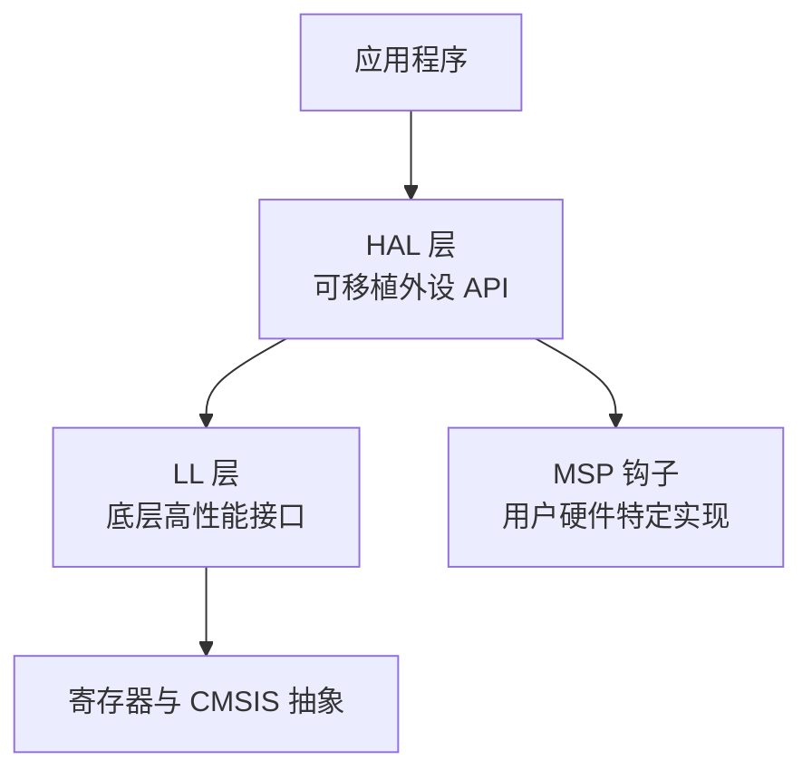
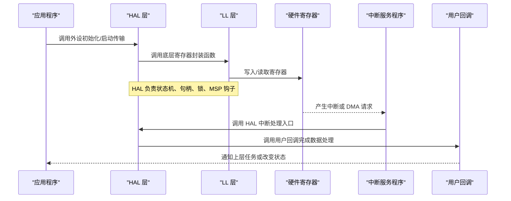
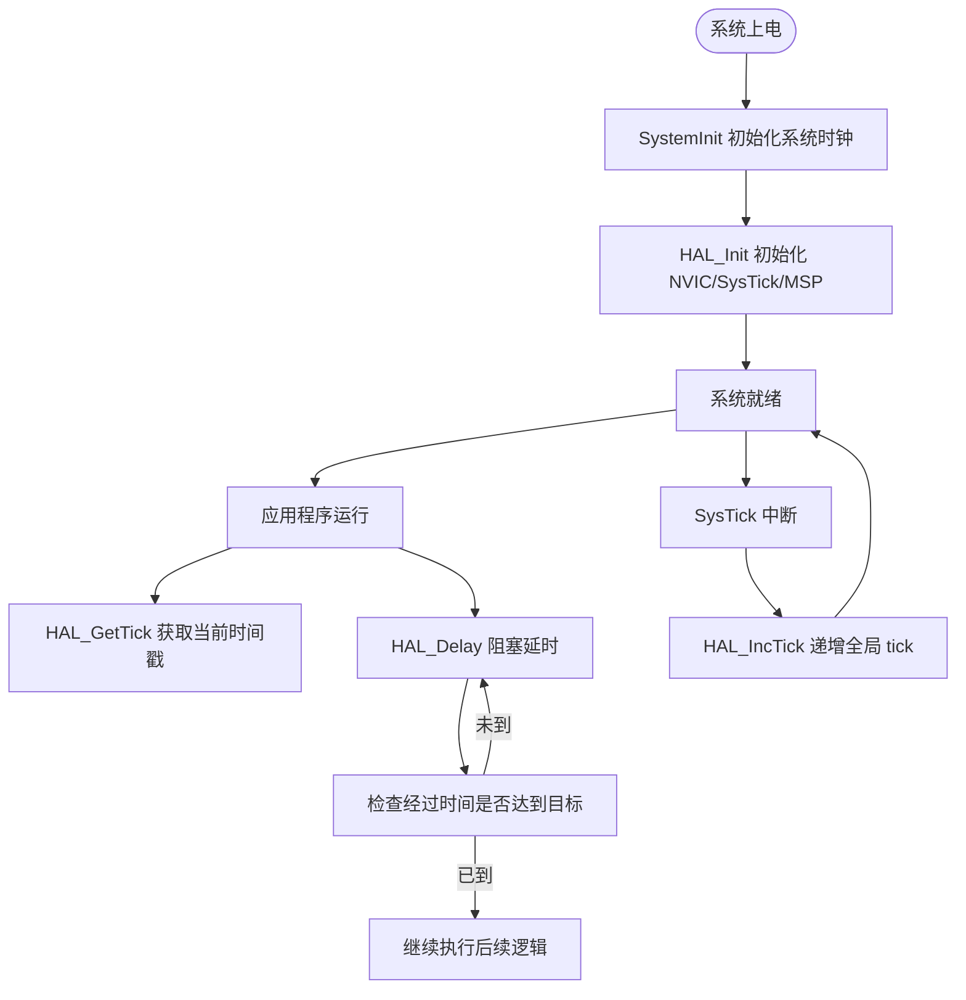
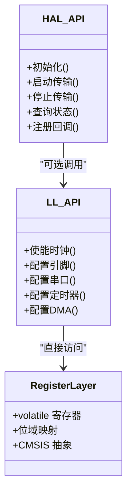
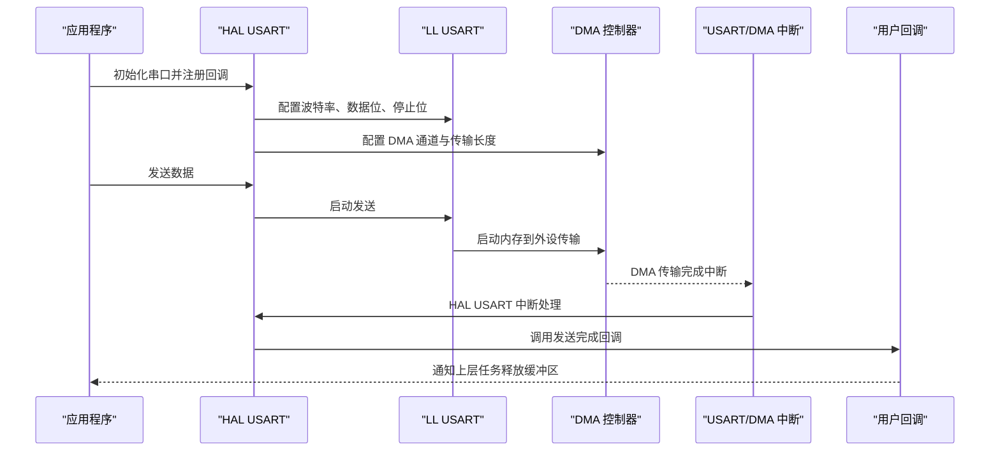
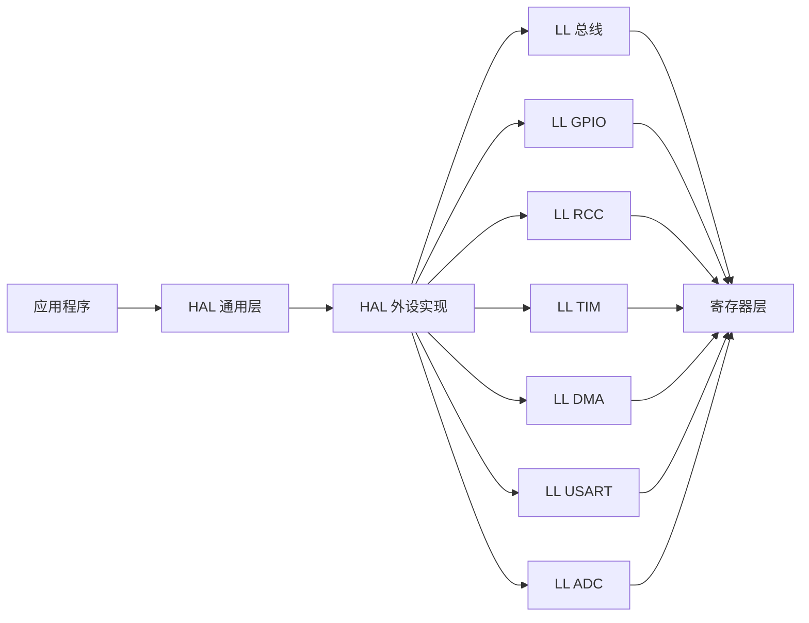

# 核心架构与设计

<cite>
**本文引用的文件**   
- [README.md](file://README.md)
- [stm32f1xx_hal_def.h](file://Inc/stm32f1xx_hal_def.h)
- [stm32f1xx_hal_conf_template.h](file://Inc/stm32f1xx_hal_conf_template.h)
- [stm32f1xx_hal.h](file://Inc/stm32f1xx_hal.h)
- [stm32f1xx_ll_bus.h](file://Inc/stm32f1xx_ll_bus.h)
- [stm32f1xx_ll_gpio.h](file://Inc/stm32f1xx_ll_gpio.h)
- [stm32f1xx_ll_rcc.h](file://Inc/stm32f1xx_ll_rcc.h)
- [stm32f1xx_ll_tim.h](file://Inc/stm32f1xx_ll_tim.h)
- [stm32f1xx_ll_dma.h](file://Inc/stm32f1xx_ll_dma.h)
- [stm32f1xx_ll_usart.h](file://Inc/stm32f1xx_ll_usart.h)
- [stm32f1xx_ll_adc.h](file://Inc/stm32f1xx_ll_adc.h)
- [stm32f1xx_hal.c](file://Src/stm32f1xx_hal.c)
- [stm32f1xx_ll_bus.c](file://Src/stm32f1xx_ll_bus.c)
- [stm32f1xx_ll_gpio.c](file://Src/stm32f1xx_ll_gpio.c)
- [stm32f1xx_ll_rcc.c](file://Src/stm32f1xx_ll_rcc.c)
- [stm32f1xx_ll_tim.c](file://Src/stm32f1xx_ll_tim.c)
- [stm32f1xx_ll_dma.c](file://Src/stm32f1xx_ll_dma.c)
- [stm32f1xx_ll_usart.c](file://Src/stm32f1xx_ll_usart.c)
- [stm32f1xx_ll_adc.c](file://Src/stm32f1xx_ll_adc.c)
- [stm32f1xx_hal_msp_template.c](file://Src/stm32f1xx_hal_msp_template.c)
</cite>

## 目录
1. [引言](#引言)
2. [项目结构](#项目结构)
3. [核心组件](#核心组件)
4. [架构总览](#架构总览)
5. [详细组件分析](#详细组件分析)
6. [依赖关系分析](#依赖关系分析)
7. [性能考量](#性能考量)
8. [故障排查指南](#故障排查指南)
9. [结论](#结论)
10. [附录](#附录)

## 引言
本仓库是面向 STM32F1 系列的 HAL/LL 驱动库。其设计目标是把“应用层 API”“底层高性能接口”和“具体寄存器访问”分层解耦，使上层代码具备跨芯片的移植性，同时为需要极致性能的场合暴露 LL 层接口。HAL 层通过句柄、回调、状态机和 MSP（MCU Specific Peripheral）钩子扩展点，屏蔽不同外设寄存器的差异；LL 层直接封装寄存器位域与原子操作；最底层则由 CMSIS 头文件和芯片寄存器定义提供。

本架构文档重点说明：
- HAL → LL → 寄存器 三层分离的职责边界。
- HAL 如何屏蔽寄存器差异并提供可移植 API。
- LL 如何暴露高性能、接近原语的底层接口。
- 公共类型、句柄模型、回调机制、状态机模式与 MSP 扩展点。
- 模块裁剪宏与时钟/振荡器配置断言的作用方式。
- HAL_Init、HAL_GetTick、HAL_Delay、HAL_IncTick 的系统生命周期与 Tick 时基流程。
- 从应用调用到中断/DMA 完成再到回调返回的数据流。
- 性能权衡、线程安全注意事项与调试建议。

**章节来源**
- [README.md:1-200](file://README.md#L1-L200)

## 项目结构
仓库按功能划分为 Inc（接口头文件）与 Src（实现源文件）两部分，每个外设通常对应一组 HAL 头文件与实现文件，以及可选的 LL 头文件与实现文件。典型组织方式如下：

- Inc/stm32f1xx_hal_*.h 与 Src/stm32f1xx_hal_*.c：HAL 层对外 API 与实现。
- Inc/stm32f1xx_ll_*.h 与 Src/stm32f1xx_ll_*.c：LL 层底层高性能接口。
- stm32f1xx_hal_def.h：HAL 公共类型、句柄、锁、回调等基础定义。
- stm32f1xx_hal_conf_template.h：HAL 模块裁剪与系统配置模板。
- stm32f1xx_hal.c：通用 HAL 初始化、Tick 时基、延时与全局钩子。
- stm32f1xx_hal_msp_template.c：MSP 钩子模板，用户需实现具体硬件相关逻辑。

**图表来源**
- [stm32f1xx_hal_def.h:1-200](file://Inc/stm32f1xx_hal_def.h#L1-L200)
- [stm32f1xx_hal_conf_template.h:1-200](file://Inc/stm32f1xx_hal_conf_template.h#L1-L200)
- [stm32f1xx_hal.c:1-200](file://Src/stm32f1xx_hal.c#L1-L200)
- [stm32f1xx_hal_msp_template.c:1-200](file://Src/stm32f1xx_hal_msp_template.c#L1-L200)

**章节来源**
- [stm32f1xx_hal_def.h:1-200](file://Inc/stm32f1xx_hal_def.h#L1-L200)
- [stm32f1xx_hal_conf_template.h:1-200](file://Inc/stm32f1xx_hal_conf_template.h#L1-L200)
- [stm32f1xx_hal.c:1-200](file://Src/stm32f1xx_hal.c#L1-L200)
- [stm32f1xx_hal_msp_template.c:1-200](file://Src/stm32f1xx_hal_msp_template.c#L1-L200)

## 核心组件
本节聚焦 HAL 与 LL 的核心抽象：公共类型、句柄、回调、锁、状态机，以及 LL 层对寄存器的高性能封装。

### 公共类型与错误码
- HAL_StatusTypeDef：统一的状态返回值，用于指示成功、忙、超时、无效参数等结果。所有 HAL 函数通过该类型向上报告运行态。
- HAL_LockTypeDef：用于保护共享资源或临界区的轻量锁对象，常用于防止多上下文并发访问同一外设。
- HAL_HANDLE_DEF：统一的句柄宏，用于声明各外设句柄指针类型，便于在函数间传递并保存外设状态。

这些类型定义了 HAL 层与外部应用的契约边界，使上层无需感知具体寄存器布局。

**章节来源**
- [stm32f1xx_hal_def.h:1-200](file://Inc/stm32f1xx_hal_def.h#L1-L200)

### 句柄模型与回调机制
- 句柄（Handle）：每个外设实例对应一个句柄结构体，包含寄存器基地址、当前状态、锁定对象、DMA/中断通道信息、回调函数指针等。
- 回调（Callback）：异步事件（如 DMA 传输完成、串口接收中断、定时器更新中断）发生时，由 HAL 层调用用户注册的回调函数，完成数据搬运、状态清理与通知上层。
- 回调注册：通常在初始化或启动传输前设置句柄中的回调函数指针，以便中断路径中快速分发。

这种“句柄 + 回调”的组合将“设备状态”与“控制流”解耦，避免在中断中执行耗时逻辑。

**章节来源**
- [stm32f1xx_hal_def.h:1-200](file://Inc/stm32f1xx_hal_def.h#L1-L200)

### 状态机模式
HAL 外设普遍采用有限状态机管理生命周期，常见状态包括空闲、准备、忙、错误、半完成等。典型流程：
- 初始化后进入空闲。
- 启动传输后进入忙。
- 传输完成后根据结果进入空闲或错误。
- 用户可通过回调观察状态变化并触发上层业务。

状态机确保并发调用、重复启动、异常恢复等行为具有一致性。

**章节来源**
- [stm32f1xx_hal_def.h:1-200](file://Inc/stm32f1xx_hal_def.h#L1-L200)

### MSP 钩子扩展点
MSP（MCU Specific Peripheral）是 HAL 留给用户的硬件特定扩展点，通常包括：
- 外设时钟与 GPIO 复用配置。
- 中断优先级分组与向量表配置。
- DMA 通道与优先级配置。
- 电源模式或低功耗相关设置。

默认模板文件中只包含空实现，用户需在项目中复制并重写这些钩子，以实现真正硬件相关的初始化与去初始化。

**章节来源**
- [stm32f1xx_hal_msp_template.c:1-200](file://Src/stm32f1xx_hal_msp_template.c#L1-L200)

### LL 层高性能接口
LL 层位于 HAL 之下，职责更贴近寄存器：
- LL_BUS：总线复位、时钟门控、APB/AHB 配置。
- LL_GPIO：GPIO 输入输出、复用功能、上拉下拉、速度配置。
- LL_RCC：内部/外部振荡器、PLL、系统时钟切换。
- LL_TIM：定时器计数、预分频、比较、输出比较、编码器等。
- LL_DMA：DMA 通道、内存到外设/外设到内存、循环模式、优先级。
- LL_USART：串行波特率、帧格式、收发中断、DMA 集成。
- LL_ADC：ADC 采样、转换、校准、中断/DMA。

LL 函数通常以最小封装暴露寄存器位域写入与读取，适合对延迟和体积敏感的场景。

**章节来源**
- [stm32f1xx_ll_bus.h:1-200](file://Inc/stm32f1xx_ll_bus.h#L1-L200)
- [stm32f1xx_ll_gpio.h:1-200](file://Inc/stm32f1xx_ll_gpio.h#L1-L200)
- [stm32f1xx_ll_rcc.h:1-200](file://Inc/stm32f1xx_ll_rcc.h#L1-L200)
- [stm32f1xx_ll_tim.h:1-200](file://Inc/stm32f1xx_ll_tim.h#L1-L200)
- [stm32f1xx_ll_dma.h:1-200](file://Inc/stm32f1xx_ll_dma.h#L1-L200)
- [stm32f1xx_ll_usart.h:1-200](file://Inc/stm32f1xx_ll_usart.h#L1-L200)
- [stm32f1xx_ll_adc.h:1-200](file://Inc/stm32f1xx_ll_adc.h#L1-L200)

## 架构总览
下图展示 HAL → LL → 寄存器三层的调用关系，以及用户回调与中断的关系。

**图表来源**
- [stm32f1xx_hal.c:1-200](file://Src/stm32f1xx_hal.c#L1-L200)
- [stm32f1xx_ll_bus.c:1-200](file://Src/stm32f1xx_ll_bus.c#L1-L200)
- [stm32f1xx_ll_gpio.c:1-200](file://Src/stm32f1xx_ll_gpio.c#L1-L200)
- [stm32f1xx_ll_rcc.c:1-200](file://Src/stm32f1xx_ll_rcc.c#L1-L200)
- [stm32f1xx_ll_tim.c:1-200](file://Src/stm32f1xx_ll_tim.c#L1-L200)
- [stm32f1xx_ll_dma.c:1-200](file://Src/stm32f1xx_ll_dma.c#L1-L200)
- [stm32f1xx_ll_usart.c:1-200](file://Src/stm32f1xx_ll_usart.c#L1-L200)
- [stm32f1xx_ll_adc.c:1-200](file://Src/stm32f1xx_ll_adc.c#L1-L200)

## 详细组件分析

### HAL 通用初始化与 Tick 时基
HAL_Init 负责：
- 初始化 NVIC 与 SysTick。
- 调用 SystemInit（由芯片启动代码提供）。
- 调用 HAL_MspInit（MSP 钩子），完成时钟、GPIO、中断等硬件相关初始化。
- 初始化 HAL 全局状态。

Tick 时基流程：
- HAL 使用 SysTick 作为系统时基，定期递增全局 tick 变量。
- HAL_GetTick 返回当前 tick 值，供延时与超时判断使用。
- HAL_Delay 基于 tick 实现阻塞延时。
- HAL_IncTick 在 SysTick 中断中调用，递增 tick 计数器。

**图表来源**
- [stm32f1xx_hal.c:1-200](file://Src/stm32f1xx_hal.c#L1-L200)

**章节来源**
- [stm32f1xx_hal.c:1-200](file://Src/stm32f1xx_hal.c#L1-L200)

### 模块裁剪与时钟/振荡器配置断言
stm32f1xx_hal_conf_template.h 提供大量宏来控制编译期裁剪：
- 启用/禁用某个 HAL 外设模块，减少最终固件体积。
- 选择 LL 层是否启用，影响 HAL 是否能调用 LL。
- 配置时钟源（HSE、HSI、PLL）、振荡器等待时间与超时参数。
- 启用断言机制，用于运行时检查非法参数或不满足的配置前提。

这些宏在 HAL/LL 头文件中被条件编译引用，从而决定哪些函数、类型与常量参与链接。

**章节来源**
- [stm32f1xx_hal_conf_template.h:1-200](file://Inc/stm32f1xx_hal_conf_template.h#L1-L200)

### HAL 与 LL 的职责边界
- HAL 层：
  - 提供稳定的、可移植的外设 API。
  - 管理句柄、状态机、锁、回调、超时、错误码。
  - 通过 MSP 钩子接入具体硬件初始化。
  - 可选调用 LL 或直接操作寄存器，但对外隐藏实现细节。
- LL 层：
  - 暴露接近原语的低层函数。
  - 直接读写寄存器位域，性能更高、体积更小。
  - 不负责复杂的状态机与业务逻辑。
- 寄存器层：
  - 由 CMSIS 与芯片头文件定义。
  - 提供 volatile 寄存器结构与位域映射。

**图表来源**
- [stm32f1xx_hal_def.h:1-200](file://Inc/stm32f1xx_hal_def.h#L1-L200)
- [stm32f1xx_ll_bus.h:1-200](file://Inc/stm32f1xx_ll_bus.h#L1-L200)
- [stm32f1xx_ll_gpio.h:1-200](file://Inc/stm32f1xx_ll_gpio.h#L1-L200)
- [stm32f1xx_ll_rcc.h:1-200](file://Inc/stm32f1xx_ll_rcc.h#L1-L200)
- [stm32f1xx_ll_tim.h:1-200](file://Inc/stm32f1xx_ll_tim.h#L1-L200)
- [stm32f1xx_ll_dma.h:1-200](file://Inc/stm32f1xx_ll_dma.h#L1-L200)
- [stm32f1xx_ll_usart.h:1-200](file://Inc/stm32f1xx_ll_usart.h#L1-L200)
- [stm32f1xx_ll_adc.h:1-200](file://Inc/stm32f1xx_ll_adc.h#L1-L200)

**章节来源**
- [stm32f1xx_hal_def.h:1-200](file://Inc/stm32f1xx_hal_def.h#L1-L200)
- [stm32f1xx_ll_bus.h:1-200](file://Inc/stm32f1xx_ll_bus.h#L1-L200)
- [stm32f1xx_ll_gpio.h:1-200](file://Inc/stm32f1xx_ll_gpio.h#L1-L200)
- [stm32f1xx_ll_rcc.h:1-200](file://Inc/stm32f1xx_ll_rcc.h#L1-L200)
- [stm32f1xx_ll_tim.h:1-200](file://Inc/stm32f1xx_ll_tim.h#L1-L200)
- [stm32f1xx_ll_dma.h:1-200](file://Inc/stm32f1xx_ll_dma.h#L1-L200)
- [stm32f1xx_ll_usart.h:1-200](file://Inc/stm32f1xx_ll_usart.h#L1-L200)
- [stm32f1xx_ll_adc.h:1-200](file://Inc/stm32f1xx_ll_adc.h#L1-L200)

### 外设中断与 DMA 完成回调数据流
以 USART 为例，展示从应用调用到中断/DMA 完成再到回调返回的完整流程：

**图表来源**
- [stm32f1xx_ll_usart.h:1-200](file://Inc/stm32f1xx_ll_usart.h#L1-L200)
- [stm32f1xx_ll_dma.h:1-200](file://Inc/stm32f1xx_ll_dma.h#L1-L200)
- [stm32f1xx_hal_def.h:1-200](file://Inc/stm32f1xx_hal_def.h#L1-L200)

**章节来源**
- [stm32f1xx_ll_usart.h:1-200](file://Inc/stm32f1xx_ll_usart.h#L1-L200)
- [stm32f1xx_ll_dma.h:1-200](file://Inc/stm32f1xx_ll_dma.h#L1-L200)
- [stm32f1xx_hal_def.h:1-200](file://Inc/stm32f1xx_hal_def.h#L1-L200)

### MSP 钩子的扩展方式
MSP 钩子模板为空实现，用户需要：
- 复制模板文件到工程。
- 根据具体板级电路配置时钟、GPIO、中断优先级、DMA。
- 在 HAL 初始化过程中自动调用，完成硬件特定设置。
- 在去初始化钩子中关闭外设、释放 DMA、清除中断标志。

这保证了 HAL 层对外保持统一 API，而硬件差异被限制在少数几个用户实现文件中。

**章节来源**
- [stm32f1xx_hal_msp_template.c:1-200](file://Src/stm32f1xx_hal_msp_template.c#L1-L200)

## 依赖关系分析
HAL 与 LL 的依赖关系体现为“API 稳定、实现可替换”。HAL 通过公共类型与句柄模型降低耦合，LL 则通过最小封装暴露寄存器操作。

**图表来源**
- [stm32f1xx_hal.h:1-200](file://Inc/stm32f1xx_hal.h#L1-L200)
- [stm32f1xx_ll_bus.h:1-200](file://Inc/stm32f1xx_ll_bus.h#L1-L200)
- [stm32f1xx_ll_gpio.h:1-200](file://Inc/stm32f1xx_ll_gpio.h#L1-L200)
- [stm32f1xx_ll_rcc.h:1-200](file://Inc/stm32f1xx_ll_rcc.h#L1-L200)
- [stm32f1xx_ll_tim.h:1-200](file://Inc/stm32f1xx_ll_tim.h#L1-L200)
- [stm32f1xx_ll_dma.h:1-200](file://Inc/stm32f1xx_ll_dma.h#L1-L200)
- [stm32f1xx_ll_usart.h:1-200](file://Inc/stm32f1xx_ll_usart.h#L1-L200)
- [stm32f1xx_ll_adc.h:1-200](file://Inc/stm32f1xx_ll_adc.h#L1-L200)

**章节来源**
- [stm32f1xx_hal.h:1-200](file://Inc/stm32f1xx_hal.h#L1-L200)
- [stm32f1xx_ll_bus.h:1-200](file://Inc/stm32f1xx_ll_bus.h#L1-L200)
- [stm32f1xx_ll_gpio.h:1-200](file://Inc/stm32f1xx_ll_gpio.h#L1-L200)
- [stm32f1xx_ll_rcc.h:1-200](file://Inc/stm32f1xx_ll_rcc.h#L1-L200)
- [stm32f1xx_ll_tim.h:1-200](file://Inc/stm32f1xx_ll_tim.h#L1-L200)
- [stm32f1xx_ll_dma.h:1-200](file://Inc/stm32f1xx_ll_dma.h#L1-L200)
- [stm32f1xx_ll_usart.h:1-200](file://Inc/stm32f1xx_ll_usart.h#L1-L200)
- [stm32f1xx_ll_adc.h:1-200](file://Inc/stm32f1xx_ll_adc.h#L1-L200)

## 性能考量
- 优先使用 LL 层：当对延迟、体积或 CPU 占用非常敏感时，直接调用 LL 可减少 HAL 状态机与锁带来的开销。
- 合理选择 DMA：对于大量数据，应优先使用 DMA，避免在中断中进行大数据拷贝。
- 回调轻量化：中断与回调中只做必要的数据搬运与状态更新，避免阻塞或长耗时操作。
- 避免重复初始化：HAL 初始化与 MSP 钩子只在系统启动时执行一次，不要在高频路径中重复配置时钟与 GPIO。
- 谨慎使用阻塞延时：HAL_Delay 会阻塞当前任务，适合简单原型，不适合实时关键路径。
- 裁剪未用模块：通过 stm32f1xx_hal_conf_template.h 禁用不需要的 HAL/LL 模块，减小代码体积与启动时间。

[本节为一般性指导，不直接分析具体文件]

## 故障排查指南
常见问题与定位建议：
- 系统无法启动或卡死：
  - 检查 HAL_Init 是否被正确调用。
  - 确认 SystemInit 与 MSP 钩子已实现。
  - 核对时钟配置宏是否正确，特别是 HSE/PLL 参数。
- Tick 不工作导致延时异常：
  - 检查 SysTick 中断是否启用。
  - 确认 HAL_IncTick 在中断中被调用。
  - 验证 HAL_GetTick 返回值是否随时间增长。
- 外设无响应：
  - 检查 MSP 中是否开启对应时钟与 GPIO 复用。
  - 确认中断优先级分组与 NVIC 使能。
  - 检查 DMA 通道、优先级与传输方向配置。
- 回调未触发：
  - 确认回调函数指针已在句柄中正确注册。
  - 检查中断标志位是否被清除。
  - 避免回调中长时间阻塞，导致后续中断丢失。
- 配置断言失败：
  - 打开 stm32_assert_template.h 提供的断言机制。
  - 检查传入参数、时钟频率、缓冲区指针与长度是否为合法值。

**章节来源**
- [stm32f1xx_hal.c:1-200](file://Src/stm32f1xx_hal.c#L1-L200)
- [stm32f1xx_hal_conf_template.h:1-200](file://Inc/stm32f1xx_hal_conf_template.h#L1-L200)
- [stm32f1xx_hal_msp_template.c:1-200](file://Src/stm32f1xx_hal_msp_template.c#L1-L200)

## 结论
STM32F1xx HAL Driver 通过 HAL、LL、寄存器三层分离，实现了“可移植 API”与“高性能底层接口”的统一。HAL 层用句柄、回调、状态机与 MSP 钩子屏蔽寄存器差异；LL 层暴露接近原语的操作，满足低延迟与小体积需求。配合模块裁剪宏与断言机制，开发者可以在保证稳定性的前提下灵活优化性能。在实际工程中，应遵循“HAL 为主、LL 为辅、回调轻量化、DMA 优先、裁剪未用模块”的原则，并结合 Tick 时基与中断/DMA 回调构建可靠的实时数据流。

[本节为总结性内容，不直接分析具体文件]

## 附录
- 推荐阅读顺序：
  - 先理解 stm32f1xx_hal_def.h 的公共类型与句柄模型。
  - 再查看 stm32f1xx_hal_conf_template.h 的裁剪与配置宏。
  - 然后学习 stm32f1xx_hal.c 的 HAL_Init 与 Tick 流程。
  - 最后根据具体外设选择对应的 HAL 与 LL 头文件进行开发。
- 常用组合：
  - USART + DMA + HAL 回调：适用于中等速率、批量数据传输。
  - TIM + LL：适用于高精度定时与 PWM 生成。
  - ADC + DMA + HAL 回调：适用于连续采样与缓冲处理。

[本节为补充信息，不直接分析具体文件]