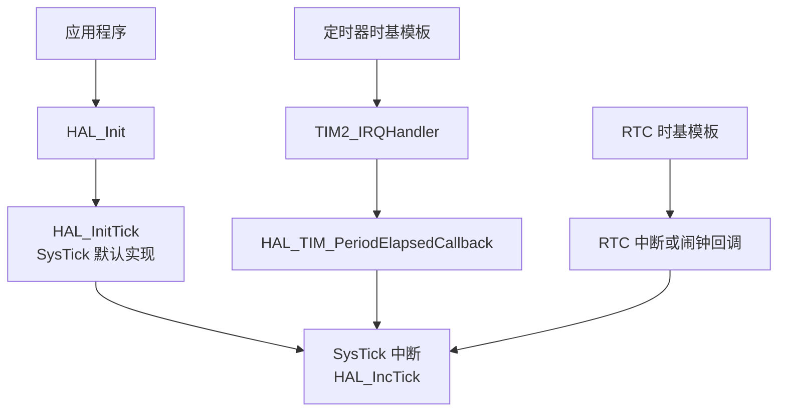
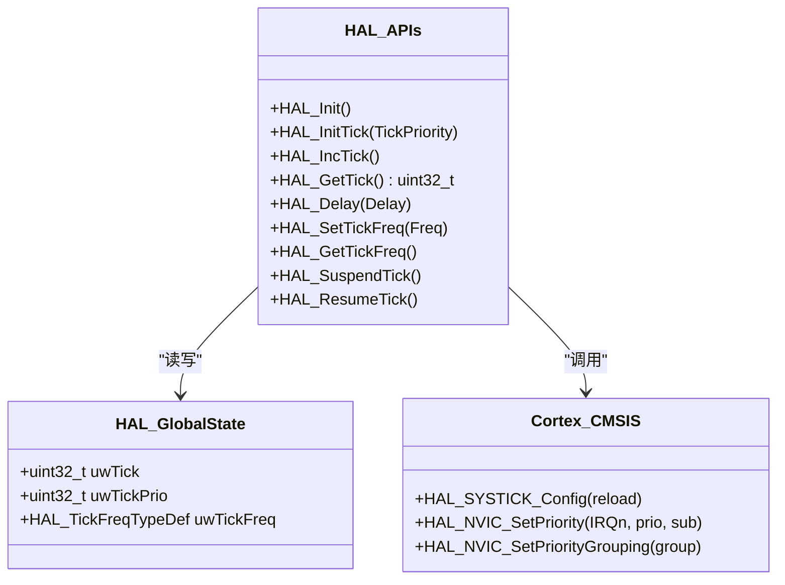
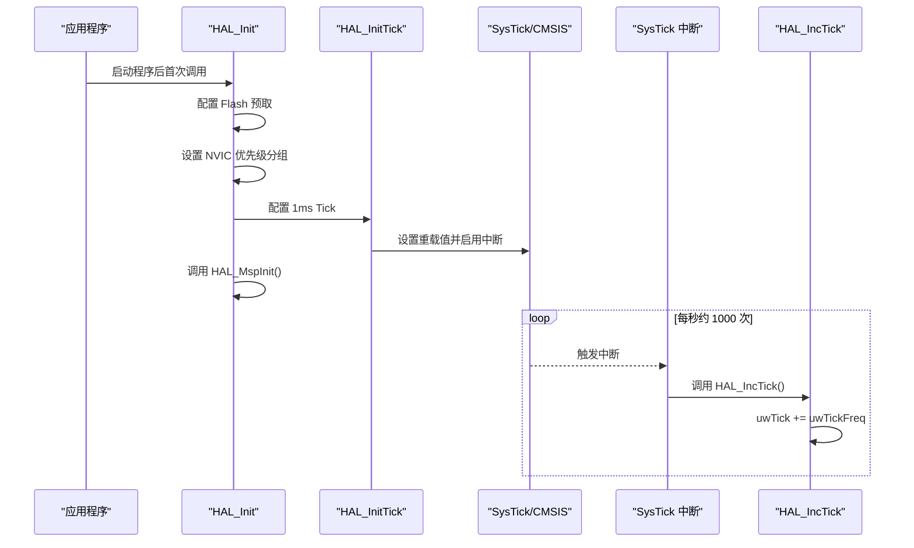
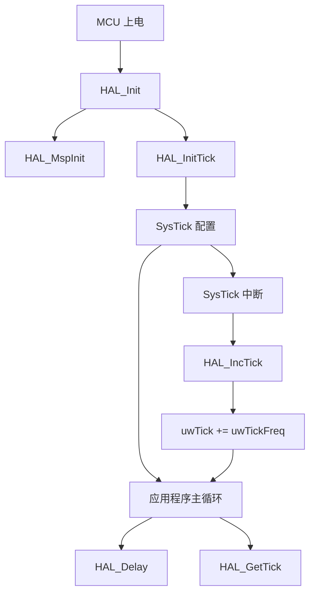
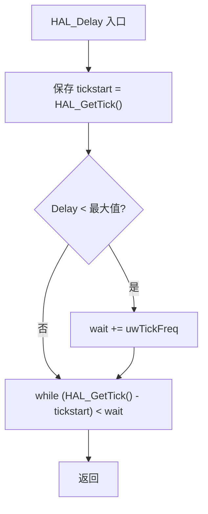
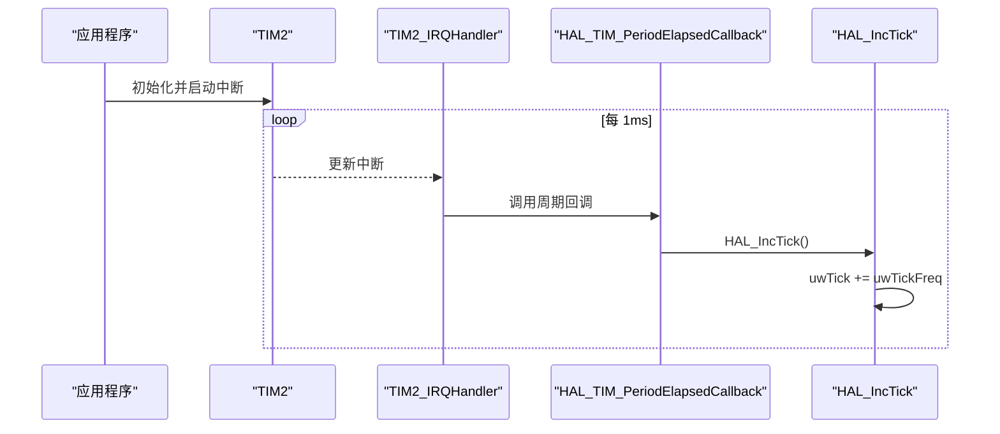
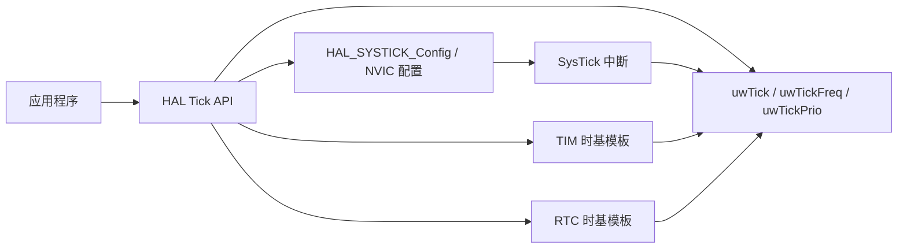

# 系统生命周期与 Tick 时基

<cite>
**本文引用的文件**
- [Src/stm32f1xx_hal.c](file://Src/stm32f1xx_hal.c)
- [Inc/stm32f1xx_hal.h](file://Inc/stm32f1xx_hal.h)
- [Src/stm32f1xx_hal_timebase_tim_template.c](file://Src/stm32f1xx_hal_timebase_tim_template.c)
- [Src/stm32f1xx_hal_cortex.c](file://Src/stm32f1xx_hal_cortex.c)
- [Src/stm32f1xx_hal_rcc.c](file://Src/stm32f1xx_hal_rcc.c)
- [README.md](file://README.md)
</cite>

## 目录
1. [引言](#引言)
2. [项目结构与时基相关文件](#项目结构与时基相关文件)
3. [核心组件与全局状态](#核心组件与全局状态)
4. [上电初始化序列](#上电初始化序列)
5. [架构总览](#架构总览)
6. [详细组件分析](#详细组件分析)
7. [依赖关系分析](#依赖关系分析)
8. [精度、中断上下文与多核实时系统注意事项](#精度中断上下文与多核实时系统注意事项)
9. [自定义时基实现指南](#自定义时基实现指南)
10. [性能考虑](#性能考虑)
11. [故障排查](#故障排查)
12. [结论](#结论)

## 引言
本文围绕 STM32F1xx HAL Driver 的系统生命周期与 Tick 时基展开，重点解释 MCU 上电后从 `HAL_Init` 到应用程序主循环的数据流，并详细说明 SysTick 默认时基与定时器或 RTC 时基模板的区别。文档还给出 Tick 精度、中断优先级要求、RTOS 环境下的注意事项，以及替换默认时基、验证精度和排查常见问题的实践方法。

本仓库是 STM32CubeF1 HAL-LL 驱动组件的一部分，提供可移植的硬件抽象层接口；其 README 强调 CMSIS Core、CMSIS Device、HAL 版本一致性的重要性。

**章节来源**
- [README.md:1-45](file://README.md#L1-L45)

## 项目结构与时基相关文件
该仓库以“功能模块”组织源码：公共 HAL 接口集中在 `Src/stm32f1xx_hal.c`，Cortex/NVIC/SysTick 相关逻辑在 `Src/stm32f1xx_hal_cortex.c`，RCC 时钟配置在 `Src/stm32f1xx_hal_rcc.c`，头文件声明集中在 `Inc/stm32f1xx_hal.h`。Tick 时基有两种典型实现：

- 默认 SysTick 时基：由 `stm32f1xx_hal.c` 中的弱函数提供。
- 定时器时基模板：`stm32f1xx_hal_timebase_tim_template.c`，使用通用定时器产生 1ms 中断。
- RTC 时基模板：仓库提供了同名模板文件，但当前快照中该文件内容不可读取；其设计思路是使用 RTC 作为系统时基，并通过回调调用 `HAL_IncTick`。

**图表来源**
- [Src/stm32f1xx_hal.c:115-168](file://Src/stm32f1xx_hal.c#L115-L168)
- [Src/stm32f1xx_hal.c:226-254](file://Src/stm32f1xx_hal.c#L226-L254)
- [Src/stm32f1xx_hal_timebase_tim_template.c:1-178](file://Src/stm32f1xx_hal_timebase_tim_template.c#L1-L178)

**章节来源**
- [Src/stm32f1xx_hal.c:115-168](file://Src/stm32f1xx_hal.c#L115-L168)
- [Src/stm32f1xx_hal_timebase_tim_template.c:1-178](file://Src/stm32f1xx_hal_timebase_tim_template.c#L1-L178)
- [README.md:1-45](file://README.md#L1-L45)

## 核心组件与全局状态
HAL 维护一个毫秒级时间基数变量和频率控制变量：

| 名称 | 类型 | 作用 | 默认值/说明 |
|---|---|---|---|
| `uwTick` | 32 位无符号整数 | 应用侧统一的时间基准计数器 | 初始为 0，每 Tick 增加 |
| `uwTickPrio` | 32 位无符号整数 | 记录当前 Tick 中断优先级 | 初始为无效优先级 |
| `uwTickFreq` | `HAL_TickFreqTypeDef` | Tick 频率步进单位 | 默认 1kHz，即每次加 1ms |
| `HAL_TICK_FREQ_1KHZ` | 枚举常量 | 1ms 步进 | 默认值 |
| `HAL_TICK_FREQ_100HZ` | 枚举常量 | 10ms 步进 | 可选低频 Tick |
| `HAL_TICK_FREQ_10HZ` | 枚举常量 | 100ms 步进 | 可选极低频 Tick |

这些变量由 `HAL_InitTick`、`HAL_IncTick`、`HAL_GetTick`、`HAL_SetTickFreq` 等函数共同维护。

**图表来源**
- [Inc/stm32f1xx_hal.h:38-62](file://Inc/stm32f1xx_hal.h#L38-L62)
- [Src/stm32f1xx_hal.c:74-83](file://Src/stm32f1xx_hal.c#L74-L83)
- [Src/stm32f1xx_hal.c:226-387](file://Src/stm32f1xx_hal.c#L226-L387)
- [Src/stm32f1xx_hal_cortex.c:100-160](file://Src/stm32f1xx_hal_cortex.c#L100-L160)

**章节来源**
- [Inc/stm32f1xx_hal.h:38-62](file://Inc/stm32f1xx_hal.h#L38-L62)
- [Src/stm32f1xx_hal.c:74-83](file://Src/stm32f1xx_hal.c#L74-L83)

## 上电初始化序列
MCU 复位后，HAL 的典型初始化流程如下：

1. **进入 `HAL_Init`**
   - 根据宏启用 Flash 预取缓冲（若支持）。
   - 设置 NVIC 优先级分组为 4 组。
   - 调用 `HAL_InitTick(TICK_INT_PRIORITY)` 配置 1ms Tick。
   - 调用用户提供的 `HAL_MspInit()` 完成底层硬件初始化。

2. **`HAL_InitTick` 默认实现**
   - 使用 `HAL_SYSTICK_Config(SystemCoreClock / (1000 / uwTickFreq))` 配置 SysTick。
   - 设置 SysTick 中断优先级，并保存至 `uwTickPrio`。
   - 若优先级无效，返回错误。

3. **SysTick 中断服务程序**
   - CMSIS/HAL 层在 SysTick 中断中递增 `uwTick`，实际通过弱函数 `HAL_IncTick` 完成。
   - 默认实现按 `uwTickFreq` 步进计数。

4. **时钟重配路径**
   - RCC 时钟配置完成后会再次调用 `HAL_InitTick(uwTickPrio)`，确保 Tick 与新的系统时钟一致。

**图表来源**
- [Src/stm32f1xx_hal.c:115-168](file://Src/stm32f1xx_hal.c#L115-L168)
- [Src/stm32f1xx_hal.c:226-254](file://Src/stm32f1xx_hal.c#L226-L254)
- [Src/stm32f1xx_hal.c:289-297](file://Src/stm32f1xx_hal.c#L289-L297)
- [Src/stm32f1xx_hal_rcc.c:241-247](file://Src/stm32f1xx_hal_rcc.c#L241-L247)

**章节来源**
- [Src/stm32f1xx_hal.c:115-168](file://Src/stm32f1xx_hal.c#L115-L168)
- [Src/stm32f1xx_hal.c:226-254](file://Src/stm32f1xx_hal.c#L226-L254)
- [Src/stm32f1xx_hal.c:289-297](file://Src/stm32f1xx_hal.c#L289-L297)
- [Src/stm32f1xx_hal_rcc.c:241-247](file://Src/stm32f1xx_hal_rcc.c#L241-L247)

## 架构总览
下图展示从 `HAL_Init` 到应用程序主循环的 Tick 数据流。SysTick 默认路径直接更新 `uwTick`；定时器时基模板则通过 TIM 中断回调间接调用 `HAL_IncTick`。

**图表来源**
- [Src/stm32f1xx_hal.c:115-168](file://Src/stm32f1xx_hal.c#L115-L168)
- [Src/stm32f1xx_hal.c:226-254](file://Src/stm32f1xx_hal.c#L226-L254)
- [Src/stm32f1xx_hal.c:289-297](file://Src/stm32f1xx_hal.c#L289-L297)
- [Src/stm32f1xx_hal.c:371-387](file://Src/stm32f1xx_hal.c#L371-L387)

## 详细组件分析

### HAL_Init
`HAL_Init` 是 HAL 的第一个入口函数，负责：
- 配置 Flash 预取缓冲。
- 设置 NVIC 优先级分组。
- 调用 `HAL_InitTick` 建立 1ms 时基。
- 调用 `HAL_MspInit` 执行用户级 MSP 初始化。

它不直接配置 RCC 主时钟树；RCC 配置通常由应用或板级初始化代码完成，并在 `HAL_RCC_ClockConfig` 之后重新校准 Tick。

**章节来源**
- [Src/stm32f1xx_hal.c:115-168](file://Src/stm32f1xx_hal.c#L115-L168)

### HAL_InitTick（SysTick 默认实现）
默认实现使用 SysTick 作为时基源：
- 根据 `SystemCoreClock` 和 `uwTickFreq` 计算 SysTick 重载值。
- 调用 `HAL_SYSTICK_Config` 启用 SysTick 中断。
- 校验传入的 `TickPriority`，合法则写入 `uwTickPrio`，否则返回错误。

注意：`uwTickFreq` 决定每个中断增加的 Tick 值；默认 1kHz 对应每次加 1。

**章节来源**
- [Src/stm32f1xx_hal.c:226-254](file://Src/stm32f1xx_hal.c#L226-L254)
- [Src/stm32f1xx_hal_cortex.c:100-160](file://Src/stm32f1xx_hal_cortex.c#L100-L160)

### HAL_IncTick 与 HAL_GetTick
- `HAL_IncTick` 将 `uwTick` 加上 `uwTickFreq`。
- `HAL_GetTick` 直接返回 `uwTick`。
- 两者均为弱函数，允许被用户覆盖；但在默认实现中，它们构成 Tick 计数的核心。

由于 `uwTick` 是共享变量，在中断上下文中被 SysTick/TIM/RTC 中断修改，应用层应保证读取与比较操作满足 32 位原子性，并在高优先级中断中避免长时间阻塞 Tick 更新。

**章节来源**
- [Src/stm32f1xx_hal.c:289-307](file://Src/stm32f1xx_hal.c#L289-L307)

### HAL_Delay
`HAL_Delay` 是一个基于 `uwTick` 的非精确忙等待延时函数：
- 记录起始 Tick。
- 对非最大延时值增加一个 Tick 步进，以保证最小等待时间。
- 循环比较当前 Tick 与起始 Tick 的差值。

因此，它的“精度”受以下因素影响：
- Tick 频率：默认 1kHz，理论分辨率约 1ms。
- 中断延迟：如果 Tick 中断被更高优先级中断阻塞，延时可能略长。
- 溢出处理：使用 32 位无符号数相减，天然支持 `uwTick` 溢出。

**图表来源**
- [Src/stm32f1xx_hal.c:371-387](file://Src/stm32f1xx_hal.c#L371-L387)

**章节来源**
- [Src/stm32f1xx_hal.c:371-387](file://Src/stm32f1xx_hal.c#L371-L387)

### HAL_SuspendTick 与 HAL_ResumeTick
默认实现控制 SysTick 中断使能：
- `HAL_SuspendTick` 禁用 SysTick 中断。
- `HAL_ResumeTick` 重新启用 SysTick 中断。

这两个函数也可被定时器时基模板覆盖，用于暂停/恢复对应定时器的更新中断。

**章节来源**
- [Src/stm32f1xx_hal.c:395-423](file://Src/stm32f1xx_hal.c#L395-L423)
- [Src/stm32f1xx_hal_timebase_tim_template.c:118-146](file://Src/stm32f1xx_hal_timebase_tim_template.c#L118-L146)

### HAL_DeInit
`HAL_DeInit` 复位 APB1/APB2（以及部分设备的 AHB），然后调用 `HAL_MspDeInit`。它不是必须实现的路径，主要用于调试或特殊复位场景。

**章节来源**
- [Src/stm32f1xx_hal.c:170-200](file://Src/stm32f1xx_hal.c#L170-L200)

### 定时器时基模板
`stm32f1xx_hal_timebase_tim_template.c` 用 TIM2 替代 SysTick：
- 启用 TIM2 时钟。
- 查询 RCC 时钟配置，得到 PCLK1 频率。
- 配置预分频器，使定时器计数时钟接近 1MHz。
- 设置 Period 为 `(TIM2CLK/1000)-1`，实现 1ms 周期。
- 以中断方式启动基础定时器。
- 使能 TIM2 全局中断并设置 NVIC 优先级。
- 在 `HAL_TIM_PeriodElapsedCallback` 中调用 `HAL_IncTick`。
- 提供 `HAL_SuspendTick`/`HAL_ResumeTick` 控制定时器更新中断。

**图表来源**
- [Src/stm32f1xx_hal_timebase_tim_template.c:37-116](file://Src/stm32f1xx_hal_timebase_tim_template.c#L37-L116)
- [Src/stm32f1xx_hal_timebase_tim_template.c:118-178](file://Src/stm32f1xx_hal_timebase_tim_template.c#L118-L178)

**章节来源**
- [Src/stm32f1xx_hal_timebase_tim_template.c:1-178](file://Src/stm32f1xx_hal_timebase_tim_template.c#L1-L178)

### RTC 时基模板
仓库包含 `stm32f1xx_hal_timebase_rtc_alarm_template.c`，但当前快照中该文件无法按 UTF-8 文本读取。从命名和 HAL 时基模式可知，其目标是使用 RTC 或 RTC 闹钟作为系统时基，并在 RTC 相关中断或回调中调用 `HAL_IncTick`。选择该模板时，需要确保：
- RTC 时钟源可用且稳定。
- RTC 中断优先级高于外设中断。
- RTC 中断服务程序足够短，及时调用 `HAL_IncTick`。
- 若使用低功耗模式，需确认 RTC 在目标模式下仍能提供 Tick。

由于文件内容不可读，本文不展开具体寄存器配置细节，只强调它与 SysTick/TIM 模板的共同契约：按时调用 `HAL_IncTick`。

**章节来源**
- [Src/stm32f1xx_hal_timebase_rtc_alarm_template.c](file://Src/stm32f1xx_hal_timebase_rtc_alarm_template.c)

## 依赖关系分析
Tick 子系统依赖以下层次：

- **应用层**：调用 `HAL_Init`、`HAL_Delay`、`HAL_GetTick`。
- **HAL 层**：维护 `uwTick`、`uwTickFreq`、`uwTickPrio`，并提供 Tick API。
- **Cortex/CMSIS 层**：SysTick 配置、NVIC 优先级分组和中断优先级设置。
- **外设层**：默认 SysTick；可选 TIM 或 RTC 中断回调。

**图表来源**
- [Src/stm32f1xx_hal.c:74-83](file://Src/stm32f1xx_hal.c#L74-L83)
- [Src/stm32f1xx_hal.c:226-254](file://Src/stm32f1xx_hal.c#L226-L254)
- [Src/stm32f1xx_hal_timebase_tim_template.c:37-178](file://Src/stm32f1xx_hal_timebase_tim_template.c#L37-L178)

**章节来源**
- [Src/stm32f1xx_hal.c:74-83](file://Src/stm32f1xx_hal.c#L74-L83)
- [Src/stm32f1xx_hal.c:226-254](file://Src/stm32f1xx_hal.c#L226-L254)
- [Src/stm32f1xx_hal_timebase_tim_template.c:37-178](file://Src/stm32f1xx_hal_timebase_tim_template.c#L37-L178)

## 精度、中断上下文与多核实时系统注意事项

### Tick 精度
- 默认 SysTick 时基的理论分辨率为 1ms。
- 若使用 `HAL_SetTickFreq(HAL_TICK_FREQ_100HZ)`，Tick 步进变为 10ms；`HAL_TICK_FREQ_10HZ` 步进为 100ms。
- `HAL_Delay` 的最小等待值会额外增加一个 Tick 步进，以避免零延时或极短延时被立即返回。
- 实际精度受中断延迟影响：如果 SysTick 中断被更高优先级中断抢占，`uwTick` 更新会延后，导致延时偏长。

### 中断上下文安全
- HAL 文档明确警告：如果在某个外设中断服务程序中调用 `HAL_Delay`，必须确保 Tick 中断优先级高于该外设中断；否则外设中断会阻塞 Tick，导致死锁或严重延时误差。
- 建议在中断中使用非阻塞超时机制，而不是直接调用 `HAL_Delay`。

### 多核与 RTOS 注意事项
- STM32F1xx 通常是单核 Cortex-M3，不存在真正的多核并发竞争。
- 若运行 RTOS，需要注意：
  - Tick 中断可能被 RTOS 内核用作系统节拍；此时不要随意改变 Tick 频率。
  - 高优先级任务或中断不能长时间占用 CPU，否则会推迟 `HAL_IncTick`。
  - 如果使用 FreeRTOS、RTX 等，应遵循该 RTOS 对 SysTick 或系统 Tick 的要求，避免重复定义冲突。
  - 低功耗模式（Sleep/Stop/Standby）下，需确认 SysTick 或所选时基是否仍在运行；STM32F1 在 Stop 模式下 SysTick 行为需参考设备手册与 HAL 注释。

[本节为通用指导，不直接分析具体代码行]

## 自定义时基实现指南

### 何时选择不同时基
- 保留 SysTick 默认时基：适合大多数应用，简单可靠。
- 选择定时器时基模板：希望使用通用定时器、与其他定时器共用中断框架，或需要在 Tick 中断中执行更多定时器相关逻辑。
- 选择 RTC 时基模板：需要与 RTC 时间保持强一致，或在某些低功耗场景中依赖 RTC 计时。

### 使用定时器时基模板的步骤
1. 将 `stm32f1xx_hal_timebase_tim_template.c` 加入工程编译。
2. 确保没有同时启用多个时基实现，避免重复定义 `HAL_InitTick`、`HAL_IncTick` 等弱函数。
3. 检查 TIM2 时钟是否启用，NVIC 中断是否使能。
4. 确认 `TICK_INT_PRIORITY` 低于外设中断优先级数值。
5. 验证 `HAL_TIM_PeriodElapsedCallback` 被调用，并调用 `HAL_IncTick`。
6. 如需调整 Tick 频率，使用 `HAL_SetTickFreq` 并重新调用 `HAL_InitTick`。

### 使用 RTC 时基模板的步骤
1. 启用 RTC 时钟和 RTC 闹钟或秒中断。
2. 将 RTC 时基模板加入工程。
3. 在 RTC 中断或闹钟回调中调用 `HAL_IncTick`。
4. 设置 RTC 中断优先级高于外设中断。
5. 验证低功耗模式下 Tick 是否仍然工作。

### 精度验证方法
- 使用 GPIO 翻转配合示波器测量 1ms 间隔。
- 在 Tick 回调中翻转引脚，观察脉冲周期。
- 使用定时器捕获输入或外部计数器统计一段时间内的 Tick 数量。
- 对比不同 Tick 频率下的延时误差。
- 在高负载中断环境中验证 `HAL_Delay` 的最大抖动。

[本节为实践步骤，不直接引用具体代码行]

## 性能考虑
- `HAL_Delay` 是忙等待实现，会占用 CPU；不适合频繁调用或在中断中调用。
- 高频 Tick 会增加中断开销；低频 Tick 会降低时间分辨率。
- 使用定时器或 RTC 时基时，中断服务程序应尽量短，仅做必要标志更新和 `HAL_IncTick`。
- 时钟重配后，RCC 会重新调用 `HAL_InitTick`，确保 Tick 重载值与新的系统时钟匹配。

**章节来源**
- [Src/stm32f1xx_hal.c:371-387](file://Src/stm32f1xx_hal.c#L371-L387)
- [Src/stm32f1xx_hal_rcc.c:241-247](file://Src/stm32f1xx_hal_rcc.c#L241-L247)

## 故障排查

### Tick 不递增
可能原因：
- SysTick 中断未启用或未到达。
- Tick 中断优先级被屏蔽或配置错误。
- 使用了定时器时基模板，但 TIM2 中断未使能。
- 使用了 RTC 时基模板，但 RTC 中断未使能或回调未调用 `HAL_IncTick`。
- 系统在低功耗模式下关闭了 Tick 源。

排查建议：
- 检查 `HAL_Init` 是否成功调用。
- 检查 `uwTickPrio` 是否已设置为有效值。
- 在 SysTick 或 TIM2/RTC 中断入口设置断点。
- 确认没有多个时基实现重复定义弱函数。

**章节来源**
- [Src/stm32f1xx_hal.c:115-168](file://Src/stm32f1xx_hal.c#L115-L168)
- [Src/stm32f1xx_hal.c:226-254](file://Src/stm32f1xx_hal.c#L226-L254)
- [Src/stm32f1xx_hal_timebase_tim_template.c:37-116](file://Src/stm32f1xx_hal_timebase_tim_template.c#L37-L116)

### 延时不准
可能原因：
- Tick 中断被更高优先级中断阻塞。
- 在中断中调用 `HAL_Delay`，造成 Tick 更新被阻塞。
- Tick 频率被改为 100Hz 或 10Hz，导致分辨率变低。
- 系统时钟变化后未重新配置 Tick。

排查建议：
- 降低外设中断优先级，保证 Tick 优先。
- 避免在中断中调用 `HAL_Delay`。
- 检查 `HAL_GetTickFreq` 返回值是否符合预期。
- 在 RCC 时钟配置后确认 `HAL_InitTick` 被重新调用。

**章节来源**
- [Src/stm32f1xx_hal.c:226-254](file://Src/stm32f1xx_hal.c#L226-L254)
- [Src/stm32f1xx_hal.c:329-357](file://Src/stm32f1xx_hal.c#L329-L357)
- [Src/stm32f1xx_hal.c:371-387](file://Src/stm32f1xx_hal.c#L371-L387)
- [Src/stm32f1xx_hal_rcc.c:241-247](file://Src/stm32f1xx_hal_rcc.c#L241-L247)

### 中断优先级过低
现象：
- 外设中断中调用 `HAL_Delay` 卡死。
- Tick 更新延迟明显，延时变长。
- 高优先级任务或中断抢占 Tick，导致系统时间抖动增大。

处理原则：
- Tick 中断优先级数值应小于外设中断优先级数值。
- 不要在 ISR 中调用阻塞式延时。
- 使用 RTOS 时，遵循 RTOS 的 Tick 管理策略。

**章节来源**
- [Src/stm32f1xx_hal.c:115-168](file://Src/stm32f1xx_hal.c#L115-L168)
- [Src/stm32f1xx_hal.c:226-254](file://Src/stm32f1xx_hal.c#L226-L254)
- [Src/stm32f1xx_hal_cortex.c:100-160](file://Src/stm32f1xx_hal_cortex.c#L100-L160)

## 结论
STM32F1xx HAL 的 Tick 时基是系统生命周期的关键基础设施。默认实现使用 SysTick，结构简单、易于理解；定时器或 RTC 时基模板则提供更灵活的硬件选择，但必须严格保证中断优先级、回调正确性和低功耗模式行为。应用层应以 `HAL_Init` 为起点，合理配置 Tick 频率，避免在中断中使用 `HAL_Delay`，并在更换时钟源或运行时基时重新校准 Tick。通过中断入口观测、GPIO 翻转和定时器捕获等方法，可以验证 Tick 精度并定位常见问题。