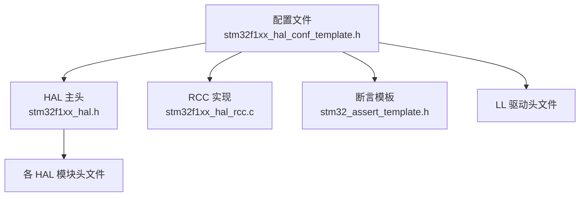
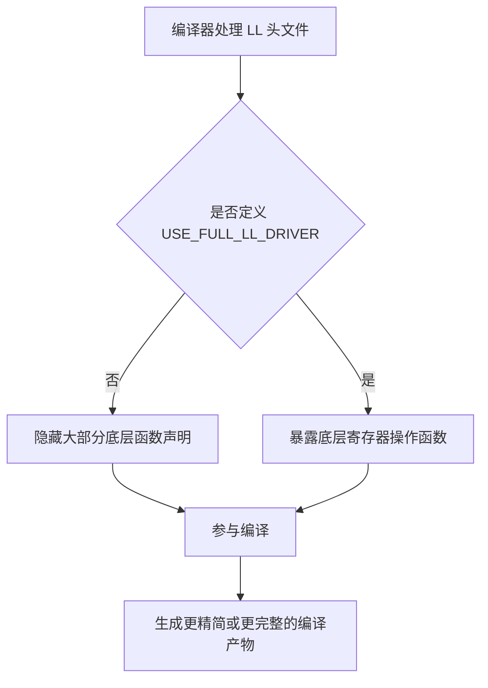
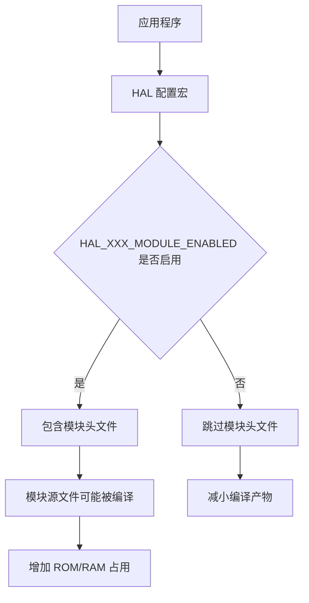
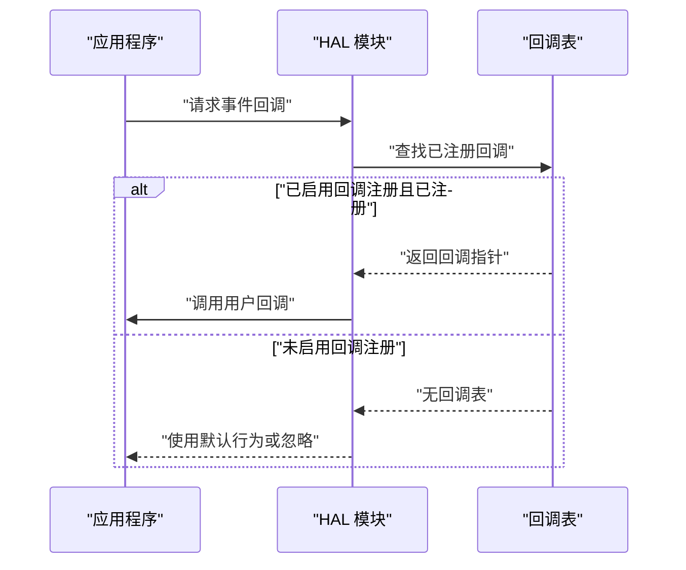
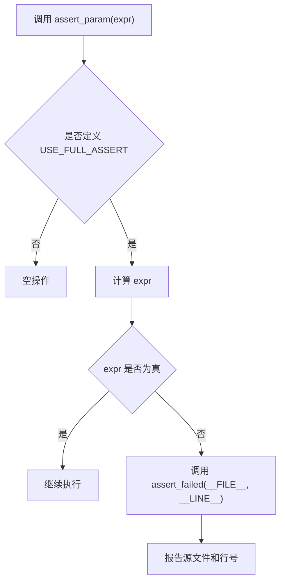
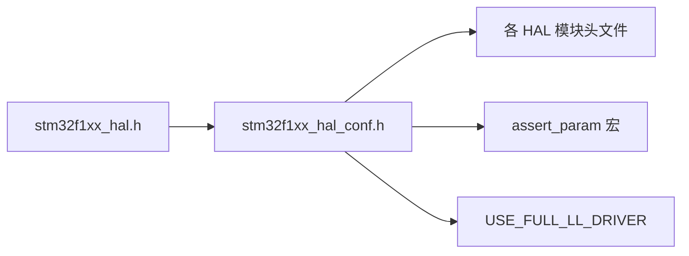
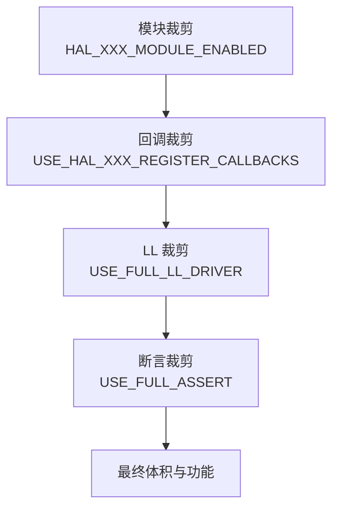

# 配置系统与模块裁剪

<cite>
**本文引用的文件**   
- [stm32f1xx_hal_conf_template.h](file://Inc/stm32f1xx_hal_conf_template.h)
- [stm32_assert_template.h](file://Inc/stm32_assert_template.h)
- [stm32f1xx_hal.h](file://Inc/stm32f1xx_hal.h)
- [stm32f1xx_ll_adc.h](file://Inc/stm32f1xx_ll_adc.h)
- [stm32f1xx_ll_dma.h](file://Inc/stm32f1xx_ll_dma.h)
- [stm32f1xx_ll_i2c.h](file://Inc/stm32f1xx_ll_i2c.h)
- [stm32f1xx_ll_gpio.h](file://Inc/stm32f1xx_ll_gpio.h)
- [stm32f1xx_ll_exti.h](file://Inc/stm32f1xx_ll_exti.h)
- [stm32f1xx_ll_dac.h](file://Inc/stm32f1xx_ll_dac.h)
- [stm32f1xx_ll_crc.h](file://Inc/stm32f1xx_ll_crc.h)
- [stm32f1xx_hal_rcc.c](file://Src/stm32f1xx_hal_rcc.c)
- [README.md](file://README.md)
</cite>

## 目录
1. [简介](#简介)
2. [项目结构](#项目结构)
3. [核心配置宏总览](#核心配置宏总览)
4. [驱动库与低层驱动选择](#驱动库与低层驱动选择)
5. [模块裁剪机制](#模块裁剪机制)
6. [回调注册开关](#回调注册开关)
7. [时钟与振荡器配置](#时钟与振荡器配置)
8. [运行时参数断言机制](#运行时参数断言机制)
9. [典型 hal_conf.h 配置示例](#典型-hal_confh-配置示例)
10. [依赖关系分析](#依赖关系分析)
11. [性能与体积影响](#性能与体积影响)
12. [故障排查清单](#故障排查清单)
13. [结论](#结论)

## 简介
本文面向 STM32F1xx HAL Driver 的配置系统与模块裁剪机制，重点说明以下问题：
- 如何通过 `stm32f1xx_hal_conf_template.h` 中的宏控制 HAL 模块、LL 驱动、回调函数和运行时检查。
- 如何通过模块开关减少编译产物体积，降低 ROM/RAM 占用。
- 如何正确设置 HSE、HSI、LSI、LSE 等时钟常量，并理解频率计算与时钟启动超时校验。
- 如何通过 `USE_FULL_ASSERT` 启用或禁用 `assert_param` 参数检查。
- 如何编写一个实际项目的 `hal_conf.h`，并在出现链接失败、功能缺失、时钟频率错误时进行排查。

该仓库是 STM32CubeF1 的 HAL/LL 组件，提供可单独选取的驱动实现，而不是完整 MCU 包的全部软件。因此，正确的配置直接影响最终固件是否可用、体积是否合理、行为是否符合预期。

**章节来源**
- [README.md:1-45](file://README.md#L1-L45)

## 项目结构
本仓库按“接口头文件 + 源文件”的方式组织，核心相关目录如下：
- `Inc/`：HAL 与 LL 的头文件、配置模板、断言模板。
- `Src/`：HAL 与 LL 的实现文件。
- `Inc/Legacy/` 与 `Src/Legacy/`：旧版 CAN 兼容代码。

与本主题直接相关的入口文件包括：
- 配置模板：`Inc/stm32f1xx_hal_conf_template.h`
- 断言模板：`Inc/stm32_assert_template.h`
- HAL 主头：`Inc/stm32f1xx_hal.h`
- RCC 时钟实现：`Src/stm32f1xx_hal_rcc.c`
- 若干 LL 头文件，用于展示 `USE_FULL_LL_DRIVER` 的作用范围。

**图表来源**
- [stm32f1xx_hal_conf_template.h:1-398](file://Inc/stm32f1xx_hal_conf_template.h#L1-L398)
- [stm32f1xx_hal.h:1-357](file://Inc/stm32f1xx_hal.h#L1-L357)
- [stm32_assert_template.h:1-56](file://Inc/stm32_assert_template.h#L1-L56)
- [stm32f1xx_hal_rcc.c:1050-1150](file://Src/stm32f1xx_hal_rcc.c#L1050-L1150)

**章节来源**
- [stm32f1xx_hal_conf_template.h:1-398](file://Inc/stm32f1xx_hal_conf_template.h#L1-L398)
- [stm32f1xx_hal.h:1-357](file://Inc/stm32f1xx_hal.h#L1-L357)
- [stm32_assert_template.h:1-56](file://Inc/stm32_assert_template.h#L1-L56)
- [stm32f1xx_hal_rcc.c:1050-1150](file://Src/stm32f1xx_hal_rcc.c#L1050-L1150)

## 核心配置宏总览
`stm32f1xx_hal_conf_template.h` 是 HAL 配置模板。用户应将其复制到应用工程并重命名为 `stm32f1xx_hal_conf.h`，然后修改其中的宏来裁剪功能。该模板包含四类关键内容：
1. **模块使能宏**：如 `HAL_ADC_MODULE_ENABLED`、`HAL_I2C_MODULE_ENABLED`、`HAL_UART_MODULE_ENABLED` 等。
2. **振荡器与系统配置宏**：如 `HSE_VALUE`、`HSE_STARTUP_TIMEOUT`、`HSI_VALUE`、`LSI_VALUE`、`LSE_VALUE`、`VDD_VALUE`、`TICK_INT_PRIORITY`、`USE_RTOS`、`PREFETCH_ENABLE`。
3. **回调注册开关**：如 `USE_HAL_ADC_REGISTER_CALLBACKS`、`USE_HAL_I2C_REGISTER_CALLBACKS`、`USE_HAL_UART_REGISTER_CALLBACKS` 等。
4. **断言开关**：`USE_FULL_ASSERT`。

这些宏在编译期决定：
- 哪些 HAL 模块被包含到编译单元中。
- 哪些 LL 驱动 API 暴露给上层。
- 是否生成回调注册表、虚函数指针表和调试断言。
- 时钟初始化逻辑如何根据外部晶振频率计算系统时钟。

**章节来源**
- [stm32f1xx_hal_conf_template.h:1-190](file://Inc/stm32f1xx_hal_conf_template.h#L1-L190)
- [stm32f1xx_hal_conf_template.h:190-398](file://Inc/stm32f1xx_hal_conf_template.h#L190-L398)

## 驱动库与低层驱动选择

### USE_FULL_LL_DRIVER 的作用
`USE_FULL_LL_DRIVER` 是一个条件编译宏，用于决定是否暴露 LL（Low Layer）驱动头文件中的大部分函数声明。从多个 LL 头文件可以看到，许多函数原型被包裹在 `#if defined(USE_FULL_LL_DRIVER)` 块中。

例如：
- ADC LL 头文件中存在多处受 `USE_FULL_LL_DRIVER` 控制的函数声明。
- DMA、I2C、GPIO、EXTI、DAC、CRC 等 LL 头文件也使用相同模式。

其影响如下：
- **定义后**：LL 头文件暴露更多底层寄存器访问函数，适合需要绕过 HAL、直接操作外设的应用。
- **未定义时**：LL 层对外暴露的 API 大幅减少，减少头文件依赖，间接降低编译产物体积和误用风险。
- **对 HAL 的影响**：HAL 层本身通常不依赖 `USE_FULL_LL_DRIVER`；该宏主要控制 LL 驱动层的公开接口。

**图表来源**
- [stm32f1xx_ll_adc.h:230-400](file://Inc/stm32f1xx_ll_adc.h#L230-L400)
- [stm32f1xx_ll_adc.h:3870-3920](file://Inc/stm32f1xx_ll_adc.h#L3870-L3920)
- [stm32f1xx_ll_dma.h:55-145](file://Inc/stm32f1xx_ll_dma.h#L55-L145)
- [stm32f1xx_ll_i2c.h:50-110](file://Inc/stm32f1xx_ll_i2c.h#L50-L110)
- [stm32f1xx_ll_gpio.h:50-110](file://Inc/stm32f1xx_ll_gpio.h#L50-L110)
- [stm32f1xx_ll_exti.h:40-80](file://Inc/stm32f1xx_ll_exti.h#L40-L80)
- [stm32f1xx_ll_dac.h:140-200](file://Inc/stm32f1xx_ll_dac.h#L140-L200)
- [stm32f1xx_ll_crc.h:165-185](file://Inc/stm32f1xx_ll_crc.h#L165-L185)

**章节来源**
- [stm32f1xx_ll_adc.h:230-400](file://Inc/stm32f1xx_ll_adc.h#L230-L400)
- [stm32f1xx_ll_adc.h:3870-3920](file://Inc/stm32f1xx_ll_adc.h#L3870-L3920)
- [stm32f1xx_ll_dma.h:55-145](file://Inc/stm32f1xx_ll_dma.h#L55-L145)
- [stm32f1xx_ll_i2c.h:50-110](file://Inc/stm32f1xx_ll_i2c.h#L50-L110)
- [stm32f1xx_ll_gpio.h:50-110](file://Inc/stm32f1xx_ll_gpio.h#L50-L110)
- [stm32f1xx_ll_exti.h:40-80](file://Inc/stm32f1xx_ll_exti.h#L40-L80)
- [stm32f1xx_ll_dac.h:140-200](file://Inc/stm32f1xx_ll_dac.h#L140-L200)
- [stm32f1xx_ll_crc.h:165-185](file://Inc/stm32f1xx_ll_crc.h#L165-L185)

### USE_HAL_DRIVER 的角色
在当前仓库中，`USE_HAL_DRIVER` 并未在 HAL 主头文件或配置模板中被直接使用来控制 HAL 整体开关。相反，HAL 主头文件 `stm32f1xx_hal.h` 通过包含 `stm32f1xx_hal_conf.h` 引入所有配置，再根据 `HAL_XXX_MODULE_ENABLED` 宏决定是否包含具体模块头文件。

因此，在本仓库中：
- **真正控制模块裁剪的是 `HAL_XXX_MODULE_ENABLED`**。
- `USE_HAL_DRIVER` 可能由工具链、CMSIS 设备定义或其他顶层工程宏定义，但不在该 HAL 组件内部作为裁剪主开关。
- 若工程中确实定义了 `USE_HAL_DRIVER`，它通常是更高阶框架或 BSP 层面的约定；本 HAL 组件更关注 `HAL_XXX_MODULE_ENABLED`。

**章节来源**
- [stm32f1xx_hal.h:1-40](file://Inc/stm32f1xx_hal.h#L1-L40)
- [stm32f1xx_hal_conf_template.h:25-70](file://Inc/stm32f1xx_hal_conf_template.h#L25-L70)

## 模块裁剪机制

### HAL 模块开关
模板中定义了众多 `HAL_XXX_MODULE_ENABLED` 宏，例如：
- `HAL_ADC_MODULE_ENABLED`
- `HAL_CAN_MODULE_ENABLED`
- `HAL_CEC_MODULE_ENABLED`
- `HAL_CORTEX_MODULE_ENABLED`
- `HAL_CRC_MODULE_ENABLED`
- `HAL_DAC_MODULE_ENABLED`
- `HAL_DMA_MODULE_ENABLED`
- `HAL_ETH_MODULE_ENABLED`
- `HAL_EXTI_MODULE_ENABLED`
- `HAL_FLASH_MODULE_ENABLED`
- `HAL_GPIO_MODULE_ENABLED`
- `HAL_HCD_MODULE_ENABLED`
- `HAL_I2C_MODULE_ENABLED`
- `HAL_I2S_MODULE_ENABLED`
- `HAL_IRDA_MODULE_ENABLED`
- `HAL_IWDG_MODULE_ENABLED`
- `HAL_MMC_MODULE_ENABLED`
- `HAL_NAND_MODULE_ENABLED`
- `HAL_NOR_MODULE_ENABLED`
- `HAL_PCCARD_MODULE_ENABLED`
- `HAL_PCD_MODULE_ENABLED`
- `HAL_PWR_MODULE_ENABLED`
- `HAL_RCC_MODULE_ENABLED`
- `HAL_RTC_MODULE_ENABLED`
- `HAL_SD_MODULE_ENABLED`
- `HAL_SMARTCARD_MODULE_ENABLED`
- `HAL_SPI_MODULE_ENABLED`
- `HAL_SRAM_MODULE_ENABLED`
- `HAL_TIM_MODULE_ENABLED`
- `HAL_UART_MODULE_ENABLED`
- `HAL_USART_MODULE_ENABLED`
- `HAL_WWDG_MODULE_ENABLED`

每个模块头文件都被包裹在类似 `#ifdef HAL_XXX_MODULE_ENABLED` 的 include 语句中。这意味着：
- 如果某个模块宏被注释掉或未定义，对应头文件不会被包含。
- 对应模块的 MSP 初始化、中断处理、状态机、回调表等代码很可能不会进入编译。
- 未使用的模块不会贡献大量全局数据表、函数体和字符串描述。

**图表来源**
- [stm32f1xx_hal_conf_template.h:25-70](file://Inc/stm32f1xx_hal_conf_template.h#L25-L70)
- [stm32f1xx_hal_conf_template.h:240-398](file://Inc/stm32f1xx_hal_conf_template.h#L240-L398)

### 关于 USE_HAL_I2C_ENABLE、USE_HAL_SPI_ENABLE、USE_HAL_UART_ENABLE
在当前仓库中搜索不到 `USE_HAL_I2C_ENABLE`、`USE_HAL_SPI_ENABLE`、`USE_HAL_UART_ENABLE` 这类宏。这说明它们不是本 HAL 组件的标准裁剪宏。

本仓库实际使用的模块裁剪宏是：
- `HAL_I2C_MODULE_ENABLED`
- `HAL_SPI_MODULE_ENABLED`
- `HAL_UART_MODULE_ENABLED`
- `HAL_USART_MODULE_ENABLED`

如果其他工程文档提到 `USE_HAL_I2C_ENABLE` 等名称，可能是不同 MCU 系列、不同版本 HAL、或第三方 BSP 的自定义命名。对于 STM32F1xx HAL Driver 这个仓库，应以 `HAL_XXX_MODULE_ENABLED` 为准。

**章节来源**
- [stm32f1xx_hal_conf_template.h:25-70](file://Inc/stm32f1xx_hal_conf_template.h#L25-L70)
- [stm32f1xx_hal_conf_template.h:240-398](file://Inc/stm32f1xx_hal_conf_template.h#L240-L398)

## 回调注册开关

### 作用机制
模板中为多个外设定义了 `USE_HAL_XXX_REGISTER_CALLBACKS` 宏，默认值均为 `0U`，表示禁用回调注册。例如：
- `USE_HAL_ADC_REGISTER_CALLBACKS`
- `USE_HAL_CAN_REGISTER_CALLBACKS`
- `USE_HAL_CEC_REGISTER_CALLBACKS`
- `USE_HAL_DAC_REGISTER_CALLBACKS`
- `USE_HAL_ETH_REGISTER_CALLBACKS`
- `USE_HAL_HCD_REGISTER_CALLBACKS`
- `USE_HAL_I2C_REGISTER_CALLBACKS`
- `USE_HAL_I2S_REGISTER_CALLBACKS`
- `USE_HAL_MMC_REGISTER_CALLBACKS`
- `USE_HAL_NAND_REGISTER_CALLBACKS`
- `USE_HAL_NOR_REGISTER_CALLBACKS`
- `USE_HAL_PCCARD_REGISTER_CALLBACKS`
- `USE_HAL_PCD_REGISTER_CALLBACKS`
- `USE_HAL_RTC_REGISTER_CALLBACKS`
- `USE_HAL_SD_REGISTER_CALLBACKS`
- `USE_HAL_SMARTCARD_REGISTER_CALLBACKS`
- `USE_HAL_IRDA_REGISTER_CALLBACKS`
- `USE_HAL_SRAM_REGISTER_CALLBACKS`
- `USE_HAL_SPI_REGISTER_CALLBACKS`
- `USE_HAL_TIM_REGISTER_CALLBACKS`
- `USE_HAL_UART_REGISTER_CALLBACKS`
- `USE_HAL_USART_REGISTER_CALLBACKS`
- `USE_HAL_WWDG_REGISTER_CALLBACKS`

当某个 `USE_HAL_XXX_REGISTER_CALLBACKS` 设为 `1U` 时，对应 HAL 模块通常会：
- 增加回调指针字段或回调表。
- 暴露回调注册函数，例如 `HAL_XXX_RegisterCallback()`。
- 在事件发生时调用用户注册的回调，而不是固定实现的默认回调。

当保持默认值 `0U` 时：
- 不需要回调注册表。
- 不需要回调初始化逻辑。
- 减少 RAM 中指针表的大小。
- 减少相关分支和函数体，从而降低 ROM 占用。

**图表来源**
- [stm32f1xx_hal_conf_template.h:120-180](file://Inc/stm32f1xx_hal_conf_template.h#L120-L180)

### 典型影响
- **ADC、CAN、DAC、I2C、I2S、MMC、SD、UART、USART、PCD 等**：如果应用不使用这些外设的动态回调，应保持默认 `0U`。
- **仅使用轮询或简单中断**：不需要开启回调注册。
- **使用 RTOS 或复杂事件模型**：可能需要开启相应模块的回调注册，以支持异步事件处理。

**章节来源**
- [stm32f1xx_hal_conf_template.h:120-180](file://Inc/stm32f1xx_hal_conf_template.h#L120-L180)

## 时钟与振荡器配置

### HSE_VALUE
`HSE_VALUE` 是外部高速晶振频率，单位为赫兹。模板默认在非专用评估板情况下定义为 `8000000U`，即 8 MHz。RCC HAL 在使用 HSE 作为系统时钟源或通过 PLL 倍频时，会使用该值计算系统时钟频率。

如果硬件实际使用 25 MHz 晶振而仍保留 8 MHz 定义，会导致：
- 系统时钟频率错误。
- 定时器计数速度异常。
- UART 波特率偏差。
- USB、以太网等对时钟敏感的外设工作异常。

模板中也展示了针对特定评估板的默认值路径，但通用场景下应明确覆盖 `HSE_VALUE`。

**章节来源**
- [stm32f1xx_hal_conf_template.h:70-110](file://Inc/stm32f1xx_hal_conf_template.h#L70-L110)
- [stm32f1xx_hal_rcc.c:1050-1150](file://Src/stm32f1xx_hal_rcc.c#L1050-L1150)

### HSE_STARTUP_TIMEOUT
`HSE_STARTup_TIMEOUT` 是等待 HSE 振荡器就绪的最大超时时间，单位毫秒。RCC 在启用 HSE 后会等待振荡器稳定，如果超过该时间仍未就绪，则视为启动失败。

建议根据实际晶振特性调整：
- 普通陶瓷晶振：模板默认 100 ms 通常足够。
- 慢起振晶振或带负载电容较大的电路：可适当增大。
- 生产测试环境：如需快速失败，可减少超时以便更快发现硬件问题。

**章节来源**
- [stm32f1xx_hal_conf_template.h:80-100](file://Inc/stm32f1xx_hal_conf_template.h#L80-L100)

### HSI_VALUE、LSI_VALUE、LSE_VALUE
- `HSI_VALUE`：内部高速 RC 振荡器典型值，模板默认 8 MHz。
- `LSI_VALUE`：内部低速 RC 振荡器典型值，模板默认 40 kHz。
- `LSE_VALUE`：外部低速 32.768 kHz 晶振典型值，模板默认 32768 Hz。

这些值用于 RCC 和 RTC 等模块的频率计算。注意它们是“典型值”，实际芯片可能存在工艺偏差，但在大多数应用中可直接使用模板默认值。

**章节来源**
- [stm32f1xx_hal_conf_template.h:90-120](file://Inc/stm32f1xx_hal_conf_template.h#L90-L120)

### LSE_STARTUP_TIMEOUT
`LSE_STARTUP_TIMEOUT` 是 LSE 振荡器启动超时，模板默认 5000 ms。RTC 或低功耗时钟路径中使用 LSE 时应确保该值与实际硬件匹配。

**章节来源**
- [stm32f1xx_hal_conf_template.h:110-120](file://Inc/stm32f1xx_hal_conf_template.h#L110-L120)

### USE_RTC_CRS
在 STM32F1xx HAL Driver 中，CRS（Clock Recovery System）通常属于 STM32F3/F4/H7 等系列的特性。当前仓库的 RTC 头文件和 RCC 实现片段中没有发现 `USE_RTC_CRS` 的使用。

因此，对于 STM32F1xx：
- `USE_RTC_CRS` 不是本仓库的有效裁剪宏。
- 不应将其作为 F1 系列 RTC 或时钟配置的判断依据。
- 如果移植到其他系列，应参考对应系列的 HAL 头文件确认 CRS 支持。

**章节来源**
- [stm32f1xx_hal_rtc.h:1-200](file://Inc/stm32f1xx_hal_rtc.h#L1-L200)
- [stm32f1xx_hal_rcc.c:1050-1150](file://Src/stm32f1xx_hal_rcc.c#L1050-L1150)

### 时钟频率校验方式
RCC 实现中明确提示：如果使用 HSE 作为系统时钟源或通过 PLL 产生系统时钟，必须保证 `HSE_VALUE` 与实际硬件一致。否则 `HAL_RCC_GetSysClockFreq()` 等函数返回的频率将基于错误的输入值。

常见校验方法包括：
- 使用已知波特率打印串口输出，观察终端显示是否正常。
- 使用定时器比较输出精确延时，验证计时周期。
- 读取 PLL 配置寄存器并结合 `HSE_VALUE` 反推期望系统频率。
- 在调试环境中添加断点，检查 `HAL_RCC_GetSysClockFreq()` 返回值。

**章节来源**
- [stm32f1xx_hal_rcc.c:1050-1150](file://Src/stm32f1xx_hal_rcc.c#L1050-L1150)

## 运行时参数断言机制

### assert_param 的工作原理
`stm32_assert_template.h` 定义了 `assert_param` 宏的行为：
- 如果定义了 `USE_FULL_ASSERT`：
  - `assert_param(expr)` 会在表达式为假时调用 `assert_failed(file, line)`。
  - `assert_failed` 接收源文件名和行号，便于定位参数错误。
- 如果未定义 `USE_FULL_ASSERT`：
  - `assert_param(expr)` 展开为空操作，不产生运行时代码。

同时，`stm32f1xx_hal_conf_template.h` 中也提供了同一份断言宏定义，并以 `USE_FULL_ASSERT` 作为开关。

**图表来源**
- [stm32_assert_template.h:20-50](file://Inc/stm32_assert_template.h#L20-L50)
- [stm32f1xx_hal_conf_template.h:330-370](file://Inc/stm32f1xx_hal_conf_template.h#L330-L370)

### 启用与禁用
- **开发阶段**：建议启用 `USE_FULL_ASSERT`，让非法参数尽早被发现。
- **发布阶段**：若对体积非常敏感，可以关闭 `USE_FULL_ASSERT`，避免生成参数检查代码和 `assert_failed` 引用。
- **注意**：关闭断言后，传入非法参数可能不会立即报错，而是导致不可预测行为。

**章节来源**
- [stm32_assert_template.h:20-50](file://Inc/stm32_assert_template.h#L20-L50)
- [stm32f1xx_hal_conf_template.h:330-370](file://Inc/stm32f1xx_hal_conf_template.h#L330-L370)

## 典型 hal_conf.h 配置示例

以下为不同应用场景下的配置思路。由于本仓库要求不直接粘贴源码，这里以“应定义或注释的内容”形式给出。

### 最小系统示例
适用场景：仅使用 GPIO、RCC、Flash、TIM、UART 等基本外设。

应启用的模块宏：
- `HAL_GPIO_MODULE_ENABLED`
- `HAL_RCC_MODULE_ENABLED`
- `HAL_FLASH_MODULE_ENABLED`
- `HAL_TIM_MODULE_ENABLED`
- `HAL_UART_MODULE_ENABLED`

可注释掉的模块宏：
- `HAL_ADC_MODULE_ENABLED`
- `HAL_DAC_MODULE_ENABLED`
- `HAL_I2C_MODULE_ENABLED`
- `HAL_SPI_MODULE_ENABLED`
- `HAL_ETH_MODULE_ENABLED`
- `HAL_USB_OTG_FS_MODULE_ENABLED` 或 `HAL_PCD_MODULE_ENABLED`
- `HAL_SD_MODULE_ENABLED`
- `HAL_MMC_MODULE_ENABLED`
- `HAL_CAN_MODULE_ENABLED`

建议保持默认：
- `USE_FULL_ASSERT = 0U`（发布版本）
- 所有 `USE_HAL_XXX_REGISTER_CALLBACKS = 0U`
- `HSE_VALUE = 8000000U` 或根据硬件改为 25000000U

### 多外设通信示例
适用场景：I2C、SPI、UART、DMA、TIM、RCC、GPIO。

应启用的模块宏：
- `HAL_GPIO_MODULE_ENABLED`
- `HAL_RCC_MODULE_ENABLED`
- `HAL_DMA_MODULE_ENABLED`
- `HAL_I2C_MODULE_ENABLED`
- `HAL_SPI_MODULE_ENABLED`
- `HAL_UART_MODULE_ENABLED`
- `HAL_TIM_MODULE_ENABLED`

可选回调：
- 若 I2C、SPI、UART 使用回调，则启用对应 `USE_HAL_I2C_REGISTER_CALLBACKS`、`USE_HAL_SPI_REGISTER_CALLBACKS`、`USE_HAL_UART_REGISTER_CALLBACKS`。
- 若仅使用阻塞或简单中断，则保持 `0U`。

### USB PCD 示例
适用场景：使用 USB 全速设备模式。

应启用的模块宏：
- `HAL_PCD_MODULE_ENABLED`
- `HAL_PCD_EX_MODULE_ENABLED`（如果工程中存在扩展头）
- 同时启用 `HAL_PCD_REGISTER_CALLBACKS` 以支持 USB 事件回调。

注意：USB 通常需要配合 DMA、RCC、GPIO 及相应的时钟配置。

### 时钟配置注意事项
无论哪种示例，都应确保：
- `HSE_VALUE` 与实际晶振一致。
- `HSE_STARTUP_TIMEOUT` 足够等待晶振启动。
- 如果系统时钟来自 PLL，则 PLL 乘数和分频系数应与 `HSE_VALUE` 匹配。
- 如果使用 RTC 的 LSE，应确认 `LSE_VALUE` 和 `LSE_STARTUP_TIMEOUT`。

**章节来源**
- [stm32f1xx_hal_conf_template.h:25-70](file://Inc/stm32f1xx_hal_conf_template.h#L25-L70)
- [stm32f1xx_hal_conf_template.h:120-180](file://Inc/stm32f1xx_hal_conf_template.h#L120-L180)
- [stm32f1xx_hal_conf_template.h:70-120](file://Inc/stm32f1xx_hal_conf_template.h#L70-L120)

## 依赖关系分析

### 配置入口依赖
`stm32f1xx_hal.h` 首先包含 `stm32f1xx_hal_conf.h`，然后通过 `HAL_XXX_MODULE_ENABLED` 控制各模块头文件的包含。这是 HAL 模块裁剪的第一道门。

**图表来源**
- [stm32f1xx_hal.h:1-40](file://Inc/stm32f1xx_hal.h#L1-L40)
- [stm32f1xx_hal_conf_template.h:240-398](file://Inc/stm32f1xx_hal_conf_template.h#L240-L398)

### 裁剪层次
1. **模块层**：`HAL_XXX_MODULE_ENABLED` 控制模块头文件是否被包含。
2. **回调层**：`USE_HAL_XXX_REGISTER_CALLBACKS` 控制回调注册表和动态回调能力。
3. **LL 层**：`USE_FULL_LL_DRIVER` 控制 LL 驱动函数是否暴露。
4. **断言层**：`USE_FULL_ASSERT` 控制运行时参数检查。

**图表来源**
- [stm32f1xx_hal_conf_template.h:25-70](file://Inc/stm32f1xx_hal_conf_template.h#L25-L70)
- [stm32f1xx_hal_conf_template.h:120-180](file://Inc/stm32f1xx_hal_conf_template.h#L120-L180)
- [stm32f1xx_hal_conf_template.h:240-398](file://Inc/stm32f1xx_hal_conf_template.h#L240-L398)

**章节来源**
- [stm32f1xx_hal.h:1-40](file://Inc/stm32f1xx_hal.h#L1-L40)
- [stm32f1xx_hal_conf_template.h:25-180](file://Inc/stm32f1xx_hal_conf_template.h#L25-L180)
- [stm32f1xx_hal_conf_template.h:240-398](file://Inc/stm32f1xx_hal_conf_template.h#L240-L398)

## 性能与体积影响

### 模块裁剪
- 禁用未使用模块可显著减少：
  - 全局状态变量。
  - 中断向量引用。
  - MSP 初始化函数。
  - 回调表指针。
  - 字符串和错误码表。
- 对 ROM 的影响通常比 RAM 更明显，因为很多模块包含静态表、描述符和错误处理逻辑。

### 回调注册
- 启用回调注册会增加：
  - 每模块一个或多个回调指针。
  - 回调注册函数。
  - 回调分发逻辑。
- 对 RAM 的影响尤其体现在嵌入式系统中，全局指针表会占用不可恢复的 RAM 空间。

### LL 驱动
- 定义 `USE_FULL_LL_DRIVER` 会增加 LL 头文件暴露的函数数量。
- 如果应用只使用 HAL，不建议定义该宏，以减少头文件依赖和潜在的低层误用。

### 断言
- 启用 `USE_FULL_ASSERT` 会增加：
  - 参数检查分支。
  - `assert_failed` 符号引用。
  - 可能的文件名和行号处理逻辑。
- 对实时性有轻微影响，但对体积和 RAM 的影响相对较小。

**章节来源**
- [stm32f1xx_hal_conf_template.h:25-180](file://Inc/stm32f1xx_hal_conf_template.h#L25-L180)
- [stm32f1xx_ll_adc.h:230-400](file://Inc/stm32f1xx_ll_adc.h#L230-L400)
- [stm32f1xx_hal_conf_template.h:330-370](file://Inc/stm32f1xx_hal_conf_template.h#L330-L370)

## 故障排查清单

### 链接失败
常见原因：
- 启用了某个 HAL 模块，但未实现对应的 MSP 初始化函数，例如 `HAL_<MODULE>_MspInit()`。
- 启用了回调注册，但未实现回调注册函数或回调分发逻辑。
- 使用了 LL 函数，但未定义 `USE_FULL_LL_DRIVER`，导致链接找不到符号。
- 启用了 `USE_FULL_ASSERT`，但未实现 `assert_failed()`。

排查步骤：
1. 检查是否启用了某模块，但缺少 MSP 初始化。
2. 检查是否启用了回调注册，但缺少回调实现。
3. 检查是否调用了 LL 函数而未定义 `USE_FULL_LL_DRIVER`。
4. 检查是否定义了 `USE_FULL_ASSERT` 但未实现 `assert_failed()`。

**章节来源**
- [stm32f1xx_hal_conf_template.h:25-180](file://Inc/stm32f1xx_hal_conf_template.h#L25-L180)
- [stm32f1xx_hal_conf_template.h:330-370](file://Inc/stm32f1xx_hal_conf_template.h#L330-L370)

### 功能缺失
常见原因：
- 忘记启用 `HAL_XXX_MODULE_ENABLED`。
- 启用了模块，但未配置引脚、时钟、中断优先级。
- 启用了回调但没有注册回调函数。
- 使用了 LL 函数，但 `USE_FULL_LL_DRIVER` 未定义。

排查步骤：
1. 对照应用使用的模块，逐一检查 `HAL_XXX_MODULE_ENABLED`。
2. 检查对应外设的初始化流程是否完整。
3. 如果依赖回调，确认是否调用了对应的 `RegisterCallback`。
4. 如果直接操作寄存器，确认是否定义 `USE_FULL_LL_DRIVER`。

**章节来源**
- [stm32f1xx_hal_conf_template.h:25-70](file://Inc/stm32f1xx_hal_conf_template.h#L25-L70)
- [stm32f1xx_ll_adc.h:230-400](file://Inc/stm32f1xx_ll_adc.h#L230-L400)

### 时钟频率错误
常见原因：
- `HSE_VALUE` 与实际晶振不一致。
- `HSE_STARTUP_TIMEOUT` 过小，导致 HSE 启动失败。
- PLL 配置与 `HSE_VALUE` 不匹配。
- 使用 LSE 时 `LSE_VALUE` 或 `LSE_STARTUP_TIMEOUT` 不正确。
- 误以为 `USE_RTC_CRS` 是 F1 系列有效宏。

排查步骤：
1. 确认硬件晶振频率，并更新 `HSE_VALUE`。
2. 适当调整 `HSE_STARTUP_TIMEOUT`。
3. 检查 RCC 配置是否与目标系统频率一致。
4. 使用串口、定时器或调试器验证实际系统频率。
5. 不要在 F1 系列中依赖 `USE_RTC_CRS`。

**章节来源**
- [stm32f1xx_hal_conf_template.h:70-120](file://Inc/stm32f1xx_hal_conf_template.h#L70-L120)
- [stm32f1xx_hal_rcc.c:1050-1150](file://Src/stm32f1xx_hal_rcc.c#L1050-L1150)

## 结论
STM32F1xx HAL Driver 的配置系统围绕四个维度展开：
- **模块裁剪**：通过 `HAL_XXX_MODULE_ENABLED` 控制 HAL 模块是否参与编译。
- **回调裁剪**：通过 `USE_HAL_XXX_REGISTER_CALLBACKS` 控制动态回调能力。
- **LL 裁剪**：通过 `USE_FULL_LL_DRIVER` 控制 LL 驱动函数是否暴露。
- **断言裁剪**：通过 `USE_FULL_ASSERT` 控制运行时参数检查。

时钟配置的核心在于 `HSE_VALUE`、`HSE_STARTUP_TIMEOUT`、`LSE_VALUE`、`LSE_STARTUP_TIMEOUT` 等常量必须与实际硬件一致。`USE_RTC_CRS` 不属于 STM32F1xx HAL Driver 的有效裁剪宏。

在实际项目中，应先确定硬件和外设需求，再据此裁剪模块、回调和 LL 接口；最后通过串口、定时器和调试器验证时钟频率和功能完整性。这样可以在满足功能的前提下，尽可能减少 ROM/RAM 占用。