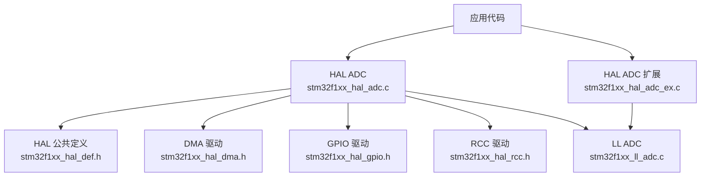
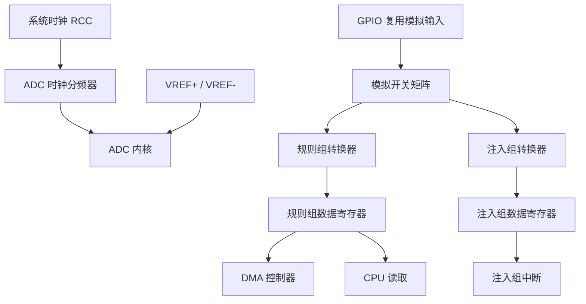
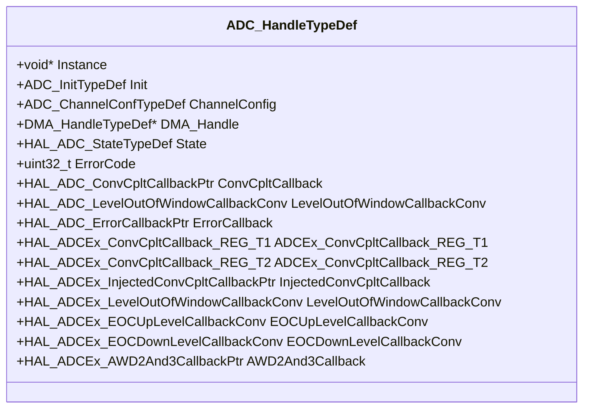
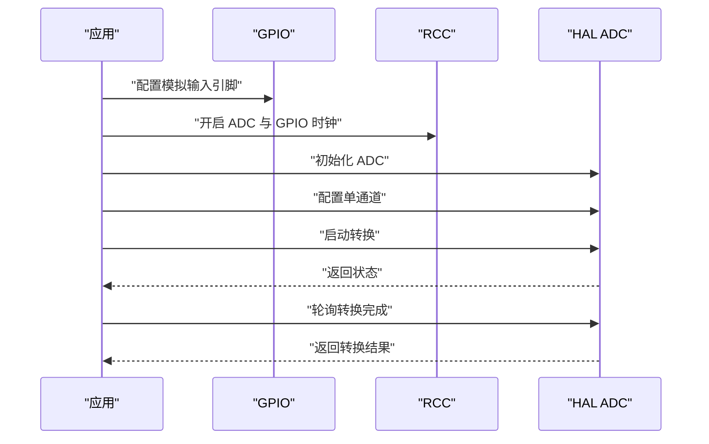
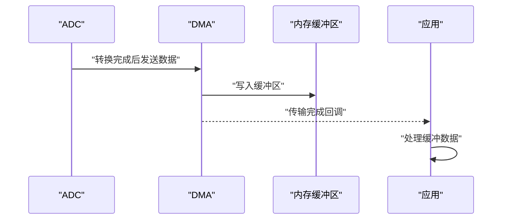
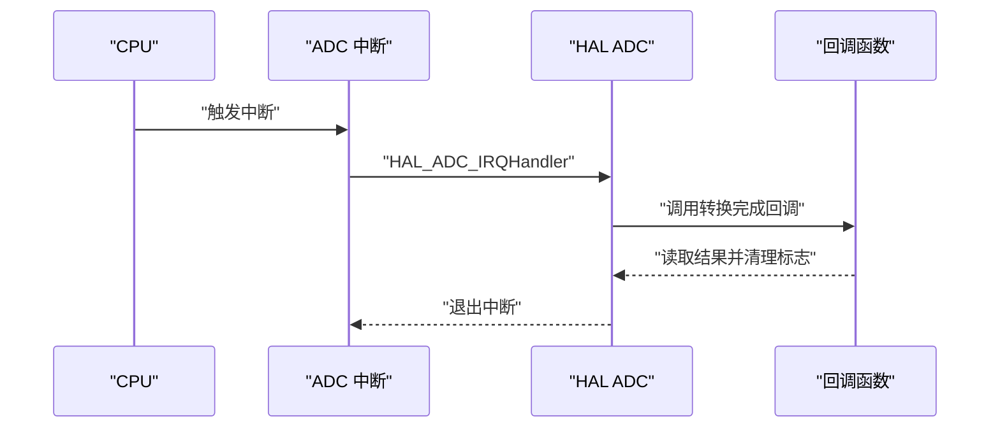
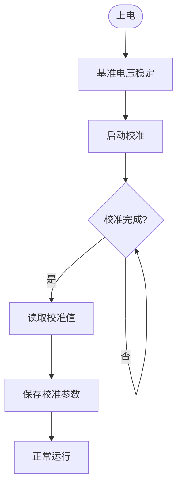
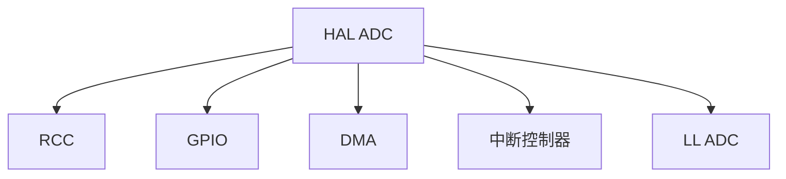
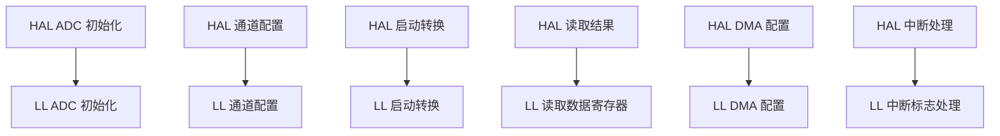

# ADC 模数转换

<cite>
**本文引用的文件**
- [stm32f1xx_hal_adc.h](file://Inc/stm32f1xx_hal_adc.h)
- [stm32f1xx_hal_adc_ex.h](file://Inc/stm32f1xx_hal_adc_ex.h)
- [stm32f1xx_hal_adc.c](file://Src/stm32f1xx_hal_adc.c)
- [stm32f1xx_hal_adc_ex.c](file://Src/stm32f1xx_hal_adc_ex.c)
- [stm32f1xx_ll_adc.h](file://Inc/stm32f1xx_ll_adc.h)
- [stm32f1xx_ll_adc.c](file://Src/stm32f1xx_ll_adc.c)
- [stm32f1xx_hal_def.h](file://Inc/stm32f1xx_hal_def.h)
- [stm32f1xx_hal_dma.h](file://Inc/stm32f1xx_hal_dma.h)
- [stm32f1xx_hal_gpio.h](file://Inc/stm32f1xx_hal_gpio.h)
- [stm32f1xx_hal_rcc.h](file://Inc/stm32f1xx_hal_rcc.h)
</cite>

## 目录
1. [引言](#引言)
2. [项目结构与文档范围](#项目结构与文档范围)
3. [STM32F1 ADC 架构总览](#stm32f1-adc-架构总览)
4. [核心数据结构和句柄](#核心数据结构和句柄)
5. [使用难度分层与典型流程](#使用难度分层与典型流程)
6. [主要 API 参考](#主要-api-参考)
7. [DMA、中断与回调机制](#dma中断与回调机制)
8. [校准、基准电压与输入阻抗](#校准基准电压与输入阻抗)
9. [精度、吞吐率与噪声抑制](#精度吞吐率与噪声抑制)
10. [依赖关系分析](#依赖关系分析)
11. [性能与配置权衡](#性能与配置权衡)
12. [故障排查指南](#故障排查指南)
13. [从 HAL 迁移到 LL 的要点](#从-hal-迁移到-ll-的要点)
14. [结论](#结论)

## 引言
本文件为 STM32F1xx HAL ADC 模块的完整 API 与实现参考。内容覆盖：
- STM32F1 ADC 的整体硬件架构，包括时钟树、基准电压、通道映射、规则组与注入组。
- HAL 句柄 `ADC_HandleTypeDef` 及扩展配置结构体字段含义。
- 按使用难度组织的使用模式：单通道单次采样、多通道扫描、外部触发、连续/单次转换、分辨率与采样时间、DMA、中断、校准。
- 关键 HAL 接口的参数、返回值、状态码、调用序列和错误处理建议。
- 精度、吞吐率、噪声抑制与校准方法。
- 常见问题定位与调试清单。
- 从 HAL 接口迁移到 LL 低层接口的对照与注意事项。

## 项目结构与文档范围
本仓库提供 STM32F1 HAL 与 LL 驱动的头文件和源文件。ADC 相关代码集中在以下文件中：
- HAL 头文件：`stm32f1xx_hal_adc.h`、`stm32f1xx_hal_adc_ex.h`
- HAL 源文件：`stm32f1xx_hal_adc.c`、`stm32f1xx_hal_adc_ex.c`
- LL 头文件与源文件：`stm32f1xx_ll_adc.h`、`stm32f1xx_ll_adc.c`
- 通用 HAL 定义、DMA、GPIO、RCC 头文件用于理解依赖关系。

**图表来源**
- [stm32f1xx_hal_adc.c](file://Src/stm32f1xx_hal_adc.c)
- [stm32f1xx_hal_adc_ex.c](file://Src/stm32f1xx_hal_adc_ex.c)
- [stm32f1xx_ll_adc.c](file://Src/stm32f1xx_ll_adc.c)
- [stm32f1xx_hal_def.h](file://Inc/stm32f1xx_hal_def.h)
- [stm32f1xx_hal_dma.h](file://Inc/stm32f1xx_hal_dma.h)
- [stm32f1xx_hal_gpio.h](file://Inc/stm32f1xx_hal_gpio.h)
- [stm32f1xx_hal_rcc.h](file://Inc/stm32f1xx_hal_rcc.h)

**章节来源**
- [stm32f1xx_hal_adc.h](file://Inc/stm32f1xx_hal_adc.h)
- [stm32f1xx_hal_adc_ex.h](file://Inc/stm32f1xx_hal_adc_ex.h)
- [stm32f1xx_hal_adc.c](file://Src/stm32f1xx_hal_adc.c)
- [stm32f1xx_hal_adc_ex.c](file://Src/stm32f1xx_hal_adc_ex.c)
- [stm32f1xx_ll_adc.h](file://Inc/stm32f1xx_ll_adc.h)

## STM32F1 ADC 架构总览
STM32F1 系列通常包含多个独立的 12 位 ADC。每个 ADC 具有以下特性：
- **时钟来源**：ADC 外设时钟由 RCC 分频得到，常见分频系数会限制最高 ADC 时钟频率。
- **基准电压**：VREF+ 与 VREF- 决定 ADC 输入量程；多数封装中 VREF- 接地，VREF+ 接外部基准或电源。
- **模拟输入通道**：通过复用引脚接入，不同封装引脚到通道号映射不同。
- **规则组和注入组**：
  - 规则组：常规转换队列，可配置多通道扫描、外部触发、连续转换等。
  - 注入组：高优先级转换通道，可在规则组运行时插入转换结果。
- **转换输出**：规则组结果寄存器用于读取最新值；注入组有独立结果寄存器。
- **DMA 支持**：规则组在扫描模式下可通过 DMA 将结果传输至内存缓冲区。
- **中断**：转换完成中断、注入组转换完成中断、过采样事件等。

**图表来源**
- [stm32f1xx_hal_adc.c](file://Src/stm32f1xx_hal_adc.c)
- [stm32f1xx_ll_adc.c](file://Src/stm32f1xx_ll_adc.c)

**章节来源**
- [stm32f1xx_hal_adc.h](file://Inc/stm32f1xx_hal_adc.h)
- [stm32f1xx_ll_adc.h](file://Inc/stm32f1xx_ll_adc.h)

## 核心数据结构和句柄
### ADC_HandleTypeDef
该句柄是 HAL ADC 的核心对象，保存 ADC 实例指针、当前状态、错误码、初始化参数、通道配置、DMA 指针、回调函数指针等。典型关键字段包括：
- `Instance`：指向具体 ADC 外设基地址。
- `Init`：ADC 初始化配置，如时钟极性、对齐方式、扫描模式、连续模式、外部触发源、分辨率、采样时间等。
- `MspInitCallback`、`MspDeInitCallback`：MSP 钩子，用于初始化时钟、GPIO、中断、DMA 等底层资源。
- `DMA_Handle`：DMA 句柄指针，用于 DMA 传输。
- `State`、`ErrorCode`：运行状态与错误码。
- `ChannelConfig`：最近一次配置的通道信息，便于后续查询或批量配置。
- `ConversionData`：部分版本用于保存转换结果或中间状态。

### 扩展配置结构体
扩展头文件定义了更丰富的通道配置、校准、过采样、注入通道配置等结构体。常用字段包括：
- 通道编号、采样时间、偏置电压选择、差分或单端模式。
- 注入通道序号、外部触发源、自动注入使能。
- 过采样比率、移位、增益、是否启用过采样。
- 校准偏移、校准值、校准状态标志。

**图表来源**
- [stm32f1xx_hal_adc.h](file://Inc/stm32f1xx_hal_adc.h)

**章节来源**
- [stm32f1xx_hal_adc.h](file://Inc/stm32f1xx_hal_adc.h)
- [stm32f1xx_hal_adc_ex.h](file://Inc/stm32f1xx_hal_adc_ex.h)

## 使用难度分层与典型流程
### 第一层：单通道单次采样
适用场景：低频、简单信号采集。
典型流程：
1. 初始化 GPIO 为模拟输入。
2. 开启 RCC 中对应 ADC 和 GPIO 时钟。
3. 初始化 ADC（单次转换、非扫描、软件触发）。
4. 配置单个通道及采样时间。
5. 启动 ADC 转换并轮询等待转换完成。
6. 读取转换结果并进行单位换算。

**图表来源**
- [stm32f1xx_hal_adc.c](file://Src/stm32f1xx_hal_adc.c)
- [stm32f1xx_hal_gpio.h](file://Inc/stm32f1xx_hal_gpio.h)
- [stm32f1xx_hal_rcc.h](file://Inc/stm32f1xx_hal_rcc.h)

### 第二层：多通道扫描与外部触发
适用场景：周期性采集多个模拟量。
关键点：
- 开启扫描模式。
- 配置多个通道的采样时间与顺序。
- 可选择定时器触发或 EXTI 触发。
- 结合 DMA 或中断获取结果。

### 第三层：DMA、中断与回调
适用场景：高吞吐率、实时性要求较高。
关键点：
- DMA 传输规则组结果数组。
- 转换完成回调、溢出回调、错误回调。
- 注入组独立回调。

### 第四层：校准、基准电压与输入阻抗优化
适用场景：高精度测量。
关键点：
- 上电后执行 ADC 自校准。
- 合理选择基准电压。
- 控制信号源内阻与采样时间，降低输入阻抗影响。

**章节来源**
- [stm32f1xx_hal_adc.c](file://Src/stm32f1xx_hal_adc.c)
- [stm32f1xx_hal_adc_ex.c](file://Src/stm32f1xx_hal_adc_ex.c)

## 主要 API 参考
本节按使用路径分组说明关键接口。为避免直接粘贴源码，所有示例均以“调用路径”形式给出。

### HAL_ADC_Init
作用：初始化 ADC 句柄与外设基本参数。
参数：
- `hadc`：ADC 句柄指针。
返回值：
- HAL 状态码，例如成功、无效参数、忙、超时等。
典型调用序列：
1. 配置 GPIO 为模拟输入。
2. 开启 RCC 时钟。
3. 填充 `ADC_InitTypeDef`，设置对齐、扫描、连续、触发源、分辨率。
4. 调用 `HAL_ADC_Init`。
5. 检查返回值，必要时清除错误码。
错误处理建议：
- 若返回忙，确认未重复初始化或未正确释放前一次初始化。
- 若返回无效参数，检查时钟极性、对齐方式、触发源是否在允许范围内。

**章节来源**
- [stm32f1xx_hal_adc.h](file://Inc/stm32f1xx_hal_adc.h)
- [stm32f1xx_hal_adc.c](file://Src/stm32f1xx_hal_adc.c)

### HAL_ADC_ConfigChannel
作用：配置 ADC 通道及其采样时间、偏置、差分等。
参数：
- `hadc`：ADC 句柄指针。
- `sConfig`：通道配置结构体指针，包含通道号、采样时间、偏置、差分模式等。
返回值：
- HAL 状态码。
典型调用序列：
1. 清零并填充 `ADC_ChannelConfTypeDef`。
2. 设置通道编号。
3. 设置采样时间，根据信号源内阻与带宽调整。
4. 如需注入通道或差分模式，填写扩展字段。
5. 调用 `HAL_ADC_ConfigChannel`。
错误处理建议：
- 通道号超出范围时返回无效参数。
- 同一通道多次配置应确保采样时间满足精度需求。

**章节来源**
- [stm32f1xx_hal_adc.h](file://Inc/stm32f1xx_hal_adc.h)
- [stm32f1xx_hal_adc_ex.h](file://Inc/stm32f1xx_hal_adc_ex.h)
- [stm32f1xx_hal_adc.c](file://Src/stm32f1xx_hal_adc.c)

### HAL_ADC_Start
作用：启动 ADC 转换。
参数：
- `hadc`：ADC 句柄指针。
- `Timeout`：等待超时时间。
返回值：
- HAL 状态码。
典型调用序列：
- 单次转换：启动后轮询转换完成。
- 扫描模式：配合 DMA 或中断。
- 外部触发：先配置触发源，再启动。
错误处理建议：
- 超时可能表示外设未就绪或 DMA/中断未正确配置。
- 若在转换过程中再次启动，需先停止或避免重复启动。

**章节来源**
- [stm32f1xx_hal_adc.h](file://Inc/stm32f1xx_hal_adc.h)
- [stm32f1xx_hal_adc.c](file://Src/stm32f1xx_hal_adc.c)

### HAL_ADC_PollForConversion
作用：轮询等待 ADC 转换完成。
参数：
- `hadc`：ADC 句柄指针。
- `Timeout`：等待超时时间。
返回值：
- HAL 状态码，指示是否完成、是否溢出、是否出错。
典型调用序列：
- 单次转换后调用，成功后读取转换结果。
- 注意区分“规则组转换完成”和“注入组转换完成”。
错误处理建议：
- 超时时应检查触发源、时钟、DMA、中断是否启用。
- 若出现溢出，检查采样时间是否太短或通道切换太频繁。

**章节来源**
- [stm32f1xx_hal_adc.h](file://Inc/stm32f1xx_hal_adc.h)
- [stm32f1xx_hal_adc.c](file://Src/stm32f1xx_hal_adc.c)

### HAL_ADC_GetValue
作用：获取最近一次 ADC 转换结果。
参数：
- `hadc`：ADC 句柄指针。
返回值：
- 转换结果整数。
典型调用序列：
- 在 `HAL_ADC_PollForConversion` 成功后调用。
- 结合基准电压和分辨率进行物理单位换算。

**章节来源**
- [stm32f1xx_hal_adc.h](file://Inc/stm32f1xx_hal_adc.h)
- [stm32f1xx_hal_adc.c](file://Src/stm32f1xx_hal_adc.c)

### HAL_ADC_Start_IT
作用：以中断方式启动 ADC。
参数：
- `hadc`：ADC 句柄指针。
返回值：
- HAL 状态码。
典型调用序列：
1. 配置中断优先级。
2. 调用 `HAL_ADC_Start_IT`。
3. 在 `HAL_ADC_IRQHandler` 中统一处理。
4. 在回调中读取结果并继续下一次转换。
错误处理建议：
- 回调未注册时可能出现空指针行为。
- 中断丢失通常与优先级配置、嵌套中断、DMA 冲突有关。

**章节来源**
- [stm32f1xx_hal_adc.h](file://Inc/stm32f1xx_hal_adc.h)
- [stm32f1xx_hal_adc.c](file://Src/stm32f1xx_hal_adc.c)

### HAL_ADC_Start_DMA
作用：以 DMA 方式启动 ADC。
参数：
- `hadc`：ADC 句柄指针。
- `pData`：目标缓冲区指针。
- `Length`：缓冲区长度。
返回值：
- HAL 状态码。
典型调用序列：
1. 初始化 DMA，方向为外设到内存，循环模式。
2. 设置缓冲区大小等于通道数×采样次数。
3. 调用 `HAL_ADC_Start_DMA`。
4. 在 DMA 半传输或传输完成回调中处理数据。
错误处理建议：
- 缓冲区地址错位会导致 DMA 写入错误位置。
- 长度不匹配会造成数据错位或丢包。
- DMA 未完成时不要修改缓冲区。

**章节来源**
- [stm32f1xx_hal_adc.h](file://Inc/stm32f1xx_hal_adc.h)
- [stm32f1xx_hal_adc.c](file://Src/stm32f1xx_hal_adc.c)
- [stm32f1xx_hal_dma.h](file://Inc/stm32f1xx_hal_dma.h)

### HAL_ADC_Stop
作用：停止 ADC 转换并释放资源。
参数：
- `hadc`：ADC 句柄指针。
返回值：
- HAL 状态码。
典型调用序列：
- 停止 DMA 或中断。
- 关闭 ADC。
- 可选关闭时钟。
错误处理建议：
- 在 DMA 传输中途停止需确保 DMA 已禁用。
- 反复停止可能导致状态不一致，应先检查当前状态。

**章节来源**
- [stm32f1xx_hal_adc.h](file://Inc/stm32f1xx_hal_adc.h)
- [stm32f1xx_hal_adc.c](file://Src/stm32f1xx_hal_adc.c)

### HAL_ADC_IRQHandler
作用：ADC 中断服务程序入口。
参数：
- `hadc`：ADC 句柄指针。
典型调用序列：
1. 用户在中断向量表中调用此函数。
2. HAL 内部判断中断类型：规则组完成、注入组完成、模拟看门狗等。
3. 调用相应回调函数。
4. 清除中断标志。
错误处理建议：
- 忘记调用 IRQHandler 会导致中断挂起。
- 回调中不应执行耗时操作。

**章节来源**
- [stm32f1xx_hal_adc.h](file://Inc/stm32f1xx_hal_adc.h)
- [stm32f1xx_hal_adc.c](file://Src/stm32f1xx_hal_adc.c)

### HAL_ADC_ConvCpltCallback
作用：规则组转换完成回调。
参数：
- `hadc`：ADC 句柄指针。
典型用法：
- 读取转换结果。
- 更新滤波或平均算法。
- 启动下一次转换或等待 DMA 完成。

**章节来源**
- [stm32f1xx_hal_adc.h](file://Inc/stm32f1xx_hal_adc.h)
- [stm32f1xx_hal_adc.c](file://Src/stm32f1xx_hal_adc.c)

### HAL_ADCEx_InjectedConvCpltCallback
作用：注入组转换完成回调。
参数：
- `hadc`：ADC 句柄指针。
典型用法：
- 读取注入组结果。
- 处理高优先级事件或补偿数据。

**章节来源**
- [stm32f1xx_hal_adc_ex.h](file://Inc/stm32f1xx_hal_adc_ex.h)
- [stm32f1xx_hal_adc_ex.c](file://Src/stm32f1xx_hal_adc_ex.c)

### HAL_ADCEx_Calibration_Start / HAL_ADCEx_Calibration_SetConfig / HAL_ADCEx_Calibration_GetValue
作用：校准 ADC。
典型流程：
1. 复位 ADC。
2. 启动校准。
3. 等待校准完成。
4. 读取校准值并存储。
5. 在应用中加载校准偏移。
错误处理建议：
- 校准应在稳定电源和固定温度下进行。
- 校准值不能跨批次共用，除非产品级校准。

**章节来源**
- [stm32f1xx_hal_adc_ex.h](file://Inc/stm32f1xx_hal_adc_ex.h)
- [stm32f1xx_hal_adc_ex.c](file://Src/stm32f1xx_hal_adc_ex.c)

## DMA、中断与回调机制
### DMA 数据流

**图表来源**
- [stm32f1xx_hal_adc.c](file://Src/stm32f1xx_hal_adc.c)
- [stm32f1xx_hal_dma.h](file://Inc/stm32f1xx_hal_dma.h)

### 中断处理时序

**图表来源**
- [stm32f1xx_hal_adc.c](file://Src/stm32f1xx_hal_adc.c)

### 回调函数注册
典型步骤：
1. 定义 `HAL_ADC_ConvCpltCallback` 或注入组回调。
2. 在初始化后注册回调。
3. 在回调中尽量轻量处理，复杂任务放到主循环或更低优先级任务。

**章节来源**
- [stm32f1xx_hal_adc.h](file://Inc/stm32f1xx_hal_adc.h)
- [stm32f1xx_hal_adc.c](file://Src/stm32f1xx_hal_adc.c)

## 校准、基准电压与输入阻抗
### 校准流程
推荐流程：
1. 上电后等待基准电压稳定。
2. 调用校准开始接口。
3. 等待校准结束。
4. 读取校准值并保存到非易失存储。
5. 应用中使用校准偏移修正读数。

### 基准电压选择
- 使用外部精密基准可提高精度。
- 使用芯片内部基准方便但受电源噪声影响。
- 注意 VREF+ 上限与封装引脚可用性。

### 输入阻抗注意事项
- ADC 采样保持电容需要充电时间。
- 信号源内阻过高会导致采样不足，读数偏低。
- 增加采样时间可降低输入阻抗影响。
- 对高频信号应考虑加 RC 滤波器，同时权衡带宽与采样时间。

**图表来源**
- [stm32f1xx_hal_adc_ex.c](file://Src/stm32f1xx_hal_adc_ex.c)

**章节来源**
- [stm32f1xx_hal_adc_ex.h](file://Inc/stm32f1xx_hal_adc_ex.h)
- [stm32f1xx_hal_adc_ex.c](file://Src/stm32f1xx_hal_adc_ex.c)

## 精度、吞吐率与噪声抑制
### 精度影响因素
- 基准电压稳定性。
- ADC 分辨率与对齐方式。
- 采样时间是否足够。
- 通道串扰。
- 数字噪声与电源噪声。

### 吞吐率
- 单次转换吞吐率受采样时间与转换时间影响。
- 扫描模式可提升多通道吞吐率。
- DMA 可减轻 CPU 负担，提高整体吞吐率。
- 外部触发可实现精确周期采样。

### 噪声抑制
- 硬件滤波：RC 低通、屏蔽、走线优化。
- 软件滤波：滑动平均、中值滤波、指数平滑。
- 过采样与抽取：通过多次采样取平均降低噪声。
- 合理布局模拟地与数字地。

**章节来源**
- [stm32f1xx_hal_adc.h](file://Inc/stm32f1xx_hal_adc.h)
- [stm32f1xx_hal_adc.c](file://Src/stm32f1xx_hal_adc.c)
- [stm32f1xx_hal_adc_ex.h](file://Inc/stm32f1xx_hal_adc_ex.h)

## 依赖关系分析
ADC HAL 依赖以下子系统：
- **RCC**：开启 ADC 时钟、GPIO 时钟。
- **GPIO**：配置模拟输入引脚。
- **DMA**：规则组扫描模式下传输数据。
- **NVIC/中断**：中断回调与优先级管理。
- **LL ADC**：底层寄存器操作，HAL 在其之上封装。

**图表来源**
- [stm32f1xx_hal_adc.c](file://Src/stm32f1xx_hal_adc.c)
- [stm32f1xx_ll_adc.c](file://Src/stm32f1xx_ll_adc.c)

**章节来源**
- [stm32f1xx_hal_adc.c](file://Src/stm32f1xx_hal_adc.c)
- [stm32f1xx_ll_adc.c](file://Src/stm32f1xx_ll_adc.c)

## 性能与配置权衡
### 分辨率与速度
- 12 位分辨率提供更高分辨率，但转换时间更长。
- 较低分辨率可降低转换时间，提高吞吐率。
- 对齐方式影响数据格式与计算复杂度。

### 采样时间
- 短采样时间提高吞吐率，但可能降低精度。
- 长采样时间提高精度，但降低吞吐率。
- 高内阻信号源需要更长采样时间。

### 扫描模式与通道数量
- 通道越多，单次扫描时间越长。
- DMA 缓冲区应大于等于通道数。
- 相邻通道可能存在串扰，应合理安排采样顺序。

### 外部触发
- 定时器触发可实现精确周期采样。
- EXTI 触发适合事件驱动采集。
- 触发源必须与 ADC 时钟域协调。

**章节来源**
- [stm32f1xx_hal_adc.h](file://Inc/stm32f1xx_hal_adc.h)
- [stm32f1xx_hal_adc.c](file://Src/stm32f1xx_hal_adc.c)

## 故障排查指南
### 读数异常
- 检查基准电压是否稳定。
- 检查采样时间是否足够。
- 检查通道配置是否与硬件一致。
- 检查是否误用注入组结果寄存器。

### 通道串扰
- 调整采样时间。
- 减少相邻通道切换频率。
- 增加硬件滤波。
- 重新安排通道扫描顺序。

### DMA 地址错位
- 检查 DMA 目标缓冲区地址是否为有效 RAM。
- 检查缓冲区长度与通道数匹配。
- 检查 DMA 方向与数据宽度。
- 避免在 DMA 传输中修改缓冲区。

### 超时
- 检查 ADC 时钟是否开启。
- 检查触发源是否启用。
- 检查 DMA 或中断是否初始化。
- 检查 `Timeout` 是否过小。

### 中断丢失
- 检查中断优先级是否被更高优先级抢占。
- 检查回调中是否执行耗时操作。
- 检查是否重复启动 ADC 导致状态混乱。
- 检查是否忘记调用 `HAL_ADC_IRQHandler`。

**章节来源**
- [stm32f1xx_hal_adc.c](file://Src/stm32f1xx_hal_adc.c)
- [stm32f1xx_hal_adc_ex.c](file://Src/stm32f1xx_hal_adc_ex.c)

## 从 HAL 迁移到 LL 的要点
当需要从 HAL 迁移到 LL 时，重点在于理解 HAL 如何封装 LL 寄存器操作：
- HAL 初始化最终调用 LL 函数配置 ADC 时钟、对齐、扫描、触发等。
- HAL 通道配置最终调用 LL 函数设置通道采样时间、偏置、差分模式。
- HAL 启动/停止转换最终调用 LL 函数控制 ADC 使能与转换启动。
- HAL DMA 与中断最终调用 LL 函数配置 DMA 与中断标志。

### 迁移对照表
| HAL 接口 | LL 对应职责 | 迁移注意点 |
|---|---|---|
| `HAL_ADC_Init` | 配置 ADC 时钟、对齐、扫描、触发、分辨率 | 手动调用 LL 初始化函数并检查状态 |
| `HAL_ADC_ConfigChannel` | 配置通道采样时间、偏置、差分 | 手动调用 LL 通道配置函数 |
| `HAL_ADC_Start` | 启动 ADC 转换 | 手动设置 ADC 转换启动位 |
| `HAL_ADC_PollForConversion` | 轮询转换完成标志 | 手动读取 LL 状态寄存器 |
| `HAL_ADC_Start_IT` | 使能 ADC 中断 | 手动配置 NVIC 与 LL 中断使能 |
| `HAL_ADC_Start_DMA` | 配置 DMA 外设到内存 | 手动初始化 DMA 并连接 ADC 数据寄存器 |
| `HAL_ADC_Stop` | 停止 ADC | 手动清除 ADC 使能位 |
| `HAL_ADC_IRQHandler` | 中断入口 | 手动识别中断源并调用应用回调 |

### 关键 LL 函数类别
- ADC 初始化与去初始化。
- 通道配置与读取。
- 校准与校准值读取。
- DMA 与中断配置。
- 状态寄存器与标志位读取。

**图表来源**
- [stm32f1xx_ll_adc.h](file://Inc/stm32f1xx_ll_adc.h)
- [stm32f1xx_ll_adc.c](file://Src/stm32f1xx_ll_adc.c)

**章节来源**
- [stm32f1xx_ll_adc.h](file://Inc/stm32f1xx_ll_adc.h)
- [stm32f1xx_ll_adc.c](file://Src/stm32f1xx_ll_adc.c)

## 结论
STM32F1 HAL ADC 提供了从简单单通道采集到高吞吐 DMA 采集的完整能力。正确使用 ADC 的关键在于：
- 正确初始化 GPIO、RCC、ADC、DMA 与中断。
- 根据信号源内阻与带宽选择合适的采样时间。
- 合理使用规则组与注入组。
- 使用校准与基准电压提升精度。
- 通过 DMA 与中断降低 CPU 负载。
- 在 HAL 与 LL 之间按需迁移，理解底层寄存器操作。