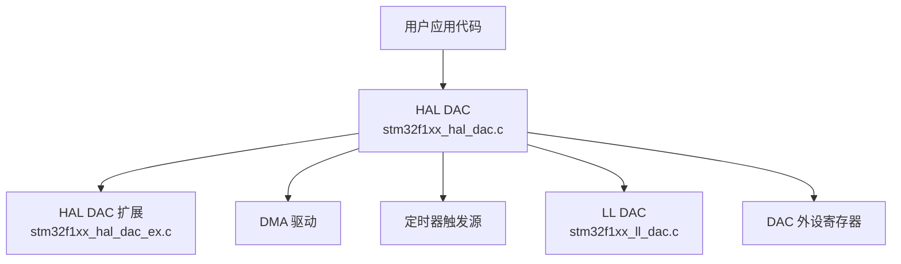
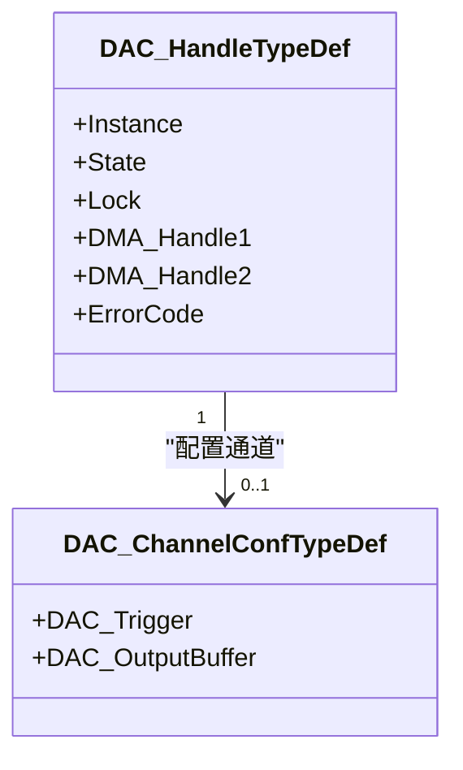
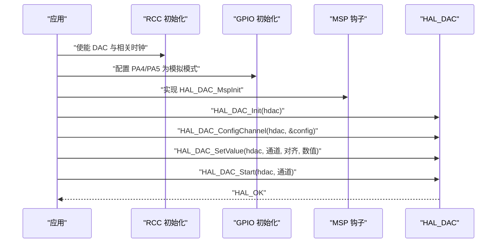
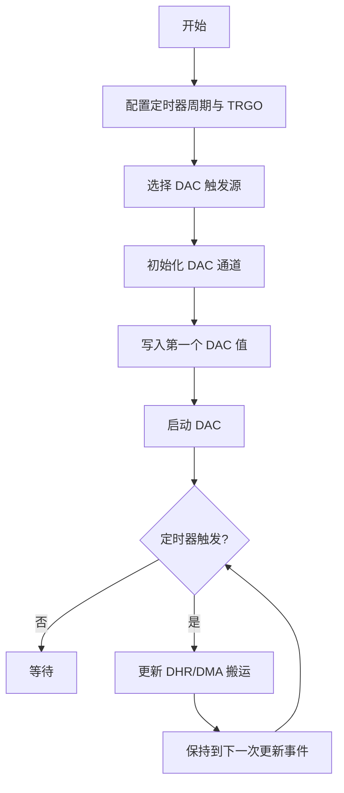
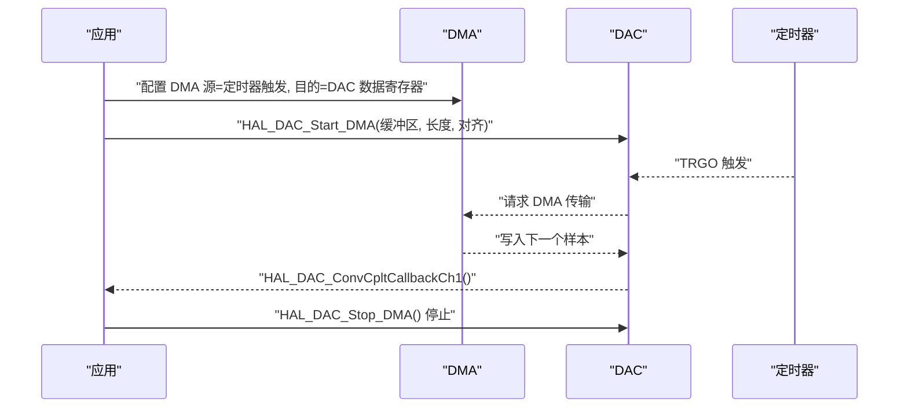
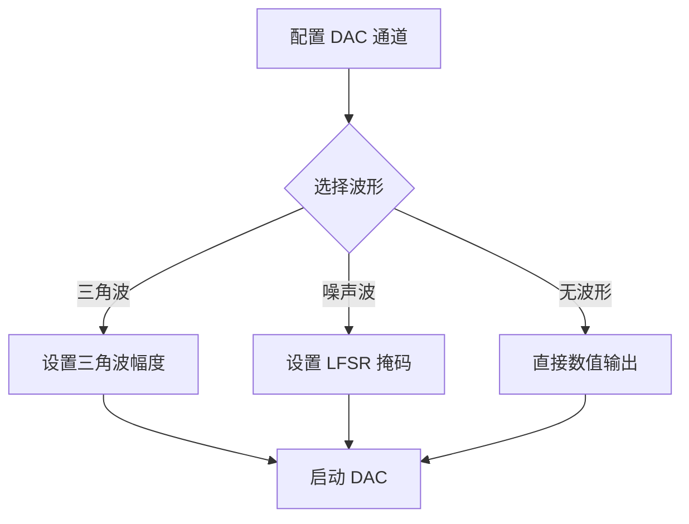
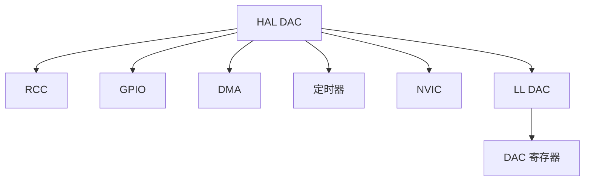
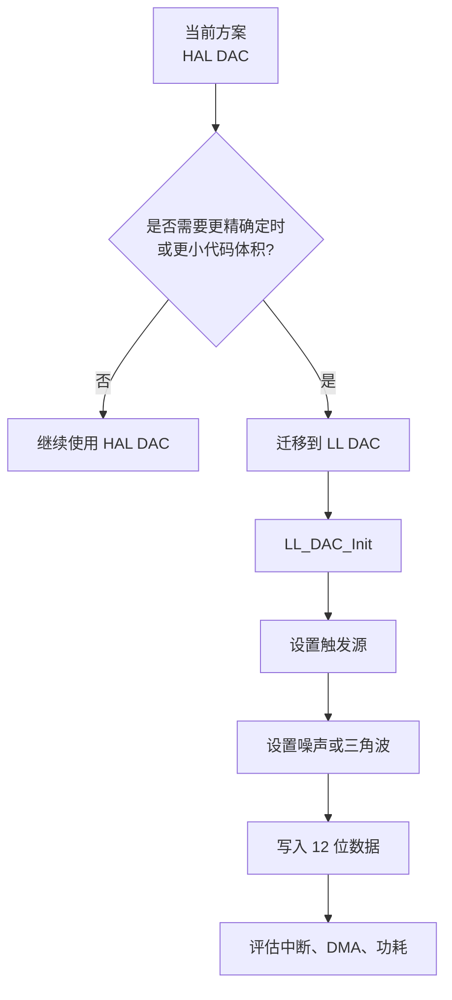

# DAC 数模转换

<cite>
**本文引用的文件**   
- [stm32f1xx_hal_dac.h](file://Inc/stm32f1xx_hal_dac.h)
- [stm32f1xx_hal_dac_ex.h](file://Inc/stm32f1xx_hal_dac_ex.h)
- [stm32f1xx_hal_dac.c](file://Src/stm32f1xx_hal_dac.c)
- [stm32f1xx_hal_dac_ex.c](file://Src/stm32f1xx_hal_dac_ex.c)
- [stm32f1xx_ll_dac.h](file://Inc/stm32f1xx_ll_dac.h)
- [stm32f1xx_ll_dac.c](file://Src/stm32f1xx_ll_dac.c)
</cite>

## 目录
1. [引言](#引言)
2. [项目结构](#项目结构)
3. [DAC 外设基本原理](#dac-外设基本原理)
4. [HAL 数据结构与扩展配置](#hal-数据结构与扩展配置)
5. [核心 API 总览](#核心-api-总览)
6. [输出控制与直流电压设置](#输出控制与直流电压设置)
7. [定时器硬件触发与周期性波形](#定时器硬件触发与周期性波形)
8. [DMA 连续波形输出](#dma-连续波形输出)
9. [噪声波与三角波发生器](#噪声波与三角波发生器)
10. [数字值到实际电压映射](#数字值到实际电压映射)
11. [性能、精度与功耗权衡](#性能精度与功耗权衡)
12. [依赖关系分析](#依赖关系分析)
13. [常见问题排查](#常见问题排查)
14. [从 HAL 迁移到 LL 的建议](#从-hal-迁移到-ll-的建议)
15. [结论](#结论)

## 引言
本文件面向使用 STM32F1xx HAL 驱动开发 DAC（数模转换器）的工程师，聚焦三类典型应用：
- 直流或低频电压输出；
- 由定时器触发的周期性模拟波形；
- 通过 DMA 持续输出预先生成的波形数组。

文档同时覆盖 DAC 通道、参考电压、输出缓冲、保持时间、更新事件、引脚复用、软件触发、硬件触发、直接数值写入、DMA 驱动、噪声波和三角波发生器的完整使用流程，并给出 API 参数、返回值、状态码、调用时序说明及故障排查建议。最后讨论从 HAL 层迁移到 `stm32f1xx_ll_dac.h/.c` 的适用场景。

## 项目结构
STM32 HAL 对 DAC 的支持被拆分为基础接口和扩展功能：
- 基础接口定义在 `Inc/stm32f1xx_hal_dac.h` 与 `Src/stm32f1xx_hal_dac.c`，提供初始化、通道配置、数据写入、启动停止、DMA 控制和中断处理。
- 扩展接口定义在 `Inc/stm32f1xx_hal_dac_ex.h` 与 `Src/stm32f1xx_hal_dac_ex.c`，提供双通道同时启停、噪声波和三角波生成。
- LL 底层接口定义在 `Inc/stm32f1xx_ll_dac.h` 与 `Src/stm32f1xx_ll_dac.c`，提供寄存器级初始化和波形/触发配置。

**图示来源**
- [stm32f1xx_hal_dac.c:291-992](file://Src/stm32f1xx_hal_dac.c#L291-L992)
- [stm32f1xx_hal_dac_ex.c:185-241](file://Src/stm32f1xx_hal_dac_ex.c#L185-L241)
- [stm32f1xx_ll_dac.c:1-200](file://Src/stm32f1xx_ll_dac.c#L1-L200)

**章节来源**
- [stm32f1xx_hal_dac.h:1-200](file://Inc/stm32f1xx_hal_dac.h#L1-L200)
- [stm32f1xx_hal_dac.c:1-200](file://Src/stm32f1xx_hal_dac.c#L1-L200)
- [stm32f1xx_hal_dac_ex.c:1-200](file://Src/stm32f1xx_hal_dac_ex.c#L1-L200)
- [stm32f1xx_ll_dac.h:1-200](file://Inc/stm32f1xx_ll_dac.h#L1-L200)

## DAC 外设基本原理
STM32F1 的 DAC 外设包含两个独立的 12 位数模转换器通道：
- 通道 1 对应输出引脚通常为 PA4；
- 通道 2 对应输出引脚通常为 PA5。

两者可独立使用，也可同时工作。关键概念如下：

| 概念 | 含义与影响 |
|---|---|
| 输出通道 | 通道 1 和通道 2 可分别配置触发方式、输出缓冲和波形模式。 |
| 参考电压 | DAC 输出范围由 VREF+ 决定；数据寄存器满量程为 12 位，最大值为 4095。 |
| 输出缓冲 | 开启可降低输出阻抗、提高带载能力；关闭时驱动能力较弱，适合高输入阻抗负载。 |
| 保持时间与更新事件 | 当启用外部触发或 DMA 时，DHR 中的值会在更新事件到来时被传送到 DOR，从而产生“保持”效果。 |
| 引脚复用 | DAC 输出引脚需配置为模拟模式；未使用的相邻通道若仍为模拟模式可能引入耦合干扰。 |
| 触发方式 | 支持软件触发、EXTI Line 9 触发，以及多个定时器的 TRGO 触发。 |
| 数据对齐 | 支持 12 位右对齐、12 位左对齐、8 位右对齐。 |
| 波形发生器 | 支持噪声波（LFSR）和三角波，幅度可选。 |
| DMA | 非软件触发模式下可启用 DMA，按触发节奏自动搬运数据。 |

驱动注释中明确给出输出电压计算公式：  
`DAC_OUTx = VREF+ × DOR / 4095`。  
其中 DOR 是 DAC 数据输出寄存器的当前值，VREF+ 是模拟参考电压。

**章节来源**
- [stm32f1xx_hal_dac.c:1-200](file://Src/stm32f1xx_hal_dac.c#L1-L200)

## HAL 数据结构与扩展配置
### DAC 句柄 `DAC_HandleTypeDef`
该句柄保存 DAC 实例地址、运行状态、锁对象、通道 1 和通道 2 的 DMA 句柄指针，以及错误码。若启用回调注册宏，则还包含各通道的完成回调、半传输回调、错误回调和下溢回调函数指针。

| 字段 | 作用 |
|---|---|
| `Instance` | 指向 DAC 寄存器基地址。 |
| `State` | HAL 层状态，例如重置、就绪、忙、超时、错误。 |
| `Lock` | 用于保护临界区访问。 |
| `DMA_Handle1` | 通道 1 使用的 DMA 句柄指针。 |
| `DMA_Handle2` | 通道 2 使用的 DMA 句柄指针。 |
| `ErrorCode` | HAL 层错误码，包括 DMA 下溢、DMA 错误、超时等。 |

### 通道配置结构体 `DAC_ChannelConfTypeDef`
这是 DAC 通道的基本配置结构，包含：
- `DAC_Trigger`：触发源选择；
- `DAC_OutputBuffer`：输出缓冲使能或禁用。

### 扩展触发与波形常量
扩展头文件定义了：
- 所有支持的触发源，包括无触发、软件触发、EXTI Line 9、TIM2/TIM3/TIM4/TIM5/TIM6/TIM7/TIM8/TIM15 的 TRGO；
- LFSR 噪声波掩码，从仅第 0 位到第 11 位；
- 三角波最大幅度，从 1 到 4095。

**图示来源**
- [stm32f1xx_hal_dac.h:55-120](file://Inc/stm32f1xx_hal_dac.h#L55-L120)
- [stm32f1xx_hal_dac_ex.h:55-127](file://Inc/stm32f1xx_hal_dac_ex.h#L55-L127)

**章节来源**
- [stm32f1xx_hal_dac.h:55-120](file://Inc/stm32f1xx_hal_dac.h#L55-L120)
- [stm32f1xx_hal_dac_ex.h:55-127](file://Inc/stm32f1xx_hal_dac_ex.h#L55-L127)

## 核心 API 总览
以下 API 均返回 `HAL_StatusTypeDef`，常见状态包括成功、错误、超时等；部分操作会修改句柄中的 `State` 和 `ErrorCode`。

| API | 主要参数 | 返回值与行为 | 典型用途 |
|---|---|---|---|
| `HAL_DAC_Init` | `DAC_HandleTypeDef *hdac` | 初始化 DAC APB 时钟并使能外设；成功后进入就绪态。 | 首次使用前初始化。 |
| `HAL_DAC_ConfigChannel` | `hdac`、`DAC_ChannelConfTypeDef *pConfig` | 配置触发方式和输出缓冲；必须在通道关闭后调用。 | 设置通道是否缓冲、是否使用外部触发。 |
| `HAL_DAC_SetValue` | `hdac`、通道、对齐方式、数据值 | 将数据写入对应数据保持寄存器。 | 设置直流电压或 DMA 前初值。 |
| `HAL_DAC_Start` | `hdac`、通道 | 使能通道并开始转换；若配置为软件触发，需要再触发一次。 | 单点输出或配合后续 `SetValue`。 |
| `HAL_DAC_Start_DMA` | `hdac`、通道、数据缓冲区指针、长度、对齐方式 | 启动 DMA 并按触发频率搬运数据。 | 连续波形输出。 |
| `HAL_DAC_Stop` | `hdac`、通道 | 关闭通道。 | 停止普通输出。 |
| `HAL_DAC_Stop_DMA` | `hdac`、通道 | 停止 DMA 传输并关闭通道。 | 停止连续输出。 |
| `HAL_DAC_IRQHandler` | `hdac` | 处理 DAC 中断，包括 DMA 下溢、错误等。 | 在中断向量表中调用。 |
| `HAL_DAC_ConvCpltCallbackCh1` | `hdac` | DMA 完成回调默认实现；用户可重载。 | 处理 DMA 波形传输完成。 |
| `HAL_DAC_ErrorCallbackCh1` | `hdac` | 错误回调默认实现；用户可重载。 | 上报错误、恢复系统。 |
| `HAL_DACEx_TriangleWaveGenerate` | `hdac`、通道、幅度 | 启用三角波自动生成。 | 硬件三角波。 |
| `HAL_DACEx_NoiseWaveGenerate` | `hdac`、通道、LFSR 掩码 | 启用噪声波自动生成。 | 伪随机噪声输出。 |

注意：
- 当触发方式为软件触发时，第一次启动可能先输出上次写入的值，随后由软件触发信号更新。
- DMA 模式下，首次触发会先输出通过 `HAL_DAC_SetValue` 设置的初值，然后才从 DMA 缓冲区读取数据。
- 通道配置应在通道关闭状态下进行；多次重配前应确保已停止。

**章节来源**
- [stm32f1xx_hal_dac.c:291-992](file://Src/stm32f1xx_hal_dac.c#L291-L992)
- [stm32f1xx_hal_dac_ex.c:185-241](file://Src/stm32f1xx_hal_dac_ex.c#L185-L241)

## 输出控制与直流电压设置
典型流程如下：

要点：
1. **RCC 初始化**：必须先使能 DAC 所在 APB1 时钟，否则无法写入寄存器。
2. **GPIO 初始化**：DAC 输出引脚应配置为模拟模式。未使用的相邻通道若仍为模拟模式，可能因串扰影响另一通道；可在关闭未用通道前将其设为上拉或下拉输入。
3. **MSP 钩子**：如果使用 HAL 回调注册机制，可通过 `MspInitCallback` 自定义引脚与时钟初始化逻辑；否则通常由应用直接调用 RCC/GPIO 初始化。
4. **初始化顺序**：先 `HAL_DAC_Init`，再 `HAL_DAC_ConfigChannel`，再写值，最后 `HAL_DAC_Start`。
5. **输出缓冲**：如果驱动低输入阻抗负载，应开启输出缓冲；如果只是测量仪器或高阻负载，可以关闭以降低功耗。

**图示来源**
- [stm32f1xx_hal_dac.c:291-516](file://Src/stm32f1xx_hal_dac.c#L291-L516)

**章节来源**
- [stm32f1xx_hal_dac.c:291-516](file://Src/stm32f1xx_hal_dac.c#L291-L516)

## 定时器硬件触发与周期性波形
当希望 DAC 输出随定时器节拍变化时，应：
1. 配置定时器以固定周期产生 TRGO；
2. 选择与定时器匹配的 DAC 触发源；
3. 每次定时器事件到来时，由 DMA 或 CPU 向 DHR 写入新值；
4. DAC 在更新事件时将 DHR 值传送到 DOR，形成稳定输出。

注意事项：
- 触发源必须与实际使用的定时器一致，例如 TIM2、TIM4、TIM6、TIM7，或在高密度/XL 设备上的 TIM8，在连接型设备和 F100 系列上的 TIM3，以及在特定 Value-Line 设备上的 TIM15。
- 若使用软件触发，则不需要定时器，但实时性和抖动不如定时器硬件触发稳定。
- 若使用 EXTI Line 9，外部引脚必须配置为输入模式。

**图示来源**
- [stm32f1xx_hal_dac_ex.h:87-127](file://Inc/stm32f1xx_hal_dac_ex.h#L87-L127)
- [stm32f1xx_hal_dac.c:1-200](file://Src/stm32f1xx_hal_dac.c#L1-L200)

**章节来源**
- [stm32f1xx_hal_dac_ex.h:87-127](file://Inc/stm32f1xx_hal_dac_ex.h#L87-L127)
- [stm32f1xx_hal_dac.c:1-200](file://Src/stm32f1xx_hal_dac.c#L1-L200)

## DMA 连续波形输出
DMA 模式适合输出较长波形序列，如正弦采样表、音频包络、扫描信号等。

典型调用时序：

关键点：
- DMA 仅在非软件触发模式下有效；软件触发不会生成 DMA 请求。
- 首次触发会先输出 `HAL_DAC_SetValue` 设置的初值，再开始从 DMA 缓冲区取数。
- 缓冲区长度应与期望的波形周期长度匹配；如果长度不足，可能发生 DMA 下溢。
- 数据对齐必须与 `HAL_DAC_Start_DMA` 中指定的对齐方式一致。
- 中断服务程序中调用 `HAL_DAC_IRQHandler`，完成回调中可更新缓冲区、切换波形或记录统计信息。

常见错误：
- DMA 缓冲区未对齐或未正确声明为全局变量，导致编译器优化后位置不稳定。
- 缓冲区长度不是 DMA 数据宽度对应的合理值。
- 触发频率过高而 CPU 来不及更新缓冲区，造成下溢。
- 忘记启用 DAC 的 DMA 请求。

**图示来源**
- [stm32f1xx_hal_dac.c:554-748](file://Src/stm32f1xx_hal_dac.c#L554-L748)

**章节来源**
- [stm32f1xx_hal_dac.c:554-748](file://Src/stm32f1xx_hal_dac.c#L554-L748)

## 噪声波与三角波发生器
HAL 扩展模块提供两类内置波形：

| 波形 | API | 配置项 | 特点 |
|---|---|---|---|
| 三角波 | `HAL_DACEx_TriangleWaveGenerate` | 最大幅度：1、3、7、15、31、63、127、255、511、1023、2047、4095 | 幅度越大，峰峰值越接近 DAC 全量程；受 VREF+ 限制。 |
| 噪声波 | `HAL_DACEx_NoiseWaveGenerate` | LFSR 掩码：Bit0 到 Bits11_0 | 掩码越宽，噪声频谱越丰富，但平均功率越高。 |

使用时机：
- 这些波形由 DAC 内部 LFSR 或计数器自动生成，CPU 无需逐点写入；
- 仍可结合外部触发，让波形按定时器节拍更新；
- 不适合高精度线性信号，更适合测试、抖动注入、白噪声近似等场景。

**图示来源**
- [stm32f1xx_hal_dac_ex.c:185-241](file://Src/stm32f1xx_hal_dac_ex.c#L185-L241)
- [stm32f1xx_hal_dac_ex.h:55-80](file://Inc/stm32f1xx_hal_dac_ex.h#L55-L80)

**章节来源**
- [stm32f1xx_hal_dac_ex.c:185-241](file://Src/stm32f1xx_hal_dac_ex.c#L185-L241)
- [stm32f1xx_hal_dac_ex.h:55-80](file://Inc/stm32f1xx_hal_dac_ex.h#L55-L80)

## 数字值到实际电压映射
DAC 是 12 位分辨率，满量程数字值为 4095。输出电压由参考电压决定：

| 输入 | 含义 |
|---|---|
| `VREF+` | 模拟参考电压，单位伏特。 |
| `DOR` | DAC 输出寄存器当前值，范围 0 到 4095。 |
| `DAC_OUTx` | 通道 x 的输出电压。 |

计算公式：
`DAC_OUTx = VREF+ × DOR / 4095`

示例换算方法：
- 若 VREF+ = 3.3V，目标输出 0.7V，则 `DOR ≈ 0.7 × 4095 / 3.3 ≈ 868`。
- 若 VREF+ = 2.5V，目标输出 1.0V，则 `DOR ≈ 1.0 × 4095 / 2.5 ≈ 1638`。
- 若只关心相对电平而不需要绝对精度，可用比例法计算，但仍应以 VREF+ 校准为准。

注意事项：
- 实际电压还受 PCB 布局、参考电源噪声、负载电流、输出缓冲开关等因素影响。
- 8 位或 12 位左对齐时，应用库函数传入的数据仍需映射到相应寄存器位域；推荐优先使用 12 位右对齐以减少换算错误。

**章节来源**
- [stm32f1xx_hal_dac.c:1-200](file://Src/stm32f1xx_hal_dac.c#L1-L200)

## 性能、精度与功耗权衡
| 设计选择 | 优点 | 缺点或代价 |
|---|---|---|
| 开启输出缓冲 | 输出阻抗低，可直接驱动较小负载，纹波更小 | 静态功耗略高，输出范围可能受限 |
| 关闭输出缓冲 | 功耗更低 | 带载能力弱，易受负载和噪声影响 |
| 高触发频率 | 波形带宽更高 | DMA 压力更大，容易下溢；功耗上升 |
| 长 DMA 缓冲区 | 减少中断和 CPU 更新次数 | 延迟增加，动态调整波形更慢 |
| 短 DMA 缓冲区 | 响应更快 | 中断频繁，CPU 占用增加 |
| 高 LFSR 掩码或大三角波幅度 | 噪声能量或信号摆幅更大 | 平均功耗更高，可能超出后续电路承受范围 |
| 12 位右对齐 | 换算直观，精度最高 | 需要 12 位数据源 |
| 8 位右对齐 | 数据量减半 | 分辨率降低 |
| 定时器硬件触发 | 定时精确、抖动小 | 需要正确配置定时器与触发映射 |
| 软件触发 | 实现简单 | 实时性差，抖动大 |

建立时间和保持时间主要由 DAC 内部模拟电路和更新事件决定。DMA 或外部触发只是控制数据何时从 DHR 转移到 DOR；它们不能替代 DAC 自身的建立时间。因此，高频应用中应避免把触发频率设置得高于 DAC 允许的最大转换速率。

[本节为通用性能讨论，不直接分析具体代码行]

## 依赖关系分析
HAL DAC 驱动依赖以下子系统：
- RCC：提供 DAC 时钟；
- GPIO：提供模拟输出引脚；
- DMA：提供非软件触发下的数据搬运；
- 定时器或 EXTI：提供外部触发；
- NVIC：处理 DAC 中断；
- LL DAC：作为底层寄存器访问工具。

**图示来源**
- [stm32f1xx_hal_dac.c:291-992](file://Src/stm32f1xx_hal_dac.c#L291-L992)
- [stm32f1xx_ll_dac.c:1-200](file://Src/stm32f1xx_ll_dac.c#L1-L200)

**章节来源**
- [stm32f1xx_hal_dac.c:291-992](file://Src/stm32f1xx_hal_dac.c#L291-L992)
- [stm32f1xx_ll_dac.c:1-200](file://Src/stm32f1xx_ll_dac.c#L1-L200)

## 常见问题排查
| 现象 | 可能原因 | 排查与修复 |
|---|---|---|
| 输出漂移 | VREF+ 不稳、参考电源噪声、温度漂移 | 检查 VREF+ 滤波电容、电源完整性；必要时加缓冲放大器。 |
| 纹波过大 | 负载变化、输出缓冲关闭、地线噪声 | 开启输出缓冲；改善供电与接地；加入 RC 低通滤波。 |
| DMA 缓冲区未对齐 | 缓冲区类型、地址或对齐属性不正确 | 确认缓冲区类型为 DMA 数据宽度，并使用合适对齐修饰符。 |
| DMA 下溢 | 缓冲区太小、触发太快、中断更新太慢 | 增大缓冲区、降低触发频率、在回调中避免耗时操作。 |
| 触发源不匹配 | 定时器编号或 TRGO 选择错误 | 核对 DAC 触发宏与定时器实际配置。 |
| 软件触发无更新 | 未真正触发 SWTRIG，或首次输出的是旧值 | 确认触发逻辑，并在首次启动前写入预期初值。 |
| 相邻通道串扰 | 未用通道仍为模拟模式 | 将未用通道设为上拉/下拉输入，或在启用前切换为模拟。 |
| 带载能力不足 | 输出缓冲关闭 | 开启 `DAC_OUTPUTBUFFER_ENABLE`。 |
| 电压偏低或偏高 | VREF+ 不等于假设值、数据对齐错误 | 实测 VREF+，检查 8 位/12 位左/右对齐配置。 |
| 噪声波异常 | LFSR 掩码或触发配置错误 | 检查掩码常量是否在允许集合内，并确认通道已启用。 |
| 三角波幅度不对 | 幅度宏选择不当 | 使用 `DAC_TRIANGLEAMPLITUDE_x` 常量，而不是任意数值。 |

**章节来源**
- [stm32f1xx_hal_dac.c:748-830](file://Src/stm32f1xx_hal_dac.c#L748-L830)
- [stm32f1xx_hal_dac_ex.c:185-241](file://Src/stm32f1xx_hal_dac_ex.c#L185-L241)

## 从 HAL 迁移到 LL 的建议
### 何时考虑迁移
- 需要极精确的触发时序控制；
- 希望最小化代码体积和运行时开销；
- 不需要 HAL 的跨平台抽象和复杂回调体系；
- 已经熟悉寄存器描述和参考手册。

### LL DAC 的关键差异
- LL 使用 `LL_DAC_InitTypeDef`，包含触发源、波形自动生成模式和输出缓冲；
- LL 提供明确的触发源枚举，如软件触发、EXTI Line 9、TIM2/TIM3/TIM4/TIM5/TIM6/TIM7/TIM8/TIM15 的 TRGO；
- LL 提供噪声波和三角波模式的枚举，以及对应配置参数；
- LL 初始化要求 DAC 通道处于关闭状态；
- LL 更贴近寄存器操作，适合对性能敏感的应用。

### 迁移步骤建议
1. 保留 HAL 用于 GPIO、RCC、DMA、定时器等其他外设；
2. 将 DAC 初始化改为调用 `LL_DAC_Init`；
3. 使用 `LL_DAC_SetTriggerSource`、`LL_DAC_SetWaveAutoGeneration`、`LL_DAC_SetOutputBuffer` 逐步替换 HAL 配置；
4. 使用 `LL_DAC_ConvertData12RightAligned` 等函数写入数据；
5. 若仍使用 DMA，继续通过 HAL DMA 管理 DMA 资源，仅将 DAC 数据寄存器地址交给 DMA；
6. 若完全脱离 HAL，则同步迁移 DMA、NVIC、RCC、GPIO 到 LL 层。

**图示来源**
- [stm32f1xx_ll_dac.h:1-200](file://Inc/stm32f1xx_ll_dac.h#L1-L200)
- [stm32f1xx_ll_dac.c:1-200](file://Src/stm32f1xx_ll_dac.c#L1-L200)

### 不建议完全迁移的场景
- 需要快速移植到其他 STM32 系列；
- 项目大量依赖 HAL 回调机制；
- 团队对寄存器不熟悉，且性能不是瓶颈；
- 调试和维护成本高于 LL 带来的微小收益。

**章节来源**
- [stm32f1xx_ll_dac.h:1-200](file://Inc/stm32f1xx_ll_dac.h#L1-L200)
- [stm32f1xx_ll_dac.c:1-200](file://Src/stm32f1xx_ll_dac.c#L1-L200)

## 结论
STM32F1xx HAL DAC 提供了从简单直流输出到 DMA 驱动波形生成的完整能力。对于大多数应用，推荐遵循以下实践：
- 先用 `HAL_DAC_Init` 和 `HAL_DAC_ConfigChannel` 配置通道；
- 用 `HAL_DAC_SetValue` 设置直流或初始值；
- 用 `HAL_DAC_Start` 启动单次或软件触发输出；
- 用定时器硬件触发获得稳定节拍；
- 用 `HAL_DAC_Start_DMA` 输出连续波形；
- 根据负载需求决定是否开启输出缓冲；
- 用 `HAL_DACEx_TriangleWaveGenerate` 和 `HAL_DACEx_NoiseWaveGenerate` 生成内置波形；
- 出现漂移、纹波、下溢或触发问题时，对照排查清单逐项验证。

当应用对定时精度、代码体积和运行时开销有严格要求时，可以考虑将 DAC 部分迁移到 `stm32f1xx_ll_dac.h/.c`，但需谨慎评估迁移成本和兼容性。