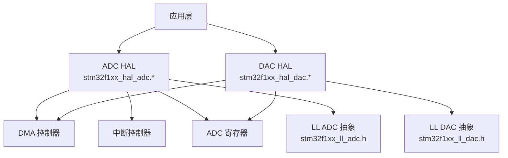
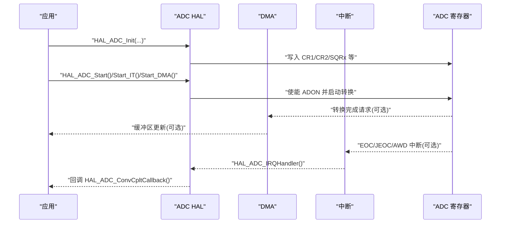
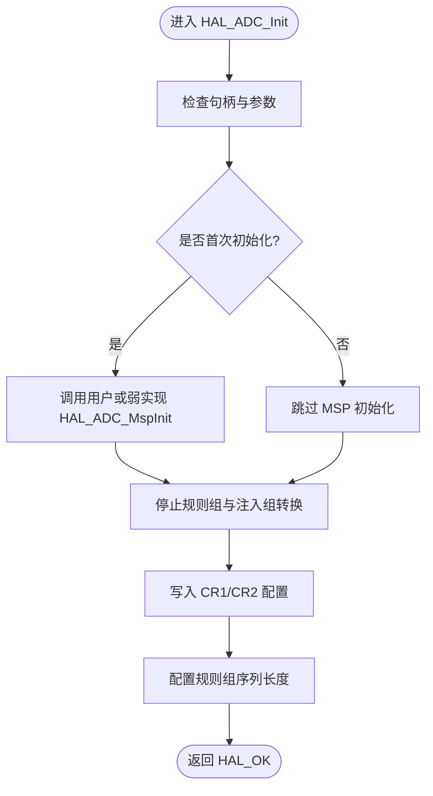
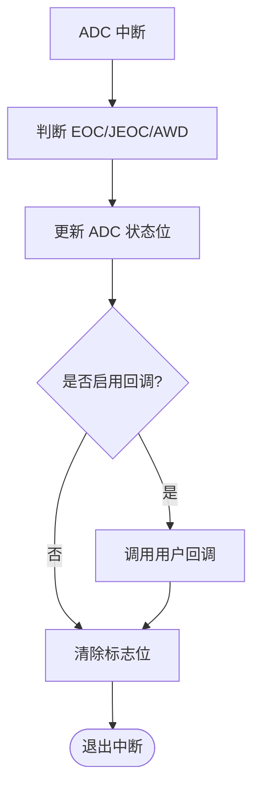
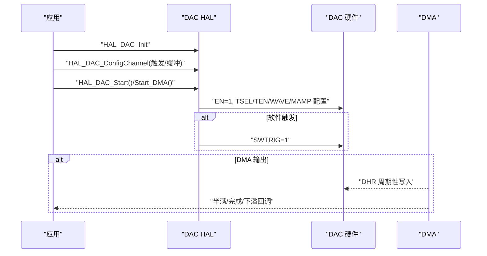
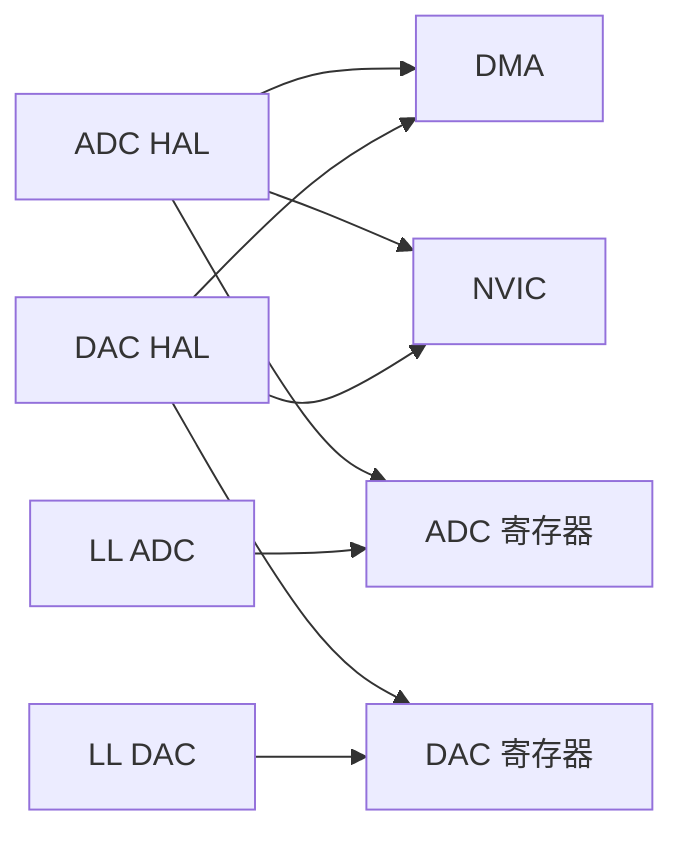

# 模拟信号处理

<cite>
**本文引用的文件**   
- [stm32f1xx_hal_adc.h](file://Inc/stm32f1xx_hal_adc.h)
- [stm32f1xx_hal_adc_ex.h](file://Inc/stm32f1xx_hal_adc_ex.h)
- [stm32f1xx_hal_adc.c](file://Src/stm32f1xx_hal_adc.c)
- [stm32f1xx_hal_dac.h](file://Inc/stm32f1xx_hal_dac.h)
- [stm32f1xx_hal_dac_ex.h](file://Inc/stm32f1xx_hal_dac_ex.h)
- [stm32f1xx_hal_dac.c](file://Src/stm32f1xx_hal_dac.c)
- [stm32f1xx_ll_adc.h](file://Inc/stm32f1xx_ll_adc.h)
- [stm32f1xx_ll_dac.h](file://Inc/stm32f1xx_ll_dac.h)
</cite>

## 目录
1. [简介](#简介)
2. [项目结构](#项目结构)
3. [核心组件](#核心组件)
4. [架构总览](#架构总览)
5. [详细组件分析](#详细组件分析)
6. [依赖关系分析](#依赖关系分析)
7. [性能与精度权衡](#性能与精度权衡)
8. [从 HAL 迁移到 LL 的建议](#从-hal-迁移到-ll-的建议)
9. [故障排查指南](#故障排查指南)
10. [结论](#结论)

## 简介
本文件面向 STM32F1xx 系列中使用 HAL 库进行模拟信号处理的开发者，系统性梳理 ADC 与 DAC 模块的初始化、配置、转换流程、DMA/中断协作、波形生成与触发方式。文档同时给出校准、基准电压、输入阻抗、噪声抑制、转换精度与吞吐率的工程权衡建议，并提供从 HAL 接口迁移到 LL 接口的参考路径，以及常见调试问题的定位方法。

## 项目结构
本仓库中与模拟信号处理直接相关的代码主要分布在以下头文件与实现文件中：
- ADC HAL 接口与扩展：`stm32f1xx_hal_adc.h`、`stm32f1xx_hal_adc_ex.h`、`stm32f1xx_hal_adc.c`
- DAC HAL 接口与扩展：`stm32f1xx_hal_dac.h`、`stm32f1xx_hal_dac_ex.h`、`stm32f1xx_hal_dac.c`
- LL 底层抽象：`stm32f1xx_ll_adc.h`、`stm32f1xx_ll_dac.h`



图表来源
- [stm32f1xx_hal_adc.h:211-360](file://Inc/stm32f1xx_hal_adc.h#L211-L360)
- [stm32f1xx_hal_dac.h:1-120](file://Inc/stm32f1xx_hal_dac.h#L1-L120)
- [stm32f1xx_ll_adc.h:1-120](file://Inc/stm32f1xx_ll_adc.h#L1-L120)
- [stm32f1xx_ll_dac.h:1-120](file://Inc/stm32f1xx_ll_dac.h#L1-L120)

章节来源
- [stm32f1xx_hal_adc.h:211-360](file://Inc/stm32f1xx_hal_adc.h#L211-L360)
- [stm32f1xx_hal_dac.h:1-120](file://Inc/stm32f1xx_hal_dac.h#L1-L120)

## 核心组件
### ADC 核心数据结构
- `ADC_InitTypeDef`：定义数据对齐、扫描模式、连续/单次模式、通道数、不连续模式、外部触发等全局与规则组参数。
- `ADC_ChannelConfTypeDef`：定义规则组中单个通道的编号、序列号、采样时间。
- `ADC_AnalogWDGConfTypeDef`：定义模拟看门狗工作模式、通道、阈值与中断模式。
- `ADC_HandleTypeDef`：保存外设实例指针、初始化参数、DMA 句柄、锁、状态位、错误码和回调函数指针。

关键行为要点：
- 扫描模式下，规则组按序列依次转换；若不启用扫描则只转换 rank 1 对应通道。
- 连续模式允许外部触发或软件触发后持续启动转换；单次模式则在最后一次转换结束后释放忙标志。
- 注入组有独立的序列、独立的数据寄存器，适合高优先级任务打断规则组。
- 在扫描+中断模式下，只有最后一个通道的 EOC 会触发中断，此前通道结果可能被覆盖；使用 DMA 可避免该问题。

章节来源
- [stm32f1xx_hal_adc.h:211-360](file://Inc/stm32f1xx_hal_adc.h#L211-L360)
- [stm32f1xx_hal_adc.h:360-520](file://Inc/stm32f1xx_hal_adc.h#L360-L520)

### DAC 核心数据结构
- `DAC_ChannelConfTypeDef`：定义触发源与输出缓冲开关。
- `DAC_HandleTypeDef`：保存外设实例、状态、两个通道各自的 DMA 句柄、错误码与回调。
- DAC 扩展提供噪声/三角波幅度、双通道同步控制、双通道数据设置与读取。

关键行为要点：
- 支持软件触发与定时器/EXTI 硬件触发。
- 支持 8bit/12bit 右对齐或 12bit 左对齐。
- 支持 DMA 输出，存在 DMA 下溢中断和回调。
- 输出缓冲开启可降低驱动能力但提高带载能力；关闭可提高线性度但对外部负载敏感。

章节来源
- [stm32f1xx_hal_dac.h:60-220](file://Inc/stm32f1xx_hal_dac.h#L60-L220)
- [stm32f1xx_hal_dac_ex.h:1-120](file://Inc/stm32f1xx_hal_dac_ex.h#L1-L120)

## 架构总览
下图展示 HAL 层在 ADC/DAC 数据采集与输出中的典型交互：



图表来源
- [stm32f1xx_hal_adc.c:411-560](file://Src/stm32f1xx_hal_adc.c#L411-L560)
- [stm32f1xx_hal_adc.c:1036-1149](file://Src/stm32f1xx_hal_adc.c#L1036-L1149)
- [stm32f1xx_hal_adc.c:1779-1860](file://Src/stm32f1xx_hal_adc.c#L1779-L1860)

## 详细组件分析

### ADC 初始化与常规转换流程
ADC 初始化由 `HAL_ADC_Init` 负责，内部完成：
- MSP 初始化调用，分配锁与回调默认值。
- 停止正在进行的规则组和注入组转换。
- 校验参数：数据对齐、扫描模式、连续模式、外部触发、不连续模式及其数量。
- 写入 CR1/CR2，配置扫描、不连续、连续、对齐、外部触发极性。
- 配置规则组序列长度；若未启用扫描则强制单通道。



图表来源
- [stm32f1xx_hal_adc.c:411-560](file://Src/stm32f1xx_hal_adc.c#L411-L560)

章节来源
- [stm32f1xx_hal_adc.c:411-560](file://Src/stm32f1xx_hal_adc.c#L411-L560)

### 启动转换、读取结果与事件等待
- `HAL_ADC_Start`：使能 ADC，设置规则组状态，并根据软件或外部触发启动转换。
- `HAL_ADC_Stop`：停止转换并禁用 ADC。
- `HAL_ADC_PollForConversion`：轮询 EOC；在扫描模式下用最大转换时间替代逐通道轮询。
- `HAL_ADC_Start_IT`：启动规则组转换并使能 EOC 中断。
- `HAL_ADC_Start_DMA`：启动 DMA 传输并自动管理 EOC/状态。

```mermaid
sequenceDiagram
    participant App as "应用"
    participant ADC as "ADC HAL"
    participant HW as "ADC 硬件"

    App->>ADC: "HAL_ADC_Start"
    ADC->>HW: "ADON=1, 根据触发类型启动"
    HW-->>ADC: "EOC 置位(软件触发立即; 外部触发延迟)"
    App->>ADC: "HAL_ADC_PollForConversion / Start_IT / Start_DMA"
    ADC-->>App: "读取 DR 或回调通知"
```

图表来源
- [stm32f1xx_hal_adc.c:1036-1149](file://Src/stm32f1xx_hal_adc.c#L1036-L1149)
- [stm32f1xx_hal_adc.c:1385-1553](file://Src/stm32f1xx_hal_adc.c#L1385-L1553)

章节来源
- [stm32f1xx_hal_adc.c:1036-1149](file://Src/stm32f1xx_hal_adc.c#L1036-L1149)
- [stm32f1xx_hal_adc.c:1385-1553](file://Src/stm32f1xx_hal_adc.c#L1385-L1553)

### 中断与 DMA 下的 ADC 采集
- 中断路径：`HAL_ADC_IRQHandler` 检测 EOC/JEOC/AWD，更新状态位，调用相应回调，并在合适时机关闭中断（例如单次软件触发）。
- DMA 路径：`HAL_ADC_Start_DMA` 绑定 DMA 句柄，将转换结果写入内存；DMA 半满/完成回调可用于环形缓冲或双缓冲策略。



图表来源
- [stm32f1xx_hal_adc.c:1779-1860](file://Src/stm32f1xx_hal_adc.c#L1779-L1860)

章节来源
- [stm32f1xx_hal_adc.c:1779-1860](file://Src/stm32f1xx_hal_adc.c#L1779-L1860)

### 多通道扫描与注入组转换
- 规则组扫描：通过 `ADC_InitTypeDef.ScanConvMode` 与 `NbrOfConversion` 决定通道数和顺序；`Rank` 指定每个通道在序列中的位置。
- 注入组：使用 `ADC_InjectionConfTypeDef`，支持最多 4 个 rank，可配置采样时间与偏移；支持自动注入模式，可在规则组转换后自动执行注入序列。
- 外部触发：规则组与注入组各自支持多个定时器/EXTI 触发源；注意不同 ADC 实例上同名触发可能映射到不同寄存器位。

注意事项：
- 扫描+中断时仅最后一个通道产生 EOC 中断；多通道采集建议使用 DMA。
- 注入组每个 rank 拥有独立数据寄存器，不会像规则组那样被覆盖。
- 自动注入模式下，如果规则组使用 DMA 且为正常模式，JAUTO 会在 DMA 完成后停止；要维持 JAUTO 需使用循环模式。

章节来源
- [stm32f1xx_hal_adc_ex.h:1-207](file://Inc/stm32f1xx_hal_adc_ex.h#L1-L207)
- [stm32f1xx_hal_adc_ex.h:208-450](file://Inc/stm32f1xx_hal_adc_ex.h#L208-L450)

### DAC 输出电压、波形发生器与触发
DAC 基本操作：
- `HAL_DAC_Init`：完成 MSP 初始化、状态与错误码初始化。
- `HAL_DAC_ConfigChannel`：配置触发源与输出缓冲。
- `HAL_DAC_Start`：使能 DAC 通道；若为软件触发则立即触发一次转换。
- `HAL_DAC_SetValue`：写入数据保持寄存器，数据按 8bit/12bit 右对齐或 12bit 左对齐。
- `HAL_DAC_GetValue`：读取当前输出数据寄存器。

波形与扩展功能：
- 噪声波：通过 LFSR 掩码控制随机噪声幅度。
- 三角波：通过最大振幅常量选择三角波幅值。
- 双通道：支持双通道同时启动、停止、设置与读取。
- DMA：`HAL_DAC_Start_DMA` 使用 DMA 搬运数据到 DHR，存在 DMA 下溢错误与回调。



图表来源
- [stm32f1xx_hal_dac.c:291-570](file://Src/stm32f1xx_hal_dac.c#L291-L570)
- [stm32f1xx_hal_dac.c:830-1030](file://Src/stm32f1xx_hal_dac.c#L830-L1030)
- [stm32f1xx_hal_dac_ex.h:1-120](file://Inc/stm32f1xx_hal_dac_ex.h#L1-L120)

章节来源
- [stm32f1xx_hal_dac.c:291-570](file://Src/stm32f1xx_hal_dac.c#L291-L570)
- [stm32f1xx_hal_dac.c:830-1030](file://Src/stm32f1xx_hal_dac.c#L830-L1030)
- [stm32f1xx_hal_dac_ex.h:1-120](file://Inc/stm32f1xx_hal_dac_ex.h#L1-L120)

## 依赖关系分析
ADC/DAC 与 DMA、中断、寄存器之间的依赖关系如下：



图表来源
- [stm32f1xx_hal_adc.c:1779-1860](file://Src/stm32f1xx_hal_adc.c#L1779-L1860)
- [stm32f1xx_hal_dac.c:554-830](file://Src/stm32f1xx_hal_dac.c#L554-L830)
- [stm32f1xx_ll_adc.h:1-120](file://Inc/stm32f1xx_ll_adc.h#L1-L120)
- [stm32f1xx_ll_dac.h:1-120](file://Inc/stm32f1xx_ll_dac.h#L1-L120)

章节来源
- [stm32f1xx_hal_adc.c:1779-1860](file://Src/stm32f1xx_hal_adc.c#L1779-L1860)
- [stm32f1xx_hal_dac.c:554-830](file://Src/stm32f1xx_hal_dac.c#L554-L830)

## 性能与精度权衡
- 分辨率与采样时间：
  - 12bit 分辨率下，转换固定需要约 12.5 个 ADC 时钟周期；总转换时间 = 采样时间 + 转换时间。
  - 更高采样时间提升对高内阻源的充电时间，有助于提高精度，但降低吞吐率。
  - 低采样时间可提升吞吐率，但对输入源内阻与寄生电容敏感，容易引入误差。
- 扫描模式与吞吐率：
  - 多通道扫描可一次性按序转换多个通道，减少重复配置开销。
  - 扫描+中断仅在最后一个通道触发中断；DMA 更适合多通道高频采集。
- 基准电压与输入范围：
  - 数据表通常以 Vref+ 作为基准上限；具体范围需参考器件数据手册。
  - 内部参考电压与温度传感器使用时必须遵守最小采样时间约束。
- 噪声与精度：
  - ADC 可通过平均滤波、过采样、适当采样时间、屏蔽与接地优化降低噪声。
  - DAC 噪声波用于测试或抖动注入；三角波用于扫频或线性测试。
  - DAC 输出缓冲开启可提高驱动能力，但可能影响线性与噪声特性。
- 吞吐率与延迟权衡：
  - 软件触发延迟较低，外部触发可实现精确同步。
  - DMA 可减少 CPU 参与，提高吞吐率；中断适合少量通道或事件驱动场景。
- 校准与一致性：
  - 设备校准可消除系统级增益/偏移误差；具体校准流程应参照数据手册与校准宏。
  - 多通道采样时应保证各通道采样时间一致，尤其在交替/并行多 ADC 模式下。

章节来源
- [stm32f1xx_hal_adc.h:400-520](file://Inc/stm32f1xx_hal_adc.h#L400-L520)
- [stm32f1xx_hal_adc_ex.h:1-207](file://Inc/stm32f1xx_hal_adc_ex.h#L1-L207)

## 从 HAL 迁移到 LL 的建议
HAL 提供结构化句柄、回调与状态机，便于应用开发；LL 提供更直接的寄存器访问与更小的运行时开销，适合性能敏感场景。

迁移要点：
- ADC
  - 初始化：LL 使用 `LL_ADC_InitTypeDef` 与 `LL_ADC_REG_Init`、`LL_ADC_INJ_Init` 等函数；HAL 使用 `ADC_InitTypeDef` 与 `HAL_ADC_Init`。
  - 通道配置：LL 使用 `LL_ADC_REG_SetSequencerChannels`、`LL_ADC_SetChannelSamplingTime`；HAL 使用 `HAL_ADC_RegularChannelConfig`。
  - 触发：LL 使用 `LL_ADC_REG_SetTriggerSource`；HAL 使用 `ExternalTrigConv` 与外部触发宏。
  - 数据读取：LL 使用 `LL_ADC_REG_ReadConversionData32`；HAL 直接读 `DR`。
  - DMA/中断：LL 使用 `LL_DMA_xxx` 与 `LL_ADC_EnableIT_xxx`；HAL 使用 `HAL_ADC_Start_DMA` 与 `HAL_ADC_Start_IT`。
- DAC
  - 初始化：LL 使用 `LL_DAC_InitTypeDef` 与 `LL_DAC_Init`；HAL 使用 `DAC_ChannelConfTypeDef` 与 `HAL_DAC_ConfigChannel`。
  - 波形：LL 使用 `LL_DAC_SetWaveAutoGeneration`、`LL_DAC_SetWaveNoiseLFSR`、`LL_DAC_SetWaveTriangleAmplitude`；HAL 使用扩展函数 `HAL_DACEx_NoiseWaveGenerate`、`HAL_DACEx_TriangleWaveGenerate`。
  - 触发：LL 使用 `LL_DAC_SetTriggerSource`；HAL 使用 `DAC_Trigger` 宏。
  - 数据写入：LL 使用 `LL_DAC_ConvertData12` 或直接写 DHR；HAL 使用 `HAL_DAC_SetValue`。
  - DMA：LL 使用 `LL_DMA_xxx` 与 `LL_DAC_EnableDMAReq`；HAL 使用 `HAL_DAC_Start_DMA`。

迁移步骤建议：
1. 保留 HAL 版本运行稳定后，先复制关键初始化逻辑到 LL 版本。
2. 替换 `HAL_ADC_Init` → LL 初始化函数；替换 `HAL_ADC_Start/Start_IT/Start_DMA` → LL 触发与 DMA 配置。
3. 替换 DAC 配置：`HAL_DAC_ConfigChannel` → `LL_DAC_Init`；波形生成 → LL 波形函数。
4. 逐步验证：先用单通道软件触发验证，再启用外部触发、扫描、DMA。
5. 对比时序：使用示波器或定时器捕获触发边沿，确认 LL 版本延迟与相位一致性。
6. 性能评估：测量 CPU 占用、中断频率、DMA 带宽与吞吐率差异，决定是否全面迁移。

章节来源
- [stm32f1xx_ll_adc.h:1-234](file://Inc/stm32f1xx_ll_adc.h#L1-L234)
- [stm32f1xx_ll_dac.h:1-250](file://Inc/stm32f1xx_ll_dac.h#L1-L250)

## 故障排查指南
### ADC 读数异常
常见问题与排查：
- 采样时间不足：高内阻信号源需要更长采样时间；检查 `SamplingTime` 与 ADC 时钟频率。
- 通道复用与封装引脚限制：某些通道不可用或受封装影响；核对数据手册通道可用性。
- 扫描+中断覆盖：多通道扫描仅最后一个通道产生 EOC；改用 DMA 或读取中间结果。
- 外部触发未生效：检查触发源是否启用、极性是否正确、AFIO 重映射是否配置。
- 内部通道噪声：VrefInt/TempSensor 需满足最小采样时间；必要时增加滤波。

相关实现参考：
- 采样时间与转换周期常量：[stm32f1xx_hal_adc.h:400-520](file://Inc/stm32f1xx_hal_adc.h#L400-L520)
- 中断处理与状态更新：[stm32f1xx_hal_adc.c:1779-1860](file://Src/stm32f1xx_hal_adc.c#L1779-L1860)

### DAC 输出漂移
常见问题与排查：
- 输出缓冲未正确配置：负载较重时需开启输出缓冲；轻载时可关闭以提升线性度。
- 数据对齐错误：写入 DHR 时对齐方式与 DMA 配置不一致会导致数值偏移。
- DMA 下溢：数据更新速度低于 DAC 刷新速度会触发 DMA 下溢；检查 DMA 长度、时钟与更新频率。
- 触发源冲突：软件触发与硬件触发混用可能导致意外触发；明确选择单一触发源。

相关实现参考：
- DAC 配置与触发：[stm32f1xx_hal_dac.c:992-1030](file://Src/stm32f1xx_hal_dac.c#L992-L1030)
- DAC 数据写入与读取：[stm32f1xx_hal_dac.c:830-992](file://Src/stm32f1xx_hal_dac.c#L830-L992)
- DAC 错误码与回调：[stm32f1xx_hal_dac.h:120-220](file://Inc/stm32f1xx_hal_dac.h#L120-L220)

### DMA 配置错误
常见问题与排查：
- 缓冲区地址或长度错误：确保 DMA 目标地址与应用缓冲区一致，长度等于转换次数。
- 循环模式未启用：长时采集应使用循环模式，否则 DMA 完成后不再传输。
- 半满/完整回调未处理：双缓冲或环形缓冲需要正确处理回调。
- ADC/DAC 的 DMA 请求未使能：确认外设的 DMA 请求位已打开。

相关实现参考：
- ADC DMA 启动与回调：[stm32f1xx_hal_adc.c:1553-1694](file://Src/stm32f1xx_hal_adc.c#L1553-L1694)
- DAC DMA 启动与回调：[stm32f1xx_hal_dac.c:554-830](file://Src/stm32f1xx_hal_dac.c#L554-L830)

## 结论
STM32F1xx 的 ADC 与 DAC 在 HAL 库中提供了清晰的结构化 API，适用于大多数应用。ADC 的关键在于合理配置采样时间、扫描模式、触发源与 DMA/中断协作；DAC 的关键在于触发源、输出缓冲、对齐方式与 DMA 稳定性。工程实践中应在精度、噪声、吞吐率与功耗之间取得平衡，并通过数据手册与示波器验证时序与波形。对于高性能需求，可逐步迁移到 LL 接口以获得更直接的控制与更低开销，但需仔细对齐 HAL 与 LL 的配置语义。