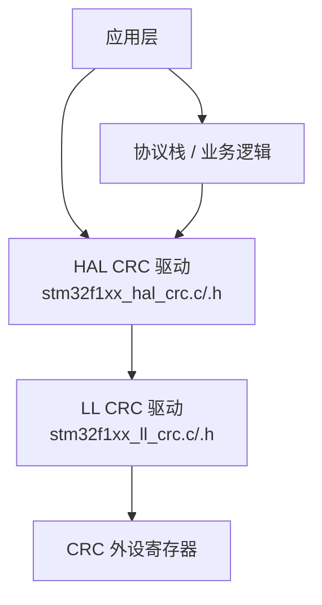
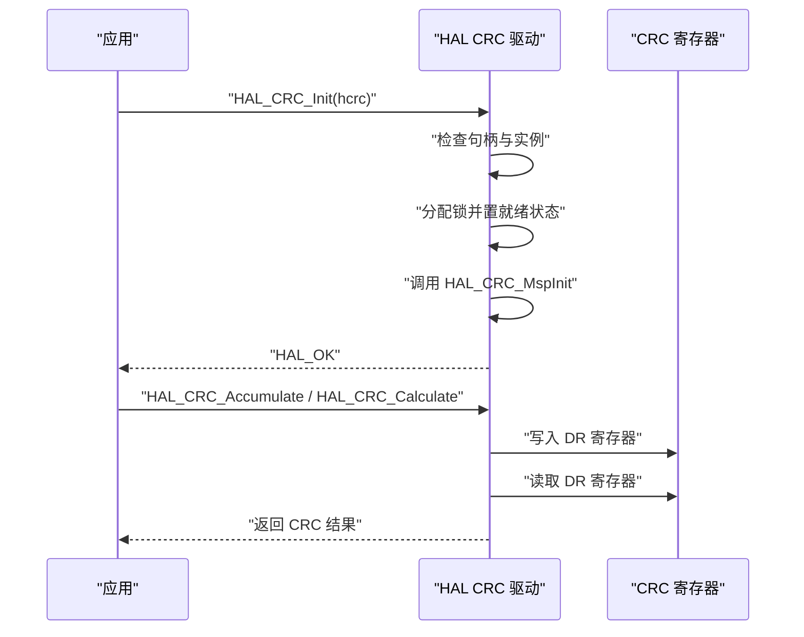
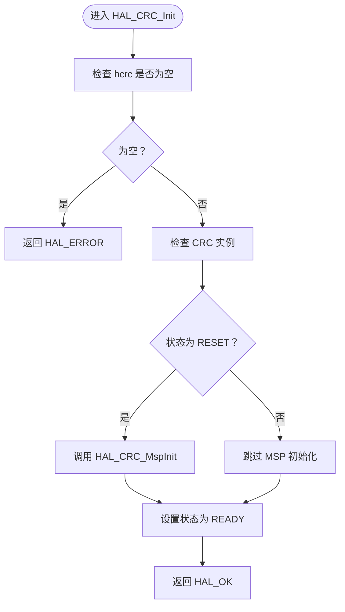
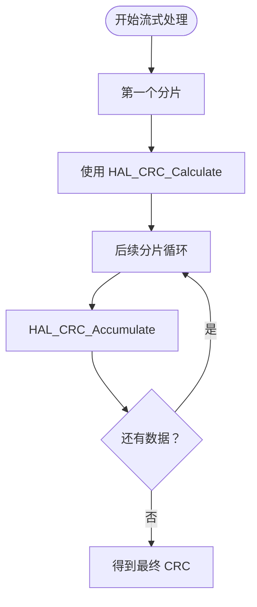
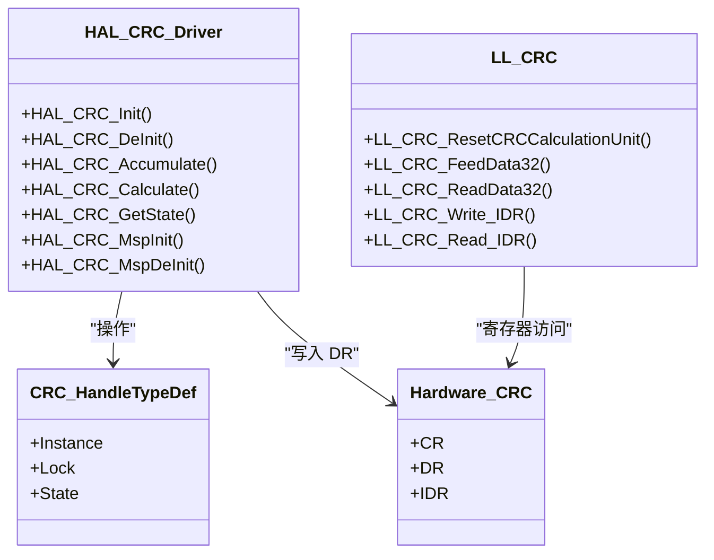
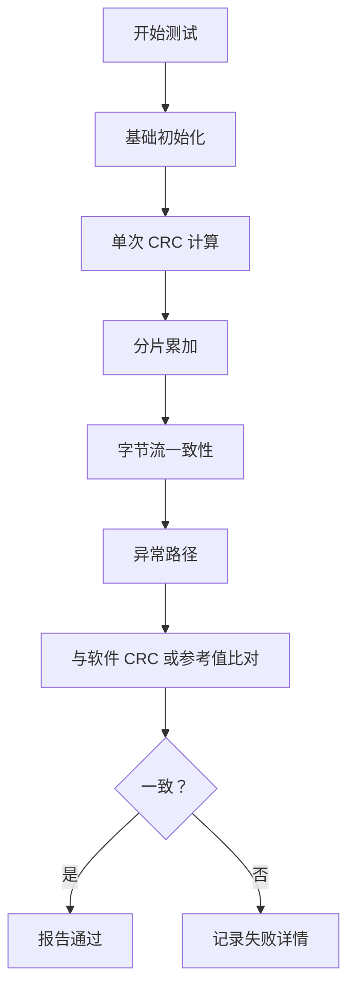
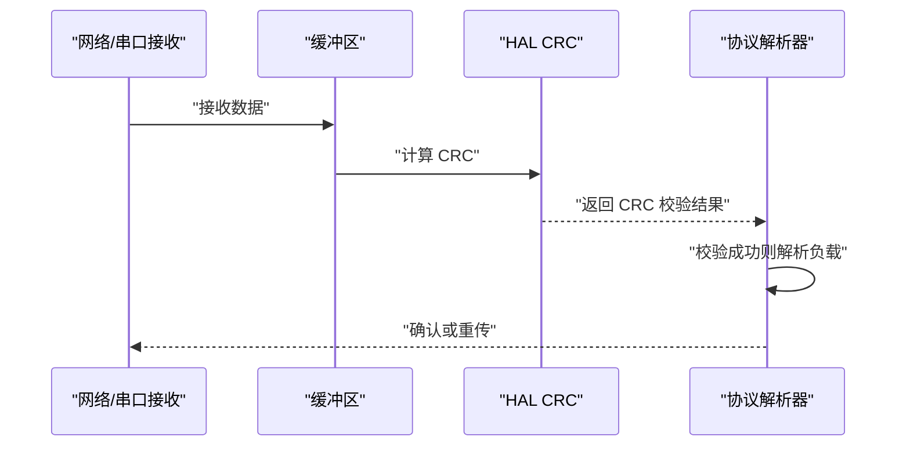

# CRC 循环冗余校验

<cite>
**本文引用的文件**   
- [stm32f1xx_hal_crc.h](file://Inc/stm32f1xx_hal_crc.h)
- [stm32f1xx_hal_crc.c](file://Src/stm32f1xx_hal_crc.c)
- [stm32f1xx_ll_crc.h](file://Inc/stm32f1xx_ll_crc.h)
- [stm32f1xx_ll_crc.c](file://Src/stm32f1xx_ll_crc.c)
- [README.md](file://README.md)
</cite>

## 目录

1. [简介](#简介)
2. [项目结构](#项目结构)
3. [核心组件](#核心组件)
4. [架构总览](#架构总览)
5. [详细组件分析](#详细组件分析)
6. [依赖关系分析](#依赖关系分析)
7. [性能与硬件特性](#性能与硬件特性)
8. [DMA、Flash 与总线冲突注意事项](#dmaflash-与总线冲突注意事项)
9. [测试用例设计](#测试用例设计)
10. [与上层协议校验逻辑集成](#与上层协议校验逻辑集成)
11. [故障排查](#故障排查)
12. [结论](#结论)

## 简介

本文件面向 STM32F1xx HAL 中的 CRC 模块，系统说明：

- `HAL_CRC_Init` 的职责与限制。
- 当前 HAL 接口中数据输入宽度为 32 bit 字，缓冲区长度以 `uint32_t` 个数计量。
- 初始值、多项式、输入/输出位反转等配置在 STM32F1xx HAL 层并未暴露专用结构体；这些能力需通过底层寄存器或 LL 层实现。
- 对比 `HAL_CRC_Accumulate` 与 `HAL_CRC_Calculate` 的行为差异。
- 解释为何仓库中不存在 `HAL_CRC_Compute`、`HAL_CRC_Input`、`HAL_CRC_IRQHandler`：STM32F1xx HAL 的 CRC 驱动是同步、非中断、无 DMA 回调的轻量实现。
- 给出计算缓冲区 CRC、增量累加和字节/字流式处理的实践方式。
- 讨论软件 CRC 与硬件 CRC 的性能差异、DMA 配合 CRC 的注意事项、硬件 CRC 与 Flash 读取冲突、以及如何在通信协议栈中集成 CRC 校验。

## 项目结构

CRC 相关代码位于 HAL 与 LL 两个层次：

| 层次 | 文件 | 职责 |
|---|---|---|
| HAL 头文件 | `Inc/stm32f1xx_hal_crc.h` | 定义 `CRC_HandleTypeDef`、状态枚举、宏与对外函数声明 |
| HAL 实现 | `Src/stm32f1xx_hal_crc.c` | 初始化、反初始化、累加计算、独立计算、状态查询 |
| LL 头文件 | `Inc/stm32f1xx_ll_crc.h` | 低层寄存器读写宏与内联函数 |
| LL 实现 | `Src/stm32f1xx_ll_crc.c` | 可选的完整 LL 反初始化实现 |

**图表来源**  
- [stm32f1xx_hal_crc.c:1-120](file://Src/stm32f1xx_hal_crc.c#L1-L120)
- [stm32f1xx_hal_crc.h:1-181](file://Inc/stm32f1xx_hal_crc.h#L1-L181)
- [stm32f1xx_ll_crc.h:1-201](file://Inc/stm32f1xx_ll_crc.h#L1-L201)
- [stm32f1xx_ll_crc.c:1-104](file://Src/stm32f1xx_ll_crc.c#L1-L104)

**章节来源**  
- [README.md:1-45](file://README.md#L1-L45)

## 核心组件

### CRC 句柄与状态

HAL 层只维护一个最小化的 CRC 句柄：

| 字段或成员 | 含义 |
|---|---|
| `Instance` | 指向 CRC 外设寄存器基地址 |
| `Lock` | HAL 通用锁对象 |
| `State` | CRC 外围设备状态 |

状态枚举包括：

| 状态值 | 含义 |
|---|---|
| `HAL_CRC_STATE_RESET` | 未初始化或已禁用 |
| `HAL_CRC_STATE_READY` | 已初始化并可再次使用 |
| `HAL_CRC_STATE_BUSY` | 内部过程正在进行 |
| `HAL_CRC_STATE_TIMEOUT` | 超时状态 |
| `HAL_CRC_STATE_ERROR` | 错误状态 |

该设计表明：STM32F1xx HAL CRC 没有保存多项式、初始值、输入宽度、反转模式等配置参数；它主要管理外设实例、生命周期和运行时状态。

**章节来源**  
- [stm32f1xx_hal_crc.h:39-71](file://Inc/stm32f1xx_hal_crc.h#L39-L71)

### 对外函数清单

| 函数 | 返回类型 | 用途 |
|---|---|---|
| `HAL_CRC_Init` | `HAL_StatusTypeDef` | 初始化 CRC 句柄并调用 MSP 初始化 |
| `HAL_CRC_DeInit` | `HAL_StatusTypeDef` | 重置 CRC 单元并释放资源 |
| `HAL_CRC_MspInit` | `void` | 用户实现的硬件级初始化回调 |
| `HAL_CRC_MspDeInit` | `void` | 用户实现的硬件级反初始化回调 |
| `HAL_CRC_Accumulate` | `uint32_t` | 以前一次 CRC 结果作为初始值，继续计算缓冲区 |
| `HAL_CRC_Calculate` | `uint32_t` | 先复位 CRC，再以默认初始值开始计算缓冲区 |
| `HAL_CRC_GetState` | `HAL_CRC_StateTypeDef` | 查询句柄状态 |

需要特别注意：**当前仓库中的 STM32F1xx HAL CRC 接口不包含 `HAL_CRC_Compute`、`HAL_CRC_Input` 或 `HAL_CRC_IRQHandler`**。

**章节来源**  
- [stm32f1xx_hal_crc.h:120-162](file://Inc/stm32f1xx_hal_crc.h#L120-L162)
- [stm32f1xx_hal_crc.c:200-328](file://Src/stm32f1xx_hal_crc.c#L200-L328)

## 架构总览

STM32F1xx HAL CRC 的调用流程非常直接：

**图表来源**  
- [stm32f1xx_hal_crc.c:70-120](file://Src/stm32f1xx_hal_crc.c#L70-L120)
- [stm32f1xx_hal_crc.c:200-328](file://Src/stm32f1xx_hal_crc.c#L200-L328)

## 详细组件分析

### `HAL_CRC_Init` 行为与局限

`HAL_CRC_Init` 的核心行为如下：

1. 检查句柄指针是否为空。
2. 使用 `IS_CRC_ALL_INSTANCE` 检查外设实例是否合法。
3. 如果句柄状态为 `HAL_CRC_STATE_RESET`，则分配锁并调用 `HAL_CRC_MspInit`。
4. 将句柄状态设为 `HAL_CRC_STATE_READY`。
5. 返回 `HAL_OK`。

这意味着：

- 初始化主要完成 HAL 层句柄状态管理。
- 真正的时钟、引脚、寄存器配置应放在用户实现的 `HAL_CRC_MspInit` 中。
- 当前 HAL CRC 实现不会自动使能 CRC 时钟，也不会写入多项式、初始值、输入宽度或反转位；这些属于外设配置细节。

**图表来源**  
- [stm32f1xx_hal_crc.c:70-120](file://Src/stm32f1xx_hal_crc.c#L70-L120)

**章节来源**  
- [stm32f1xx_hal_crc.c:70-120](file://Src/stm32f1xx_hal_crc.c#L70-L120)
- [stm32f1xx_hal_crc.h:120-141](file://Inc/stm32f1xx_hal_crc.h#L120-L141)

### `HAL_CRC_Accumulate`：增量累加

`HAL_CRC_Accumulate` 用于“延续上一次 CRC 结果”的场景：

- 将句柄状态设为 `BUSY`。
- 按 `BufferLength` 逐个写入 `pBuffer` 中的 `uint32_t` 到 `DR`。
- 最后从 `DR` 读取当前 CRC 值。
- 将状态恢复为 `READY`。

典型场景：

- 分片接收网络帧时，每收到一段就调用一次。
- 对多个缓冲区进行累积校验。
- 长流式数据不需要每次都从头复位。

时间复杂度为 O(n)，空间复杂度为 O(1)，因为只遍历缓冲区并反复写读同一个寄存器。

**章节来源**  
- [stm32f1xx_hal_crc.c:200-250](file://Src/stm32f1xx_hal_crc.c#L200-L250)
- [stm32f1xx_hal_crc.h:145-151](file://Inc/stm32f1xx_hal_crc.h#L145-L151)

### `HAL_CRC_Calculate`：独立计算

`HAL_CRC_Calculate` 用于“从零开始计算缓冲区 CRC”的场景：

- 将句柄状态设为 `BUSY`。
- 调用 `__HAL_CRC_DR_RESET`，这会触发硬件复位 CRC 计算单元。
- 逐个写入缓冲区数据。
- 读取最终 CRC。
- 恢复 `READY` 状态。

典型场景：

- 对单个数据包计算完整 CRC。
- 每次校验都要求与固定初始值一致。
- 不依赖上一次计算结果。

**章节来源**  
- [stm32f1xx_hal_crc.c:250-300](file://Src/stm32f1xx_hal_crc.c#L250-L300)
- [stm32f1xx_hal_crc.h:90-100](file://Inc/stm32f1xx_hal_crc.h#L90-L100)

### 为什么没有 `HAL_CRC_Compute`、`HAL_CRC_Input`、`HAL_CRC_IRQHandler`

在当前 STM32F1xx HAL CRC 驱动中：

- 所有数据操作都是同步的：调用方等待循环写入寄存器后直接读取结果。
- 没有异步传输接口。
- 没有数据寄存器满、传输完成、错误等中断处理函数。
- 没有 `HAL_CRC_Compute` 这个名称的函数；对应功能由 `HAL_CRC_Accumulate` 和 `HAL_CRC_Calculate` 承担。
- 没有 `HAL_CRC_Input`；数据通过直接写入 `DR` 寄存器输入。
- 没有 `HAL_CRC_IRQHandler`；HAL 层不注册或处理 CRC 中断。

因此，这些缺失不是 bug，而是 STM32F1xx HAL CRC 驱动的设计边界。

**章节来源**  
- [stm32f1xx_hal_crc.h:120-162](file://Inc/stm32f1xx_hal_crc.h#L120-L162)
- [stm32f1xx_hal_crc.c:200-328](file://Src/stm32f1xx_hal_crc.c#L200-L328)

### 数据输入宽度：32 bit 字

当前 HAL CRC 接口的缓冲区类型为 `const uint32_t pBuffer[]`，长度为“`uint32_t` 个数”。这说明：

- HAL 层以 32 bit 字为单位输入数据。
- 每个数组元素写入 `DR` 寄存器。
- 返回值也是 32 bit CRC（短于 32 bit 时使用低位）。

如果需要 8 bit 或 16 bit 输入宽度，不能直接通过当前 HAL 高层接口选择；需要直接操作寄存器或使用 LL 层。

**章节来源**  
- [stm32f1xx_hal_crc.c:200-300](file://Src/stm32f1xx_hal_crc.c#L200-L300)
- [stm32f1xx_hal_crc.h:145-151](file://Inc/stm32f1xx_hal_crc.h#L145-L151)

### 初始值、多项式、输入/输出位反转

在 STM32F1xx HAL CRC 头文件中：

- 没有 `CRC_InitTypeDef`。
- 没有多项式配置字段。
- 没有初始值配置字段。
- 没有输入数据宽度选择字段。
- 没有输入/输出位反转字段。

因此，这些配置必须通过以下方式之一完成：

1. 在 `HAL_CRC_MspInit` 中直接写入 CRC 控制寄存器。
2. 使用 LL 层提供的寄存器访问接口。
3. 使用 CMSIS 设备头文件中的寄存器宏。

HAL 提供的 `__HAL_CRC_DR_RESET` 宏会设置 `CRC_CR_RESET`，从而复位 CRC 计算单元；但它不负责配置多项式、初始值、输入格式或反转模式。

**章节来源**  
- [stm32f1xx_hal_crc.h:80-100](file://Inc/stm32f1xx_hal_crc.h#L80-L100)
- [stm32f1xx_hal_crc.h:120-162](file://Inc/stm32f1xx_hal_crc.h#L120-L162)

### 字节与字流式处理

#### 字节流处理

由于 HAL 接口以 `uint32_t` 数组输入，若数据源是字节流，建议：

- 在应用层将字节缓冲填充到 32 bit 字。
- 注意字节序与对齐。
- 若剩余不足 32 bit，再决定如何补齐或切换到 LL 层按字节输入。

#### 字流处理

当数据已经是 32 bit 字时，可以直接调用 `HAL_CRC_Accumulate` 或 `HAL_CRC_Calculate`。

#### 流式分段处理

推荐策略：

- 第一个分片使用 `HAL_CRC_Calculate`，确保从正确初始值开始。
- 后续分片使用 `HAL_CRC_Accumulate`，避免重复复位。
- 所有分片完成后，得到最终 CRC。

**图表来源**  
- [stm32f1xx_hal_crc.c:200-300](file://Src/stm32f1xx_hal_crc.c#L200-L300)

**章节来源**  
- [stm32f1xx_hal_crc.c:200-300](file://Src/stm32f1xx_hal_crc.c#L200-L300)

## 依赖关系分析

**图表来源**  
- [stm32f1xx_hal_crc.h:39-71](file://Inc/stm32f1xx_hal_crc.h#L39-L71)
- [stm32f1xx_hal_crc.h:120-162](file://Inc/stm32f1xx_hal_crc.h#L120-L162)
- [stm32f1xx_ll_crc.h:80-201](file://Inc/stm32f1xx_ll_crc.h#L80-L201)

### 耦合与内聚

- HAL CRC 与 LL CRC 解耦：HAL 主要写 `DR`，LL 提供通用寄存器读写工具。
- HAL CRC 与具体外设配置弱耦合：不持有配置结构体，降低 API 复杂度。
- 风险点：由于配置不在 HAL 层表达，不同应用可能以不同方式配置 CRC，导致同一组数据在不同工程中产生不同结果。

**章节来源**  
- [stm32f1xx_hal_crc.c:200-328](file://Src/stm32f1xx_hal_crc.c#L200-L328)
- [stm32f1xx_ll_crc.h:80-201](file://Inc/stm32f1xx_ll_crc.h#L80-L201)

## 性能与硬件特性

### 硬件 CRC 的优势

- 硬件 CRC 通常比软件查表或多项式模拟更快，尤其在连续写入 `DR` 时。
- 减少 CPU 占用，适合高吞吐串口、SPI、DMA 等场景。
- 结果确定性高，便于协议一致性验证。

### 软件 CRC 的特点

- 不需要外设配置，可在任意 MCU 上实现。
- 便于调试和仿真。
- 可灵活支持多种多项式和位顺序。
- 在小块数据或低频场景中，开销可以接受。

### 当前 HAL 实现的执行模型

`HAL_CRC_Accumulate` 和 `HAL_CRC_Calculate` 都是同步循环：

- 时间复杂度 O(n)。
- 每次循环写入一个 32 bit 字。
- 返回前读取一次 `DR`。
- 无中断、无 DMA、无回调。

**章节来源**  
- [stm32f1xx_hal_crc.c:200-328](file://Src/stm32f1xx_hal_crc.c#L200-L328)

## DMA、Flash 与总线冲突注意事项

### DMA 配合 CRC

当前 HAL CRC 没有 DMA 回调或异步接口。实践中常见做法：

- 使用 DMA 将数据从外设或内存搬运到缓冲区。
- DMA 传输完成后，CPU 调用 `HAL_CRC_Accumulate` 或 `HAL_CRC_Calculate`。
- 对于超大流，可结合 DMA 半传输/完成中断，分段调用 HAL CRC 接口。

注意：

- HAL CRC 不保证 DMA 安全，应用层要确保 DMA 不再修改缓冲区后再计算 CRC。
- 若希望 DMA 直接喂给 CRC，需要参考芯片参考手册和 LL 层寄存器，但当前 HAL 不提供封装。

### 硬件 CRC 与 Flash 读取冲突

STM32F1xx 的 CRC 外设与 Flash 共享部分总线资源。某些情况下，同时读取 Flash 和向 CRC 写入数据可能引起总线竞争，导致：

- CRC 计算延迟增加。
- 极端情况下出现不可预期行为。

建议：

- 计算 CRC 时尽量避免同时执行大量 Flash 读取。
- 可将待校验数据复制到 RAM。
- 在高实时任务中关闭不必要的 Flash 访问。
- 根据具体型号参考手册评估总线仲裁和时序。

### 总线与缓存影响

虽然 STM32F1xx 通常为 Cortex-M3，不带 I/D Cache，但仍需注意：

- 编译器优化可能改变循环展开和内存访问顺序。
- 大缓冲区 CRC 计算可能阻塞中断响应。
- 多任务环境中应保护 CRC 句柄状态和缓冲区。

**章节来源**  
- [stm32f1xx_hal_crc.c:200-328](file://Src/stm32f1xx_hal_crc.c#L200-L328)

## 测试用例设计

### 基础功能测试

| 测试项 | 输入 | 期望 |
|---|---|---|
| 初始化成功 | 有效 `hcrc` | 返回 `HAL_OK`，状态变为 `READY` |
| 空句柄初始化 | 空指针 | 返回 `HAL_ERROR` |
| 单次计算 | 单字缓冲区 | 返回与已知 CRC 一致的 32 bit 值 |
| 多次累加 | 分片缓冲区 | 最终结果等于一次性计算的 CRC |
| 反初始化 | 空闲句柄 | 可正常复位 CRC |
| 忙状态反初始化 | 正在计算 | 返回 `HAL_BUSY` |

### 流式处理测试

- 将大数据拆成多个 32 bit 字分片。
- 第一次调用 `HAL_CRC_Calculate`。
- 后续调用 `HAL_CRC_Accumulate`。
- 与一次性 `HAL_CRC_Calculate` 结果比对。

### 字节流测试

- 构造固定字节序列。
- 分别用软件 CRC 和硬件 CRC 计算。
- 比较最终 CRC。
- 验证字节序、填充方式和初始值一致。

### 异常路径测试

- 非法实例。
- 并发访问句柄。
- DMA 与 CRC 同时访问相同缓冲区。
- 长时间阻塞场景下的超时检测。

[此图为概念性测试流程，不对应特定源码文件]

## 与上层协议校验逻辑集成

### 典型集成模式

**图表来源**  
- [stm32f1xx_hal_crc.c:200-300](file://Src/stm32f1xx_hal_crc.c#L200-L300)

### 关键集成要点

1. **协议初始值**：若协议要求特定初始值，必须在首次计算前完成硬件配置。
2. **多项式**：协议常用多项式如 CRC-32、CRC-16 等，必须与硬件配置一致。
3. **位反转**：某些协议要求输入或输出位反转。
4. **输入宽度**：协议可能是字节流，需确定是按字节还是按字输入。
5. **结束符**：某些协议会在末尾追加固定字节或取反结果，需在协议层处理。
6. **校验范围**：明确 CRC 覆盖哪些字段，避免包含可变头部或长度字段。

### 与软件 CRC 对比

| 维度 | 硬件 CRC | 软件 CRC |
|---|---|---|
| 速度 | 通常更快 | 较慢 |
| CPU 占用 | 低 | 高 |
| 灵活性 | 受硬件能力限制 | 完全可编程 |
| 移植性 | 依赖外设 | 跨平台 |
| 调试难度 | 需对照寄存器 | 易于断点调试 |
| 协议一致性 | 取决于硬件配置 | 可由算法保证 |

**章节来源**  
- [stm32f1xx_hal_crc.c:200-300](file://Src/stm32f1xx_hal_crc.c#L200-L300)

## 故障排查

### 常见问题

| 现象 | 可能原因 | 排查建议 |
|---|---|---|
| 初始化返回错误 | 句柄为空 | 检查传入 `hcrc` |
| 计算结果不一致 | 初始值、多项式、输入宽度或反转模式不同 | 核对硬件配置与协议文档 |
| 流式计算错误 | 中间被复位或误调 `HAL_CRC_Calculate` | 首片用 `Calculate`，后续用 `Accumulate` |
| DMA 后 CRC 错 | DMA 仍在修改缓冲区 | 确保 DMA 完成后再计算 |
| 大缓冲区阻塞系统 | 同步循环占用 CPU | 分片处理或改用 DMA 流式方案 |
| Flash 读取时 CRC 不稳定 | 总线竞争 | 复制数据到 RAM，减少并行 Flash 访问 |

### 状态检查

使用 `HAL_CRC_GetState` 检查句柄状态：

- `RESET`：尚未初始化。
- `READY`：可用。
- `BUSY`：正在计算。
- `TIMEOUT`：超时。
- `ERROR`：错误。

**章节来源**  
- [stm32f1xx_hal_crc.h:39-71](file://Inc/stm32f1xx_hal_crc.h#L39-L71)
- [stm32f1xx_hal_crc.c:300-328](file://Src/stm32f1xx_hal_crc.c#L300-L328)

## 结论

STM32F1xx HAL CRC 驱动是一个简洁、同步、面向 32 bit 字数据的 CRC 抽象：

- 它暴露了 `HAL_CRC_Init`、`HAL_CRC_Accumulate`、`HAL_CRC_Calculate` 和状态查询接口。
- 它没有 `HAL_CRC_Compute`、`HAL_CRC_Input`、`HAL_CRC_IRQHandler`。
- 它不管理多项式、初始值、输入宽度和反转配置；这些必须由用户或 LL 层处理。
- `HAL_CRC_Accumulate` 适合增量累加，`HAL_CRC_Calculate` 适合从零开始的独立计算。
- 在生产系统中，应结合协议规范、DMA、RAM 缓冲和总线特性设计 CRC 校验流程，并通过软件 CRC 或参考向量做一致性验证。