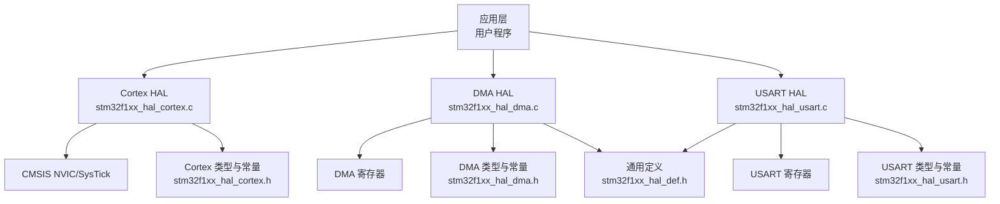
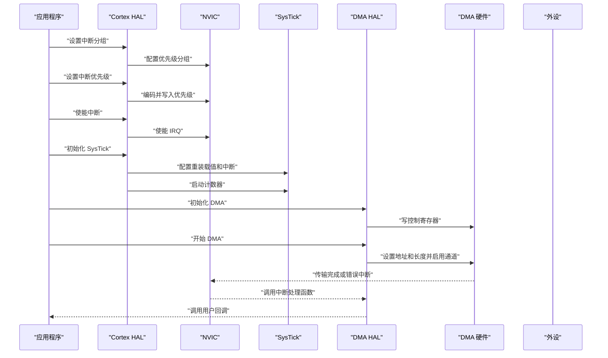
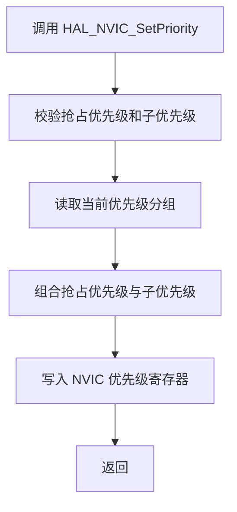
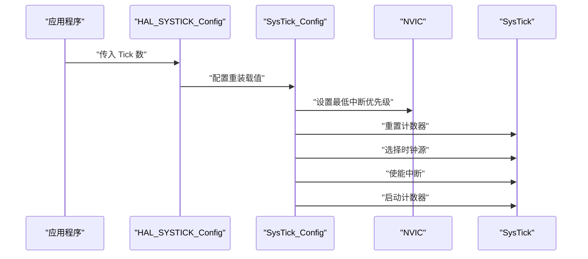
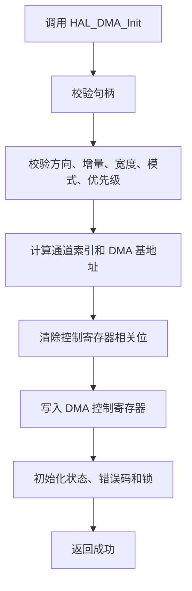
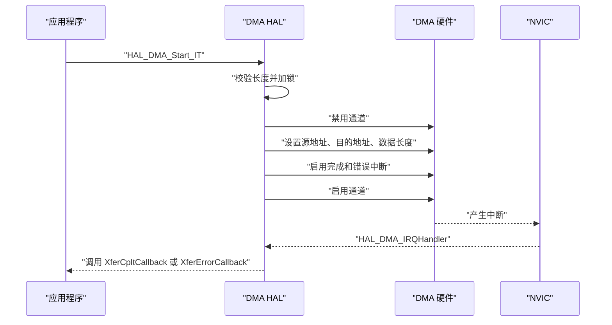
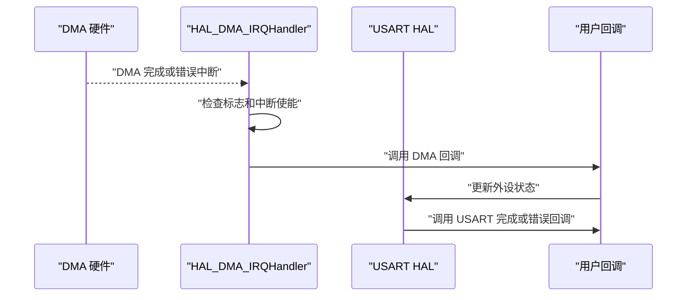
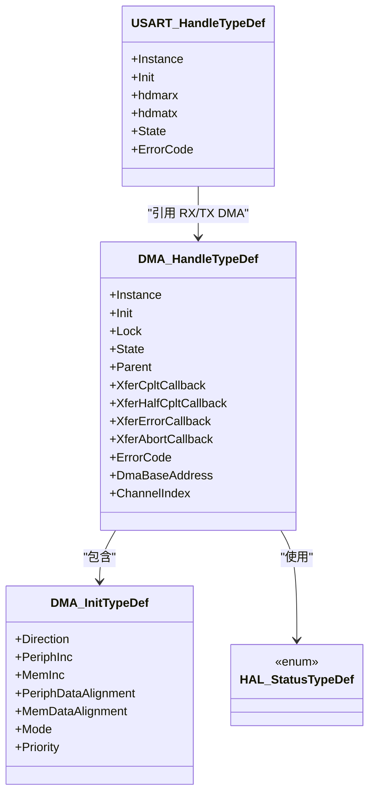

# Cortex-M3 内核服务与 DMA

<cite>
**本文引用的文件**   
- [stm32f1xx_hal_cortex.h](file://Inc/stm32f1xx_hal_cortex.h)
- [stm32f1xx_hal_cortex.c](file://Src/stm32f1xx_hal_cortex.c)
- [stm32f1xx_hal_dma.h](file://Inc/stm32f1xx_hal_dma.h)
- [stm32f1xx_hal_dma.c](file://Src/stm32f1xx_hal_dma.c)
- [stm32f1xx_hal_def.h](file://Inc/stm32f1xx_hal_def.h)
- [stm32f1xx_hal_usart.h](file://Inc/stm32f1xx_hal_usart.h)
- [stm32f1xx_hal_usart.c](file://Src/stm32f1xx_hal_usart.c)
</cite>

## 目录

1. [引言](#引言)
2. [项目结构](#项目结构)
3. [核心组件](#核心组件)
4. [架构总览](#架构总览)
5. [详细组件分析](#详细组件分析)
6. [依赖关系分析](#依赖关系分析)
7. [性能考虑](#性能考虑)
8. [故障排查指南](#故障排查指南)
9. [结论](#结论)

## 引言

本文面向 STM32F1 系列中基于 Cortex-M3 内核的 HAL 驱动，重点说明以下子系统：

- NVIC 中断分组、抢占优先级、子优先级和中断使能。
- SysTick 时基初始化、时钟源选择、中断优先级和延时实现。
- DMA 通道配置、数据方向、地址增量、宽度对齐、循环/正常模式、半满/满中断，以及 `HAL_DMA_Init`、`HAL_DMA_Start`、`HAL_DMA_Start_IT`、`HAL_DMA_Abort` 等接口。
- 使用 USART 接收或按键触发 DMA 的最小流程。
- DMA、NVIC 中断、外设 HAL 回调之间的协作关系。
- 栈溢出、中断屏蔽、调试器冻结 DMA、地址对齐、缓存未命中（如适用）及性能优化建议。

Cortex-M3 提供 16 级可编程中断优先级，但 STM32F1 硬件只使用高 4 位，因此 NVIC 优先级值范围是 0–15；数值越小，优先级越高。DMA 具有软件优先级，用于多个 DMA 通道竞争时的调度顺序。

## 项目结构

本仓库属于 STM32Cube HAL 固件库的一部分，相关代码集中在以下头文件和源文件中：

**图示来源**
- [stm32f1xx_hal_cortex.c:1-120](file://Src/stm32f1xx_hal_cortex.c#L1-L120)
- [stm32f1xx_hal_dma.c:1-120](file://Src/stm32f1xx_hal_dma.c#L1-L120)
- [stm32f1xx_hal_usart.c:1-120](file://Src/stm32f1xx_hal_usart.c#L1-L120)

**章节来源**
- [stm32f1xx_hal_cortex.h:1-200](file://Inc/stm32f1xx_hal_cortex.h#L1-L200)
- [stm32f1xx_hal_cortex.c:1-120](file://Src/stm32f1xx_hal_cortex.c#L1-L120)
- [stm32f1xx_hal_dma.h:1-120](file://Inc/stm32f1xx_hal_dma.h#L1-L120)
- [stm32f1xx_hal_dma.c:1-120](file://Src/stm32f1xx_hal_dma.c#L1-L120)
- [stm32f1xx_hal_usart.h:1-120](file://Inc/stm32f1xx_hal_usart.h#L1-L120)
- [stm32f1xx_hal_usart.c:1-120](file://Src/stm32f1xx_hal_usart.c#L1-L120)

## 核心组件

### NVIC 中断分组与优先级

Cortex HAL 暴露三个关键函数：

| 函数 | 作用 | 行为要点 |
|---|---|---|
| `HAL_NVIC_SetPriorityGrouping` | 设置抢占优先级与子优先级的位数分配 | 实际调用 CMSIS 的优先级分组设置；STM32F1 支持 0–4 组，每组抢占/子优先级位数之和为 4。 |
| `HAL_NVIC_SetPriority` | 设置某个 IRQ 的抢占优先级和子优先级 | 先读取当前优先级分组，再编码后写入 NVIC。 |
| `HAL_NVIC_EnableIRQ` | 使能指定外部中断 | 参数校验后调用底层 NVIC 使能。 |

中断优先级比较规则如下：

1. 抢占优先级数值越小，优先级越高。
2. 抢占优先级相同时，按子优先级数值越小优先级越高。
3. 抢占和子优先级都相同时，按硬件 IRQ 编号决定，编号越小优先级越高。

当抢占优先级分组设为 0 时，所有中断没有抢占能力，只能按子优先级串行执行；此时不能发生嵌套中断。

**章节来源**
- [stm32f1xx_hal_cortex.h:60-110](file://Inc/stm32f1xx_hal_cortex.h#L60-L110)
- [stm32f1xx_hal_cortex.c:120-190](file://Src/stm32f1xx_hal_cortex.c#L120-L190)

### SysTick 时基

SysTick 由 HAL 封装 CMSIS 的 `SysTick_Config`，主要职责包括：

- 设置重装载值。
- 设置 SysTick 中断优先级。
- 清零计数器。
- 选择时钟源。
- 使能 SysTick 中断并启动计数。

时钟源可通过 `HAL_SYSTICK_CLKSourceConfig` 设置为系统主频 HCLK 或 HCLK 八分频。默认情况下，HAL 文档说明 SysTick 初始化为 HCLK 源，并开启中断；之后可调整优先级或切换时钟源。

SysTick 中断处理函数调用弱定义的 `HAL_SYSTICK_Callback`，应用层应在用户文件中实现该回调以更新系统时间。

**章节来源**
- [stm32f1xx_hal_cortex.c:1-120](file://Src/stm32f1xx_hal_cortex.c#L1-L120)
- [stm32f1xx_hal_cortex.c:200-320](file://Src/stm32f1xx_hal_cortex.c#L200-L320)
- [stm32f1xx_hal_cortex.h:250-340](file://Inc/stm32f1xx_hal_cortex.h#L250-L340)

### DMA 基本数据结构

DMA HAL 的核心是 `DMA_HandleTypeDef` 和 `DMA_InitTypeDef`：

| 字段或成员 | 含义 |
|---|---|
| `Direction` | 传输方向：外设到内存、内存到外设、内存到内存。 |
| `PeriphInc` | 外设地址是否递增。 |
| `MemInc` | 内存地址是否递增。 |
| `PeriphDataAlignment` | 外设数据宽度：字节、半字、字。 |
| `MemDataAlignment` | 内存数据宽度：字节、半字、字。 |
| `Mode` | 正常模式或循环模式。 |
| `Priority` | DMA 软件优先级：低、中、高、非常高。 |
| `State` | DMA 状态：复位、就绪、忙、超时。 |
| `XferCpltCallback` | 传输完成回调。 |
| `XferHalfCpltCallback` | 半传输完成回调。 |
| `XferErrorCallback` | 错误回调。 |
| `XferAbortCallback` | 中止回调。 |
| `ErrorCode` | DMA 错误码。 |

**章节来源**
- [stm32f1xx_hal_dma.h:40-120](file://Inc/stm32f1xx_hal_dma.h#L40-L120)

## 架构总览

Cortex-M3 内核服务与 DMA 的整体交互如下：

**图示来源**
- [stm32f1xx_hal_cortex.c:120-190](file://Src/stm32f1xx_hal_cortex.c#L120-L190)
- [stm32f1xx_hal_cortex.c:200-320](file://Src/stm32f1xx_hal_cortex.c#L200-L320)
- [stm32f1xx_hal_dma.c:200-420](file://Src/stm32f1xx_hal_dma.c#L200-L420)
- [stm32f1xx_hal_dma.c:420-754](file://Src/stm32f1xx_hal_dma.c#L420-L754)

## 详细组件分析

### NVIC 中断分组与优先级流程

#### 中断分组设置

`HAL_NVIC_SetPriorityGrouping` 会检查传入分组是否合法，然后调用 CMSIS 的优先级分组设置。STM32F1 支持的分组从 0 到 4：

| 分组 | 抢占优先级位数 | 子优先级位数 |
|---|---:|---:|
| 0 | 0 | 4 |
| 1 | 1 | 3 |
| 2 | 2 | 2 |
| 3 | 3 | 1 |
| 4 | 4 | 0 |

分组 0 意味着没有抢占优先级，所有中断只能按子优先级排队；分组 4 意味着没有子优先级，只有抢占优先级。

#### 优先级设置

`HAL_NVIC_SetPriority` 先校验抢占优先级和子优先级范围，再读取当前优先级分组，最后通过 CMSIS 的优先级编码函数将两个值编码为一个 NVIC 优先级值。

#### 中断使能

`HAL_NVIC_EnableIRQ` 校验中断号后直接调用底层 NVIC 使能。

**图示来源**
- [stm32f1xx_hal_cortex.c:120-190](file://Src/stm32f1xx_hal_cortex.c#L120-L190)

**章节来源**
- [stm32f1xx_hal_cortex.h:60-110](file://Inc/stm32f1xx_hal_cortex.h#L60-L110)
- [stm32f1xx_hal_cortex.c:120-190](file://Src/stm32f1xx_hal_cortex.c#L120-L190)

### SysTick 时基与延时

SysTick 初始化流程如下：

**图示来源**
- [stm32f1xx_hal_cortex.c:200-240](file://Src/stm32f1xx_hal_cortex.c#L200-L240)

时钟源可选择 HCLK 或 HCLK 八分频。若希望 SysTick 使用更慢的时钟，可在初始化后调用 `HAL_SYSTICK_CLKSourceConfig`。

SysTick 中断处理函数直接转发到 `HAL_SYSTICK_Callback`，因此用户应实现该回调来维护系统节拍。

**章节来源**
- [stm32f1xx_hal_cortex.c:200-320](file://Src/stm32f1xx_hal_cortex.c#L200-L320)
- [stm32f1xx_hal_cortex.h:250-340](file://Inc/stm32f1xx_hal_cortex.h#L250-L340)

### DMA 初始化与传输

#### DMA 初始化

`HAL_DMA_Init` 的职责是：

1. 校验 DMA 句柄指针。
2. 校验方向、外设地址增量、内存地址增量、外设宽度、内存宽度、模式和优先级。
3. 计算通道索引和 DMA 基地址。
4. 清除控制寄存器中与方向、增量、宽度、循环模式和优先级相关的位。
5. 写入新的配置。
6. 初始化错误码、状态和锁。

注意：STM32F1 的 DMA 不支持突发传输；其配置项主要是普通单次传输的数据宽度与地址增量。

**图示来源**
- [stm32f1xx_hal_dma.c:120-220](file://Src/stm32f1xx_hal_dma.c#L120-L220)

#### 开始传输

`HAL_DMA_Start` 在 DMA 状态为就绪时禁用通道，设置源地址、目的地址和数据长度，然后重新启用通道。它适用于轮询模式。

`HAL_DMA_Start_IT` 在此基础上额外启用传输完成和传输错误中断；如果已注册半传输回调，还会启用半传输中断。

**图示来源**
- [stm32f1xx_hal_dma.c:280-420](file://Src/stm32f1xx_hal_dma.c#L280-L420)
- [stm32f1xx_hal_dma.c:420-754](file://Src/stm32f1xx_hal_dma.c#L420-L754)

#### 中止传输

`HAL_DMA_Abort` 要求 DMA 处于忙碌状态；否则返回错误。成功中止时会关闭相关中断、禁用通道、清除标志，并将状态改为就绪。

`HAL_DMA_Abort_IT` 在中止完成后调用用户的中止回调。

**章节来源**
- [stm32f1xx_hal_dma.c:200-280](file://Src/stm32f1xx_hal_dma.c#L200-L280)
- [stm32f1xx_hal_dma.c:420-560](file://Src/stm32f1xx_hal_dma.c#L420-L560)

### DMA 配置项详解

| 配置项 | 可选值 | 说明 |
|---|---|---|
| `Direction` | `DMA_PERIPH_TO_MEMORY`、`DMA_MEMORY_TO_PERIPH`、`DMA_MEMORY_TO_MEMORY` | 指定数据传输方向。内存到内存模式下不能使用循环缓冲。 |
| `PeriphInc` | `DMA_PINC_ENABLE`、`DMA_PINC_DISABLE` | 外设地址是否递增。对固定寄存器通常禁用，对 FIFO 或多寄存器外设可能启用。 |
| `MemInc` | `DMA_MINC_ENABLE`、`DMA_MINC_DISABLE` | 内存地址是否递增。数组传输通常启用。 |
| `PeriphDataAlignment` | 字节、半字、字 | 外设数据宽度。必须与外设寄存器宽度匹配。 |
| `MemDataAlignment` | 字节、半字、字 | 内存数据宽度。应与缓冲区数据类型一致。 |
| `Mode` | `DMA_NORMAL`、`DMA_CIRCULAR` | 正常模式传输一次；循环模式自动重复。 |
| `Priority` | 低、中、高、非常高 | 同一总线上的 DMA 通道优先级。 |

中断选项包括：

| 宏 | 含义 |
|---|---|
| `DMA_IT_TC` | 传输完成中断 |
| `DMA_IT_HT` | 半传输完成中断 |
| `DMA_IT_TE` | 传输错误中断 |

标志位包含全局、传输完成、半传输完成和传输错误标志。

**章节来源**
- [stm32f1xx_hal_dma.h:120-220](file://Inc/stm32f1xx_hal_dma.h#L120-L220)
- [stm32f1xx_hal_dma.h:220-360](file://Inc/stm32f1xx_hal_dma.h#L220-L360)
- [stm32f1xx_hal_dma.h:360-455](file://Inc/stm32f1xx_hal_dma.h#L360-L455)

### 按键或 UART 接收使用 DMA 的最小流程

由于本仓库不包含具体工程模板，下面给出最小实现步骤，而不是直接粘贴代码片段。

#### UART 接收 DMA 的最小步骤

1. 声明一个 `USART_HandleTypeDef` 和一个 `DMA_HandleTypeDef`。
2. 在 MSP 初始化中启用 USART 和 DMA 时钟。
3. 配置 USART 引脚为复用功能。
4. 配置 DMA：
   - 方向：外设到内存。
   - 外设地址：USART 数据寄存器。
   - 内存地址：环形缓冲区起始地址。
   - 外设地址不递增。
   - 内存地址递增。
   - 外设宽度和内存宽度与数据帧一致，通常为字节。
   - 模式根据需求选择正常或循环。
   - 优先级至少不低于 USART 中断。
5. 将 DMA 句柄关联到 USART 句柄。
6. 使能 DMA 通道中断并在 NVIC 中配置优先级。
7. 调用 USART 的 DMA 接收接口启动传输。
8. 在 DMA 完成回调中处理数据；如果使用循环模式，可使用半传输回调实现双缓冲。

#### 按键触发 DMA 的最小步骤

按键本身通常通过 EXTI 或 GPIO 中断进入用户逻辑；如果需要把按键扫描结果批量传送到 DMA，常见做法是：

1. 按键中断中准备数据。
2. 调用 DMA 发送接口将按键事件缓冲区传送到 UART、SPI 或其他外设。
3. 在 DMA 完成回调中继续下一次传输或更新状态。

也可以让外设 HAL 内部使用 DMA：例如 USART 接收 DMA 模式下，DMA 把串口数据搬运到内存，然后在 HAL 回调中通知上层应用。

**章节来源**
- [stm32f1xx_hal_usart.h:100-200](file://Inc/stm32f1xx_hal_usart.h#L100-L200)
- [stm32f1xx_hal_usart.c:1-120](file://Src/stm32f1xx_hal_usart.c#L1-L120)
- [stm32f1xx_hal_dma.c:1-120](file://Src/stm32f1xx_hal_dma.c#L1-L120)

### DMA 与中断、外设 HAL 回调的关系

DMA 与中断和外设 HAL 的协作分为两层：

1. **DMA 层**：`HAL_DMA_IRQHandler` 检查 DMA 标志和中断使能位，分别调用半传输、完成或错误回调。在非循环模式下，完成中断后会关闭完成和错误中断，并把 DMA 状态改回就绪。
2. **外设层**：USART HAL 内部有 DMA 传输完成、半传输完成、错误和中止回调函数。这些回调负责更新 USART 句柄的状态、计数器和错误码，并最终调用用户注册的 USART 回调。

**图示来源**
- [stm32f1xx_hal_dma.c:420-754](file://Src/stm32f1xx_hal_dma.c#L420-L754)
- [stm32f1xx_hal_usart.c:200-600](file://Src/stm32f1xx_hal_usart.c#L200-L600)

**章节来源**
- [stm32f1xx_hal_dma.c:420-754](file://Src/stm32f1xx_hal_dma.c#L420-L754)
- [stm32f1xx_hal_usart.c:200-600](file://Src/stm32f1xx_hal_usart.c#L200-L600)

## 依赖关系分析

**图示来源**
- [stm32f1xx_hal_dma.h:40-120](file://Inc/stm32f1xx_hal_dma.h#L40-L120)
- [stm32f1xx_hal_usart.h:100-200](file://Inc/stm32f1xx_hal_usart.h#L100-L200)
- [stm32f1xx_hal_def.h:30-60](file://Inc/stm32f1xx_hal_def.h#L30-L60)

**章节来源**
- [stm32f1xx_hal_dma.h:40-120](file://Inc/stm32f1xx_hal_dma.h#L40-L120)
- [stm32f1xx_hal_usart.h:100-200](file://Inc/stm32f1xx_hal_usart.h#L100-L200)
- [stm32f1xx_hal_def.h:30-60](file://Inc/stm32f1xx_hal_def.h#L30-L60)

## 性能考虑

### 中断优先级设计

- 将高频、低延迟要求的实时中断设为更高抢占优先级。
- 将耗时较长的数据处理放在 DMA 完成回调中，避免在中断里做大量运算。
- 避免让多个同级中断互相频繁抢占；必要时提高关键中断的抢占优先级。
- 不要把所有中断优先级设为相同，否则无法利用抢占特性。

### DMA 配置优化

- 外设到内存或内存到外设时，尽量使用内存地址递增，减少 CPU 干预。
- 外设寄存器地址固定时关闭外设地址递增；外设 FIFO 或寄存器序列需要递增时再开启。
- 数据宽度要与外设寄存器宽度一致，避免 CPU 在回调中进行字节转换。
- 大数据量接收建议使用循环模式配合半传输/满传输中断，实现双缓冲。
- DMA 软件优先级应根据业务重要性设置；高优先级 DMA 可抢占低优先级 DMA。

### SysTick 与时基

- SysTick 中断频率不宜过高，否则会占用过多 CPU 时间。
- 如果 SysTick 使用 HCLK，注意中断频率等于系统主频除以重装载值。
- 若降低 SysTick 时钟频率，可减少中断开销，但延时精度会降低。

[本节为一般性指导，不直接分析具体源码行]

## 故障排查指南

### 栈溢出

症状：

- 程序运行一段时间后崩溃。
- 进入 HardFault 或 MemoryFault。
- 堆栈指针异常。

排查方法：

- 检查递归深度过大的函数。
- 检查中断中分配过大局部变量。
- 检查 DMA 回调中是否有大数组。
- 使用栈填充和栈溢出检测机制。
- 确保 DMA 缓冲区位于可用 RAM，且大小合理。

### 中断屏蔽导致 DMA 不响应

现象：

- 高优先级中断长期持有全局中断屏蔽。
- DMA 中断被延迟或丢失。
- 外设 HAL 回调不执行。

处理方法：

- 缩短临界区，避免长时间关闭全局中断。
- 在 DMA 回调中只做必要状态更新，避免阻塞操作。
- 使用标志位和任务队列，在中断外处理耗时逻辑。

### 调试器冻结 DMA

现象：

- 单步调试时 DMA 停止。
- 观察 DMA 计数器不变。
- 进入调试器后外设不再接收数据。

处理方法：

- 在调试器中启用“保持 DMA 运行”选项。
- 确认调试器配置不会暂停整个芯片总线。
- 避免在 DMA 回调中使用阻塞式调试输出。

### 地址对齐问题

现象：

- DMA 传输错误或数据错位。
- 外设读到的数据与预期不符。

处理方法：

- 确保内存缓冲区按数据类型对齐。
- 外设宽度与内存宽度一致。
- 使用编译器对齐属性或静态分配对齐缓冲区。
- 避免跨页访问未知边界的外设寄存器。

### 缓存未命中（如适用）

Cortex-M3 通常没有 L1 指令缓存和数据缓存；因此典型 ARMv7-M 缓存一致性不是主要问题。但若使用扩展存储控制器、外部 SRAM 或特殊内存区域，仍需注意：

- 外部存储器访问延迟可能影响 DMA 时序。
- 不要在 DMA 传输期间修改正在使用的缓冲区。
- 使用循环模式时，确保读写指针同步逻辑正确。

### DMA 中止失败

`HAL_DMA_Abort` 在非忙碌状态下会返回错误。常见问题包括：

- 重复调用中止。
- 没有在正确的状态机位置调用中止。
- 忘记在回调中恢复状态。

处理方法：

- 检查 DMA 状态。
- 在中止回调中清理标志和状态。
- 避免在中断中执行长耗时操作。

**章节来源**
- [stm32f1xx_hal_dma.c:420-560](file://Src/stm32f1xx_hal_dma.c#L420-L560)
- [stm32f1xx_hal_def.h:30-60](file://Inc/stm32f1xx_hal_def.h#L30-L60)

## 结论

Cortex-M3 的 NVIC 提供了灵活的抢占优先级和子优先级机制，而 STM32F1 通过 HAL 将其封装为分组、优先级和使能三类接口。SysTick 由 HAL 统一初始化，并可调整时钟源和中断优先级。DMA HAL 提供完整的通道配置、传输控制和中断回调体系，适合高效搬运外设数据。

在实际工程中，应优先将数据搬运交给 DMA，把中断和回调限制在最小必要逻辑；同时合理规划 NVIC 优先级、DMA 优先级和缓冲区策略，以避免栈溢出、中断风暴、调试冻结和地址对齐问题。对于 USART 接收等场景，结合 DMA 半传输和满传输中断可实现稳定、低 CPU 占用的异步数据流。