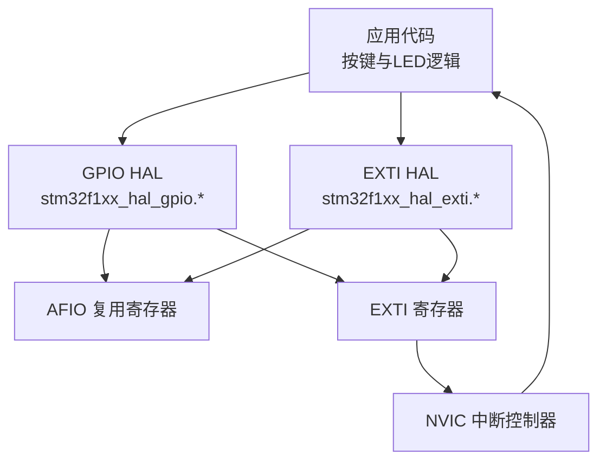
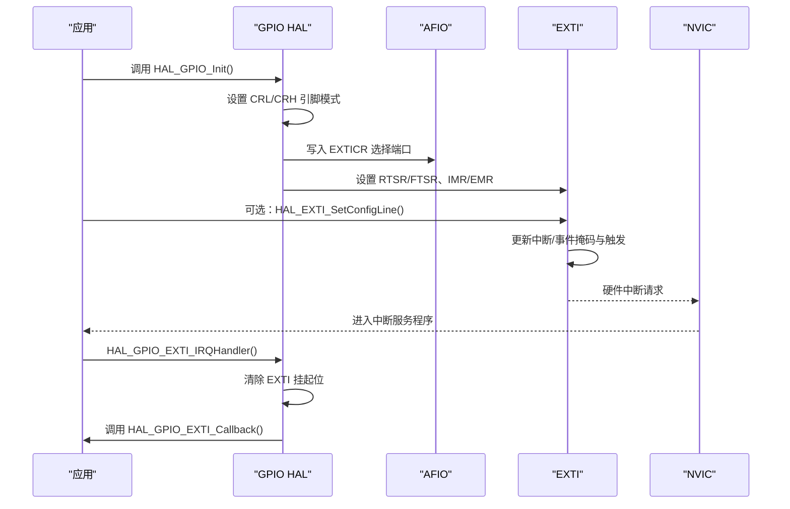
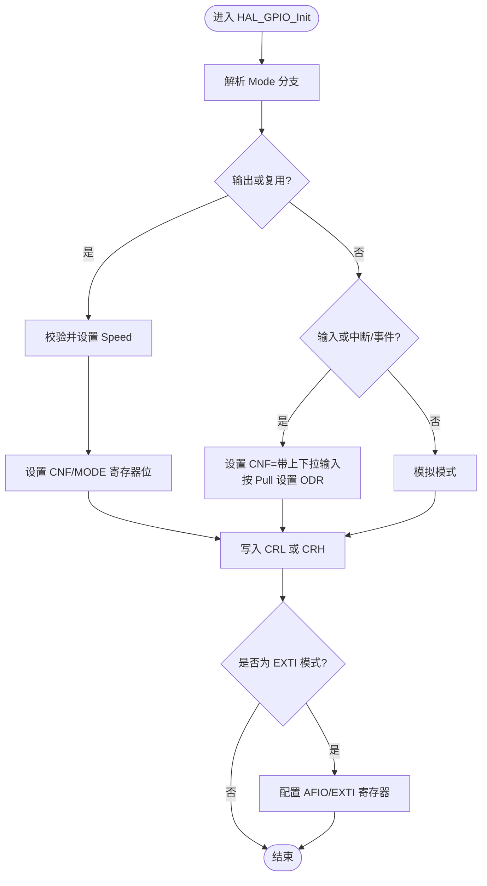
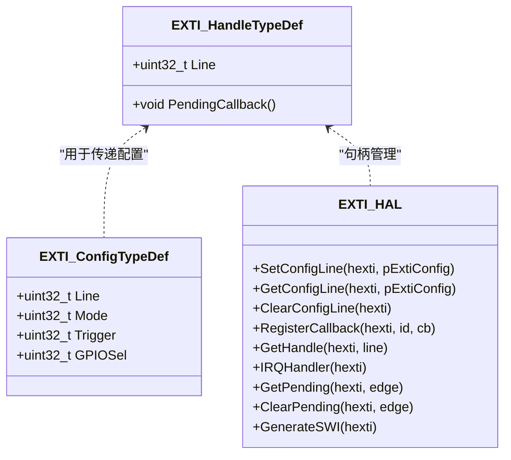
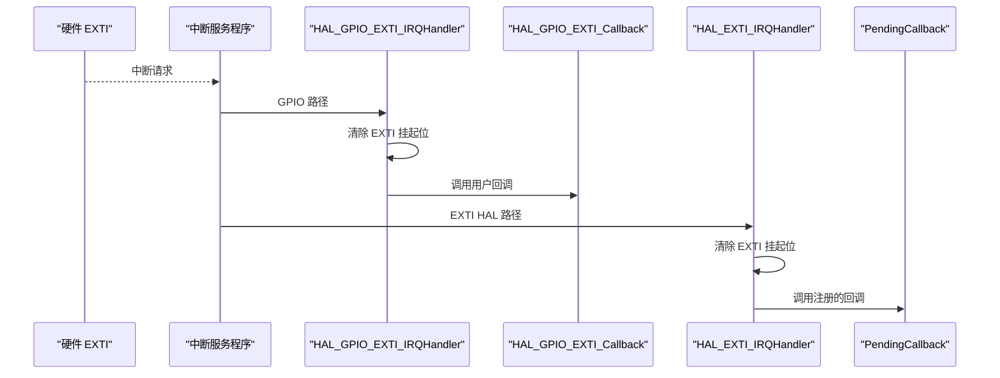
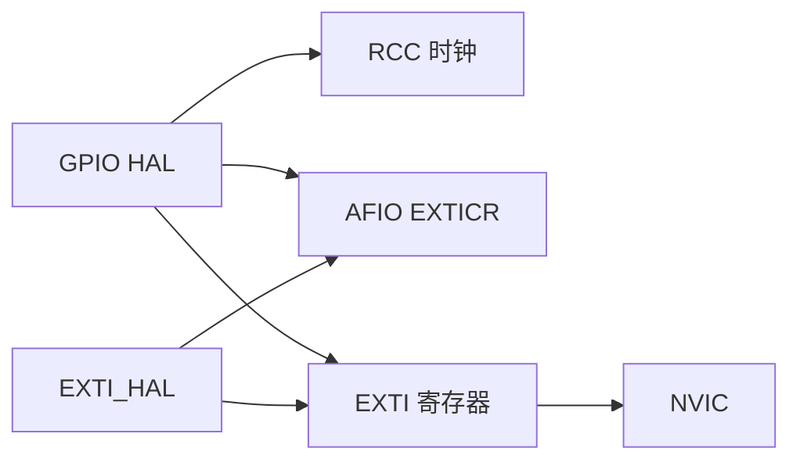

# GPIO 与 EXTI 外部中断

<cite>
**本文引用的文件**
- [stm32f1xx_hal_gpio.h](file://Inc/stm32f1xx_hal_gpio.h)
- [stm32f1xx_hal_gpio.c](file://Src/stm32f1xx_hal_gpio.c)
- [stm32f1xx_hal_exti.h](file://Inc/stm32f1xx_hal_exti.h)
- [stm32f1xx_hal_exti.c](file://Src/stm32f1xx_hal_exti.c)
- [README.md](file://README.md)
</cite>

## 目录
1. [简介](#简介)
2. [项目结构](#项目结构)
3. [核心组件](#核心组件)
4. [架构总览](#架构总览)
5. [详细组件分析](#详细组件分析)
6. [依赖关系分析](#依赖关系分析)
7. [性能考虑](#性能考虑)
8. [故障排查指南](#故障排查指南)
9. [结论](#结论)
10. [附录：最小可用示例](#附录最小可用示例)

## 简介
本文面向 STM32F1xx HAL 中的 GPIO 与 EXTI 外部中断，重点解释以下主题：
- GPIO 初始化结构体 `GPIO_InitTypeDef` 的字段含义。
- 引脚模式：输入、输出（推挽/开漏）、复用（复用推挽/复用开漏）、模拟。
- 上下拉电阻与输出速度配置。
- GPIO 常用接口：`HAL_GPIO_Init`、`HAL_GPIO_WritePin`、`HAL_GPIO_ReadPin`、`HAL_GPIO_TogglePin`。
- EXTI 中断线映射规则、触发边沿（上升/下降/双边沿）、中断优先级与回调机制 `HAL_GPIO_EXTI_Callback`。
- 结合 `stm32f1xx_hal_gpio.{h,c}` 与 `stm32f1xx_hal_exti.{h,c}`，给出按键驱动 LED 的最小可用方案。
- 常见问题：引脚复用冲突、浮空输入噪声、中断延迟、唤醒路径和调试冻结对 GPIO/EXTI 的影响。
- GPIO/EXTI 如何作为其他外设（如串口、定时器、ADC/DAC）的底层信号入口。

## 项目结构
本仓库是 STM32CubeF1 HAL 驱动组件，包含 HAL 层头文件与实现文件。GPIO 与 EXTI 的核心定义位于：
- 头文件：`Inc/stm32f1xx_hal_gpio.h`、`Inc/stm32f1xx_hal_exti.h`
- 实现文件：`Src/stm32f1xx_hal_gpio.c`、`Src/stm32f1xx_hal_exti.c`

**图示来源**
- [stm32f1xx_hal_gpio.c:201-380](file://Src/stm32f1xx_hal_gpio.c#L201-L380)
- [stm32f1xx_hal_exti.c:201-330](file://Src/stm32f1xx_hal_exti.c#L201-L330)

**章节来源**
- [README.md:1-45](file://README.md#L1-L45)

## 核心组件
- GPIO HAL
  - 初始化结构体：`GPIO_InitTypeDef`，包含引脚、模式、上下拉、速度。
  - 初始化与读写接口：`HAL_GPIO_Init`、`HAL_GPIO_WritePin`、`HAL_GPIO_ReadPin`、`HAL_GPIO_TogglePin`、`HAL_GPIO_LockPin`。
  - EXTI 中断处理与回调：`HAL_GPIO_EXTI_IRQHandler`、`HAL_GPIO_EXTI_Callback`。
- EXTI HAL
  - 通用句柄与配置结构体：`EXTI_HandleTypeDef`、`EXTI_ConfigTypeDef`。
  - 配置函数：`HAL_EXTI_SetConfigLine`、`HAL_EXTI_GetConfigLine`、`HAL_EXTI_ClearConfigLine`。
  - 回调注册与查询：`HAL_EXTI_RegisterCallback`、`HAL_EXTI_GetHandle`。
  - 中断服务与挂起位操作：`HAL_EXTI_IRQHandler`、`HAL_EXTI_GetPending`、`HAL_EXTI_ClearPending`、`HAL_EXTI_GenerateSWI`。

**章节来源**
- [stm32f1xx_hal_gpio.h:20-60](file://Inc/stm32f1xx_hal_gpio.h#L20-L60)
- [stm32f1xx_hal_gpio.h:201-260](file://Inc/stm32f1xx_hal_gpio.h#L201-L260)
- [stm32f1xx_hal_exti.h:40-120](file://Inc/stm32f1xx_hal_exti.h#L40-L120)
- [stm32f1xx_hal_exti.h:201-318](file://Inc/stm32f1xx_hal_exti.h#L201-L318)

## 架构总览
GPIO 与 EXTI 的交互流程如下：
- GPIO 引脚通过 `HAL_GPIO_Init` 配置为输入或带中断的模式；内部会设置端口控制寄存器 CRL/CRH，并在需要时启用 AFIO 时钟，写入 EXTICR 完成 GPIO 到 EXTI 线的映射，同时配置 RTSR/FTSR 触发边沿以及 IMR/EMR 中断/事件屏蔽。
- EXTI HAL 提供更高抽象的配置 API，使用 `HAL_EXTI_SetConfigLine` 来统一设置中断/事件模式、触发边沿与 GPIO 端口选择。
- 硬件产生中断后，由 NVIC 调度到对应 IRQHandler；HAL 层在中断服务中清除挂起位并调用回调。

**图示来源**
- [stm32f1xx_hal_gpio.c:201-380](file://Src/stm32f1xx_hal_gpio.c#L201-L380)
- [stm32f1xx_hal_exti.c:201-330](file://Src/stm32f1xx_hal_exti.c#L201-L330)
- [stm32f1xx_hal_gpio.c:520-586](file://Src/stm32f1xx_hal_gpio.c#L520-L586)

## 详细组件分析

### GPIO 初始化结构体与模式
`GPIO_InitTypeDef` 包含四个关键字段：
- Pin：选择的引脚，支持单引脚与组合掩码。
- Mode：工作模式，包括输入、输出推挽/开漏、复用推挽/开漏、模拟，以及带中断/事件的上升/下降/双边沿模式。
- Pull：上拉/下拉/无上下拉。
- Speed：输出速度，分低、中、高三档。

GPIO 模式常量说明：
- 输入：`GPIO_MODE_INPUT`
- 输出：`GPIO_MODE_OUTPUT_PP`（推挽）、`GPIO_MODE_OUTPUT_OD`（开漏）
- 复用：`GPIO_MODE_AF_PP`、`GPIO_MODE_AF_OD`
- 模拟：`GPIO_MODE_ANALOG`
- 中断：`GPIO_MODE_IT_RISING`、`GPIO_MODE_IT_FALLING`、`GPIO_MODE_IT_RISING_FALLING`
- 事件：`GPIO_MODE_EVT_RISING`、`GPIO_MODE_EVT_FALLING`、`GPIO_MODE_EVT_RISING_FALLING`

上下拉选项：
- `GPIO_NOPULL`：浮空
- `GPIO_PULLUP`：内部上拉
- `GPIO_PULLDOWN`：内部下拉

输出速度选项：
- `GPIO_SPEED_FREQ_LOW`：低速
- `GPIO_SPEED_FREQ_MEDIUM`：中速
- `GPIO_SPEED_FREQ_HIGH`：高速

这些常量与宏在头文件中集中定义，并在初始化实现中通过参数校验宏进行边界检查。

**章节来源**
- [stm32f1xx_hal_gpio.h:20-60](file://Inc/stm32f1xx_hal_gpio.h#L20-L60)
- [stm32f1xx_hal_gpio.h:90-170](file://Inc/stm32f1xx_hal_gpio.h#L90-L170)
- [stm32f1xx_hal_gpio.h:170-200](file://Inc/stm32f1xx_hal_gpio.h#L170-L200)
- [stm32f1xx_hal_gpio.h:240-260](file://Inc/stm32f1xx_hal_gpio.h#L240-L260)

### HAL_GPIO_Init 的行为
`HAL_GPIO_Init` 根据 `Mode` 分支设置引脚的控制寄存器：
- 输出与复用时，设置 CNF 与 MODE 字段，并强制要求提供合法 Speed。
- 输入与时钟中断/事件模式下，设置 CNF 为“带上下拉输入”，并根据 Pull 设置 ODR 的高或低。
- 当模式属于 EXTI 模式时：
  - 启用 AFIO 时钟。
  - 写入 AFIO->EXTICR 完成端口到 EXTI 线的映射。
  - 依据边沿标志设置 RTSR/FTSR。
  - 依据是否事件或中断分别设置 EMR/IMR。

这意味着：即使只使用 GPIO 读取功能，若将模式配置为带中断/事件的模式，也会同步配置 EXTI 相关寄存器。

**图示来源**
- [stm32f1xx_hal_gpio.c:201-380](file://Src/stm32f1xx_hal_gpio.c#L201-L380)

**章节来源**
- [stm32f1xx_hal_gpio.c:201-380](file://Src/stm32f1xx_hal_gpio.c#L201-L380)

### GPIO 读写与翻转接口
- `HAL_GPIO_ReadPin`：从 IDR 读取引脚电平，返回 `GPIO_PIN_SET` 或 `GPIO_PIN_RESET`。
- `HAL_GPIO_WritePin`：使用 BSRR 原子写数据寄存器，避免中断导致的读-改-写竞争。
- `HAL_GPIO_TogglePin`：先读 ODR，再使用 BSRR 对置位与复位位进行原子翻转。
- `HAL_GPIO_LockPin`：通过 LCKR 锁序列锁定引脚配置，直到下一次复位。

这些接口均包含参数校验宏，确保 Pin 值有效。

**章节来源**
- [stm32f1xx_hal_gpio.c:420-520](file://Src/stm32f1xx_hal_gpio.c#L420-L520)
- [stm32f1xx_hal_gpio.h:201-260](file://Inc/stm32f1xx_hal_gpio.h#L201-L260)

### EXTI 中断线与映射规则
EXTI 支持最多 20 条中断线，其中：
- 0~15 线映射到 GPIO 引脚 0~15，可通过多路选择器选择 GPIOA~GPIOG。
- 16 线通常连接到 PVD。
- 17 线通常连接到 RTC Alarm。
- 18/19 线视设备而定，可能连接到 USB Wakeup、Ethernet Wakeup 等。

EXTI HAL 通过 `EXTI_ConfigTypeDef` 的 Line、Mode、Trigger、GPIOSel 字段描述配置。`HAL_EXTI_SetConfigLine` 负责：
- 计算行号与掩码。
- 对可配置线设置 RTSR/FTSR 触发边沿。
- 对 GPIO 线写入 AFIO->EXTICR 选择端口。
- 设置 IMR/EMR 中断/事件屏蔽。

**图示来源**
- [stm32f1xx_hal_exti.h:40-120](file://Inc/stm32f1xx_hal_exti.h#L40-L120)
- [stm32f1xx_hal_exti.h:201-318](file://Inc/stm32f1xx_hal_exti.h#L201-L318)
- [stm32f1xx_hal_exti.c:201-330](file://Src/stm32f1xx_hal_exti.c#L201-L330)

**章节来源**
- [stm32f1xx_hal_exti.h:60-180](file://Inc/stm32f1xx_hal_exti.h#L60-L180)
- [stm32f1xx_hal_exti.c:201-330](file://Src/stm32f1xx_hal_exti.c#L201-L330)

### 触发边沿、中断优先级与回调
- 触发边沿：`EXTI_TRIGGER_RISING`、`EXTI_TRIGGER_FALLING`、`EXTI_TRIGGER_RISING_FALLING`。
- 模式：`EXTI_MODE_INTERRUPT`、`EXTI_MODE_EVENT`。
- 中断优先级：HAL 文档建议在使用 EXTI 中断时，调用 NVIC 相关 API 设置优先级并使能中断。GPIO HAL 注释明确提到应通过 `HAL_NVIC_SetPriority` 与 `HAL_NVIC_EnableIRQ` 配置。
- 回调机制：
  - GPIO 方式：`HAL_GPIO_EXTI_IRQHandler` 检测并清除 EXTI 挂起位后调用 `HAL_GPIO_EXTI_Callback`，该回调为弱函数，用户可在应用文件中重写。
  - EXTI HAL 方式：`HAL_EXTI_IRQHandler` 清除挂起位后调用句柄中的 `PendingCallback`，并通过 `HAL_EXTI_RegisterCallback` 注册。

**图示来源**
- [stm32f1xx_hal_gpio.c:520-586](file://Src/stm32f1xx_hal_gpio.c#L520-L586)
- [stm32f1xx_hal_exti.c:430-553](file://Src/stm32f1xx_hal_exti.c#L430-L553)

**章节来源**
- [stm32f1xx_hal_gpio.c:520-586](file://Src/stm32f1xx_hal_gpio.c#L520-L586)
- [stm32f1xx_hal_exti.c:430-553](file://Src/stm32f1xx_hal_exti.c#L430-L553)

## 依赖关系分析
- GPIO HAL 依赖：
  - RCC：启用 GPIOx 时钟与 AFIO 时钟。
  - AFIO：EXTICR 寄存器用于 GPIO 到 EXTI 线的映射。
  - EXTI：RTSR、FTSR、IMR、EMR、PR、SWIER 寄存器。
  - NVIC：中断优先级与使能（由应用或上层 HAL 配置）。
- EXTI HAL 依赖：
  - AFIO：EXTICR 端口选择。
  - EXTI：IMR、EMR、RTSR、FTSR、PR、SWIER。
  - 回调机制：通过句柄存储用户回调指针。

**图示来源**
- [stm32f1xx_hal_gpio.c:201-380](file://Src/stm32f1xx_hal_gpio.c#L201-L380)
- [stm32f1xx_hal_exti.c:201-330](file://Src/stm32f1xx_hal_exti.c#L201-L330)

**章节来源**
- [stm32f1xx_hal_gpio.c:201-380](file://Src/stm32f1xx_hal_gpio.c#L201-L380)
- [stm32f1xx_hal_exti.c:201-330](file://Src/stm32f1xx_hal_exti.c#L201-L330)

## 性能考虑
- GPIO 写操作使用 BSRR 原子访问，避免中断干扰导致的竞态条件。
- 输出速度越高，切换越快，但功耗与噪声也越大；应根据 VDD 与 EMI 需求选择合适速度。
- EXTI 中断路径应尽量精简回调逻辑，减少中断执行时间，避免影响实时性。
- 使用 `HAL_GPIO_LockPin` 锁定引脚配置可减少运行时误修改，但锁定后需重启才能更改。

[本节为通用性能指导，不直接分析具体源码]

## 故障排查指南
- 引脚复用冲突
  - 同一 EXTI 线只能映射到一个 GPIO 端口；重复配置可能导致中断响应错误。
  - 某些引脚在 HSE/LSE 振荡器开启时优先分配给振荡器功能；关闭振荡器后可作为 GPIO 使用，但需注意优先级。
- 浮空输入噪声
  - 未配置上下拉时，GPIO 处于浮空输入状态，易受噪声干扰；建议按键输入使用 `GPIO_PULLUP` 或 `GPIO_PULLDOWN`。
- 中断延迟
  - EXTI 触发边沿配置不正确会导致中断丢失或抖动；确认 RTSR/FTSR 设置与硬件按键行为匹配。
  - 中断服务程序中应尽快清除挂起位，避免重复触发。
- 唤醒路径
  - 使用 EXTI 作为唤醒源时，需确保对应中断已在 NVIC 中使能，并正确配置唤醒事件（事件模式 vs 中断模式）。
- 调试冻结
  - 在调试过程中，如果中断频繁触发且回调中有死循环或阻塞，可能导致调试器无法继续；建议在中断中仅置标志位，在主循环中处理业务。
- 其他外设的信号入口
  - UART 的 RX/TX、SPI 的 NSS/SCK/MISO/MOSI、定时器的 PWM 输出、ADC/DAC 的模拟通道等，都依赖 GPIO 模式与复用配置；若复用冲突或模式错误，会导致外设信号异常。

**章节来源**
- [stm32f1xx_hal_gpio.c:201-380](file://Src/stm32f1xx_hal_gpio.c#L201-L380)
- [stm32f1xx_hal_exti.c:201-330](file://Src/stm32f1xx_hal_exti.c#L201-L330)

## 结论
GPIO 与 EXTI 构成了 STM32F1xx 数字输入输出的基础。通过 HAL 提供的结构化配置与回调机制，开发者可以以较低复杂度实现按键检测、状态切换与中断驱动。实际工程中，应重点关注引脚模式、上下拉、速度、EXTI 映射与触发边沿的正确性，并结合 NVIC 配置中断优先级，保证系统实时性与稳定性。

[本节为总结性内容，不直接分析具体源码]

## 附录：最小可用示例

### 示例一：轮询按键检测驱动 LED
目标：主循环中读取按键引脚电平，控制 LED 引脚状态。

步骤要点：
- 配置 LED 引脚为输出推挽，选择合适的速度。
- 配置按键引脚为输入，建议使用上拉或下拉。
- 主循环中调用 `HAL_GPIO_ReadPin` 读取按键，调用 `HAL_GPIO_WritePin` 或 `HAL_GPIO_TogglePin` 控制 LED。

参考接口位置：
- [stm32f1xx_hal_gpio.h:201-260](file://Inc/stm32f1xx_hal_gpio.h#L201-L260)
- [stm32f1xx_hal_gpio.c:420-520](file://Src/stm32f1xx_hal_gpio.c#L420-L520)

**章节来源**
- [stm32f1xx_hal_gpio.h:201-260](file://Inc/stm32f1xx_hal_gpio.h#L201-L260)
- [stm32f1xx_hal_gpio.c:420-520](file://Src/stm32f1xx_hal_gpio.c#L420-L520)

### 示例二：按键中断切换 LED 状态
目标：按键按下触发 EXTI 中断，在中断回调中翻转 LED。

步骤要点：
- 配置按键引脚为 EXTI 中断模式（例如上升沿或双边沿），并在初始化中完成 AFIO 与 EXTI 映射。
- 配置 NVIC 中断优先级并启用中断。
- 重写 `HAL_GPIO_EXTI_Callback`，在其中调用 `HAL_GPIO_TogglePin` 翻转 LED。

参考接口位置：
- [stm32f1xx_hal_gpio.c:201-380](file://Src/stm32f1xx_hal_gpio.c#L201-L380)
- [stm32f1xx_hal_gpio.c:520-586](file://Src/stm32f1xx_hal_gpio.c#L520-L586)

也可使用 EXTI HAL：
- 使用 `HAL_EXTI_SetConfigLine` 配置中断线、触发边沿与 GPIO 端口。
- 使用 `HAL_EXTI_RegisterCallback` 注册回调。
- 在中断服务程序中调用 `HAL_EXTI_IRQHandler`，由句柄回调执行业务。

参考接口位置：
- [stm32f1xx_hal_exti.h:40-120](file://Inc/stm32f1xx_hal_exti.h#L40-L120)
- [stm32f1xx_hal_exti.c:201-330](file://Src/stm32f1xx_hal_exti.c#L201-L330)
- [stm32f1xx_hal_exti.c:430-553](file://Src/stm32f1xx_hal_exti.c#L430-L553)

**章节来源**
- [stm32f1xx_hal_gpio.c:201-380](file://Src/stm32f1xx_hal_gpio.c#L201-L380)
- [stm32f1xx_hal_gpio.c:520-586](file://Src/stm32f1xx_hal_gpio.c#L520-L586)
- [stm32f1xx_hal_exti.c:201-330](file://Src/stm32f1xx_hal_exti.c#L201-L330)
- [stm32f1xx_hal_exti.c:430-553](file://Src/stm32f1xx_hal_exti.c#L430-L553)