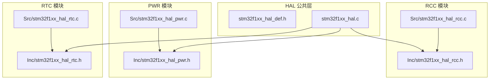
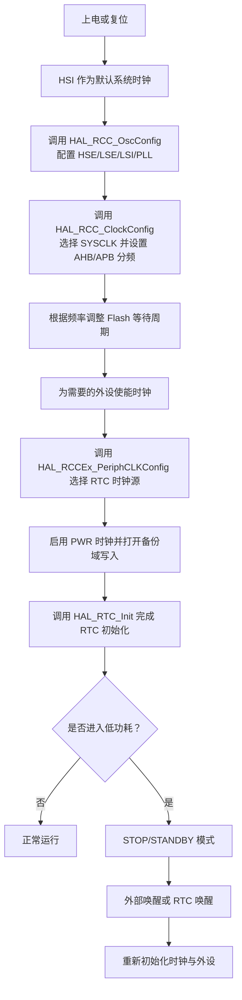
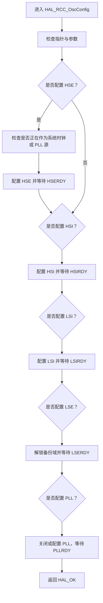
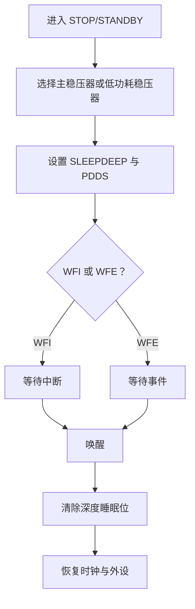
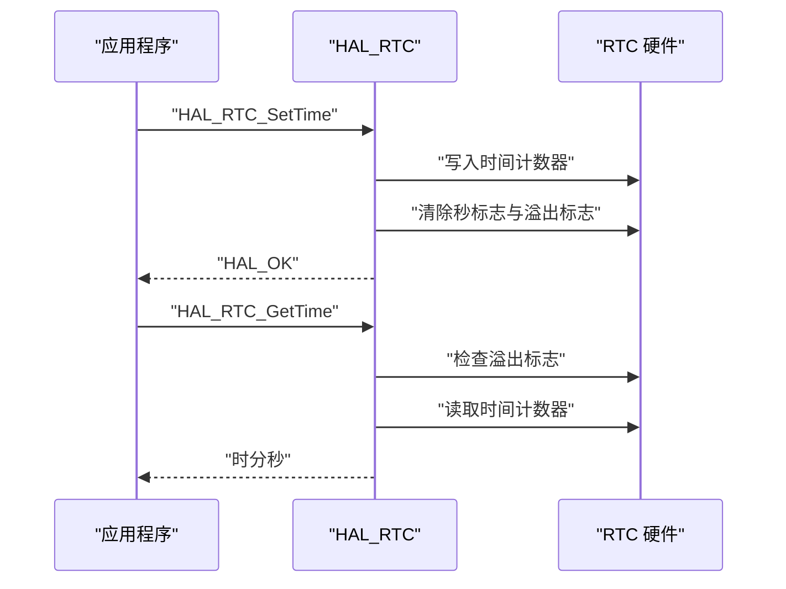
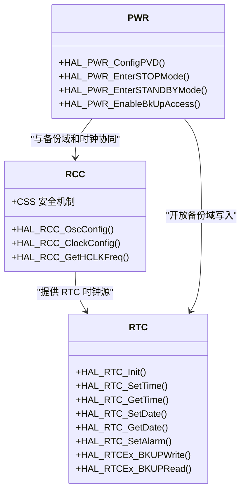

# 电源管理、RCC 与时钟树、RTC 实时时钟

<cite>
**本文引用的文件**
- [README.md](file://README.md)
- [stm32f1xx_hal_rcc.h](file://Inc/stm32f1xx_hal_rcc.h)
- [stm32f1xx_hal_rcc.c](file://Src/stm32f1xx_hal_rcc.c)
- [stm32f1xx_hal_pwr.h](file://Inc/stm32f1xx_hal_pwr.h)
- [stm32f1xx_hal_pwr.c](file://Src/stm32f1xx_hal_pwr.c)
- [stm32f1xx_hal_rtc.h](file://Inc/stm32f1xx_hal_rtc.h)
- [stm32f1xx_hal_rtc.c](file://Src/stm32f1xx_hal_rtc.c)
</cite>

## 目录
1. [引言](#引言)
2. [项目结构](#项目结构)
3. [核心组件](#核心组件)
4. [架构总览](#架构总览)
5. [详细组件分析](#详细组件分析)
6. [依赖关系分析](#依赖关系分析)
7. [性能与功耗特性](#性能与功耗特性)
8. [故障排查指南](#故障排查指南)
9. [结论](#结论)

## 引言
本仓库是 STM32CubeF1 HAL/LL 驱动组件，提供对 STM32F1 系列微控制器外设的统一抽象。本文聚焦三个紧密耦合的子系统：

- **RCC（复位与时钟控制）**：负责 HSI/HSE/LSE/LSI、PLL、系统时钟、AHB/APB 分频及外设时钟使能；实现 `HAL_RCC_OscConfig`、`HAL_RCC_ClockConfig`、`HAL_RCC_GetHCLKFreq` 等接口，并提供时钟稳定性检查、超时处理与 CSS 安全机制。
- **PWR（电源控制）**：负责低功耗模式（睡眠、停止、待机）、唤醒源配置、电压检测器 PVD、备份域访问开关，以及与 RTC 后备域的关系。
- **RTC（实时时钟）**：在 STM32F1 上采用 V1 版本，时间由硬件计数器维护，日期由软件维护；支持闹钟、秒中断、备份寄存器读写，并依赖 RCC 的低频时钟源与 PWR 的备份域访问权限。

文档既适合初学者理解初始化流程，也适合工程师排查 HSE 起振失败、PLL 失锁、后备域数据丢失、调试器影响和低功耗唤醒时序等问题。

**章节来源**
- [README.md:1-45](file://README.md#L1-L45)

## 项目结构
本仓库按功能模块划分头文件与实现文件：

**图表来源**
- [stm32f1xx_hal_rcc.h:1-200](file://Inc/stm32f1xx_hal_rcc.h#L1-L200)
- [stm32f1xx_hal_pwr.h:1-200](file://Inc/stm32f1xx_hal_pwr.h#L1-L200)
- [stm32f1xx_hal_rtc.h:1-200](file://Inc/stm32f1xx_hal_rtc.h#L1-L200)

**章节来源**
- [stm32f1xx_hal_rcc.h:1-200](file://Inc/stm32f1xx_hal_rcc.h#L1-L200)
- [stm32f1xx_hal_pwr.h:1-200](file://Inc/stm32f1xx_hal_pwr.h#L1-L200)
- [stm32f1xx_hal_rtc.h:1-200](file://Inc/stm32f1xx_hal_rtc.h#L1-L200)

## 核心组件
本节从类型、关键函数和职责角度总结三个模块：

| 模块 | 主要数据结构 | 关键接口 | 主要职责 |
|---|---|---|---|
| RCC | `RCC_OscInitTypeDef`、`RCC_ClkInitTypeDef` | `HAL_RCC_OscConfig`、`HAL_RCC_ClockConfig`、`HAL_RCC_GetHCLKFreq` | 振荡器与 PLL 配置、系统时钟切换、总线分频、外设时钟使能、CSS 安全 |
| PWR | `PWR_PVDTypeDef` | `HAL_PWR_ConfigPVD`、`HAL_PWR_EnterSTOPMode`、`HAL_PWR_EnterSTANDBYMode`、`HAL_PWR_EnableBkUpAccess` | 低功耗模式、唤醒引脚、PVD、备份域写保护开关 |
| RTC | `RTC_InitTypeDef`、`RTC_TimeTypeDef`、`RTC_DateTypeDef`、`RTC_AlarmTypeDef` | `HAL_RTC_Init`、`HAL_RTC_SetTime`、`HAL_RTC_GetTime`、`HAL_RTC_SetDate`、`HAL_RTC_GetDate`、`HAL_RTC_SetAlarm`、`HAL_RTCEx_BKUPWrite/Read` | RTC 时钟初始化、时间/日期读写、闹钟、备份寄存器操作 |

**章节来源**
- [stm32f1xx_hal_rcc.h:1-200](file://Inc/stm32f1xx_hal_rcc.h#L1-L200)
- [stm32f1xx_hal_pwr.h:1-200](file://Inc/stm32f1xx_hal_pwr.h#L1-L200)
- [stm32f1xx_hal_rtc.h:1-200](file://Inc/stm32f1xx_hal_rtc.h#L1-L200)

## 架构总览
RCC、PWR、RTC 三者形成“时钟源 → 系统时钟 → 外设时钟 → 后备域”的依赖链：

**图表来源**
- [stm32f1xx_hal_rcc.c:340-920](file://Src/stm32f1xx_hal_rcc.c#L340-L920)
- [stm32f1xx_hal_rcc.c:811-1185](file://Src/stm32f1xx_hal_rcc.c#L811-L1185)
- [stm32f1xx_hal_pwr.c:145-181](file://Src/stm32f1xx_hal_pwr.c#L145-L181)
- [stm32f1xx_hal_rtc.c:260-420](file://Src/stm32f1xx_hal_rtc.c#L260-L420)

**章节来源**
- [stm32f1xx_hal_rcc.c:1-200](file://Src/stm32f1xx_hal_rcc.c#L1-L200)
- [stm32f1xx_hal_pwr.c:1-200](file://Src/stm32f1xx_hal_pwr.c#L1-L200)
- [stm32f1xx_hal_rtc.c:1-200](file://Src/stm32f1xx_hal_rtc.c#L1-L200)

## 详细组件分析

### RCC 时钟树初始化与关键接口

#### 1. 振荡器配置：`HAL_RCC_OscConfig`
该函数按 HSE、HSI、LSI、LSE、PLL 的顺序处理请求，并对每个振荡器执行参数校验、状态检查和就绪等待。

核心行为包括：

- **HSE 配置**：若当前系统时钟或 PLL 输入使用 HSE，则不允许直接关闭；否则可开启或关闭 HSE，并通过 `RCC_FLAG_HSERDY` 等待稳定，超时返回 `HAL_TIMEOUT`。
- **HSI 配置**：若 HSI 正作为系统时钟或 PLL 输入，则禁止关闭，仅允许调整校准值；否则可开启/关闭并等待 `RCC_FLAG_HSIRDY`。
- **LSI 配置**：开启后额外增加约 1ms 延迟以确保完全稳定。
- **LSE 配置**：必须先确保 PWR 时钟可用，并在必要时通过备份域写保护位 `PWR_CR_DBP` 解锁；随后等待 `RCC_FLAG_LSERDY`。
- **PLL 配置**：若 PLL 未用作系统时钟，可在关闭状态下修改 PLL 源与倍频系数；若 PLL 已是系统时钟，则只允许重复相同配置，否则报错。

**图表来源**
- [stm32f1xx_hal_rcc.c:340-920](file://Src/stm32f1xx_hal_rcc.c#L340-L920)

**章节来源**
- [stm32f1xx_hal_rcc.c:340-920](file://Src/stm32f1xx_hal_rcc.c#L340-L920)

#### 2. 系统时钟与总线分频：`HAL_RCC_ClockConfig`
该函数负责：

- 校验 `ClockType` 与 Flash 等待周期。
- 在目标时钟源就绪后切换系统时钟。
- 更新 `SystemCoreClock`，供后续频率查询使用。
- 配置 AHB 分频器得到 HCLK。
- 配置 APB1 与 APB2 分频器得到 PCLK1、PCLK2。
- 根据最大频率限制调整 Flash 等待周期，避免总线访问错误。

典型初始化顺序建议：

1. 先调用 `HAL_RCC_OscConfig` 启动 HSE/LSE/LSI 并配置 PLL。
2. 再调用 `HAL_RCC_ClockConfig` 选择系统时钟源、设置 AHB/APB 分频。
3. 最后按需为具体外设调用时钟使能宏。

**章节来源**
- [stm32f1xx_hal_rcc.c:811-1185](file://Src/stm32f1xx_hal_rcc.c#L811-L1185)

#### 3. 频率查询：`HAL_RCC_GetHCLKFreq`
该函数直接返回 `SystemCoreClock`。文档注释强调：每次 HCLK 变化后必须调用相关频率更新函数，否则基于频率的配置会出错。

**章节来源**
- [stm32f1xx_hal_rcc.c:1160-1185](file://Src/stm32f1xx_hal_rcc.c#L1160-L1185)

#### 4. 时钟切换中的稳定性检查与失败处理
RCC 实现中广泛使用以下策略：

| 阶段 | 检查项 | 处理方式 |
|---|---|---|
| HSE 启振 | `RCC_FLAG_HSERDY` | 轮询等待，超时返回 `HAL_TIMEOUT` |
| HSI 启振 | `RCC_FLAG_HSIRDY` | 轮询等待，超时返回 `HAL_TIMEOUT` |
| LSI 启振 | `RCC_FLAG_LSIRDY` | 轮询等待后增加短延时 |
| LSE 启振 | `RCC_FLAG_LSERDY` | 先解锁备份域，再轮询等待 |
| PLL 锁定 | `RCC_FLAG_PLLRDY` | 关闭后修改，再开启并等待锁定 |
| 系统时钟切换 | 目标时钟就绪标志 | 只在目标就绪后切换，避免不稳定 |
| 非法切换 | 如关闭正在使用的 HSE/HSI/PLL | 返回 `HAL_ERROR` |

此外，RCC 文档注释还说明：

- 复位后默认运行于 HSI。
- 可通过 CSS 在 HSE 失效时自动回退到 HSI，并可触发 NMI 中断回调。
- 外设时钟使能后可能需要一次 dummy 读以等待寄存器生效。

**章节来源**
- [stm32f1xx_hal_rcc.c:1-200](file://Src/stm32f1xx_hal_rcc.c#L1-L200)
- [stm32f1xx_hal_rcc.c:340-920](file://Src/stm32f1xx_hal_rcc.c#L340-L920)
- [stm32f1xx_hal_rcc.c:811-1185](file://Src/stm32f1xx_hal_rcc.c#L811-L1185)

### PWR 低功耗、唤醒源与备份域

#### 1. 低功耗模式
PWR 提供三种常用模式：

- **睡眠模式**：CPU 停止，外设仍运行；可通过 WFI 或 WFE 进入。
- **停止模式**：系统时钟停止，但可保留 SRAM 和部分外设状态；唤醒后默认使用 HSI。
- **待机模式**：几乎所有电路断电，仅保留少量唤醒逻辑；通常用于极低功耗场景。

**图表来源**
- [stm32f1xx_hal_pwr.c:416-520](file://Src/stm32f1xx_hal_pwr.c#L416-L520)

**章节来源**
- [stm32f1xx_hal_pwr.c:416-520](file://Src/stm32f1xx_hal_pwr.c#L416-L520)

#### 2. 唤醒源配置
唤醒源主要包括：

- **WKUP 引脚**：通过 `HAL_PWR_EnableWakeUpPin` 启用 PA0 唤醒引脚。
- **RTC 闹钟**：RTC 闹钟可唤醒 STOP 或 STANDBY。
- **PVD 中断**：电压低于阈值时可产生中断或事件。

PWR 标志位包括唤醒标志 `PWR_FLAG_WU`、待机标志 `PWR_FLAG_SB` 和 PVD 输出标志 `PWR_FLAG_PVDO`。

**章节来源**
- [stm32f1xx_hal_pwr.h:1-200](file://Inc/stm32f1xx_hal_pwr.h#L1-L200)
- [stm32f1xx_hal_pwr.c:370-416](file://Src/stm32f1xx_hal_pwr.c#L370-L416)

#### 3. 电压调节器与 PVD
PWR 支持主稳压器与低功耗稳压器两种模式：

- `PWR_MAINREGULATOR_ON`：停止模式下保持主稳压器开启，唤醒更快但功耗更高。
- `PWR_LOWPOWERREGULATOR_ON`：停止模式下使用低功耗稳压器，功耗更低但唤醒延迟更大。

PVD 可通过 `HAL_PWR_ConfigPVD`、`HAL_PWR_EnablePVD`、`HAL_PWR_DisablePVD` 配置检测电平与工作模式，并配合 EXTI 产生中断。

**章节来源**
- [stm32f1xx_hal_pwr.h:1-200](file://Inc/stm32f1xx_hal_pwr.h#L1-L200)
- [stm32f1xx_hal_pwr.c:315-368](file://Src/stm32f1xx_hal_pwr.c#L315-L368)

#### 4. 备份域访问
备份域包含 RTC 寄存器与备份数据寄存器，默认写保护。访问前需：

1. 使能 PWR 时钟。
2. 调用 `HAL_PWR_EnableBkUpAccess` 打开备份域写保护。
3. 如需关闭访问，调用 `HAL_PWR_DisableBkUpAccess`。

注意：当使用 HSE 分频后的时钟作为 RTC 时钟时，备份域访问应保持开启。

**章节来源**
- [stm32f1xx_hal_pwr.c:145-181](file://Src/stm32f1xx_hal_pwr.c#L145-L181)

#### 5. 进入待机并唤醒的最小示例流程
虽然本文不直接粘贴代码，但可以给出最小工程步骤：

1. 初始化系统时钟：`HAL_RCC_OscConfig` + `HAL_RCC_ClockConfig`。
2. 初始化 RTC：`HAL_RCCEx_PeriphCLKConfig` 选择 RTC 时钟源，然后 `HAL_RTC_Init`。
3. 启用 PWR 时钟并打开备份域：`__HAL_RCC_PWR_CLK_ENABLE()` + `HAL_PWR_EnableBkUpAccess()`。
4. 可选：设置 RTC 闹钟或唤醒引脚。
5. 调用 `HAL_PWR_EnterSTANDBYMode()` 进入待机。
6. 唤醒后检查 `PWR_FLAG_WU`、`PWR_FLAG_SB`，并重新初始化时钟和外设。

**章节来源**
- [stm32f1xx_hal_pwr.c:502-520](file://Src/stm32f1xx_hal_pwr.c#L502-L520)
- [stm32f1xx_hal_rtc.c:260-420](file://Src/stm32f1xx_hal_rtc.c#L260-L420)

### RTC 实时时钟：初始化、时间/日期、闹钟与备份寄存器

#### 1. RTC 初始化
`HAL_RTC_Init` 完成以下工作：

- 校验句柄、输出源、异步预分频值。
- 调用 MSP 初始化钩子。
- 等待寄存器同步标志 RSF。
- 进入初始化模式，配置输出信号和预分频值。
- 若选择自动 1 秒时间基，则根据当前 RTC 时钟频率计算预分频。
- 退出初始化模式并设置初始日期。

STM32F1 的 RTC 是 V1 版本：时间由硬件计数器维护，日期由软件维护；因此 STOP/STANDBY 后日期可能丢失，应用应通过备份寄存器保存日期。

**章节来源**
- [stm32f1xx_hal_rtc.c:260-420](file://Src/stm32f1xx_hal_rtc.c#L260-L420)
- [stm32f1xx_hal_rtc.h:1-200](file://Inc/stm32f1xx_hal_rtc.h#L1-L200)

#### 2. 时间与日期读写
- `HAL_RTC_SetTime`：将时分秒转换为计数器值写入 RTC，并处理闹钟对齐。
- `HAL_RTC_GetTime`：读取时间计数器，转换为时分秒；若检测到溢出标志 OW，则返回错误。
- `HAL_RTC_SetDate` / `HAL_RTC_GetDate`：在 F1 系列中，日期字段由软件维护。

**图表来源**
- [stm32f1xx_hal_rtc.c:704-834](file://Src/stm32f1xx_hal_rtc.c#L704-L834)

**章节来源**
- [stm32f1xx_hal_rtc.c:704-834](file://Src/stm32f1xx_hal_rtc.c#L704-L834)

#### 3. 闹钟配置与中断
- `HAL_RTC_SetAlarm`：设置单次闹钟，不支持重复报警。
- `HAL_RTC_SetAlarm_IT`：启用闹钟中断。
- 闹钟事件通过回调或用户自定义中断处理。

F1 系列限制包括：

- 仅支持 24 小时格式。
- 闹钟最多提前一天检测。
- 日期在低功耗后会丢失，需应用层恢复。

**章节来源**
- [stm32f1xx_hal_rtc.c:1093-1185](file://Src/stm32f1xx_hal_rtc.c#L1093-L1185)
- [stm32f1xx_hal_rtc.c:1-200](file://Src/stm32f1xx_hal_rtc.c#L1-L200)

#### 4. 备份寄存器基础操作
备份寄存器可用于保存用户数据，例如日期、配置标志等。常用接口：

- `HAL_RTCEx_BKUPWrite`：写入备份寄存器。
- `HAL_RTCEx_BKUPRead`：读取备份寄存器。

这些操作需要先打开备份域访问，否则写入会被拒绝。

**章节来源**
- [stm32f1xx_hal_rtc.h:1-200](file://Inc/stm32f1xx_hal_rtc.h#L1-L200)
- [stm32f1xx_hal_pwr.c:145-181](file://Src/stm32f1xx_hal_pwr.c#L145-L181)

#### 5. 与 PWR/RCC 在后备域中的关系
- RTC 需要 RCC 提供低频时钟源：LSE、LSI 或 HSE 分频。
- RTC 寄存器位于备份域，需要 PWR 打开备份域写保护才能写入。
- 当主电源 VDD 掉电而 VBAT 存在时，RTC 和备份域可由 VBAT 供电。
- 复位后备域会导致 RTC 和 BDCR 寄存器回到复位值。

**章节来源**
- [stm32f1xx_hal_rtc.c:1-200](file://Src/stm32f1xx_hal_rtc.c#L1-L200)
- [stm32f1xx_hal_pwr.c:145-181](file://Src/stm32f1xx_hal_pwr.c#L145-L181)

## 依赖关系分析

**图表来源**
- [stm32f1xx_hal_rcc.c:340-1185](file://Src/stm32f1xx_hal_rcc.c#L340-L1185)
- [stm32f1xx_hal_pwr.c:145-520](file://Src/stm32f1xx_hal_pwr.c#L145-L520)
- [stm32f1xx_hal_rtc.c:260-1185](file://Src/stm32f1xx_hal_rtc.c#L260-L1185)

**章节来源**
- [stm32f1xx_hal_rcc.c:340-1185](file://Src/stm32f1xx_hal_rcc.c#L340-L1185)
- [stm32f1xx_hal_pwr.c:145-520](file://Src/stm32f1xx_hal_pwr.c#L145-L520)
- [stm32f1xx_hal_rtc.c:260-1185](file://Src/stm32f1xx_hal_rtc.c#L260-L1185)

## 性能与功耗特性

### 1. 时钟频率与 Flash 等待周期
RCC 文档指出，不同 SYSCLK 范围对应不同 Flash 等待周期：

| SYSCLK 范围 | 建议等待周期 |
|---|---|
| 小于等于 24 MHz | 0 等待周期 |
| 24 MHz 到 48 MHz | 1 等待周期 |
| 48 MHz 到 72 MHz | 2 等待周期 |

若频率提升而未正确设置等待周期，可能导致 Flash 读取错误，表现为程序跑飞或外设初始化失败。

**章节来源**
- [stm32f1xx_hal_rcc.c:1-200](file://Src/stm32f1xx_hal_rcc.c#L1-L200)

### 2. 低功耗模式对比

| 模式 | CPU | 外设 | 唤醒方式 | 唤醒延迟 | 适用场景 |
|---|---|---|---|---|---|
| 睡眠 | 停止 | 继续运行 | 中断或事件 | 较短 | 周期性任务 |
| 停止 | 停止 | 大部分停止 | 中断、唤醒引脚、RTC | 中等，低功耗稳压器更慢 | 空闲等待 |
| 待机 | 几乎全部断电 | 极少量 | 唤醒引脚、RTC、复位 | 最长，接近完整复位 | 极低功耗 |

**章节来源**
- [stm32f1xx_hal_pwr.c:416-520](file://Src/stm32f1xx_hal_pwr.c#L416-L520)

### 3. 外设时钟使能延迟
RCC 注释明确说明：外设时钟使能与外设真正可用之间存在延迟，需要对 AHB/APB 外设进行一次 dummy 读。HAL 宏中已插入该补偿，但应用层仍应避免在时钟刚使能后立即进行复杂外设配置。

**章节来源**
- [stm32f1xx_hal_rcc.c:1-200](file://Src/stm32f1xx_hal_rcc.c#L1-L200)

## 故障排查指南

### 1. HSE 起振失败
**现象**：`HAL_RCC_OscConfig` 返回 `HAL_TIMEOUT`，系统卡住或回退到 HSI。

**常见原因**：

- 外部晶振未焊接或频率不匹配。
- HSE 负载电容不合适。
- 使用 HSE 作为系统时钟或 PLL 源时尝试关闭 HSE。
- 调试器或仿真环境干扰外部晶振。

**处理方法**：

- 检查 `HSE_TIMEOUT_VALUE` 是否足够。
- 确认没有在当前系统时钟或 PLL 源使用 HSE 的情况下请求关闭 HSE。
- 使用内部 HSI + PLL 作为调试阶段的备用方案。
- 记录返回状态并进行降级处理。

**章节来源**
- [stm32f1xx_hal_rcc.c:340-500](file://Src/stm32f1xx_hal_rcc.c#L340-L500)

### 2. PLL 失锁或配置失败
**现象**：PLL 无法锁定，系统时钟未按预期提升。

**常见原因**：

- PLL 输入频率超出允许范围。
- 倍频系数与预分频组合导致输出超限。
- 在 PLL 作为系统时钟时尝试关闭或更改其配置。
- HSE 预分频值不正确。

**处理方法**：

- 校验 `PLLSource` 与 `PLLMUL`。
- 避免在 PLL 作为系统时钟时修改其配置。
- 先关闭 PLL，再修改参数，再重新开启并等待 `PLLRDY`。
- 结合 `HAL_RCC_GetHCLKFreq` 验证最终频率。

**章节来源**
- [stm32f1xx_hal_rcc.c:500-920](file://Src/stm32f1xx_hal_rcc.c#L500-L920)
- [stm32f1xx_hal_rcc.c:1160-1185](file://Src/stm32f1xx_hal_rcc.c#L1160-L1185)

### 3. 低频时钟来源问题
**现象**：RTC 初始化失败或秒中断不触发。

**常见原因**：

- 未通过 RCC 配置 RTC 时钟源。
- 使用 LSE 但晶振未起振。
- 使用 LSI 但精度要求过高。
- 使用 HSE 分频后作为 RTC 时钟，但未保持备份域访问。

**处理方法**：

- 调用 RCC 扩展接口选择 LSE、LSI 或 HSE 分频。
- 确保 LSE 起振成功。
- 若使用 HSE 分频，不要关闭备份域访问。
- 在 `HAL_RTC_Init` 中检查 RTC 时钟频率是否非零。

**章节来源**
- [stm32f1xx_hal_rtc.c:260-420](file://Src/stm32f1xx_hal_rtc.c#L260-L420)
- [stm32f1xx_hal_pwr.c:145-181](file://Src/stm32f1xx_hal_pwr.c#L145-L181)

### 4. 复位后备份域数据丢失
**现象**：设备复位后备份寄存器数据清空，RTC 日期不可用。

**常见原因**：

- 触发了备份域复位。
- VDD 与 VBAT 都掉电后再上电。
- 软件写入了备份域复位位。
- 调试器擦除或复位芯片。

**处理方法**：

- 仅在必要时写入备份域复位位。
- 保证 VBAT 供电以保留备份域。
- 在上电时检查备份寄存器标志，若无效则重新初始化日期。
- 避免调试器意外擦除备份域。

**章节来源**
- [stm32f1xx_hal_rtc.c:1-200](file://Src/stm32f1xx_hal_rtc.c#L1-L200)

### 5. 调试器影响
**现象**：外部晶振不起振、系统时钟异常、RTC 行为异常。

**常见原因**：

- 调试器占用或改变引脚状态。
- 调试器复位策略与备份域访问冲突。
- 仿真环境下 HSE 负载条件与实际硬件不同。

**处理方法**：

- 优先使用 HSI 调试，稳定后再切换到 HSE。
- 避免调试器强制拉低唤醒引脚或 RTC 相关引脚。
- 在真实硬件上复现低功耗与唤醒时序。

**章节来源**
- [stm32f1xx_hal_rcc.c:340-500](file://Src/stm32f1xx_hal_rcc.c#L340-L500)
- [stm32f1xx_hal_pwr.c:370-520](file://Src/stm32f1xx_hal_pwr.c#L370-L520)

### 6. 低功耗唤醒时序问题
**现象**：唤醒后外设未正常工作、RTC 数据不同步、时钟未恢复。

**常见原因**：

- 唤醒后未重新初始化 RCC。
- 未等待 RTC 寄存器同步。
- 未清除 PWR 唤醒标志。
- 使用低功耗稳压器后唤醒延迟不足。

**处理方法**：

- 唤醒后重新调用 `HAL_RCC_OscConfig` 与 `HAL_RCC_ClockConfig`。
- 调用 `HAL_RTC_WaitForSynchro` 等待 RSF。
- 检查并清除 `PWR_FLAG_WU`、`PWR_FLAG_SB`。
- 为低功耗稳压器预留足够唤醒时间。

**章节来源**
- [stm32f1xx_hal_pwr.c:416-520](file://Src/stm32f1xx_hal_pwr.c#L416-L520)
- [stm32f1xx_hal_rtc.c:260-420](file://Src/stm32f1xx_hal_rtc.c#L260-L420)

## 结论
STM32F1 的 PWR、RCC 与 RTC 子系统共同构成设备的时钟、电源与时序基础：

- RCC 负责振荡器、PLL 与系统时钟树，`HAL_RCC_OscConfig` 与 `HAL_RCC_ClockConfig` 是时钟初始化的两个关键入口。
- PWR 提供低功耗模式和备份域访问控制，待机与停止模式的选择直接影响功耗、唤醒延迟和数据保留策略。
- RTC 在 F1 系列中以 V1 形式实现，时间由硬件计数、日期由软件维护，必须与 RCC 的低频时钟和 PWR 的备份域权限配合使用。

工程实践中，应重视时钟稳定性检查、Flash 等待周期、备份域写保护、低功耗唤醒时序和调试器影响。通过合理组合这三个模块，可以在满足性能的同时实现可靠的低功耗运行。