# 系统与基础服务

<cite>
**本文引用的文件**   
- [README.md](file://README.md)
- [stm32f1xx_hal_gpio.h](file://Inc/stm32f1xx_hal_gpio.h)
- [stm32f1xx_hal_gpio.c](file://Src/stm32f1xx_hal_gpio.c)
- [stm32f1xx_hal_exti.h](file://Inc/stm32f1xx_hal_exti.h)
- [stm32f1xx_hal_exti.c](file://Src/stm32f1xx_hal_exti.c)
- [stm32f1xx_hal_cortex.h](file://Inc/stm32f1xx_hal_cortex.h)
- [stm32f1xx_hal_cortex.c](file://Src/stm32f1xx_hal_cortex.c)
- [stm32f1xx_hal_dma.h](file://Inc/stm32f1xx_hal_dma.h)
- [stm32f1xx_hal_dma.c](file://Src/stm32f1xx_hal_dma.c)
- [stm32f1xx_hal_crc.h](file://Inc/stm32f1xx_hal_crc.h)
- [stm32f1xx_hal_crc.c](file://Src/stm32f1xx_hal_crc.c)
- [stm32f1xx_hal_pwr.h](file://Inc/stm32f1xx_hal_pwr.h)
- [stm32f1xx_hal_pwr.c](file://Src/stm32f1xx_hal_pwr.c)
- [stm32f1xx_hal_rcc.h](file://Inc/stm32f1xx_hal_rcc.h)
- [stm32f1xx_hal_rcc.c](file://Src/stm32f1xx_hal_rcc.c)
- [stm32f1xx_hal_rtc.h](file://Inc/stm32f1xx_hal_rtc.h)
- [stm32f1xx_hal_rtc.c](file://Src/stm32f1xx_hal_rtc.c)
</cite>

## 目录
1. [引言](#引言)
2. [项目结构](#项目结构)
3. [核心组件](#核心组件)
4. [架构总览](#架构总览)
5. [详细组件分析](#详细组件分析)
6. [依赖关系分析](#依赖关系分析)
7. [性能与低功耗设计](#性能与低功耗设计)
8. [故障排查指南](#故障排查指南)
9. [结论](#结论)
10. [附录：最小可用示例路径](#附录最小可用示例路径)

## 引言
本参考文档面向 STM32F1xx HAL 的“系统层与基础服务”模块，覆盖 GPIO、EXTI、Cortex-M3、DMA、CRC、PWR、RCC 与 RTC。这些模块共同构成外设初始化之前或之外的基础能力：引脚电气特性与时钟使能、中断路由与优先级、无 CPU 参与的数据搬运、数据完整性校验、电源模式与唤醒、时钟树配置以及日历闹钟与备份域访问。文档既提供代码级分析，也给出工程实践建议，帮助读者从“能跑通的最小配置”走向“可维护、低功耗、高可靠”的系统方案。

## 项目结构
该仓库是 STM32CubeF1 HAL 驱动组件，采用“Inc/Src + 模块头/源文件”的组织方式。每个外设对应一个 `stm32f1xx_hal_{peripheral}.h` 与 `.c` 对，并提供 LL 层接口（LL 文件用于更底层寄存器操作）。HAL 层负责参数检查、状态机、回调注册、MSP 钩子与通用流程封装；LL 层直接读写寄存器。GPIO、EXTI、Cortex、DMA、CRC、PWR、RCC、RTC 均按此模式组织。

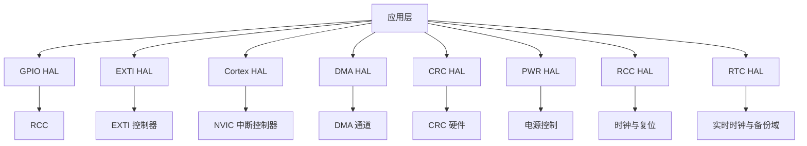

图表来源
- [stm32f1xx_hal_gpio.c:1-120](file://Src/stm32f1xx_hal_gpio.c#L1-L120)
- [stm32f1xx_hal_exti.c:1-120](file://Src/stm32f1xx_hal_exti.c#L1-L120)
- [stm32f1xx_hal_cortex.c:1-120](file://Src/stm32f1xx_hal_cortex.c#L1-L120)
- [stm32f1xx_hal_dma.c:1-120](file://Src/stm32f1xx_hal_dma.c#L1-L120)
- [stm32f1xx_hal_crc.c:1-120](file://Src/stm32f1xx_hal_crc.c#L1-L120)
- [stm32f1xx_hal_pwr.c:1-120](file://Src/stm32f1xx_hal_pwr.c#L1-L120)
- [stm32f1xx_hal_rcc.c:1-120](file://Src/stm32f1xx_hal_rcc.c#L1-L120)
- [stm32f1xx_hal_rtc.c:1-120](file://Src/stm32f1xx_hal_rtc.c#L1-L120)

章节来源
- [README.md:1-45](file://README.md#L1-L45)

## 核心组件
- GPIO：引脚模式、推挽/开漏、复用、上下拉、速度、读取/写入/翻转/锁定、EXTI 标志宏。
- EXTI：外部中断线、事件线、边沿触发、GPIO 端口复用、挂起位、软件触发、回调。
- Cortex-M3：NVIC 中断分组、抢占/子优先级、IRQ 使能/禁用、SysTick 配置与时钟源选择。
- DMA：通道、方向、外设/内存自增、数据宽度对齐、循环/正常模式、优先级、状态与回调。
- CRC：句柄、初始化、累计计算、从头计算、IDR 独立数据、状态查询。
- PWR：PVD 电压检测、睡眠/停止/待机入口、唤醒引脚、备份域访问、标志位。
- RCC：HSI/HSE/LSE/LSI、PLL、系统时钟、AHB/APB 分频、外设时钟使能、CSS/MCO、延迟补偿。
- RTC：时间/日期、闹钟、异步预分频、输出配置、备份域与低功耗唤醒限制。

章节来源
- [stm32f1xx_hal_gpio.h:1-200](file://Inc/stm32f1xx_hal_gpio.h#L1-L200)
- [stm32f1xx_hal_exti.h:1-200](file://Inc/stm32f1xx_hal_exti.h#L1-L200)
- [stm32f1xx_hal_cortex.h:1-200](file://Inc/stm32f1xx_hal_cortex.h#L1-L200)
- [stm32f1xx_hal_dma.h:1-200](file://Inc/stm32f1xx_hal_dma.h#L1-L200)
- [stm32f1xx_hal_crc.h:1-181](file://Inc/stm32f1xx_hal_crc.h#L1-L181)
- [stm32f1xx_hal_pwr.h:1-200](file://Inc/stm32f1xx_hal_pwr.h#L1-L200)
- [stm32f1xx_hal_rcc.h:1-200](file://Inc/stm32f1xx_hal_rcc.h#L1-L200)
- [stm32f1xx_hal_rtc.h:1-200](file://Inc/stm32f1xx_hal_rtc.h#L1-L200)

## 架构总览
下图展示各模块在启动与外设初始化中的协作关系。典型顺序为：先配置 RCC 时钟，再启用 GPIO/PWR/RTC 等外设时钟；通过 GPIO 配置引脚并映射 EXTI；由 Cortex 配置 NVIC 分组与优先级；使用 DMA 卸载数据搬运；用 CRC 做数据校验；通过 PWR 管理低功耗；RTC 提供时间基准和唤醒源。

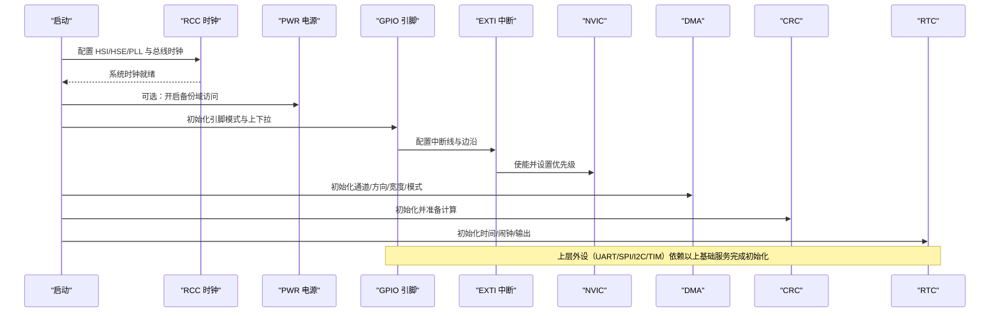

图表来源
- [stm32f1xx_hal_rcc.c:1-120](file://Src/stm32f1xx_hal_rcc.c#L1-L120)
- [stm32f1xx_hal_gpio.c:1-120](file://Src/stm32f1xx_hal_gpio.c#L1-L120)
- [stm32f1xx_hal_exti.c:1-120](file://Src/stm32f1xx_hal_exti.c#L1-L120)
- [stm32f1xx_hal_cortex.c:1-120](file://Src/stm32f1xx_hal_cortex.c#L1-L120)
- [stm32f1xx_hal_dma.c:1-120](file://Src/stm32f1xx_hal_dma.c#L1-L120)
- [stm32f1xx_hal_crc.c:1-120](file://Src/stm32f1xx_hal_crc.c#L1-L120)
- [stm32f1xx_hal_pwr.c:1-120](file://Src/stm32f1xx_hal_pwr.c#L1-L120)
- [stm32f1xx_hal_rtc.c:1-120](file://Src/stm32f1xx_hal_rtc.c#L1-L120)

## 详细组件分析

### GPIO：输入输出、复用、推挽/开漏、上下拉与中断
- 数据结构：`GPIO_InitTypeDef` 包含 Pin、Mode、Pull、Speed。
- 模式常量：输入、输出推挽/开漏、复用推挽/开漏、模拟；中断/事件及上升/下降/双边沿；低速/中速/高速。
- 实现要点：
  - `HAL_GPIO_Init()` 根据 Pin 位置分别处理 CRL/CRH 寄存器，解析 Mode/CNF/MODE 字段，支持中断/事件时同时配置 EXTI 边沿。
  - 提供 `HAL_GPIO_ReadPin()`、`HAL_GPIO_WritePin()`、`HAL_GPIO_TogglePin()`、`HAL_GPIO_LockPin()`。
  - 提供 EXTI 标志获取与清除宏，便于在中断中快速响应。
- 与上层外设的关系：SPI/I2C/UART/TIM 等外设均以 GPIO 复用引脚为基础；ADC/DAC 需要模拟模式；JTAG 引脚默认调试复用。

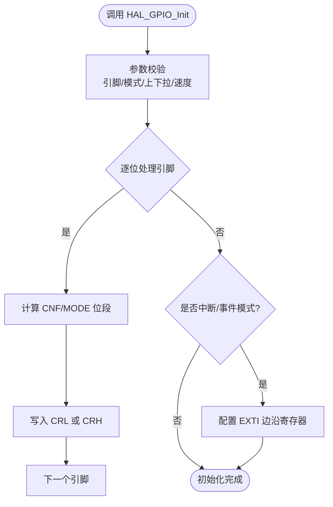

图表来源
- [stm32f1xx_hal_gpio.c:120-260](file://Src/stm32f1xx_hal_gpio.c#L120-L260)
- [stm32f1xx_hal_gpio.h:60-180](file://Inc/stm32f1xx_hal_gpio.h#L60-L180)

章节来源
- [stm32f1xx_hal_gpio.h:1-200](file://Inc/stm32f1xx_hal_gpio.h#L1-L200)
- [stm32f1xx_hal_gpio.c:1-260](file://Src/stm32f1xx_hal_gpio.c#L1-L260)

### EXTI：外部中断与事件
- 数据结构：`EXTI_HandleTypeDef`（Line、PendingCallback）、`EXTI_ConfigTypeDef`（Line、Mode、Trigger、GPIOSel）。
- 行为：
  - `HAL_EXTI_SetConfigLine()` 配置 Line 的模式（中断/事件）、边沿（上升/下降/双边沿），并对 GPIO 相关 Line 设置 AFIO 复用。
  - 提供获取/清除挂起位、生成软件中断、注册回调等能力。
- 与 GPIO 的关系：GPIO 的中断模式与 EXTI 的配置需保持一致；GPIO 头文件中提供 EXTI 标志宏以便快速判断。

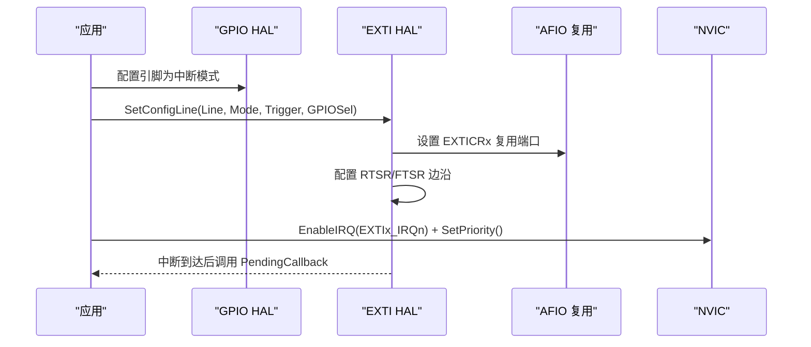

图表来源
- [stm32f1xx_hal_exti.c:120-220](file://Src/stm32f1xx_hal_exti.c#L120-L220)
- [stm32f1xx_hal_exti.h:60-180](file://Inc/stm32f1xx_hal_exti.h#L60-L180)
- [stm32f1xx_hal_gpio.h:120-200](file://Inc/stm32f1xx_hal_gpio.h#L120-L200)

章节来源
- [stm32f1xx_hal_exti.h:1-200](file://Inc/stm32f1xx_hal_exti.h#L1-L200)
- [stm32f1xx_hal_exti.c:1-220](file://Src/stm32f1xx_hal_exti.c#L1-L220)

### Cortex-M3：NVIC 与 SysTick
- NVIC：
  - `HAL_NVIC_SetPriorityGrouping()` 设置抢占/子优先级位数。
  - `HAL_NVIC_SetPriority()` 编码并设置具体 IRQ 优先级。
  - `HAL_NVIC_EnableIRQ()` / `DisableIRQ()` 控制中断开关。
- SysTick：
  - `HAL_SYSTICK_Config()` 设置重载值、最低优先级、计数源、使能中断。
  - 可通过宏切换 SysTick 时钟源为 HCLK 或 HCLK/8。
- 注意事项：
  - 优先级分组必须在设置优先级前配置。
  - SysTick 重载值不应超过上限，并按公式计算期望节拍。

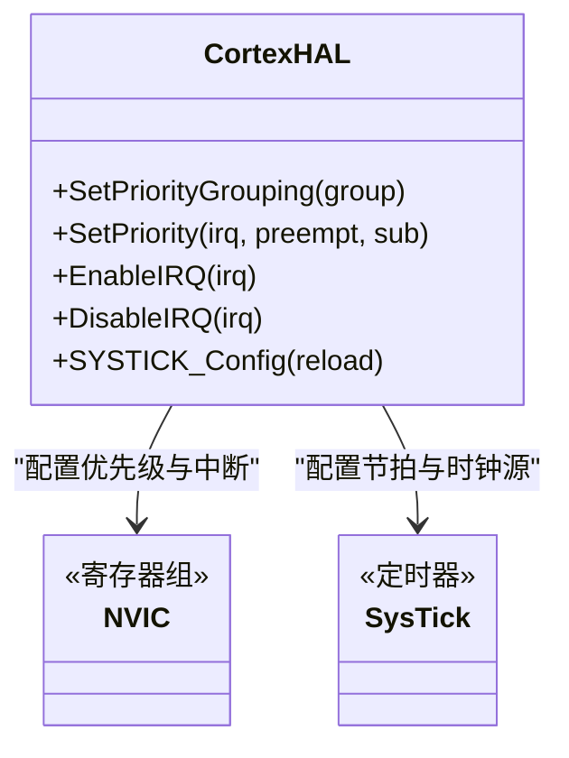

图表来源
- [stm32f1xx_hal_cortex.c:80-200](file://Src/stm32f1xx_hal_cortex.c#L80-L200)
- [stm32f1xx_hal_cortex.h:60-160](file://Inc/stm32f1xx_hal_cortex.h#L60-L160)

章节来源
- [stm32f1xx_hal_cortex.h:1-200](file://Inc/stm32f1xx_hal_cortex.h#L1-L200)
- [stm32f1xx_hal_cortex.c:1-200](file://Src/stm32f1xx_hal_cortex.c#L1-L200)

### DMA：通道、方向、增量、数据宽度与模式
- 数据结构：`DMA_InitTypeDef`（Direction、PeriphInc、MemInc、PeriphDataAlignment、MemDataAlignment、Mode、Priority）、`DMA_HandleTypeDef`（实例、Init、状态、回调、错误码、基地址、通道索引）。
- 关键能力：
  - `HAL_DMA_Init()` 校验参数、计算 ChannelIndex 与 DmaBaseAddress、清零 CCR 相关位并写入配置。
  - 支持外设到内存、内存到外设、内存到内存（禁止循环模式）三种方向。
  - 支持字节/半字/字对齐。
  - 支持正常/循环模式与软件优先级。
  - 提供 Polling/Interrupt 两种 IO 操作风格，含回调注册。

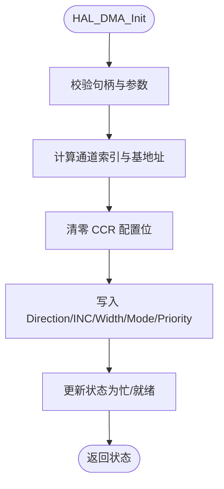

图表来源
- [stm32f1xx_hal_dma.c:120-220](file://Src/stm32f1xx_hal_dma.c#L120-L220)
- [stm32f1xx_hal_dma.h:60-200](file://Inc/stm32f1xx_hal_dma.h#L60-L200)

章节来源
- [stm32f1xx_hal_dma.h:1-200](file://Inc/stm32f1xx_hal_dma.h#L1-L200)
- [stm32f1xx_hal_dma.c:1-220](file://Src/stm32f1xx_hal_dma.c#L1-L220)

### CRC：校验计算
- 数据结构：`CRC_HandleTypeDef`（Instance、Lock、State）。
- 功能：
  - `HAL_CRC_Init()` / `DeInit()` 管理句柄状态与 MSP 钩子。
  - `HAL_CRC_Accumulate()` 基于已有 CRC 继续累加。
  - `HAL_CRC_Calculate()` 以指定初始值开始计算。
  - 提供 IDR 存储/读取、DR 重置宏。
- 典型用法：启用 RCC CRC 时钟 → 初始化 → 计算数据缓冲区的 CRC。

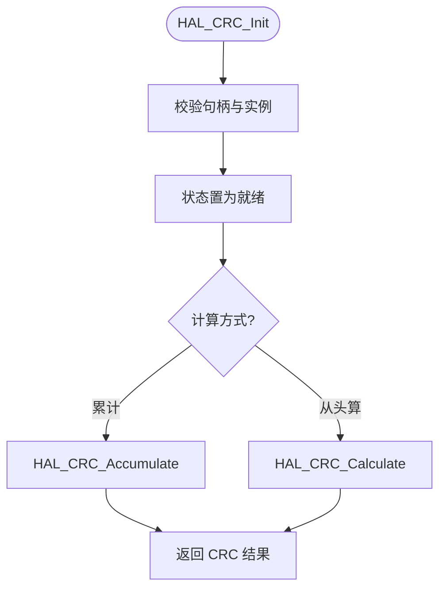

图表来源
- [stm32f1xx_hal_crc.c:120-220](file://Src/stm32f1xx_hal_crc.c#L120-L220)
- [stm32f1xx_hal_crc.h:60-181](file://Inc/stm32f1xx_hal_crc.h#L60-L181)

章节来源
- [stm32f1xx_hal_crc.h:1-181](file://Inc/stm32f1xx_hal_crc.h#L1-L181)
- [stm32f1xx_hal_crc.c:1-220](file://Src/stm32f1xx_hal_crc.c#L1-L220)

### PWR：电源模式与备份域
- 能力：
  - PVD 电压检测：电平、模式（普通/中断/事件及边沿）。
  - 睡眠/停止/待机入口：WFI/WFE。
  - 唤醒引脚：WKUP 引脚使能。
  - 备份域访问：`HAL_PWR_EnableBkUpAccess()` / `DisableBkUpAccess()`，与 RTC 配合。
  - 标志位：唤醒、待机、PVD 输出。
- 注意：进入低功率模式前需关闭不必要的外设时钟；退出后可能需要重新初始化部分外设。

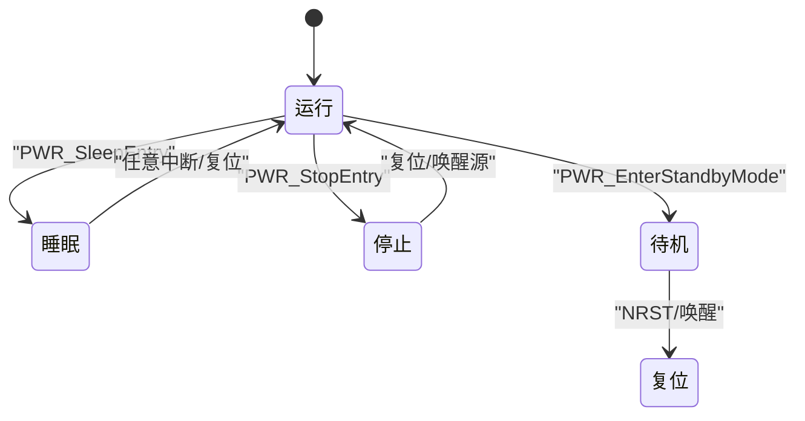

图表来源
- [stm32f1xx_hal_pwr.h:120-200](file://Inc/stm32f1xx_hal_pwr.h#L120-L200)
- [stm32f1xx_hal_pwr.c:120-220](file://Src/stm32f1xx_hal_pwr.c#L120-L220)

章节来源
- [stm32f1xx_hal_pwr.h:1-200](file://Inc/stm32f1xx_hal_pwr.h#L1-L200)
- [stm32f1xx_hal_pwr.c:1-220](file://Src/stm32f1xx_hal_pwr.c#L1-L220)

### RCC：时钟树与总线时钟
- 能力：
  - 振荡器：HSI、HSE、LSI、LSE。
  - PLL：输入源（HSI/2 或 HSE）、倍频因子。
  - 系统时钟：HSI/HSE/PLL 切换。
  - AHB/APB1/APB2 分频。
  - 外设时钟使能宏、CSS 安全系统、MCO 输出。
  - Flash 等待状态与频率匹配说明。
- 限制与建议：
  - 外设时钟使能与实际寄存器生效之间存在延迟，宏已插入 dummy read 补偿。
  - USB OTG FS 需要 48 MHz，需确保 PLL 输出满足要求。
  - SYSCLK/HCLK/PCLK2 最高频率受型号限制。

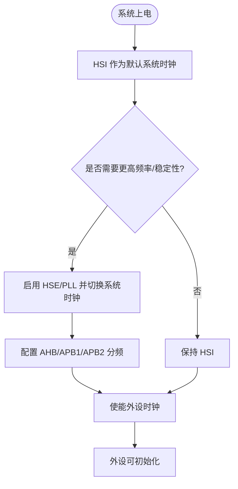

图表来源
- [stm32f1xx_hal_rcc.c:1-200](file://Src/stm32f1xx_hal_rcc.c#L1-L200)
- [stm32f1xx_hal_rcc.h:1-200](file://Inc/stm32f1xx_hal_rcc.h#L1-L200)

章节来源
- [stm32f1xx_hal_rcc.h:1-200](file://Inc/stm32f1xx_hal_rcc.h#L1-L200)
- [stm32f1xx_hal_rcc.c:1-200](file://Src/stm32f1xx_hal_rcc.c#L1-L200)

### RTC：日历、闹钟与备份域
- 能力：
  - 初始化异步预分频，产生 1 Hz 时基。
  - 设置/读取时间与日期。
  - 配置闹钟 A，支持中断模式。
  - 备份数据寄存器读写（通过扩展 API）。
  - 输出配置（校准/闹钟/秒脉冲）。
- F1 系列限制：
  - 日期由软件维护；STOP/STANDBY 模式下日期会丢失，需保存至备份寄存器。
  - 仅支持 24 小时制。
  - 闹钟只触发一次，不重复。
- 备份域访问：必须先启用 PWR 时钟并开放备份域访问。

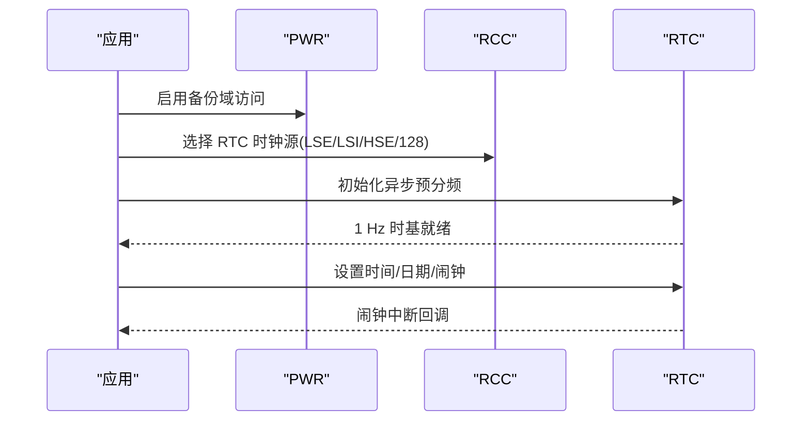

图表来源
- [stm32f1xx_hal_rtc.c:120-220](file://Src/stm32f1xx_hal_rtc.c#L120-L220)
- [stm32f1xx_hal_rtc.h:1-200](file://Inc/stm32f1xx_hal_rtc.h#L1-L200)
- [stm32f1xx_hal_pwr.c:120-220](file://Src/stm32f1xx_hal_pwr.c#L120-L220)

章节来源
- [stm32f1xx_hal_rtc.h:1-200](file://Inc/stm32f1xx_hal_rtc.h#L1-L200)
- [stm32f1xx_hal_rtc.c:1-220](file://Src/stm32f1xx_hal_rtc.c#L1-L220)

## 依赖关系分析
- GPIO 依赖 RCC 提供端口时钟；当配置为中断/事件模式时依赖 EXTI 与 AFIO。
- EXTI 依赖 GPIO 端口复用与 NVIC 中断路由。
- DMA 依赖 RCC 时钟与外设请求映射；不能将循环模式用于内存到内存传输。
- CRC 依赖 RCC 时钟；其 IDR 可用于携带上下文信息。
- PWR 与 RTC 共享备份域；进入低功耗前需协调外设时钟与状态。
- RCC 是所有外设的基础；错误的时钟配置会导致外设不可用或不稳定。

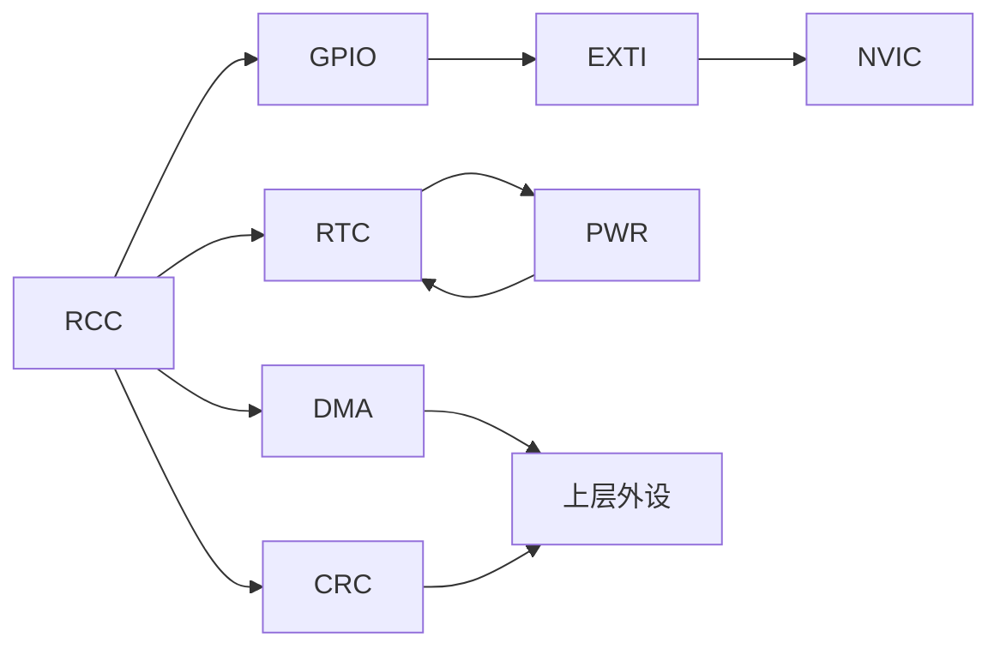

图表来源
- [stm32f1xx_hal_rcc.c:1-200](file://Src/stm32f1xx_hal_rcc.c#L1-L200)
- [stm32f1xx_hal_gpio.c:1-120](file://Src/stm32f1xx_hal_gpio.c#L1-L120)
- [stm32f1xx_hal_exti.c:1-120](file://Src/stm32f1xx_hal_exti.c#L1-L120)
- [stm32f1xx_hal_dma.c:1-120](file://Src/stm32f1xx_hal_dma.c#L1-L120)
- [stm32f1xx_hal_crc.c:1-120](file://Src/stm32f1xx_hal_crc.c#L1-L120)
- [stm32f1xx_hal_pwr.c:1-120](file://Src/stm32f1xx_hal_pwr.c#L1-L120)
- [stm32f1xx_hal_rtc.c:1-120](file://Src/stm32f1xx_hal_rtc.c#L1-L120)

## 性能与低功耗设计
- 低功耗设计
  - 优先使用 Sleep/Stop 降低功耗；仅在必要时进入 Standby。
  - 关闭未使用外设时钟，合理选择 LDO/低压调节器。
  - 利用 WKUP 引脚、RTC 闹钟作为唤醒源；在进入低功耗前保存必要状态到备份寄存器。
  - 使用 PVD 监测供电跌落，及时执行安全停机流程。
- 中断优先级规划
  - 在系统启动早期统一设置 NVIC 优先级分组。
  - 高频、严格时序的外设中断（如 UART、TIM、DMA）设置较高抢占优先级；非实时任务使用较低优先级。
  - 避免在同一抢占级别内嵌套过多中断，减少临界区长度。
- 时钟稳定性
  - 生产环境建议使用 HSE 与 PLL 提供稳定系统时钟；启用 CSS 以应对 HSE 失效。
  - 确保 Flash Wait State 与 SYSCLK 匹配，避免总线访问失败。
  - USB 场景必须保证 48 MHz 时钟来源正确。
- 复位行为与调试冻结
  - GPIO 复位后为浮空输入，JTAG 引脚保留调试功能；如需释放引脚，需在初始化中显式配置。
  - 进入 Stop/Standby 前关闭调试接口可能影响调试；建议在调试阶段谨慎使用深度低功耗。
  - 备份域复位会清零 RTC 与备份寄存器；进入低功耗前应保存关键数据。

[本节为通用工程实践指导，不直接分析具体文件]

## 故障排查指南
- GPIO 无法输出或输入异常
  - 检查是否已启用对应 GPIO 端口时钟。
  - 检查 Mode/Pull/Speed 是否与外设需求一致。
  - 若用作复用，确认 AFIO 与外设引脚映射。
- EXTI 中断不触发
  - 检查 GPIO 是否配置为中断模式且边沿一致。
  - 检查 EXTI 配置是否正确设置 RTSR/FTSR。
  - 检查 NVIC 是否使能对应 IRQ 并设置合理优先级。
- DMA 传输错误或卡死
  - 检查 Direction、INC、Width、Mode 是否合法。
  - 内存到内存模式不得使用循环模式。
  - 检查外设请求映射与优先级，避免冲突。
- CRC 结果异常
  - 检查是否启用 CRC 时钟。
  - 区分 Accumulate 与 Calculate 的使用场景。
  - 检查 IDR 内容是否被意外修改。
- PWR/RTC 备份域写入失败
  - 确认已启用 PWR 时钟并打开备份域访问。
  - 检查是否使用了正确的时钟源（LSE/LSI/HSE/128）。
  - 注意 STOP/STANDBY 后日期会丢失，需保存到备份寄存器。
- RCC 外设不可用
  - 检查目标外设时钟是否使能。
  - 检查 SYSCLK 与 Flash Latency 匹配。
  - 注意外设时钟使能与寄存器生效之间的延迟。

章节来源
- [stm32f1xx_hal_gpio.c:1-120](file://Src/stm32f1xx_hal_gpio.c#L1-L120)
- [stm32f1xx_hal_exti.c:1-120](file://Src/stm32f1xx_hal_exti.c#L1-L120)
- [stm32f1xx_hal_dma.c:1-120](file://Src/stm32f1xx_hal_dma.c#L1-L120)
- [stm32f1xx_hal_crc.c:1-120](file://Src/stm32f1xx_hal_crc.c#L1-L120)
- [stm32f1xx_hal_pwr.c:1-120](file://Src/stm32f1xx_hal_pwr.c#L1-L120)
- [stm32f1xx_hal_rcc.c:1-120](file://Src/stm32f1xx_hal_rcc.c#L1-L120)
- [stm32f1xx_hal_rtc.c:1-120](file://Src/stm32f1xx_hal_rtc.c#L1-L120)

## 结论
GPIO、EXTI、Cortex、DMA、CRC、PWR、RCC、RTC 构成了 STM32F1xx 应用的基础设施。正确理解它们的职责边界与相互依赖，是实现稳定、高效、低功耗系统的关键。实践中应遵循“先时钟、再外设；先基础、后业务；先安全、后优化”的顺序，并通过中断优先级规划、时钟稳定性保障与备份域策略，提升整体可靠性。

[本节为总结性内容，不直接分析具体文件]

## 附录：最小可用示例路径
以下列出各模块“最小可用配置”的代码片段所在路径。读者可按路径定位具体函数与常量，组合出完整的最小示例。

- GPIO 输出 LED
  - [stm32f1xx_hal_gpio.h:60-180](file://Inc/stm32f1xx_hal_gpio.h#L60-L180)
  - [stm32f1xx_hal_gpio.c:120-260](file://Src/stm32f1xx_hal_gpio.c#L120-L260)
  - 要点：启用 RCC GPIO 时钟 → `HAL_GPIO_Init()` 配置输出推挽 → `HAL_GPIO_WritePin()` 控制电平。

- EXTI 按键中断
  - [stm32f1xx_hal_gpio.h:120-200](file://Inc/stm32f1xx_hal_gpio.h#L120-L200)
  - [stm32f1xx_hal_exti.h:60-180](file://Inc/stm32f1xx_hal_exti.h#L60-L180)
  - [stm32f1xx_hal_exti.c:120-220](file://Src/stm32f1xx_hal_exti.c#L120-L220)
  - 要点：GPIO 配置为中断模式 → `HAL_EXTI_SetConfigLine()` → NVIC 使能 → 回调处理挂起位。

- NVIC 与 SysTick
  - [stm32f1xx_hal_cortex.h:60-160](file://Inc/stm32f1xx_hal_cortex.h#L60-L160)
  - [stm32f1xx_hal_cortex.c:80-200](file://Src/stm32f1xx_hal_cortex.c#L80-L200)
  - 要点：`HAL_NVIC_SetPriorityGrouping()` → `HAL_NVIC_SetPriority()` → `HAL_NVIC_EnableIRQ()`；`HAL_SYSTICK_Config()` 配置节拍。

- DMA 串口发送
  - [stm32f1xx_hal_dma.h:60-200](file://Inc/stm32f1xx_hal_dma.h#L60-L200)
  - [stm32f1xx_hal_dma.c:120-220](file://Src/stm32f1xx_hal_dma.c#L120-L220)
  - 要点：`HAL_DMA_Init()` 配置方向/增量/宽度/模式/优先级 → `HAL_DMA_Start_IT()` → 中断回调。

- CRC 数据校验
  - [stm32f1xx_hal_crc.h:60-181](file://Inc/stm32f1xx_hal_crc.h#L60-L181)
  - [stm32f1xx_hal_crc.c:120-220](file://Src/stm32f1xx_hal_crc.c#L120-L220)
  - 要点：启用 RCC CRC 时钟 → `HAL_CRC_Init()` → `HAL_CRC_Calculate()` 或 `HAL_CRC_Accumulate()`。

- PWR 低功耗
  - [stm32f1xx_hal_pwr.h:120-200](file://Inc/stm32f1xx_hal_pwr.h#L120-L200)
  - [stm32f1xx_hal_pwr.c:120-220](file://Src/stm32f1xx_hal_pwr.c#L120-L220)
  - 要点：`HAL_PWR_EnableBkUpAccess()` → 配置 PVD/唤醒 → 进入 Sleep/Stop/Standby。

- RCC 时钟树
  - [stm32f1xx_hal_rcc.h:1-200](file://Inc/stm32f1xx_hal_rcc.h#L1-L200)
  - [stm32f1xx_hal_rcc.c:1-200](file://Src/stm32f1xx_hal_rcc.c#L1-L200)
  - 要点：配置 HSE/PLL → 切换系统时钟 → 设置 AHB/APB 分频 → 使能外设时钟。

- RTC 日历与闹钟
  - [stm32f1xx_hal_rtc.h:1-200](file://Inc/stm32f1xx_hal_rtc.h#L1-L200)
  - [stm32f1xx_hal_rtc.c:120-220](file://Src/stm32f1xx_hal_rtc.c#L120-L220)
  - 要点：启用备份域访问 → 配置 RTC 预分频 → 设置时间/日期/闹钟 → 回调处理闹钟事件。

[本节为导航性说明，不直接分析具体文件]