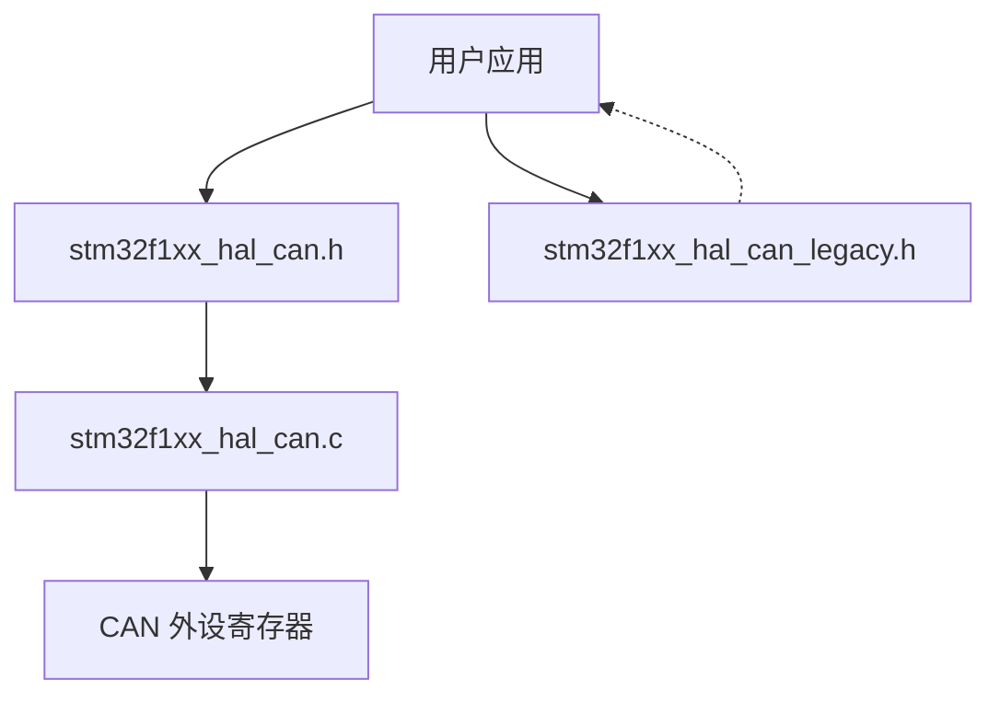
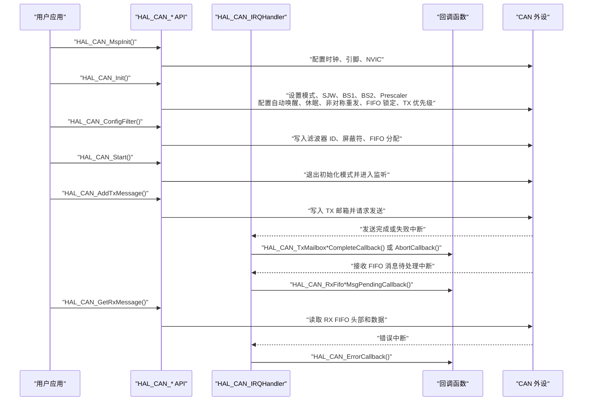
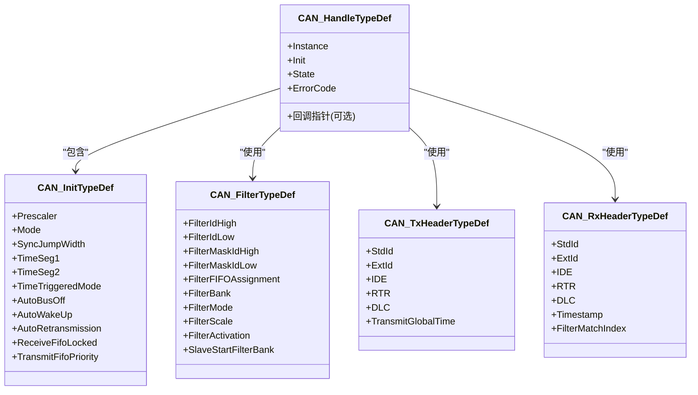

# CAN 控制器局域网接口

<cite>
**本文引用的文件**
- [stm32f1xx_hal_can.h](file://Inc/stm32f1xx_hal_can.h)
- [stm32f1xx_hal_can.c](file://Src/stm32f1xx_hal_can.c)
- [stm32f1xx_hal_can_legacy.h](file://Inc/Legacy/stm32f1xx_hal_can_legacy.h)
- [README.md](file://README.md)
</cite>

## 目录
1. [简介](#简介)
2. [项目结构](#项目结构)
3. [核心数据结构](#核心数据结构)
4. [架构总览](#架构总览)
5. [关键 API 与处理流程](#关键-api-与处理流程)
6. [详细组件分析](#详细组件分析)
7. [依赖关系分析](#依赖关系分析)
8. [性能与总线特性](#性能与总线特性)
9. [典型用例](#典型用例)
10. [故障排查指南](#故障排查指南)
11. [结论](#结论)

## 简介
本文件面向 STM32F1xx HAL 的 CAN 驱动，系统梳理其数据类型、初始化选项、滤波器配置、发送/接收流程、中断与回调机制，以及错误状态恢复、位定时与波特率设置、仲裁丢失、错误计数器和 Bus Off/Error Passive 行为。文档同时给出 Legacy HAL 迁移要点，帮助从旧版 `CAN_HandleTypeDef`、`CanTxMsgTypeDef`、`CanRxMsgTypeDef` 迁移到新版 `HAL_CAN_AddTxMessage`、`HAL_CAN_GetRxMessage`、`HAL_CAN_ActivateNotification`、`HAL_CAN_IRQHandler` 等 API。

## 项目结构
STM32F1xx HAL CAN 相关代码主要分布在以下位置：
- 头文件：`Inc/stm32f1xx_hal_can.h`，定义 CAN 句柄、滤波器、报文头、状态枚举、常量与导出函数原型。
- 实现文件：`Src/stm32f1xx_hal_can.c`，实现初始化、滤波器配置、启动/停止、休眠唤醒、发送、接收、中断处理、回调和错误管理。
- Legacy 兼容头：`Inc/Legacy/stm32f1xx_hal_can_legacy.h`，保留旧版类型、常量与宏，用于历史代码迁移。
- 仓库说明：`README.md`，描述 STM32CubeF1 HAL 驱动的定位与版本兼容性。

图表来源
- [stm32f1xx_hal_can.h:1-859](file://Inc/stm32f1xx_hal_can.h#L1-L859)
- [stm32f1xx_hal_can.c:1-2436](file://Src/stm32f1xx_hal_can.c#L1-L2436)
- [stm32f1xx_hal_can_legacy.h:1-776](file://Inc/Legacy/stm32f1xx_hal_can_legacy.h#L1-L776)
- [README.md:1-45](file://README.md#L1-L45)

章节来源
- [README.md:1-45](file://README.md#L1-L45)

## 核心数据结构
本节聚焦四个关键结构体：`CAN_HandleTypeDef`、`CAN_FilterTypeDef`、`CAN_TxHeaderTypeDef`、`CAN_RxHeaderTypeDef`。

### CAN_HandleTypeDef
这是 CAN 驱动的运行时上下文，包含：
- 外设基地址指针。
- 当前初始化配置 `CAN_InitTypeDef`。
- 当前通信状态 `HAL_CAN_StateTypeDef`。
- 累计错误码 `ErrorCode`。
- 当启用可注册回调时，还包含一组函数指针，例如发送完成、接收 FIFO 消息待定、睡眠、唤醒、错误回调及 MspInit/MspDeInit 回调。

该句柄贯穿所有 HAL CAN API，是状态、错误和回调分发中心。

章节来源
- [stm32f1xx_hal_can.h:200-330](file://Inc/stm32f1xx_hal_can.h#L200-L330)
- [stm32f1xx_hal_can.c:200-684](file://Src/stm32f1xx_hal_can.c#L200-L684)

### CAN_FilterTypeDef
滤波器配置结构体包含：
- `FilterIdHigh`、`FilterIdLow`：标识号高位与低位。
- `FilterMaskIdHigh`、`FilterMaskIdLow`：屏蔽符或第二标识号。
- `FilterFIFOAssignment`：分配至 FIFO0 或 FIFO1。
- `FilterBank`：滤波器组编号；单实例为 0-13，双实例为 0-27。
- `FilterMode`：标识掩码模式或标识列表模式。
- `FilterScale`：16 位双滤波或 32 位单滤波。
- `FilterActivation`：启用或禁用。
- `SlaveStartFilterBank`：双实例中从机 CAN 起始滤波器组。

该结构通过 `HAL_CAN_ConfigFilter` 写入硬件滤波器寄存器，并在初始化和监听模式下生效。

章节来源
- [stm32f1xx_hal_can.h:120-190](file://Inc/stm32f1xx_hal_can.h#L120-L190)
- [stm32f1xx_hal_can.c:750-1264](file://Src/stm32f1xx_hal_can.c#L750-L1264)

### CAN_TxHeaderTypeDef
发送报文头结构体包含：
- `StdId`：标准标识符，范围 0-0x7FF。
- `ExtId`：扩展标识符，范围 0-0x1FFFFFFF。
- `IDE`：标准 ID 或扩展 ID。
- `RTR`：数据帧或远程请求帧。
- `DLC`：数据长度，最大 8。
- `TransmitGlobalTime`：在时间触发通信模式下，是否将时间戳计数器值作为 DATA6 和 DATA7 发送，要求 DLC=8。

章节来源
- [stm32f1xx_hal_can.h:160-200](file://Inc/stm32f1xx_hal_can.h#L160-L200)
- [stm32f1xx_hal_can.c:1264-1400](file://Src/stm32f1xx_hal_can.c#L1264-L1400)

### CAN_RxHeaderTypeDef
接收报文头结构体包含：
- `StdId`、`ExtId`、`IDE`、`RTR`、`DLC`：与发送头类似。
- `Timestamp`：接收起始捕获的时间戳，需启用时间触发通信模式。
- `FilterMatchIndex`：匹配接受的滤波器元素索引。

章节来源
- [stm32f1xx_hal_can.h:200-220](file://Inc/stm32f1xx_hal_can.h#L200-L220)
- [stm32f1xx_hal_can.c:1400-1878](file://Src/stm32f1xx_hal_can.c#L1400-L1878)

## 架构总览
下图展示 HAL CAN 的主要调用链：用户应用通过 `HAL_CAN_Init`、`HAL_CAN_Start`、`HAL_CAN_AddTxMessage`、`HAL_CAN_GetRxMessage`、`HAL_CAN_ActivateNotification` 控制 CAN；中断由 `HAL_CAN_IRQHandler` 统一处理，并根据标志位调用相应弱回调或已注册回调。

图表来源
- [stm32f1xx_hal_can.c:200-684](file://Src/stm32f1xx_hal_can.c#L200-L684)
- [stm32f1xx_hal_can.c:750-1264](file://Src/stm32f1xx_hal_can.c#L750-L1264)
- [stm32f1xx_hal_can.c:1264-1878](file://Src/stm32f1xx_hal_can.c#L1264-L1878)
- [stm32f1xx_hal_can.c:1879-2390](file://Src/stm32f1xx_hal_can.c#L1879-L2390)

## 关键 API 与处理流程

### 初始化与 MSP
- `HAL_CAN_Init`：检查参数、调用底层 `HAL_CAN_MspInit`、请求初始化、退出睡眠、写入时间触发、自动 Bus Off、自动唤醒、非自动重发、接收 FIFO 锁定、传输 FIFO 优先级、BTR（模式、SJW、BS1、BS2、分频器），然后设置错误码和状态为 READY。
- `HAL_CAN_MspInit`：默认空实现，用户应在此实现 CAN 时钟、GPIO 复用引脚和 NVIC 中断优先级。
- `HAL_CAN_DeInit`：停止 CAN、调用 `MspDeInit`、复位外设、重置错误码和状态。

章节来源
- [stm32f1xx_hal_can.c:200-684](file://Src/stm32f1xx_hal_can.c#L200-L684)

### 滤波器配置
- `HAL_CAN_ConfigFilter`：进入滤波器初始化模式，根据 16 位或 32 位规模写入 FR1/FR2，设置 FM1R 模式、FFA1R FIFO 分配、FA1R 激活，再退出初始化模式。支持单实例 14 个滤波器组和双实例 28 个共享滤波器组。

章节来源
- [stm32f1xx_hal_can.c:750-1264](file://Src/stm32f1xx_hal_can.c#L750-L1264)

### 启动、停止、休眠与唤醒
- `HAL_CAN_Start`：状态为 READY 时进入 LISTENING，清除 INRQ 并等待 INAK 清零。
- `HAL_CAN_Stop`：进入 INIT 模式，退出睡眠，状态回到 READY。
- `HAL_CAN_RequestSleep`：置位 SLEEP，允许后续自动或手动唤醒。
- `HAL_CAN_WakeUp`：清除 SLEEP 并等待 SLAK 清零。
- `HAL_CAN_IsSleepActive`：检查 SLAK 标志。

章节来源
- [stm32f1xx_hal_can.c:1264-1400](file://Src/stm32f1xx_hal_can.c#L1264-L1400)

### 发送与获取
- `HAL_CAN_AddTxMessage`：校验 IDE/RTR/DLC/ID，选择空闲 TX 邮箱，写入 TIR 和 TDxR，返回使用的邮箱标志。
- `HAL_CAN_GetRxMessage`：校验 FIFO，读取 RIR、RDTR、RDLR/RDHR，填充 RxHeader 和 aData，释放对应 FIFO。

章节来源
- [stm32f1xx_hal_can.c:1264-1400](file://Src/stm32f1xx_hal_can.c#L1264-L1400)
- [stm32f1xx_hal_can.c:1400-1878](file://Src/stm32f1xx_hal_can.c#L1400-L1878)

### 中断与回调
- `HAL_CAN_ActivateNotification`：启用指定中断。
- `HAL_CAN_DeactivateNotification`：禁用指定中断。
- `HAL_CAN_IRQHandler`：按 TX 邮箱、RX FIFO0/FIFO1、睡眠、唤醒、错误中断分类处理，更新 ErrorCode 并调用回调。
- 回调包括：
  - 发送完成：`HAL_CAN_TxMailbox0/1/2CompleteCallback`
  - 发送中止：`HAL_CAN_TxMailbox0/1/2AbortCallback`
  - 接收 FIFO 消息待定：`HAL_CAN_RxFifo0/1MsgPendingCallback`
  - 接收 FIFO 满：`HAL_CAN_RxFifo0/1FullCallback`
  - 睡眠：`HAL_CAN_SleepCallback`
  - 唤醒：`HAL_CAN_WakeUpFromRxMsgCallback`
  - 错误：`HAL_CAN_ErrorCallback`

章节来源
- [stm32f1xx_hal_can.c:1400-1878](file://Src/stm32f1xx_hal_can.c#L1400-L1878)
- [stm32f1xx_hal_can.c:1879-2390](file://Src/stm32f1xx_hal_can.c#L1879-L2390)

## 详细组件分析

### CAN_Init 中的关键选项
- 自动唤醒 `AutoWakeUp`：使能后，收到起始帧可自动从睡眠模式唤醒。
- 自动 Bus Off 管理 `AutoBusOff`：使能后，达到 Bus Off 时可自动尝试恢复。
- 非自动重发 `AutoRetransmission`：对应 NART；禁用表示自动重发，启用表示不自动重发。
- 时间触发通信 `TimeTriggeredMode`：使能后可使用全局时间戳；配合 `TransmitGlobalTime` 可将时间戳放入 DATA6/7。
- 接收 FIFO 锁定 `ReceiveFifoLocked`：锁定 FIFO，防止新消息覆盖未读消息。
- 传输 FIFO 优先级 `TransmitFifoPriority`：按 FIFO 顺序而不是 ID 优先级调度发送。

这些选项通过 `MCR` 和 `BTR` 写入硬件，并由 `HAL_CAN_Init` 的参数断言确保有效范围。

章节来源
- [stm32f1xx_hal_can.c:200-684](file://Src/stm32f1xx_hal_can.c#L200-L684)
- [stm32f1xx_hal_can.h:60-120](file://Inc/stm32f1xx_hal_can.h#L60-L120)

### MSP 钩子中的引脚与中断配置
`HAL_CAN_MspInit` 默认是空弱函数，用户需要在自己的文件中实现它，通常包括：
- 启用 CAN 外设时钟。
- 配置 TX/RX GPIO 为复用推挽。
- 配置 NVIC 中 CAN 中断优先级。
- 若使用中断，调用 `HAL_NVIC_SetPriority` 和 `HAL_NVIC_EnableIRQ`。

注意：在 `USE_HAL_CAN_REGISTER_CALLBACKS` 模式下，`HAL_CAN_Init` 会优先使用用户注册的 `MspInitCallback`；否则直接调用 `HAL_CAN_MspInit`。

章节来源
- [stm32f1xx_hal_can.c:200-684](file://Src/stm32f1xx_hal_can.c#L200-L684)

### 过滤器与屏蔽符
- 掩码模式 `CAN_FILTERMODE_IDMASK`：使用 `FilterId` 与 `FilterMaskId` 进行按位匹配。
- 列表模式 `CAN_FILTERMODE_IDLIST`：使用多个标识号精确匹配。
- 16 位规模：两个 16 位滤波器，共用一个 FilterBank。
- 32 位规模：一个 32 位滤波器。
- 每个滤波器可分配到 FIFO0 或 FIFO1。

对于“过滤特定节点消息”，通常使用掩码模式，将目标节点的 StdId/ExtId 作为 ID，并将不需要匹配的位设为屏蔽符 0，需要匹配的位设为 1。

章节来源
- [stm32f1xx_hal_can.h:120-190](file://Inc/stm32f1xx_hal_can.h#L120-L190)
- [stm32f1xx_hal_can.c:750-1264](file://Src/stm32f1xx_hal_can.c#L750-L1264)

### 错误状态与恢复
`HAL_CAN_IRQHandler` 汇总错误并更新 `hcan->ErrorCode`，包括：
- EWG：协议错误警告。
- EPV：错误被动。
- BOF：Bus Off。
- STF/FOR/ACK/BR/BD/CRC：具体最后错误码。
- RX FIFO 溢出：FIFO0/FIFO1。
- TX 邮箱仲裁丢失或传输错误。

恢复建议：
- 遇到 EPV 或 BOF 时，检查总线负载、终端电阻、布线、其他节点配置。
- 启用 `AutoBusOff` 以自动尝试恢复。
- 在回调中记录错误码，必要时重启 CAN 或重新配置滤波器。
- 使用 `HAL_CAN_GetError` 获取错误码，`HAL_CAN_ResetError` 清理。

章节来源
- [stm32f1xx_hal_can.c:1879-2390](file://Src/stm32f1xx_hal_can.c#L1879-L2390)
- [stm32f1xx_hal_can.h:330-450](file://Inc/stm32f1xx_hal_can.h#L330-L450)

## 依赖关系分析

图表来源
- [stm32f1xx_hal_can.h:60-330](file://Inc/stm32f1xx_hal_can.h#L60-L330)

章节来源
- [stm32f1xx_hal_can.h:60-330](file://Inc/stm32f1xx_hal_can.h#L60-L330)

## 性能与总线特性

### 位定时、采样点与波特率
- 时间量子 `Tq = Prescaler / Fpclk`。
- 位时间 `BitTime = SJW + BS1 + BS2`。
- 波特率 `Baud = 1 / BitTime`。
- 采样点通常位于 BS1 结束处，接近比特末尾；增大 BS1 可提高采样点靠近末端，提升抗噪能力；增大 BS2 可增加同步容限，但会降低采样点。
- SJW 决定硬件可延长或缩短的同步宽度；BS1 主要用于传播段和相位缓冲段；BS2 用于相位缓冲段 2。
- 推荐先确定目标波特率和总线时钟频率，再计算 Prescaler、BS1、BS2，保证采样点在合理范围，并验证 SJW 不超过硬件允许范围。

章节来源
- [stm32f1xx_hal_can.c:200-684](file://Src/stm32f1xx_hal_can.c#L200-L684)
- [stm32f1xx_hal_can.h:330-450](file://Inc/stm32f1xx_hal_can.h#L330-L450)

### 仲裁丢失
- 当多个节点同时发送时，低 ID 优先。若检测到电平冲突，则发生仲裁丢失。
- HAL 在 TX 邮箱中断中将 ALST 标记为错误，并调用 Tx Mailbox Abort 回调。
- 如果启用自动重发，硬件会重试；否则需在应用中主动重发。

章节来源
- [stm32f1xx_hal_can.c:1879-2390](file://Src/stm32f1xx_hal_can.c#L1879-L2390)
- [stm32f1xx_hal_can.h:330-450](file://Inc/stm32f1xx_hal_can.h#L330-L450)

### 错误计数器与 Bus Off / Error Passive
- EWG：错误警告，错误计数器超过阈值。
- EPV：错误被动，收发器进入被动模式。
- BOF：Bus Off，设备从总线断开，需等待自动恢复或软件干预。
- 这些状态由 ESR 寄存器反映，HAL 中断处理器映射到 `HAL_CAN_ERROR_EWG`、`HAL_CAN_ERROR_EPV`、`HAL_CAN_ERROR_BOF`。

章节来源
- [stm32f1xx_hal_can.c:1879-2390](file://Src/stm32f1xx_hal_can.c#L1879-L2390)
- [stm32f1xx_hal_can.h:330-450](file://Inc/stm32f1xx_hal_can.h#L330-L450)

### 中断优先级与总线负载
- 在中断模式下，应在 `HAL_CAN_MspInit` 中设置合适的 NVIC 优先级，避免高负载下丢失 RX FIFO 消息。
- 对于高流量场景，建议在 RX FIFO 消息待定回调中尽快调用 `HAL_CAN_GetRxMessage`，或在回调中禁用通知、稍后重新启用。
- 可使用 `HAL_CAN_GetRxFifoFillLevel` 监控 FIFO 占用，评估总线负载与处理能力。

章节来源
- [stm32f1xx_hal_can.c:200-684](file://Src/stm32f1xx_hal_can.c#L200-L684)
- [stm32f1xx_hal_can.c:1400-1878](file://Src/stm32f1xx_hal_can.c#L1400-L1878)

## 典型用例

### 发送标准 ID 与扩展 ID 报文
步骤：
1. 实现 `HAL_CAN_MspInit`：配置 CAN 时钟、TX/RX 引脚、NVIC。
2. 配置 `CAN_InitTypeDef`：设置 Prescaler、Mode、SJW、BS1、BS2。
3. 调用 `HAL_CAN_Init`、`HAL_CAN_Start`。
4. 构造 `CAN_TxHeaderTypeDef`：标准 ID 设置 `StdId` 和 `IDE=CAN_ID_STD`；扩展 ID 设置 `ExtId` 和 `IDE=CAN_ID_EXT`。
5. 调用 `HAL_CAN_AddTxMessage` 发送数据。
6. 在发送完成回调中确认发送结果。

章节来源
- [stm32f1xx_hal_can.c:200-684](file://Src/stm32f1xx_hal_can.c#L200-L684)
- [stm32f1xx_hal_can.c:1264-1400](file://Src/stm32f1xx_hal_can.c#L1264-L1400)

### 过滤特定节点消息
步骤：
1. 使用掩码模式，将目标节点 ID 作为 `FilterId`，屏蔽符 `FilterMaskId` 只匹配需要的位。
2. 选择 16 位或 32 位规模，并分配至 FIFO0 或 FIFO1。
3. 调用 `HAL_CAN_ConfigFilter` 配置滤波器。
4. 在 RX FIFO 消息待定回调中调用 `HAL_CAN_GetRxMessage` 读取匹配的消息。

章节来源
- [stm32f1xx_hal_can.c:750-1264](file://Src/stm32f1xx_hal_can.c#L750-L1264)
- [stm32f1xx_hal_can.c:1879-2390](file://Src/stm32f1xx_hal_can.c#L1879-L2390)

### 错误状态恢复
步骤：
1. 在 `HAL_CAN_ErrorCallback` 中读取 `HAL_CAN_GetError`。
2. 针对 BOF/EPV/EWG 做不同处理：检查总线、终端电阻、节点配置。
3. 若启用 `AutoBusOff`，等待自动恢复；否则调用 `HAL_CAN_Stop` 再 `HAL_CAN_Start` 或重新初始化。
4. 清理错误码 `HAL_CAN_ResetError`，并记录诊断信息。

章节来源
- [stm32f1xx_hal_can.c:1879-2390](file://Src/stm32f1xx_hal_can.c#L1879-L2390)
- [stm32f1xx_hal_can.h:330-450](file://Inc/stm32f1xx_hal_can.h#L330-L450)

### 与 Legacy HAL 迁移
Legacy HAL 使用：
- `CAN_HandleTypeDef`：包含 `Init`、`pTxMsg`、`pRxMsg`、`pRx1Msg`、`State`、`Lock`、`ErrorCode`。
- `CanTxMsgTypeDef`：包含 `StdId`、`ExtId`、`IDE`、`RTR`、`DLC`、`Data[8]`。
- `CanRxMsgTypeDef`：包含 `StdId`、`ExtId`、`IDE`、`RTR`、`DLC`、`Data[8]`、`FMI`、`FIFONumber`。

迁移要点：
- 发送：从 `CanTxMsgTypeDef` 迁移到 `CAN_TxHeaderTypeDef` 加独立数据数组，使用 `HAL_CAN_AddTxMessage`。
- 接收：从 `CanRxMsgTypeDef` 迁移到 `CAN_RxHeaderTypeDef` 加独立数据数组，使用 `HAL_CAN_GetRxMessage`。
- 中断：从直接操作寄存器或使用旧中断 API，迁移到 `HAL_CAN_ActivateNotification` 和 `HAL_CAN_IRQHandler`，并在回调中使用新的 `HAL_CAN_*Callback`。
- 错误码：Legacy 使用 `HAL_CAN_ERROR_FOV0/FOV1/TXFAIL` 等；新 HAL 使用更细粒度的 `HAL_CAN_ERROR_RX_FOV0/RX_FOV1/TX_ALST*/TX_TERR*`。

章节来源
- [stm32f1xx_hal_can_legacy.h:1-500](file://Inc/Legacy/stm32f1xx_hal_can_legacy.h#L1-L500)
- [stm32f1xx_hal_can.c:1879-2390](file://Src/stm32f1xx_hal_can.c#L1879-L2390)

## 故障排查指南
常见问题与建议：
- 初始化超时：检查 CAN 时钟、复位状态、MSP 是否正确配置。
- 无法进入监听模式：确认状态为 READY，且 INAK 已清零。
- 发送失败或仲裁丢失：检查总线负载、其他节点配置、是否启用自动重发。
- 接收 FIFO 溢出：提高中断优先级，及时读取 FIFO，或增加滤波器减少无关消息。
- Bus Off 或 Error Passive：检查物理层、终端电阻、总线噪声；启用自动 Bus Off 并记录错误码。
- 回调未触发：确认使用 `HAL_CAN_ActivateNotification` 启用中断，并在 NVIC 中启用 CAN IRQ。

章节来源
- [stm32f1xx_hal_can.c:200-684](file://Src/stm32f1xx_hal_can.c#L200-L684)
- [stm32f1xx_hal_can.c:1400-1878](file://Src/stm32f1xx_hal_can.c#L1400-L1878)
- [stm32f1xx_hal_can.c:1879-2390](file://Src/stm32f1xx_hal_can.c#L1879-L2390)

## 结论
STM32F1xx HAL 的 CAN 驱动通过清晰的数据结构和 API 分层，提供完整的初始化、滤波器配置、发送/接收、中断与回调、错误处理功能。正确使用 `CAN_HandleTypeDef`、`CAN_FilterTypeDef`、`CAN_TxHeaderTypeDef`、`CAN_RxHeaderTypeDef`，并结合 `HAL_CAN_Init`、`HAL_CAN_ConfigFilter`、`HAL_CAN_AddTxMessage`、`HAL_CAN_GetRxMessage`、`HAL_CAN_ActivateNotification`、`HAL_CAN_IRQHandler` 及相关回调，可以构建稳定可靠的 CAN 通信系统。对于高负载和复杂网络，应重视位定时、采样点、仲裁丢失、错误计数器、Bus Off/Error Passive 的处理策略，并通过 NVIC 优先级和 FIFO 监控优化实时性。Legacy HAL 迁移时，应以新 API 为中心，逐步替换旧的结构体和中断处理方式。