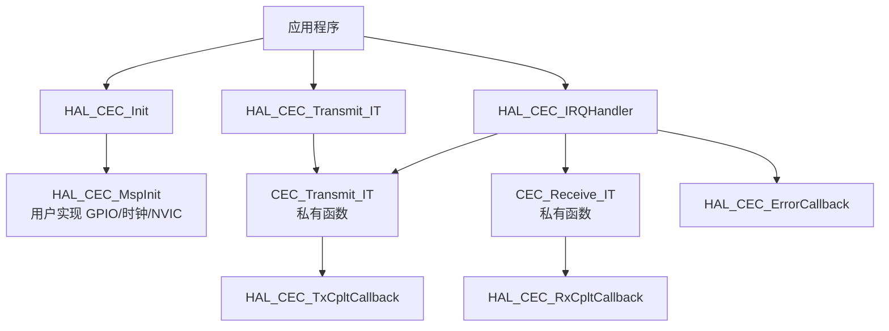
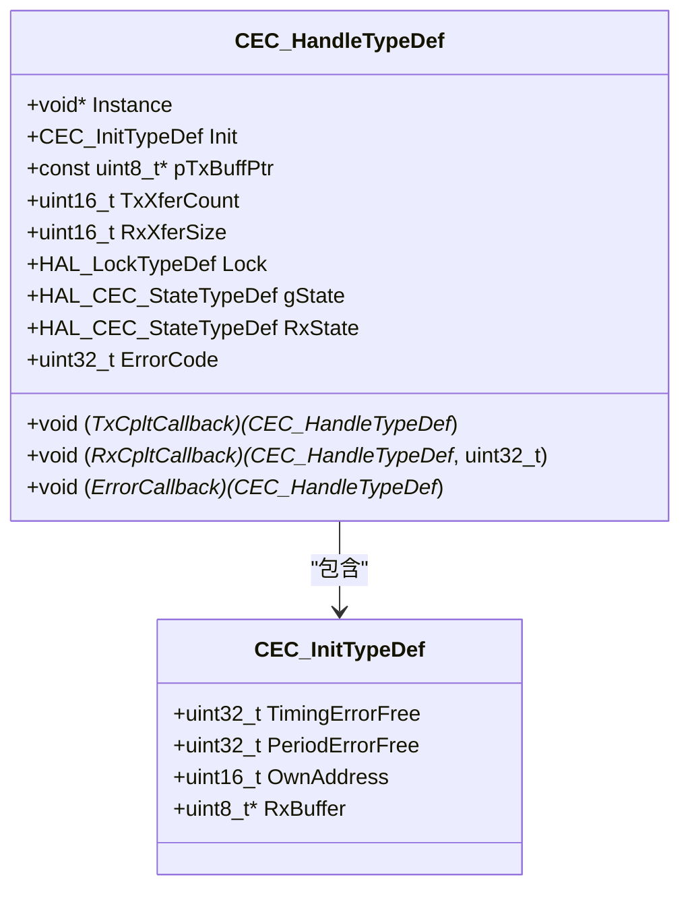
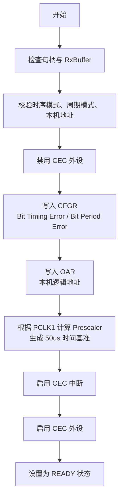
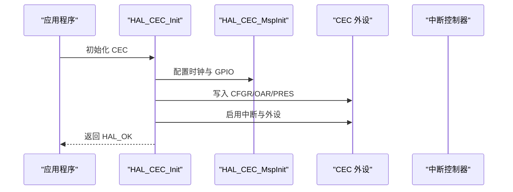
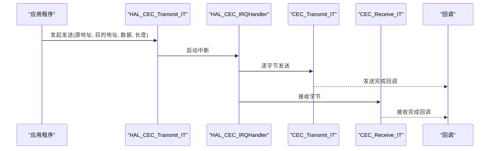
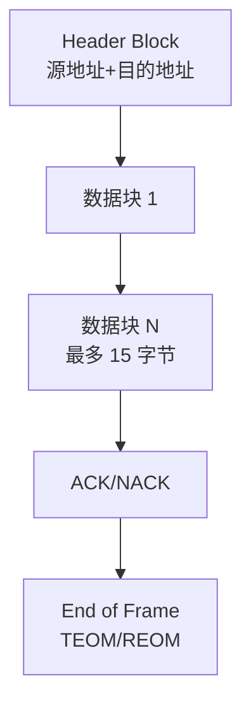
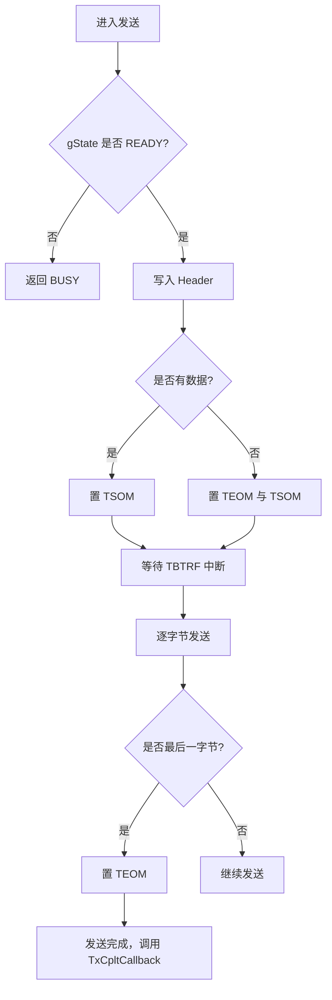

# CEC 消费电子控制接口

<cite>
**本文引用的文件**   
- [stm32f1xx_hal_cec.h](file://Inc/stm32f1xx_hal_cec.h)
- [stm32f1xx_hal_cec.c](file://Src/stm32f1xx_hal_cec.c)
</cite>

## 目录
1. [简介](#简介)
2. [项目结构](#项目结构)
3. [核心数据结构](#核心数据结构)
4. [物理层与硬件参数](#物理层与硬件参数)
5. [架构总览](#架构总览)
6. [API 详解](#api-详解)
7. [典型用例](#典型用例)
8. [CEC 帧格式与位编码](#cec-帧格式与位编码)
9. [错误处理与调试方法](#错误处理与调试方法)
10. [性能与实现特性](#性能与实现特性)
11. [故障排查指南](#故障排查指南)
12. [结论](#结论)

## 简介
本文件为 STM32F1xx HAL 中 CEC（消费电子控制）接口的完整技术文档。目标读者包括嵌入式软件工程师、系统集成人员以及需要理解 HDMI-CEC 物理层与数据链路行为的开发者。文档重点解释：
- `CEC_HandleTypeDef` 与 `CEC_InitTypeDef` 的字段含义与生命周期。
- CEC 物理层相关配置：引脚模式、时钟分频 Prescaler、Bit Timing Error/Bit Free 定时器模式、接收增益等。
- HAL 驱动 API：初始化、中断发送、中断接收、中断处理函数与三类回调。
- CEC 帧格式、位编码、Start/End of Frame、ACK/NACK、重传机制、总线冲突与噪声干扰。
- 面向实际系统的调试方法与最佳实践。

注意：STM32F1xx HAL 中的 CEC 驱动主要提供寄存器级封装、状态机、中断收发流程与回调；具体的 GPIO 复用引脚、Prescaler 数值、Reception Gain 等底层细节由 HAL 宏与寄存器定义共同决定，应用层应结合芯片参考手册进行最终硬件验证。

## 项目结构
本项目包含 HAL 头文件与实现文件两个关键部分：
- `Inc/stm32f1xx_hal_cec.h`：导出类型、枚举、常量、宏与对外 API 声明。
- `Src/stm32f1xx_hal_cec.c`：实现初始化、去初始化、设备地址设置、中断发送、中断接收、中断处理、回调默认实现、获取状态与错误码，以及私有传输/接收逻辑。

**图表来源**
- [stm32f1xx_hal_cec.h:380-559](file://Inc/stm32f1xx_hal_cec.h#L380-L559)
- [stm32f1xx_hal_cec.c:200-300](file://Src/stm32f1xx_hal_cec.c#L200-L300)
- [stm32f1xx_hal_cec.c:600-1009](file://Src/stm32f1xx_hal_cec.c#L600-L1009)

**章节来源**
- [stm32f1xx_hal_cec.h:1-559](file://Inc/stm32f1xx_hal_cec.h#L1-L559)
- [stm32f1xx_hal_cec.c:1-1009](file://Src/stm32f1xx_hal_cec.c#L1-L1009)

## 核心数据结构
### CEC_InitTypeDef
该结构用于描述 CEC 初始化参数：
- `TimingErrorFree`：比特时序误差模式。标准模式或无比特时序误差模式。
- `PeriodErrorFree`：比特周期误差模式。标准模式或灵活模式。
- `OwnAddress`：本机逻辑地址，范围 0x00–0x0F，或“无地址”。
- `RxBuffer`：接收缓冲区指针，必须在初始化时提供。

这些字段在 `HAL_CEC_Init` 中被校验并写入外设寄存器。

### CEC_HandleTypeDef
该句柄维护运行期状态、缓冲区和错误信息：
- `Instance`：CEC 寄存器基地址。
- `Init`：初始化配置。
- `pTxBuffPtr`、`TxXferCount`：发送缓冲指针与剩余字节计数。
- `RxXferSize`：已接收字节数，初始化为特殊值以表示仅收到头部。
- `Lock`：互斥锁，防止并发操作。
- `gState`、`RxState`：全局与接收状态。
- `ErrorCode`：错误码，复制自 ISR 错误状态寄存器。
- 回调指针：可选动态注册时使用。

状态组合遵循 HAL 约定：`RESET`、`READY`、`BUSY_TX`、`BUSY_RX`、`BUSY_RX_TX`、`ERROR`。

**图表来源**
- [stm32f1xx_hal_cec.h:30-120](file://Inc/stm32f1xx_hal_cec.h#L30-L120)

**章节来源**
- [stm32f1xx_hal_cec.h:30-120](file://Inc/stm32f1xx_hal_cec.h#L30-L120)

## 物理层与硬件参数
CEC 的物理层行为由以下参数与外设寄存器共同决定：

| 类别 | 参数或机制 | 说明 |
|---|---|---|
| 引脚配置 | GPIO 复用上拉 | CEC 引脚需配置为复用功能并启用上拉电阻，具体端口与复用号请参考芯片参考手册。HAL 通过 `HAL_CEC_MspInit` 暴露钩子，由用户实现时钟使能与引脚复用。 |
| 时钟分频 | Prescaler | HAL 初始化中根据 PCLK1 频率计算 50 微秒时间基准，写入 PRES 寄存器。这是 CEC 定时的重要基础。 |
| 比特时序误差模式 | Bit Timing Error Mode | `CEC_BIT_TIMING_ERROR_MODE_STANDARD` 或 `CEC_BIT_TIMING_ERROR_MODE_ERRORFREE`。后者可抑制比特时序误差检测。 |
| 比特周期误差模式 | Bit Period Error Mode | `CEC_BIT_PERIOD_ERROR_MODE_STANDARD` 或 `CEC_BIT_PERIOD_ERROR_MODE_FLEXIBLE`。灵活模式放宽对比特周期的要求。 |
| 本机地址 | Own Address | 支持逻辑地址 0x00–0x0F，或关闭本机地址匹配。 |
| 接收增益 | Reception Gain | 在 STM32F1xx HAL 提供的 CEC 接口中未见直接可调的 Reception Gain 字段；若平台存在该寄存器，则需在参考手册确认并通过 HAL 扩展访问。当前 HAL 未暴露该配置项。 |

需要注意：
- HAL 初始化会将 `TimingErrorFree` 与 `PeriodErrorFree` 写入 CFGR 寄存器。
- HAL 初始化会禁用外设、写入 OAR、配置 Prescaler、启用中断、最后启用外设。
- 用户必须实现 `HAL_CEC_MspInit` 来开启 CEC 时钟、配置 CEC 引脚为上拉复用，并在需要时配置 NVIC。

**图表来源**
- [stm32f1xx_hal_cec.c:200-300](file://Src/stm32f1xx_hal_cec.c#L200-L300)

**章节来源**
- [stm32f1xx_hal_cec.h:200-300](file://Inc/stm32f1xx_hal_cec.h#L200-L300)
- [stm32f1xx_hal_cec.c:200-300](file://Src/stm32f1xx_hal_cec.c#L200-L300)

## 架构总览
CEC HAL 采用典型的 HAL 分层架构：
- 应用层调用 `HAL_CEC_Init`、`HAL_CEC_Transmit_IT`、`HAL_CEC_IRQHandler`。
- HAL 层管理状态机、缓冲区和中断流程。
- 用户层通过 `HAL_CEC_MspInit` 和回调函数扩展硬件抽象与应用逻辑。

**图表来源**
- [stm32f1xx_hal_cec.c:200-300](file://Src/stm32f1xx_hal_cec.c#L200-L300)

## API 详解
### 初始化与去初始化
- `HAL_CEC_Init`
  - 校验句柄与参数。
  - 调用 `MspInitCallback` 或 `HAL_CEC_MspInit` 完成底层硬件初始化。
  - 禁用外设、写入 CFGR、写入 OAR、配置 Prescaler、启用中断、启用外设。
  - 更新状态为 `READY`。
- `HAL_CEC_DeInit`
  - 调用去初始化回调或默认 `HAL_CEC_MspDeInit`。
  - 复位 CEC 时钟域，重置句柄状态。

**章节来源**
- [stm32f1xx_hal_cec.c:200-300](file://Src/stm32f1xx_hal_cec.c#L200-L300)
- [stm32f1xx_hal_cec.c:300-400](file://Src/stm32f1xx_hal_cec.c#L300-L400)

### 设备地址设置
- `HAL_CEC_SetDeviceAddress`
  - 仅在 `READY` 状态下允许修改。
  - 禁用外设后写入 OAR；若地址为“无”，则清除 OA 位。
  - 重新启用外设。

**章节来源**
- [stm32f1xx_hal_cec.c:400-500](file://Src/stm32f1xx_hal_cec.c#L400-L500)

### 发送与接收
- `HAL_CEC_Transmit_IT`
  - 校验目的地址、源地址与消息长度。
  - 设置发送缓冲指针与剩余字节数。
  - 写入首字节作为 Header：源地址左移 4 位后与目的地址拼接。
  - 若 Size 非零，置 TSOM；若 Size 为零，同时置 TEOM 与 TSOM，表示仅发送 Header 的 ping。
- `HAL_CEC_GetLastReceivedFrameSize`
  - 返回最近一次接收帧的数据字节数。
- `HAL_CEC_ChangeRxBuffer`
  - 在 `HAL_CEC_RxCpltCallback` 中更换接收缓冲区。

**章节来源**
- [stm32f1xx_hal_cec.c:600-750](file://Src/stm32f1xx_hal_cec.c#L600-L750)

### 中断处理
- `HAL_CEC_IRQHandler`
  - 保存 CSR 标志与 ESR 错误码。
  - 清除 TX/RX 错误标志，并将相应状态重置为 `READY`。
  - 若存在错误，调用错误回调。
  - 若发生 TBTRF，调用私有 `CEC_Transmit_IT`。
  - 若发生 RBTF，初始化或继续接收，调用私有 `CEC_Receive_IT`。

**章节来源**
- [stm32f1xx_hal_cec.c:750-850](file://Src/stm32f1xx_hal_cec.c#L750-L850)

### 回调函数
- `HAL_CEC_TxCpltCallback`
  - 发送完成时的弱实现，用户可在应用文件中重写。
- `HAL_CEC_RxCpltCallback`
  - 接收完成时的弱实现，参数为帧大小。
- `HAL_CEC_ErrorCallback`
  - 错误处理时的弱实现。

回调可通过动态注册 API 替换默认实现，前提是编译宏 `USE_HAL_CEC_REGISTER_CALLBACKS` 启用。

**章节来源**
- [stm32f1xx_hal_cec.c:850-1009](file://Src/stm32f1xx_hal_cec.c#L850-L1009)

### 状态与错误查询
- `HAL_CEC_GetState`
  - 合并 `gState` 与 `RxState` 返回当前整体状态。
- `HAL_CEC_GetError`
  - 返回最近一次记录的错误码。

**章节来源**
- [stm32f1xx_hal_cec.c:900-1000](file://Src/stm32f1xx_hal_cec.c#L900-L1000)

## 典型用例
### 1. CEC 命令发送与响应
步骤：
1. 在 `HAL_CEC_MspInit` 中启用 CEC 时钟、配置 CEC 引脚为复用上拉、配置 NVIC。
2. 调用 `HAL_CEC_Init`，配置时序模式、周期模式、本机地址与接收缓冲区。
3. 调用 `HAL_CEC_Transmit_IT`，传入源地址、目的地址、数据指针与长度。
4. 在中断中，等待 TBTRF 触发私有发送逻辑；全部字节发送完成后调用 `HAL_CEC_TxCpltCallback`。
5. 在 `HAL_CEC_RxCpltCallback` 中处理响应帧，必要时使用 `HAL_CEC_ChangeRxBuffer` 切换下一轮接收缓冲。

**图表来源**
- [stm32f1xx_hal_cec.c:600-1009](file://Src/stm32f1xx_hal_cec.c#L600-L1009)

### 2. 广播帧处理
- 目的地址为广播逻辑地址（HAL 文档指出 4 位逻辑地址，广播为目的地址 0xF）。
- 所有节点均应监听广播帧；本地节点在 `HAL_CEC_RxCpltCallback` 中解析帧内容并执行对应动作。
- 广播帧通常不期望点对点 ACK，但 CEC 协议仍可能产生 ACK/NACK 语义，需结合协议栈实现。

### 3. 目标地址与源地址匹配
- 发送时：Header 包含源地址与目的地址。
- 接收时：CEC 外设根据 OAR 与协议规则判断是否为本机帧；若启用了本机地址，外设会自动匹配本机逻辑地址。
- 应用层应在 `HAL_CEC_RxCpltCallback` 中进一步校验源地址与目的地址，确保只处理目标为自身或广播的帧。

**章节来源**
- [stm32f1xx_hal_cec.c:600-850](file://Src/stm32f1xx_hal_cec.c#L600-L850)
- [stm32f1xx_hal_cec.h:200-300](file://Inc/stm32f1xx_hal_cec.h#L200-L300)

## CEC 帧格式与位编码
CEC 帧由 Header Block、Data Blocks 与 Acknowledge 组成：
- Header Block：包含源地址与目的地址。源地址占高 4 位，目的地址占低 4 位。
- Data Blocks：Opcode 与最多 14 个 Operands，合计不超过 15 字节。
- Acknowledge：每个字节之后应有 ACK/NACK 信号。
- Start/End of Frame：TSOM 表示发送起始，TEOM 表示发送结束；RSOM/REOM 对应接收侧。
- 位编码：CEC 使用曼彻斯特编码，起始位与时钟基准由 Prescaler 与外设定时机制保证。

HAL 层负责：
- 将 Header 写入 TXD。
- 按 TBTRF 中断逐字节发送，最后一个字节置 TEOM。
- 接收时从 RXD 读取数据，直到 REOM 标志指示帧结束。
- 在接收过程中写入 0x00 以 ACK 已接收字节。

**图表来源**
- [stm32f1xx_hal_cec.c:600-1009](file://Src/stm32f1xx_hal_cec.c#L600-L1009)
- [stm32f1xx_hal_cec.h:200-300](file://Inc/stm32f1xx_hal_cec.h#L200-L300)

## 错误处理与调试方法
### 错误码
HAL 支持的错误类型包括：
- 比特时序错误（BTE）
- 比特周期错误（BPE）
- 接收块传输结束错误（RBTFE）
- 起始位错误（SBE）
- 块确认错误（ACKE）
- 线路错误（LINE）
- 发送块传输结束错误（TBTFE）
- 无效回调（INVALID_CALLBACK）

错误码保存在 `hcec->ErrorCode`，并通过 `HAL_CEC_GetError` 查询。

### 常见错误原因
- BTE/BPE：时钟频率偏差或 Prescaler 配置不当导致时序异常。
- SBE：起始位采样失败，可能由总线噪声或电气问题引起。
- ACKE：接收方未正确 ACK，可能因协议栈未处理或对方设备异常。
- LINE：总线电平异常，可能与布线、终端电阻或电源噪声有关。
- TBTFE/RBTFE：传输/接收块结束时出现异常，可能由于帧长度错误或协议不一致。

### 调试建议
- 使用逻辑分析仪抓取 CEC 总线波形，验证曼彻斯特编码、起始/结束位、ACK/NACK 序列。
- 检查 Prescaler 是否正确根据 PCLK1 计算得到 50us 基准。
- 检查 GPIO 上拉电阻与布线质量，避免总线短路或强噪声。
- 在 `HAL_CEC_ErrorCallback` 中记录错误码与上下文，定位问题阶段。
- 在 `HAL_CEC_RxCpltCallback` 中打印帧内容与长度，验证协议栈解析。
- 逐步关闭 Flex 模式或 Error-Free 模式，对比行为差异，判断是否为时序容差问题。

**章节来源**
- [stm32f1xx_hal_cec.h:200-250](file://Inc/stm32f1xx_hal_cec.h#L200-L250)
- [stm32f1xx_hal_cec.c:750-900](file://Src/stm32f1xx_hal_cec.c#L750-L900)

## 性能与实现特性
- 中断驱动：发送与接收均基于中断，减少 CPU 占用。
- 状态机：使用 `gState` 与 `RxState` 区分全局与接收状态，避免并发冲突。
- 锁定机制：通过 `Lock` 保护初始化与地址修改等临界区。
- 回调可扩展：支持动态注册回调，便于多任务或多实例场景。
- 帧长度限制：消息负载最大 15 字节，HAL 通过宏校验。
- 错误快速恢复：错误发生后重置状态并调用错误回调，应用层可决定重试策略。

**图表来源**
- [stm32f1xx_hal_cec.c:600-850](file://Src/stm32f1xx_hal_cec.c#L600-L850)

**章节来源**
- [stm32f1xx_hal_cec.c:600-1009](file://Src/stm32f1xx_hal_cec.c#L600-L1009)

## 故障排查指南
### 初始化失败
- 检查 `RxBuffer` 是否为空。
- 检查 `TimingErrorFree`、`PeriodErrorFree`、`OwnAddress` 是否有效。
- 检查 `HAL_CEC_MspInit` 是否启用 CEC 时钟与 GPIO。

### 发送卡住
- 检查是否重复调用发送且 `gState` 不为 `READY`。
- 检查 NVIC 是否启用 CEC 中断。
- 检查是否存在总线冲突或 ACK 失败。

### 接收不完整
- 检查 `RxXferSize` 是否在回调中被正确更新。
- 检查是否及时 ACK 每个接收字节。
- 检查是否存在 REOM 标志未被识别。

### 频繁错误回调
- 记录 `ErrorCode`，分析具体错误类型。
- 检查 Prescaler 与时钟频率是否匹配。
- 检查 CEC 总线布线、终端电阻与电源噪声。

**章节来源**
- [stm32f1xx_hal_cec.c:200-300](file://Src/stm32f1xx_hal_cec.c#L200-L300)
- [stm32f1xx_hal_cec.c:750-900](file://Src/stm32f1xx_hal_cec.c#L750-L900)

## 结论
STM32F1xx HAL 的 CEC 接口提供了完整的初始化、发送、接收、中断处理与回调框架。其物理层关键参数包括：
- 引脚复用与上拉。
- Prescaler 生成的 50us 时间基准。
- Bit Timing Error 与 Bit Period Error 模式。
- 本机逻辑地址与广播/单播帧处理。
- 错误码与回调机制。

应用层应结合芯片参考手册与 HDMI-CEC 协议规范，完善 GPIO/NVIC 配置、协议栈解析、重传与仲裁逻辑，并使用逻辑分析仪进行系统级调试。通过合理配置 Prescaler、Error-Free/Flex 模式与回调策略，可在复杂电视与音视频设备环境中获得稳定可靠的 CEC 通信能力。