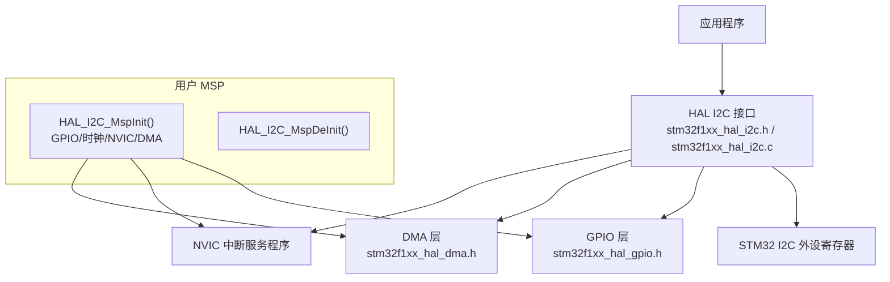
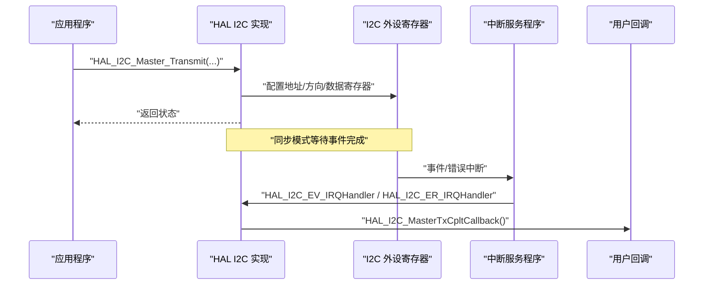
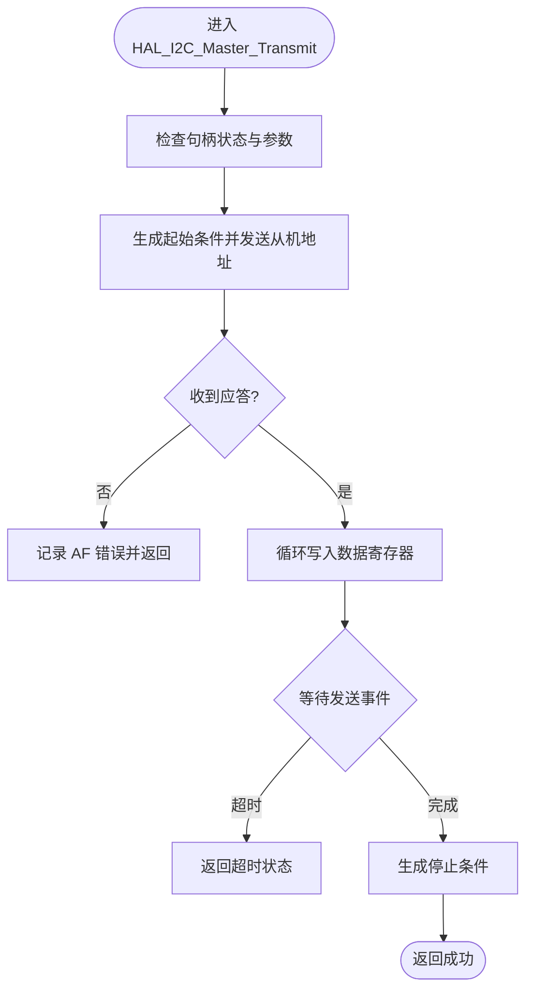
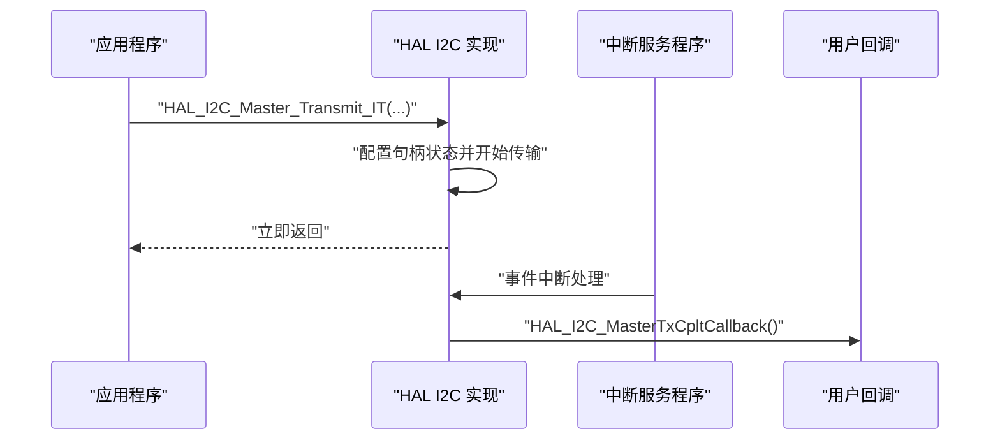
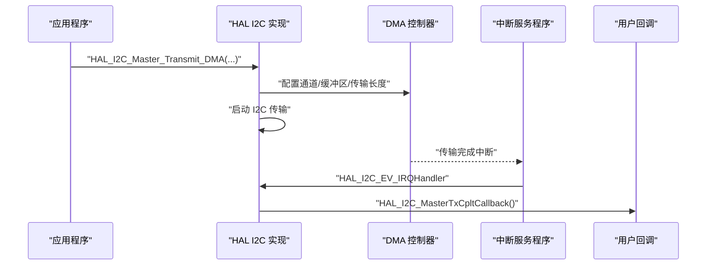
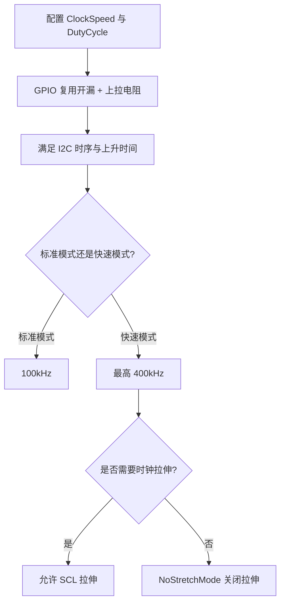

# I2C 通信接口

<cite>
**本文引用的文件**   
- [stm32f1xx_hal_i2c.h](file://Inc/stm32f1xx_hal_i2c.h)
- [stm32f1xx_hal_i2c.c](file://Src/stm32f1xx_hal_i2c.c)
- [stm32f1xx_hal_gpio.h](file://Inc/stm32f1xx_hal_gpio.h)
- [stm32f1xx_hal_dma.h](file://Inc/stm32f1xx_hal_dma.h)
</cite>

## 目录
1. [简介](#简介)
2. [项目结构](#项目结构)
3. [核心数据结构与配置项](#核心数据结构与配置项)
4. [架构总览](#架构总览)
5. [关键函数与传输路径](#关键函数与传输路径)
6. [从机、多主机与总线行为](#从机多主机与总线行为)
7. [典型用例](#典型用例)
8. [时序与硬件约束](#时序与硬件约束)
9. [错误码与调试指南](#错误码与调试指南)
10. [性能与可靠性建议](#性能与可靠性建议)
11. [结论](#结论)

## 简介
本文件面向使用 STM32F1xx HAL 的 I2C 驱动开发者，系统化说明：
- I2C 句柄与配置结构体。
- MSP 钩子中 GPIO、中断和 DMA 的配置职责。
- 主机发送/接收、从机发送/接收、设备就绪检测、内存读写等 API。
- 同步轮询、异步中断、DMA 三种传输模式。
- 重复起始条件、NACK 与总线错误处理。
- 时序、时钟拉伸、SCL/SDA 上升时间、频率限制、总线竞争与超时参数。
- 逻辑分析仪、错误码等常见调试方法。

## 项目结构
I2C 功能由头文件声明接口与类型，实现文件提供初始化、IO、内存访问、中断/DMA 回调及状态/错误查询函数。MSP 钩子位于用户代码中，负责引脚、时钟、NVIC 和 DMA 的底层配置。

**图示来源**   
- [stm32f1xx_hal_i2c.h:541-618](file://Inc/stm32f1xx_hal_i2c.h#L541-L618)
- [stm32f1xx_hal_i2c.c:463-7669](file://Src/stm32f1xx_hal_i2c.c#L463-L7669)

**章节来源**   
- [stm32f1xx_hal_i2c.h:47-243](file://Inc/stm32f1xx_hal_i2c.h#L47-L243)
- [stm32f1xx_hal_i2c.c:1-200](file://Src/stm32f1xx_hal_i2c.c#L1-L200)

## 核心数据结构与配置项

### I2C_HandleTypeDef 句柄
句柄是 HAL I2C 模块的状态中心，保存：
- 外设基地址指针。
- I2C_InitTypeDef 配置对象。
- 传输缓冲区指针、长度与计数。
- 传输选项、当前状态、模式、错误码。
- 可替换的用户回调，包括主/从发送/接收完成、监听、内存传输、错误、中止、地址匹配、MSP 初始化/反初始化回调。

该句柄使同步、异步、DMA 以及顺序传输共享同一套上下文。

**章节来源**   
- [stm32f1xx_hal_i2c.h:185-243](file://Inc/stm32f1xx_hal_i2c.h#L185-L243)
- [stm32f1xx_hal_i2c.h:627-629](file://Inc/stm32f1xx_hal_i2c.h#L627-L629)

### I2C_InitTypeDef 配置项
| 字段 | 含义 | 重要约束或用法 |
|---|---|---|
| ClockSpeed | I2C 时钟频率 | 必须低于 400kHz；标准模式通常为 100kHz，快速模式可达 400kHz。 |
| DutyCycle | 快速模式下占空比 | 用于快速模式下的 SCL 高/低电平比例。 |
| OwnAddress1 | 本机第一地址 | 支持 7 位或 10 位地址，取决于 AddressingMode。 |
| AddressingMode | 寻址模式 | 选择 7 位或 10 位地址模式。 |
| DualAddressMode | 双地址模式 | 允许 I2C 以两个不同地址被主机识别。 |
| OwnAddress2 | 第二地址 | 仅在启用双地址模式时有效，通常为 7 位地址。 |
| GeneralCallMode | 通用呼叫模式 | 是否响应 I2C 通用广播地址。 |
| NoStretchMode | 禁止时钟拉伸 | 关闭 SCL 拉伸能力；若外设或从机依赖拉伸，应保留默认开启。 |

这些字段在调用 HAL_I2C_Init 时生效，影响外设寄存器、地址匹配、应答策略、时钟生成与事件处理。

**章节来源**   
- [stm32f1xx_hal_i2c.h:47-73](file://Inc/stm32f1xx_hal_i2c.h#L47-L73)
- [stm32f1xx_hal_i2c.c:463-577](file://Src/stm32f1xx_hal_i2c.c#L463-L577)

### HAL 状态、模式与错误码
- 状态枚举涵盖复位、就绪、忙、忙发送、忙接收、监听、中止、超时、错误等状态。
- 模式枚举区分无通信、主机、从机和内存模式。
- 错误码包含无错误、总线错误、仲裁丢失、应答失败、溢出、DMA 错误、超时、大小管理错误、DMA 参数错误、起始条件错误等。

**章节来源**   
- [stm32f1xx_hal_i2c.h:108-169](file://Inc/stm32f1xx_hal_i2c.h#L108-L169)

## 架构总览
I2C HAL 采用分层设计：
- 应用层调用 HAL_I2C_Master_Transmit/Receive、HAL_I2C_Slave_Transmit/Receive、HAL_I2C_Mem_Write/Read、HAL_I2C_IsDeviceReady 等高层函数。
- HAL 根据同步、中断或 DMA 模式设置外设寄存器、启动传输、维护句柄状态。
- 外设通过事件/错误中断触发 HAL 内部处理，最终调用用户回调或返回状态。
- MSP 钩子提供平台相关资源初始化，包括 GPIO、中断向量优先级和 DMA 通道。

**图示来源**   
- [stm32f1xx_hal_i2c.c:1074-1194](file://Src/stm32f1xx_hal_i2c.c#L1074-L1194)
- [stm32f1xx_hal_i2c.c:1744-1899](file://Src/stm32f1xx_hal_i2c.c#L1744-L1899)
- [stm32f1xx_hal_i2c.c:607-618](file://Inc/stm32f1xx_hal_i2c.h#L607-L618)

## 关键函数与传输路径

### 同步（轮询）传输
- HAL_I2C_Master_Transmit：主机发送数据，阻塞等待完成或超时。
- HAL_I2C_Master_Receive：主机接收数据，阻塞等待完成或超时。
- HAL_I2C_Slave_Transmit：从机发送数据，阻塞等待完成或超时。
- HAL_I2C_Slave_Receive：从机接收数据，阻塞等待完成或超时。
- HAL_I2C_Mem_Write：向目标设备的内存地址写入数据，通常先写地址再写数据。
- HAL_I2C_Mem_Read：从目标设备的内存地址读取数据，通常先写内存地址再发起读操作。
- HAL_I2C_IsDeviceReady：向指定地址发送空闲检测序列，判断设备是否存在并准备通信。

同步模式适合简单任务、少量数据传输或对实时性要求不高的场景。其优点是实现直观，缺点是占用 CPU。

**图示来源**   
- [stm32f1xx_hal_i2c.c:1074-1194](file://Src/stm32f1xx_hal_i2c.c#L1074-L1194)

**章节来源**   
- [stm32f1xx_hal_i2c.h:563-569](file://Inc/stm32f1xx_hal_i2c.h#L563-L569)
- [stm32f1xx_hal_i2c.c:1074-1194](file://Src/stm32f1xx_hal_i2c.c#L1074-L1194)
- [stm32f1xx_hal_i2c.c:1195-1492](file://Src/stm32f1xx_hal_i2c.c#L1195-L1492)
- [stm32f1xx_hal_i2c.c:1493-1622](file://Src/stm32f1xx_hal_i2c.c#L1493-L1622)
- [stm32f1xx_hal_i2c.c:1623-1743](file://Src/stm32f1xx_hal_i2c.c#L1623-L1743)
- [stm32f1xx_hal_i2c.c:2560-2682](file://Src/stm32f1xx_hal_i2c.c#L2560-L2682)
- [stm32f1xx_hal_i2c.c:2683-2983](file://Src/stm32f1xx_hal_i2c.c#L2683-L2983)
- [stm32f1xx_hal_i2c.c:3534-3700](file://Src/stm32f1xx_hal_i2c.c#L3534-L3700)

### 异步（中断）传输
- HAL_I2C_Master_Transmit_IT / HAL_I2C_Master_Receive_IT
- HAL_I2C_Slave_Transmit_IT / HAL_I2C_Slave_Receive_IT
- HAL_I2C_Mem_Write_IT / HAL_I2C_Mem_Read_IT
- HAL_I2C_Master_Seq_Transmit_IT / HAL_I2C_Master_Seq_Receive_IT
- HAL_I2C_Slave_Seq_Transmit_IT / HAL_I2C_Slave_Seq_Receive_IT

中断模式在启动后释放 CPU，传输过程中由事件中断和错误中断驱动，完成后调用对应回调。适合中等数据量、需要与其他任务并行处理的系统。

**图示来源**   
- [stm32f1xx_hal_i2c.c:1744-1899](file://Src/stm32f1xx_hal_i2c.c#L1744-L1899)
- [stm32f1xx_hal_i2c.c:1821-1899](file://Src/stm32f1xx_hal_i2c.c#L1821-L1899)
- [stm32f1xx_hal_i2c.c:2984-3159](file://Src/stm32f1xx_hal_i2c.c#L2984-L3159)
- [stm32f1xx_hal_i2c.c:3069-3159](file://Src/stm32f1xx_hal_i2c.c#L3069-L3159)

**章节来源**   
- [stm32f1xx_hal_i2c.h:572-584](file://Inc/stm32f1xx_hal_i2c.h#L572-L584)
- [stm32f1xx_hal_i2c.c:1744-1899](file://Src/stm32f1xx_hal_i2c.c#L1744-L1899)
- [stm32f1xx_hal_i2c.c:2984-3159](file://Src/stm32f1xx_hal_i2c.c#L2984-L3159)

### DMA 传输
- HAL_I2C_Master_Transmit_DMA / HAL_I2C_Master_Receive_DMA
- HAL_I2C_Slave_Transmit_DMA / HAL_I2C_Slave_Receive_DMA
- HAL_I2C_Mem_Write_DMA / HAL_I2C_Mem_Read_DMA
- HAL_I2C_Master_Seq_Transmit_DMA / HAL_I2C_Master_Seq_Receive_DMA
- HAL_I2C_Slave_Seq_Transmit_DMA / HAL_I2C_Slave_Seq_Receive_DMA

DMA 模式将大量数据搬运交给 DMA 控制器，CPU 仅负责启动和收尾。适合大数据块传输或低功耗场景。

**图示来源**   
- [stm32f1xx_hal_i2c.c:2027-2330](file://Src/stm32f1xx_hal_i2c.c#L2027-L2330)
- [stm32f1xx_hal_i2c.c:2180-2330](file://Src/stm32f1xx_hal_i2c.c#L2180-L2330)
- [stm32f1xx_hal_i2c.c:3160-3533](file://Src/stm32f1xx_hal_i2c.c#L3160-L3533)

**章节来源**   
- [stm32f1xx_hal_i2c.h:588-598](file://Inc/stm32f1xx_hal_i2c.h#L588-L598)
- [stm32f1xx_hal_i2c.c:2027-2330](file://Src/stm32f1xx_hal_i2c.c#L2027-L2330)
- [stm32f1xx_hal_i2c.c:3160-3533](file://Src/stm32f1xx_hal_i2c.c#L3160-L3533)

### 设备就绪检测
HAL_I2C_IsDeviceReady 通过多次尝试向目标地址发送空闲检测序列来确认设备是否在线。Trials 控制重试次数，Timeout 控制每次尝试的超时。适用于上电初始化阶段或热插拔检测。

**章节来源**   
- [stm32f1xx_hal_i2c.h:569](file://Inc/stm32f1xx_hal_i2c.h#L569)
- [stm32f1xx_hal_i2c.c:3534-3700](file://Src/stm32f1xx_hal_i2c.c#L3534-L3700)

## 从机、多主机与总线行为

### 从机模式
- 从机发送/接收使用 HAL_I2C_Slave_Transmit/Receive 及其 IT/DMA 版本。
- 从机监听模式可通过 HAL_I2C_EnableListen_IT / HAL_I2C_DisableListen_IT 启用，并在地址匹配时触发 HAL_I2C_AddrCallback。
- 句柄状态中的 LISTEN、BUSY_TX_LISTEN、BUSY_RX_LISTEN 表示从机正在监听地址或同时进行收发。

**章节来源**   
- [stm32f1xx_hal_i2c.h:113-120](file://Inc/stm32f1xx_hal_i2c.h#L113-L120)
- [stm32f1xx_hal_i2c.h:583-584](file://Inc/stm32f1xx_hal_i2c.h#L583-L584)
- [stm32f1xx_hal_i2c.h:613-614](file://Inc/stm32f1xx_hal_i2c.h#L613-L614)
- [stm32f1xx_hal_i2c.c:1493-1743](file://Src/stm32f1xx_hal_i2c.c#L1493-L1743)

### 多主机仲裁
当多个主机同时发起 I2C 通信时，I2C 总线通过线“与”机制进行仲裁。若发生仲裁丢失，HAL 会记录 ARLO 错误。多主机场景下应注意：
- 避免长时间占用总线。
- 合理设置超时与重试。
- 在中断或 DMA 模式下减少临界区时间。
- 使用合理的总线拓扑和终端电阻。

**章节来源**   
- [stm32f1xx_hal_i2c.h:165](file://Inc/stm32f1xx_hal_i2c.h#L165)
- [stm32f1xx_hal_i2c.h:164-169](file://Inc/stm32f1xx_hal_i2c.h#L164-L169)

### 重复起始条件
重复起始条件常用于“写寄存器地址 + 读数据”或连续分帧传输。HAL 提供顺序传输接口并通过 XferOptions 控制起始与停止位置，例如 FIRST_FRAME、NEXT_FRAME、LAST_FRAME、OTHER_FRAME 等。这类接口在 MEM 读、传感器寄存器扫描和多段数据流中非常有用。

**章节来源**   
- [stm32f1xx_hal_i2c.c:1-200](file://Src/stm32f1xx_hal_i2c.c#L1-L200)
- [stm32f1xx_hal_i2c.h:579-598](file://Inc/stm32f1xx_hal_i2c.h#L579-L598)

### NACK 检测与应答
- 从机未准备好或地址不匹配时可能返回 NACK，HAL 将其视为 AF 错误。
- 主机在接收最后字节前应正确配置 ACK/NAK，否则可能产生后续 NACK。
- NoStretchMode 为禁用时钟拉伸时应谨慎使用，因为部分从机依赖 SCL 拉伸缓冲数据。

**章节来源**   
- [stm32f1xx_hal_i2c.h:47-73](file://Inc/stm32f1xx_hal_i2c.h#L47-L73)
- [stm32f1xx_hal_i2c.h:166](file://Inc/stm32f1xx_hal_i2c.h#L166)
- [stm32f1xx_hal_i2c.c:1074-1194](file://Src/stm32f1xx_hal_i2c.c#L1074-L1194)

## 典型用例

### 写寄存器并读取传感器数据
典型流程：
1. 初始化 I2C、GPIO、中断或 DMA。
2. 可选调用 HAL_I2C_IsDeviceReady 检测设备。
3. 调用 HAL_I2C_Mem_Write 写入传感器寄存器地址。
4. 调用 HAL_I2C_Mem_Read 读取传感器数据。
5. 检查返回值和错误码，必要时重试或上报故障。

该用例本质上是“写地址 + 读数据”，内部会使用重复起始条件。

**章节来源**   
- [stm32f1xx_hal_i2c.c:2560-2983](file://Src/stm32f1xx_hal_i2c.c#L2560-L2983)
- [stm32f1xx_hal_i2c.c:3534-3700](file://Src/stm32f1xx_hal_i2c.c#L3534-L3700)

### 连续读取 EEPROM
EEPROM 通常支持页写和顺序读。建议：
- 写操作注意页边界，避免跨页写入导致数据错乱。
- 读操作可使用顺序传输接口保持重复起始条件，提高吞吐。
- 对于大数据量优先使用 DMA，减小 CPU 负载。
- 为写周期预留足够延时，遵循器件手册的 Write Cycle Time。

**章节来源**   
- [stm32f1xx_hal_i2c.h:579-598](file://Inc/stm32f1xx_hal_i2c.h#L579-L598)
- [stm32f1xx_hal_i2c.c:2560-3533](file://Src/stm32f1xx_hal_i2c.c#L2560-L3533)

### 从机应答设备
从机模式常用于 MCU 作为 I2C 从设备响应上位机或其他主控：
- 配置 OwnAddress1 或双地址模式。
- 启用监听模式并实现 HAL_I2C_AddrCallback。
- 在回调中判断读写方向，分别调用从机发送/接收 API。
- 注意从机必须在合适时机读取/写入数据寄存器，避免 OVR 或 NACK。

**章节来源**   
- [stm32f1xx_hal_i2c.h:47-73](file://Inc/stm32f1xx_hal_i2c.h#L47-L73)
- [stm32f1xx_hal_i2c.h:583-584](file://Inc/stm32f1xx_hal_i2c.h#L583-L584)
- [stm32f1xx_hal_i2c.h:613-614](file://Inc/stm32f1xx_hal_i2c.h#L613-L614)
- [stm32f1xx_hal_i2c.c:1493-1743](file://Src/stm32f1xx_hal_i2c.c#L1493-L1743)

## 时序与硬件约束

### 时钟频率与占空比
- ClockSpeed 必须小于 400kHz。
- 标准模式 100kHz、快速模式 400kHz。
- DutyCycle 仅在快速模式下有意义，用于调节 SCL 高/低电平比例以满足上升/下降时间与占空比要求。

### 时钟拉伸
- NoStretchMode 为关闭拉伸时，从机无法通过拉低 SCL 暂停主机。
- 若外设或从机需要更多时间处理数据，应保持允许时钟拉伸。

### SCL/SDA 上升时间与端口配置
- I2C 使用开漏输出，外部需上拉电阻。
- GPIO 应配置为复用开漏模式，并选择合适的上拉强度。
- 高速模式下对引脚电气特性、走线电容和上拉电阻值更敏感。

### 总线竞争与时序风险
- 多主机并发时可能出现仲裁丢失。
- 长走线和强电容会导致上升时间变慢，可能违反 I2C 时序规范。
- 高频下建议缩短走线、减小电容、使用适当上拉电阻，并进行信号完整性验证。

### 超时参数
- 所有同步 API 均提供 Timeout 参数，用于防止死等。
- IsDeviceReady 还额外提供 Trials 重试次数。
- 超时并非总是代表硬件故障，也可能来自从机忙、总线拥塞或外部干扰。

**图示来源**   
- [stm32f1xx_hal_i2c.h:47-73](file://Inc/stm32f1xx_hal_i2c.h#L47-L73)

**章节来源**   
- [stm32f1xx_hal_i2c.h:47-73](file://Inc/stm32f1xx_hal_i2c.h#L47-L73)
- [stm32f1xx_hal_gpio.h](file://Inc/stm32f1xx_hal_gpio.h)

## 错误码与调试指南

### 主要错误码
| 错误码 | 含义 | 常见原因 |
|---|---|---|
| HAL_I2C_ERROR_NONE | 无错误 | 正常完成。 |
| HAL_I2C_ERROR_BERR | 总线错误 | 非法起始/停止、总线冲突、总线状态异常。 |
| HAL_I2C_ERROR_ARLO | 仲裁丢失 | 多主机竞争或总线噪声。 |
| HAL_I2C_ERROR_AF | 应答失败 | 从机未应答、地址错误、设备未就绪、接收末尾未正确 NACK。 |
| HAL_I2C_ERROR_OVR | 溢出 | 从机未及时读取 RXDR 或主机未及时写入 TXDR。 |
| HAL_I2C_ERROR_TIMEOUT | 超时 | 从机忙、总线阻塞、中断/DMA 未触发。 |
| HAL_I2C_ERROR_SIZE | 大小管理错误 | 期望数据长度与实际不一致。 |
| HAL_I2C_ERROR_DMA | DMA 传输错误 | DMA 配置错误或传输未完成。 |
| HAL_I2C_ERROR_DMA_PARAM | DMA 参数错误 | DMA 句柄或参数无效。 |
| HAL_I2C_WRONG_START | 起始条件错误 | 起始条件未按协议生成。 |

### 调试方法
- 使用逻辑分析仪捕获 SCL/SDA，检查起始、停止、地址字节、数据字节、ACK/NACK、重复起始和停止条件。
- 核对 I2C 地址、读写方向、寄存器地址宽度。
- 逐步缩小问题范围：先测 IsDeviceReady，再测 Mem_Write，最后测 Mem_Read。
- 降低 I2C 频率或增大上拉电阻，排除信号完整性问题。
- 检查中断优先级与 DMA 配置，避免 ISR 延迟过大导致 OVR。
- 在回调和错误处理中添加日志，记录错误码、剩余长度、当前状态和模式。

**章节来源**   
- [stm32f1xx_hal_i2c.h:163-169](file://Inc/stm32f1xx_hal_i2c.h#L163-L169)
- [stm32f1xx_hal_i2c.h:627-629](file://Inc/stm32f1xx_hal_i2c.h#L627-L629)
- [stm32f1xx_hal_i2c.c:1074-1194](file://Src/stm32f1xx_hal_i2c.c#L1074-L1194)

## 性能与可靠性建议
- 小数据量、简单逻辑优先使用同步模式，便于理解和调试。
- 中大数据量或需要与其他任务协作时使用中断模式。
- 大批量数据优先使用 DMA，并配合顺序传输接口减少重复起始开销。
- 合理设置 Timeout，避免长期阻塞；对关键路径增加重试与降级策略。
- 在多主机环境中控制总线占用时间，避免频繁冲突。
- 在快速模式下关注引脚电气特性和 PCB 布局，必要时降低频率。
- 从机实现应尽快响应地址匹配并及时读写数据寄存器，避免 OVR 与 NACK。
- 使用 HAL_I2C_GetState/HAL_I2C_GetError 定期检查状态，结合日志定位问题。

[本节为通用指导，不直接分析具体源码文件]

## 结论
STM32F1xx HAL I2C 接口通过统一的 I2C_HandleTypeDef 句柄，将同步、异步和 DMA 三种传输路径整合在一起，并提供丰富的状态、模式和错误信息。正确配置 I2C_InitTypeDef、GPIO、中断和 DMA，并理解重复起始条件、NACK、总线错误和多主机仲裁，是稳定实现传感器读取、EEPROM 访问和从机应答的关键。在实际项目中，应结合逻辑分析仪、错误码和设备手册，持续优化时序、频率、超时和错误恢复策略。