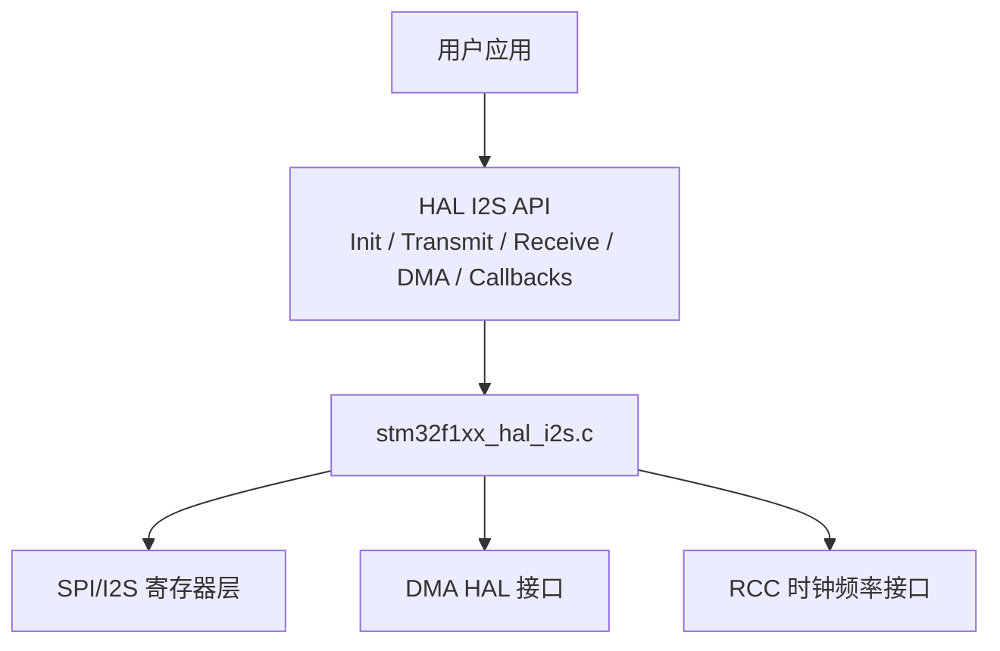
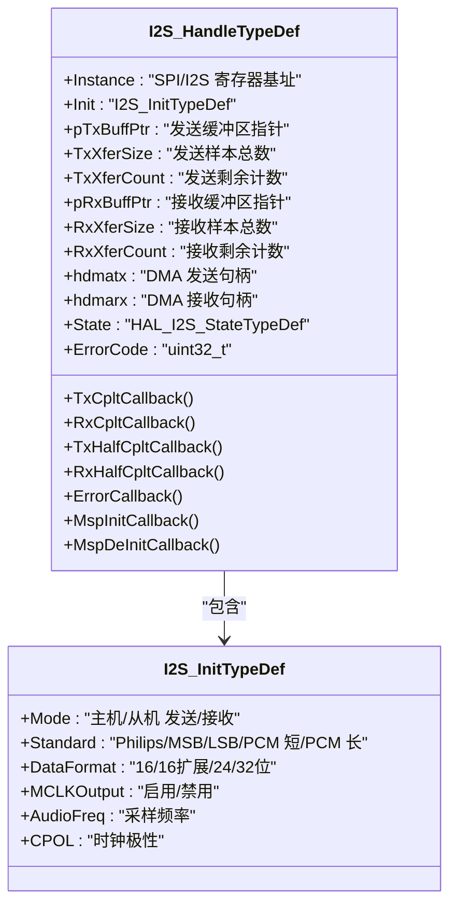
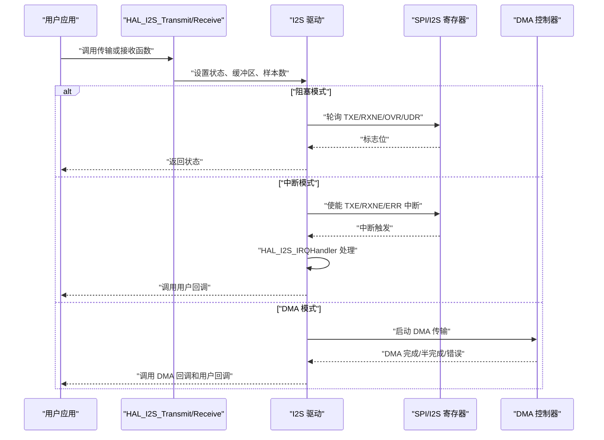
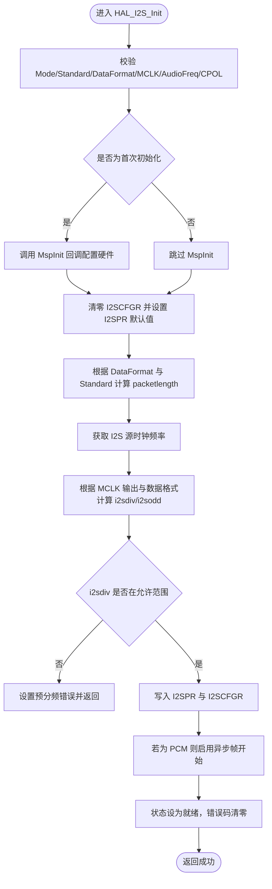
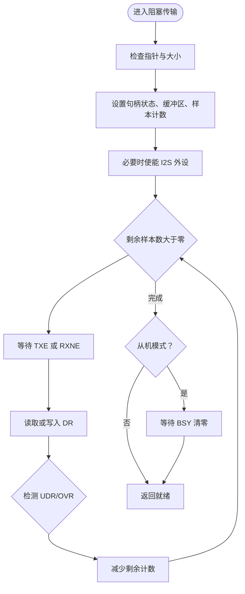
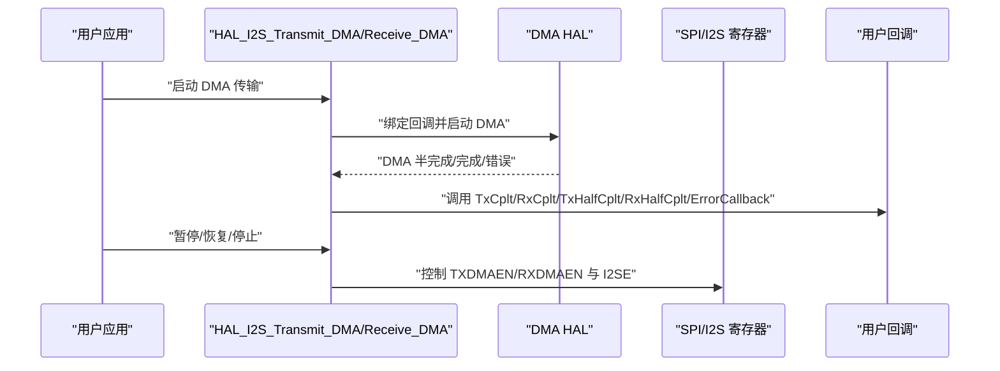
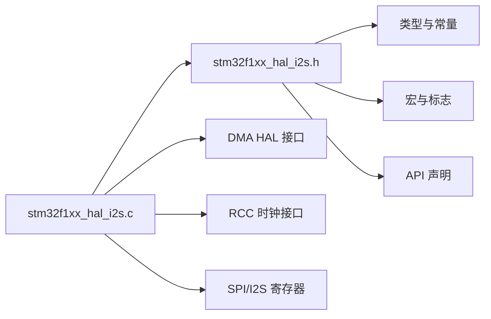

# I2S 音频接口

<cite>
**本文引用的文件**   
- [stm32f1xx_hal_i2s.h](file://Inc/stm32f1xx_hal_i2s.h)
- [stm32f1xx_hal_i2s.c](file://Src/stm32f1xx_hal_i2s.c)
</cite>

## 目录
1. [引言](#引言)
2. [项目结构](#项目结构)
3. [核心数据结构](#核心数据结构)
4. [架构总览](#架构总览)
5. [详细组件分析](#详细组件分析)
6. [依赖关系分析](#依赖关系分析)
7. [性能与音频质量](#性能与音频质量)
8. [典型应用用例](#典型应用用例)
9. [故障排查指南](#故障排查指南)
10. [结论](#结论)

## 引言
本文面向 STM32F1xx HAL 的 I2S 音频接口，系统化说明以下主题：
- `I2S_HandleTypeDef` 与 `I2S_InitTypeDef` 字段含义、状态机与错误码。
- I2S 模式：主机/从机、发送/接收。
- 音频协议：Philips I2S、MSB、LSB、PCM 短帧/长帧。
- 帧格式：短帧/长帧、数据宽度、声道边沿、时钟极性。
- 标准模式与扩展模式的差异及硬件限制。
- I2S 与 SPI 外设共享寄存器实现的耦合关系。
- 阻塞、中断、DMA 三种传输方式及其回调函数。
- 典型系统：I2S ADC 采集、I2S DAC 播放 PCM、Stereo/TDM 连接 Codec。
- 采样率与 I2S 时钟关系、WS/LRCLK 行为、DMA 环形缓冲、中断延迟对音质的影响、时钟串扰与调试技巧。

## 项目结构
本仓库是 STM32 HAL 驱动工程的一部分。与 I2S 直接相关的代码集中在以下两个文件：
- 头文件 `Inc/stm32f1xx_hal_i2s.h`：定义 I2S 类型、常量、宏和对外 API 声明。
- 实现文件 `Src/stm32f1xx_hal_i2s.c`：实现初始化、IO 操作、中断处理、DMA 回调、状态与错误查询等逻辑。

**图示来源**
- [stm32f1xx_hal_i2s.c:200-280](file://Src/stm32f1xx_hal_i2s.c#L200-L280)
- [stm32f1xx_hal_i2s.c:1200-1400](file://Src/stm32f1xx_hal_i2s.c#L1200-L1400)

**章节来源**
- [stm32f1xx_hal_i2s.h:1-554](file://Inc/stm32f1xx_hal_i2s.h#L1-L554)
- [stm32f1xx_hal_i2s.c:1-200](file://Src/stm32f1xx_hal_i2s.c#L1-L200)

## 核心数据结构
### I2S_InitTypeDef
该结构体描述 I2S 通信参数，包括：
- `Mode`：工作模式（主机/从机、发送/接收）。
- `Standard`：音频协议（Philips、MSB、LSB、PCM 短帧、PCM 长帧）。
- `DataFormat`：数据格式（16 位、16 位扩展、24 位、32 位）。
- `MCLKOutput`：是否输出 MCLK。
- `AudioFreq`：音频采样频率。
- `CPOL`：串行时钟空闲极性。

这些字段在初始化时会被校验，并写入 I2S 配置寄存器，同时参与预分频器计算。

**章节来源**
- [stm32f1xx_hal_i2s.h:28-60](file://Inc/stm32f1xx_hal_i2s.h#L28-L60)
- [stm32f1xx_hal_i2s.h:200-280](file://Inc/stm32f1xx_hal_i2s.h#L200-L280)
- [stm32f1xx_hal_i2s.c:240-420](file://Src/stm32f1xx_hal_i2s.c#L240-L420)

### I2S_HandleTypeDef
该句柄保存运行时状态和传输上下文：
- `Instance`：指向底层 SPI/I2S 寄存器基地址。
- `Init`：当前 I2S 配置。
- `pTxBuffPtr`、`TxXferSize`、`TxXferCount`：发送缓冲区指针、总样本数、剩余计数。
- `pRxBuffPtr`、`RxXferSize`、`RxXferCount`：接收缓冲区指针、总样本数、剩余计数。
- `hdmatx`、`hdmarx`：发送与接收 DMA 句柄。
- `State`：I2S 状态，如复位、就绪、忙、发送中、接收中、超时、错误。
- `ErrorCode`：错误码，如无错误、超时、溢出、欠载、DMA 错误、预分频错误、无效回调、从机接收忙等。
- 可选回调函数：完成、半完成、错误、MspInit/MspDeInit。

**图示来源**
- [stm32f1xx_hal_i2s.h:60-160](file://Inc/stm32f1xx_hal_i2s.h#L60-L160)
- [stm32f1xx_hal_i2s.h:160-200](file://Inc/stm32f1xx_hal_i2s.h#L160-L200)

**章节来源**
- [stm32f1xx_hal_i2s.h:60-160](file://Inc/stm32f1xx_hal_i2s.h#L60-L160)
- [stm32f1xx_hal_i2s.h:160-200](file://Inc/stm32f1xx_hal_i2s.h#L160-L200)

## 架构总览
STM32F1 的 I2S 功能复用 SPI 外设寄存器。HAL 层通过 SPI/I2S 控制寄存器、状态寄存器、数据寄存器以及预分频寄存器配置 I2S。传输路径分为三类：
- 阻塞轮询：`HAL_I2S_Transmit`、`HAL_I2S_Receive`。
- 中断：`HAL_I2S_Transmit_IT`、`HAL_I2S_Receive_IT`，配合 `HAL_I2S_IRQHandler`。
- DMA：`HAL_I2S_Transmit_DMA`、`HAL_I2S_Receive_DMA`，配合 DMA 回调与用户回调。

**图示来源**
- [stm32f1xx_hal_i2s.c:800-1100](file://Src/stm32f1xx_hal_i2s.c#L800-L1100)
- [stm32f1xx_hal_i2s.c:1200-1685](file://Src/stm32f1xx_hal_i2s.c#L1200-L1685)

## 详细组件分析

### 初始化流程与时钟分频
`HAL_I2S_Init` 主要完成：
1. 参数校验：模式、协议、数据格式、MCLK、采样频率、时钟极性。
2. 首次初始化时调用 MSP 初始化回调，配置 GPIO、时钟、NVIC、DMA。
3. 清零 I2S 控制寄存器相关位，并将预分频寄存器设为默认值。
4. 根据数据帧长度、协议类型、MCLK 输出状态计算 I2SDIV 与 ODD。
5. 写入预分频寄存器与控制寄存器，启用 I2S 模式位。
6. 对 PCM 模式启用异步帧开始使能（如果硬件支持）。
7. 更新状态为就绪，清除错误码。

关键点：
- 数据包长度：16 位数据格式为 16，其他为 32；Philips/MSB/LSB 模式下包长度再乘以 2。
- 源时钟：SPI2/SPI3 使用各自 I2S 时钟源，其他实例使用系统时钟。
- MCLK 开启时，预分频公式按 4 倍或 8 倍变化，取决于数据格式。
- 预分频值必须在允许范围内，否则设置预分频错误码并返回错误。

**图示来源**
- [stm32f1xx_hal_i2s.c:240-420](file://Src/stm32f1xx_hal_i2s.c#L240-L420)

**章节来源**
- [stm32f1xx_hal_i2s.c:240-420](file://Src/stm32f1xx_hal_i2s.c#L240-L420)

### I2S 模式与协议
- **模式（Mode）**：
  - `I2S_MODE_SLAVE_TX`：从机发送。
  - `I2S_MODE_SLAVE_RX`：从机接收。
  - `I2S_MODE_MASTER_TX`：主机发送。
  - `I2S_MODE_MASTER_RX`：主机接收。
- **标准（Standard）**：
  - `I2S_STANDARD_PHILIPS`：经典 Philips I2S。
  - `I2S_STANDARD_MSB`：MSB 对齐。
  - `I2S_STANDARD_LSB`：LSB 对齐。
  - `I2S_STANDARD_PCM_SHORT`：PCM 短帧。
  - `I2S_STANDARD_PCM_LONG`：PCM 长帧。
- **数据格式（DataFormat）**：
  - `I2S_DATAFORMAT_16B`：16 位数据帧。
  - `I2S_DATAFORMAT_16B_EXTENDED`：16 位数据扩展。
  - `I2S_DATAFORMAT_24B`：24 位数据帧。
  - `I2S_DATAFORMAT_32B`：32 位数据帧。
- **时钟极性（CPOL）**：
  - `I2S_CPOL_LOW`：时钟空闲低电平。
  - `I2S_CPOL_HIGH`：时钟空闲高电平。
- **MCLK 输出**：
  - `I2S_MCLKOUTPUT_ENABLE`：输出主时钟。
  - `I2S_MCLKOUTPUT_DISABLE`：关闭主时钟。

注意：
- Philips、MSB、LSB 属于标准 I2S 协议族，WS/LRCLK 在数据前一个周期切换。
- PCM 短帧/长帧属于 PCM 协议，帧同步行为不同；长帧需额外同步位。
- 当使用 PCM 长帧且 I2S 为主机时，硬件限制仅支持 16 位无扩展数据格式。

**章节来源**
- [stm32f1xx_hal_i2s.h:100-180](file://Inc/stm32f1xx_hal_i2s.h#L100-L180)
- [stm32f1xx_hal_i2s.h:200-280](file://Inc/stm32f1xx_hal_i2s.h#L200-L280)
- [stm32f1xx_hal_i2s.c:200-280](file://Src/stm32f1xx_hal_i2s.c#L200-L280)

### 帧格式、声道边沿与 WS/LRCLK
- 帧长度由数据格式决定：16 位格式下单通道数据占 16 位，双声道时一帧包含左右两通道；24/32 位格式下单通道数据占相应位数。
- 声道边沿由 `CHSIDE` 标志指示，表示当前传输的是左声道还是右声道。
- WS/LRCLK 行为：
  - Philips/MSB/LSB：每个声道数据前有一个时钟周期用于标识声道。
  - PCM：帧同步信号行为与 PCM 协议一致，长帧模式需要额外的同步位。
- 数据宽度与声道组合决定了每帧比特数，进而影响预分频器计算。

**章节来源**
- [stm32f1xx_hal_i2s.h:200-280](file://Inc/stm32f1xx_hal_i2s.h#L200-L280)
- [stm32f1xx_hal_i2s.c:240-420](file://Src/stm32f1xx_hal_i2s.c#L240-L420)

### 与 SPI 外设共享的实现关系
I2S 在 STM32F1 上复用 SPI 外设，因此：
- 句柄中的 `Instance` 指向 SPI/I2S 寄存器基地址。
- 控制与状态标志均通过 SPI/I2S 寄存器位访问，例如 `I2SCFGR`、`I2SPR`、`CR2`、`SR`、`DR`。
- I2S 模式位在 SPI/I2S 控制寄存器中设置，同时启用 I2S 功能位。
- DMA 请求通过 SPI CR2 的 TXDMAEN/RXDMAEN 位使能。
- 中断源与标志也共用 SPI/I2S 的中断与状态机制。

这种设计意味着：
- 同一物理外设不能同时以纯 SPI 模式和 I2S 模式运行。
- 配置 I2S 时会覆盖部分 SPI 相关寄存器位，需要注意外设复用冲突。
- 驱动内部通过 I2S 专用宏与位掩码访问寄存器，避免直接使用 SPI 语义。

**章节来源**
- [stm32f1xx_hal_i2s.h:120-160](file://Inc/stm32f1xx_hal_i2s.h#L120-L160)
- [stm32f1xx_hal_i2s.c:240-420](file://Src/stm32f1xx_hal_i2s.c#L240-L420)
- [stm32f1xx_hal_i2s.c:1200-1400](file://Src/stm32f1xx_hal_i2s.c#L1200-L1400)

### 阻塞传输：HAL_I2S_Transmit / HAL_I2S_Receive
阻塞传输会：
- 校验参数与状态。
- 设置发送/接收缓冲区指针与样本计数。
- 对于 24/32 位格式，将样本数翻倍，因为每次 DR 访问对应半个完整帧。
- 使能 I2S 外设。
- 轮询 TXE/RXNE 标志，直到传输完成。
- 检测 UDR/OVR 错误并记录错误码。
- 从机模式等待 BSY 标志清零。
- 保持 I2S 外设启用以避免时钟失步。

**图示来源**
- [stm32f1xx_hal_i2s.c:800-1100](file://Src/stm32f1xx_hal_i2s.c#L800-L1100)

**章节来源**
- [stm32f1xx_hal_i2s.c:800-1100](file://Src/stm32f1xx_hal_i2s.c#L800-L1100)

### 中断传输：HAL_I2S_Transmit_IT / HAL_I2S_Receive_IT
中断传输会：
- 校验参数与状态。
- 设置句柄上下文。
- 使能 TXE/RXNE 与 ERR 中断。
- 必要时使能 I2S 外设。
- 在中断入口 `HAL_I2S_IRQHandler` 中分发到接收或发送处理。
- 发生 OVR/UDR 时禁用相应中断，设置错误码，并调用错误回调。

注意：
- 文档建议接收端优先使用 DMA，以减少中断延迟导致的时钟失步风险。

**章节来源**
- [stm32f1xx_hal_i2s.c:1000-1150](file://Src/stm32f1xx_hal_i2s.c#L1000-L1150)
- [stm32f1xx_hal_i2s.c:1500-1600](file://Src/stm32f1xx_hal_i2s.c#L1500-L1600)

### DMA 传输：HAL_I2S_Transmit_DMA / HAL_I2S_Receive_DMA
DMA 传输会：
- 校验参数与状态。
- 设置句柄上下文。
- 绑定 DMA 半完成、完成、错误回调。
- 启动 DMA 传输，并使能 I2S 的 TXDMAEN/RXDMAEN。
- 必要时使能 I2S 外设。
- 提供暂停、恢复、停止接口，分别控制 DMA 请求位与外设状态。

DMA 回调：
- `I2S_DMATxCplt`、`I2S_DMATxHalfCplt`、`I2S_DMARxCplt`、`I2S_DMARxHalfCplt` 转发到用户回调。
- `I2S_DMAError` 统一错误处理。

停止逻辑：
- 发送方向中止 DMA，等待 TXE 与 BSY，然后禁用 I2S，清理 UDR。
- 接收方向中止 DMA，禁用 I2S，清理 OVR，禁用 RXDMAEN；从机模式停止会设置“接收线忙”错误，提示外部主机仍在发送数据。

**图示来源**
- [stm32f1xx_hal_i2s.c:1150-1400](file://Src/stm32f1xx_hal_i2s.c#L1150-L1400)
- [stm32f1xx_hal_i2s.c:1400-1685](file://Src/stm32f1xx_hal_i2s.c#L1400-L1685)

**章节来源**
- [stm32f1xx_hal_i2s.c:1150-1400](file://Src/stm32f1xx_hal_i2s.c#L1150-L1400)
- [stm32f1xx_hal_i2s.c:1400-1685](file://Src/stm32f1xx_hal_i2s.c#L1400-L1685)

### 回调函数体系
HAL 提供以下回调：
- `HAL_I2S_TxCpltCallback`：发送完成。
- `HAL_I2S_RxCpltCallback`：接收完成。
- `HAL_I2S_TxHalfCpltCallback`：发送半完成。
- `HAL_I2S_RxHalfCpltCallback`：接收半完成。
- `HAL_I2S_ErrorCallback`：错误回调。
- 可选动态回调注册：`HAL_I2S_RegisterCallback` / `HAL_I2S_UnRegisterCallback`。

默认弱函数为空实现，用户可重写或在启用回调注册时使用 API 动态替换。

**章节来源**
- [stm32f1xx_hal_i2s.h:160-200](file://Inc/stm32f1xx_hal_i2s.h#L160-L200)
- [stm32f1xx_hal_i2s.c:600-750](file://Src/stm32f1xx_hal_i2s.c#L600-L750)
- [stm32f1xx_hal_i2s.c:1600-1685](file://Src/stm32f1xx_hal_i2s.c#L1600-L1685)

## 依赖关系分析

**图示来源**
- [stm32f1xx_hal_i2s.h:1-554](file://Inc/stm32f1xx_hal_i2s.h#L1-L554)
- [stm32f1xx_hal_i2s.c:200-420](file://Src/stm32f1xx_hal_i2s.c#L200-L420)

**章节来源**
- [stm32f1xx_hal_i2s.h:1-554](file://Inc/stm32f1xx_hal_i2s.h#L1-L554)
- [stm32f1xx_hal_i2s.c:200-420](file://Src/stm32f1xx_hal_i2s.c#L200-L420)

## 性能与音频质量
- **采样率与 I2S 时钟**：
  - I2S 串行时钟频率由源时钟、预分频器与数据帧长度共同决定。
  - Philips/MSB/LSB 双声道模式下，每帧至少包含两个声道数据，因此实际比特率约为采样率 × 位数 × 声道数。
  - MCLK 输出可用于 Codec 主时钟需求，其频率与分频公式受数据格式影响。
- **中断延迟对音质**：
  - 中断模式下，CPU 需在每个数据样本到达时及时读写 DR，否则可能出现 UDR/OVR。
  - 高采样率或多任务环境容易引发抖动，建议接收端使用 DMA。
- **DMA 环形缓冲**：
  - HAL 提供的 DMA 回调支持半完成与完成事件，适合构建环形缓冲：一半写、一半读，降低 CPU 负担。
  - 注意缓冲区大小应满足实时性要求，避免在 DMA 搬运期间被抢占导致丢帧。
- **时钟串扰与调试**：
  - 确保 I2S 时钟源稳定，避免与其他高频外设共用不稳定时钟。
  - 使用示波器观测 SCK、WS/LRCLK、SDATA，确认相位、极性与对齐符合协议。
  - 若出现爆音或杂音，优先检查 OVR/UDR 标志与 DMA 半完成回调中的数据拼接逻辑。

[本节为通用指导，不直接分析具体文件]

## 典型应用用例

### I2S ADC 采集音频
场景：Codec 作为 I2S 主机或从机，向 MCU 的 I2S 从机接收端输出 PCM 数据。
- 配置 I2S 为从机接收模式，选择 Philips/MSB/LSB 或 PCM 协议。
- 数据格式通常为 16 位或 24 位；若为 24/32 位，HAL 会将样本数翻倍，需注意缓冲布局。
- 推荐使用 DMA 接收，并在半完成回调中将数据复制到环形缓冲，供音频处理任务消费。
- 关注 OVR 错误，若出现需增大缓冲、降低 CPU 负载或优化 DMA 优先级。

**章节来源**
- [stm32f1xx_hal_i2s.c:1000-1150](file://Src/stm32f1xx_hal_i2s.c#L1000-L1150)
- [stm32f1xx_hal_i2s.c:1150-1400](file://Src/stm32f1xx_hal_i2s.c#L1150-L1400)

### I2S DAC 播放 PCM
场景：MCU 通过 I2S 主机或从机发送 PCM 数据到 Codec。
- 配置 I2S 为发送模式，选择合适协议与数据格式。
- 使用 DMA 发送，在半完成回调中填充下一段缓冲，实现连续播放。
- 注意 MCLK 输出与采样率匹配，确保 Codec 正确解码。
- 播放开始时保持 I2S 外设启用，避免时钟失步。

**章节来源**
- [stm32f1xx_hal_i2s.c:800-1100](file://Src/stm32f1xx_hal_i2s.c#L800-L1100)
- [stm32f1xx_hal_i2s.c:1150-1400](file://Src/stm32f1xx_hal_i2s.c#L1150-L1400)

### Stereo 或 TDM 连接 Codec
- **Stereo**：每个采样周期内包含左声道与右声道数据，WS/LRCLK 在每个声道切换一次。
- **TDM**：多路时分复用，通常使用 PCM 协议或自定义帧格式；STM32F1 的 I2S 主要用于常见 Stereo PCM，复杂 TDM 可能需要更高层协议适配。
- 配置要点：
  - 选择 Philips/MSB/LSB 或 PCM 协议。
  - 设置数据宽度与声道数量，保证帧长度与 Codec 一致。
  - 若 Codec 需要 MCLK，启用 MCLK 输出并设置合适频率。
  - 使用 DMA 半完成回调管理环形缓冲，避免中断延迟造成的时钟失步。

**章节来源**
- [stm32f1xx_hal_i2s.h:100-180](file://Inc/stm32f1xx_hal_i2s.h#L100-L180)
- [stm32f1xx_hal_i2s.c:240-420](file://Src/stm32f1xx_hal_i2s.c#L240-L420)

## 故障排查指南
常见问题与定位方法：
- **OVR（溢出）错误**：
  - 现象：接收端数据丢失、爆音。
  - 原因：DMA 或中断未及时读取 DR。
  - 解决：启用 DMA 接收、提高 DMA 优先级、优化回调耗时、增加缓冲。
- **UDR（欠载）错误**：
  - 现象：发送端缺数据、声音断续。
  - 原因：发送缓冲区未提前填充或 CPU 调度延迟。
  - 解决：使用 DMA 发送、在回调中预填充缓冲、检查环形缓冲逻辑。
- **BUSY 标志未清零**：
  - 现象：从机模式下传输结束后外设仍忙。
  - 解决：确认外部主机已停止发送，必要时使用刷新 DR 宏。
- **从机接收停止报错**：
  - 现象：调用停止接口后返回“接收线忙”错误。
  - 原因：外部主机仍在发送数据。
  - 解决：先让外部主机停止，或使用刷新 DR 宏清理残留数据。
- **预分频错误**：
  - 现象：初始化失败，错误码为预分频错误。
  - 原因：请求的采样率与可用时钟无法得到合法分频值。
  - 解决：调整系统时钟、MCLK 输出、数据格式或采样率。

常用宏与工具：
- `__HAL_I2S_GET_FLAG`、`__HAL_I2S_CLEAR_OVRFLAG`、`__HAL_I2S_CLEAR_UDRFLAG`、`__HAL_I2S_FLUSH_RX_DR`。
- `HAL_I2S_GetState`、`HAL_I2S_GetError`。

**章节来源**
- [stm32f1xx_hal_i2s.h:280-500](file://Inc/stm32f1xx_hal_i2s.h#L280-L500)
- [stm32f1xx_hal_i2s.c:1400-1685](file://Src/stm32f1xx_hal_i2s.c#L1400-L1685)

## 结论
STM32F1xx HAL 的 I2S 模块以 SPI 寄存器为基础，提供完整的音频接口抽象。通过 `I2S_InitTypeDef` 配置模式、协议、数据格式、MCLK、采样率与时钟极性，并通过 `I2S_HandleTypeDef` 管理运行时状态、缓冲区与 DMA。阻塞、中断、DMA 三种传输方式适用于不同实时性与资源约束场景。音频应用中，推荐优先使用 DMA 与环形缓冲以降低中断延迟与抖动；同时需关注 OVR/UDR 错误、WS/LRCLK 相位、时钟源稳定性与 Codec 协议匹配。合理调试与故障排查可显著提升音频质量与系统可靠性。