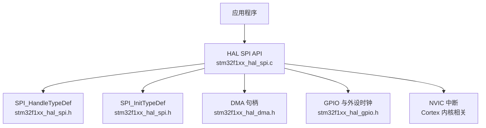
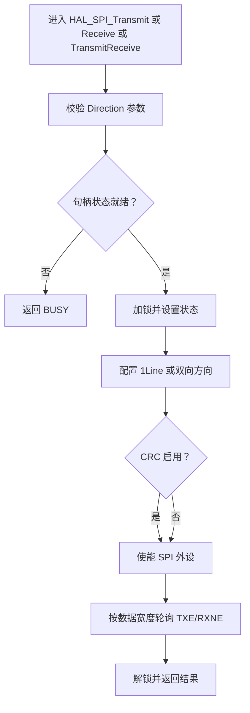
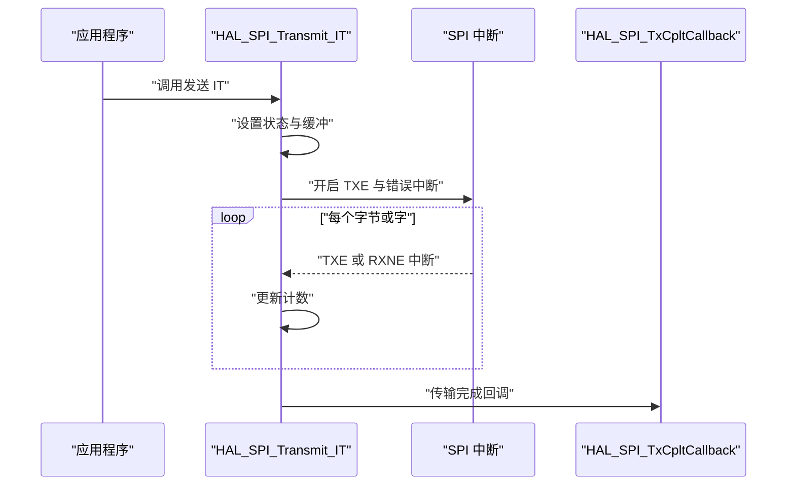
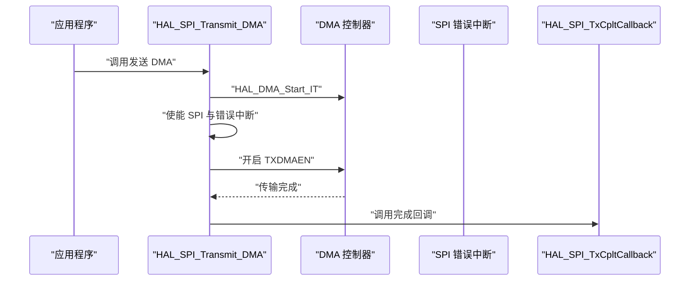
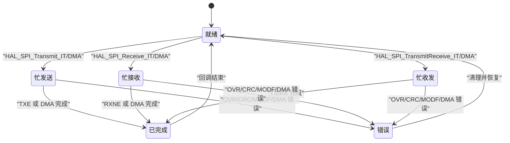
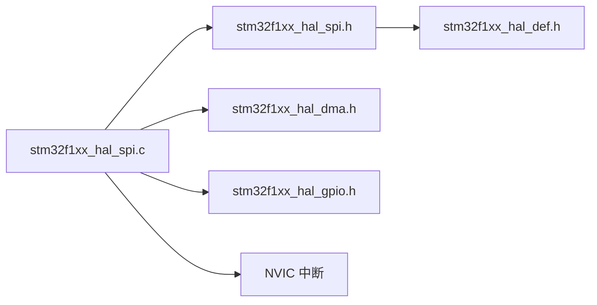

# SPI 通信接口

<cite>
**本文引用的文件**   
- [stm32f1xx_hal_spi.h](file://Inc/stm32f1xx_hal_spi.h)
- [stm32f1xx_hal_spi.c](file://Src/stm32f1xx_hal_spi.c)
- [stm32f1xx_hal_def.h](file://Inc/stm32f1xx_hal_def.h)
- [stm32f1xx_hal_dma.h](file://Inc/stm32f1xx_hal_dma.h)
- [stm32f1xx_hal_gpio.h](file://Inc/stm32f1xx_hal_gpio.h)
- [README.md](file://README.md)
</cite>

## 目录
1. [简介](#简介)
2. [项目结构](#项目结构)
3. [核心数据结构](#核心数据结构)
4. [SPI 配置参数详解](#spi-配置参数详解)
5. [API 分类与调用流程](#api-分类与调用流程)
6. [中断与 DMA 传输模型](#中断与-dma-传输模型)
7. [回调函数使用指南](#回调函数使用指南)
8. [典型应用模式](#典型应用模式)
9. [时序、时钟频率与引脚复用](#时序时钟频率与引脚复用)
10. [依赖关系分析](#依赖关系分析)
11. [性能注意事项](#性能注意事项)
12. [故障排查](#故障排查)
13. [结论](#结论)

## 简介
本文件面向 STM32F1xx HAL 驱动中的 SPI 子系统，聚焦以下目标：
- 解释 `SPI_HandleTypeDef` 与 `SPI_InitTypeDef` 的职责和字段。
- 说明全双工、半双工、仅收发等通信方向。
- 说明主从选择、时钟极性 CPOL、时钟相位 CPHA、波特率分频、NSS 管理、MSB/LSB 优先、数据帧格式。
- 梳理阻塞式、中断式、DMA 式 API：`HAL_SPI_Transmit` / `Receive` / `TransmitReceive` 及其 `_IT` / `_DMA` 变体。
- 说明 `HAL_SPI_TxCpltCallback`、`HAL_SPI_RxCpltCallback`、`HAL_SPI_ErrorCallback` 的使用方式。
- 提供 SPI Flash 页读写、ADC 数据采集、多设备 NSS 切换等典型代码的组织思路。
- 讨论 SPI 时序、时钟频率上限、MOSI/MISO/CLK/NSS 引脚复用、CS 建立保持时间、DMA 缓冲区对齐、中断优先级、SPI 冲突与故障排查。

## 项目结构
STM32F1xx HAL SPI 接口由头文件定义类型、常量与宏，并由实现文件提供初始化、IO 操作、状态查询、中断与 DMA 控制逻辑。

**图示来源**
- [stm32f1xx_hal_spi.c:35-120](file://Src/stm32f1xx_hal_spi.c#L35-L120)
- [stm32f1xx_hal_spi.h:35-120](file://Inc/stm32f1xx_hal_spi.h#L35-L120)

**章节来源**
- [README.md:1-45](file://README.md#L1-L45)

## 核心数据结构
### SPI_HandleTypeDef
`SPI_HandleTypeDef` 是 SPI 驱动的运行时句柄，保存寄存器基地址、当前配置、发送与接收缓冲指针、转移计数、中断处理函数指针、DMA 句柄、锁、状态和错误码。其关键职责包括：
- 维护一次或多次 SPI 传输的上下文。
- 在阻塞、中断、DMA 三种模式下共用同一组状态机字段。
- 通过 `hdmatx` / `hdmarx` 关联 DMA 通道。
- 通过 `State` 区分空闲、忙、忙发送、忙接收、忙收发、错误、中止等状态。
- 通过 `ErrorCode` 记录无错误、MODF、CRC、OVR、DMA、标志位、中止、无效回调等错误。

| 字段 | 作用 |
|---|---|
| `Instance` | SPI 外设寄存器基地址 |
| `Init` | 本次使用的 `SPI_InitTypeDef` 配置 |
| `pTxBuffPtr` / `TxXferSize` / `TxXferCount` | 发送缓冲指针、总长度、剩余计数 |
| `pRxBuffPtr` / `RxXferSize` / `RxXferCount` | 接收缓冲指针、总长度、剩余计数 |
| `RxISR` / `TxISR` | 按数据宽度选择的内部中断处理函数指针 |
| `hdmatx` / `hdmarx` | 发送与接收 DMA 句柄指针 |
| `Lock` | 进程互斥锁 |
| `State` | 当前 SPI 状态 |
| `ErrorCode` | 错误码 |

**章节来源**
- [stm32f1xx_hal_spi.h:70-160](file://Inc/stm32f1xx_hal_spi.h#L70-L160)

### HAL_SPI_StateTypeDef
状态枚举用于避免重复启动、检测冲突、配合超时机制。常见状态包括：
- 复位、就绪、忙、忙发送、忙接收、忙收发、错误、中止。

**章节来源**
- [stm32f1xx_hal_spi.h:110-140](file://Inc/stm32f1xx_hal_spi.h#L110-L140)

### SPI_InitTypeDef
`SPI_InitTypeDef` 描述一次 SPI 初始化配置，包含模式、方向、数据大小、时钟极性与相位、NSS 管理、波特率分频、首字节位置、TI 模式、CRC 计算与 CRC 多项式。

| 字段 | 含义 |
|---|---|
| `Mode` | 主机或从机 |
| `Direction` | 双向全双工、仅接收、单线 |
| `DataSize` | 8 位或 16 位数据帧 |
| `CLKPolarity` | CPOL：时钟空闲电平 |
| `CLKPhase` | CPHA：采样边沿 |
| `NSS` | 软件 NSS、硬件输入、硬件输出 |
| `BaudRatePrescaler` | APB 时钟到 SCK 的分频系数 |
| `FirstBit` | MSB 优先或 LSB 优先 |
| `TIMode` | TI 模式（该实现中禁用） |
| `CRCCalculation` | 是否启用 CRC |
| `CRCPolynomial` | CRC 多项式 |

**章节来源**
- [stm32f1xx_hal_spi.h:40-100](file://Inc/stm32f1xx_hal_spi.h#L40-L100)

## SPI 配置参数详解
### 通信模式与方向
- **主机模式**：`SPI_MODE_MASTER`。
- **从机模式**：`SPI_MODE_SLAVE`。
- **双向全双工**：`SPI_DIRECTION_2LINES`，同时使用 MOSI 与 MISO。
- **仅接收**：`SPI_DIRECTION_2LINES_RXONLY`，主机接收时仍需要时钟；HAL 内部通常通过发送 dummy 数据并走收发路径。
- **单线半双工**：`SPI_DIRECTION_1LINE`，只使用 MOSI 或单向数据线。

注意：
- `HAL_SPI_Transmit` 允许双向或单线方向。
- `HAL_SPI_Receive` 在主机的双向模式下会转为收发模式，以产生时钟。
- `HAL_SPI_TransmitReceive` 要求双向模式。

**章节来源**
- [stm32f1xx_hal_spi.h:200-260](file://Inc/stm32f1xx_hal_spi.h#L200-L260)
- [stm32f1xx_hal_spi.c:795-860](file://Src/stm32f1xx_hal_spi.c#L795-L860)
- [stm32f1xx_hal_spi.c:964-1000](file://Src/stm32f1xx_hal_spi.c#L964-L1000)
- [stm32f1xx_hal_spi.c:1180-1245](file://Src/stm32f1xx_hal_spi.c#L1180-L1245)

### 主从选择
- 主机模式适合 MCU 主动发起通信。
- 从机模式适合被其他主机控制。
- 从机模式下，外部时钟由主机提供，MCU 不应自行设置 SCK 频率。

**章节来源**
- [stm32f1xx_hal_spi.h:200-215](file://Inc/stm32f1xx_hal_spi.h#L200-L215)

### 时钟极性 CPOL 与相位 CPHA
- `SPI_POLARITY_LOW`：空闲时 SCK 为低。
- `SPI_POLARITY_HIGH`：空闲时 SCK 为高。
- `SPI_PHASE_1EDGE`：第一个时钟边沿采样。
- `SPI_PHASE_2EDGE`：第二个时钟边沿采样。

SPI 主机与从机必须匹配相同的 CPOL 与 CPHA，否则会出现数据错位或 CRC 错误。

**章节来源**
- [stm32f1xx_hal_spi.h:230-260](file://Inc/stm32f1xx_hal_spi.h#L230-L260)

### 波特率分频
`SPI_BAUDRATEPRESCALER_2` 至 `SPI_BAUDRATEPRESCALER_256` 将 APB 外设时钟除以对应系数得到 SCK。实际可用最高频率受数据宽度、模式、传输方式影响。

**章节来源**
- [stm32f1xx_hal_spi.h:270-295](file://Inc/stm32f1xx_hal_spi.h#L270-L295)
- [stm32f1xx_hal_spi.c:35-120](file://Src/stm32f1xx_hal_spi.c#L35-L120)

### NSS 管理
- `SPI_NSS_SOFT`：软件管理 NSS。用户需手动拉低片选，并在必要时重新初始化 SPI。
- `SPI_NSS_HARD_INPUT`：硬件 NSS 输入，由外部引脚控制。
- `SPI_NSS_HARD_OUTPUT`：主机自动输出 NSS。

当使用软件 NSS 进行多设备切换时，应在每次传输前拉低 CS，传输后拉高 CS，并注意某些器件对 CS 建立时间与保持时间的要求。

**章节来源**
- [stm32f1xx_hal_spi.h:260-275](file://Inc/stm32f1xx_hal_spi.h#L260-L275)

### MSB/LSB 优先
- `SPI_FIRSTBIT_MSB`：默认，先传高位。
- `SPI_FIRSTBIT_LSB`：先传低位。

多数 SPI Flash、传感器使用 MSB 优先。

**章节来源**
- [stm32f1xx_hal_spi.h:295-310](file://Inc/stm32f1xx_hal_spi.h#L295-L310)

### 数据帧格式
- `SPI_DATASIZE_8BIT`：8 位数据帧。
- `SPI_DATASIZE_16BIT`：16 位数据帧。

16 位模式下，传输计数单位是 16 位元素；底层中断或 DMA 访问 DR 寄存器时使用相应宽度。

**章节来源**
- [stm32f1xx_hal_spi.h:245-260](file://Inc/stm32f1xx_hal_spi.h#L245-L260)
- [stm32f1xx_hal_spi.c:1440-1540](file://Src/stm32f1xx_hal_spi.c#L1440-L1540)

### TI 模式与 CRC
- TI 模式在该实现中被禁用。
- CRC 可启用，但 DMA 循环模式受限，且启用 CRC 时接收长度可能需要加一。

**章节来源**
- [stm32f1xx_hal_spi.h:310-330](file://Inc/stm32f1xx_hal_spi.h#L310-L330)
- [stm32f1xx_hal_spi.c:1700-1940](file://Src/stm32f1xx_hal_spi.c#L1700-L1940)

## API 分类与调用流程
### 阻塞式 API
- `HAL_SPI_Transmit`：阻塞发送。
- `HAL_SPI_Receive`：阻塞接收；主机双向模式下内部转为收发。
- `HAL_SPI_TransmitReceive`：阻塞同时收发。

共同特点：
- 检查方向参数。
- 检查句柄状态是否为就绪。
- 锁定句柄。
- 设置发送或接收缓冲指针与计数。
- 根据方向配置单线模式。
- 可选重置 CRC。
- 使能 SPI 外设。
- 按数据宽度轮询 TXE/RXNE。
- 返回状态码，可能为 OK、BUSY、ERROR、TIMEOUT。

**图示来源**
- [stm32f1xx_hal_spi.c:795-860](file://Src/stm32f1xx_hal_spi.c#L795-L860)
- [stm32f1xx_hal_spi.c:964-1000](file://Src/stm32f1xx_hal_spi.c#L964-L1000)
- [stm32f1xx_hal_spi.c:1180-1245](file://Src/stm32f1xx_hal_spi.c#L1180-L1245)

**章节来源**
- [stm32f1xx_hal_spi.c:795-860](file://Src/stm32f1xx_hal_spi.c#L795-L860)
- [stm32f1xx_hal_spi.c:964-1000](file://Src/stm32f1xx_hal_spi.c#L964-L1000)
- [stm32f1xx_hal_spi.c:1180-1245](file://Src/stm32f1xx_hal_spi.c#L1180-L1245)

### 中断式 API
- `HAL_SPI_Transmit_IT`
- `HAL_SPI_Receive_IT`
- `HAL_SPI_TransmitReceive_IT`

调用流程要点：
- 校验参数与状态。
- 设置 TxISR 或 RxISR，按 8 位或 16 位选择不同处理函数。
- 配置方向。
- 可选重置 CRC。
- 使能 SPI。
- 开启 TXE 与 ERR 中断。
- 立即返回，后续在中断中推进计数并触发完成回调。

**图示来源**
- [stm32f1xx_hal_spi.c:1440-1540](file://Src/stm32f1xx_hal_spi.c#L1440-L1540)
- [stm32f1xx_hal_spi.c:2545-2650](file://Src/stm32f1xx_hal_spi.c#L2545-L2650)

**章节来源**
- [stm32f1xx_hal_spi.c:1440-1540](file://Src/stm32f1xx_hal_spi.c#L1440-L1540)
- [stm32f1xx_hal_spi.c:1522-1613](file://Src/stm32f1xx_hal_spi.c#L1522-L1613)
- [stm32f1xx_hal_spi.c:1613-1700](file://Src/stm32f1xx_hal_spi.c#L1613-L1700)

### DMA 式 API
- `HAL_SPI_Transmit_DMA`
- `HAL_SPI_Receive_DMA`
- `HAL_SPI_TransmitReceive_DMA`

调用流程要点：
- 校验 DMA 句柄。
- 设置 DMA 回调：完成、半完成、错误。
- 启动 DMA。
- 使能 SPI。
- 开启 SPI 错误中断。
- 使能 DMA 请求。
- 在 DMA 完成后调用 HAL 回调。

**图示来源**
- [stm32f1xx_hal_spi.c:1700-1940](file://Src/stm32f1xx_hal_spi.c#L1700-L1940)
- [stm32f1xx_hal_spi.c:2545-2650](file://Src/stm32f1xx_hal_spi.c#L2545-L2650)

**章节来源**
- [stm32f1xx_hal_spi.c:1700-1940](file://Src/stm32f1xx_hal_spi.c#L1700-L1940)
- [stm32f1xx_hal_spi.c:1804-1914](file://Src/stm32f1xx_hal_spi.c#L1804-L1914)
- [stm32f1xx_hal_spi.c:1914-1940](file://Src/stm32f1xx_hal_spi.c#L1914-L1940)

## 中断与 DMA 传输模型
### 中断传输模型
- 发送 IT 模式优先使能 TXE 与错误中断。
- 接收 IT 模式在主机的双向模式下转发到收发 IT。
- 内部根据 `DataSize` 选择 8 位或 16 位 ISR。
- 传输结束后清除中断并调用完成回调。

### DMA 传输模型
- 发送 DMA 绑定 `hdmatx`，接收 DMA 绑定 `hdmarx`。
- 主机双向接收时需同时配置发送 DMA。
- DMA 回调负责清理状态、关闭 DMA 请求、调用 HAL 回调。
- 错误时设置 `HAL_SPI_ERROR_DMA` 并调用错误回调。

**图示来源**
- [stm32f1xx_hal_spi.c:1440-1540](file://Src/stm32f1xx_hal_spi.c#L1440-L1540)
- [stm32f1xx_hal_spi.c:1700-1940](file://Src/stm32f1xx_hal_spi.c#L1700-L1940)
- [stm32f1xx_hal_spi.c:2545-2650](file://Src/stm32f1xx_hal_spi.c#L2545-L2650)

**章节来源**
- [stm32f1xx_hal_spi.c:1440-1540](file://Src/stm32f1xx_hal_spi.c#L1440-L1540)
- [stm32f1xx_hal_spi.c:1700-1940](file://Src/stm32f1xx_hal_spi.c#L1700-L1940)
- [stm32f1xx_hal_spi.c:2545-2650](file://Src/stm32f1xx_hal_spi.c#L2545-L2650)

## 回调函数使用指南
### 主要回调
- `HAL_SPI_TxCpltCallback`：发送完成。
- `HAL_SPI_RxCpltCallback`：接收完成。
- `HAL_SPI_TxRxCpltCallback`：收发完成。
- `HAL_SPI_TxHalfCpltCallback` / `HAL_SPI_RxHalfCpltCallback` / `HAL_SPI_TxRxHalfCpltCallback`：半传输完成，常用于 DMA 双缓冲。
- `HAL_SPI_ErrorCallback`：错误回调。
- 若启用动态回调注册，还包含中止、MspInit、MspDeInit 等回调 ID。

### 使用建议
- 在用户文件中重写这些弱函数。
- 在回调中检查 `hspi->ErrorCode`，必要时调用 `HAL_SPI_GetError()`。
- 不要在回调中执行耗时操作。
- 多设备场景下，可在发送完成回调中切换下一个设备的 NSS。
- 使用 DMA 双缓冲时，结合半完成回调刷新前半部分数据。

**章节来源**
- [stm32f1xx_hal_spi.h:120-190](file://Inc/stm32f1xx_hal_spi.h#L120-L190)
- [stm32f1xx_hal_spi.c:2545-2650](file://Src/stm32f1xx_hal_spi.c#L2545-L2650)

## 典型应用模式
### SPI Flash 页读写
设计要点：
- 主机模式、双向全双工、MSB 优先、8 位数据帧。
- 使用软件 NSS 管理片选，确保 CS 建立与保持时间。
- 写操作通常包括：写使能、页编程命令、地址、最多一页数据。
- 读操作通常包括：快速读取命令、地址、连续读取数据。
- 大数据量建议使用 DMA，小指令建议使用阻塞或中断。
- 注意 Flash 写入前擦除，以及写入周期时间。

参考组织：
- 初始化 `SPI_HandleTypeDef`，配置 CPOL/CPHA 与 Flash 一致。
- 封装 `SpiFlash_WriteEnable`、`SpiFlash_PageWrite`、`SpiFlash_Read`。
- 在 DMA 完成回调中切换状态机，例如从“等待写入完成”切换到“下一次命令”。

[本节为应用设计说明，不直接分析具体源码行]

### ADC 数据采集
设计要点：
- 如果 MCU 的 ADC 通过 SPI 输出，则 MCU 作为 SPI 主机，持续产生时钟以采样数据。
- 方向通常为双向或仅接收，取决于 ADC 芯片协议。
- 使用 DMA 将连续转换结果搬运到环形缓冲区。
- 注意采样时钟与 SPI 时钟匹配，避免丢样。
- 注意 ADC 数据格式可能是 12 位、16 位等，需与 SPI 数据帧对齐。

参考组织：
- 初始化 SPI 与 DMA。
- 启动 DMA 接收。
- 在 DMA 半完成/完成回调中处理历史数据，防止覆盖新数据。
- 根据采样率调度应用层数据处理任务。

[本节为应用设计说明，不直接分析具体源码行]

### 多设备 NSS 切换
设计要点：
- 使用 `SPI_NSS_SOFT`，由 GPIO 控制 CS。
- 每个设备独立 GPIO 片选。
- 每次传输前拉低目标设备 CS，传输后拉高。
- 对于对 CS 时序敏感的设备，应在命令前后插入足够延时。
- 若多个 SPI 外设共享总线，应进一步增加全局互斥。

参考组织：
- 定义设备表，包含 SPI 句柄、CS GPIO、协议函数。
- 封装统一发送函数，内部切换 CS。
- 在回调或事务结束后恢复总线空闲状态。

[本节为应用设计说明，不直接分析具体源码行]

## 时序、时钟频率与引脚复用
### SPI 时序
- CPOL 决定空闲电平。
- CPHA 决定第一个或第二个边沿采样。
- 主机发出 CLK，MOSI 在有效边沿前稳定，MISO 在对方有效边沿前准备。
- 软件 NSS 下，CS 必须在首个时钟前拉低，最后一个时钟后保持一段时间再释放。

### 时钟频率上限
文档注释给出不同数据宽度、模式、传输方式的最高频率参考，大致规律如下：
- 全双工主从：轮询或 DMA 常可达 APB 时钟的较高比例，如 Fpclk/2。
- 仅接收或单线模式：轮询、中断、DMA 的最高频率更低。
- 16 位数据帧在某些模式下的最高频率可能与 8 位不同。
- 实际频率需结合系统时钟、APB 分频、SPI 分频器、负载电容与器件手册综合确定。

### MOSI/MISO/CLK/NSS 引脚复用
- SPI 引脚应配置为复用推挽。
- 如果使用硬件 NSS，应正确配置相应 GPIO 功能。
- 如果使用软件 NSS，可将对应 GPIO 配置为普通输出。
- 引脚复用与 RCC 时钟使能需在 MSP 初始化中完成。

[本节为通用设计说明，不直接分析具体源码行]

## 依赖关系分析

**图示来源**
- [stm32f1xx_hal_spi.h:1-40](file://Inc/stm32f1xx_hal_spi.h#L1-L40)
- [stm32f1xx_hal_spi.c:1-40](file://Src/stm32f1xx_hal_spi.c#L1-L40)

**章节来源**
- [stm32f1xx_hal_spi.h:1-40](file://Inc/stm32f1xx_hal_spi.h#L1-L40)
- [stm32f1xx_hal_spi.c:1-40](file://Src/stm32f1xx_hal_spi.c#L1-L40)

## 性能注意事项
- **阻塞模式**：简单可靠，但会占用 CPU，不适合高频大数据量。
- **中断模式**：降低 CPU 占用，但频繁中断开销较大，适合中等速率或小数据块。
- **DMA 模式**：最适合大批量数据传输；需注意 DMA 缓冲区对齐、缓存一致性、双缓冲策略。
- **CRC 模式**：提高可靠性，但会增加计算与传输开销，DMA 循环模式有限制。
- **数据宽度**：16 位可减少中断次数，但内存带宽和总线利用率需评估。
- **SPI 频率**：不要盲目使用最大分频；需考虑 Flash、ADC、传感器、PCB 布线与 EMC。
- **CS 时序**：多设备切换时，CS 建立与保持不足会导致命令解析失败。
- **状态机**：避免在同一 SPI 句柄上并发调用多个传输 API，防止 `HAL_BUSY`。

[本节为通用指导，不直接分析具体源码行]

## 故障排查
### 常见问题与原因
- **HAL_BUSY**：句柄仍处于忙状态，重复调用传输函数。
- **HAL_ERROR**：参数为空、长度为 0、DMA 句柄未配置。
- **HAL_SPI_ERROR_OVR**： overrun，接收未及时读取，或发送速度过快。
- **HAL_SPI_ERROR_CRC**：CRC 校验失败，常见于时钟极性/相位不一致、数据错位。
- **HAL_SPI_ERROR_MODF**：模式故障，通常发生在从机模式下主从协商异常。
- **HAL_SPI_ERROR_DMA**：DMA 启动失败或 DMA 传输错误。
- **HAL_SPI_ERROR_FLAG**：标志位状态异常。

### 排查步骤
1. 检查 `hspi->State` 与 `hspi->ErrorCode`。
2. 核对 CPOL、CPHA、方向、数据宽度是否与从设备一致。
3. 检查 NSS 是硬件还是软件管理；软件 NSS 是否正确拉低拉高。
4. 检查 MOSI、MISO、CLK、CS 引脚复用与电平。
5. 使用逻辑分析仪观察时钟、数据与 CS 波形。
6. 降低 SPI 频率，确认物理层是否正常。
7. 对于 DMA，检查缓冲区是否对齐、长度是否正确、是否启用 DMA 时钟与中断。
8. 对于中断，检查 NVIC 优先级与 SPI 中断是否使能。

**章节来源**
- [stm32f1xx_hal_spi.h:160-200](file://Inc/stm32f1xx_hal_spi.h#L160-L200)
- [stm32f1xx_hal_spi.c:2545-2650](file://Src/stm32f1xx_hal_spi.c#L2545-L2650)

## 结论
STM32F1xx HAL 的 SPI 接口通过 `SPI_HandleTypeDef` 与 `SPI_InitTypeDef` 统一管理运行时上下文与配置参数，并提供阻塞、中断、DMA 三类 API。正确理解方向、主从、CPOL/CPHA、NSS、数据帧格式、CRC 与错误码，是实现稳定 SPI 通信的基础。实际工程中，SPI Flash、ADC 和多设备总线应分别采用合适的传输方式与回调策略，并结合逻辑分析仪、错误码、状态机与时序约束进行调试与优化。