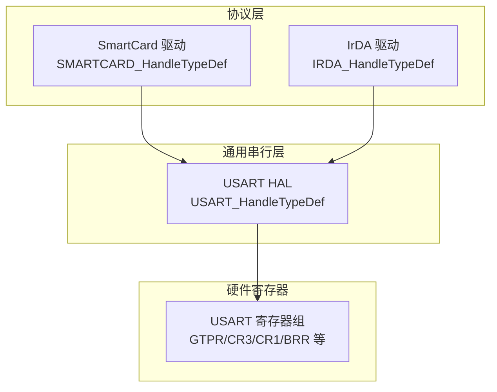
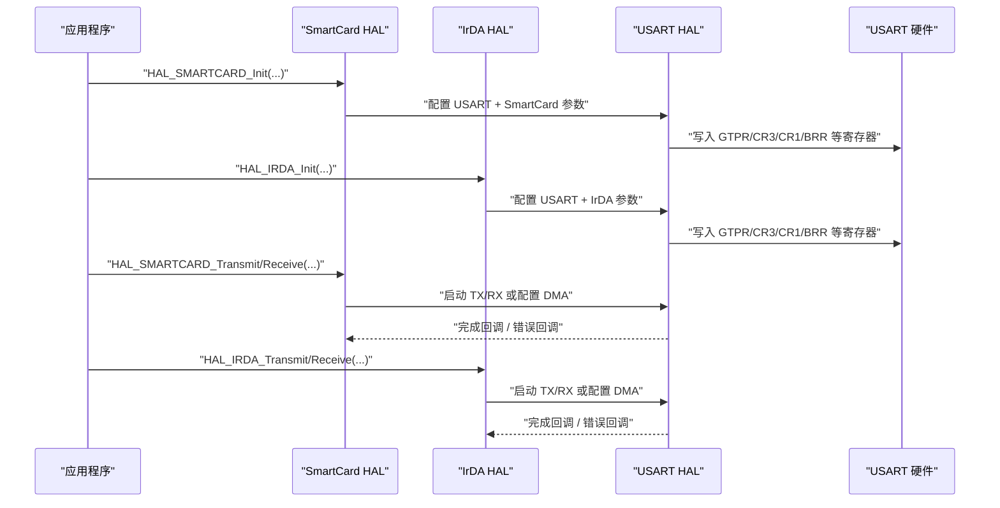
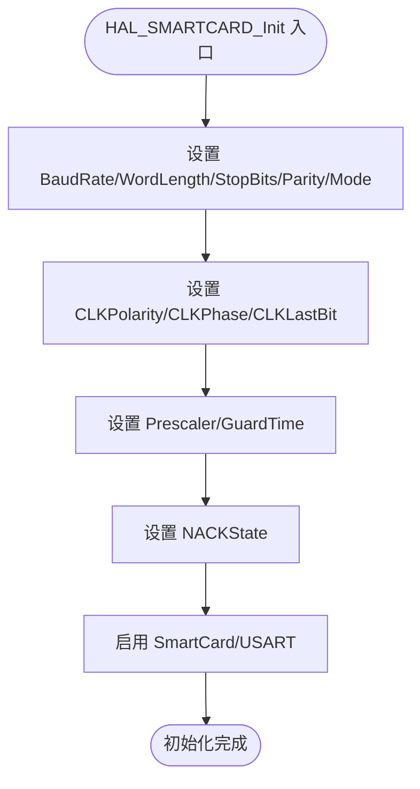
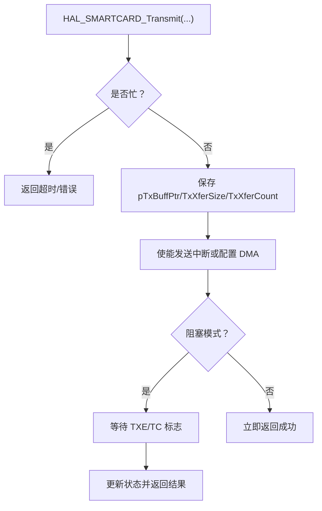
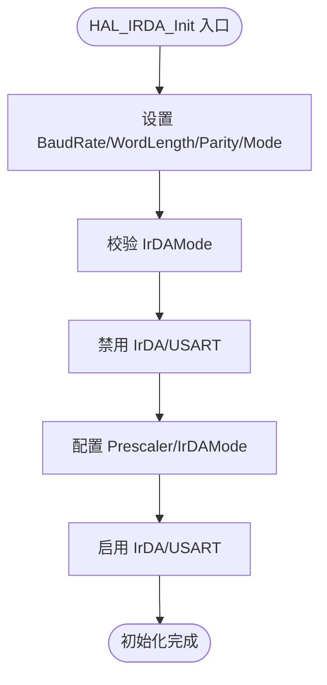
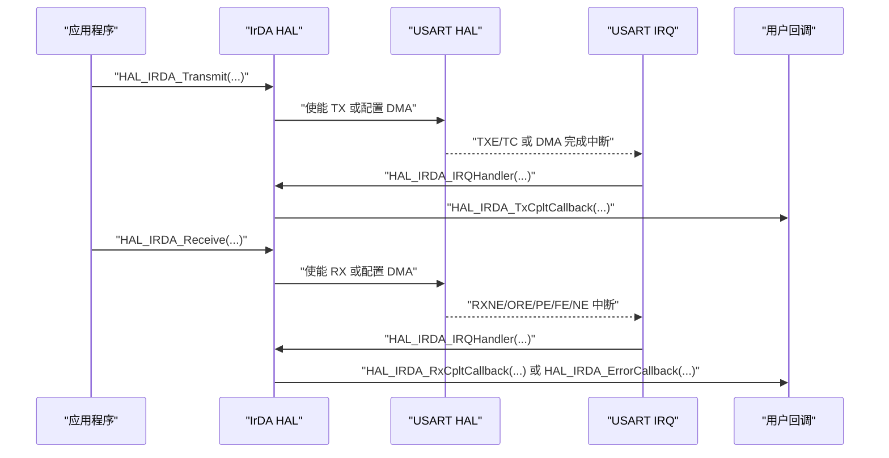
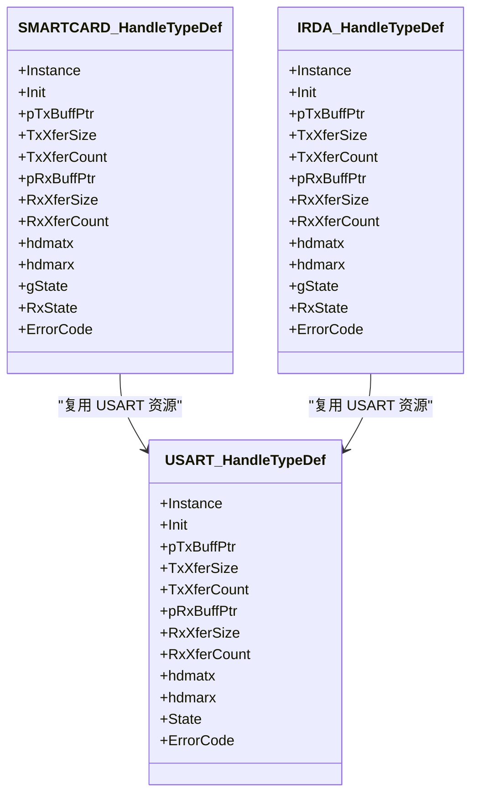
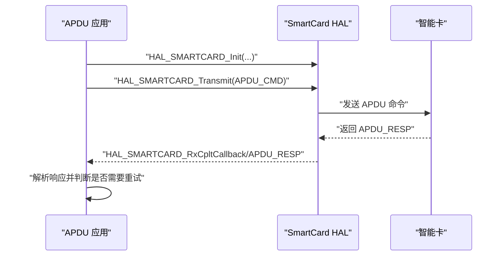
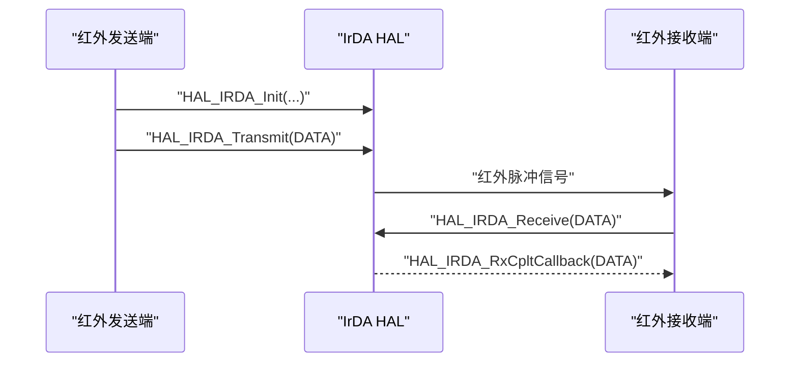

# SmartCard 与 IrDA 专用协议接口

<cite>
**本文引用的文件**   
- [stm32f1xx_hal_smartcard.h](file://Inc/stm32f1xx_hal_smartcard.h)
- [stm32f1xx_hal_smartcard.c](file://Src/stm32f1xx_hal_smartcard.c)
- [stm32f1xx_hal_irda.h](file://Inc/stm32f1xx_hal_irda.h)
- [stm32f1xx_hal_irda.c](file://Src/stm32f1xx_hal_irda.c)
- [stm32f1xx_hal_usart.h](file://Inc/stm32f1xx_hal_usart.h)
- [stm32f1xx_hal_usart.c](file://Src/stm32f1xx_hal_usart.c)
</cite>

## 目录
1. [引言](#引言)
2. [项目结构](#项目结构)
3. [核心组件](#核心组件)
4. [架构总览](#架构总览)
5. [详细组件分析](#详细组件分析)
6. [依赖关系分析](#依赖关系分析)
7. [性能与功耗考虑](#性能与功耗考虑)
8. [故障排查指南](#故障排查指南)
9. [结论](#结论)
10. [附录：典型用例](#附录典型用例)

## 引言
本文件面向 STM32F1xx HAL 中的 SmartCard 与 IrDA 两个专用协议接口。二者均基于 USART 外设实现，但面向不同物理层与应用场景：
- SmartCard 用于 ISO/IEC 7816 智能卡通信，支持同步时钟、NACK、Guard Time、分频器、自动重试等智能卡特有机制。
- IrDA 用于红外数据链路，通过脉冲宽度调制对 UART 数据进行编码，支持正常模式与低功耗脉冲模式，以及系统时钟分频控制脉冲宽度。

HAL 为两者分别提供初始化、阻塞传输、中断传输与 DMA 传输 API，并提供统一的错误回调模型。SmartCard 和 IrDA 的句柄结构与配置项存在显著差异，需根据应用协议选择合适接口。

## 项目结构
本仓库中 SmartCard 与 IrDA 的实现分布在以下头文件与源文件中：
- SmartCard 接口定义与实现：`Inc/stm32f1xx_hal_smartcard.h`、`Src/stm32f1xx_hal_smartcard.c`
- IrDA 接口定义与实现：`Inc/stm32f1xx_hal_irda.h`、`Src/stm32f1xx_hal_irda.c`
- 底层 USART HAL：`Inc/stm32f1xx_hal_usart.h`、`Src/stm32f1xx_hal_usart.c`

**图示来源**  
- [stm32f1xx_hal_smartcard.h:153-189](file://Inc/stm32f1xx_hal_smartcard.h#L153-L189)
- [stm32f1xx_hal_irda.h:138-189](file://Inc/stm32f1xx_hal_irda.h#L138-L189)
- [stm32f1xx_hal_usart.h:72-130](file://Inc/stm32f1xx_hal_usart.h#L72-L130)

**章节来源**  
- [stm32f1xx_hal_smartcard.h:1-200](file://Inc/stm32f1xx_hal_smartcard.h#L1-L200)
- [stm32f1xx_hal_irda.h:1-200](file://Inc/stm32f1xx_hal_irda.h#L1-L200)
- [stm32f1xx_hal_usart.h:1-200](file://Inc/stm32f1xx_hal_usart.h#L1-L200)

## 核心组件
### SmartCard 组件
- 类型：`SMARTCARD_InitTypeDef`、`SMARTCARD_HandleTypeDef`
- 关键配置项：
  - `BaudRate`、`WordLength`、`StopBits`、`Parity`、`Mode`
  - 同步时钟相关：`CLKPolarity`、`CLKPhase`、`CLKLastBit`
  - 智能卡专用：`Prescaler`（SCLK 分频）、`GuardTime`（保护时间）、`NACKState`（NACK 使能）
- 主要 API：
  - 初始化：`HAL_SMARTCARD_Init`
  - 阻塞 I/O：`HAL_SMARTCARD_Transmit`、`HAL_SMARTCARD_Receive`
  - 中断 I/O：`HAL_SMARTCARD_Transmit_IT`、`HAL_SMARTCARD_Receive_IT`
  - DMA I/O：`HAL_SMARTCARD_Transmit_DMA`、`HAL_SMARTCARD_Receive_DMA`
- 回调：
  - `HAL_SMARTCARD_TxCpltCallback`、`HAL_SMARTCARD_RxCpltCallback`、`HAL_SMARTCARD_ErrorCallback`
  - 可选动态注册回调集：`TxCpltCallback`、`RxCpltCallback`、`ErrorCallback`、`Abort*`、`MspInit/MspDeInit`

**章节来源**  
- [stm32f1xx_hal_smartcard.h:46-88](file://Inc/stm32f1xx_hal_smartcard.h#L46-L88)
- [stm32f1xx_hal_smartcard.h:153-200](file://Inc/stm32f1xx_hal_smartcard.h#L153-L200)
- [stm32f1xx_hal_smartcard.h:615-620](file://Inc/stm32f1xx_hal_smartcard.h#L615-L620)
- [stm32f1xx_hal_smartcard.c:751-769](file://Src/stm32f1xx_hal_smartcard.c#L751-L769)
- [stm32f1xx_hal_smartcard.c:813-828](file://Src/stm32f1xx_hal_smartcard.c#L813-L828)
- [stm32f1xx_hal_smartcard.c:871-918](file://Src/stm32f1xx_hal_smartcard.c#L871-L918)
- [stm32f1xx_hal_smartcard.c:919-963](file://Src/stm32f1xx_hal_smartcard.c#L919-L963)
- [stm32f1xx_hal_smartcard.c:964-1025](file://Src/stm32f1xx_hal_smartcard.c#L964-L1025)
- [stm32f1xx_hal_smartcard.c:1026-1085](file://Src/stm32f1xx_hal_smartcard.c#L1026-L1085)

### IrDA 组件
- 类型：`IRDA_InitTypeDef`、`IRDA_HandleTypeDef`
- 关键配置项：
  - `BaudRate`、`WordLength`、`Parity`、`Mode`
  - 红外专用：`Prescaler`（系统时钟分频，决定脉冲宽度）、`IrDAMode`（Normal 或 Pulse Width Modulation 低功耗模式）
- 主要 API：
  - 初始化：`HAL_IRDA_Init`
  - 阻塞 I/O：`HAL_IRDA_Transmit`、`HAL_IRDA_Receive`
  - 中断 I/O：`HAL_IRDA_Transmit_IT`、`HAL_IRDA_Receive_IT`
  - DMA I/O：`HAL_IRDA_Transmit_DMA`、`HAL_IRDA_Receive_DMA`
- 回调：
  - `HAL_IRDA_TxCpltCallback`、`HAL_IRDA_RxCpltCallback`、`HAL_IRDA_ErrorCallback`
  - 可选动态注册回调集：含半完成回调、中止回调与 Msp 回调

**章节来源**  
- [stm32f1xx_hal_irda.h:45-72](file://Inc/stm32f1xx_hal_irda.h#L45-L72)
- [stm32f1xx_hal_irda.h:138-189](file://Inc/stm32f1xx_hal_irda.h#L138-L189)
- [stm32f1xx_hal_irda.h:531-535](file://Inc/stm32f1xx_hal_irda.h#L531-L535)
- [stm32f1xx_hal_irda.c:764-780](file://Src/stm32f1xx_hal_irda.c#L764-L780)
- [stm32f1xx_hal_irda.c:849-865](file://Src/stm32f1xx_hal_irda.c#L849-L865)
- [stm32f1xx_hal_irda.c:939-983](file://Src/stm32f1xx_hal_irda.c#L939-L983)
- [stm32f1xx_hal_irda.c:984-1039](file://Src/stm32f1xx_hal_irda.c#L984-L1039)
- [stm32f1xx_hal_irda.c:1040-1121](file://Src/stm32f1xx_hal_irda.c#L1040-L1121)
- [stm32f1xx_hal_irda.c:1122-1200](file://Src/stm32f1xx_hal_irda.c#L1122-L1200)

## 架构总览
SmartCard 与 IrDA 在 HAL 层共享相似的数据流模型：句柄持有缓冲区指针、传输计数、DMA 句柄与状态机；上层调用者通过阻塞、中断或 DMA 方式发起收发，底层由 USART 中断/DMA 触发回调完成帧处理。

**图示来源**  
- [stm32f1xx_hal_smartcard.c:296-353](file://Src/stm32f1xx_hal_smartcard.c#L296-L353)
- [stm32f1xx_hal_irda.c:293-348](file://Src/stm32f1xx_hal_irda.c#L293-L348)
- [stm32f1xx_hal_usart.c:1-120](file://Src/stm32f1xx_hal_usart.c#L1-L120)

## 详细组件分析

### SmartCard 配置与处理逻辑
SmartCard 的初始化会设置波特率、字长、停止位、奇偶校验、收发模式，并额外配置智能卡同步时钟极性、相位、末位时钟输出、SCLK 预分频、保护时间和 NACK 行为。初始化完成后启用外设。

**图示来源**  
- [stm32f1xx_hal_smartcard.c:296-353](file://Src/stm32f1xx_hal_smartcard.c#L296-L353)

SmartCard 的发送与接收流程与 USART 一致：
- 阻塞模式轮询标志位；
- 中断模式开启相应中断并在 ISR 中递减计数器、最终调用完成回调；
- DMA 模式绑定 DMA 通道并在传输完成时回调。

**图示来源**  
- [stm32f1xx_hal_smartcard.c:751-769](file://Src/stm32f1xx_hal_smartcard.c#L751-L769)
- [stm32f1xx_hal_smartcard.c:871-918](file://Src/stm32f1xx_hal_smartcard.c#L871-L918)
- [stm32f1xx_hal_smartcard.c:964-1025](file://Src/stm32f1xx_hal_smartcard.c#L964-L1025)

**章节来源**  
- [stm32f1xx_hal_smartcard.h:46-88](file://Inc/stm32f1xx_hal_smartcard.h#L46-L88)
- [stm32f1xx_hal_smartcard.c:296-353](file://Src/stm32f1xx_hal_smartcard.c#L296-L353)
- [stm32f1xx_hal_smartcard.c:751-769](file://Src/stm32f1xx_hal_smartcard.c#L751-L769)
- [stm32f1xx_hal_smartcard.c:813-828](file://Src/stm32f1xx_hal_smartcard.c#L813-L828)
- [stm32f1xx_hal_smartcard.c:871-918](file://Src/stm32f1xx_hal_smartcard.c#L871-L918)
- [stm32f1xx_hal_smartcard.c:919-963](file://Src/stm32f1xx_hal_smartcard.c#L919-L963)
- [stm32f1xx_hal_smartcard.c:964-1025](file://Src/stm32f1xx_hal_smartcard.c#L964-L1025)
- [stm32f1xx_hal_smartcard.c:1026-1085](file://Src/stm32f1xx_hal_smartcard.c#L1026-L1085)

### IrDA 配置与处理逻辑
IrDA 的初始化会设置波特率、字长、奇偶校验、收发模式，并写入 IrDA 专用分频器和 IrDA 模式（Normal 或低功耗脉冲模式）。初始化过程中会禁用外设、配置寄存器后重新启用。

**图示来源**  
- [stm32f1xx_hal_irda.c:293-348](file://Src/stm32f1xx_hal_irda.c#L293-L348)

IrDA 的收发路径同样支持阻塞、中断与 DMA。其 IRQ 处理器会根据事件调用相应的完成或错误回调，DMA 模式下还包含半完成回调。

**图示来源**  
- [stm32f1xx_hal_irda.c:764-780](file://Src/stm32f1xx_hal_irda.c#L764-L780)
- [stm32f1xx_hal_irda.c:1760-1875](file://Src/stm32f1xx_hal_irda.c#L1760-L1875)
- [stm32f1xx_hal_irda.c:1905-1975](file://Src/stm32f1xx_hal_irda.c#L1905-L1975)

**章节来源**  
- [stm32f1xx_hal_irda.h:45-72](file://Inc/stm32f1xx_hal_irda.h#L45-L72)
- [stm32f1xx_hal_irda.c:293-348](file://Src/stm32f1xx_hal_irda.c#L293-L348)
- [stm32f1xx_hal_irda.c:764-780](file://Src/stm32f1xx_hal_irda.c#L764-L780)
- [stm32f1xx_hal_irda.c:1760-1875](file://Src/stm32f1xx_hal_irda.c#L1760-L1875)
- [stm32f1xx_hal_irda.c:1905-1975](file://Src/stm32f1xx_hal_irda.c#L1905-L1975)

### SmartCard 与 IrDA 的配置差异对比
| 维度 | SmartCard | IrDA |
|---|---|---|
| 基础串口参数 | `BaudRate`、`WordLength`、`StopBits`、`Parity`、`Mode` | `BaudRate`、`WordLength`、`Parity`、`Mode` |
| 同步与时钟 | `CLKPolarity`、`CLKPhase`、`CLKLastBit`、`Prescaler` | 无同步时钟配置；使用 `Prescaler` 控制红外脉冲宽度 |
| 协议专用字段 | `GuardTime`、`NACKState` | `IrDAMode`（Normal 或低功耗脉冲模式） |
| 典型用途 | ISO7816 智能卡、需要 SCLK 与保护时间的卡片 | 红外点对点通信，要求正确脉冲宽度与角度对准 |
| 常见错误 | 奇偶校验错误、帧错误、噪声、溢出、NACK 未正确处理 | 奇偶校验错误、帧错误、噪声、溢出；红外链路误码 |

**章节来源**  
- [stm32f1xx_hal_smartcard.h:46-88](file://Inc/stm32f1xx_hal_smartcard.h#L46-L88)
- [stm32f1xx_hal_irda.h:45-72](file://Inc/stm32f1xx_hal_irda.h#L45-L72)
- [stm32f1xx_hal_smartcard.c:296-353](file://Src/stm32f1xx_hal_smartcard.c#L296-L353)
- [stm32f1xx_hal_irda.c:293-348](file://Src/stm32f1xx_hal_irda.c#L293-L348)

## 依赖关系分析
SmartCard 与 IrDA 都依赖 USART HAL 提供的通用串行通信能力，包括：
- 寄存器访问宏与状态标志；
- 中断与 DMA 配置；
- 错误码与状态机管理。

**图示来源**  
- [stm32f1xx_hal_smartcard.h:153-200](file://Inc/stm32f1xx_hal_smartcard.h#L153-L200)
- [stm32f1xx_hal_irda.h:138-189](file://Inc/stm32f1xx_hal_irda.h#L138-L189)
- [stm32f1xx_hal_usart.h:72-130](file://Inc/stm32f1xx_hal_usart.h#L72-L130)

**章节来源**  
- [stm32f1xx_hal_smartcard.h:153-200](file://Inc/stm32f1xx_hal_smartcard.h#L153-L200)
- [stm32f1xx_hal_irda.h:138-189](file://Inc/stm32f1xx_hal_irda.h#L138-L189)
- [stm32f1xx_hal_usart.h:72-130](file://Inc/stm32f1xx_hal_usart.h#L72-L130)

## 性能与功耗考虑
- SmartCard：
  - 合理设置 `Prescaler` 以获得符合 ISO7816 要求的 SCLK；
  - `GuardTime` 应根据卡片速率与芯片时钟调整；
  - 使用 DMA 降低 CPU 负载，尤其在批量 APDU 传输中；
  - 仅在需要时启用 NACK，避免不必要的重传开销；
  - 空闲时关闭 SmartCard 或进入低功耗模式以减少功耗。
- IrDA：
  - `Prescaler` 决定脉冲宽度，需匹配目标速率与距离；
  - `IrDAMode` 选择 Normal 或低功耗模式，低功耗模式可降低发射功率；
  - 短距离高可靠链路建议使用 Normal 模式与适当波特率；
  - 远距离或低光环境可适度提高发射功率，但要权衡功耗与干扰；
  - 使用 DMA 进行大数据量红外传输以降低 CPU 占用。

[本节为通用指导，不直接分析具体代码文件]

## 故障排查指南
### SmartCard 常见问题
- 奇偶校验错误：检查 `Parity` 是否与卡片一致；
- 帧错误/噪声：检查 `WordLength`、`StopBits`、波特率与线路质量；
- NACK 未生效：确认 `NACKState` 已启用，且应用层在收到 NACK 后进行重试；
- 复位与防碰撞：ISO7816 复位序列需在应用层按协议实现，HAL 仅负责数据帧传输；
- 自动重试：若应用需要自动重试，应在应用层实现重试策略；HAL 提供 NACK 与错误回调供上层决策。

**章节来源**  
- [stm32f1xx_hal_smartcard.h:244-282](file://Inc/stm32f1xx_hal_smartcard.h#L244-L282)
- [stm32f1xx_hal_smartcard.h:319-323](file://Inc/stm32f1xx_hal_smartcard.h#L319-L323)
- [stm32f1xx_hal_smartcard.c:751-769](file://Src/stm32f1xx_hal_smartcard.c#L751-L769)

### IrDA 常见问题
- 奇偶校验错误：检查 `Parity` 与帧格式；
- 帧错误/噪声/溢出：检查波特率、`WordLength`、`StopBits`、红外发射接收角度；
- 脉冲宽度不正确：调整 `Prescaler`；
- 功耗过高：尝试 `IrDAMode` 低功耗模式；
- 距离与速率权衡：较低速率通常可获得更远距离与更高可靠性。

**章节来源**  
- [stm32f1xx_hal_irda.h:238-269](file://Inc/stm32f1xx_hal_irda.h#L238-L269)
- [stm32f1xx_hal_irda.c:293-348](file://Src/stm32f1xx_hal_irda.c#L293-L348)
- [stm32f1xx_hal_irda.c:1760-1875](file://Src/stm32f1xx_hal_irda.c#L1760-L1875)

## 结论
SmartCard 与 IrDA 在 STM32F1xx HAL 中均以 USART 为基础，但面向不同物理层与协议栈。SmartCard 强调同步时钟、保护时间与 NACK 等智能卡特性；IrDA 强调脉冲宽度与低功耗模式。开发者应依据应用场景选择合适的接口，并合理配置波特率、字长、奇偶校验、DMA 与中断优先级，以实现稳定、低功耗的通信链路。

[本节为总结性内容，不直接分析具体代码文件]

## 附录：典型用例

### 用例一：智能卡 APDU 命令收发
步骤建议：
1. 配置 `SMARTCARD_HandleTypeDef`：
   - 设置 `BaudRate`、`WordLength=8`、`StopBits`、`Parity`；
   - 设置 `CLKPolarity`、`CLKPhase`、`CLKLastBit` 以匹配智能卡时钟；
   - 设置 `Prescaler` 与 `GuardTime`；
   - 根据需要启用 `NACKState`。
2. 调用 `HAL_SMARTCARD_Init`。
3. 构造 APDU 命令帧并通过 `HAL_SMARTCARD_Transmit` 或 `HAL_SMARTCARD_Transmit_IT/DMA` 发送。
4. 使用 `HAL_SMARTCARD_Receive` 或对应中断/DMA 接收响应。
5. 在 `HAL_SMARTCARD_ErrorCallback` 中处理奇偶校验、帧错误、噪声、溢出等异常，并根据 NACK 状态决定是否重试。

**图示来源**  
- [stm32f1xx_hal_smartcard.c:751-769](file://Src/stm32f1xx_hal_smartcard.c#L751-L769)
- [stm32f1xx_hal_smartcard.c:813-828](file://Src/stm32f1xx_hal_smartcard.c#L813-L828)

**章节来源**  
- [stm32f1xx_hal_smartcard.h:46-88](file://Inc/stm32f1xx_hal_smartcard.h#L46-L88)
- [stm32f1xx_hal_smartcard.c:296-353](file://Src/stm32f1xx_hal_smartcard.c#L296-L353)
- [stm32f1xx_hal_smartcard.c:751-769](file://Src/stm32f1xx_hal_smartcard.c#L751-L769)
- [stm32f1xx_hal_smartcard.c:813-828](file://Src/stm32f1xx_hal_smartcard.c#L813-L828)

### 用例二：IrDA 点对点红外数据传输
步骤建议：
1. 配置 `IRDA_HandleTypeDef`：
   - 设置 `BaudRate`、`WordLength`、`Parity`、`Mode`；
   - 设置 `Prescaler` 以匹配目标速率与距离；
   - 设置 `IrDAMode` 为 Normal 或低功耗脉冲模式。
2. 调用 `HAL_IRDA_Init`。
3. 使用 `HAL_IRDA_Transmit` 或 `HAL_IRDA_Transmit_IT/DMA` 发送数据。
4. 使用 `HAL_IRDA_Receive` 或 `HAL_IRDA_Receive_IT/DMA` 接收数据。
5. 在 `HAL_IRDA_ErrorCallback` 中处理链路异常，并根据链路质量调整速率或功率。

**图示来源**  
- [stm32f1xx_hal_irda.c:764-780](file://Src/stm32f1xx_hal_irda.c#L764-L780)
- [stm32f1xx_hal_irda.c:849-865](file://Src/stm32f1xx_hal_irda.c#L849-L865)

**章节来源**  
- [stm32f1xx_hal_irda.h:45-72](file://Inc/stm32f1xx_hal_irda.h#L45-L72)
- [stm32f1xx_hal_irda.c:293-348](file://Src/stm32f1xx_hal_irda.c#L293-L348)
- [stm32f1xx_hal_irda.c:764-780](file://Src/stm32f1xx_hal_irda.c#L764-L780)
- [stm32f1xx_hal_irda.c:849-865](file://Src/stm32f1xx_hal_irda.c#L849-L865)