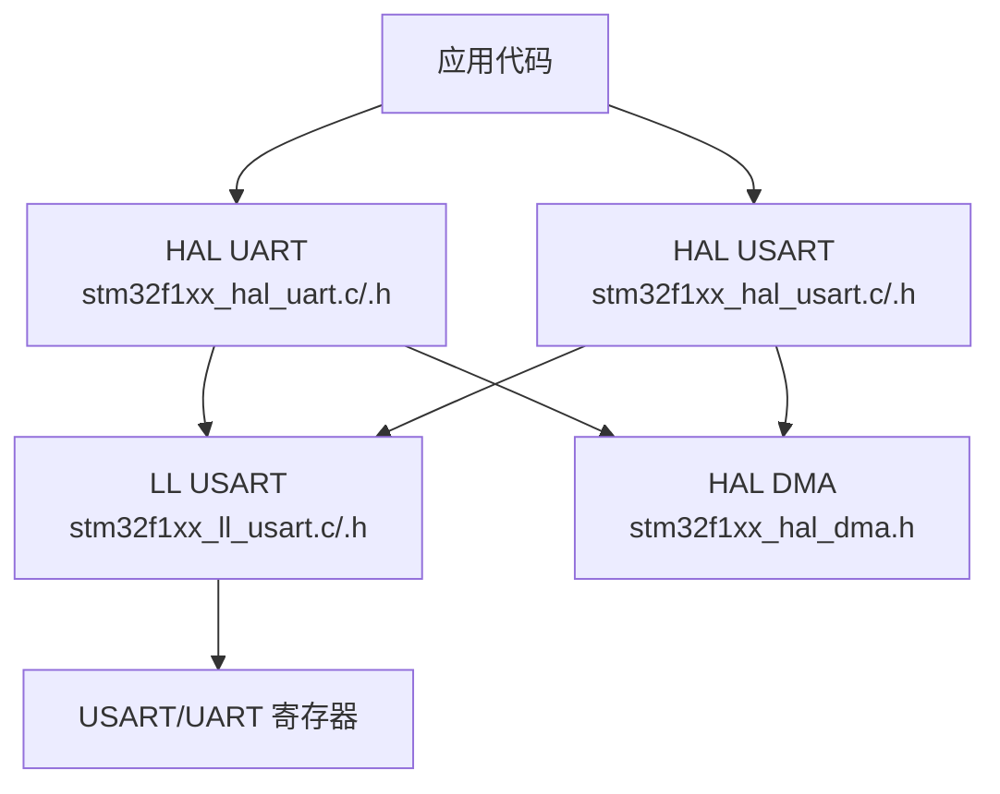
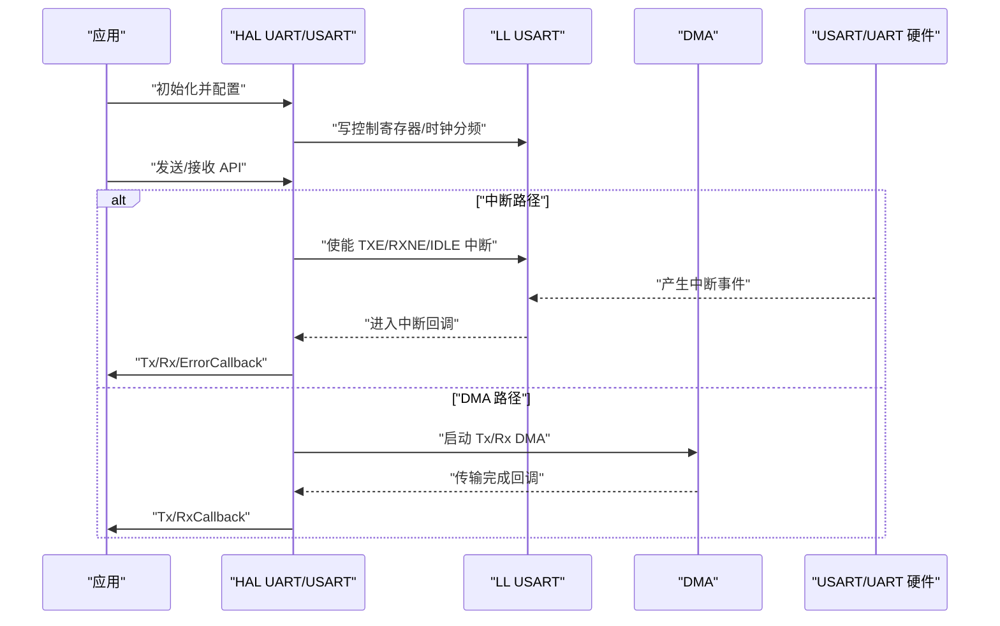
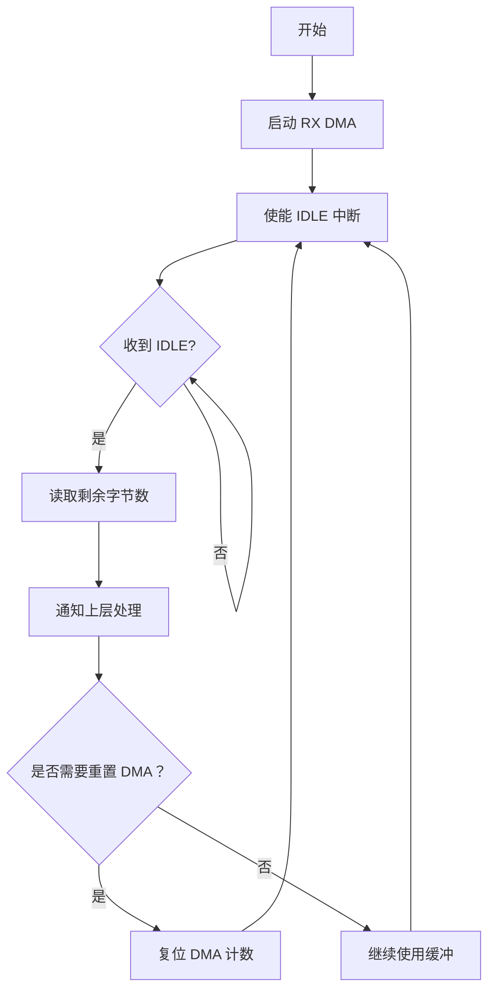
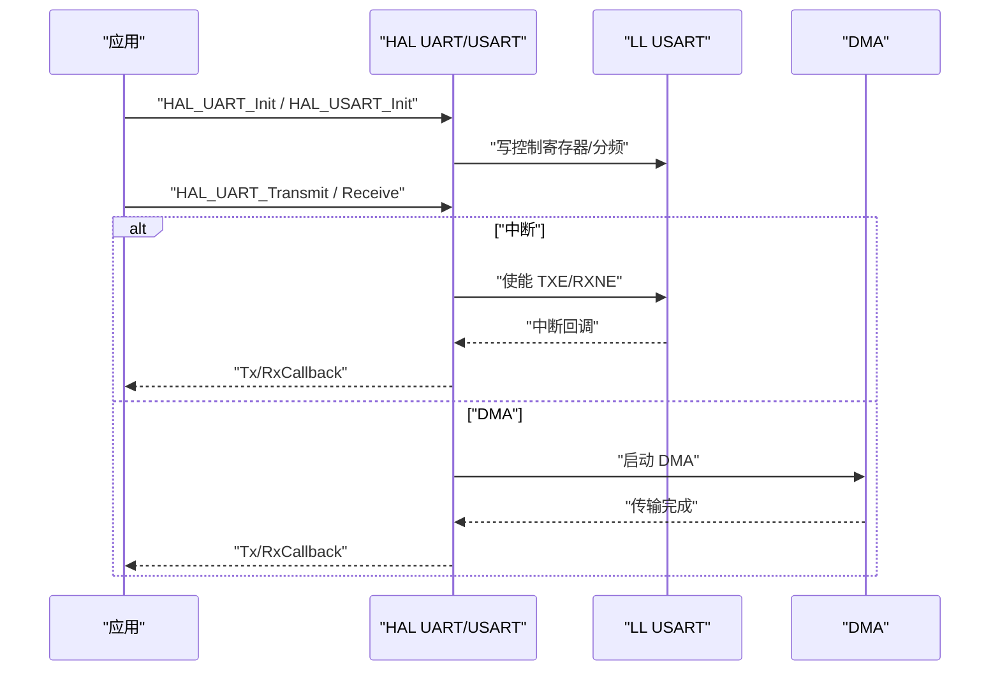
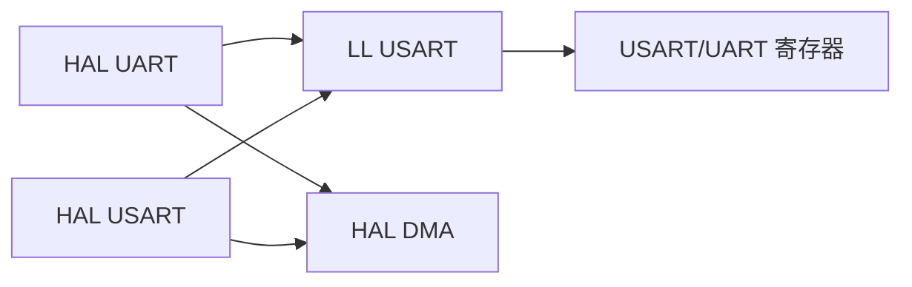

# UART/USART 通信接口

<cite>
**本文引用的文件**   
- [stm32f1xx_hal.h](file://Inc/stm32f1xx_hal.h)
- [stm32f1xx_hal_def.h](file://Inc/stm32f1xx_hal_def.h)
- [stm32f1xx_hal_uart.h](file://Inc/stm32f1xx_hal_uart.h)
- [stm32f1xx_hal_usart.h](file://Inc/stm32f1xx_hal_usart.h)
- [stm32f1xx_ll_usart.h](file://Inc/stm32f1xx_ll_usart.h)
- [stm32f1xx_hal_dma.h](file://Inc/stm32f1xx_hal_dma.h)
- [stm32f1xx_hal_uart.c](file://Src/stm32f1xx_hal_uart.c)
- [stm32f1xx_hal_usart.c](file://Src/stm32f1xx_hal_usart.c)
- [stm32f1xx_ll_usart.c](file://Src/stm32f1xx_ll_usart.c)
</cite>

## 目录
1. [简介](#简介)
2. [项目结构](#项目结构)
3. [核心组件](#核心组件)
4. [架构总览](#架构总览)
5. [详细组件分析](#详细组件分析)
6. [依赖关系分析](#依赖关系分析)
7. [性能考虑](#性能考虑)
8. [故障排查指南](#故障排查指南)
9. [结论](#结论)
10. [附录：常用示例与最佳实践](#附录常用示例与最佳实践)

## 简介
本文件面向使用 STM32F1xx HAL 库进行串口通信的开发者，系统梳理 UART 与 USART 的差异、配置项、API、中断与 DMA 异步路径，以及波特率误差、寄存器标志、流控和 RS-485 半双工等工程要点。STM32F1 系列中，UART 是通用异步收发器，没有同步时钟输出能力；USART 则在此基础上支持同步模式、SmartCard、IrDA、LIN 和多主机等扩展功能。HAL 层通过 `UART_HandleTypeDef`/`USART_InitTypeDef` 暴露统一配置入口，并通过中断或 DMA 驱动底层 LL 寄存器完成数据搬运。

## 项目结构
本仓库中与 UART/USART 直接相关的头文件和实现位于 Inc 与 Src 两个目录：

- 头文件
  - `stm32f1xx_hal_uart.h`：UART 句柄、初始化结构体、回调函数原型、传输 API 声明。
  - `stm32f1xx_hal_usart.h`：USART 初始化结构体、扩展配置、同步与智能卡相关宏定义。
  - `stm322f1xx_ll_usart.h`：LL 层寄存器访问、状态位、控制位、分频器等常量。
  - `stm32f1xx_hal_def.h`：公共类型、状态码、句柄基类。
  - `stm32f1xx_hal_dma.h`：DMA 传输 API 与状态回调。
  - `stm32f1xx_hal.h`：HAL 初始化入口与外设使能。
- 实现文件
  - `stm32f1xx_hal_uart.c`：UART 传输、接收、错误处理、中断服务封装。
  - `stm32f1xx_hal_usart.c`：USART 初始化、同步/多主机/SmartCard/IrDA 专用逻辑。
  - `stm32f1xx_ll_usart.c`：LL 层寄存器读写、时钟配置、状态查询与清除。

**图表来源**
- [stm32f1xx_hal_uart.c:1-120](file://Src/stm32f1xx_hal_uart.c#L1-L120)
- [stm32f1xx_hal_usart.c:1-120](file://Src/stm32f1xx_hal_usart.c#L1-L120)
- [stm32f1xx_ll_usart.c:1-120](file://Src/stm32f1xx_ll_usart.c#L1-L120)

**章节来源**
- [stm32f1xx_hal.h:1-200](file://Inc/stm32f1xx_hal.h#L1-L200)
- [stm32f1xx_hal_def.h:1-200](file://Inc/stm32f1xx_hal_def.h#L1-L200)
- [stm32f1xx_hal_uart.h:1-200](file://Inc/stm32f1xx_hal_uart.h#L1-L200)
- [stm32f1xx_hal_usart.h:1-200](file://Inc/stm32f1xx_hal_usart.h#L1-L200)

## 核心组件
- UART 句柄与初始化
  - `UART_HandleTypeDef`：包含 USART/UART 实例指针、初始化参数、状态、错误码、回调函数指针、TX/RX DMA 句柄等。
  - `UART_InitTypeDef`：波特率、停止位、校验位、硬件流控、过采样、单/双向模式、多处理器模式、LIN 模式、唤醒方式等字段。
- USART 扩展初始化
  - `USART_InitTypeDef`：在 UART 基础上增加同步模式、主/从时钟选择、奇偶校验选择、硬件流控、智能卡时钟设置、暂停/恢复等字段。
- LL 层常量
  - LL 层提供 BRR 分频、CR1/CR2/CR3 控制位、SR 状态位、DR 数据寄存器偏移、RXNE/TXE/ORE/FE/PE 标志、CTS/RTS 控制位、IDLE 标志等。

关键职责划分：
- HAL 层负责状态机、超时、回调派发、中断/DMA 装配、参数合法性检查。
- LL 层负责直接操作寄存器、计算分频、清标志、开启/关闭中断。
- DMA 层负责内存到 DR 或 DR 到内存的数据搬运。

**章节来源**
- [stm32f1xx_hal_uart.h:1-200](file://Inc/stm32f1xx_hal_uart.h#L1-L200)
- [stm32f1xx_hal_usart.h:1-200](file://Inc/stm32f1xx_hal_usart.h#L1-L200)
- [stm32f1xx_ll_usart.h:1-200](file://Inc/stm32f1xx_ll_usart.h#L1-L200)

## 架构总览
UART/USART 通信在 HAL 层形成“应用 → HAL → LL → 寄存器”的分层调用链，并可选择中断或 DMA 作为数据搬运通道。

**图表来源**
- [stm32f1xx_hal_uart.c:1-200](file://Src/stm32f1xx_hal_uart.c#L1-L200)
- [stm32f1xx_hal_usart.c:1-200](file://Src/stm32f1xx_hal_usart.c#L1-L200)
- [stm32f1xx_ll_usart.c:1-200](file://Src/stm32f1xx_ll_usart.c#L1-L200)

## 详细组件分析

### UART 与 USART 的差异及适用场景
- UART
  - 异步串行通信，无同步时钟输出。
  - 适合大多数终端打印、传感器读取、协议栈透传等场景。
- USART
  - 除异步外，还支持：
    - 同步模式：由 MCLK 引脚输出时钟，用于与外部 SPI-like 设备通信。
    - SmartCard：支持 ISO7816 同步协议。
    - IrDA：红外数据链路。
    - LIN：本地互联网络。
    - 多主机：配合 CTS/RTS 实现简单仲裁。
  - 适合需要时钟同步、总线拓扑或特定协议的设备。

选择建议：
- 仅需异步通信时优先用 UART，避免启用不必要的 USART 特性。
- 需要同步时钟、智能卡或 IrDA/LIN 时使用 USART。

**章节来源**
- [stm32f1xx_hal_usart.h:1-200](file://Inc/stm32f1xx_hal_usart.h#L1-L200)
- [stm32f1xx_hal_uart.h:1-200](file://Inc/stm32f1xx_hal_uart.h#L1-L200)

### 配置结构体详解
- UART_InitTypeDef 关键字段
  - 波特率：由 PCLK 经分频得到，需考虑过采样对精度影响。
  - 停止位：1、1.5、2 位可选。
  - 校验位：无校验、偶校验、奇校验。
  - 硬件流控：None、RTS、CTS、RTS+CTS。
  - 过采样：16 倍或 8 倍。
  - 单/双向模式：全双工或仅 RX/仅 TX。
  - 多处理器模式：MME（多主机/多处理器）。
  - LIN 模式：LIN 主/从帧格式。
  - 唤醒方式：空闲线唤醒、地址标记唤醒等。
- USART_InitTypeDef 关键字段
  - 同步模式：ClockPolarity、ClockPhase、ClockLastBit、CPOL/CPHA 语义。
  - 主/从时钟：MasterClockOutput。
  - 奇偶校验选择：ParitySelect。
  - 硬件流控：同 UART。
  - SmartCard 时钟：Prescaler、GuardTime、NACK。
  - 暂停/恢复：Pause、Resume。

注意：
- 同一外设既可作为 UART 也可作为 USART 使用，具体取决于固件包与芯片型号；F1 系列通常以 USART 外设承载 UART 功能。
- 不同模式会改变 CR1/CR2/CR3 的配置位，例如 LIN、SmartCard、同步时钟、多主机等。

**章节来源**
- [stm32f1xx_hal_uart.h:1-200](file://Inc/stm32f1xx_hal_uart.h#L1-L200)
- [stm32f1xx_hal_usart.h:1-200](file://Inc/stm32f1xx_hal_usart.h#L1-L200)

### 波特率误差与分频
- F1 系列的 BRR 寄存器由整数部分和小数部分组成，HAL 会根据目标波特率和 PCLK 频率计算分频值。
- 过采样为 16 时精度更高；8 倍过采样在低波特率或高噪声环境可能更鲁棒，但误差更大。
- 典型误差评估方法：
  - 已知 PCLK、目标波特率、过采样倍数，先计算理论分频值，再对比实际可配置的最小步进对应的真实波特率，求百分比误差。
  - 若误差超过协议允许范围（例如 RS-232 通常要求小于约 3%），应调整 PCLK 或改用更低波特率。

参考实现位置：
- LL 层负责写入 BRR 分频值。
- HAL 层在初始化前进行参数有效性检查，必要时返回错误码。

**章节来源**
- [stm32f1xx_ll_usart.c:1-200](file://Src/stm32f1xx_ll_usart.c#L1-L200)
- [stm32f1xx_ll_usart.h:1-200](file://Inc/stm32f1xx_ll_usart.h#L1-L200)

### 寄存器与标志位
- DR：数据寄存器，读/写一帧数据。
- SR：状态寄存器，常见标志包括：
  - RXNE：接收缓冲区非空。
  - TXE：发送数据寄存器为空。
  - TC：发送完成。
  - ORE：溢出错误。
  - FE：帧错误。
  - PE：校验错误。
  - IDLE：空闲中断标志。
- CR1/CR2/CR3：控制寄存器，分别控制使能、中断、DMA、校验、停止位、流控、同步时钟、SmartCard、IrDA 等。
- BRR：波特率分频寄存器。
- GTPR：SmartCard/Guard Time 寄存器。

错误处理要点：
- ORE/FE/PE 需在 ISR 中读取 DR 清除标志，否则后续中断可能被阻塞。
- 在多中断嵌套场景中，应避免在错误回调中进行耗时操作。

**章节来源**
- [stm32f1xx_ll_usart.h:1-200](file://Inc/stm32f1xx_ll_usart.h#L1-L200)
- [stm32f1xx_ll_usart.c:1-200](file://Src/stm32f1xx_ll_usart.c#L1-L200)

### 硬件流控与 RS-485 半双工
- 硬件流控
  - RTS：请求发送，控制对端是否允许发送。
  - CTS：清除发送，指示对端是否准备好接收。
  - 支持 None、RTS、CTS、RTS+CTS 四种组合。
- RS-485 半双工
  - HAL 未提供专用 RS-485 抽象，但可通过 CTS/RTS 或 GPIO 控制 DE/RE 引脚实现。
  - 常见做法：
    - 使用 CTS 模拟方向控制：发送前拉低 CTS，接收前释放 CTS。
    - 或使用 GPIO 控制 DE/RE，并在 HAL 发送完成回调中切换方向。
  - 注意时序：确保方向切换发生在最后一位数据之后，避免丢字节。

**章节来源**
- [stm32f1xx_hal_uart.h:1-200](file://Inc/stm32f1xx_hal_uart.h#L1-L200)
- [stm32f1xx_ll_usart.h:1-200](file://Inc/stm32f1xx_ll_usart.h#L1-L200)

### 中断与 DMA 异步路径
- 中断路径
  - 触发条件：TXE、RXNE、TC、IDLE、ORE/FE/PE 等。
  - 回调函数：
    - `HAL_UART_TxCpltCallback`：发送完成。
    - `HAL_UART_RxCpltCallback`：接收完成。
    - `HAL_UART_ErrorCallback`：错误处理。
  - 适合小数据量、命令响应、调试打印等场景。
- DMA 路径
  - TX DMA：内存到 DR，减少 CPU 占用。
  - RX DMA：DR 到内存，适合大数据吞吐。
  - 回调函数：
    - `HAL_UART_TxCpltCallback`、`HAL_UART_RxCpltCallback`、`HAL_UART_ErrorCallback`。
  - 适合高速、大批量数据。
- IDLE 中断不定长接收
  - 使用 DMA + IDLE 检测帧结束，常用于不定长报文。
  - 流程：
    1. 启动 RX DMA，目标为环形缓冲或固定大小缓冲。
    2. 使能 IDLE 中断。
    3. 收到 IDLE 后在中断中读取剩余字节数，通知上层处理。
    4. 根据业务决定复位 DMA 或继续复用缓冲。

**图表来源**
- [stm32f1xx_hal_uart.c:1-200](file://Src/stm32f1xx_hal_uart.c#L1-L200)
- [stm32f1xx_ll_usart.c:1-200](file://Src/stm32f1xx_ll_usart.c#L1-L200)

**章节来源**
- [stm32f1xx_hal_uart.h:1-200](file://Inc/stm32f1xx_hal_uart.h#L1-L200)
- [stm32f1xx_hal_dma.h:1-200](file://Inc/stm32f1xx_hal_dma.h#L1-L200)

### 同步模式与 USART 专用功能
- 同步模式
  - 通过 ClockPolarity、ClockPhase、ClockLastBit 配置时钟极性与相位。
  - MasterClockOutput 可将 MCLK 输出到引脚，供外部从设备采样。
- SmartCard
  - 配置 Prescaler、GuardTime、NACK，支持 ISO7816 协议。
- IrDA
  - 配置 IrDA 功率等级与编码。
- LIN
  - 配置 LIN 主/从模式、断点/同步场。
- 多主机
  - 结合 CTS/RTS 与多处理器模式，实现简单总线仲裁。

注意：
- 同步模式下，数据采样与时钟边沿严格对齐，需确保外部设备满足时序要求。
- SmartCard/IrDA/LIN 等模式会修改控制位，可能与普通 UART 配置冲突，使用前务必重新初始化。

**章节来源**
- [stm32f1xx_hal_usart.h:1-200](file://Inc/stm32f1xx_hal_usart.h#L1-L200)
- [stm32f1xx_hal_usart.c:1-200](file://Src/stm32f1xx_hal_usart.c#L1-L200)

### API 概览与调用顺序
- 初始化
  - `HAL_UART_Init` / `HAL_USART_Init`：配置波特率、停止位、校验位、流控、模式等。
- 异步发送/接收
  - `HAL_UART_Transmit`：阻塞式发送。
  - `HAL_UART_Receive`：阻塞式接收。
  - `HAL_USART_Transmit` / `HAL_USART_Receive`：USART 专用同步或扩展模式下的收发。
- 高级接收
  - `HAL_UARTEx_ReceiveToIdle`：基于 IDLE 的不定长接收。
- 回调
  - `HAL_UART_TxCpltCallback`、`HAL_UART_RxCpltCallback`、`HAL_UART_ErrorCallback`。
  - `HAL_USART_TxCpltCallback`、`HAL_USART_RxCpltCallback`、`HAL_USART_ErrorCallback`。

典型调用序列：

**图表来源**
- [stm32f1xx_hal_uart.c:1-200](file://Src/stm32f1xx_hal_uart.c#L1-L200)
- [stm32f1xx_hal_usart.c:1-200](file://Src/stm32f1xx_hal_usart.c#L1-L200)

**章节来源**
- [stm32f1xx_hal_uart.h:1-200](file://Inc/stm32f1xx_hal_uart.h#L1-L200)
- [stm32f1xx_hal_usart.h:1-200](file://Inc/stm32f1xx_hal_usart.h#L1-L200)

## 依赖关系分析
- HAL UART/USART 依赖 LL USART 完成寄存器级操作。
- HAL UART/USART 可依赖 HAL DMA 完成高效数据搬运。
- HAL 初始化依赖 RCC 时钟配置与 GPIO 复用配置，这些通常在用户代码或 CubeMX 生成代码中完成。
- LL USART 依赖芯片寄存器映射与系统时钟树。

**图表来源**
- [stm32f1xx_hal_uart.c:1-200](file://Src/stm32f1xx_hal_uart.c#L1-L200)
- [stm32f1xx_hal_usart.c:1-200](file://Src/stm32f1xx_hal_usart.c#L1-L200)
- [stm32f1xx_ll_usart.c:1-200](file://Src/stm32f1xx_ll_usart.c#L1-L200)

**章节来源**
- [stm32f1xx_hal_def.h:1-200](file://Inc/stm32f1xx_hal_def.h#L1-L200)
- [stm32f1xx_hal_dma.h:1-200](file://Inc/stm32f1xx_hal_dma.h#L1-L200)

## 性能考虑
- 使用 DMA 替代中断搬运大量数据，降低 CPU 负载。
- 合理选择过采样倍数：高精度场景用 16 倍，抗噪场景可尝试 8 倍。
- 使用 IDLE + DMA 接收不定长数据，避免逐字节中断开销。
- 避免在回调中进行 printf 等耗时操作；改为置标志或入队列，在主循环处理。
- 谨慎使用多重嵌套中断；如需高优先级中断，确保短小快速。
- 对于 RS-485 半双工，方向切换要精确，避免在数据帧中间切换。
- 使用硬件流控可减少忙轮询，提高吞吐稳定性。

[本节为通用指导，不直接分析具体文件]

## 故障排查指南
常见问题与定位步骤：
- 无法接收
  - 检查 RXNE 是否被正确使能。
  - 确认 DR 是否被读取以清除 RXNE。
  - 检查波特率与过采样是否匹配。
- 频繁 ORE/FE/PE
  - ORE：可能是对端发送过快或 DMA/ISR 未及时取数。
  - FE：时钟极性/相位错误或波特率不一致。
  - PE：校验位配置不一致。
- 发送卡住
  - 检查 TXE/TC 标志与中断使能。
  - DMA 发送未完成时不要重复启动。
- 半双工方向错乱
  - 检查 CTS/DE/RE 控制时序。
  - 确认发送完成后才切换到接收方向。
- IDLE 中断不触发
  - 确认 IDLE 中断已使能。
  - 确认 DR 未被反复读取导致状态异常。

**章节来源**
- [stm32f1xx_ll_usart.h:1-200](file://Inc/stm32f1xx_ll_usart.h#L1-L200)
- [stm32f1xx_ll_usart.c:1-200](file://Src/stm32f1xx_ll_usart.c#L1-L200)

## 结论
STM32F1xx 的 UART/USART 在 HAL 层提供了统一的配置与 API，同时保留 USART 的同步、SmartCard、IrDA、LIN 等多模式扩展。工程中应根据通信需求选择合适的模式与数据搬运方式：轻量场景用中断，高速与不定长场景优先 DMA+IDLE。波特率误差、寄存器标志、流控与半双工时序是落地时的关键细节，需结合 LL 层行为与 HAL 回调进行系统化设计与测试。

[本节为总结性内容，不直接分析具体文件]

## 附录：常用示例与最佳实践
- 串口打印
  - 使用 `HAL_UART_Transmit` 或重定向 `printf` 到 UART。
  - 建议使用较小缓冲区，避免阻塞主循环。
- 终端交互
  - 使用 `HAL_UART_Receive` 或 DMA+IDLE 接收命令。
  - 将命令解析放在主循环，回调仅做数据收集。
- DMA+IDLE 不定长接收
  - 启动 RX DMA，使能 IDLE 中断。
  - 在 IDLE 回调中计算剩余长度并通知上层。
  - 根据业务策略复位 DMA 或复用缓冲。
- USART 同步时钟输出
  - 配置同步模式与主时钟输出。
  - 确保外部从设备时钟极性与相位一致。
- 最佳实践清单
  - 初始化前先关闭外设，避免意外状态。
  - 所有回调中只设标志或入队列。
  - 错误回调中清 ORE/FE/PE 标志。
  - 使用硬件流控提升稳定性。
  - 定期校验波特率误差是否在协议允许范围内。

[本节为概念性指导，不直接分析具体文件]