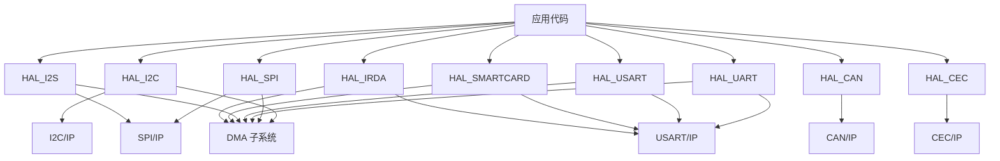
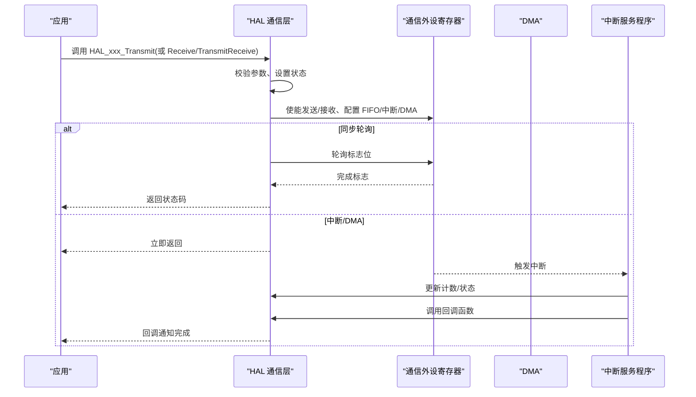
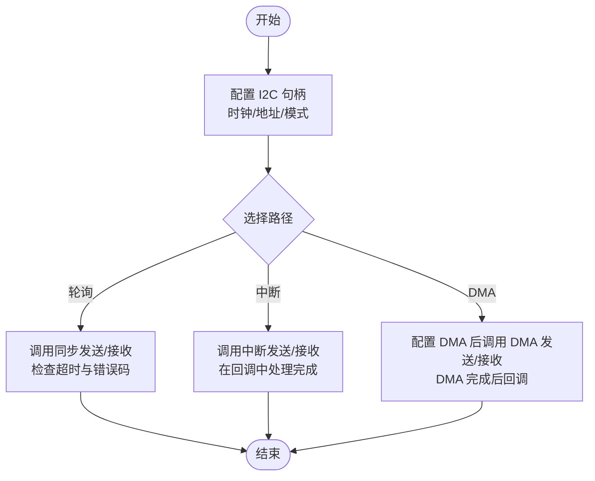
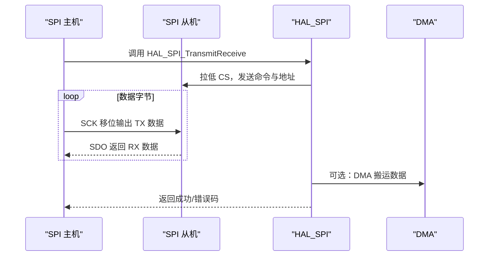
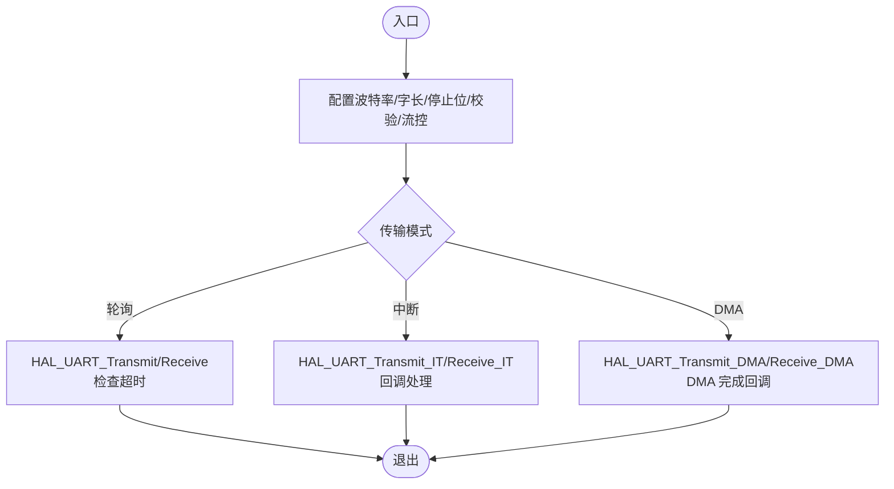
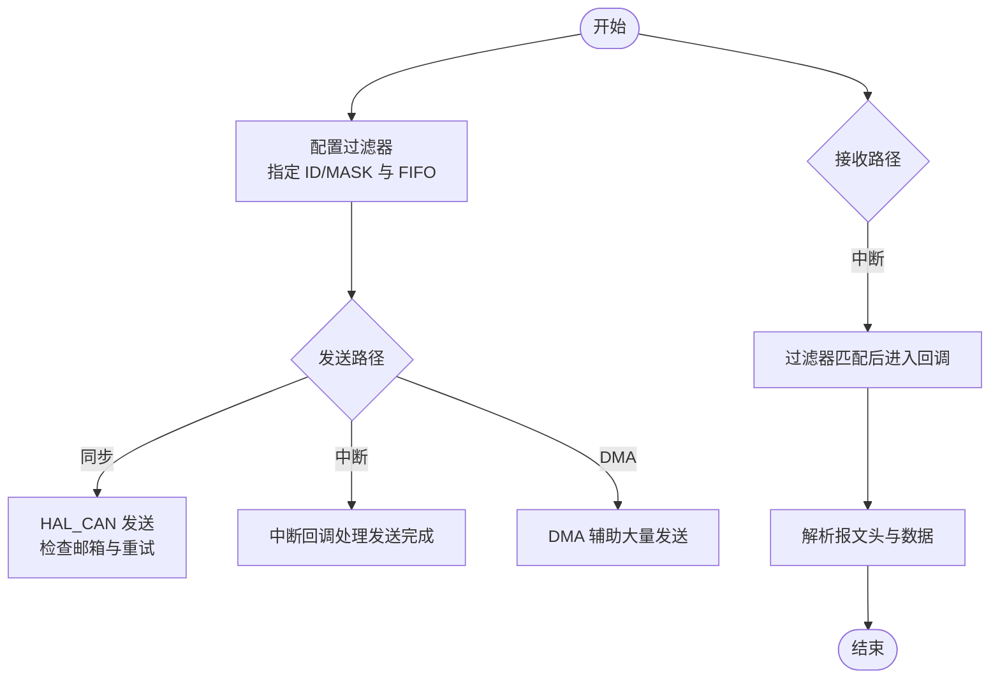
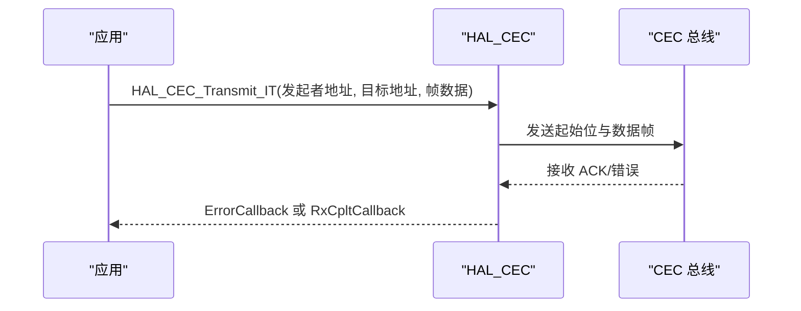
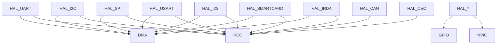

# 通信接口族

<cite>
**本文引用的文件**   
- [Inc/stm32f1xx_hal_i2c.h](file://Inc/stm32f1xx_hal_i2c.h)
- [Src/stm32f1xx_hal_i2c.c](file://Src/stm32f1xx_hal_i2c.c)
- [Inc/stm32f1xx_hal_spi.h](file://Inc/stm32f1xx_hal_spi.h)
- [Src/stm32f1xx_hal_spi.c](file://Src/stm32f1xx_hal_spi.c)
- [Inc/stm32f1xx_hal_usart.h](file://Inc/stm32f1xx_hal_usart.h)
- [Src/stm32f1xx_hal_usart.c](file://Src/stm32f1xx_hal_usart.c)
- [Inc/stm32f1xx_hal_uart.h](file://Inc/stm32f1xx_hal_uart.h)
- [Src/stm32f1xx_hal_uart.c](file://Src/stm32f1xx_hal_uart.c)
- [Inc/stm32f1xx_hal_i2s.h](file://Inc/stm32f1xx_hal_i2s.h)
- [Src/stm32f1xx_hal_i2s.c](file://Src/stm32f1xx_hal_i2s.c)
- [Inc/stm32f1xx_hal_can.h](file://Inc/stm32f1xx_hal_can.h)
- [Src/stm32f1xx_hal_can.c](file://Src/stm32f1xx_hal_can.c)
- [Inc/stm32f1xx_hal_cec.h](file://Inc/stm32f1xx_hal_cec.h)
- [Src/stm32f1xx_hal_cec.c](file://Src/stm32f1xx_hal_cec.c)
- [Inc/stm32f1xx_hal_smartcard.h](file://Inc/stm32f1xx_hal_smartcard.h)
- [Src/stm32f1xx_hal_smartcard.c](file://Src/stm32f1xx_hal_smartcard.c)
- [Inc/stm32f1xx_hal_irda.h](file://Inc/stm32f1xx_hal_irda.h)
- [Src/stm32f1xx_hal_irda.c](file://Src/stm32f1xx_hal_irda.c)
</cite>

## 目录
1. [引言](#引言)
2. [项目结构](#项目结构)
3. [核心组件总览](#核心组件总览)
4. [架构总览](#架构总览)
5. [详细组件分析](#详细组件分析)
6. [依赖关系分析](#依赖关系分析)
7. [性能与资源对比](#性能与资源对比)
8. [故障排查指南](#故障排查指南)
9. [结论](#结论)

## 引言
本文面向 STM32F1xx HAL 的通信接口族，覆盖 I2C、SPI、UART/USART、I2S、CAN、CEC、SmartCard、IrDA 等外设。文档重点说明：
- 句柄结构体初始化字段含义
- 同步轮询、中断、DMA 三种传输路径
- DMA 配置与回调机制
- 超时控制与错误码处理
- 典型主机/从机、全双工/半双工使用模式
- 时序、帧格式、时钟极性与相位、波特率或位速率配置
- 总线仲裁、冲突处理与调试建议

为避免泄露具体实现细节，本文不直接粘贴源码，而是通过“章节来源”和“图示来源”指向头文件和源文件中的关键函数原型与数据结构定义位置。

## 项目结构
该仓库采用分层组织方式：
- `Inc/`：HAL 驱动头文件，定义所有外设的句柄、初始化结构体、状态枚举、错误码、公开 API 原型。
- `Src/`：HAL 驱动 C 实现，封装寄存器操作、中断服务程序、回调分发、DMA 管理、超时检查。
- 其他层如 DMA、RCC、GPIO、Cortex 等为通信外设提供底层支持。

**图示来源**
- [Inc/stm32f1xx_hal_i2c.h:541-629](file://Inc/stm32f1xx_hal_i2c.h#L541-L629)
- [Inc/stm32f1xx_hal_spi.h:656-712](file://Inc/stm32f1xx_hal_spi.h#L656-L712)
- [Inc/stm32f1xx_hal_usart.h:492-548](file://Inc/stm32f1xx_hal_usart.h#L492-L548)
- [Inc/stm32f1xx_hal_uart.h:722-808](file://Inc/stm32f1xx_hal_uart.h#L722-L808)
- [Inc/stm32f1xx_hal_i2s.h:405-456](file://Inc/stm32f1xx_hal_i2s.h#L405-L456)
- [Inc/stm32f1xx_hal_can.h:649-745](file://Inc/stm32f1xx_hal_can.h#L649-L745)
- [Inc/stm32f1xx_hal_cec.h:424-465](file://Inc/stm32f1xx_hal_cec.h#L424-L465)
- [Inc/stm32f1xx_hal_smartcard.h:615-663](file://Inc/stm32f1xx_hal_smartcard.h#L615-L663)
- [Inc/stm32f1xx_hal_irda.h:531-585](file://Inc/stm32f1xx_hal_irda.h#L531-L585)

**章节来源**
- [Inc/stm32f1xx_hal_def.h](file://Inc/stm32f1xx_hal_def.h)
- [Inc/stm32f1xx_hal_dma.h](file://Inc/stm32f1xx_hal_dma.h)
- [Inc/stm32f1xx_hal_rcc.h](file://Inc/stm32f1xx_hal_rcc.h)

## 核心组件总览
各通信外设均遵循 HAL 通用约定：
- 句柄结构体：保存外设寄存器基地址、初始化参数、缓冲区指针、传输计数、DMA 句柄、锁、状态和错误码。
- 初始化函数：`HAL_xxx_Init`，内部调用 MspInit 钩子完成 GPIO/RCC/DMA/中断等底层配置。
- 传输函数：提供同步轮询、中断、DMA 三套 API；多数还提供全双工收发组合函数。
- 异步回调：在传输完成、半完成、错误、中止等阶段回调用户函数。
- 状态查询：`HAL_xxx_GetState` 返回当前通信状态。
- 错误查询：`HAL_xxx_GetError` 返回错误码，供上层诊断。

下表给出每个接口的典型 API 家族及用途定位（以头文件中导出原型为准）：

| 接口 | 初始化/反初始化 | 同步轮询 | 中断 | DMA | 中止/取消 | 状态/错误 |
|---|---|---|---|---|---|---|
| I2C | `HAL_I2C_Init` / `HAL_I2C_DeInit` | 发送/接收 | 发送/接收 | 发送/接收 | 中止相关函数 | `HAL_I2C_GetState` / `HAL_I2C_GetError` |
| SPI | `HAL_SPI_Init` / `HAL_SPI_DeInit` | `HAL_SPI_Transmit/Receive/TransmitReceive` | `_IT` 系列 | `_DMA` 系列 | `HAL_SPI_Abort` / `HAL_SPI_Abort_IT` | `HAL_SPI_GetState` / `HAL_SPI_GetError` |
| UART | `HAL_UART_Init` / `HAL_UART_DeInit` | `HAL_UART_Transmit/Receive` | `_IT` 系列 | `_DMA` 系列 | `HAL_UART_Abort*` | `HAL_UART_GetState` / `HAL_UART_GetError` |
| USART | `HAL_USART_Init` / `HAL_USART_DeInit` | `HAL_USART_Transmit/Receive/TransmitReceive` | `_IT` 系列 | `_DMA` 系列 | `HAL_USART_Abort*` | `HAL_USART_GetState` / `HAL_USART_GetError` |
| I2S | `HAL_I2S_Init` / `HAL_I2S_DeInit` | `HAL_I2S_Transmit/Receive` | `_IT` 系列 | `_DMA` 系列 | 未统一暴露 Abort API | `HAL_I2S_GetState` / `HAL_I2S_GetError` |
| CAN | `HAL_CAN_Init` / `HAL_CAN_DeInit` | 报文发送/过滤接收 | 发送/接收回调 | 通常结合 DMA | `HAL_CAN_Stop` / `HAL_CAN_AbortTxRequest` | `HAL_CAN_GetState` / `HAL_CAN_GetError` |
| CEC | `HAL_CEC_Init` / `HAL_CEC_DeInit` | 无同步发送 | `HAL_CEC_Transmit_IT` | 未在主 API 中暴露 | 通过错误回调与状态判断 | `HAL_CEC_GetState` / `HAL_CEC_GetError` |
| SmartCard | `HAL_SMARTCARD_Init` / `HAL_SMARTCARD_DeInit` | `HAL_SMARTCARD_Transmit/Receive` | `_IT` 系列 | `_DMA` 系列 | `HAL_SMARTCARD_Abort*` | `HAL_SMARTCARD_GetState` / `HAL_SMARTCARD_GetError` |
| IrDA | `HAL_IRDA_Init` / `HAL_IRDA_DeInit` | `HAL_IRDA_Transmit/Receive` | `_IT` 系列 | `_DMA` 系列 | `HAL_IRDA_Abort*` | `HAL_IRDA_GetState` / `HAL_IRDA_GetError` |

**章节来源**
- [Inc/stm32f1xx_hal_i2c.h:541-629](file://Inc/stm32f1xx_hal_i2c.h#L541-L629)
- [Inc/stm32f1xx_hal_spi.h:656-712](file://Inc/stm32f1xx_hal_spi.h#L656-L712)
- [Inc/stm32f1xx_hal_usart.h:492-548](file://Inc/stm32f1xx_hal_usart.h#L492-L548)
- [Inc/stm32f1xx_hal_uart.h:722-808](file://Inc/stm32f1xx_hal_uart.h#L722-L808)
- [Inc/stm32f1xx_hal_i2s.h:405-456](file://Inc/stm32f1xx_hal_i2s.h#L405-L456)
- [Inc/stm32f1xx_hal_can.h:649-745](file://Inc/stm32f1xx_hal_can.h#L649-L745)
- [Inc/stm32f1xx_hal_cec.h:424-465](file://Inc/stm32f1xx_hal_cec.h#L424-L465)
- [Inc/stm32f1xx_hal_smartcard.h:615-663](file://Inc/stm32f1xx_hal_smartcard.h#L615-L663)
- [Inc/stm32f1xx_hal_irda.h:531-585](file://Inc/stm32f1xx_hal_irda.h#L531-L585)

## 架构总览
所有通信外设共享以下抽象层次：
- 应用层：调用 HAL API，填写句柄和缓冲区。
- HAL 层：校验参数、设置状态、启动外设、绑定 DMA/中断、循环等待或立即返回。
- 中断/DMA 层：硬件触发中断或 DMA 请求，HAL 更新计数、状态，并调用用户回调。
- 寄存器层：由 HAL 内部间接访问，避免应用直接操作寄存器。

**图示来源**
- [Src/stm32f1xx_hal_spi.c](file://Src/stm32f1xx_hal_spi.c)
- [Src/stm32f1xx_hal_uart.c](file://Src/stm32f1xx_hal_uart.c)
- [Src/stm32f1xx_hal_usart.c](file://Src/stm32f1xx_hal_usart.c)
- [Src/stm32f1xx_hal_i2c.c](file://Src/stm32f1xx_hal_i2c.c)
- [Src/stm32f1xx_hal_i2s.c](file://Src/stm32f1xx_hal_i2s.c)
- [Src/stm32f1xx_hal_can.c](file://Src/stm32f1xx_hal_can.c)
- [Src/stm32f1xx_hal_cec.c](file://Src/stm32f1xx_hal_cec.c)
- [Src/stm32f1xx_hal_smartcard.c](file://Src/stm32f1xx_hal_smartcard.c)
- [Src/stm32f1xx_hal_irda.c](file://Src/stm32f1xx_hal_irda.c)

## 详细组件分析

### I2C 接口
#### 句柄与初始化
- 句柄包含寄存器基地址、`I2C_InitTypeDef`、缓冲指针、传输大小与计数、选项、DMA 句柄、状态与错误码。
- 初始化结构体包括时钟频率、快速模式占空比、主设备地址、寻址模式、双地址、通用呼叫、无应答拉伸等。

关键点：
- 时钟频率应低于 400kHz，Fast Mode 需要正确占空比。
- 支持 7 位和 10 位地址。
- 可启用通用呼叫模式和 NOSTRETCH 模式，但需谨慎。

**章节来源**
- [Inc/stm32f1xx_hal_i2c.h:24-78](file://Inc/stm32f1xx_hal_i2c.h#L24-L78)
- [Inc/stm32f1xx_hal_i2c.h:100-176](file://Inc/stm32f1xx_hal_i2c.h#L100-L176)
- [Inc/stm32f1xx_hal_i2c.h:541-629](file://Inc/stm32f1xx_hal_i2c.h#L541-L629)

#### 传输模式
- 同步：发送/接收带超时。
- 中断：非阻塞启动，完成时回调。
- DMA：适合大数据量，避免 CPU 占用。

I2C 常见用法：
- 主机写传感器：先写寄存器地址，再写数据；或使用内存模式。
- 主机读传感器：发起读序列并读取响应字节。
- 从机监听：配置自身地址，进入监听模式并通过回调处理地址匹配和数据帧。

**图示来源**
- [Inc/stm32f1xx_hal_i2c.h:541-629](file://Inc/stm32f1xx_hal_i2c.h#L541-L629)

#### 时序、帧格式与错误处理
- 起始/停止条件、ACK/NACK、地址帧与数据帧由 HAL 与硬件共同管理。
- 错误码包括总线错误、仲裁丢失、应答失败、溢出、DMA 参数错误、超时、尺寸管理等。
- 超时控制用于防止总线卡死；发生错误时应复位句柄或重启外设。

**章节来源**
- [Inc/stm32f1xx_hal_i2c.h:176-200](file://Inc/stm32f1xx_hal_i2c.h#L176-L200)
- [Src/stm32f1xx_hal_i2c.c](file://Src/stm32f1xx_hal_i2c.c)

### SPI 接口
#### 句柄与初始化
- 句柄包含发送/接收缓冲指针、大小与计数、Rx/Tx ISR 回调函数指针、DMA 句柄、锁、状态和错误码。
- 初始化结构体包括模式、方向、数据位宽、时钟极性、时钟相位、NSS 管理、波特率分频、首位顺序、TI 模式、CRC 计算与多项式。

关键点：
- 时钟极性和相位决定 CPOL/CPHA 四组时序。
- NSS 可由硬件引脚或软件控制。
- 支持全双工、半双工、单线双向。

**章节来源**
- [Inc/stm32f1xx_hal_spi.h:30-90](file://Inc/stm32f1xx_hal_spi.h#L30-L90)
- [Inc/stm32f1xx_hal_spi.h:110-170](file://Inc/stm32f1xx_hal_spi.h#L110-L170)
- [Inc/stm32f1xx_hal_spi.h:656-712](file://Inc/stm32f1xx_hal_spi.h#L656-L712)

#### 传输模式与时序
- 同步：`HAL_SPI_Transmit` / `HAL_SPI_Receive` / `HAL_SPI_TransmitReceive`。
- 中断：`_IT` 系列。
- DMA：`_DMA` 系列，适合 Flash 页写、批量采集。

SPI Flash 典型流程：
- 主机写命令、地址、数据；注意 CS 拉低、命令帧格式、写保护与页边界。
- 主机读命令、地址，连续采样数据；注意空闲时钟与数据有效边沿。

**图示来源**
- [Inc/stm32f1xx_hal_spi.h:656-712](file://Inc/stm32f1xx_hal_spi.h#L656-L712)
- [Src/stm32f1xx_hal_spi.c](file://Src/stm32f1xx_hal_spi.c)

#### 错误处理
- 错误码包括模式故障、CRC 错误、溢出、DMA 错误、标志错误、中止错误、无效回调等。
- 建议在回调中检查错误码并重置句柄或上报应用。

**章节来源**
- [Inc/stm32f1xx_hal_spi.h:170-200](file://Inc/stm32f1xx_hal_spi.h#L170-L200)

### UART 与 USART 接口
#### 区别与共性
- UART：异步串口，无外部时钟。
- USART：支持同步模式，可配置时钟极性、相位和最后一位时钟脉冲。
- 两者句柄结构体相似，均包含发送/接收缓冲、DMA 句柄、锁、状态、错误码。
- 波特率计算公式在头文件注释中说明：整数分频与小数分频由 PCLK 与目标波特率推导。

**章节来源**
- [Inc/stm32f1xx_hal_uart.h:24-60](file://Inc/stm32f1xx_hal_uart.h#L24-L60)
- [Inc/stm32f1xx_hal_usart.h:24-60](file://Inc/stm32f1xx_hal_usart.h#L24-L60)

#### 帧格式与配置
- 数据位：8 位或 9 位。
- 停止位：可选数量。
- 校验：偶校验、奇校验或关闭。
- 流控：UART 支持硬件流控 RTS/CTS。
- 过采样：STM32F100 系列支持 8 倍过采样，其他系列建议使用 16 倍。

#### 传输模式
- 同步轮询：适合简单打印或短帧。
- 中断：适合事件驱动，例如按字符解析协议。
- DMA：适合长数据流、稳定吞吐，降低 CPU 占用。

典型用例：
- UART 打印：使用同步发送或 DMA 发送日志。
- UART 接收：中断接收单个字符，或在 IDLE 中断配合 DMA 做包解析。
- USART 全双工：同时发送与接收，适用于同步通信设备。

**图示来源**
- [Inc/stm32f1xx_hal_uart.h:722-808](file://Inc/stm32f1xx_hal_uart.h#L722-L808)
- [Inc/stm32f1xx_hal_usart.h:492-548](file://Inc/stm32f1xx_hal_usart.h#L492-L548)

#### 错误与状态
- 错误码包括校验错误、噪声错误、帧错误、溢出、DMA 错误、无效回调。
- 状态枚举区分 gState 与 RxState，便于同时跟踪发送与接收进度。

**章节来源**
- [Inc/stm32f1xx_hal_uart.h:60-140](file://Inc/stm32f1xx_hal_uart.h#L60-L140)
- [Inc/stm32f1xx_hal_usart.h:60-120](file://Inc/stm32f1xx_hal_usart.h#L60-L120)

### I2S 接口
#### 句柄与初始化
- 句柄基于 SPI 寄存器基地址，包含 I2S 初始化参数、发送/接收缓冲、DMA 句柄、锁、状态和错误码。
- 初始化参数包括工作模式、标准、数据格式、MCLK 输出、音频频率、时钟极性。

关键点：
- I2S 标准包括 Philips、MSB、LSB、PCM 短帧/长帧。
- 音频频率由 HAL 根据时钟树计算分频值。
- 主从模式与发送/接收方向灵活组合。

**章节来源**
- [Inc/stm32f1xx_hal_i2s.h:24-70](file://Inc/stm32f1xx_hal_i2s.h#L24-L70)
- [Inc/stm32f1xx_hal_i2s.h:90-150](file://Inc/stm32f1xx_hal_i2s.h#L90-L150)
- [Inc/stm32f1xx_hal_i2s.h:405-456](file://Inc/stm32f1xx_hal_i2s.h#L405-L456)

#### 传输模式
- 同步：`HAL_I2S_Transmit` / `HAL_I2S_Receive`。
- 中断：`_IT` 系列。
- DMA：`_DMA` 系列，适合音频流。

音频典型流程：
- 主机作为 I2S Master 产生 SCK 与 WS。
- 从机作为 I2S Slave 采样或输出 PCM 数据。
- DMA 循环搬运音频样本，减少 CPU 负载。

**章节来源**
- [Inc/stm32f1xx_hal_i2s.h:405-456](file://Inc/stm32f1xx_hal_i2s.h#L405-L456)
- [Src/stm32f1xx_hal_i2s.c](file://Src/stm32f1xx_hal_i2s.c)

### CAN 接口
#### 句柄与初始化
- 初始化结构体包括预分频、工作模式、同步跳宽、位段 1/2、时间触发通信、自动 bus-off、自动唤醒、自动重传、接收 FIFO 锁定、发送 FIFO 优先级。
- 过滤器结构体支持 ID/MASK 或 ID/ID 模式，16 位或 32 位宽度，分配 FIFO 和激活状态。
- 发送报文头包含标准 ID、扩展 ID、标识类型、远程请求、数据长度、时间戳注入等。

关键点：
- 位定时需根据总线长度、节点数和目标波特率计算时间量子、位段。
- 自动重传保证可靠性，但高错误率会导致 bus-off。
- 过滤器用于筛选感兴趣的消息，减少中断与 CPU 开销。

**章节来源**
- [Inc/stm32f1xx_hal_can.h:40-120](file://Inc/stm32f1xx_hal_can.h#L40-L120)
- [Inc/stm32f1xx_hal_can.h:120-200](file://Inc/stm32f1xx_hal_can.h#L120-L200)
- [Inc/stm32f1xx_hal_can.h:649-745](file://Inc/stm32f1xx_hal_can.h#L649-L745)

#### 仲裁与冲突处理
- CAN 基于非破坏性位仲裁，显性位优先于隐性位。
- 多个节点同时发送时，ID 小的消息优先。
- 错误帧、过载帧、ACK 错误会触发错误计数和状态变化；严重时进入 sleep 或 bus-off。

#### 传输模式
- 发送：通过发送邮箱队列，可中止特定邮箱请求。
- 接收：通过 FIFO 接收，结合过滤器与回调处理。
- 状态：监听、睡眠待命、睡眠活跃、错误等。

**图示来源**
- [Inc/stm32f1xx_hal_can.h:649-745](file://Inc/stm32f1xx_hal_can.h#L649-L745)
- [Src/stm32f1xx_hal_can.c](file://Src/stm32f1xx_hal_can.c)

**章节来源**
- [Inc/stm32f1xx_hal_can.h:40-200](file://Inc/stm32f1xx_hal_can.h#L40-L200)

### CEC 接口
#### 句柄与初始化
- 初始化结构体包含比特时序误差模式、比特周期误差模式、自身地址、接收缓冲指针。
- 句柄包含发送缓冲指针、发送计数、接收大小、锁、gState/RxState、错误码与回调。

关键点：
- CEC 是低频单线总线，常用于 HDMI 控制。
- 自身地址参与帧识别，接收缓冲用于存储收到的帧。
- 错误类型包括比特时序错误、比特周期错误、块传输完成错误、起始位错误、确认错误、线路错误等。

**章节来源**
- [Inc/stm32f1xx_hal_cec.h:24-60](file://Inc/stm32f1xx_hal_cec.h#L24-L60)
- [Inc/stm32f1xx_hal_cec.h:80-160](file://Inc/stm32f1xx_hal_cec.h#L80-L160)
- [Inc/stm32f1xx_hal_cec.h:424-465](file://Inc/stm32f1xx_hal_cec.h#L424-L465)

#### 传输模式
- 主要提供中断发送 API：`HAL_CEC_Transmit_IT`，携带发起者地址、目标地址和数据帧。
- 接收通过缓冲与回调完成。

**图示来源**
- [Inc/stm32f1xx_hal_cec.h:424-465](file://Inc/stm32f1xx_hal_cec.h#L424-L465)
- [Src/stm32f1xx_hal_cec.c](file://Src/stm32f1xx_hal_cec.c)

**章节来源**
- [Inc/stm32f1xx_hal_cec.h:424-465](file://Inc/stm32f1xx_hal_cec.h#L424-L465)

### SmartCard 接口
#### 句柄与初始化
- 初始化结构体包括波特率、字长、停止位、校验、模式、时钟极性/相位、最后一位时钟、预分频、保护时间、NACK 状态。
- 句柄包含发送/接收缓冲、DMA 句柄、锁、gState/RxState、错误码与回调。

关键点：
- SmartCard 基于 ISO7816 协议，需要时钟与保护时间。
- 可使用 USART 时钟生成 SmartCard 时钟。
- 支持同步/异步收发、中断与 DMA。

**章节来源**
- [Inc/stm32f1xx_hal_smartcard.h:24-70](file://Inc/stm32f1xx_hal_smartcard.h#L24-L70)
- [Inc/stm32f1xx_hal_smartcard.h:100-180](file://Inc/stm32f1xx_hal_smartcard.h#L100-L180)
- [Inc/stm32f1xx_hal_smartcard.h:615-663](file://Inc/stm32f1xx_hal_smartcard.h#L615-L663)

#### 传输模式
- 同步：`HAL_SMARTCARD_Transmit` / `HAL_SMARTCARD_Receive`。
- 中断：`_IT` 系列。
- DMA：`_DMA` 系列。
- 中止：多种 Abort API，支持全局、发送、接收及其中断版本。

**章节来源**
- [Inc/stm32f1xx_hal_smartcard.h:615-663](file://Inc/stm32f1xx_hal_smartcard.h#L615-L663)

### IrDA 接口
#### 句柄与初始化
- 初始化结构体包括波特率、字长、校验、模式、预分频、低功耗模式。
- 句柄包含发送/接收缓冲、DMA 句柄、锁、gState/RxState、错误码与回调。

关键点：
- IrDA 使用红外光进行串行通信，需设置预分频控制脉冲宽度。
- 低功耗模式可降低功耗，但会影响可达距离与鲁棒性。

**章节来源**
- [Inc/stm32f1xx_hal_irda.h:24-60](file://Inc/stm32f1xx_hal_irda.h#L24-L60)
- [Inc/stm32f1xx_hal_irda.h:80-160](file://Inc/stm32f1xx_hal_irda.h#L80-L160)
- [Inc/stm32f1xx_hal_irda.h:531-585](file://Inc/stm32f1xx_hal_irda.h#L531-L585)

#### 传输模式
- 同步：`HAL_IRDA_Transmit` / `HAL_IRDA_Receive`。
- 中断：`_IT` 系列。
- DMA：`_DMA` 系列。
- 中止：多种 Abort API。

**章节来源**
- [Inc/stm32f1xx_hal_irda.h:531-585](file://Inc/stm32f1xx_hal_irda.h#L531-L585)

## 依赖关系分析
通信外设对 HAL 内部模块的依赖如下：
- DMA：UART/USART/SPI/I2S/SmartCard/IrDA 等大量数据传输场景依赖 DMA。
- RCC/GPIO：初始化时钟树与复用引脚。
- Cortex：中断优先级与嵌套管理影响实时性。
- 底层 LL 库：部分 HAL 内部可能调用 LL 以提升性能或简化寄存器访问。

**图示来源**
- [Inc/stm32f1xx_hal_dma.h](file://Inc/stm32f1xx_hal_dma.h)
- [Inc/stm32f1xx_hal_rcc.h](file://Inc/stm32f1xx_hal_rcc.h)
- [Inc/stm32f1xx_hal_gpio.h](file://Inc/stm32f1xx_hal_gpio.h)

**章节来源**
- [Inc/stm32f1xx_hal_dma.h](file://Inc/stm32f1xx_hal_dma.h)
- [Inc/stm32f1xx_hal_rcc.h](file://Inc/stm32f1xx_hal_rcc.h)
- [Inc/stm32f1xx_hal_gpio.h](file://Inc/stm32f1xx_hal_gpio.h)

## 性能与资源对比
- 轮询路径：实现简单，但占用 CPU，不适合高频或大数据量。
- 中断路径：CPU 仅在事件发生时介入，适合中等吞吐与事件驱动协议。
- DMA 路径：CPU 几乎不参与数据搬运，适合高速、大缓存、周期性数据流。

缓冲区管理建议：
- 使用环形缓冲 + DMA 半满/满中断，实现生产者-消费者模型。
- 避免在中断中进行耗时操作，仅更新状态与触发应用层处理。
- 对于 I2C/CAN，合理设置超时与错误恢复，防止总线或队列永久占用。

优先级与中断嵌套：
- 高实时需求的外设（如音频 I2S、CAN 紧急报文）应配置较高中断优先级。
- 避免同一优先级内长时间占用，必要时拆分任务。

总线竞争与冲突：
- I2C：多主机时注意仲裁丢失与总线忙；从机注意应答与拉伸。
- SPI：CS 管理必须严格，避免从机误响应。
- CAN：关注错误帧与 bus-off，及时恢复与重连。

调试技巧：
- 使用逻辑分析仪抓取 I2C/SPI/UART 波形，核对时序与帧格式。
- 在 HAL 回调中记录状态与错误码，配合 LED/串口日志定位问题。
- 对 DMA 使用内存校验或填充已知模式验证数据完整性。

[本节为通用指导，不直接分析具体文件]

## 故障排查指南
常见问题与处理思路：
- I2C 总线错误/仲裁丢失：检查上拉电阻、地址冲突、时钟频率、从机是否响应。
- SPI CRC 或模式故障：检查极性/相位、NSS 配置、从机是否就绪。
- UART/USART 溢出或帧错误：检查波特率、过采样、校验位、停止位、流控。
- I2S 预分频错误：检查音频频率与时钟树配置。
- CAN bus-off：检查总线负载、终端电阻、滤波器配置、错误计数。
- CEC 线路错误或 ACK 错误：检查 HDMI 链路、电平、协议一致性。
- SmartCard 时钟异常：检查预分频、保护时间、NACK 配置。
- IrDA 通信不稳定：检查预分频、发射功率、环境光干扰。

通用步骤：
1. 调用 `HAL_xxx_GetState` 判断是否 Busy 或 Timeout。
2. 调用 `HAL_xxx_GetError` 获取错误码。
3. 在回调中记录错误码、计数值与上下文。
4. 必要时调用 DeInit 后再 Init，或重启外设。
5. 对 DMA 检查通道配置、内存地址对齐与传输大小。

**章节来源**
- [Inc/stm32f1xx_hal_i2c.h:176-200](file://Inc/stm32f1xx_hal_i2c.h#L176-L200)
- [Inc/stm32f1xx_hal_spi.h:170-200](file://Inc/stm32f1xx_hal_spi.h#L170-L200)
- [Inc/stm32f1xx_hal_usart.h:120-160](file://Inc/stm32f1xx_hal_usart.h#L120-L160)
- [Inc/stm32f1xx_hal_uart.h:140-200](file://Inc/stm32f1xx_hal_uart.h#L140-L200)
- [Inc/stm32f1xx_hal_i2s.h:150-200](file://Inc/stm32f1xx_hal_i2s.h#L150-L200)
- [Inc/stm32f1xx_hal_cec.h:160-200](file://Inc/stm32f1xx_hal_cec.h#L160-L200)

## 结论
STM32F1xx HAL 通信接口族提供统一的句柄模型与一致的 API 风格，覆盖从低速 I2C/CEC 到高速 SPI/I2S，再到串行 UART/USART 与现场总线 CAN。开发者应根据业务实时性、数据量和 CPU 资源选择合适的轮询、中断或 DMA 路径，并结合超时、错误码与回调机制构建健壮的系统。在实际工程中，务必重视总线时序、帧格式、时钟配置与仲裁策略，并通过调试工具与日志完善问题定位能力。

[本节为总结，不直接分析具体文件]