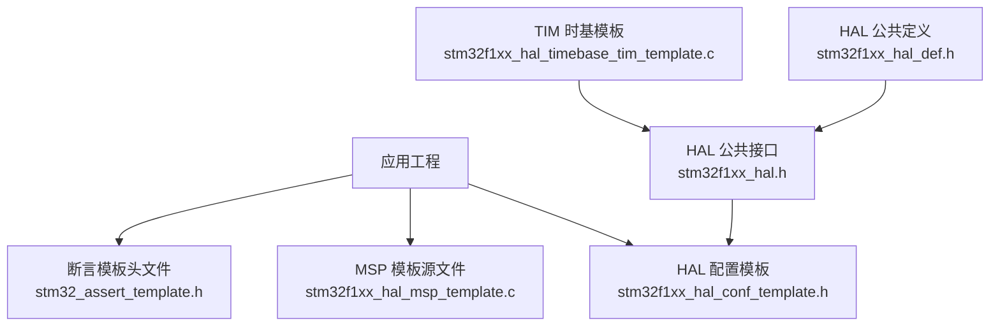
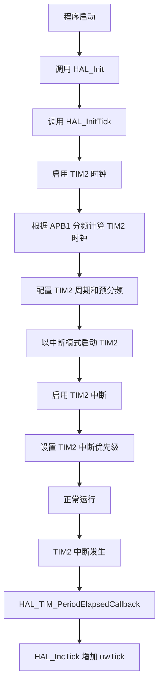
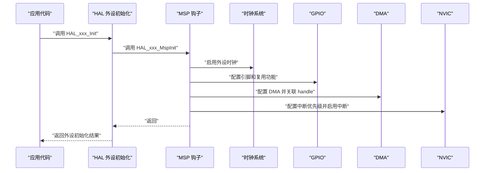
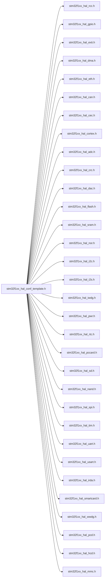
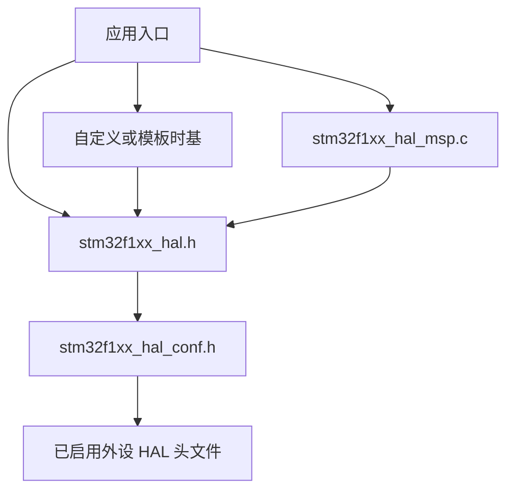

# 配置与定制指南

<cite>
**本文引用的文件**
- [stm32f1xx_hal_conf_template.h](file://Inc/stm32f1xx_hal_conf_template.h)
- [stm32_assert_template.h](file://Inc/stm32_assert_template.h)
- [stm32f1xx_hal_msp_template.c](file://Src/stm32f1xx_hal_msp_template.c)
- [stm32f1xx_hal_timebase_tim_template.c](file://Src/stm32f1xx_hal_timebase_tim_template.c)
- [stm32f1xx_hal.h](file://Inc/stm32f1xx_hal.h)
- [stm32f1xx_hal_def.h](file://Inc/stm32f1xx_hal_def.h)
- [README.md](file://README.md)
</cite>

## 目录
1. [引言](#引言)
2. [项目结构](#项目结构)
3. [核心配置入口](#核心配置入口)
4. [裁剪外设模块以减小固件体积](#裁剪外设模块以减小固件体积)
5. [时钟源、振荡器频率与时钟配置](#时钟源振荡器频率与时钟配置)
6. [Tick 时基与 Tick 频率](#tick-时基与-tick-频率)
7. [调试选项与外设宏开关](#调试选项与外设宏开关)
8. [MSP 钩子编写规范](#msp-钩子编写规范)
9. [断言机制与发布构建策略](#断言机制与发布构建策略)
10. [自定义时基实现要点](#自定义时基实现要点)
11. [RTOS 集成注意事项](#rtos-集成注意事项)
12. [依赖关系分析](#依赖关系分析)
13. [性能与体积优化建议](#性能与体积优化建议)
14. [常见问题排查](#常见问题排查)
15. [结论](#结论)

## 引言
本指南面向使用 STM32F1xx HAL Driver 的嵌入式开发者，重点说明如何基于模板文件对 HAL 进行裁剪、时钟配置、Tick 时基选择、调试开关设置，以及如何正确编写板级 MSP 钩子和处理 RTOS 集成。文档内容严格基于仓库中的模板头文件、模板源文件和 HAL 公共定义推导而来，适合从零搭建或二次移植 HAL 固件的工程参考。

## 项目结构
该 HAL 组件采用“头文件 + 源文件”分层组织：
- `Inc/` 中存放所有 HAL 头文件、LL 头文件、模板配置头文件和断言模板头文件。
- `Src/` 中存放对应 HAL 实现、LL 实现以及多个模板实现文件。
- 应用层需要复制并修改模板配置文件，而不是直接编辑模板本身。

**图表来源**
- [stm32f1xx_hal_conf_template.h:1-200](file://Inc/stm32f1xx_hal_conf_template.h#L1-L200)
- [stm32f1xx_hal_msp_template.c:1-92](file://Src/stm32f1xx_hal_msp_template.c#L1-L92)
- [stm32_assert_template.h:1-56](file://Inc/stm32_assert_template.h#L1-L56)
- [stm32f1xx_hal.h:1-150](file://Inc/stm32f1xx_hal.h#L1-L150)
- [stm32f1xx_hal_def.h:1-200](file://Inc/stm32f1xx_hal_def.h#L1-L200)
- [stm32f1xx_hal_timebase_tim_template.c:1-178](file://Src/stm32f1xx_hal_timebase_tim_template.c#L1-L178)

**章节来源**
- [README.md:1-45](file://README.md#L1-L45)

## 核心配置入口
STM32F1xx HAL 的核心配置入口是 `stm32f1xx_hal_conf_template.h`。它负责：
- 启用或禁用各 HAL 模块。
- 配置外部和内部振荡器频率。
- 配置系统电压、Tick 中断优先级、是否使用 RTOS、预取指等系统级常量。
- 配置每个外设的回调注册开关。
- 包含各外设头文件，从而决定哪些 HAL 源文件会被编译。
- 定义 `USE_FULL_ASSERT` 分支下的断言宏实现。

应用工程应将该模板复制到工程目录并重命名为 `stm32f1xx_hal_conf.h`，然后只修改副本。

**章节来源**
- [stm32f1xx_hal_conf_template.h:1-200](file://Inc/stm32f1xx_hal_conf_template.h#L1-L200)
- [stm32f1xx_hal_conf_template.h:201-398](file://Inc/stm32f1xx_hal_conf_template.h#L201-L398)
- [stm32f1xx_hal.h:1-60](file://Inc/stm32f1xx_hal.h#L1-L60)

## 裁剪外设模块以减小固件体积
### 裁剪原则
- 只保留工程中实际使用的 HAL 模块宏。
- 未使用的外设模块应注释掉对应的 `HAL_XXX_MODULE_ENABLED`。
- 被禁用的模块不会在配置文件中 include 其头文件，通常也不会参与后续编译路径。

### 可裁剪的主要模块
模板默认启用了大量模块，例如 ADC、CAN、CEC、CORTEX、CRC、DAC、DMA、ETH、EXTI、FLASH、GPIO、HCD、I2C、I2S、IRDA、IWDG、NAND、NOR、PCCARD、PCD、PWR、RCC、RTC、SD、SMARTCARD、SPI、SRAM、TIM、UART、USART、WWDG、MMC 等。若工程不使用以太网、USB、音频 I2S、智能卡、SD/MMC、NAND/NOR/PCCARD 等，应关闭相应宏。

### 裁剪效果
- 减少不必要的头文件 include。
- 减少相关 HAL 源文件的编译产物。
- 降低代码段和数据段占用。
- 降低链接阶段符号冲突风险。

### 裁剪检查清单
- 确认没有调用某外设的 HAL 初始化函数。
- 确认没有在中断或 DMA 中使用该外设。
- 确认没有依赖该外设的回调注册功能。
- 重新编译后检查 Flash/RAM 占用变化。

**章节来源**
- [stm32f1xx_hal_conf_template.h:1-200](file://Inc/stm32f1xx_hal_conf_template.h#L1-L200)
- [stm32f1xx_hal_conf_template.h:201-398](file://Inc/stm32f1xx_hal_conf_template.h#L201-L398)

## 时钟源、振荡器频率与时钟配置
### 振荡器频率宏
模板中定义了以下振荡器典型值：
- HSE_VALUE：外部高速振荡器频率。
- HSE_STARTUP_TIMEOUT：HSE 启动超时。
- HSI_VALUE：内部高速振荡器频率。
- LSI_VALUE：内部低速振荡器频率。
- LSE_VALUE：外部低速振荡器频率。
- LSE_STARTUP_TIMEOUT：LSE 启动超时。

这些值用于 RCC HAL 计算系统时钟。若硬件使用不同晶振，必须修改这些宏；更推荐通过编译器预处理参数传入，避免每次修改模板文件。

### 系统配置宏
- VDD_VALUE：系统工作电压毫伏值。
- TICK_INT_PRIORITY：Tick 中断优先级。
- USE_RTOS：当前 HAL 版本要求设为 0。
- PREFETCH_ENABLE：预取指使能。

### 重要约束
- 如果修改了 HSE、HSI、LSE、LSI 的值，必须确保与实际硬件一致，否则 PLL、总线分频、定时器计数、串口波特率等都可能出错。
- HSE/LSE 启动超时需要根据实际晶振特性调整，否则可能进入启动失败分支。

**章节来源**
- [stm32f1xx_hal_conf_template.h:1-200](file://Inc/stm32f1xx_hal_conf_template.h#L1-L200)

## Tick 时基与 Tick 频率
### Tick 频率类型
HAL 暴露了 Tick 频率枚举：
- HAL_TICK_FREQ_10HZ
- HAL_TICK_FREQ_100HZ
- HAL_TICK_FREQ_1KHZ
- HAL_TICK_FREQ_DEFAULT

这些值表示 tick 间隔毫秒数，而不是每秒次数。例如 1kHz 对应 1ms。

### 全局 Tick 变量
- uwTick：由 HAL_IncTick 递增的全局时间基准。
- uwTickPrio：Tick 中断优先级。
- uwTickFreq：当前 Tick 频率。

### TIM 时基模板行为
TIM 时基模板使用 TIM2 作为 1ms Tick 源：
- 启用 TIM2 时钟。
- 根据 APB1 分频计算 TIM2 时钟。
- 设置定时器 Period 和 Prescaler，使计数器达到 1MHz。
- 以 1kHz（1ms）触发更新中断。
- 在 TIM2 中断回调中调用 HAL_IncTick。
- 提供 HAL_SuspendTick 和 HAL_ResumeTick 来暂停或恢复 Tick。

**图表来源**
- [stm32f1xx_hal_timebase_tim_template.c:1-178](file://Src/stm32f1xx_hal_timebase_tim_template.c#L1-L178)
- [stm32f1xx_hal.h:60-120](file://Inc/stm32f1xx_hal.h#L60-L120)

**章节来源**
- [stm32f1xx_hal.h:60-120](file://Inc/stm32f1xx_hal.h#L60-L120)
- [stm32f1xx_hal_timebase_tim_template.c:1-178](file://Src/stm32f1xx_hal_timebase_tim_template.c#L1-L178)

## 调试选项与外设宏开关
### 调试冻结外设
HAL 头文件中提供了 DBGMCU 冻结/解冻宏，可用于调试时让某些定时器在 Debug 模式下停止计数，例如 TIM2、TIM3、TIM4、TIM5、TIM6、TIM7、TIM12、TIM13、TIM14。这有助于单步调试定时器相关逻辑。

### 外设回调注册开关
模板为每个外设提供 `USE_HAL_XXX_REGISTER_CALLBACKS` 宏，默认全部禁用。开启后会引入回调注册机制，但会增加代码体积和间接调用开销。若不需要动态替换回调，应保持关闭。

### SPI CRC 开关
模板还定义了 `USE_SPI_CRC`，用于控制 SPI 驱动中是否包含 CRC 功能。

**章节来源**
- [stm32f1xx_hal.h:60-150](file://Inc/stm32f1xx_hal.h#L60-L150)
- [stm32f1xx_hal_conf_template.h:1-200](file://Inc/stm32f1xx_hal_conf_template.h#L1-L200)
- [stm32f1xx_hal_conf_template.h:201-398](file://Inc/stm32f1xx_hal_conf_template.h#L201-L398)

## MSP 钩子编写规范
### MSP 的作用
MSP（MCU Specific Peripheral）钩子是 HAL 与应用板级代码之间的桥梁。HAL 在初始化外设前会调用 `HAL_PPP_MspInit`，其中 PPP 代表具体外设名，如 UART、I2C、SPI、ADC 等。

### 模板提供的钩子
模板源文件提供：
- `HAL_MspInit`：全局 MSP 初始化。
- `HAL_MspDeInit`：全局 MSP 反初始化。
- `HAL_PPP_MspInit`：外设通用 MSP 初始化占位。
- `HAL_PPP_MspDeInit`：外设通用 MSP 反初始化占位。

应用应将模板复制到工程目录并重命名为 `stm32f1xx_hal_msp.c`，然后为每个实际使用的外设实现对应函数。

### 推荐初始化顺序
在每个 `HAL_PPP_MspInit` 中，建议按以下顺序执行：
1. 启用外设时钟。
2. 配置 GPIO，包括复用功能和引脚模式。
3. 如需 DMA，则配置 DMA 并将 DMA handle 与外设 handle 关联。
4. 配置中断通道，设置 NVIC 优先级并启用中断。
5. 最后再调用外设本身的 HAL 初始化函数。

在 `HAL_PPP_MspDeInit` 中应按相反顺序释放资源，先停外设，再关中断、DMA、GPIO 和外设时钟。

**图表来源**
- [stm32f1xx_hal_msp_template.c:1-92](file://Src/stm32f1xx_hal_msp_template.c#L1-L92)

**章节来源**
- [stm32f1xx_hal_msp_template.c:1-92](file://Src/stm32f1xx_hal_msp_template.c#L1-L92)

## 断言机制与发布构建策略
### 断言宏来源
断言机制可通过两种方式启用：
1. 在 `stm32f1xx_hal_conf_template.h` 中启用 `USE_FULL_ASSERT`。
2. 将 `stm32_assert_template.h` 复制到工程并重命名为 `stm32_assert.h`，并在其中启用 `USE_FULL_ASSERT`。

两种方式的共同点是：启用后 `assert_param(expr)` 会在表达式为假时调用 `assert_failed(file, line)`；未启用时 `assert_param` 为空操作。

### 发布构建策略
- 开发阶段启用 `USE_FULL_ASSERT`，配合调试输出定位非法参数。
- 发布构建关闭 `USE_FULL_ASSERT`，避免运行时断言检查和额外代码。
- 建议在工具链中分别定义 Release 和 Debug 构建条件，确保发布固件不包含断言逻辑。

### 断言失败处理
`assert_failed` 必须由应用实现。常见做法包括：
- 通过串口打印文件名和行号。
- 点亮错误指示灯。
- 进入无限循环或复位系统。
- 记录日志到非易失存储器。

**章节来源**
- [stm32_assert_template.h:1-56](file://Inc/stm32_assert_template.h#L1-L56)
- [stm32f1xx_hal_conf_template.h:1-200](file://Inc/stm32f1xx_hal_conf_template.h#L1-L200)
- [stm32f1xx_hal_conf_template.h:201-398](file://Inc/stm32f1xx_hal_conf_template.h#L201-L398)

## 自定义时基实现要点
### 为什么需要自定义时基
默认 TIM 时基模板使用 TIM2 产生 1ms Tick。如果工程需要：
- 使用 SysTick 作为 Tick 源。
- 使用 RTC 或其他定时器作为 Tick 源。
- 改变 Tick 频率。
- 在 RTOS 中接管 Tick 中断。

则需要提供自己的 `HAL_InitTick`、`HAL_SuspendTick`、`HAL_ResumeTick` 实现，并确保中断回调中调用 `HAL_IncTick`。

### SysTick 方案要点
- 使用 Cortex-M3 SysTick 作为 1ms 或目标 Tick 频率源。
- 在 SysTick 中断中调用 `HAL_IncTick`。
- 注意 SysTick 中断优先级不能高于 `TICK_INT_PRIORITY`，否则会破坏 HAL 时序语义。
- 如果使用 RTOS，通常由 RTOS 内核接管 SysTick，HAL 不应重复管理。

### RTC 方案要点
- 使用 RTC 秒或亚秒事件作为 Tick 源。
- 需要确保 RTC 时钟源配置正确，通常为 LSE。
- 在 RTC 中断或闹钟回调中调用 `HAL_IncTick`。
- 注意低功耗模式下 RTC 仍能计数的能力。

### TIM 方案要点
- 选择一个未被其他功能占用的定时器。
- 根据 APB 总线频率计算合适的预分频和自动重装载值。
- 确保定时器中断优先级与 `TICK_INT_PRIORITY` 一致。
- 提供 `HAL_SuspendTick` 和 `HAL_ResumeTick` 的中断使能/禁止实现。

**章节来源**
- [stm32f1xx_hal_timebase_tim_template.c:1-178](file://Src/stm32f1xx_hal_timebase_tim_template.c#L1-L178)
- [stm32f1xx_hal.h:60-120](file://Inc/stm32f1xx_hal.h#L60-L120)

## RTOS 集成注意事项
### HAL 当前版本对 RTOS 的限制
HAL 公共定义中明确声明：当前 HAL 版本要求 `USE_RTOS` 为 0。若设置为 1，编译时会触发错误。因此，不能简单地通过宏切换启用 HAL 内置 RTOS 支持。

### FreeRTOS 集成
- 保持 `USE_RTOS` 为 0。
- 使用 FreeRTOS 的 Tick Hook 或在空闲任务中维护 HAL Tick，不要与 HAL 默认的 SysTick/TIM Tick 冲突。
- 如果使用 FreeRTOS 的 SysTick，则由 FreeRTOS 内核管理 Tick，HAL 的 Tick 应由 RTOS 侧同步。
- 外设中断仍可由 HAL 处理，但应避免在中断中执行阻塞式 API。

### ThreadX 集成
- 同样保持 `USE_RTOS` 为 0。
- 由 ThreadX 管理系统 Tick。
- HAL 中断服务程序中避免长时间占用 CPU。
- 注意 FreeRTOS/ThreadX 的中断优先级映射。

### 通用规则
- HAL 的 `__HAL_LOCK` / `__HAL_UNLOCK` 是裸机锁语义，不是 RTOS 互斥量。
- 不要在 RTOS 任务中误用 HAL 的 Lock 字段替代信号量。
- 中断回调应尽量短小，把耗时工作交给任务。
- 若 HAL 外设使用了回调，需确保回调能在 RTOS 上下文中安全运行。

**章节来源**
- [stm32f1xx_hal_def.h:1-200](file://Inc/stm32f1xx_hal_def.h#L1-L200)
- [stm32f1xx_hal_conf_template.h:1-200](file://Inc/stm32f1xx_hal_conf_template.h#L1-L200)

## 依赖关系分析
### 配置文件依赖图

**图表来源**
- [stm32f1xx_hal_conf_template.h:201-398](file://Inc/stm32f1xx_hal_conf_template.h#L201-L398)

### HAL 初始化关键依赖

**图表来源**
- [stm32f1xx_hal.h:1-60](file://Inc/stm32f1xx_hal.h#L1-L60)
- [stm32f1xx_hal_conf_template.h:201-398](file://Inc/stm32f1xx_hal_conf_template.h#L201-L398)
- [stm32f1xx_hal_msp_template.c:1-92](file://Src/stm32f1xx_hal_msp_template.c#L1-L92)
- [stm32f1xx_hal_timebase_tim_template.c:1-178](file://Src/stm32f1xx_hal_timebase_tim_template.c#L1-L178)

## 性能与体积优化建议
- 关闭未使用的外设 HAL 模块。
- 关闭未使用的外设回调注册宏。
- 不需要的 SPI CRC 功能应关闭。
- 使用最小化的时钟配置，避免过度提高总线频率。
- 合理设置 Tick 频率：高频 Tick 提升实时性但增加中断负载。
- 不在中断回调中执行 printf、延时或阻塞操作。
- 使用 DMA 传输大数据，避免频繁中断搬运。
- 使用断言仅在开发阶段启用。

[本节为通用优化建议，不直接分析具体代码文件]

## 常见问题排查
### 编译期问题
- **未定义 HSE_VALUE 或 HSI_VALUE**：检查 `stm32f1xx_hal_conf_template.h` 是否被复制到工程并修改为实际晶振频率。
- **USE_RTOS 编译错误**：当前 HAL 版本要求 `USE_RTOS` 为 0，不能直接启用。
- **未实现的 assert_failed**：启用断言后必须实现 `assert_failed`。
- **重复定义 MSP 函数**：确保工程中只有一个 `HAL_xxx_MspInit` 实现。
- **未包含 stm32f1xx_hal_conf.h**：确认主头文件包含的是应用副本，而不是模板。

### 运行期问题
- **系统卡在 HSE 启动等待**：晶振频率或启动超时配置错误。
- **Tick 不增长**：检查 TIM2 中断是否启用、优先级是否正确、回调是否调用 `HAL_IncTick`。
- **定时器在调试时行为异常**：检查 DBGMCU 是否冻结了对应定时器。
- **外设初始化返回忙或错误**：检查 MspInit 中时钟、GPIO、DMA、中断是否按顺序配置。
- **RTOS 下定时不准**：检查 SysTick 是否被 RTOS 接管，HAL Tick 是否与 RTOS Tick 同步。

**章节来源**
- [stm32f1xx_hal_conf_template.h:1-200](file://Inc/stm32f1xx_hal_conf_template.h#L1-L200)
- [stm32f1xx_hal_conf_template.h:201-398](file://Inc/stm32f1xx_hal_conf_template.h#L201-L398)
- [stm32f1xx_hal_msp_template.c:1-92](file://Src/stm32f1xx_hal_msp_template.c#L1-L92)
- [stm32f1xx_hal_timebase_tim_template.c:1-178](file://Src/stm32f1xx_hal_timebase_tim_template.c#L1-L178)
- [stm32f1xx_hal_def.h:1-200](file://Inc/stm32f1xx_hal_def.h#L1-L200)

## 结论
STM32F1xx HAL Driver 的配置定制围绕三个关键点展开：
1. 使用 `stm32f1xx_hal_conf_template.h` 精确裁剪外设模块、振荡器频率、Tick 优先级、回调注册开关和调试宏。
2. 在 `stm32f1xx_hal_msp_template.c` 中按时钟、GPIO、DMA、中断的顺序编写板级 MSP 钩子。
3. 根据项目需求选择 SysTick、RTC 或定时器作为 Tick 时基，并注意 RTOS 集成的限制。

遵循本指南可以显著降低固件体积、减少配置错误，并使 HAL 在不同硬件平台和 RTOS 环境中保持稳定可靠。