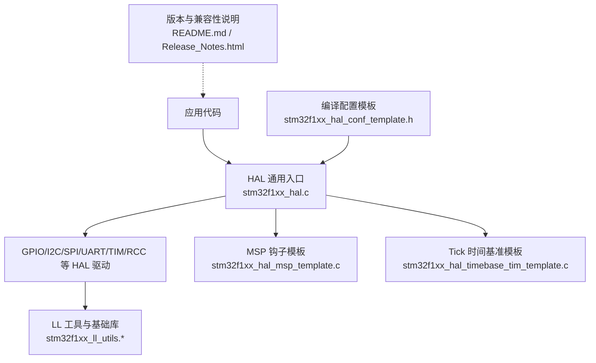
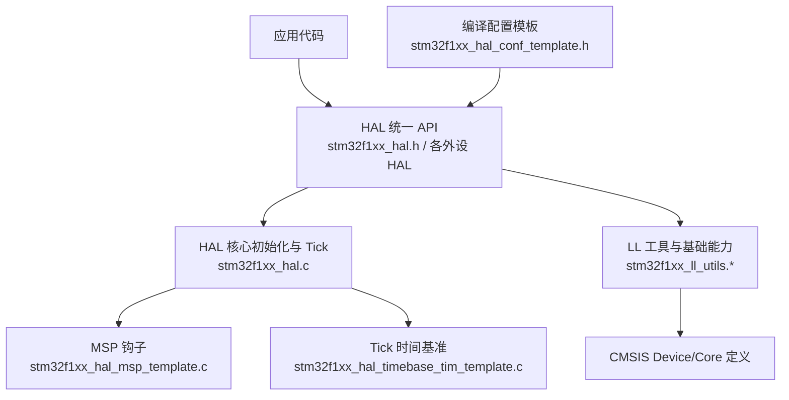
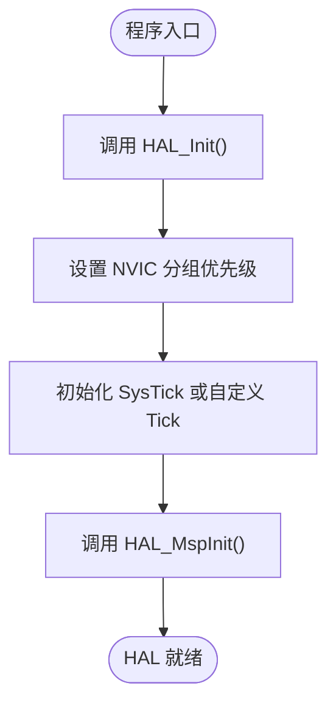
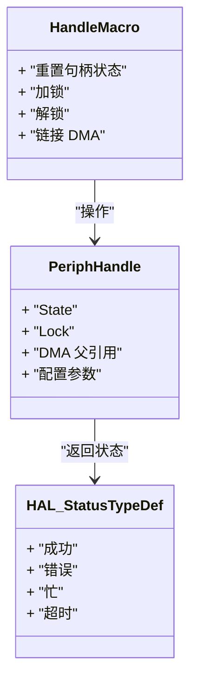
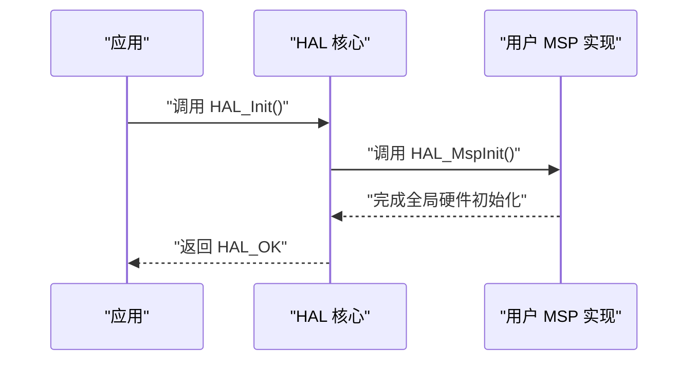
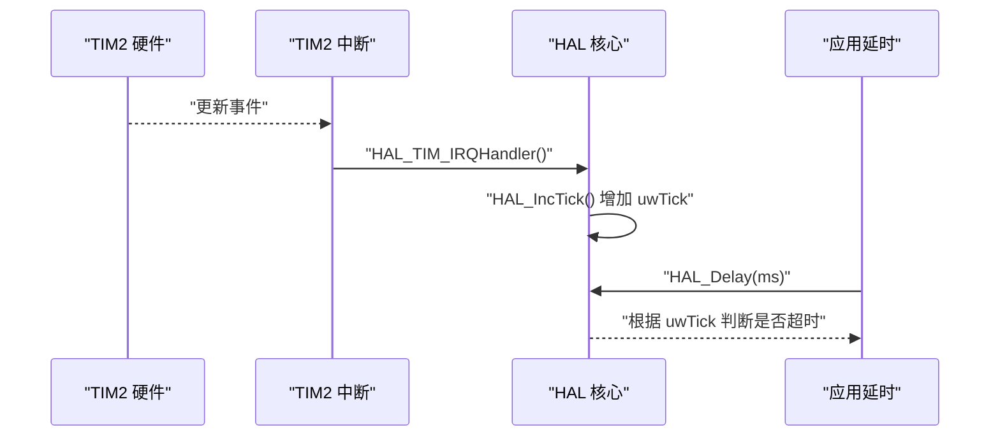
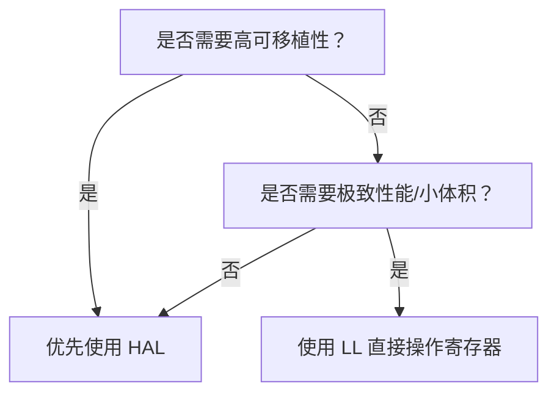
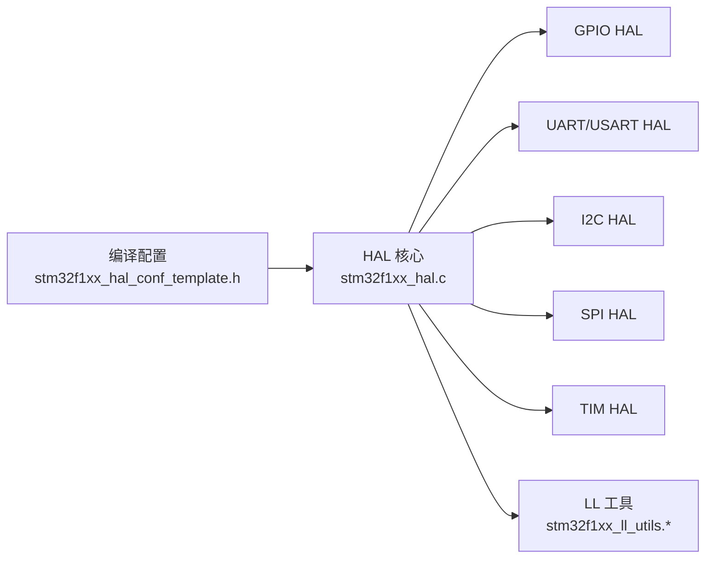
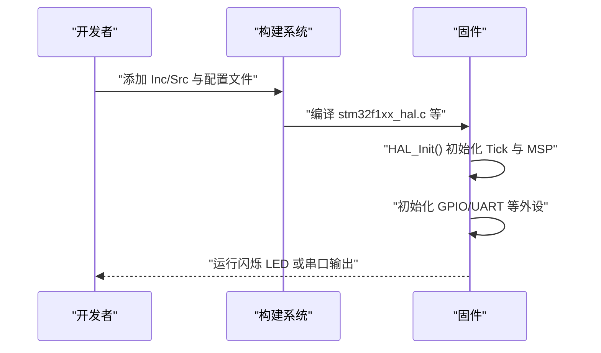

# 项目概述与快速开始

<cite>
**本文引用的文件**
- [README.md](file://README.md)
- [Release_Notes.html](file://Release_Notes.html)
- [stm32f1xx_hal.h](file://Inc/stm32f1xx_hal.h)
- [stm32f1xx_hal_def.h](file://Inc/stm32f1xx_hal_def.h)
- [stm32f1xx_hal_conf_template.h](file://Inc/stm32f1xx_hal_conf_template.h)
- [stm32f1xx_ll_utils.h](file://Inc/stm32f1xx_ll_utils.h)
- [stm32f1xx_ll_utils.c](file://Src/stm32f1xx_ll_utils.c)
- [stm32f1xx_hal.c](file://Src/stm32f1xx_hal.c)
- [stm32f1xx_hal_msp_template.c](file://Src/stm32f1xx_hal_msp_template.c)
- [stm32f1xx_hal_timebase_tim_template.c](file://Src/stm32f1xx_hal_timebase_tim_template.c)
</cite>

## 目录
1. [简介](#简介)
2. [项目结构](#项目结构)
3. [核心组件](#核心组件)
4. [架构总览](#架构总览)
5. [详细组件分析](#详细组件分析)
6. [依赖关系分析](#依赖关系分析)
7. [性能与裁剪建议](#性能与裁剪建议)
8. [快速开始：最小示例流程](#快速开始最小示例流程)
9. [故障排除指南](#故障排除指南)
10. [结论](#结论)

## 简介
本仓库是 STM32CubeF1 生态中的 **STM32F1xx HAL/LL Driver MCU Component**，提供面向 STM32F1 系列的 HAL（高级抽象层）与 LL（底层驱动）接口。它既可以作为完整 STM32CubeF1 MCU Package 的一部分被使用，也可以作为独立组件集成到已有工程中。

在 STM32Cube 生态中，HAL 负责可移植、统一的 API；LL 提供更接近寄存器、更轻量、原子化的操作。两者共同构成“HAL-LL”分层架构，使上层应用无需关心具体外设寄存器细节，同时保留对关键路径进行优化的空间。

**章节来源**
- [README.md:1-45](file://README.md#L1-L45)

## 项目结构
该仓库按功能模块划分，采用“每类外设一个头文件与源文件”的组织方式，并在 `Inc/Legacy` 与 `Src/Legacy` 中保留部分历史兼容代码。

**图示来源**
- [stm32f1xx_hal.c:1-120](file://Src/stm32f1xx_hal.c#L1-L120)
- [stm32f1xx_hal_msp_template.c:1-92](file://Src/stm32f1xx_hal_msp_template.c#L1-L92)
- [stm32f1xx_hal_timebase_tim_template.c:1-178](file://Src/stm32f1xx_hal_timebase_tim_template.c#L1-L178)
- [stm32f1xx_ll_utils.h:1-200](file://Inc/stm32f1xx_ll_utils.h#L1-L200)
- [stm32f1xx_hal_conf_template.h:1-200](file://Inc/stm32f1xx_hal_conf_template.h#L1-L200)
- [README.md:1-45](file://README.md#L1-L45)
- [Release_Notes.html:1-200](file://Release_Notes.html#L1-L200)

**章节来源**
- [stm32f1xx_hal.h:1-120](file://Inc/stm32f1xx_hal.h#L1-L120)
- [stm32f1xx_hal_def.h:1-120](file://Inc/stm32f1xx_hal_def.h#L1-L120)

## 核心组件
- HAL 通用入口与 Tick 机制：定义系统 Tick、中断优先级、初始化流程以及 MSP 钩子。
- HAL 配置模板：控制启用哪些外设模块、振荡器频率、RTOS 开关、回调注册、断言策略等。
- LL 工具库：提供设备签名、Flash 容量查询、SysTick 初始化、时钟辅助计算等低层能力。
- MSP 钩子模板：为全局与外设的硬件级初始化/反初始化提供扩展点。
- TimeBase 模板：以定时器实现 1ms Tick，供 HAL_Delay、超时等待等机制使用。

**章节来源**
- [stm32f1xx_hal.c:1-120](file://Src/stm32f1xx_hal.c#L1-L120)
- [stm32f1xx_hal_conf_template.h:1-200](file://Inc/stm32f1xx_hal_conf_template.h#L1-L200)
- [stm32f1xx_ll_utils.h:1-200](file://Inc/stm32f1xx_ll_utils.h#L1-L200)
- [stm32f1xx_ll_utils.c:1-120](file://Src/stm32f1xx_ll_utils.c#L1-L120)
- [stm32f1xx_hal_msp_template.c:1-92](file://Src/stm32f1xx_hal_msp_template.c#L1-L92)
- [stm32f1xx_hal_timebase_tim_template.c:1-178](file://Src/stm32f1xx_hal_timebase_tim_template.c#L1-L178)

## 架构总览
STM32F1xx HAL Driver 采用“应用 → HAL → LL → CMSIS Device/Core”的分层设计：

**图示来源**
- [stm32f1xx_hal.h:1-120](file://Inc/stm32f1xx_hal.h#L1-L120)
- [stm32f1xx_hal.c:1-120](file://Src/stm32f1xx_hal.c#L1-L120)
- [stm32f1xx_hal_msp_template.c:1-92](file://Src/stm32f1xx_hal_msp_template.c#L1-L92)
- [stm32f1xx_hal_timebase_tim_template.c:1-178](file://Src/stm32f1xx_hal_timebase_tim_template.c#L1-L178)
- [stm32f1xx_ll_utils.h:1-200](file://Inc/stm32f1xx_ll_utils.h#L1-L200)
- [stm32f1xx_hal_conf_template.h:1-200](file://Inc/stm32f1xx_hal_conf_template.h#L1-L200)

## 详细组件分析

### HAL 通用入口与 Tick 机制
- `HAL_Init()` 完成 Flash 预取、NVIC 分组优先级、SysTick 初始化，并调用用户实现的 `HAL_MspInit()`。
- Tick 默认基于 SysTick，频率可配置；`uwTick` 由 `HAL_IncTick()` 递增，供 `HAL_Delay()` 和各类超时等待使用。
- 若用户替换 Tick 源（例如使用 TIM），需要实现 `HAL_InitTick()`，并确保中断优先级高于可能阻塞 Tick 的外设中断。

**图示来源**
- [stm32f1xx_hal.c:1-120](file://Src/stm32f1xx_hal.c#L1-L120)
- [stm32f1xx_hal.h:1-120](file://Inc/stm32f1xx_hal.h#L1-L120)

**章节来源**
- [stm32f1xx_hal.c:1-120](file://Src/stm32f1xx_hal.c#L1-L120)
- [stm32f1xx_hal.h:1-120](file://Inc/stm32f1xx_hal.h#L1-L120)

### 句柄（Handle）与状态管理
- 每个外设通常有一个句柄结构体，用于保存实例化参数、状态、锁、DMA 关联等。
- 通用宏用于重置句柄状态、加解锁、链接 DMA 等，保证多实例与并发访问的基本安全。
- 错误码统一使用 `HAL_StatusTypeDef`，常见值包括成功、错误、忙、超时。

**图示来源**
- [stm32f1xx_hal_def.h:1-120](file://Inc/stm32f1xx_hal_def.h#L1-L120)

**章节来源**
- [stm32f1xx_hal_def.h:1-120](file://Inc/stm32f1xx_hal_def.h#L1-L120)

### MSP 钩子机制
- `HAL_MspInit()` 与 `HAL_MspDeInit()` 是弱函数，用户可在应用中重写，用于配置时钟树、中断、DMA、引脚复用等全局资源。
- 外设级别也提供 `HAL_PPP_MspInit()` 等占位符，实际使用时按外设替换 PPP 名称。

**图示来源**
- [stm32f1xx_hal.c:1-120](file://Src/stm32f1xx_hal.c#L1-L120)
- [stm32f1xx_hal_msp_template.c:1-92](file://Src/stm32f1xx_hal_msp_template.c#L1-L92)

**章节来源**
- [stm32f1xx_hal.c:1-120](file://Src/stm32f1xx_hal.c#L1-L120)
- [stm32f1xx_hal_msp_template.c:1-92](file://Src/stm32f1xx_hal_msp_template.c#L1-L92)

### Tick 时间基准与时钟链
- 默认 Tick 可由 SysTick 或定时器实现；模板中使用 TIM2 产生 1ms 中断，并在周期中断回调中调用 `HAL_IncTick()`。
- 当使用 RTOS 时，应谨慎修改 SysTick，避免与应用调度冲突。

**图示来源**
- [stm32f1xx_hal_timebase_tim_template.c:1-178](file://Src/stm32f1xx_hal_timebase_tim_template.c#L1-L178)
- [stm32f1xx_hal.c:1-120](file://Src/stm32f1xx_hal.c#L1-L120)

**章节来源**
- [stm32f1xx_hal_timebase_tim_template.c:1-178](file://Src/stm32f1xx_hal_timebase_tim_template.c#L1-L178)
- [stm32f1xx_hal.c:1-120](file://Src/stm32f1xx_hal.c#L1-L120)

### HAL 与 LL 的区别与选择
- HAL 提供跨系列一致的高级 API，适合应用开发、快速原型和移植。
- LL 提供更接近寄存器的原子操作，适合性能敏感路径、精简代码体积或替代 HAL 的部分功能。
- LL UTILS 提供 UID、Flash 大小、SysTick 初始化、时钟辅助等通用能力，可与 HAL 共存但保持独立。

**图示来源**
- [stm32f1xx_ll_utils.h:1-200](file://Inc/stm32f1xx_ll_utils.h#L1-L200)
- [Release_Notes.html:1-200](file://Release_Notes.html#L1-L200)

**章节来源**
- [stm32f1xx_ll_utils.h:1-200](file://Inc/stm32f1xx_ll_utils.h#L1-L200)
- [stm32f1xx_ll_utils.c:1-120](file://Src/stm32f1xx_ll_utils.c#L1-L120)
- [Release_Notes.html:1-200](file://Release_Notes.html#L1-L200)

### 版本兼容矩阵
根据仓库提供的兼容性信息，HAL Driver F1、CMSIS Device F1、CMSIS Core 必须保持一致版本组合。下表汇总了文档中列出的组合：

| HAL Driver F1 | CMSIS Device F1 | CMSIS Core       | 对应完整包 |
|---------------|-----------------|------------------|------------|
| v1.1.4        | v4.3.1          | v5.4.0_cm3       | v1.8.0     |
| v1.1.5        | v4.3.1          | v5.4.0_cm3       | v1.8.1     |
| v1.1.6        | v4.3.2          | v5.4.0_cm3       | v1.8.2     |
| v1.1.8        | v4.3.2          | v5.4.0_cm3       | v1.8.3     |
| v1.1.8        | v4.3.3          | v5.4.0_cm3       | v1.8.4     |

**章节来源**
- [README.md:25-45](file://README.md#L25-L45)

## 依赖关系分析
- HAL 核心依赖 CMSIS Device/Core 定义与中断向量表。
- HAL 通过配置宏决定包含哪些外设模块，从而减少未用代码。
- LL 工具与 HAL 解耦，可单独使用，也可被 HAL 内部调用。
- 应用通过 `stm32f1xx_hal_conf.h`（从模板复制）控制编译期特性。

**图示来源**
- [stm32f1xx_hal_conf_template.h:1-200](file://Inc/stm32f1xx_hal_conf_template.h#L1-L200)
- [stm32f1xx_hal.c:1-120](file://Src/stm32f1xx_hal.c#L1-L120)
- [stm32f1xx_ll_utils.h:1-200](file://Inc/stm32f1xx_ll_utils.h#L1-L200)

**章节来源**
- [stm32f1xx_hal_conf_template.h:1-200](file://Inc/stm32f1xx_hal_conf_template.h#L1-L200)
- [stm32f1xx_hal.c:1-120](file://Src/stm32f1xx_hal.c#L1-L120)

## 性能与裁剪建议
- 模块裁剪：在配置文件中仅启用需要的 HAL 模块，关闭不用的外设可降低编译体积与链接开销。
- Tick 优化：若不使用 `HAL_Delay()`，可使用 LL 的 `LL_Init1msTick()` 或直接管理 SysTick，减少 HAL 依赖。
- 中断优先级：确保 Tick 中断优先级高于可能长时间占用 CPU 的外设中断，避免延时抖动或死锁。
- 回调与锁：默认禁用回调注册可减少运行时开销；如需动态回调，请评估内存与中断上下文安全性。
- 断言：生产环境可关闭全量断言以减少分支，调试阶段开启以尽早发现参数错误。

[本节为通用指导，不直接分析具体源码]

## 快速开始：最小示例流程
以下流程适用于初学者将 STM32F1xx HAL Driver 集成到最小工程中：

1. 下载仓库或获取所需标签版本。
2. 将 `Inc` 与 `Src` 加入编译器包含路径与源文件列表。
3. 复制 `stm32f1xx_hal_conf_template.h` 为 `stm32f1xx_hal_conf.h`，并根据硬件调整 HSE/HSI 频率与启用必要模块。
4. 在工程中添加 `stm32f1xx_hal.c`、`stm32f1xx_hal_msp_template.c`、`stm32f1xx_hal_timebase_tim_template.c`。
5. 重写 `HAL_MspInit()`，至少完成必要的时钟与中断配置。
6. 编写 `main()`，先调用 `HAL_Init()`，再初始化外设并使用 `HAL_Delay()` 验证 Tick。
7. 若需更高性能或更小体积，可改用 LL 工具函数实现基础延时与时钟配置。

**图示来源**
- [stm32f1xx_hal_conf_template.h:1-200](file://Inc/stm32f1xx_hal_conf_template.h#L1-L200)
- [stm32f1xx_hal.c:1-120](file://Src/stm32f1xx_hal.c#L1-L120)
- [stm32f1xx_hal_msp_template.c:1-92](file://Src/stm32f1xx_hal_msp_template.c#L1-L92)
- [stm32f1xx_hal_timebase_tim_template.c:1-178](file://Src/stm32f1xx_hal_timebase_tim_template.c#L1-L178)

## 故障排除指南
- 编译找不到 `stm32f1xx_hal_conf.h`：确认已从模板复制并重命名。
- 延时不准确或卡住：检查 Tick 中断是否启用、优先级是否合理，或是否正确实现 `HAL_InitTick()`。
- 外设初始化无效：确认已在 MSP 中配置相应时钟、引脚复用与中断/DMA。
- 返回 `HAL_BUSY` 或 `HAL_TIMEOUT`：检查句柄状态是否已正确重置，避免重复初始化。
- 版本不匹配导致链接或行为异常：对照兼容性矩阵，确保 HAL、CMSIS Device、CMSIS Core 版本一致。
- 回调未触发：确认已启用回调注册宏，且中断服务程序正确调用对应 HAL 处理器。

**章节来源**
- [stm32f1xx_hal_def.h:1-120](file://Inc/stm32f1xx_hal_def.h#L1-L120)
- [stm32f1xx_hal_timebase_tim_template.c:1-178](file://Src/stm32f1xx_hal_timebase_tim_template.c#L1-L178)
- [stm32f1xx_hal_msp_template.c:1-92](file://Src/stm32f1xx_hal_msp_template.c#L1-L92)
- [README.md:25-45](file://README.md#L25-L45)

## 结论
STM32F1xx HAL Driver 提供了稳定、可移植、可扩展的嵌入式软件基座。通过 HAL-LL 分层、MSP 钩子、Tick 机制与模块化配置，开发者既能快速上手，也能在性能与体积上精细优化。建议初学者从 HAL 与模板入手，逐步理解句柄、状态与中断优先级；有经验的开发者则可利用 LL 工具与裁剪选项，打造更高效、更轻量的目标固件。

[本节为总结性内容，不直接分析具体源码]